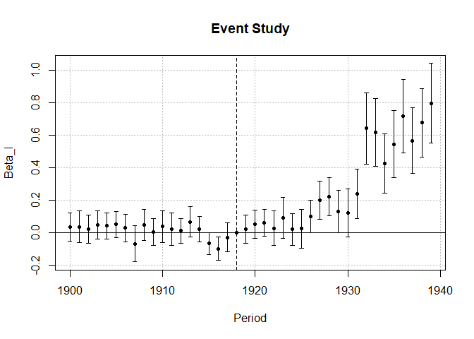
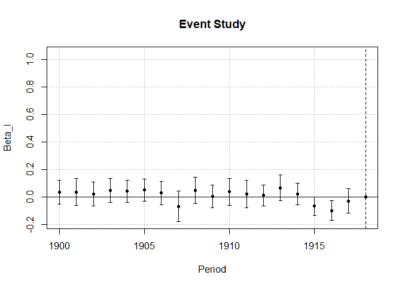
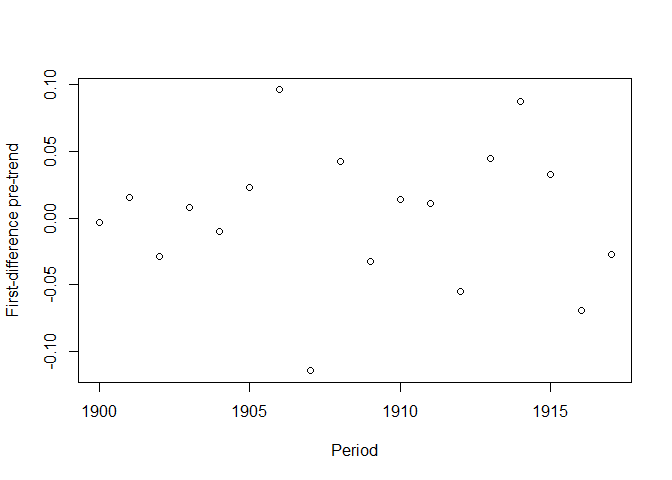
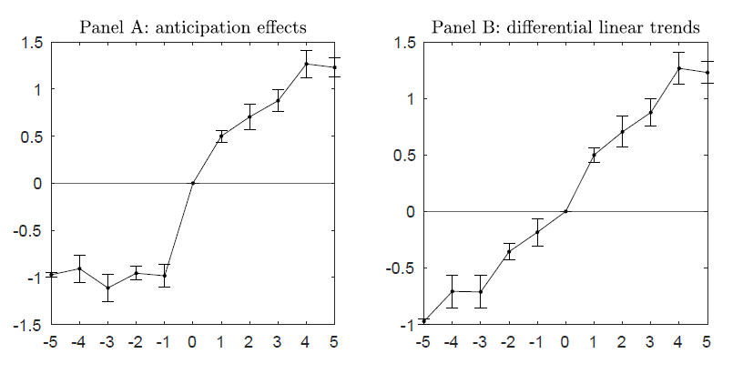
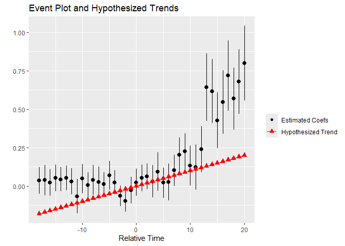
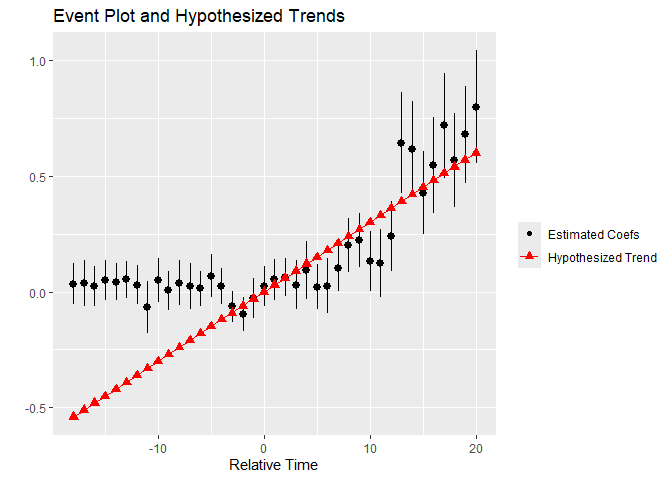
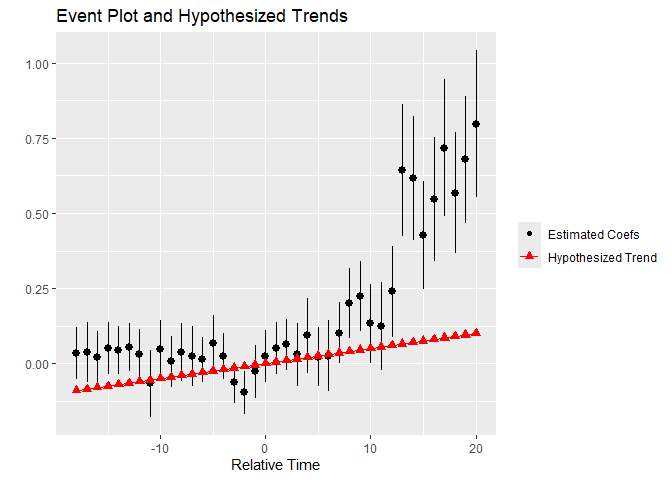
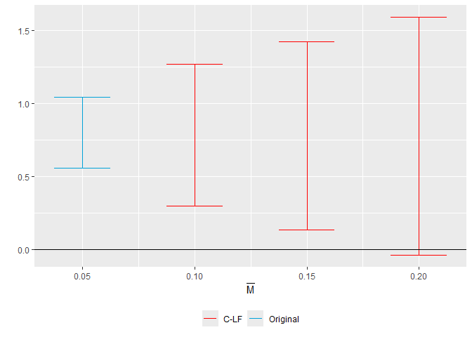
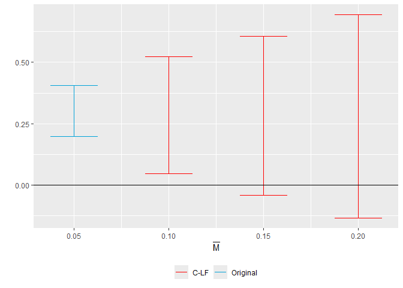

# The First Casualty of Statistics: Part Twenty Four
<big>**Differences-in-Differences I: Classical Design**</big>

<br/>
Jiří Fejlek

2026-10-10
<br/>

<br/> With differences-in-differences (DID), we make an important transition to causal inference for panel (longitudinal) data, in which the same individuals are followed as time progresses instead of having one "snapshot" observation for each individual. Since this is quite a big topic, we will split the presentation into several parts. We will start with the simplest design, in which the treatment is applied to all treated units at the same time and continues to be applied from that point on (the classical design), and we will build the theory from there. <br/>


## Table of Contents

- [Assumptions of DID](#assumptions-of-did)
- [Classical DID Design](#classical-did-design)
  - [Two-Way Fixed Effects Estimator](#two-way-fixed-effects-estimator)
  - [TWFE Event-Study Regression](#twfe-event-study-regression)
  - [Pre-Trend Test](#pre-trend-test)
- [References](#references)


``` r
library(tidyr)
library(dplyr)
library(tibble)
library(ggplot2)
library(patchwork)
library(dagitty)
library(ggdag)
library(modelsummary)
```

## Assumptions of DID

We will assume *panel data* with $`G`$ groups (e.g., individuals, firms,
states, counties, or municipalities) observed at $`T`$ periods (we will
use $`T`$ to denote time rather than treatment from now on). Let us
denote the treatment for group $`g`$ at time $`t`$ as $`D_{g,t}`$. We
denote the vector of treatments for group $`g`$ as $`D_g`$. We denote
potential outcomes for *cell* $`(g,t)`$ with the treatment vector
$`D_g = (d_1, d_2, \ldots, d_T)`$ as $`Y_{g,t}(d_1, d_2, \ldots, d_T)`$.
This notation allows us to encompass dynamic effects of lagged
treatments and anticipation effects of future treatments on the current
outcome (<span class="nocase">De Chaisemartin and d’Haultfoeuille</span>
2026).

We will make the following assumptions (<span class="nocase">De
Chaisemartin and d’Haultfoeuille</span> 2026):

- *Stable unit treatment value assumption* (potential outcomes only
  depend on $`g`$’s treatments, not on the treatment of other groups)
- *No anticipation* (potential outcomes do not depend on future
  treatments)
- *Initial conditions* (groups’ treatment before the first time period
  in the data does not affect their potential outcomes)
- *Independent groups* (vectors of potential outcomes of each group are
  mutually independent)

In addition, most of the time, we will assume the *parallel trend
assumption* (PT)
``` math
\tau_{g,t} = \mathbb{E}(Y_{g,t}(0) - Y_{g,t-1}(0))
```
is constant across $`g`$. The PT assumption requires that every group
experiences the same expected evolution of its never-treated potential
outcome. We should note here that we are explicitly using a
*model-based* (<span class="nocase">De Chaisemartin and
d’Haultfoeuille</span> 2026) perspective of inference, in which we
assume that potential outcomes are random (and hence the expectation in
the formula) rather than treatment assignments (which, we know from Part
Four, as the *Neyman repeated-sampling inference*).

Naturally, the PT assumption is a very strong assumption. We should note that many
results require the condition to hold only *on average*. For example,
the classical design we discuss in this section requires a slightly
weaker assumption (<span class="nocase">De Chaisemartin and
d’Haultfoeuille</span> 2026)
``` math
\mathbb{E}\left[ \frac{1}{|G_\text{control}|}  \sum_{g \in G_\text{control}} \mathbb{E}(Y_{g,t}(0) - Y_{g,t-1}(0)) \right] = \mathbb{E}\left[ \frac{1}{|G_\text{treated}|}  \sum_{g \in G_\text{treated}} \mathbb{E}(Y_{g,t}(0) - Y_{g,t-1}(0)) \right].
```

## Classical DID Design

The first “classical DID design” (<span class="nocase">De Chaisemartin
and d’Haultfoeuille</span> 2026) we will investigate here is the one
with binary *absorbing* (treated individual stays treated) treatment
with no variation in treatment timing, i.e.,
``` math
D_{g,t} = I(t>T_0)I(g \in G_\text{treated}),
```
where $`T_0 \geq 1`$. Let’s denote by $`1_t`$
the vector of $`t`$ ones and by $`0_t`$ the vector of $`t`$ zeros. The
individual treatment effect after $`t - T_0`$ periods is
``` math
\tau_{g,t} = \mathbb{E}(Y_{g,t}(0_{T_0},1_{t-T_0}) - Y_{g,t}(0))
```
We define average treatment effect on treated (ATT) as
(<span class="nocase">De Chaisemartin and d’Haultfoeuille</span> 2026)
``` math
\text{ATT} = \frac{1}{G_1T_1} \sum_{(g,t): D_{g,t} = 1} \tau_{g,t},
```
where $`G_1 = |G_\text{treated}|`$ is the number of treated in the
population and $`T_1 = T - T_0`$ is the number of treated periods. We
can also define ATT for $`l`$ periods (<span class="nocase">De
Chaisemartin and d’Haultfoeuille</span> 2026)
``` math
\text{ATT}_l =  \sum_{g: D_{g} = 1} \tau_{g,t} \mathbb{E}(Y_{g,T_0 + l}(0_{T_0},1_{l}) - Y_{g,T_0+l}(0_{T_0 + l})).
```

Then,
``` math
\text{ATT} = \frac{1}{T_1} \sum_{l = 1}^{T_1} \text{ATT}_l.
```

### Two-Way Fixed Effects Estimator

Let’s assume a linear outcome model
``` math
Y_{g,t} = \alpha_g + \gamma_t + \beta D_{g,t} + \varepsilon_{g,t}
```
known as the *two-way fixed effects estimator* (TWFE). Fixed effects
means that groups $`g`$ and periods $`t`$ enter the model as *fixed*
(factor) variables. Since we model both the effect across groups and the
time trend, the model is two-way.

It can be shown that the OLS estimate of $`\beta`$ meets
(<span class="nocase">De Chaisemartin and d’Haultfoeuille</span> 2026)
``` math
\hat\beta_\text{TWFE} = \left[\frac{1}{G_1 T_1} \sum_{g: D_g = 1, t> T_0} Y_{g,t} - \frac{1}{G_1 T_0} \sum_{g: D_g = 1, t\leq T_0} Y_{g,t}\right] - \left[\frac{1}{G_1 T_1} \sum_{g: D_g = 0, t> T_0} Y_{g,t} - \frac{1}{G_1 T_0} \sum_{g: D_g = 0, t\leq T_0} Y_{g,t}\right],
```
i.e., $`\hat\beta_\text{TWFE}`$ is a *difference-in-differences*
estimator: we compute the difference in average outcome pre- and
post-treatment for the treated group and compare it with the difference
in average outcome pre- and post-treatment for the control group.

The causal interpretation of $`\hat\beta_\text{TWFE}`$ can be given as
follows (<span class="nocase">De Chaisemartin and d’Haultfoeuille</span>
2026).

$`\mathbb{E}\hat\beta_\text{TWFE} = \text{ATT}`$ *under the no
anticipation assumption and the (average) parallel trends assumption.*

Let’s demonstrate the results on the *moser_voena* dataset (Moser and
Voena 2012). The authors studied the effect of the compulsory licensing
of German chemical patents under the Trading with the Enemy Act (TWEA)
on US domestic invention.

``` r
moser_voena <- read.csv("C:/Users/elini/Desktop/first casualty/moser_voena.csv")
head(moser_voena[,c(1,2,3,4,5,6)])
```

    ##   year patents subclass twea treatmentgroup post
    ## 1 1916       0       65    0              0    0
    ## 2 1932       1       65    0              0    1
    ## 3 1926       0       65    0              0    1
    ## 4 1925       0       65    0              0    1
    ## 5 1920       2       65    0              0    1
    ## 6 1922       0       65    0              0    1

The variables we will need for the fit are as follows
(<span class="nocase">De Chaisemartin and d’Haultfoeuille</span> 2026).

- **year**: time period variable
- **patents**: the number of patents in subclass $`g`$ and year $`t`$
  (outcome)
- **subclass**: group variable
- **twea**: treatment status $`D_{g,t}`$
- **treatmentgroup**: (1: treated group, 0: control group)
- **post**: an indicator for all years after 1919 ($`T_0`$)

We will fit the two-way fixed effects model using the package *fixest*
(<https://cran.r-project.org/web/packages/fixest/index.html>).

``` r
library(fixest)
summary(feols(patents ~ twea |  year + subclass, cluster ~  subclass, data = moser_voena))
```

    ## OLS estimation, Dep. Var.: patents
    ## Observations: 289,920
    ## Fixed-effects: year: 40,  subclass: 7,248
    ## Standard-errors: Clustered (subclass) 
    ##      Estimate Std. Error t value  Pr(>|t|)    
    ## twea 0.288262   0.038887 7.41278 1.377e-13 ***
    ## ---
    ## Signif. codes:  0 '***' 0.001 '**' 0.01 '*' 0.05 '.' 0.1 ' ' 1
    ## RMSE: 0.977862     Adj. R2: 0.465316
    ##                  Within R2: 9.571e-4

We observe that, according to the TWFE estimator, the number of patents
increased. Let’s check whether the coefficient equals the
differences-in-differences estimator.

``` r
mean(moser_voena$patents[moser_voena$post == 1 & moser_voena$treatmentgroup == 1]) - mean(moser_voena$patents[moser_voena$post == 0 & moser_voena$treatmentgroup == 1]) -
(
mean(moser_voena$patents[moser_voena$post == 1 & moser_voena$treatmentgroup == 0])-   mean(moser_voena$patents[moser_voena$post == 0 & moser_voena$treatmentgroup == 0])
)
```

    ## [1] 0.2882615

Indeed, it is.

### TWFE Event-Study Regression

Alternatively, we can use the following regression model
``` math
Y_{g,t} = \alpha_g + \gamma_t + \sum_{l = -T_0 + 1, l \neq 0}^{T_1}\beta_l I(t = T_0 + l)I(g \in G_\text{treat}) + \varepsilon_{g,t},
```
where $`I(t = T_0 + l)D_{g}`$ is an indicator that $`q`$ was treated for
$`l`$ periods. This regression is often referred to as TWFE event-study
regression (<span class="nocase">De Chaisemartin and
d’Haultfoeuille</span> 2026). The estimates of coefficients $`\beta_l`$
meet
``` math
\hat \beta_{l,\text{TWFE}} = \frac{1}{G_1} \sum_{g \in G_\text{treated}} (Y_{g, T_0 + l} - Y_{g,T_0}) - \frac{1}{G_0} \sum_{g \in G_\text{control}} (Y_{g, T_0 + l} - Y_{g,T_0}),
```
i.e., $`\hat \beta_l`$ i a DID estimator that compares evolutions of
outcomes from $`T_0`$ to $`T_{0 +l}`$. Consequently,
(<span class="nocase">De Chaisemartin and d’Haultfoeuille</span> 2026)

$`\mathbb{E}\hat \beta_{l,\text{TWFE}} = \text{ATT}_l`$ *under the no
anticipation assumption and the (average) parallel trends assumptions
for all* $`l \in \{1, \ldots T_1\}`$.

Let’s estimate the TWFE ES model. We do not have to define the
appropriate indicator variables manually in *fixest*; instead, we can
write the model as follows.

``` r
twfe_es <- feols(patents  ~ i(year, treatmentgroup, ref = 1918) | year + subclass, cluster ~  subclass, data = moser_voena)
summary(twfe_es)
```

    ## OLS estimation, Dep. Var.: patents
    ## Observations: 289,920
    ## Fixed-effects: year: 40,  subclass: 7,248
    ## Standard-errors: Clustered (subclass) 
    ##                            Estimate Std. Error   t value   Pr(>|t|)    
    ## year::1900:treatmentgroup  0.034495   0.044340  0.777970 4.3661e-01    
    ## year::1901:treatmentgroup  0.037636   0.050226  0.749335 4.5368e-01    
    ## year::1902:treatmentgroup  0.022032   0.044116  0.499410 6.1751e-01    
    ## year::1903:treatmentgroup  0.051091   0.044239  1.154883 2.4818e-01    
    ## year::1904:treatmentgroup  0.043196   0.040330  1.071078 2.8417e-01    
    ## year::1905:treatmentgroup  0.052931   0.040649  1.302149 1.9291e-01    
    ## year::1906:treatmentgroup  0.029927   0.042828  0.698771 4.8472e-01    
    ## year::1907:treatmentgroup -0.066179   0.056872 -1.163644 2.4461e-01    
    ## year::1908:treatmentgroup  0.048198   0.048260  0.998714 3.1797e-01    
    ## year::1909:treatmentgroup  0.005911   0.042835  0.137994 8.9025e-01    
    ## year::1910:treatmentgroup  0.038690   0.049034  0.789060 4.3010e-01    
    ## year::1911:treatmentgroup  0.024781   0.050856  0.487278 6.2608e-01    
    ## year::1912:treatmentgroup  0.013538   0.038389  0.352641 7.2437e-01    
    ## year::1913:treatmentgroup  0.068700   0.046862  1.466008 1.4269e-01    
    ## year::1914:treatmentgroup  0.023706   0.039432  0.601186 5.4773e-01    
    ## year::1915:treatmentgroup -0.063575   0.034334 -1.851675 6.4113e-02 .  
    ## year::1916:treatmentgroup -0.096375   0.036719 -2.624673 8.6914e-03 ** 
    ## year::1917:treatmentgroup -0.027034   0.044596 -0.606193 5.4441e-01    
    ## year::1919:treatmentgroup  0.023520   0.044417  0.529532 5.9645e-01    
    ## year::1920:treatmentgroup  0.052021   0.044239  1.175909 2.3967e-01    
    ## year::1921:treatmentgroup  0.062562   0.042763  1.462986 1.4351e-01    
    ## year::1922:treatmentgroup  0.029369   0.053509  0.548865 5.8311e-01    
    ## year::1923:treatmentgroup  0.093027   0.063435  1.466485 1.4256e-01    
    ## year::1924:treatmentgroup  0.021701   0.050222  0.432113 6.6567e-01    
    ## year::1925:treatmentgroup  0.025670   0.060922  0.421354 6.7351e-01    
    ## year::1926:treatmentgroup  0.101273   0.051430  1.969158 4.8973e-02 *  
    ## year::1927:treatmentgroup  0.201265   0.059083  3.406476 6.6165e-04 ***
    ## year::1928:treatmentgroup  0.224268   0.059459  3.771812 1.6336e-04 ***
    ## year::1929:treatmentgroup  0.132399   0.066576  1.988681 4.6774e-02 *  
    ## year::1930:treatmentgroup  0.122871   0.074765  1.643442 1.0033e-01    
    ## year::1931:treatmentgroup  0.239397   0.076989  3.109480 1.8814e-03 ** 
    ## year::1932:treatmentgroup  0.642216   0.111673  5.750889 9.2386e-09 ***
    ## year::1933:treatmentgroup  0.616588   0.105739  5.831254 5.7376e-09 ***
    ## year::1934:treatmentgroup  0.426835   0.092096  4.634665 3.6377e-06 ***
    ## year::1935:treatmentgroup  0.545759   0.105138  5.190872 2.1500e-07 ***
    ## year::1936:treatmentgroup  0.717324   0.115940  6.187010 6.4652e-10 ***
    ## year::1937:treatmentgroup  0.567378   0.102555  5.532412 3.2688e-08 ***
    ## year::1938:treatmentgroup  0.677724   0.107476  6.305792 3.0356e-10 ***
    ## year::1939:treatmentgroup  0.797433   0.124031  6.429325 1.3631e-10 ***
    ## ---
    ## Signif. codes:  0 '***' 0.001 '**' 0.01 '*' 0.05 '.' 0.1 ' ' 1
    ## RMSE: 0.976988     Adj. R2: 0.4662  
    ##                  Within R2: 0.002744

``` r
iplot(twfe_es, c
      main = "Event Study",
      xlab = "Period",
      ylab = "Beta_l")
```

<!-- -->

We can check our formulas.

``` r
ate_l <- numeric(length(1919:1939))

for (i in 1919:1939){
  ate_l[i-1918] <- 
  mean(moser_voena$patents[moser_voena$treatmentgroup == 1 & moser_voena$year == i]) -
  mean(moser_voena$patents[moser_voena$treatmentgroup == 1 & moser_voena$year == 1918]) -
  (
  mean(moser_voena$patents[moser_voena$treatmentgroup == 0 & moser_voena$year == i])-  
  mean(moser_voena$patents[moser_voena$treatmentgroup == 0 & moser_voena$year == 1918])
  )
}

names(ate_l) <- 1919:1939
ate_l
```

    ##       1919       1920       1921       1922       1923       1924       1925 
    ## 0.02352017 0.05202133 0.06256200 0.02936921 0.09302662 0.02170139 0.02566964 
    ##       1926       1927       1928       1929       1930       1931       1932 
    ## 0.10127315 0.20126488 0.22426835 0.13239914 0.12287120 0.23939732 0.64221644 
    ##       1933       1934       1935       1936       1937       1938       1939 
    ## 0.61658813 0.42683532 0.54575893 0.71732391 0.56737765 0.67772404 0.79743304

We see that we got the same values.

### Pre-Trend Test

The values for $`l < 0`$ also have an useful interpretation; it can be
shown that (<span class="nocase">De Chaisemartin and
d’Haultfoeuille</span> 2026)

$`\mathbb{E}\hat \beta_{l,\text{TWFE}} = 0`$ *under the no anticipation
assumption and the (average) parallel trends assumption for all*
$`l < T_0`$.

This is known as the *pre-trend test* (<span class="nocase">De
Chaisemartin and d’Haultfoeuille</span> 2026). Provided that the
no-anticipation assumption and the (average) parallel-trends assumption
hold, the differences between the treated and control groups before
treatment should be zero in expectation. Looking back at our event-study
plot, the pre-trend test is satisfied for our dataset.

``` r
pre_l <- numeric(length(1900:1917))

for (i in 1900:1917){
  pre_l[i-1899] <- 
  mean(moser_voena$patents[moser_voena$treatmentgroup == 1 & moser_voena$year == i]) -
  mean(moser_voena$patents[moser_voena$treatmentgroup == 1 & moser_voena$year == 1918]) -
  (
  mean(moser_voena$patents[moser_voena$treatmentgroup == 0 & moser_voena$year == i])-  
  mean(moser_voena$patents[moser_voena$treatmentgroup == 0 & moser_voena$year == 1918])
  )
}

names(pre_l) <- 1900:1917
pre_l
```

    ##         1900         1901         1902         1903         1904         1905 
    ##  0.034494874  0.037636409  0.022032077  0.051091270  0.043196098  0.052930721 
    ##         1906         1907         1908         1909         1910         1911 
    ##  0.029927249 -0.066178902  0.048197751  0.005911045  0.038690476  0.024780919 
    ##         1912         1913         1914         1915         1916         1917 
    ##  0.013537533  0.068700397  0.023706184 -0.063574735 -0.096374835 -0.027033730

``` r
iplot(twfe_es, 
      main = "Event Study",
      xlab = "Period",
      ylab = "Beta_l",
      xlim = c(1900,1918))
```

<!-- -->

Alternatively, we can compute *first-difference pre-trend estimators*

``` math
\hat \beta_{l,\text{FD}} = \frac{1}{G_1} \sum_{g \in G_\text{treated}} (Y_{g, T_0 + l} - Y_{g,T_0+l+1}) - \frac{1}{G_0} \sum_{g \in G_\text{control}} (Y_{g, T_0 + l} - Y_{g,T_0+l+1})
```
for $`l \in\{-1, \ldots, -(T_0-1)\}.`$

``` r
pre_fd <- numeric(length(1900:1917))

for (i in 1900:1917){
  pre_fd[i-1899] <- 
  mean(moser_voena$patents[moser_voena$treatmentgroup == 1 & moser_voena$year == i]) -
  mean(moser_voena$patents[moser_voena$treatmentgroup == 1 & moser_voena$year == i+1]) -
  (
  mean(moser_voena$patents[moser_voena$treatmentgroup == 0 & moser_voena$year == i])-  
  mean(moser_voena$patents[moser_voena$treatmentgroup == 0 & moser_voena$year == i+1])
  )
}

names(pre_fd) <- 1900:1917
pre_fd
```

    ##         1900         1901         1902         1903         1904         1905 
    ## -0.003141534  0.015604332 -0.029059193  0.007895172 -0.009734623  0.023003472 
    ##         1906         1907         1908         1909         1910         1911 
    ##  0.096106151 -0.114376653  0.042286706 -0.032779431  0.013909557  0.011243386 
    ##         1912         1913         1914         1915         1916         1917 
    ## -0.055162864  0.044994213  0.087280919  0.032800099 -0.069341104 -0.027033730

``` r
plot(1900:1917, pre_fd, xlab= 'Period', ylab = 'First-difference pre-trend')
```

<!-- -->

We can compute $`\hat\beta_{l,\text{TWFE}}`$ fro the first differences
as (<span class="nocase">De Chaisemartin and d’Haultfoeuille</span>
2026)
``` math
\hat\beta_{l,\text{TWFE}} =  \sum_{k = l}^{-1} \hat \beta_{l,\text{FD}}
```

``` r
pre_l2 <- numeric(length(pre_l))
for (i in 1:length(pre_l)){
  pre_l2[i] <- sum(pre_fd[i:(length(pre_fd))])
}

rbind(pre_l, pre_l2)
```

    ##              1900       1901       1902       1903      1904       1905
    ## pre_l  0.03449487 0.03763641 0.02203208 0.05109127 0.0431961 0.05293072
    ## pre_l2 0.03449487 0.03763641 0.02203208 0.05109127 0.0431961 0.05293072
    ##              1906       1907       1908        1909       1910       1911
    ## pre_l  0.02992725 -0.0661789 0.04819775 0.005911045 0.03869048 0.02478092
    ## pre_l2 0.02992725 -0.0661789 0.04819775 0.005911045 0.03869048 0.02478092
    ##              1912      1913       1914        1915        1916        1917
    ## pre_l  0.01353753 0.0687004 0.02370618 -0.06357474 -0.09637483 -0.02703373
    ## pre_l2 0.01353753 0.0687004 0.02370618 -0.06357474 -0.09637483 -0.02703373

The following figure from (<span class="nocase">De Chaisemartin and
d’Haultfoeuille</span> 2026) illustrates two common pre-trend
coefficient patterns observed in the data. The first subfigure shows a
case in which the no-anticipation assumption is violated: pre-trend
coefficients are nonzero because the treatment groups are already
affected by their upcoming treatments. Thus, one could recompute the
estimators by redefining the treatment start date to the date the
treatment was announced (<span class="nocase">De Chaisemartin and
d’Haultfoeuille</span> 2026). The second subfigure shows a linear trend
in pre-trend coefficients. This indicates differential linear trends
between the treated and control groups and hence, the parallel trend
assumption is not met. To alleviate this, one may allow for
group-specific linear trends in the estimation (<span class="nocase">De
Chaisemartin and d’Haultfoeuille</span> 2026).

<!-- -->

While we can partially test the no-anticipation and parallel-trend
assumptions using the pre-trend test, we must keep in mind that we can
test for parallel trends only before the treatment, not after. The fact
that parallel trends are met before the treatment does not imply that
the trends remain parallel. One should thus assess whether there were
other factors (aka unobserved confounders) which could cause
differential trends (<span class="nocase">De Chaisemartin and
d’Haultfoeuille</span> 2026).

Another factor that we have to keep in mind is that pre-trend tests are
often under-powered (Roth 2022). To investigate this, we can use the
*pretrends* package (<https://github.com/jonathandroth/pretrends>),
which computes the power of the pre-trends test for detecting a
hypothetical violation of parallel trends.

Let us assume a linear trend with the slope 0.01.

``` r
library(pretrends)
pretrends <- pretrends(
  betahat = summary(twfe_es)$coefficients,     # betas
  sigma = summary(twfe_es)$cov.scaled,         # covariance matrix
  tVec = 1900:1938-1918,                       # periods
  referencePeriod = 0,                         # T_0
  deltatrue = 0.01 * (1900:1938-1918)          # hypothetical linear trend
)

pretrends$df_power
```

    ##       Power Bayes.Factor Likelihood.Ratio
    ## 1 0.9908562   0.01285845     1.690474e-20

``` r
pretrends$event_plot
```

<!-- -->

We see from the results that, in this scenario, the power of the
pre-trend test (given the estimated standard errors from our data) is
over 0.9, and we also see from the plot that this linear trend is
nowhere near strong enough to explain the difference between the treated
group and the control group.

A trend strong enough would likely be detected.

``` r
pretrends <- pretrends(
  betahat = summary(twfe_es)$coefficients,     # betas
  sigma = summary(twfe_es)$cov.scaled,         # covariance matrix
  tVec = 1900:1938-1918,                       # periods
  referencePeriod = 0,                         # T_0
  deltatrue = 0.030*(1900:1938-1918)           # hypothetical linear trend
)

pretrends$df_power
```

    ##   Power Bayes.Factor Likelihood.Ratio
    ## 1     1            0    3.148427e-132

``` r
pretrends$event_plot
```

<!-- -->

Looking at it from the other way: the trend that would likely not be
rejected by the pre-trend test is very weak.

``` r
pretrends <- pretrends(
  betahat = summary(twfe_es)$coefficients,     # betas
  sigma = summary(twfe_es)$cov.scaled,         # covariance matrix
  tVec = 1900:1938-1918,                       # periods
  referencePeriod = 0,                         # T_0
  deltatrue = 0.005*(1900:1938-1918)           # hypothetical linear trend
)

pretrends$df_power
```

    ##       Power Bayes.Factor Likelihood.Ratio
    ## 1 0.6745586    0.4573887     1.323584e-07

``` r
pretrends$event_plot
```

<!-- -->

Our result seems quite robust. But this is not necessarily the case.
Since the effect of treatment is observed to be significant only after a
relatively long period of time, we need a comparatively small violation
of the parallel trend assumption to invalidate the inference (the effect 
is multiplicative, e.g., the violation for the second period will be twice 
as larger as for the first period). To demonstrate this, we will use the package *HonestDiD*
(<https://github.com/asheshrambachan/HonestDiD?tab=readme-ov-file#honestdid>)
based on (Rambachan and Roth 2023).

We will investigate the sensitivity analysis of the treatment effect for
the year 1939. We consider a post-treatment violation of parallel trends that is at most
$`\bar M`$ large, where  $`\bar M`$ is the maximum violation of parallel trends in 
the pre-treatment period (between consecutive periods).

``` r
library(HonestDiD)
l_vec <- rep(0, length(1919:1939))    # select the last coefficient
l_vec[length(1919:1939)] <- 1

delta_rm_results  <- createSensitivityResults_relativeMagnitudes(
                                    betahat = summary(twfe_es)$coefficients,  # betas
                                    sigma =   summary(twfe_es)$cov.scaled,    # covariance matrix
                                    numPrePeriods = length(1900:1917),        # num. of pre-treatment betas
                                    numPostPeriods = length(1919:1939),       # num. of post-treatment betas
                                    Mbarvec = c(0.1, 0.15, 0.2),              # values of Mbar
                                    l_vec = l_vec,
                                    parallel =  TRUE 
                                    )

delta_rm_results
```

    ## # A tibble: 3 × 5
    ##        lb    ub method Delta    Mbar
    ##     <dbl> <dbl> <chr>  <chr>   <dbl>
    ## 1  0.295   1.27 C-LF   DeltaRM  0.1 
    ## 2  0.132   1.42 C-LF   DeltaRM  0.15
    ## 3 -0.0422  1.59 C-LF   DeltaRM  0.2

``` r
originalResults <- constructOriginalCS(
  betahat = summary(twfe_es)$coefficients, 
  sigma = summary(twfe_es)$cov.scaled,
  numPrePeriods  = length(1900:1917), 
  numPostPeriods = length(1919:1939),
  l_vec = l_vec
  )

createSensitivityPlot_relativeMagnitudes(delta_rm_results, originalResults)
```

<!-- -->

We see that we need a violation of about 20% of the observed
violations in the pre-treatment period for the effect to be not
significant. We can also perform a sensitivity analysis on linear
combinations of $`\hat\beta_{l,\text{TWFE}}`$, such as the ATT estimate.

``` r
l_vec <- rep(1, length(1919:1939))/length(1919:1939)  # ATT can be estimated by average of ATT_l

delta_rm_results  <- createSensitivityResults_relativeMagnitudes(
                                    betahat = summary(twfe_es)$coefficients,  # betas
                                    sigma =   summary(twfe_es)$cov.scaled,    # covariance matrix
                                    numPrePeriods = length(1900:1917),        # num. of pre-treatment betas
                                    numPostPeriods = length(1919:1939),       # num. of post-treatment betas
                                    Mbarvec = c(0.1, 0.15, 0.2),              # values of Mbar
                                    l_vec = l_vec,
                                    parallel =  TRUE 
                                    )

originalResults <- constructOriginalCS(
  betahat = summary(twfe_es)$coefficients, 
  sigma = summary(twfe_es)$cov.scaled, 
  numPrePeriods  = length(1900:1917), 
  numPostPeriods = length(1919:1939), 
  l_vec = l_vec
  )

createSensitivityPlot_relativeMagnitudes(delta_rm_results, originalResults)
```

<!-- -->

## References

<div id="refs" class="references csl-bib-body hanging-indent">

<div id="ref-de2026causal" class="csl-entry">

<span class="nocase">De Chaisemartin, Clément, and Xavier
d’Haultfoeuille</span>. 2026. *Causal Inference with
Differences-in-Differences: Credible Answers to Hard Questions*.
Princeton University Press.

</div>

<div id="ref-moser2012compulsory" class="csl-entry">

Moser, Petra, and Alessandra Voena. 2012. “Compulsory Licensing:
Evidence from the Trading with the Enemy Act.” *American Economic
Review* 102 (1): 396–427.

</div>

<div id="ref-rambachan2023more" class="csl-entry">

Rambachan, Ashesh, and Jonathan Roth. 2023. “A More Credible Approach to
Parallel Trends.” *Review of Economic Studies* 90 (5): 2555–91.

</div>

<div id="ref-roth2022pretest" class="csl-entry">

Roth, Jonathan. 2022. “Pretest with Caution: Event-Study Estimates After
Testing for Parallel Trends.” *American Economic Review: Insights* 4
(3): 305–22.

</div>

</div>
