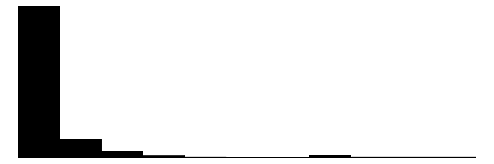
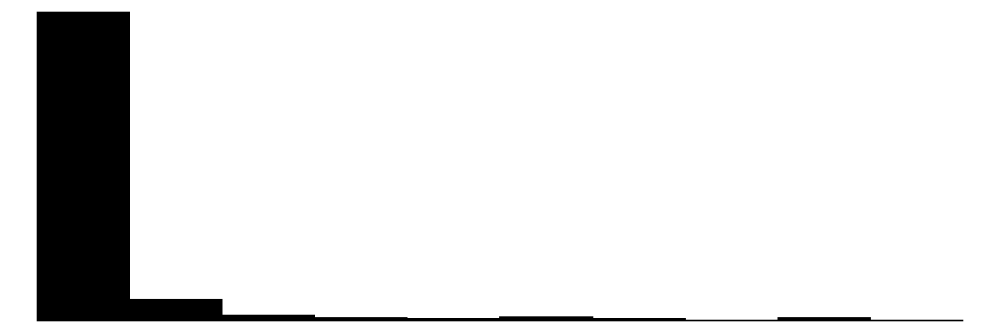
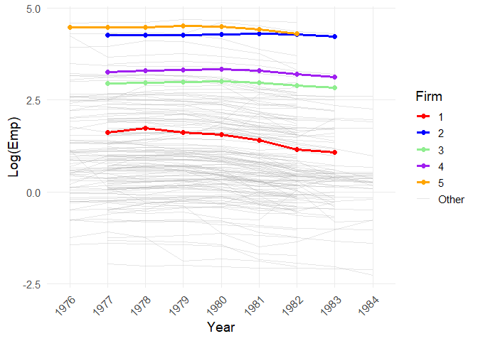

# The First Casualty of Statistics: Part Twenty Five
<big>**Differences-in-Differences II: TWFE and Lagged Dependent Variables**</big>

<br/>
Jiří Fejlek

2026-10-16
<br/>

<br/> In the previous part, we introduced the classical
difference-in-differences design and the two-way fixed-effects estimator
(TWFE). The TWFE is the workhorse model in econometrics for analyzing
panel data because of its simplicity. Unfortunately, as with 2SLS, TWFE
does not have a causal interpretation except in very narrow cases (e.g.,
under the unconditional parallel trend assumption). One notorious
example of this is the Nickell bias, which arises in fixed effects
models when they are used to estimate the effect of lagged dependent
variables. <br/>


## Table of Contents

- [Nickell Bias](#nickell-bias)
- [Anderson-Hsiao IV Estimator](#anderson-hsiao-iv-estimator)
- [Arellano and Bond Estimator](#arellano-and-bond-estimator)
- [System GMM Estimator](#system-gmm-estimator)
- [EmplUK Dataset](#empluk-dataset)
- [References](#references)

``` r
library(tidyr)
library(dplyr)
library(tibble)
library(ggplot2)
library(patchwork)
library(dagitty)
library(ggdag)
library(modelsummary)
library(fixest)
library(pretrends)
library(HonestDiD)
library(WeightIt)
library(cobalt)
```

## Nickell Bias

Let’s assume the true generating process
``` math
Y_{g,t} = \rho Y_{g,t-1} + \varepsilon_{g,t},
```
where $`\varepsilon_{g,t} = \mu_g + \nu_{g,t}`$, and where
$`\mu_g \sim N(0,\sigma^2_\mu)`$ are individual fixed effects and
$`\nu_{g,t} \sim N(0,\sigma^2_\nu)`$ are random errors. Our goal is to
estimate the parameter $`\rho`$.

Since $`Y_{g,t}`$ is correlated with $`\mu_g`$ as is $`\rho Y_{g,t-1}`$,
the simple OLS regression $`Y_{g,t} \sim Y_{g,t-1}`$ will produce biased
estimate of $`\rho`$. However, the fixed effects estimators *also* yield
biased results (Baltagi 2021). This is because the fixed effects
estimator corresponds to the demeaning transformation
``` math
Y_{g,t} - \bar{Y}_{g,.} = \rho(Y_{g,t-1} - \bar{Y}_{g,.-1}) + \varepsilon_{g,t} - \bar{\varepsilon}_{g,.},
```
which removes $`\mu_g`$. But $`\rho(Y_{g,t-1} - \bar{Y}_{g,.-1})`$ is
still correlated with $`\varepsilon_{g,t} - \bar{\varepsilon}_{g,.}`$.
This observation was made by (Nickell 1981), hence the name: the Nickell
bias. This bias is $`O(1/T)`$, i.e., the bias of the fixed effect
estimator becomes weaker for longer panel data.

Let’s demonstrate the Nickell bias via simple simulation.

``` r
set.seed(123)

n_sim <- 10000
T <- 6
rho <- 0.75

mu <- rnorm(n_sim, 0, 2.5)                     
Y0 <- rnorm(n_sim, 0, 2)

Y <- matrix(NA, n_sim, T)
Y[,1] <- Y0
for (i in 2:T){
  Y[,i] <- rho*Y[,i-1] + mu + rnorm(n_sim, 0, 1) 
}

obs_data <- data.frame(Y = c(t(Y)), T = rep(seq(1,T),n_sim), id = rep(1:n_sim, each = T))

# compute lagged Y
obs_data  <- obs_data  %>%
  group_by(id) %>%                  
  arrange(T, .by_group = TRUE) %>% 
  mutate(Y_lag1 = dplyr::lag(Y, n = 1)) %>% 
  ungroup() 
```

First, we fit a simple OLS model and compute cluster-robust standard
errors.

``` r
library(sandwich)
library(lmtest)
coeftest(lm(Y ~ Y_lag1, data = obs_data), vcov = vcovCL, cluster = ~id)
```

    ## 
    ## t test of coefficients:
    ## 
    ##              Estimate Std. Error   t value Pr(>|t|)    
    ## (Intercept) 0.0049445  0.0107333    0.4607    0.645    
    ## Y_lag1      1.1532967  0.0010879 1060.1016   <2e-16 ***
    ## ---
    ## Signif. codes:  0 '***' 0.001 '**' 0.01 '*' 0.05 '.' 0.1 ' ' 1

We see that the estimate overestimates the true value of the parameter.
Let’s fit the fixed effect model.

``` r
summary(feols(Y ~ Y_lag1| id, cluster ~  id, data = obs_data))
```

    ## OLS estimation, Dep. Var.: Y
    ## Observations: 50,000
    ## Fixed-effects: id: 10,000
    ## Standard-errors: Clustered (id) 
    ##        Estimate Std. Error t value  Pr(>|t|)    
    ## Y_lag1 0.701776   0.001811 387.431 < 2.2e-16 ***
    ## ---
    ## Signif. codes:  0 '***' 0.001 '**' 0.01 '*' 0.05 '.' 0.1 ' ' 1
    ## RMSE: 0.88623     Adj. R2: 0.97227
    ##                 Within R2: 0.80842

The fixed effect noticeably underestimates. What is observed is, in
fact, a general result. In a large enough sample, OLS estimates should
be biased upwards (because $`Y_{g,t-1}`$ is positively correlated with
$`\varepsilon_{g,t}`$) and the fixed effects estimate should be biased
downwards (because $`(Y_{g,t-1} - \bar{Y}_{g,.-1})`$ is negatively
correlated with $`\varepsilon_{g,t} - \bar{\varepsilon}_{g,.}`$) (Bond
2002). Hence, these two estimates provide a natural bound for the true
effect.

## Anderson-Hsiao IV Estimator

(Anderson and Hsiao 1981) noticed that if we consider the first
differences  
``` math
Y_{g,t} - Y_{g,t-1} = \rho(Y_{g,t-1} - Y_{g,t-2}) + \nu_{g,t} - \nu_{g,t-1},
```
we see that $`Y_{g,t-2}, Y_{g,t-3}, \ldots`$ are valid instruments for
$`Y_{g,t-1} - Y_{g,t-2}`$, since they are clearly causing
$`Y_{g,t-1} - Y_{g,t-2}`$, but they are independent of
$`\nu_{g,t} - \nu_{g,t-1}`$.

Let’s pick $`Y_{g,t-2}`$ as the instrument to estimate $`\rho`$. First,
we have to compute the corresponding differences.

``` r
obs_data_diff <- obs_data %>%
  group_by(id) %>%
  mutate(
    dY  =  Y - Y_lag1,
    dY_lag = dplyr::lag(dY, 1),
    diff_inst_lag = dplyr::lag(dY, 2)
  )
```

Then, we fit the 2SLS model using *ivreg*. We need to remember to
recompute the standard error to account for clustering.

``` r
library(ivreg)
iv_reg <- ivreg(dY  ~ dY_lag | diff_inst_lag, data = obs_data_diff)
coeftest(iv_reg, vcov = vcovCL, cluster = ~id)
```

    ## 
    ## t test of coefficients:
    ## 
    ##              Estimate Std. Error  t value Pr(>|t|)    
    ## (Intercept) 0.0022935  0.0046919   0.4888    0.625    
    ## dY_lag      0.7551144  0.0048245 156.5175   <2e-16 ***
    ## ---
    ## Signif. codes:  0 '***' 0.001 '**' 0.01 '*' 0.05 '.' 0.1 ' ' 1

We obtained a pretty accurate estimate.

## Arellano and Bond Estimator

We used only $`Y_{g,t-2}`$ as the instrument, but we could use more of
them to obtain the *Arellano and Bond Estimator* (Arellano and Bond
1991). The model is estimated using the generalized method of moments
(GMM), since we can express the properties of the instruments as
conditions on moments. Namely,
``` math
\mathbb{E}\left(Y_{g,t-k}( \nu_{g,t} - \nu_{g,t-1})\right) = 0
```
for $`k \geq 2`$; see (Baltagi 2021) for more details.

There are two versions of the Arellano and Bond Estimator: the original
one-step version and asymptotically efficient (among GMM estimators)
two-step version (Baltagi 2021). We can get both estimates using the
*plm* package as follows.

``` r
library(plm)
# one-step version
summary(pgmm(
  formula = Y ~ lag(Y, 1) | lag(Y, 2:5),               # we can specify how many lags we want to use
  data = obs_data,
  index = c("id"),          
  effect = "individual",
  transformation = "d",              
  model = "onestep"               
))
```

    ## Oneway (individual) effect One-step model Difference GMM 
    ## 
    ## Call:
    ## pgmm(formula = Y ~ lag(Y, 1) | lag(Y, 2:5), data = obs_data, 
    ##     effect = "individual", model = "onestep", transformation = "d", 
    ##     index = c("id"))
    ## 
    ## Balanced Panel: n = 10000, T = 6, N = 60000
    ## 
    ## Number of Observations Used: 40000
    ## Residuals:
    ##      Min.   1st Qu.    Median      Mean   3rd Qu.      Max. 
    ## -6.248690 -0.947639  0.002475  0.002201  0.959374  5.640329 
    ## 
    ## Coefficients:
    ##            Estimate Std. Error z-value  Pr(>|z|)    
    ## lag(Y, 1) 0.7531543  0.0033325     226 < 2.2e-16 ***
    ## ---
    ## Signif. codes:  0 '***' 0.001 '**' 0.01 '*' 0.05 '.' 0.1 ' ' 1
    ## 
    ## Sargan test: chisq(9) = 9.778651 (p-value = 0.3687)
    ## Autocorrelation test (1): normal = -54.77613 (p-value = < 2.22e-16)
    ## Autocorrelation test (2): normal = -0.9923535 (p-value = 0.32103)
    ## Wald test for coefficients: chisq(1) = 51076.93 (p-value = < 2.22e-16)

``` r
# two-step version
summary(pgmm(
  formula = Y ~ lag(Y, 1) | lag(Y, 2:5),             
  data = obs_data,
  index = c("id"),          
  effect = "individual",
  transformation = "d",              
  model = "twostep"               
))
```

    ## Oneway (individual) effect Two-steps model Difference GMM 
    ## 
    ## Call:
    ## pgmm(formula = Y ~ lag(Y, 1) | lag(Y, 2:5), data = obs_data, 
    ##     effect = "individual", model = "twostep", transformation = "d", 
    ##     index = c("id"))
    ## 
    ## Balanced Panel: n = 10000, T = 6, N = 60000
    ## 
    ## Number of Observations Used: 40000
    ## Residuals:
    ##      Min.   1st Qu.    Median      Mean   3rd Qu.      Max. 
    ## -6.248185 -0.947804  0.002403  0.002201  0.959156  5.639714 
    ## 
    ## Coefficients:
    ##            Estimate Std. Error z-value  Pr(>|z|)    
    ## lag(Y, 1) 0.7530579  0.0033401  225.46 < 2.2e-16 ***
    ## ---
    ## Signif. codes:  0 '***' 0.001 '**' 0.01 '*' 0.05 '.' 0.1 ' ' 1
    ## 
    ## Sargan test: chisq(9) = 9.777812 (p-value = 0.36877)
    ## Autocorrelation test (1): normal = -54.75602 (p-value = < 2.22e-16)
    ## Autocorrelation test (2): normal = -0.9927465 (p-value = 0.32083)
    ## Wald test for coefficients: chisq(1) = 50832.01 (p-value = < 2.22e-16)

We see that several diagnostic tests accompany the fit. Crucially, we
got a significant first-order autocorrelation in the residuals, but the
second-order autocorrelation is not significant. This is what we want to
see, because this is the model specification we assume. The
Hansen–Sargan test is a test of exeogeneity of instruments in
over-identified systems. If the test were rejected, it would indicate
that some of the instruments are not valid. Other than that, we
recovered the true value of $`\rho`$ using both methods (note that the
standard error is slightly smaller than that of the simple
Anderson-Hsiao IV Estimator).

## System GMM Estimator

The main weakness of the Arellano and Bond estimator is that the
instruments it uses might be weak provided that the correlations between
subsequent outcomes are not strong enough (when the time series are
close to random walks). Hence, many other variants build on the Arellano
and Bond estimator (see (Baltagi 2021) for the full genesis) that we
will refer to collectively as *the System GMM estimator*. The core idea
is to include more instruments, namely  
``` math
\mathbb{E}\left((Y_{g,t-1}-Y_{g,t-2}),\varepsilon_{g,t}\right) = 0.
```

Now, these conditions are valid only under *stationarity*: the lagged
changes in outcome must be uncorrelated with individual fixed effects.
This condition is violated in our simple dataset because we generated
the time series from a random initial state and ran it for only a small
number of periods.

``` r
summary(pgmm(
  formula = Y ~ lag(Y, 1) | lag(Y, 2:5),             
  data = obs_data,
  index = c("id"),          
  effect = "individual",
  transformation = "ld",             
  model = "twostep"               
))
```

    ## Oneway (individual) effect Two-steps model System GMM 
    ## 
    ## Call:
    ## pgmm(formula = Y ~ lag(Y, 1) | lag(Y, 2:5), data = obs_data, 
    ##     effect = "individual", model = "twostep", transformation = "ld", 
    ##     index = c("id"))
    ## 
    ## Balanced Panel: n = 10000, T = 6, N = 60000
    ## 
    ## Number of Observations Used: 90000
    ## Residuals:
    ##       Min.    1st Qu.     Median       Mean    3rd Qu.       Max. 
    ## -11.973510  -1.173852   0.004515   0.003469   1.165134  11.288307 
    ## 
    ## Coefficients:
    ##            Estimate Std. Error z-value  Pr(>|z|)    
    ## lag(Y, 1) 1.1880265  0.0017162  692.25 < 2.2e-16 ***
    ## ---
    ## Signif. codes:  0 '***' 0.001 '**' 0.01 '*' 0.05 '.' 0.1 ' ' 1
    ## 
    ## Sargan test: chisq(13) = 2794.579 (p-value = < 2.22e-16)
    ## Autocorrelation test (1): normal = -37.97648 (p-value = < 2.22e-16)
    ## Autocorrelation test (2): normal = 19.53622 (p-value = < 2.22e-16)
    ## Wald test for coefficients: chisq(1) = 479216.8 (p-value = < 2.22e-16)

We see that the estimate is clearly biased, and the Hansen–Sargan test
is strongly rejected,, indicating that some instruments are invalid.

Now, we can demonstrate that the lack of stationarity caused the issue
by simulating a new dataset. Instead of generating $`Y_0`$ randomly
around zero, we generate the initial outcome around the time series’
*steady state*, namely $`\mu_g/(1-\rho)`$.

``` r
set.seed(123)

n_sim <- 10000
T <- 6
rho <- 0.75

mu <- rnorm(n_sim, 0, 2.5)                     
Y0 <- rnorm(n_sim, mu / (1 - rho), 2)

Y <- matrix(NA, n_sim, T)
Y[,1] <- Y0
for (i in 2:T){
  Y[,i] <- rho*Y[,i-1] + mu + rnorm(n_sim, 0, 1) 
}

obs_data <- data.frame(Y = c(t(Y)), T = rep(seq(1,T),n_sim), id = rep(1:n_sim, each = T))
```

``` r
summary(pgmm(
  formula = Y ~ lag(Y, 1) | lag(Y, 2:5),             
  data = obs_data,
  index = c("id"),          
  effect = "individual",
  transformation = "ld",             
  model = "twostep"               
))
```

    ## Oneway (individual) effect Two-steps model System GMM 
    ## 
    ## Call:
    ## pgmm(formula = Y ~ lag(Y, 1) | lag(Y, 2:5), data = obs_data, 
    ##     effect = "individual", model = "twostep", transformation = "ld", 
    ##     index = c("id"))
    ## 
    ## Balanced Panel: n = 10000, T = 6, N = 60000
    ## 
    ## Number of Observations Used: 90000
    ## Residuals:
    ##       Min.    1st Qu.     Median       Mean    3rd Qu.       Max. 
    ## -1.120e+01 -1.314e+00  1.678e-03 -4.567e-04  1.309e+00  1.047e+01 
    ## 
    ## Coefficients:
    ##           Estimate Std. Error z-value  Pr(>|z|)    
    ## lag(Y, 1) 0.756291   0.012844  58.884 < 2.2e-16 ***
    ## ---
    ## Signif. codes:  0 '***' 0.001 '**' 0.01 '*' 0.05 '.' 0.1 ' ' 1
    ## 
    ## Sargan test: chisq(13) = 16.85596 (p-value = 0.20597)
    ## Autocorrelation test (1): normal = -43.31812 (p-value = < 2.22e-16)
    ## Autocorrelation test (2): normal = -0.9823401 (p-value = 0.32593)
    ## Wald test for coefficients: chisq(1) = 3467.315 (p-value = < 2.22e-16)

We see that the issue disappeared.

## EmplUK Dataset

Let’s demonstrate the estimators we discussed using the textbook
*EmplUK* Dataset
(<https://www.rdocumentation.org/packages/plm/versions/2.6-7/topics/EmplUK>),
which consists of a sample of UK manufacturing firms observed annually
from 1976 to 1984. The variables are employment, real wage, gross
capital, and industry output.

``` r
EmplUK <- read.csv("C:/Users/elini/Desktop/first casualty/EmplUK.csv")
head(EmplUK)
```

    ##   firm year sector   emp    wage capital   output
    ## 1    1 1977      7 5.041 13.1516  0.5894  95.7072
    ## 2    1 1978      7 5.600 12.3018  0.6318  97.3569
    ## 3    1 1979      7 5.015 12.8395  0.6771  99.6083
    ## 4    1 1980      7 4.715 13.8039  0.6171 100.5501
    ## 5    1 1981      7 4.093 14.2897  0.5076  99.5581
    ## 6    1 1982      7 3.166 14.8681  0.4229  98.6151

``` r
EmplUK$sector <- factor(EmplUK$sector)
EmplUK$year <- factor(EmplUK$year)
EmplUK$firm <- factor(EmplUK$firm)
datasummary_skim(EmplUK)
```

</head>
<body>
    <table>
        <thead>
            <tr>
                <th>Variable</th>
                <th>Unique</th>
                <th>Missing Pct.</th>
                <th>Mean</th>
                <th>SD</th>
                <th>Min</th>
                <th>Median</th>
                <th>Max</th>
                <th>Histogram</th>
            </tr>
        </thead>
        <tbody>
            <tr>
                <td><strong>emp</strong></td>
                <td>955</td>
                <td>0</td>
                <td>7.9</td>
                <td>15.9</td>
                <td>0.1</td>
                <td>2.3</td>
                <td>108.6</td>
                <td></td>
            </tr>
            <tr>
                <td><strong>wage</strong></td>
                <td>1029</td>
                <td>0</td>
                <td>23.9</td>
                <td>5.6</td>
                <td>8.0</td>
                <td>24.0</td>
                <td>45.2</td>
                <td></td>
            </tr>
            <tr>
                <td><strong>capital</strong></td>
                <td>1001</td>
                <td>0</td>
                <td>2.5</td>
                <td>6.2</td>
                <td>0.0</td>
                <td>0.5</td>
                <td>47.1</td>
                <td></td>
            </tr>
            <tr>
                <td><strong>output</strong></td>
                <td>330</td>
                <td>0</td>
                <td>103.8</td>
                <td>9.9</td>
                <td>86.9</td>
                <td>100.6</td>
                <td>128.4</td>
                <td></td>
            </tr>
        </tbody>
    </table>
    <table>
        <thead>
            <tr>
                <th>Variable</th>
                <th>N</th>
                <th>%</th>
            </tr>
        </thead>
        <tbody>
            <!-- Year -->
            <tr><td colspan="3" style="font-weight: bold;">year</td></tr>
            <tr><td>1976</td><td>80</td><td>7.8</td></tr>
            <tr><td>1977</td><td>138</td><td>13.4</td></tr>
            <tr><td>1978</td><td>140</td><td>13.6</td></tr>
            <tr><td>1979</td><td>140</td><td>13.6</td></tr>
            <tr><td>1980</td><td>140</td><td>13.6</td></tr>
            <tr><td>1981</td><td>140</td><td>13.6</td></tr>
            <tr><td>1982</td><td>140</td><td>13.6</td></tr>
            <tr><td>1983</td><td>78</td><td>7.6</td></tr>
            <tr><td>1984</td><td>35</td><td>3.4</td></tr>
            <!-- Sector -->
            <tr><td colspan="3" style="font-weight: bold;">sector</td></tr>
            <tr><td>1</td><td>122</td><td>11.8</td></tr>
            <tr><td>2</td><td>88</td><td>8.5</td></tr>
            <tr><td>3</td><td>89</td><td>8.6</td></tr>
            <tr><td>4</td><td>206</td><td>20.0</td></tr>
            <tr><td>5</td><td>92</td><td>8.9</td></tr>
            <tr><td>6</td><td>36</td><td>3.5</td></tr>
            <tr><td>7</td><td>124</td><td>12.0</td></tr>
            <tr><td>8</td><td>117</td><td>11.3</td></tr>
            <tr><td>9</td><td>157</td><td>15.2</td></tr>
        </tbody>
    </table>
</body>


We will mostly follow the demonstration
<https://carlos-mendez.org/tutorials/python_dynamic_panel/>. The goal is
to estimate the coefficient $`\rho`$ in the model for the logarithm of
employment
``` math
\log \text{emp}_t = \mu_\text{firm} + \rho\log \text{emp}_{t-1} + \alpha\log \text{wage}_{t} + \beta\log \text{wage}_{t-1} + \gamma \log \text{capital}_{t} + \delta \log \text{capital}_{t-1} + \nu_t.
```

Let’s visualize the logarithm of employment’s evolution for each firm.

``` r
plot_data <- EmplUK %>%
  mutate(
    log_emp = log(emp),
    highlight = ifelse(firm %in% 1:5, as.character(firm), "Other")
  )


ggplot(plot_data, aes(x = year, y = log_emp, group = firm)) +
  
  geom_line(data = filter(plot_data, highlight == "Other"), aes(color = highlight), alpha = 0.3, size = 0.5) +
  geom_line(data = filter(plot_data, highlight != "Other"), aes(color = highlight), size = 1.2) +
  
  geom_point(data = filter(plot_data, highlight != "Other"), aes(color = highlight), size = 2) +
  
  scale_color_manual(
    values = c("1" = "red", "2" = "blue", "3" = "lightgreen", "4" = "purple", "5" = "orange", "Other" = "darkgrey"),
    name = "Firm") + 

  theme_minimal(base_size = 14) + 
  theme(axis.text.x = element_text(angle = 45, vjust = 1, hjust = 1), 
    legend.position = "right",
    panel.grid.minor = element_blank()) + 
  labs(
    x = "Year",
    y = "Log(Emp)"
  )
```

<!-- -->

There are big differences between firms, but the changes within each
firm are comparatively small. We can check this by fitting a very simple
random effects model.

``` r
library(lme4)
summary(lmer(log(emp) ~ (1 | firm), data = EmplUK))
```

    ## Linear mixed model fit by REML ['lmerMod']
    ## Formula: log(emp) ~ (1 | firm)
    ##    Data: EmplUK
    ## 
    ## REML criterion at convergence: 500.4
    ## 
    ## Scaled residuals: 
    ##     Min      1Q  Median      3Q     Max 
    ## -3.8965 -0.4940  0.1286  0.5194  5.2040 
    ## 
    ## Random effects:
    ##  Groups   Name        Variance Std.Dev.
    ##  firm     (Intercept) 1.78723  1.3369  
    ##  Residual             0.04377  0.2092  
    ## Number of obs: 1031, groups:  firm, 140
    ## 
    ## Fixed effects:
    ##             Estimate Std. Error t value
    ## (Intercept)   1.0867     0.1132   9.602

Indeed, the variance of random effects for each firm (between variance)
is much larger than the residual (within) variance. Hence, we definitely
need to add the individual effects into the model. First, let’s fit the
naive pooled model and the TWFE model, which will provide approximate
bounds on $`\rho`$.

``` r
EmplUK$lemp <- log(EmplUK$emp)
EmplUK$lwage <- log(EmplUK$wage)
EmplUK$lcapital <- log(EmplUK$capital)

EmplUK  <- EmplUK  %>%
  group_by(firm) %>%                  
  arrange(year, .by_group = TRUE) %>% 
  mutate(lemp_lag1 = dplyr::lag(lemp, n = 1)) %>% 
  mutate(lwage_lag1 = dplyr::lag(lwage, n = 1)) %>% 
  mutate(lcapital_lag1 = dplyr::lag(lcapital, n = 1)) %>% 
  ungroup()
```

``` r
coeftest(lm(lemp ~ lemp_lag1 + lwage + lwage_lag1 + lcapital + lcapital_lag1+ year, data = EmplUK), vcov = vcovCL, cluster = ~firm)[c('lemp_lag1', 'lwage', 'lwage_lag1', 'lcapital', 'lcapital_lag1' ), ]
```

    ##                 Estimate Std. Error    t value     Pr(>|t|)
    ## lemp_lag1      0.9617211 0.00835758 115.071728 0.000000e+00
    ## lwage         -0.4146973 0.16002381  -2.591473 9.715284e-03
    ## lwage_lag1     0.3555716 0.15593151   2.280307 2.282847e-02
    ## lcapital       0.3996682 0.05652217   7.071000 3.139200e-12
    ## lcapital_lag1 -0.3674905 0.05654528  -6.499048 1.353481e-10

``` r
summary(feols(lemp ~ lemp_lag1 + lwage + lwage_lag1 + lcapital + lcapital_lag1| firm + year, cluster ~  firm, data = EmplUK))
```

    ## OLS estimation, Dep. Var.: lemp
    ## Observations: 891
    ## Fixed-effects: firm: 140,  year: 8
    ## Standard-errors: Clustered (firm) 
    ##                Estimate Std. Error  t value   Pr(>|t|)    
    ## lemp_lag1      0.626229   0.051537 12.15100  < 2.2e-16 ***
    ## lwage         -0.503537   0.144991 -3.47288 6.8672e-04 ***
    ## lwage_lag1     0.230756   0.107729  2.14200 3.3936e-02 *  
    ## lcapital       0.407842   0.056626  7.20244 3.4048e-11 ***
    ## lcapital_lag1 -0.164778   0.054743 -3.01002 3.1031e-03 ** 
    ## ---
    ## Signif. codes:  0 '***' 0.001 '**' 0.01 '*' 0.05 '.' 0.1 ' ' 1
    ## RMSE: 0.089854     Adj. R2: 0.994589
    ##                  Within R2: 0.648505

We see that the true value of $`\rho`$ should be in the range
$`[0.63, 0.96]`$. Let’s fit the Arellano and Bond estimator. We will use
lagged logarithms of employment, wage, and capital as instruments.

``` r
summary(pgmm(
  formula = lemp ~ lag(lemp, 1) + lwage + lag(lwage,1) + lcapital + lag(lcapital,1)| lag(lemp, 2:99) + lag(lwage, 2:99) + lag(lcapital, 2:99),             
  data = EmplUK,
  index = c("firm", "year"),          
  effect = "twoways",
  transformation = "d",              
  model = "twostep"
))
```

    ## Twoways effects Two-steps model Difference GMM 
    ## 
    ## Call:
    ## pgmm(formula = lemp ~ lag(lemp, 1) + lwage + lag(lwage, 1) + 
    ##     lcapital + lag(lcapital, 1) | lag(lemp, 2:99) + lag(lwage, 
    ##     2:99) + lag(lcapital, 2:99), data = EmplUK, effect = "twoways", 
    ##     model = "twostep", transformation = "d", index = c("firm", 
    ##         "year"))
    ## 
    ## Unbalanced Panel: n = 140, T = 7-9, N = 1031
    ## 
    ## Number of Observations Used: 751
    ## Residuals:
    ##       Min.    1st Qu.     Median       Mean    3rd Qu.       Max. 
    ## -0.6356258 -0.0343704  0.0000000 -0.0007999  0.0470904  0.6116172 
    ## 
    ## Coefficients:
    ##                   Estimate Std. Error z-value  Pr(>|z|)    
    ## lag(lemp, 1)      0.678787   0.089078  7.6201 2.534e-14 ***
    ## lwage            -0.719830   0.122141 -5.8934 3.782e-09 ***
    ## lag(lwage, 1)     0.462691   0.113476  4.0774 4.553e-05 ***
    ## lcapital          0.453905   0.127554  3.5585 0.0003729 ***
    ## lag(lcapital, 1) -0.191492   0.104467 -1.8330 0.0667964 .  
    ## ---
    ## Signif. codes:  0 '***' 0.001 '**' 0.01 '*' 0.05 '.' 0.1 ' ' 1
    ## 
    ## Sargan test: chisq(79) = 88.79654 (p-value = 0.21132)
    ## Autocorrelation test (1): normal = -4.461858 (p-value = 8.1252e-06)
    ## Autocorrelation test (2): normal = -0.1687485 (p-value = 0.86599)
    ## Wald test for coefficients: chisq(5) = 249.3957 (p-value = < 2.22e-16)
    ## Wald test for time dummies: chisq(7) = 14.027 (p-value = 0.050703)

We see that the estimate of 0.68 is quite close to lower bound provided
by the fixed effects model. This implies that the instruments might be
too weak making this estimate biased. Let’s use the system GMM estimator
next.

``` r
summary(pgmm(
  formula = lemp ~ lag(lemp, 1) + lwage + lag(lwage,1) + lcapital + lag(lcapital,1)| lag(lemp, 2:99) + lag(lwage, 2:99) + lag(lcapital, 2:99),             
  data = EmplUK,
  index = c("firm", "year"),          
  effect = "twoways",
  transformation = "ld",              
  model = "twostep"
))
```

    ## Twoways effects Two-steps model System GMM 
    ## 
    ## Call:
    ## pgmm(formula = lemp ~ lag(lemp, 1) + lwage + lag(lwage, 1) + 
    ##     lcapital + lag(lcapital, 1) | lag(lemp, 2:99) + lag(lwage, 
    ##     2:99) + lag(lcapital, 2:99), data = EmplUK, effect = "twoways", 
    ##     model = "twostep", transformation = "ld", index = c("firm", 
    ##         "year"))
    ## 
    ## Unbalanced Panel: n = 140, T = 7-9, N = 1031
    ## 
    ## Number of Observations Used: 1642
    ## Residuals:
    ##       Min.    1st Qu.     Median       Mean    3rd Qu.       Max. 
    ## -0.7528842 -0.0361094  0.0000000  0.0006606  0.0469500  0.6008115 
    ## 
    ## Coefficients:
    ##                   Estimate Std. Error z-value  Pr(>|z|)    
    ## lag(lemp, 1)      0.932214   0.026859 34.7072 < 2.2e-16 ***
    ## lwage            -0.634477   0.118758 -5.3426 9.163e-08 ***
    ## lag(lwage, 1)     0.494669   0.131783  3.7537 0.0001743 ***
    ## lcapital          0.485261   0.060427  8.0305 9.705e-16 ***
    ## lag(lcapital, 1) -0.423223   0.064445 -6.5672 5.127e-11 ***
    ## ---
    ## Signif. codes:  0 '***' 0.001 '**' 0.01 '*' 0.05 '.' 0.1 ' ' 1
    ## 
    ## Sargan test: chisq(100) = 110.7009 (p-value = 0.21828)
    ## Autocorrelation test (1): normal = -6.456154 (p-value = 1.074e-10)
    ## Autocorrelation test (2): normal = -0.259282 (p-value = 0.79542)
    ## Wald test for coefficients: chisq(5) = 11221.9 (p-value = < 2.22e-16)
    ## Wald test for time dummies: chisq(7) = 13.73376 (p-value = 0.056124)

The estimate of 0.93 is significantly higher, but still comfortably
lower than the estimate from the pooled model. We can also check how much the
number of instruments used influences the result.

``` r
results <- rbind(
  summary(pgmm(
    formula = lemp ~ lag(lemp, 1) + lwage + lag(lwage,1) + lcapital + lag(lcapital,1)| lag(lemp, 2) + lag(lwage, 2) + lag(lcapital, 2),             
    data = EmplUK,
    index = c("firm", "year"),          
    effect = "twoways",
    transformation = "ld",              
    model = "twostep"
))$coefficients[1,],

summary(pgmm(
    formula = lemp ~ lag(lemp, 1) + lwage + lag(lwage,1) + lcapital + lag(lcapital,1)| lag(lemp, 2:3) + lag(lwage, 2:3) + lag(lcapital, 2:3),             
    data = EmplUK,
    index = c("firm", "year"),          
    effect = "twoways",
    transformation = "ld",              
    model = "twostep"
))$coefficients[1,],


summary(pgmm(
    formula = lemp ~ lag(lemp, 1) + lwage + lag(lwage,1) + lcapital + lag(lcapital,1)| lag(lemp, 2:5) + lag(lwage, 2:5) + lag(lcapital, 2:5),             
    data = EmplUK,
    index = c("firm", "year"),          
    effect = "twoways",
    transformation = "ld",              
    model = "twostep"
))$coefficients[1,],

summary(pgmm(
    formula = lemp ~ lag(lemp, 1) + lwage + lag(lwage,1) + lcapital + lag(lcapital,1)| lag(lemp, 2:99) + lag(lwage, 2:99) + lag(lcapital, 2:99),             
    data = EmplUK,
    index = c("firm", "year"),          
    effect = "twoways",
    transformation = "ld",              
    model = "twostep"
))$coefficients[1,]
)

rownames(results) <- c('2','2:3','2:5','all')

results
```

    ##      Estimate Std. Error  z-value      Pr(>|z|)
    ## 2   0.9177013 0.04356349 21.06584  1.637061e-98
    ## 2:3 0.9546986 0.03312156 28.82408 1.070795e-182
    ## 2:5 0.9338870 0.03395803 27.50121 1.698057e-166
    ## all 0.9322135 0.02685938 34.70719 6.136873e-264

The estimates remain quite similar.

## References

<div id="refs" class="references csl-bib-body hanging-indent">

<div id="ref-anderson1981estimation" class="csl-entry">

Anderson, Theodore Wilbur, and Cheng Hsiao. 1981. “Estimation of Dynamic
Models with Error Components.” *Journal of the American Statistical
Association* 76 (375): 598–606.

</div>

<div id="ref-arellano1991some" class="csl-entry">

Arellano, Manuel, and Stephen Bond. 1991. “Some Tests of Specification
for Panel Data: Monte Carlo Evidence and an Application to Employment
Equations.” *The Review of Economic Studies* 58 (2): 277–97.

</div>

<div id="ref-baltagi2021panel" class="csl-entry">

Baltagi, Badi H. 2021. *Econometric Analysis of Panel Data*. 6th ed.
Springer Texts in Business and Economics. Springer Cham.

</div>

<div id="ref-bond2002dynamic" class="csl-entry">

Bond, Stephen R. 2002. “Dynamic Panel Data Models: A Guide to Micro Data
Methods and Practice.” *Portuguese Economic Journal* 1 (2): 141–62.

</div>

<div id="ref-nickell1981biases" class="csl-entry">

Nickell, Stephen. 1981. “Biases in Dynamic Models with Fixed Effects.”
*Econometrica: Journal of the Econometric Society*, 1417–26.

</div>

</div>
