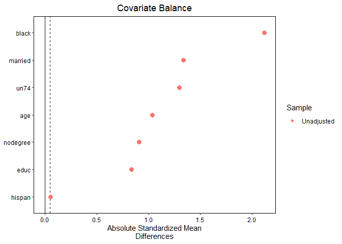
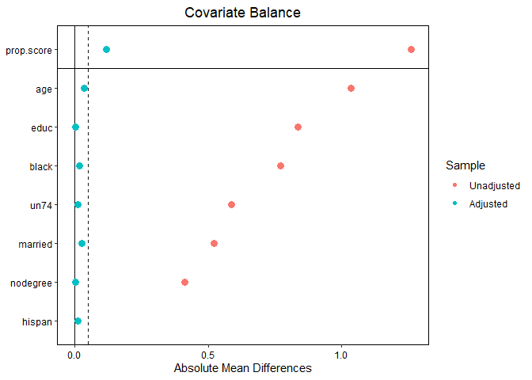

# The First Casualty of Statistics: Part Twenty Five
<big>**Differences-in-Differences: Classical Design with Control Variables**</big>

<br/>
Jiří Fejlek

2026-10-12
<br/>

<br/> In this part, we will continue our presentation of the classical differences-in-differences (DID) design by discussing how to incorporate 
observed covariates to alleviate the violations of the parallel trend 
assumption. <br/>

## Table of Contents

- [TWFE with Covariates](#twfe-with-covariates)
- [DID Estimators](#did-estimators)
- [Dataset cps1re74](#dataset-cps1re74)
  - [TWFE Estimator](#twfe-estimator)
  - [Two-Stage DID Estimator](#two-stage-did-estimator)
  - [IPW DID Estimators](#ipw-did-estimators)
  - [Doubly Robust Estimators](#doubly-robust-estimators)
- [References](#references)

``` r
library(tidyr)
library(dplyr)
library(tibble)
library(ggplot2)
library(patchwork)
library(dagitty)
library(ggdag)
library(modelsummary)
library(fixest)
library(pretrends)
library(HonestDiD)
library(WeightIt)
library(cobalt)
```

## TWFE with Covariates

In the previous part, we discussed the classical DID design
(<span class="nocase">De Chaisemartin and d’Haultfoeuille</span> 2026)
``` math
D_{g,t} = I(t>T_0)I(g \in G_\text{treated})
```

and the importance of the parallel trend assumption:
``` math
\tau_{g,t} = \mathbb{E}(Y_{g,t}(0) - Y_{g,t-1}(0)) = c(t)
```
This assumption is pretty strict, and it is often not met. A natural
relaxation is to assume that the parallel trend assumption holds only
conditionally on some covariates $`X`$.

We will assume only two time periods. In addition, we will assume no
*dynamic effects* $`Y_{g,t} (d_1, \ldots, d_t) = Y_{g,t}(d_t)`$.
Let $`X_g`$ be the control variables; the *conditional parallel trends*
assumption reduces to
``` math
\mathbb{E}(Y_{g,2}(0) - Y_{g,1}(0)) = m(X_g),
```

i.e., the expected difference in evolution without treatment depends
only on observed covariates. Namely, we will assume that the dependence
of conditional trends on $`X_{g,1}`$ is linear
``` math
\mathbb{E}(Y_{g,2}(0) - Y_{g,1}(0)) = \tilde\gamma_2 + X_{g,1}\tilde\theta.
```
Alternatively, we could also consider the dependence to be
``` math
\mathbb{E}(Y_{g,2}(0) - Y_{g,1}(0)) = \tilde\gamma_2 + (X_{g,2} - X_{g,1})\tilde\theta.
```

Since the outcome model without treatment is linear, we could consider
the following adjusted TWFE regression mode
``` math
Y_{g,t} = \alpha_g + \gamma_2  + X_{g,1}\theta I(t=2) + \beta D_{g,t} + \varepsilon_{g,t}
```
or
``` math
Y_{g,t} = \alpha_g + \gamma_2  + (X_{g,2} - X_{g,1})\theta I(t=2) + \beta D_{g,t} + \varepsilon_{g,t},
```
respectively. One would expect that the OLS estimate of $`\beta`$ after
adjusting for $`X_g`$ is an unbiased estimate of ATT. However, this is
not the case in general (<span class="nocase">De Chaisemartin and
d’Haultfoeuille</span> 2026).

*Let us assume that the no-anticipation assumption holds and that the
conditional parallel trends depend linearly on* $`X`$ *linearly, and
let* $`X_{g,1}`$ *be of dimension one. Then,*
``` math
\mathbb{E}\hat\beta_{\text{TWFE}, X} = \sum_{g \in G_\text{treated}}w_g \tau_{g,2},
```
*where* $`\sum w_g = 1`$ *and*
``` math
w_g = \frac{1}{|G_\text{treated}|} + \frac{w_1(\mu_{X,\text{treated}} - \mu_{X,\text{control}})(X_{g,1} - \mu_{X,\text{treated}})}{|G_\text{treated}|\sigma^2_{X,\text{treated}}},
```
*and where*
``` math
\mu_{X,\text{treated}} =  \frac{1}{|G_\text{treated}|} \sum_{g \in G_\text{treated}} X_{g,1},
```
``` math
\mu_{X,\text{control}} =  \frac{1}{|G_\text{control}|} \sum_{g \in G_\text{control}} X_{g,1},
```
``` math
\sigma^2_{X,\text{treated}} =  \frac{1}{|G_\text{treated}|} \sum_{g \in G_\text{treated}} (X_{g,1}- \mu_{X,\text{treated}})^2,
```

``` math
\sigma^2_{X,\text{control}} =  \frac{1}{|G_\text{control}|} \sum_{g \in G_\text{control}} (X_{g,1}- \mu_{X,\text{control}})^2,
```
*and*
``` math
w_1 = \frac{|G_\text{treated}|\sigma^2_{X,\text{treated}}}{|G_\text{treated}|\sigma^2_{X,\text{treated}} + |G_\text{control}| \sigma^2_{X,\text{control}}}.
```

Crucially, the weights are not necessarily positive. In other words,
$`\hat\beta_{\text{TWFE}, X}`$ estimates a weighted sum of group-wise
treatment effects, but because the weights are not always positive, this
value does not have a causal interpretation as a weighted average of
group-wise treatment effects. Another important observation is provided
that $`\mu_{X,\text{treated}} = \mu_{X,\text{control}}`$, $`w_g`$
simplifies to $`\frac{1}{|G_\text{treated}|}`$ and thus,
$`\mathbb{E}\hat\beta_{\text{TWFE}, X} = \text{ATT}`$.

## DID Estimators

Since TWFE regression with covariates is biased in general, we must
consider other estimation procedures. The first method we describe here
is a two-stage DID estimator, in which we first model the effect of
covariates on the outcome *in the control group*
``` math
Y_{g,2} - Y_{g,1} = \tilde{\gamma} + X_{g,1} \tilde{\theta} + \tilde\varepsilon_g
```
and then we compute the DID estimator as
``` math
\text{DID}_{X, \text{RA}} = \frac{1}{|G_\text{treated}|} \sum_{g \in G_\text{treated}} (Y_{g,2} - Y_{g,1} - (\hat{\tilde{\gamma}} + X_{g,1} \hat{\tilde{\theta}}))
```
Provided that the linear model and the no-anticipation assumption hold,
$`\mathbb{E}\text{ DID}_X = \text{ATT}`$ (<span class="nocase">De
Chaisemartin and d’Haultfoeuille</span> 2026).

The second procedure is based on inverse propensity score weighting
(<span class="nocase">De Chaisemartin and d’Haultfoeuille</span> 2026).
Let us denote propensity scores as $`e(X) = P[D = 1 \mid X]`$. (Abadie
2005) showed that
``` math
\text{ATT} = \mathbb{E} \left( \frac{D - e(X)}{P(D)(1-e(X))}(Y_{g,2} - Y_{g,1})\right),
```
which leads to the DID IPW estimator
``` math
\text{DID}_{X, \text{IPW}}  = \frac{1}{|G_\text{treated}|} \sum_{g \in G_\text{treated}} Y_{g,2} - Y_{g,1} - \frac{1}{|G_\text{control}|}\sum_{g \in G_\text{control}} \frac{|G_\text{control}|}{|G_\text{treated}|} \frac{\hat e(X_g)}{1- \hat e(X_g)}  (Y_{g,2} - Y_{g,1}).
```

This is a Horvitz-Thompson-type IPW estimator (weights are not rescaled
to sum up to one). We can also consider the Hájek variant (Sant’Anna and
Zhao 2020). Let us denote
``` math
w_{g, \text{Hájek}} = \frac{\hat e(X_g)}{1- \hat e(X_g)}/ \sum_{g\in G_\text{control}} \frac{\hat e(X_g)}{1- \hat e(X_g)} 
```
Then,
``` math
\text{DID}_{X, \text{IPW, Hájek}}  = \frac{1}{|G_\text{treated}|} \sum_{g \in G_\text{treated}} Y_{g,2} - Y_{g,1} - \frac{1}{|G_\text{control}|}\sum_{g \in G_\text{control}}  w_{g, \text{Hájek}} (Y_{g,2} - Y_{g,1}).
```

(Sant’Anna and Zhao 2020) derived a doubly robust Hájek-type estimator.
``` math
\text{DID}_{X, \text{DR, Hájek}}  = \frac{1}{|G_\text{treated}|} \sum_{g \in G_\text{treated}} (Y_{g,2} - Y_{g,1} - (\hat{\tilde{\gamma}} + X_{g,1} \hat{\tilde{\theta}})) - \frac{1}{|G_\text{control}|}\sum_{g \in G_\text{control}}  w_{g, \text{Hájek}} (Y_{g,2} - Y_{g,1} - (\hat{\tilde{\gamma}} + X_{g,1} \hat{\tilde{\theta}})).
```
In (<span class="nocase">De Chaisemartin and d’Haultfoeuille</span>
2026), the estimator is stated slightly differently from the original
paper:

``` math
\text{DID}_{X, \text{DR}, \text{H-T}} =  \frac{1}{|G_\text{treated}|} \sum_{g \in G_\text{treated}} (Y_{g,2} - Y_{g,1} - (\hat{\tilde{\gamma}} + X_{g,1} \hat{\tilde{\theta}})) - \frac{1}{|G_\text{control}|}\sum_{g \in G_\text{control}} \frac{|G_\text{control}|}{|G_\text{treated}|} \frac{e(X_g)}{1- e(X_g)}  (Y_{g,2} - Y_{g,1} - (\hat{\tilde{\gamma}} + X_{g,1} \hat{\tilde{\theta}})).
```
We see that this is the Horvitz-Thompson-type variant of the estimator.

## Dataset cps1re74

We are finally ready to tackle the *cps1re74* dataset on the effect of a
job training program on earnings (Ding 2024) based on (LaLonde 1986),
which we teased back in Part One. The research objective was to
determine whether training programs have a causal effect on earnings,
and the treatment effect was estimated using a completely randomized
experiment. In the *cps1re74* dataset, the original control group was
removed and replaced with a non-experimental comparison group drawn from
a population survey, i.e., the original randomization is compromised.

The variables in the dataset are as follows.

- **treat**: treatment (1: yes, 0: no)
- **age** in years
- **education** in years
- **black**: (1: yes, 0: no)
- **hispanic**: (1: yes, 0: no)
- **married**: (1: yes, 0: no)
- **nodegree**: high school diploma (1: yes, 0: no)
- **un74**: real earnings in 1974 greater than zero (1: yes, 0: no)
- **re74**: real earnings in 1974
- **re75**: real earnings in 1975
- **re78**: real earnings in 1978

``` r
options(width = 1000)

cps1re74 <- read.csv("C:/Users/elini/Desktop/first casualty/cps1re74.csv")

cps1re74$un74 <- (cps1re74$re74 == 0) + 0 
cps1re74$treat <- factor(cps1re74$treat)
cps1re74$black <- factor(cps1re74$black)
cps1re74$hispan <- factor(cps1re74$hispan)
cps1re74$married <- factor(cps1re74$married)
cps1re74$nodegree <- factor(cps1re74$nodegree)
cps1re74$un74 <- factor(cps1re74$un74)

head(cps1re74)
```

    ##   treat age educ black hispan married nodegree re74 re75       re78 un74
    ## 1     1  37   11     1      0       1        1    0    0  9930.0460    1
    ## 2     1  22    9     0      1       0        1    0    0  3595.8940    1
    ## 3     1  30   12     1      0       0        0    0    0 24909.4500    1
    ## 4     1  27   11     1      0       0        1    0    0  7506.1460    1
    ## 5     1  33    8     1      0       0        1    0    0   289.7899    1
    ## 6     1  22    9     1      0       0        1    0    0  4056.4940    1

``` r
datasummary_skim(cps1re74)
```
</head>
<body>

<table>
  <thead>
    <tr>
      <th>Variable</th>
      <th class="num">Unique</th>
      <th class="num">Missing Pct.</th>
      <th class="num">Mean</th>
      <th class="num">SD</th>
      <th class="num">Min</th>
      <th class="num">Median</th>
      <th class="num">Max</th>
      <th>Histogram</th>
    </tr>
  </thead>
  <tbody>
        <!-- Numeric Variables -->
        <tr>
            <td>age</td>
            <td>40</td>
            <td>0</td>
            <td>33.1</td>
            <td>11.0</td>
            <td>16.0</td>
            <td>31.0</td>
            <td>55.0</td>
            <td></td>
        </tr>
        <tr>
            <td>educ</td>
            <td>19</td>
            <td>0</td>
            <td>12.0</td>
            <td>2.9</td>
            <td>0.0</td>
            <td>12.0</td>
            <td>18.0</td>
            <td></td>
        </tr>
        <tr>
            <td>re74</td>
            <td>1449</td>
            <td>0</td>
            <td>13887.7</td>
            <td>9622.2</td>
            <td>0.0</td>
            <td>14900.0</td>
            <td>35040.1</td>
            <td></td>
        </tr>
        <tr>
            <td>re75</td>
            <td>1478</td>
            <td>0</td>
            <td>13504.0</td>
            <td>9302.8</td>
            <td>0.0</td>
            <td>14400.0</td>
            <td>25200.0</td>
            <td></td>
        </tr>
        <tr>
            <td>re78</td>
            <td>1451</td>
            <td>0</td>
            <td>14758.4</td>
            <td>9681.1</td>
            <td>0.0</td>
            <td>16200.0</td>
            <td>60307.9</td>
            <td></td>
        </tr>
        <!-- Categorical Variables -->
        </table>

<table>
  <thead>
    <tr>
      <th>Variable</th>
      <th>Value</th>
      <th class="num">N</th>
      <th class="num">%</th>
    </tr>
  </thead>
  <tbody>
            <td>treat</td>
            <td>0</td>
            <td>15992</td>
            <td>98.9</td>
            <td colspan="5"></td>
        </tr>
        <tr>
            <td></td>
            <td>1</td>
            <td>185</td>
            <td>1.1</td>
            <td colspan="5"></td>
        </tr>
        <tr>
            <td>black</td>
            <td>0</td>
            <td>14845</td>
            <td>91.8</td>
            <td colspan="5"></td>
        </tr>
        <tr>
            <td></td>
            <td>1</td>
            <td>1332</td>
            <td>8.2</td>
            <td colspan="5"></td>
        </tr>
        <tr>
            <td>hispan</td>
            <td>0</td>
            <td>15014</td>
            <td>92.8</td>
            <td colspan="5"></td>
        </tr>
        <tr>
            <td></td>
            <td>1</td>
            <td>1163</td>
            <td>7.2</td>
            <td colspan="5"></td>
        </tr>
        <tr>
            <td>married</td>
            <td>0</td>
            <td>4760</td>
            <td>29.4</td>
            <td colspan="5"></td>
        </tr>
        <tr>
            <td></td>
            <td>1</td>
            <td>11417</td>
            <td>70.6</td>
            <td colspan="5"></td>
        </tr>
        <tr>
            <td>nodegree</td>
            <td>0</td>
            <td>11315</td>
            <td>69.9</td>
            <td colspan="5"></td>
        </tr>
        <tr>
            <td></td>
            <td>1</td>
            <td>4862</td>
            <td>30.1</td>
            <td colspan="5"></td>
        </tr>
        <tr>
            <td>un74</td>
            <td>0</td>
            <td>14133</td>
            <td>87.4</td>
            <td colspan="5"></td>
        </tr>
        <tr>
            <td></td>
            <td>1</td>
            <td>2044</td>
            <td>12.6</td>
            <td colspan="5"></td>
    </tr>
  </tbody>
</table>
</body>

Let’s transform the dataset into a panel dataset with two periods: 1974
(pre-treatment) and 1978 (post-treatment).

``` r
options(width = 1000)

cps1re74_pd <- rbind(cps1re74, cps1re74)
cps1re74_pd$year <- c(rep(1, 16177), rep(0, 16177))
cps1re74_pd$id <- c(seq(1, 16177), seq(1, 16177))

cps1re74_pd$re <- cps1re74_pd$re75
cps1re74_pd$re[1:16177] <- cps1re74_pd$re78[1:16177]
cps1re74_pd$treated_group <- as.numeric(cps1re74_pd$treat)-1
cps1re74_pd$treat[16178:32354] <- 0

cps1re74_pd <- cps1re74_pd[, c(-8,-9,-10)]
head(cps1re74_pd)
```

    ##   treat age educ black hispan married nodegree un74 year id         re treated_group
    ## 1     1  37   11     1      0       1        1    1    1  1  9930.0460             1
    ## 2     1  22    9     0      1       0        1    1    1  2  3595.8940             1
    ## 3     1  30   12     1      0       0        0    1    1  3 24909.4500             1
    ## 4     1  27   11     1      0       0        1    1    1  4  7506.1460             1
    ## 5     1  33    8     1      0       0        1    1    1  5   289.7899             1
    ## 6     1  22    9     1      0       0        1    1    1  6  4056.4940             1

### TWFE Estimator

Let’s estimate the treatment effect. We start with the simple DID
estimate. As a reminder, the estimated treatment effect from the
randomized experiment is about 1,580 to 1,800, depending on the method
used.

``` r
mean(cps1re74$re78[cps1re74$treat == 1] - cps1re74$re75[cps1re74$treat == 1]) - mean(cps1re74$re78[cps1re74$treat == 0] - cps1re74$re75[cps1re74$treat == 0])
```

    ## [1] 3603.984

We can get the same value using *feols* from the *fixest* package.

``` r
summary(feols(re ~ treat |  id + year, cluster ~  id, data = cps1re74_pd))
```

    ## OLS estimation, Dep. Var.: re
    ## Observations: 32,354
    ## Fixed-effects: id: 16,177,  year: 2
    ## Standard-errors: Clustered (id) 
    ##        Estimate Std. Error t value   Pr(>|t|)    
    ## treat1  3603.98    609.867 5.90946 3.5012e-09 ***
    ## ---
    ## Signif. codes:  0 '***' 0.001 '**' 0.01 '*' 0.05 '.' 0.1 ' ' 1
    ## RMSE: 3,858.3     Adj. R2: 0.671071
    ##                 Within R2: 0.00246

We see that the estimate is severely biased. Let us check the balance of
observed covariates.

``` r
bal_cps1re74 <- bal.tab(treat ~ age + educ + black + hispan + married + nodegree + un74, data = cps1re74, estimand = "ATT", binary = "std", stats = c("m", "ks", "v"))
love.plot(bal_cps1re74, thresholds = c(m = .05), stats = c("m"), abs = TRUE, var.order = "unadjusted")
```

<!-- -->

``` r
bal_cps1re74 <- bal.tab(treat ~ age + educ + black + hispan + married + nodegree + un74, data = cps1re74, estimand = "ATT", binary = "std", stats = c("m", "ks", "v"))
bal_cps1re74
```

    ## Balance Measures
    ##             Type Diff.Un V.Ratio.Un  KS.Un
    ## age      Contin. -1.0355     0.4196 0.3427
    ## educ     Contin. -0.8363     0.4905 0.4123
    ## black     Binary  2.1171          . 0.7697
    ## hispan    Binary -0.0532          . 0.0126
    ## married   Binary -1.3342          . 0.5225
    ## nodegree  Binary  0.9068          . 0.4123
    ## un74      Binary  1.2944          . 0.5885
    ## 
    ## Sample sizes
    ##     Control Treated
    ## All   15992     185

We observe clear differences between the treated and control groups,
making the parallel-trend assumption unlikely to hold.

Let’s ignore the theoretical results we stated earlier and adjust the
TWFE model. If we add the variables to the regression, we get the
following result (we will use the “canonical” set of variables as in
<https://carlos-mendez.org/tutorials/python_did_covariates_lalonde/#spec-0--naive-twfe-no-covariates>)

``` r
summary(feols(re ~ treat + age + age^2 + age^3 + educ + educ^2 + black + hispan + married + nodegree + un74 |  id + year, cluster ~  id, data = cps1re74_pd))
```

    ## The variables 'age', 'I(age^2)', 'I(age^3)', 'educ', 'I(educ^2)', 'black1' and 4 others have been
    ## removed because of collinearity (see $collin.var).

    ## OLS estimation, Dep. Var.: re
    ## Observations: 32,354
    ## Fixed-effects: id: 16,177,  year: 2
    ## Standard-errors: Clustered (id) 
    ##        Estimate Std. Error t value   Pr(>|t|)    
    ## treat1  3603.98    609.867 5.90946 3.5012e-09 ***
    ## ... 10 variables were removed because of collinearity (age, I(age^2) and 8 others [full set in
    ## $collin.var])
    ## ---
    ## Signif. codes:  0 '***' 0.001 '**' 0.01 '*' 0.05 '.' 0.1 ' ' 1
    ## RMSE: 3,858.3     Adj. R2: 0.671071
    ##                 Within R2: 0.00246

We see that the result did not change. This is because all our
covariates are absorbed into the model’s fixed (individual) effects. To
adjust the TWFE regression, we need to interact covariates with **year**
(we assume linear conditional parallel trends).

``` r
summary(feols(re ~ treat + (age + age^2 + age^3 + educ + educ^2 + black + hispan + married + nodegree + un74):year |  id + year, cluster ~  id, data = cps1re74_pd))
```

    ## OLS estimation, Dep. Var.: re
    ## Observations: 32,354
    ## Fixed-effects: id: 16,177,  year: 2
    ## Standard-errors: Clustered (id) 
    ##                    Estimate Std. Error   t value   Pr(>|t|)    
    ## treat1          1561.158444 630.368145  2.476582 1.3275e-02 *  
    ## age:year       -1081.119475 191.921349 -5.633138 1.7991e-08 ***
    ## I(age^2):year     23.655238   5.654213  4.183648 2.8838e-05 ***
    ## I(age^3):year     -0.183838   0.052897 -3.475385 5.1146e-04 ***
    ## educ:year       -104.717537  94.548597 -1.107553 2.6807e-01    
    ## I(educ^2):year     8.324121   3.925842  2.120340 3.3993e-02 *  
    ## black1:year     -317.969450 205.060479 -1.550613 1.2101e-01    
    ## hispan1:year    -122.644675 234.127834 -0.523836 6.0040e-01    
    ## married1:year   -505.917712 163.159025 -3.100764 1.9335e-03 ** 
    ## nodegree1:year   332.052811 193.358141  1.717294 8.5945e-02 .  
    ## un741:year      1655.370939 165.253160 10.017182  < 2.2e-16 ***
    ## ---
    ## Signif. codes:  0 '***' 0.001 '**' 0.01 '*' 0.05 '.' 0.1 ' ' 1
    ## RMSE: 3,729.3     Adj. R2: 0.692505
    ##                 Within R2: 0.068038

We see that we got an estimate closer to the value determined by the
completely randomized experiment.

### Two-Stage DID Estimator

We discussed that the TWFE estimator often lacks a causal
interpretation. Hence, we should use the two-stage DID estimator
instead. First, we fit the covariate outcome model for the control
group.

``` r
cps1re74$dif <- cps1re74$re78 - cps1re74$re75
outc_m <- lm(dif ~ age + I(age^2) + I(age^3) + educ + I(educ^2) + black + hispan + married + nodegree + un74, data = cps1re74[cps1re74$treat == 0,])
summary(outc_m)
```

    ## 
    ## Call:
    ## lm(formula = dif ~ age + I(age^2) + I(age^3) + educ + I(educ^2) + 
    ##     black + hispan + married + nodegree + un74, data = cps1re74[cps1re74$treat == 
    ##     0, ])
    ## 
    ## Residuals:
    ##    Min     1Q Median     3Q    Max 
    ## -27517  -2470    323   3137  27153 
    ## 
    ## Coefficients:
    ##               Estimate Std. Error t value Pr(>|t|)    
    ## (Intercept)  1.817e+04  2.348e+03   7.737 1.08e-14 ***
    ## age         -1.151e+03  2.014e+02  -5.714 1.12e-08 ***
    ## I(age^2)     2.541e+01  5.882e+00   4.321 1.57e-05 ***
    ## I(age^3)    -1.980e-01  5.464e-02  -3.623 0.000292 ***
    ## educ        -1.126e+02  1.071e+02  -1.051 0.293097    
    ## I(educ^2)    8.730e+00  4.279e+00   2.040 0.041353 *  
    ## black1      -3.011e+02  2.289e+02  -1.315 0.188552    
    ## hispan1     -1.238e+02  2.362e+02  -0.524 0.600101    
    ## married1    -4.750e+02  1.612e+02  -2.946 0.003219 ** 
    ## nodegree1    3.605e+02  1.985e+02   1.816 0.069324 .  
    ## un741        1.540e+03  1.900e+02   8.103 5.74e-16 ***
    ## ---
    ## Signif. codes:  0 '***' 0.001 '**' 0.01 '*' 0.05 '.' 0.1 ' ' 1
    ## 
    ## Residual standard error: 7451 on 15981 degrees of freedom
    ## Multiple R-squared:  0.06677,    Adjusted R-squared:  0.06618 
    ## F-statistic: 114.3 on 10 and 15981 DF,  p-value: < 2.2e-16

Then, we compute the imputed outcomes for the treated and compute the
adjusted DID estimator.

``` r
pred_dif <- predict(outc_m, cps1re74[cps1re74$treat == 1,])
mean(cps1re74$re78[cps1re74$treat == 1] - cps1re74$re75[cps1re74$treat == 1] - pred_dif)
```

    ## [1] 1606.605

We obtain the confidence interval using bootstrapping.

``` r
set.seed(123)
nb <- 1000

att_ests <- numeric(nb)

for(i in 1:nb){
  
  cps1re74_new <-  cps1re74[sample(nrow(cps1re74) , rep=TRUE),]
  
  outc_m_new <- lm(dif ~ age + I(age^2) + I(age^3) + educ + I(educ^2) + black + hispan + married + nodegree + un74, data = cps1re74_new[cps1re74_new$treat == 0,])
  
  pred_dif_new <- predict(outc_m_new, cps1re74_new[cps1re74_new$treat == 1,])
  
  att_ests[i] <- mean(cps1re74_new$re78[cps1re74_new$treat == 1] - cps1re74_new$re75[cps1re74_new$treat == 1] - pred_dif_new)
}

quantile(att_ests, c(0.025, 0.5, 0.975))
```

    ##      2.5%       50%     97.5% 
    ##  331.7808 1587.4403 3046.7520

### IPW DID Estimators

Next, let’s compute the IPW DID estimator. First, we compute the
propensity scores.

``` r
prop_scores_model <- weightit(treat ~ age + I(age^2) + I(age^3) + educ + I(educ^2) + black + hispan + married + nodegree + un74, data = cps1re74, method = "glm", estimand = "ATT")
bal.tab(prop_scores_model, data = cps1re74, estimand = "ATT", binary = "std", stats = c("m", "ks", "v"), un = TRUE)
```

    ## Balance Measures
    ##                Type Diff.Un V.Ratio.Un  KS.Un Diff.Adj V.Ratio.Adj KS.Adj
    ## prop.score Distance  1.2605    56.8512 0.8712  -0.1191      0.9178 0.1214
    ## age         Contin. -1.0355     0.4196 0.3427  -0.0373      0.9850 0.0836
    ## educ        Contin. -0.8363     0.4905 0.4123  -0.0052      1.1670 0.0679
    ## black        Binary  2.1171          . 0.7697  -0.0557           . 0.0202
    ## hispan       Binary -0.0532          . 0.0126   0.0530           . 0.0125
    ## married      Binary -1.3342          . 0.5225   0.0697           . 0.0273
    ## nodegree     Binary  0.9068          . 0.4123  -0.0105           . 0.0048
    ## un74         Binary  1.2944          . 0.5885  -0.0308           . 0.0140
    ## 
    ## Effective sample sizes
    ##             Control Treated
    ## Unadjusted 15992.       185
    ## Adjusted      92.83     185

``` r
love.plot(prop_scores_model, thresholds = c(m = .05), stats = c("m"), abs = TRUE, var.order = "unadjusted")
```

<!-- -->

We see that propensity scores did a decent job at balancing the
covariates. Let’s compute the Horvitz-Thompson-type estimator first.

``` r
mean(cps1re74$re78[cps1re74$treat == 1] - cps1re74$re75[cps1re74$treat == 1]) - 
  sum(prop_scores_model$weights[cps1re74$treat == 0]*(cps1re74$re78[cps1re74$treat == 0] - cps1re74$re75[cps1re74$treat == 0]))/sum(cps1re74$treat == 1)
```

    ## [1] 1971.303

We can obtain the same result using the *DRDID*
(<https://cran.r-project.org/web/packages/DRDID/index.html>).

``` r
library(DRDID)
did_ipw <- ipwdid(yname = "re", tname = "year", idname = "id", dname = "treated_group",
             xformla= ~ age + I(age^2) + I(age^3) + educ + I(educ^2) + black + hispan + married + nodegree + un74,
             data = cps1re74_pd, panel = TRUE, normalized = FALSE)
summary(did_ipw)
```

    ##  Call:
    ## ipwdid(yname = "re", tname = "year", idname = "id", dname = "treated_group", 
    ##     xformla = ~age + I(age^2) + I(age^3) + educ + I(educ^2) + 
    ##         black + hispan + married + nodegree + un74, data = cps1re74_pd, 
    ##     panel = TRUE, normalized = FALSE)
    ## ------------------------------------------------------------------
    ##  IPW DID estimator for the ATT:
    ##  
    ##    ATT     Std. Error  t value    Pr(>|t|)  [95% Conf. Interval] 
    ## 1971.3027   753.5319    2.6161     0.0089    494.3802  3448.2251 
    ## ------------------------------------------------------------------
    ##  Estimator based on panel data.
    ##  Horvitz-Thompson-type IPW estimator.
    ##  Propensity score est. method: maximum likelihood.
    ##  Analytical standard error.
    ## ------------------------------------------------------------------
    ##  See Sant'Anna and Zhao (2020) for details.

Alternatively, we could use the Hájek-type estimator.

``` r
mean(cps1re74$re78[cps1re74$treat == 1] - cps1re74$re75[cps1re74$treat == 1]) - 
  sum(prop_scores_model$weights[cps1re74$treat == 0]/mean(prop_scores_model$weights[cps1re74$treat == 0])*(cps1re74$re78[cps1re74$treat == 0] - cps1re74$re75[cps1re74$treat == 0]))/sum(cps1re74$treat == 0)
```

    ## [1] 2146.492

``` r
did_ipw2 <- ipwdid(yname = "re", tname = "year", idname = "id", dname = "treated_group",
             xformla= ~ age + I(age^2) + I(age^3) + educ + I(educ^2) + black + hispan + married + nodegree + un74,
             data = cps1re74_pd, panel = TRUE, normalized = TRUE)
summary(did_ipw2)
```

    ##  Call:
    ## ipwdid(yname = "re", tname = "year", idname = "id", dname = "treated_group", 
    ##     xformla = ~age + I(age^2) + I(age^3) + educ + I(educ^2) + 
    ##         black + hispan + married + nodegree + un74, data = cps1re74_pd, 
    ##     panel = TRUE, normalized = TRUE)
    ## ------------------------------------------------------------------
    ##  IPW DID estimator for the ATT:
    ##  
    ##    ATT     Std. Error  t value    Pr(>|t|)  [95% Conf. Interval] 
    ## 2146.4922   715.7129    2.9991     0.0027    743.6948  3549.2895 
    ## ------------------------------------------------------------------
    ##  Estimator based on panel data.
    ##  Hajek-type IPW estimator (weights sum up to 1).
    ##  Propensity score est. method: maximum likelihood.
    ##  Analytical standard error.
    ## ------------------------------------------------------------------
    ##  See Sant'Anna and Zhao (2020) for details.

Let’s bootstrap both estimates.

``` r
set.seed(123)
nb <- 1000

att_ests <- matrix(NA,2,nb)

for(i in 1:nb){
  
  cps1re74_new <-  cps1re74[sample(nrow(cps1re74) , rep=TRUE),]
  
  prop_scores_model_new <- weightit(treat ~ age + I(age^2) + I(age^3) + educ + I(educ^2) + black + hispan + married + nodegree + un74, data = cps1re74_new, method = "glm", estimand = "ATT")

  att_ests[1,i] <- mean(cps1re74_new$re78[cps1re74_new$treat == 1] - cps1re74_new$re75[cps1re74_new$treat == 1]) - 
  sum(prop_scores_model_new$weights[cps1re74_new$treat == 0]*(cps1re74_new$re78[cps1re74_new$treat == 0] - cps1re74_new$re75[cps1re74_new$treat == 0]))/sum(cps1re74_new$treat == 1)
  
  att_ests[2,i] <- mean(cps1re74_new$re78[cps1re74_new$treat == 1] - cps1re74_new$re75[cps1re74_new$treat == 1]) - 
  sum(prop_scores_model_new$weights[cps1re74_new$treat == 0]/mean(prop_scores_model_new$weights[cps1re74_new$treat == 0])*(cps1re74_new$re78[cps1re74_new$treat == 0] - cps1re74_new$re75[cps1re74_new$treat == 0]))/sum(cps1re74_new$treat == 0)
  
}

results <-  apply(att_ests,1, function(x) quantile(x, c(0.025, 0.5, 0.975)))
colnames(results) <- c('Horvitz-Thompson','Hájek')
results
```

    ##       Horvitz-Thompson     Hájek
    ## 2.5%          516.8749  810.2906
    ## 50%          1943.5030 2117.5232
    ## 97.5%        3543.2274 3615.4974

### Doubly Robust Estimators

To conclude, let’s compute doubly robust estimators. The package *DRDID*
computes the Hájek variant.

``` r
did_DR <- drdid(yname = "re", tname = "year", idname = "id", dname = "treated_group",
             xformla= ~ age + I(age^2) + I(age^3) + educ + I(educ^2) + black + hispan + married + nodegree + un74,
             data = cps1re74_pd, panel = TRUE, estMethod = 'trad')
summary(did_DR)
```

    ##  Call:
    ## drdid(yname = "re", tname = "year", idname = "id", dname = "treated_group", 
    ##     xformla = ~age + I(age^2) + I(age^3) + educ + I(educ^2) + 
    ##         black + hispan + married + nodegree + un74, data = cps1re74_pd, 
    ##     panel = TRUE, estMethod = "trad")
    ## ------------------------------------------------------------------
    ##  Locally efficient DR DID estimator for the ATT:
    ##  
    ##    ATT     Std. Error  t value    Pr(>|t|)  [95% Conf. Interval] 
    ## 2119.7606   724.6833    2.9251     0.0034    699.3813  3540.1399 
    ## ------------------------------------------------------------------
    ##  Estimator based on panel data.
    ##  Outcome regression est. method: OLS.
    ##  Propensity score est. method: maximum likelihood.
    ##  Analytical standard error.
    ## ------------------------------------------------------------------
    ##  See Sant'Anna and Zhao (2020) for details.

``` r
pred_dif1 <- predict(outc_m, cps1re74[cps1re74$treat == 1,])
pred_dif0 <- predict(outc_m)

mean(cps1re74$re78[cps1re74$treat == 1] - cps1re74$re75[cps1re74$treat == 1] - pred_dif1)- 
  sum(prop_scores_model$weights[cps1re74$treat == 0]/mean(prop_scores_model$weights[cps1re74$treat == 0])*(cps1re74$re78[cps1re74$treat == 0] - cps1re74$re75[cps1re74$treat == 0]-pred_dif0))/sum(cps1re74$treat == 0)
```

    ## [1] 2119.761

We can also compute the Horvitz-Thompson variant.

``` r
mean(cps1re74$re78[cps1re74$treat == 1] - cps1re74$re75[cps1re74$treat == 1] - pred_dif1)- 
  sum(prop_scores_model$weights[cps1re74$treat == 0]*(cps1re74$re78[cps1re74$treat == 0] - cps1re74$re75[cps1re74$treat == 0]-pred_dif0))/sum(cps1re74$treat == 1)
```

    ## [1] 2153.423

``` r
set.seed(123)
nb <- 1000

att_ests <- matrix(NA,2,nb)

for(i in 1:nb){
  
  cps1re74_new <-  cps1re74[sample(nrow(cps1re74) , rep=TRUE),]
  
  prop_scores_model_new <- weightit(treat ~ age + I(age^2) + I(age^3) + educ + I(educ^2) + black + hispan + married + nodegree + un74, data = cps1re74_new, method = "glm", estimand = "ATT")
  
  outc_m_new <- lm(dif ~ age + I(age^2) + I(age^3) + educ + I(educ^2) + black + hispan + married + nodegree + un74, data = cps1re74_new[cps1re74_new$treat == 0,])
  
  pred_dif1_new <- predict(outc_m_new, cps1re74_new[cps1re74_new$treat == 1,])
  pred_dif0_new <- predict(outc_m_new)
  

  att_ests[1,i] <- mean(cps1re74_new$re78[cps1re74_new$treat == 1] - cps1re74_new$re75[cps1re74_new$treat == 1] - pred_dif1_new) - sum(prop_scores_model_new$weights[cps1re74_new$treat == 0]*(cps1re74_new$re78[cps1re74_new$treat == 0] - cps1re74_new$re75[cps1re74_new$treat == 0]-pred_dif0_new))/sum(cps1re74_new$treat == 1)
  
  att_ests[2,i] <- mean(cps1re74_new$re78[cps1re74_new$treat == 1] - cps1re74_new$re75[cps1re74_new$treat == 1] - pred_dif1_new) - sum(prop_scores_model_new$weights[cps1re74_new$treat == 0]/mean(prop_scores_model_new$weights[cps1re74_new$treat == 0])*(cps1re74_new$re78[cps1re74_new$treat == 0] - cps1re74_new$re75[cps1re74_new$treat == 0]-pred_dif0_new))/sum(cps1re74_new$treat == 0)
  
}

results <-  apply(att_ests,1, function(x) quantile(x, c(0.025, 0.5, 0.975)))
colnames(results) <- c('Horvitz-Thompson DR','Hájek DR')
results
```

    ##       Horvitz-Thompson DR  Hájek DR
    ## 2.5%             793.1052  777.2248
    ## 50%             2134.3325 2101.7706
    ## 97.5%           3680.1659 3624.4239

We see that all estimators yielded similar results.

## References

<div id="refs" class="references csl-bib-body hanging-indent">

<div id="ref-abadie2005semiparametric" class="csl-entry">

Abadie, Alberto. 2005. “Semiparametric Difference-in-Differences
Estimators.” *The Review of Economic Studies* 72 (1): 1–19.

</div>

<div id="ref-de2026causal" class="csl-entry">

<span class="nocase">De Chaisemartin, Clément, and Xavier
d’Haultfoeuille</span>. 2026. *Causal Inference with
Differences-in-Differences: Credible Answers to Hard Questions*.
Princeton University Press.

</div>

<div id="ref-ding2024first" class="csl-entry">

Ding, Peng. 2024. *A First Course in Causal Inference*. CRC press.

</div>

<div id="ref-lalonde1986evaluating" class="csl-entry">

LaLonde, Robert J. 1986. “Evaluating the Econometric Evaluations of
Training Programs with Experimental Data.” *The American Economic
Review*, 604–20.

</div>

<div id="ref-sant2020doubly" class="csl-entry">

Sant’Anna, Pedro HC, and Jun Zhao. 2020. “Doubly Robust
Difference-in-Differences Estimators.” *Journal of Econometrics* 219
(1): 101–22.

</div>

</div>
