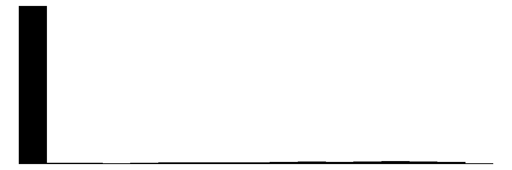
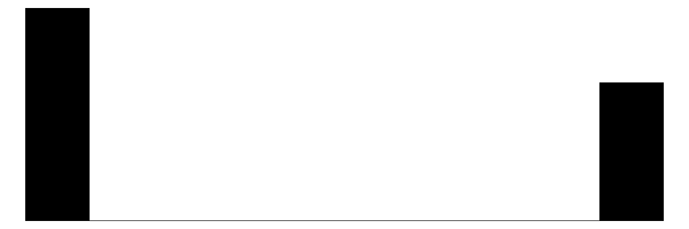
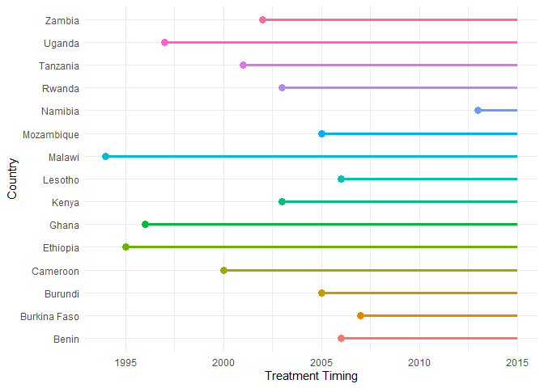
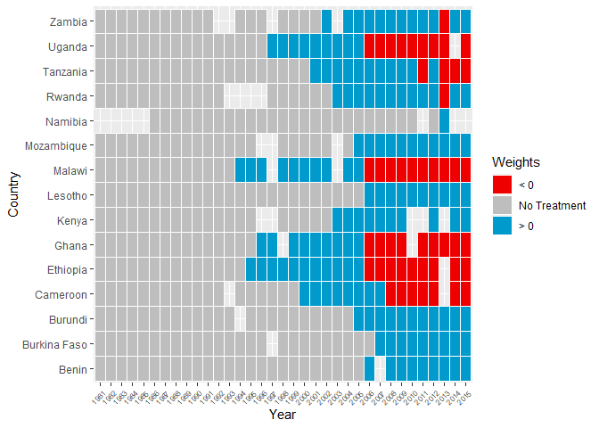
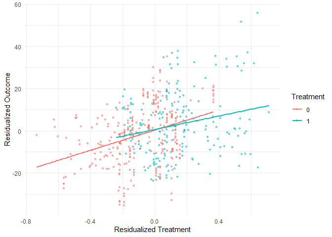
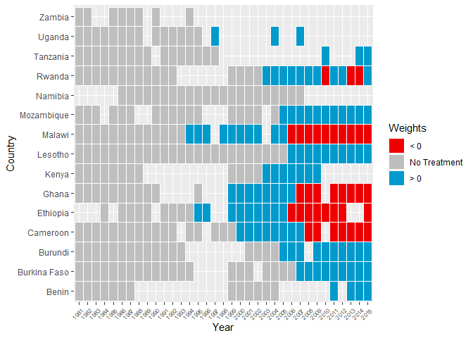
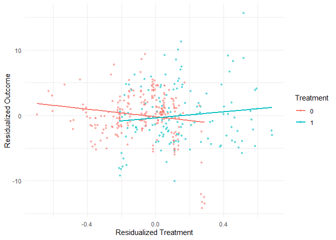

# The First Casualty of Statistics: Part Twenty Seven
<big>**Differences-in-Differences IV: Differences-in-Differences IV: TWFE Estimator in Complex Designs**</big>

<br/>
Jiří Fejlek

2026-10-18
<br/>

<br/> We learned in Part Twenty Four that the TWFE estimator reduces to a DID
estimator under the classical design (absorbing binary treatment,
without variation in treatment timing) and, under the no anticipation
and parallel trend assumptions, estimates ATT. However, the TWFE
estimator is commonly used in other, more complicated settings
(non-absorbing and/or non-binary treatments with groups that may
experience several treatment changes at different points in time).
Consequently, the natural question is what the TWFE estimator
$`\hat\beta_\text {TWFE}`$ actually estimates in general. <br/>

## Table of Contents

- [TWFE Estimator in Complex
  Designs](#twfe-estimator-in-complex-designs)
- [Gentzkow et al. Dataset](#gentzkow-et-al.-dataset)
- [WDI_FPE Dataset](#wdi_fpe-dataset)
- [References](#references)


``` r
library(tidyr)
library(dplyr)
library(tibble)
library(ggplot2)
library(patchwork)
library(dagitty)
library(ggdag)
library(modelsummary)
library(fixest)
library(pretrends)
library(HonestDiD)
library(WeightIt)
library(cobalt)
```

## TWFE Estimator in Complex Designs

We will assume no *dynamic effects*
``` math
Y_{g,t} (d_1, \ldots, d_t) = Y_{g,t}(d_t).
```
Since we assume potentially non-binary treatment, the treatment effect
is redefined as (<span class="nocase">De Chaisemartin and
d’Haultfoeuille</span> 2026)
``` math
\tau_{g,t} = \frac{\mathbb{E}(Y(D_{g,t})- Y(0))}{D_{g,t}}.
```
The ATT becomes
``` math
\text{ATT} = \frac{1}{|D_{g,t} \neq 0|}\sum_{(g,t):D_{g,t} \neq 0} \tau_{g,t}.
```
The main result that ties the TWFE estimator $`\hat\beta_\text{TFWE}`$
to the treatment effect is as follows (<span class="nocase">De
Chaisemartin and d’Haultfoeuille</span> 2026).

*Let the no anticipation, no dynamic effects, and parallel trends
assumptions hold. Then,*
``` math
\mathbb{E}\hat\beta_\text{TFWE} = \frac{1}{|D_{g,t} \neq 0|}\sum_{(g,t):D_{g,t} \neq 0} w_{g,t}\tau_{g,t},
```
*where*
``` math
w_{g,t} = \frac{\hat u_{g,t} D_{g,t}}{\sum_{(g,t) :D_{g',t'} \neq 0 } \hat u_{g',t'} D_{g',t'}},
```
*and where* $`\hat u_{g,t}`$ *denotes the sample residual from a
regression of $`\hat D_{g,t}`$ on group and period fixed effects.*

One can show that the sample residuals $`\hat u_{g,t}`$ meet
(<span class="nocase">De Chaisemartin and d’Haultfoeuille</span> 2026)
``` math
\hat u_{g,t} = D_{g,t} - D_{g,.} - D_{.,t} + D_{.,.},
```
where $`D_{g,.}`$ denotes average treatment of group $`g`$ across the
time periods, $`D_{.,t}`$ denotes the average treatment at period $`t`$
across groups, and $`D_{.,.}`$ is the average treatment across groups
and periods.

For the classical design (absorbing binary treatment, without
variation in treatment timing), we get
``` math
D_{g,t} = D_{g,.} = D_{.,t}
```
across the treated groups. Consequently, the weights $`w_{g,t}`$ are all
equal ($`w_{g,t} = 1/|D_{g,t} \neq 0|`$) and hence,
$`\mathbb{E}\hat\beta_\text{TFWE} = \text{ATT}`$.

In general, $`\hat\beta_\text{TFWE}`$ is an unbiased estimate of ATT
when (<span class="nocase">De Chaisemartin and d’Haultfoeuille</span>
2026)

- treatment effects are constant across groups and over time, i.e.,
  $`\tau_{g,t} = \delta`$ for all $`(g,t)`$
- treatment effects are uncorrelated with weights $`w_{g,t}`$, i.e.,

``` math
\sum_{(g,t):D_{g,t} \neq 0} \left(w_{g,t} -  \frac{1}{|D_{g,t} \neq 0|}\right)(\tau_{g,t} - \text{ATT}) = 0
```

If $`\hat\beta_\text{TFWE}`$ does not estimate ATT, it can still be a
weighted average of treatment effects (i.e., all weights $`w_{g,t}`$ are
positive). Assuming that $`D_{g,t}>0`$, a weight become negative when
``` math
D_{g,t} + D_{.,.}  < D_{.,t} + D_{g,.}.
```
Thus, cells with low treatment values are more likely to be weighted
negatively. Similarly, groups with the highest average treatment are the
most likely to have negatively weighted periods, and the period with the
highest average treatment is most likely to include a group that is
negatively weighted in that period.

## Gentzkow et al. Dataset

We will consider a dataset used by (Gentzkow et al. 2011) to study the
effect of newspapers on voters’ participation. The variables that are of
interest to us are as follows (<span class="nocase">De Chaisemartin and
d’Haultfoeuille</span> 2026).

- **cnty90**: county $`g`$
- **st**: state
- **year**: election-year $`t`$
- **prestout**: turnout rate in county $`g`$ and election-year $`t`$
  (outcome)
- **numdailies**: number of daily newspapers circulating in county $`g`$
  and election-year $`t`$ (treatment)
- **lag_ishare_urb**: the lagged urbanization rate of county *g* at *t*
  (its urbanization at t−1);

``` r
gentzkowetal <- read.csv("C:/Users/elini/Desktop/first casualty/gentzkowetal.csv")
head(gentzkowetal)
```

    ##   cnty90 year prestout st numdailies styr lag_numdailies changedailies changeprestout lag_ishare_urb share_urb_baseline first_change same_treat_after_first_change
    ## 1   1005 1868    1.016  1          0   12             NA            NA             NA             NA                  0         1884                             1
    ## 2   1005 1872    0.849  1          0   13              0             0   -0.166999996              0                  0         1884                             1
    ## 3   1005 1876    0.586  1          0   14              0             0   -0.263000071              0                  0         1884                             1
    ## 4   1005 1880    0.580  1          0   15              0             0   -0.005999982              0                  0         1884                             1
    ## 5   1005 1884    0.428  1          2   16              0             2   -0.151999980              0                  0         1884                             1
    ## 6   1005 1888    0.623  1          2   17              2             0    0.194999963              0                  0         1884                             1

``` r
gentzkowetal$cnty90 <- factor(gentzkowetal$cnty90)
gentzkowetal$st <- factor(gentzkowetal$st)
datasummary_skim(gentzkowetal[c(1,2,3,4,5,10)])
```

<table>
    <thead>
        <tr>
            <th></th>
            <th>Unique</th>
            <th>Missing Pct.</th>
            <th>Mean</th>
            <th>SD</th>
            <th>Min</th>
            <th>Median</th>
            <th>Max</th>
            <th>Histogram</th>
        </tr>
    </thead>
    <tbody>
        <tr>
            <td><strong>year</strong></td>
            <td>16</td>
            <td>0</td>
            <td>1900.1</td>
            <td>18.1</td>
            <td>1868.0</td>
            <td>1900.0</td>
            <td>1928.0</td>
            <td></td>
        </tr>
        <tr>
            <td><strong>prestout</strong></td>
            <td>2052</td>
            <td>0</td>
            <td>0.7</td>
            <td>0.2</td>
            <td>0.0</td>
            <td>0.7</td>
            <td>2.5</td>
            <td></td>
        </tr>
        <tr>
            <td><strong>numdailies</strong></td>
            <td>38</td>
            <td>0</td>
            <td>1.5</td>
            <td>2.2</td>
            <td>0.0</td>
            <td>1.0</td>
            <td>45.0</td>
            <td></td>
        </tr>
        <tr>
            <td><strong>lag_ishare_urb</strong></td>
            <td>1807</td>
            <td>9</td>
            <td>0.1</td>
            <td>0.2</td>
            <td>0.0</td>
            <td>0.0</td>
            <td>0.8</td>
            <td></td>
        </tr>
        <tr>
            <td><strong>st</strong></td>
            <td><strong>N</strong></td>
            <td><strong>%</strong></td>
            <td></td>
            <td></td>
            <td></td>
            <td></td>
            <td></td>
            <td></td>
        </tr>
        <tr>
            <td><strong>1</strong></td>
            <td>258</td>
            <td>1.5</td>
            <td></td>
            <td></td>
            <td></td>
            <td></td>
            <td></td>
            <td></td>
        </tr>
        <tr>
            <td><strong>4</strong></td>
            <td>45</td>
            <td>0.3</td>
            <td></td>
            <td></td>
            <td></td>
            <td></td>
            <td></td>
            <td></td>
        </tr>
        <tr>
            <td><strong>5</strong></td>
            <td>518</td>
            <td>3.1</td>
            <td></td>
            <td></td>
            <td></td>
            <td></td>
            <td></td>
            <td></td>
        </tr>
        <tr>
            <td><strong>6</strong></td>
            <td>600</td>
            <td>3.6</td>
            <td></td>
            <td></td>
            <td></td>
            <td></td>
            <td></td>
            <td></td>
        </tr>
        <tr>
            <td><strong>8</strong></td>
            <td>347</td>
            <td>2.1</td>
            <td></td>
            <td></td>
            <td></td>
            <td></td>
            <td></td>
            <td></td>
        </tr>
        <tr>
            <td><strong>9</strong></td>
            <td>112</td>
            <td>0.7</td>
            <td></td>
            <td></td>
            <td></td>
            <td></td>
            <td></td>
            <td></td>
        </tr>
        <tr>
            <td><strong>10</strong></td>
            <td>16</td>
            <td>0.1</td>
            <td></td>
            <td></td>
            <td></td>
            <td></td>
            <td></td>
            <td></td>
        </tr>
        <tr>
            <td><strong>12</strong></td>
            <td>272</td>
            <td>1.6</td>
            <td></td>
            <td></td>
            <td></td>
            <td></td>
            <td></td>
            <td></td>
        </tr>
        <tr>
            <td><strong>13</strong></td>
            <td>351</td>
            <td>2.1</td>
            <td></td>
            <td></td>
            <td></td>
            <td></td>
            <td></td>
            <td></td>
        </tr>
        <tr>
            <td><strong>16</strong></td>
            <td>102</td>
            <td>0.6</td>
            <td></td>
            <td></td>
            <td></td>
            <td></td>
            <td></td>
            <td></td>
        </tr>
        <tr>
            <td><strong>17</strong></td>
            <td>1088</td>
            <td>6.4</td>
            <td></td>
            <td></td>
            <td></td>
            <td></td>
            <td></td>
            <td></td>
        </tr>
        <tr>
            <td><strong>18</strong></td>
            <td>1038</td>
            <td>6.2</td>
            <td></td>
            <td></td>
            <td></td>
            <td></td>
            <td></td>
            <td></td>
        </tr>
        <tr>
            <td><strong>19</strong></td>
            <td>671</td>
            <td>4.0</td>
            <td></td>
            <td></td>
            <td></td>
            <td></td>
            <td></td>
            <td></td>
        </tr>
        <tr>
            <td><strong>20</strong></td>
            <td>758</td>
            <td>4.5</td>
            <td></td>
            <td></td>
            <td></td>
            <td></td>
            <td></td>
            <td></td>
        </tr>
        <tr>
            <td><strong>21</strong></td>
            <td>333</td>
            <td>2.0</td>
            <td></td>
            <td></td>
            <td></td>
            <td></td>
            <td></td>
            <td></td>
        </tr>
        <tr>
            <td><strong>22</strong></td>
            <td>232</td>
            <td>1.4</td>
            <td></td>
            <td></td>
            <td></td>
            <td></td>
            <td></td>
            <td></td>
        </tr>
        <tr>
            <td><strong>23</strong></td>
            <td>112</td>
            <td>0.7</td>
            <td></td>
            <td></td>
            <td></td>
            <td></td>
            <td></td>
            <td></td>
        </tr>
        <tr>
            <td><strong>24</strong></td>
            <td>95</td>
            <td>0.6</td>
            <td></td>
            <td></td>
            <td></td>
            <td></td>
            <td></td>
            <td></td>
        </tr>
        <tr>
            <td><strong>25</strong></td>
            <td>176</td>
            <td>1.0</td>
            <td></td>
            <td></td>
            <td></td>
            <td></td>
            <td></td>
            <td></td>
        </tr>
        <tr>
            <td><strong>26</strong></td>
            <td>679</td>
            <td>4.0</td>
            <td></td>
            <td></td>
            <td></td>
            <td></td>
            <td></td>
            <td></td>
        </tr>
        <tr>
            <td><strong>27</strong></td>
            <td>364</td>
            <td>2.2</td>
            <td></td>
            <td></td>
            <td></td>
            <td></td>
            <td></td>
            <td></td>
        </tr>
        <tr>
            <td><strong>28</strong></td>
            <td>224</td>
            <td>1.3</td>
            <td></td>
            <td></td>
            <td></td>
            <td></td>
            <td></td>
            <td></td>
        </tr>
        <tr>
            <td><strong>29</strong></td>
            <td>687</td>
            <td>4.1</td>
            <td></td>
            <td></td>
            <td></td>
            <td></td>
            <td></td>
            <td></td>
        </tr>
        <tr>
            <td><strong>30</strong></td>
            <td>111</td>
            <td>0.7</td>
            <td></td>
            <td></td>
            <td></td>
            <td></td>
            <td></td>
            <td></td>
        </tr>
        <tr>
            <td><strong>31</strong></td>
            <td>343</td>
            <td>2.0</td>
            <td></td>
            <td></td>
            <td></td>
            <td></td>
            <td></td>
            <td></td>
        </tr>
        <tr>
            <td><strong>32</strong></td>
            <td>76</td>
            <td>0.5</td>
            <td></td>
            <td></td>
            <td></td>
            <td></td>
            <td></td>
            <td></td>
        </tr>
        <tr>
            <td><strong>33</strong></td>
            <td>112</td>
            <td>0.7</td>
            <td></td>
            <td></td>
            <td></td>
            <td></td>
            <td></td>
            <td></td>
        </tr>
        <tr>
            <td><strong>34</strong></td>
            <td>256</td>
            <td>1.5</td>
            <td></td>
            <td></td>
            <td></td>
            <td></td>
            <td></td>
            <td></td>
        </tr>
        <tr>
            <td><strong>35</strong></td>
            <td>40</td>
            <td>0.2</td>
            <td></td>
            <td></td>
            <td></td>
            <td></td>
            <td></td>
            <td></td>
        </tr>
        <tr>
            <td><strong>36</strong></td>
            <td>690</td>
            <td>4.1</td>
            <td></td>
            <td></td>
            <td></td>
            <td></td>
            <td></td>
            <td></td>
        </tr>
        <tr>
            <td><strong>37</strong></td>
            <td>468</td>
            <td>2.8</td>
            <td></td>
            <td></td>
            <td></td>
            <td></td>
            <td></td>
            <td></td>
        </tr>
        <tr>
            <td><strong>38</strong></td>
            <td>90</td>
            <td>0.5</td>
            <td></td>
            <td></td>
            <td></td>
            <td></td>
            <td></td>
            <td></td>
        </tr>
        <tr>
            <td><strong>39</strong></td>
            <td>1088</td>
            <td>6.4</td>
            <td></td>
            <td></td>
            <td></td>
            <td></td>
            <td></td>
            <td></td>
        </tr>
        <tr>
            <td><strong>40</strong></td>
            <td>225</td>
            <td>1.3</td>
            <td></td>
            <td></td>
            <td></td>
            <td></td>
            <td></td>
            <td></td>
        </tr>
        <tr>
            <td><strong>41</strong></td>
            <td>266</td>
            <td>1.6</td>
            <td></td>
            <td></td>
            <td></td>
            <td></td>
            <td></td>
            <td></td>
        </tr>
        <tr>
            <td><strong>42</strong></td>
            <td>808</td>
            <td>4.8</td>
            <td></td>
            <td></td>
            <td></td>
            <td></td>
            <td></td>
            <td></td>
        </tr>
        <tr>
            <td><strong>44</strong></td>
            <td>64</td>
            <td>0.4</td>
            <td></td>
            <td></td>
            <td></td>
            <td></td>
            <td></td>
            <td></td>
        </tr>
        <tr>
            <td><strong>45</strong></td>
            <td>205</td>
            <td>1.2</td>
            <td></td>
            <td></td>
            <td></td>
            <td></td>
            <td></td>
            <td></td>
        </tr>
        <tr>
            <td><strong>46</strong></td>
            <td>120</td>
            <td>0.7</td>
            <td></td>
            <td></td>
            <td></td>
            <td></td>
            <td></td>
            <td></td>
        </tr>
        <tr>
            <td><strong>47</strong></td>
            <td>284</td>
            <td>1.7</td>
            <td></td>
            <td></td>
            <td></td>
            <td></td>
            <td></td>
            <td></td>
        </tr>
        <tr>
            <td><strong>48</strong></td>
            <td>1197</td>
            <td>7.1</td>
            <td></td>
            <td></td>
            <td></td>
            <td></td>
            <td></td>
            <td></td>
        </tr>
        <tr>
            <td><strong>49</strong></td>
            <td>54</td>
            <td>0.3</td>
            <td></td>
            <td></td>
            <td></td>
            <td></td>
            <td></td>
            <td></td>
        </tr>
        <tr>
            <td><strong>50</strong></td>
            <td>112</td>
            <td>0.7</td>
            <td></td>
            <td></td>
            <td></td>
            <td></td>
            <td></td>
            <td></td>
        </tr>
        <tr>
            <td><strong>51</strong></td>
            <td>130</td>
            <td>0.8</td>
            <td></td>
            <td></td>
            <td></td>
            <td></td>
            <td></td>
            <td></td>
        </tr>
        <tr>
            <td><strong>53</strong></td>
            <td>198</td>
            <td>1.2</td>
            <td></td>
            <td></td>
            <td></td>
            <td></td>
            <td></td>
            <td></td>
        </tr>
        <tr>
            <td><strong>54</strong></td>
            <td>320</td>
            <td>1.9</td>
            <td></td>
            <td></td>
            <td></td>
            <td></td>
            <td></td>
            <td></td>
        </tr>
        <tr>
            <td><strong>55</strong></td>
            <td>467</td>
            <td>2.8</td>
            <td></td>
            <td></td>
            <td></td>
            <td></td>
            <td></td>
            <td></td>
        </tr>
        <tr>
            <td><strong>56</strong></td>
            <td>70</td>
            <td>0.4</td>
            <td></td>
            <td></td>
            <td></td>
            <td></td>
            <td></td>
            <td></td>
        </tr>
    </tbody>
</table>


We notice that the treatment effect is not binary. Hence, the design is
clearly not the classic one. Let’s fit the TWFE model.

``` r
summary(feols(prestout ~ numdailies |  year + cnty90, cluster ~  cnty90, data = gentzkowetal))
```

    ## OLS estimation, Dep. Var.: prestout
    ## Observations: 16,872
    ## Fixed-effects: year: 16,  cnty90: 1,195
    ## Standard-errors: Clustered (cnty90) 
    ##            Estimate Std. Error t value Pr(>|t|)    
    ## numdailies 0.002939    0.00157 1.87273  0.06135 .  
    ## ---
    ## Signif. codes:  0 '***' 0.001 '**' 0.01 '*' 0.05 '.' 0.1 ' ' 1
    ## RMSE: 0.120932     Adj. R2: 0.677445
    ##                  Within R2: 4.556e-4

The treatment effect seems positive and is significant. Let’s compute
the weights.

``` r
gentzkowetal_tr <- feols(numdailies ~ 1|  year + cnty90, cluster ~  cnty90, data = gentzkowetal)
weights <- residuals(gentzkowetal_tr) * gentzkowetal$numdailies
weights <- weights/sum(weights)
gentzkowetal$weights <- weights
```

``` r
mean(weights[gentzkowetal$numdailies != 0] > 0)
```

    ## [1] 0.5954905

``` r
mean(weights[gentzkowetal$numdailies != 0] < 0)
```

    ## [1] 0.4045095

We see that more than 40% of the effects have negative weight. We can
also check the weight sums.

``` r
sum(weights[weights > 0])
```

    ## [1] 1.474013

``` r
sum(weights[weights < 0])
```

    ## [1] -0.4740132

We can also compute these weights using the package *TwoWayFEWeights*.

``` r
library(TwoWayFEWeights)
twowayfeweights(
  data = gentzkowetal, 
  Y = 'prestout', 
  G = 'cnty90',
  T = 'year', 
  D = 'numdailies',
  type = "feTR", 
  summary_measures = TRUE)
```

    ## 
    ## Under the common trends assumption,
    ## the TWFE coefficient beta, equal to 0.0029, estimates a weighted sum of 10378 ATTs.
    ## 6180 ATTs receive a positive weight, and 4198 receive a negative weight.
    ## 
    ## ──────────────────────────────────────────── 
    ## Treat. var: numdailies     ATTs    Σ weights 
    ## ──────────────────────────────────────────── 
    ## Positive weights           6180        1.474 
    ## Negative weights           4198       -0.474 
    ## ──────────────────────────────────────────── 
    ## Total                     10378            1 
    ## ────────────────────────────────────────────
    ## 
    ## Summary Measures:
    ##   TWFE Coefficient (β_fe): 0.0029
    ##   min σ(Δ) compatible with β_fe and Δ_TR = 0: 0.0010
    ##   min σ(Δ) compatible with treatment effect of opposite sign than β_fe in all (g,t) cells: 0.0019
    ##   Reference: Corollary 1, de Chaisemartin, C and D'Haultfoeuille, X (2020a)
    ## 
    ## The development of this package was funded by the European Union (ERC, REALLYCREDIBLE,GA N. 101043899).

This package also computes the robustness of the TWFE estimator with
respect to treatment effect heterogeneity (<span class="nocase">De
Chaisemartin and d’Haultfoeuille</span> 2020). The first value indicates
how much heterogeneity is required for ATT to be able to have the
opposite sign. The second value indicates how much heterogeneity is
needed for the treatment effects to be able to have opposite signs in
each cell. We do not need much heterogeneity based on these results.

Provided that we have some proxy variable likely to be correlated with
$`\tau_{g,t}`$, we can test whether the weights are correlated with
$`\tau_{g,t}`$. For example, say that the treatment effect is correlated
with urbanization **lag_ishare_urb**.

``` r
cor.test(weights[gentzkowetal$numdailies != 0], gentzkowetal$lag_ishare_urb[gentzkowetal$numdailies != 0])
```

    ## 
    ##  Pearson's product-moment correlation
    ## 
    ## data:  weights[gentzkowetal$numdailies != 0] and gentzkowetal$lag_ishare_urb[gentzkowetal$numdailies != 0]
    ## t = 7.6852, df = 9726, p-value = 1.675e-14
    ## alternative hypothesis: true correlation is not equal to 0
    ## 95 percent confidence interval:
    ##  0.05790865 0.09741326
    ## sample estimates:
    ##        cor 
    ## 0.07769145

We see that the correlation is positive and significant. The TWFE
regression is more likely to upweight newspapers’ effects for more
urbanized areas.

Overall, TWFE seems to be too far from estimating the weighted average
of treatment effects, rendering the estimate non-causal.

## WDI_FPE Dataset

The second dataset we consider, *WDI_FPE*, is from (Jakiela 2021). The
dataset contains information about the impact of the elimination of
primary school fees in Sub-Saharan Africa on school enrollment.

``` r
WDI_FPE_data <- read.csv("C:/Users/elini/Desktop/first casualty/WDI_FPE_data.csv")
WDI_FPE_data <- WDI_FPE_data[,c(1,2,4,6,7,8)]
head(WDI_FPE_data)
```

    ##   year country  primary secondary fpe_year treatment
    ## 1 1981   Benin 60.34757  15.45169     2006         0
    ## 2 1982   Benin 64.67790  18.48749     2006         0
    ## 3 1983   Benin 66.25000  21.22417     2006         0
    ## 4 1984   Benin 64.19849  20.14872     2006         0
    ## 5 1985   Benin 64.30680  18.99198     2006         0
    ## 6 1986   Benin 62.36633  16.34088     2006         0

``` r
WDI_FPE_data$country <- factor(WDI_FPE_data$country)
datasummary_skim(WDI_FPE_data)
```

<table>
    <thead>
        <tr>
            <th>Variable / Country</th>
            <th>Unique</th>
            <th>Missing Pct. / %</th>
            <th>Mean</th>
            <th>SD</th>
            <th>Min</th>
            <th>Median</th>
            <th>Max</th>
            <th>Histogram</th>
        </tr>
    </thead>
    <tbody>
        <tr>
            <td><strong>year</strong></td>
            <td>35</td>
            <td>0</td>
            <td>1998.0</td>
            <td>10.1</td>
            <td>1981.0</td>
            <td>1998.0</td>
            <td>2015.0</td>
            <td></td>
        </tr>
        <tr>
            <td><strong>primary</strong></td>
            <td>491</td>
            <td>7</td>
            <td>90.3</td>
            <td>28.9</td>
            <td>18.5</td>
            <td>94.1</td>
            <td>156.4</td>
            <td></td>
        </tr>
        <tr>
            <td><strong>secondary</strong></td>
            <td>370</td>
            <td>30</td>
            <td>25.4</td>
            <td>16.0</td>
            <td>2.6</td>
            <td>23.2</td>
            <td>67.9</td>
            <td></td>
        </tr>
        <tr>
            <td><strong>fpe_year</strong></td>
            <td>12</td>
            <td>0</td>
            <td>2002.2</td>
            <td>5.0</td>
            <td>1994.0</td>
            <td>2003.0</td>
            <td>2013.0</td>
            <td></td>
        </tr>
        <tr>
            <td><strong>treatment</strong></td>
            <td>2</td>
            <td>0</td>
            <td>0.4</td>
            <td>0.5</td>
            <td>0.0</td>
            <td>0.0</td>
            <td>1.0</td>
            <td></td>
        </tr>
        <tr>
            <td><strong>country</strong></td>
            <td><strong>N</strong></td>
            <td><strong>%</strong></td>
            <td></td>
            <td></td>
            <td></td>
            <td></td>
            <td></td>
            <td></td>
        </tr>
        <tr><td>Benin</td><td>35</td><td>6.7</td><td></td><td></td><td></td><td></td><td></td><td></td></tr>
        <tr><td>Burkina Faso</td><td>35</td><td>6.7</td><td></td><td></td><td></td><td></td><td></td><td></td></tr>
        <tr><td>Burundi</td><td>35</td><td>6.7</td><td></td><td></td><td></td><td></td><td></td><td></td></tr>
        <tr><td>Cameroon</td><td>35</td><td>6.7</td><td></td><td></td><td></td><td></td><td></td><td></td></tr>
        <tr><td>Ethiopia</td><td>35</td><td>6.7</td><td></td><td></td><td></td><td></td><td></td><td></td></tr>
        <tr><td>Ghana</td><td>35</td><td>6.7</td><td></td><td></td><td></td><td></td><td></td><td></td></tr>
        <tr><td>Kenya</td><td>35</td><td>6.7</td><td></td><td></td><td></td><td></td><td></td><td></td></tr>
        <tr><td>Lesotho</td><td>35</td><td>6.7</td><td></td><td></td><td></td><td></td><td></td><td></td></tr>
        <tr><td>Malawi</td><td>35</td><td>6.7</td><td></td><td></td><td></td><td></td><td></td><td></td></tr>
        <tr><td>Mozambique</td><td>35</td><td>6.7</td><td></td><td></td><td></td><td></td><td></td><td></td></tr>
        <tr><td>Namibia</td><td>35</td><td>6.7</td><td></td><td></td><td></td><td></td><td></td><td></td></tr>
        <tr><td>Rwanda</td><td>35</td><td>6.7</td><td></td><td></td><td></td><td></td><td></td><td></td></tr>
        <tr><td>Tanzania</td><td>35</td><td>6.7</td><td></td><td></td><td></td><td></td><td></td><td></td></tr>
        <tr><td>Uganda</td><td>35</td><td>6.7</td><td></td><td></td><td></td><td></td><td></td><td></td></tr>
        <tr><td>Zambia</td><td>35</td><td>6.7</td><td></td><td></td><td></td><td></td><td></td><td></td></tr>
    </tbody>
</table>

The dataset’s variables are as follows.

- **year**
- **country**
- **primary**: primary school enrollment (outcome)
- **secondary**: secondary school enrollment (outcome)
- **fpe_year**: treatment timing
- **treatment**

Some outcomes are missing in the dataset; hence, we will split the
dataset for the outcome models.

``` r
WDI_FPE_data_primary <- WDI_FPE_data[is.na(WDI_FPE_data$primary) == FALSE,]
WDI_FPE_data_secondary <- WDI_FPE_data[is.na(WDI_FPE_data$secondary) == FALSE,]
```

Let’s fit the TWFE models.

``` r
summary(feols(primary ~ treatment |  country + year, cluster ~  country, data = WDI_FPE_data_primary))
```

    ## OLS estimation, Dep. Var.: primary
    ## Observations: 490
    ## Fixed-effects: country: 15,  year: 35
    ## Standard-errors: Clustered (country) 
    ##           Estimate Std. Error t value Pr(>|t|)    
    ## treatment  20.4282     8.9786 2.27521 0.039146 *  
    ## ---
    ## Signif. codes:  0 '***' 0.001 '**' 0.01 '*' 0.05 '.' 0.1 ' ' 1
    ## RMSE: 13.9     Adj. R2: 0.742464
    ##              Within R2: 0.111393

``` r
summary(feols(secondary ~ treatment |  country + year, cluster ~  country, data = WDI_FPE_data_secondary))
```

    ## OLS estimation, Dep. Var.: secondary
    ## Observations: 369
    ## Fixed-effects: country: 15,  year: 35
    ## Standard-errors: Clustered (country) 
    ##            Estimate Std. Error   t value Pr(>|t|) 
    ## treatment -0.468478    3.01597 -0.155332  0.87878 
    ## ---
    ## Signif. codes:  0 '***' 0.001 '**' 0.01 '*' 0.05 '.' 0.1 ' ' 1
    ## RMSE: 3.85152     Adj. R2: 0.933311
    ##                 Within R2: 7.672e-4

Canceling primary school fees significantly increases primary school
enrollment. The effect on secondary school enrollment is not
significant. However, the treatment timings differ in this dataset, so
the conditions of the classical design are not met.

``` r
ggplot(WDI_FPE_data, aes(y = country, x = fpe_year, color = country)) +
  geom_segment(aes(x = fpe_year, xend = 2015, y = country, yend = country,  color = country), linewidth = 1.2) +
  geom_point(size = 3) +
  labs(
    x = "Treatment Timing",
    y = "Country"
  ) + theme_minimal() + theme(legend.position = "none")
```

<!-- -->

This means that the TWFE estimator computes a weighted average of
treatment effects; let’s compute the weights for *WDI_FPE_data_primary*
first.

``` r
WDI_FPE_data_primary_tr <- feols(treatment ~ 1|  country + year, cluster ~  country, data = WDI_FPE_data_primary)
weights <- residuals(WDI_FPE_data_primary_tr) * WDI_FPE_data_primary$treatment
weights <- weights/sum(weights)
WDI_FPE_data_primary$weights <- weights
```

``` r
mean(weights[WDI_FPE_data_primary$treatment != 0] > 0, na.rm = TRUE)
```

    ## [1] 0.7409326

``` r
mean(weights[WDI_FPE_data_primary$treatment != 0] < 0, na.rm = TRUE)
```

    ## [1] 0.2590674

We see that about one quarter of the treatment effects have negative
weights. The sums are as follows.

``` r
sum(weights[weights > 0 ])
```

    ## [1] 1.183083

``` r
sum(weights[weights < 0 ])
```

    ## [1] -0.1830829

Let’s compare the results with *twowayfeweights*.

``` r
twowayfeweights(
  data = WDI_FPE_data_primary, 
  Y = 'primary', 
  G = 'country',
  T = 'year', 
  D = 'treatment',
  type = "feTR", 
  summary_measures = TRUE)
```

    ## 
    ## Under the common trends assumption,
    ## the TWFE coefficient beta, equal to 20.4282, estimates a weighted sum of 193 ATTs.
    ## 143 ATTs receive a positive weight, and 50 receive a negative weight.
    ## 
    ## ────────────────────────────────────────── 
    ## Treat. var: treatment    ATTs    Σ weights 
    ## ────────────────────────────────────────── 
    ## Positive weights          143       1.1831 
    ## Negative weights           50      -0.1831 
    ## ────────────────────────────────────────── 
    ## Total                     193            1 
    ## ──────────────────────────────────────────
    ## 
    ## Summary Measures:
    ##   TWFE Coefficient (β_fe): 20.4282
    ##   min σ(Δ) compatible with β_fe and Δ_TR = 0: 13.7738
    ##   min σ(Δ) compatible with treatment effect of opposite sign than β_fe in all (g,t) cells: 43.0808
    ##   Reference: Corollary 1, de Chaisemartin, C and D'Haultfoeuille, X (2020a)
    ## 
    ## The development of this package was funded by the European Union (ERC, REALLYCREDIBLE,GA N. 101043899).

We got the same values. We can visualize which weights are negative.

``` r
weight_colors <- c(
  "No Treatment" = "gray", # 
  "> 0" = "deepskyblue3", 
  "< 0" = "red2"  
)

ggplot(WDI_FPE_data_primary, aes(x = factor(year), y =  country, fill = cut(weights, breaks = c(-Inf, -1e-9, 1e-9, Inf), labels = c("< 0", "No Treatment", "> 0")) )) + scale_fill_manual(values = weight_colors) +
geom_tile(color = "white", size = 0.5) +  theme(axis.text.x = element_text(angle = 45, vjust = 1, hjust = 1, size = 6)) + labs(x = "Year", y = "Country", fill = "Weights" ) 
```

<!-- -->

Since the treatment is binary, negative weights tend to appear in later
years (when the year-level treatment mean is high) and in early-adopter
countries (when the country-level treatment mean is high) (Jakiela
2021). Indeed, the figure shows that the weights are negative for early
adopters in later years.

Now, a notable portion of the weights is negative, but that might not be
a problem in this case provided that the treatment effect is reasonably
homogeneous. Diagnostics of the package *twowayfeweights* shows the
minimum heterogeneity necessary to make the true treatment effect
negative.

Let us assess whether the assumption of a homogeneous treatment effect
is realistic. (Jakiela 2021) suggests a simple test for binary
treatment. Provided that the treatment effect is homogeneous and the
parallel trend assumption holds, the relationship between the
residualized outcomes and the residualized treatment should be
approximately linear. The slope should not differ between the treatment
and comparison groups.

``` r
WDI_FPE_data_primary_otc <- feols(primary ~ 1|country + year, data = WDI_FPE_data_primary)

homog_test_data <- data.frame(res_pr = residuals(WDI_FPE_data_primary_otc), res_tr = residuals(WDI_FPE_data_primary_tr), tr = WDI_FPE_data_primary$treatment)

ggplot(homog_test_data, aes(x = res_tr, y = res_pr, color = factor(tr))) + geom_point(size = 1, alpha = 0.5) + geom_smooth(method = "lm", se = FALSE) + theme_minimal() + labs(x = "Residualized Treatment", y = "Residualized Outcome", color = "Treatment") 
```

<!-- -->

``` r
summary(lm(res_pr ~ res_tr*tr, homog_test_data))
```

    ## 
    ## Call:
    ## lm(formula = res_pr ~ res_tr * tr, data = homog_test_data)
    ## 
    ## Residuals:
    ##     Min      1Q  Median      3Q     Max 
    ## -35.757 -10.147   0.257   9.385  44.923 
    ## 
    ## Coefficients:
    ##             Estimate Std. Error t value Pr(>|t|)    
    ## (Intercept)   0.3196     0.8942   0.357    0.721    
    ## res_tr       23.7608     3.9682   5.988 4.14e-09 ***
    ## tr            0.3406     1.5058   0.226    0.821    
    ## res_tr:tr    -7.8060     6.0732  -1.285    0.199    
    ## ---
    ## Signif. codes:  0 '***' 0.001 '**' 0.01 '*' 0.05 '.' 0.1 ' ' 1
    ## 
    ## Residual standard error: 13.94 on 486 degrees of freedom
    ## Multiple R-squared:  0.1144, Adjusted R-squared:  0.1089 
    ## F-statistic: 20.93 on 3 and 486 DF,  p-value: 9.125e-13

We see that the difference between slopes is not significant, indicating
the homogeneity of the treatment effect. We can test this further by
removing some observations from the dataset. Provided that the effect is
homogeneous, the estimate should not change much.

First, let’s exclude observations beyond a given year.

``` r
years <- 2000:2015
TWFE_ests <- matrix(0,length(years),3)

for (i in 1:length(years)){
  
  dataset_new <- WDI_FPE_data_primary[WDI_FPE_data_primary$year <= years[i],]
  
  fit_new <- feols(primary ~ treatment |  country + year, cluster ~  country, data = dataset_new)
  
  if (is.null(fit_new$obs_selection$obsRemoved) == FALSE){
    dataset_new <- dataset_new[fit_new$obs_selection$obsRemoved,]
  }
  
  weight_fit_new <- feols(treatment ~ 1|  country + year, cluster ~  country, data = dataset_new)
  
  weights_new <- residuals(weight_fit_new) * dataset_new$treatment
  weights_new <- weights_new/sum(weights_new)
  
  mean(weights_new[dataset_new$treatment != 0] < 0, na.rm = TRUE)
  
  TWFE_ests[i,1] <- summary(fit_new)$coefficients
  TWFE_ests[i,2] <- sqrt(summary(fit_new)$cov.scaled)
  TWFE_ests[i,3] <-  mean(weights_new[dataset_new$treatment != 0] < 0, na.rm = TRUE)
} 

colnames(TWFE_ests) <- c('Estimate', 'Std. Error', 'Negative Weights Prop.')
rownames(TWFE_ests) <- years
TWFE_ests
```

    ##      Estimate Std. Error Negative Weights Prop.
    ## 2000 31.84553  15.144392             0.00000000
    ## 2001 28.70875  14.204193             0.00000000
    ## 2002 25.28987  13.328402             0.00000000
    ## 2003 22.86527  12.386800             0.00000000
    ## 2004 20.57242  11.477750             0.00000000
    ## 2005 19.18157  10.763445             0.03278689
    ## 2006 19.02641  10.271806             0.06756757
    ## 2007 19.35871  10.029246             0.10344828
    ## 2008 19.70308   9.819753             0.12871287
    ## 2009 20.12039   9.652267             0.15652174
    ## 2010 20.54007   9.542414             0.17322835
    ## 2011 20.60652   9.467822             0.20000000
    ## 2012 20.88343   9.350915             0.21428571
    ## 2013 20.58563   9.066510             0.23493976
    ## 2014 20.47143   8.995142             0.24581006
    ## 2015 20.42817   8.978596             0.25906736

The estimates are quite stable. We can also remove observations for each
country that exceed a given post-treatment period.

``` r
years <- 1:25
TWFE_ests <- matrix(0,length(years),3)

for (i in 1:length(years)){
  
  dataset_new <- WDI_FPE_data_primary[WDI_FPE_data_primary$year  <= WDI_FPE_data_primary$fpe_year +years[i],]
  
  fit_new <- feols(primary ~ treatment |  country + year, cluster ~  country, data = dataset_new)

  
  if (is.null(fit_new$obs_selection$obsRemoved) == FALSE){
    dataset_new <- dataset_new[fit_new$obs_selection$obsRemoved,]
  }
  
  weight_fit_new <- feols(treatment ~ 1|  country + year, cluster ~  country, data = dataset_new)
  
  weights_new <- residuals(weight_fit_new) * dataset_new$treatment
  weights_new <- weights_new/sum(weights_new)
  
  
  TWFE_ests[i,1] <- summary(fit_new)$coefficients
  TWFE_ests[i,2] <- sqrt(summary(fit_new)$cov.scaled)
  TWFE_ests[i,3] <- mean(weights_new[dataset_new$treatment != 0] < 0, na.rm = TRUE)
} 

colnames(TWFE_ests) <- c('Estimate', 'Std. Error', 'Negative Weights Prop.')
rownames(TWFE_ests) <- years -1
TWFE_ests
```

    ##    Estimate Std. Error Negative Weights Prop.
    ## 0  14.25783   7.488587             0.00000000
    ## 1  17.35191   8.672017             0.00000000
    ## 2  18.01085   8.551083             0.00000000
    ## 3  19.28551   8.896040             0.00000000
    ## 4  20.54975   9.214692             0.02500000
    ## 5  20.91161   9.356473             0.04210526
    ## 6  21.46670   9.540482             0.07476636
    ## 7  21.51231   9.544187             0.12500000
    ## 8  21.60163   9.451534             0.15037594
    ## 9  21.70192   9.354179             0.16783217
    ## 10 21.84724   9.262118             0.18421053
    ## 11 21.85578   9.199337             0.21118012
    ## 12 21.79570   9.196710             0.22155689
    ## 13 21.75439   9.201257             0.22674419
    ## 14 21.66511   9.191555             0.23728814
    ## 15 21.49355   9.189886             0.23756906
    ## 16 21.26787   9.164115             0.24456522
    ## 17 21.27451   9.141216             0.26737968
    ## 18 20.85962   9.076663             0.25789474
    ## 19 20.53954   9.054462             0.25520833
    ## 20 20.42817   8.978596             0.25906736
    ## 21 20.42817   8.978596             0.25906736
    ## 22 20.42817   8.978596             0.25906736
    ## 23 20.42817   8.978596             0.25906736
    ## 24 20.42817   8.978596             0.25906736

Lastly, we can remove observations by leaving out countries.

``` r
countries <- levels(factor(WDI_FPE_data_primary$country))
TWFE_ests <- matrix(0,length(countries),3)

for (i in 1:length(countries)){
  
  dataset_new <- WDI_FPE_data_primary[WDI_FPE_data_primary$country != countries[i],]
  
  fit_new <- feols(primary ~ treatment |  country + year, cluster ~  country, data = dataset_new)
  
  if (is.null(fit_new$obs_selection$obsRemoved) == FALSE){
    dataset_new <- dataset_new[fit_new$obs_selection$obsRemoved,]
  }
  
  weight_fit_new <- feols(treatment ~ 1|  country + year, cluster ~  country, data = dataset_new)
  
  weights_new <- residuals(weight_fit_new) * dataset_new$treatment
  weights_new <- weights_new/sum(weights_new)
  
  mean(weights_new[dataset_new$treatment != 0] < 0, na.rm = TRUE)
  
  TWFE_ests[i,1] <- summary(fit_new)$coefficients
  TWFE_ests[i,2] <- sqrt(summary(fit_new)$cov.scaled)
  TWFE_ests[i,3] <-  mean(weights_new[dataset_new$treatment != 0] < 0, na.rm = TRUE)
} 

colnames(TWFE_ests) <- c('Estimate', 'Std. Error', 'Negative Weights Prop.')
rownames(TWFE_ests) <- countries
TWFE_ests
```

    ##              Estimate Std. Error Negative Weights Prop.
    ## Benin        22.11617   9.105540              0.2391304
    ## Burkina Faso 21.69081   9.438327              0.2391304
    ## Burundi      18.78865   8.942766              0.2472527
    ## Cameroon     21.99438   9.480391              0.2415730
    ## Ethiopia     23.77636   9.372548              0.2485549
    ## Ghana        23.03911   9.592419              0.2400000
    ## Kenya        21.29354   9.253607              0.2568306
    ## Lesotho      22.32756   9.153409              0.2404372
    ## Malawi       14.70656   8.664001              0.2427746
    ## Mozambique   20.40935   9.138751              0.2527473
    ## Namibia      17.06785   9.734967              0.2760417
    ## Rwanda       21.14905   9.275894              0.2500000
    ## Tanzania     20.92137   9.466741              0.2584270
    ## Uganda       15.59650   8.936042              0.2342857
    ## Zambia       21.03136   9.271023              0.2500000

We see that the estimates are very stable, suggesting that the treatment
effect is homogeneous, which would make the TWFE estimate causally
interpretable. We can repeat the analysis of the effect on secondary
school enrollment.

``` r
WDI_FPE_data_secondary_tr <- feols(treatment ~ 1|  country + year, cluster ~  country, data = WDI_FPE_data_secondary)
weights <- residuals(WDI_FPE_data_secondary_tr) * WDI_FPE_data_secondary$treatment
weights <- weights/sum(weights)
WDI_FPE_data_secondary$weights <- weights
```

``` r
mean(weights[WDI_FPE_data_secondary$treatment != 0] > 0)
```

    ## [1] 0.7391304

``` r
mean(weights[WDI_FPE_data_secondary$treatment != 0] < 0)
```

    ## [1] 0.2608696

``` r
sum(weights[weights > 0])
```

    ## [1] 1.226446

``` r
sum(weights[weights < 0])
```

    ## [1] -0.2264458

``` r
twowayfeweights(
  data = WDI_FPE_data_secondary, 
  Y = 'secondary', 
  G = 'country',
  T = 'year', 
  D = 'treatment',
  type = "feTR", 
  summary_measures = TRUE)
```

    ## 
    ## Under the common trends assumption,
    ## the TWFE coefficient beta, equal to -0.4685, estimates a weighted sum of 138 ATTs.
    ## 102 ATTs receive a positive weight, and 36 receive a negative weight.
    ## 
    ## ────────────────────────────────────────── 
    ## Treat. var: treatment    ATTs    Σ weights 
    ## ────────────────────────────────────────── 
    ## Positive weights          102       1.2264 
    ## Negative weights           36      -0.2264 
    ## ────────────────────────────────────────── 
    ## Total                     138            1 
    ## ──────────────────────────────────────────
    ## 
    ## Summary Measures:
    ##   TWFE Coefficient (β_fe): -0.4685
    ##   min σ(Δ) compatible with β_fe and Δ_TR = 0: 0.2894
    ##   min σ(Δ) compatible with treatment effect of opposite sign than β_fe in all (g,t) cells: 0.8170
    ##   Reference: Corollary 1, de Chaisemartin, C and D'Haultfoeuille, X (2020a)
    ## 
    ## The development of this package was funded by the European Union (ERC, REALLYCREDIBLE,GA N. 101043899).

About a quarter of the weights are negative.

``` r
weight_colors <- c(
  "No Treatment" = "gray", # 
  "> 0" = "deepskyblue3", 
  "< 0" = "red2"  
)

ggplot(WDI_FPE_data_secondary, aes(x = factor(year), y =  country, fill = cut(weights, breaks = c(-Inf, -1e-9, 1e-9, Inf), labels = c("< 0", "No Treatment", "> 0")) )) + scale_fill_manual(values = weight_colors) +
geom_tile(color = "white", size = 0.5) +  theme(axis.text.x = element_text(angle = 45, vjust = 1, hjust = 1, size = 6)) + labs(x = "Year", y = "Country", fill = "Weights" ) 
```

<!-- -->

Let’s check the homogeneity of the treatment effect.

``` r
WDI_FPE_data_secondary_otc <- feols(secondary ~ 1|country + year, data = WDI_FPE_data_secondary)

homog_test_data <- data.frame(res_pr = residuals(WDI_FPE_data_secondary_otc), res_tr = residuals(WDI_FPE_data_secondary_tr), tr = WDI_FPE_data_secondary$treatment)

ggplot(homog_test_data, aes(x = res_tr, y = res_pr, color = factor(tr))) + geom_point(size = 1, alpha = 0.5) + geom_smooth(method = "lm", se = FALSE) + theme_minimal() + labs(x = "Residualized Treatment", y = "Residualized Outcome", color = "Treatment") 
```

<!-- -->

``` r
summary(lm(res_pr ~ res_tr*tr, homog_test_data))
```

    ## 
    ## Call:
    ## lm(formula = res_pr ~ res_tr * tr, data = homog_test_data)
    ## 
    ## Residuals:
    ##      Min       1Q   Median       3Q      Max 
    ## -13.1554  -2.2904  -0.0083   2.2969  14.8036 
    ## 
    ## Coefficients:
    ##             Estimate Std. Error t value Pr(>|t|)   
    ## (Intercept)  -0.2017     0.2763  -0.730   0.4658   
    ## res_tr       -2.9020     1.3569  -2.139   0.0331 * 
    ## tr           -0.1888     0.4733  -0.399   0.6902   
    ## res_tr:tr     5.2480     1.9926   2.634   0.0088 **
    ## ---
    ## Signif. codes:  0 '***' 0.001 '**' 0.01 '*' 0.05 '.' 0.1 ' ' 1
    ## 
    ## Residual standard error: 3.836 on 365 degrees of freedom
    ## Multiple R-squared:  0.0194, Adjusted R-squared:  0.01134 
    ## F-statistic: 2.407 on 3 and 365 DF,  p-value: 0.06692

The difference in trends is significant, indicating that the treatment
effect is significantly heterogeneous. Let’s repeat the analysis based
on omitting some observations.

``` r
years <- 2000:2015
TWFE_ests <- matrix(0,length(years),3)

for (i in 1:length(years)){
  
  dataset_new <- WDI_FPE_data_secondary[WDI_FPE_data_secondary$year <= years[i],]
  
  fit_new <- feols(secondary ~ treatment |  country + year, cluster ~  country, data = dataset_new)
  
  if (is.null(fit_new$obs_selection$obsRemoved) == FALSE){
    dataset_new <- dataset_new[fit_new$obs_selection$obsRemoved,]
  }
  
  weight_fit_new <- feols(treatment ~ 1|  country + year, cluster ~  country, data = dataset_new)
  
  weights_new <- residuals(weight_fit_new) * dataset_new$treatment
  weights_new <- weights_new/sum(weights_new)
  
  mean(weights_new[dataset_new$treatment != 0] < 0, na.rm = TRUE)
  
  TWFE_ests[i,1] <- summary(fit_new)$coefficients
  TWFE_ests[i,2] <- sqrt(summary(fit_new)$cov.scaled)
  TWFE_ests[i,3] <-  mean(weights_new[dataset_new$treatment != 0] < 0, na.rm = TRUE)
} 

colnames(TWFE_ests) <- c('Estimate', 'Std. Error', 'Negative Weights Prop.')
rownames(TWFE_ests) <- years
TWFE_ests
```

    ##        Estimate Std. Error Negative Weights Prop.
    ## 2000  0.1870586   3.518622             0.00000000
    ## 2001  0.3490633   3.533766             0.00000000
    ## 2002  0.1435154   3.504983             0.00000000
    ## 2003 -0.6103170   3.222711             0.00000000
    ## 2004 -0.9753318   2.948103             0.00000000
    ## 2005 -1.4649313   2.854691             0.02380952
    ## 2006 -1.5118781   2.753215             0.07843137
    ## 2007 -1.6111417   2.739582             0.09677419
    ## 2008 -1.5497125   2.738285             0.12676056
    ## 2009 -1.4428210   2.744586             0.16049383
    ## 2010 -1.2929046   2.783553             0.17977528
    ## 2011 -1.0760423   2.810289             0.20202020
    ## 2012 -0.9253375   2.846509             0.22222222
    ## 2013 -0.7987372   2.931803             0.23931624
    ## 2014 -0.6773528   2.990670             0.25196850
    ## 2015 -0.4684782   3.015973             0.26086957

``` r
years <- 1:25
TWFE_ests <- matrix(0,length(years),3)

for (i in 1:length(years)){
  
  dataset_new <- WDI_FPE_data_secondary[WDI_FPE_data_secondary$year  <= WDI_FPE_data_secondary$fpe_year +years[i],]
  
  fit_new <- feols(secondary ~ treatment |  country + year, cluster ~  country, data = dataset_new)

  
  if (is.null(fit_new$obs_selection$obsRemoved) == FALSE){
    dataset_new <- dataset_new[fit_new$obs_selection$obsRemoved,]
  }
  
  weight_fit_new <- feols(treatment ~ 1|  country + year, cluster ~  country, data = dataset_new)
  
  weights_new <- residuals(weight_fit_new) * dataset_new$treatment
  weights_new <- weights_new/sum(weights_new)
  
  
  TWFE_ests[i,1] <- summary(fit_new)$coefficients
  TWFE_ests[i,2] <- sqrt(summary(fit_new)$cov.scaled)
  TWFE_ests[i,3] <- mean(weights_new[dataset_new$treatment != 0] < 0, na.rm = TRUE)
} 

colnames(TWFE_ests) <- c('Estimate', 'Std. Error', 'Negative Weights Prop.')
rownames(TWFE_ests) <- years -1
TWFE_ests
```

    ##      Estimate Std. Error Negative Weights Prop.
    ## 0  -2.3034151   1.785415             0.00000000
    ## 1  -2.2253202   1.941566             0.03846154
    ## 2  -2.4043000   1.910824             0.06060606
    ## 3  -2.1589946   2.028824             0.09302326
    ## 4  -1.8585250   2.375777             0.12962963
    ## 5  -1.7792144   2.558135             0.15625000
    ## 6  -1.5105574   2.676894             0.20000000
    ## 7  -1.3959345   2.754837             0.22352941
    ## 8  -1.3841935   2.752586             0.23157895
    ## 9  -1.3830329   2.730915             0.25490196
    ## 10 -1.3974278   2.702974             0.27102804
    ## 11 -1.4135923   2.665871             0.25000000
    ## 12 -1.3831083   2.672546             0.26495726
    ## 13 -1.3709987   2.694651             0.26446281
    ## 14 -1.2772916   2.694513             0.24800000
    ## 15 -1.1036745   2.726092             0.25781250
    ## 16 -1.0202828   2.786957             0.25190840
    ## 17 -0.9119947   2.840957             0.24812030
    ## 18 -0.7967034   2.921697             0.25185185
    ## 19 -0.5599892   2.958571             0.26277372
    ## 20 -0.4684782   3.015973             0.26086957
    ## 21 -0.4684782   3.015973             0.26086957
    ## 22 -0.4684782   3.015973             0.26086957
    ## 23 -0.4684782   3.015973             0.26086957
    ## 24 -0.4684782   3.015973             0.26086957

``` r
countries <- levels(factor(WDI_FPE_data_secondary$country))
TWFE_ests <- matrix(0,length(countries),3)

for (i in 1:length(countries)){

  dataset_new <- WDI_FPE_data_secondary[WDI_FPE_data_secondary$country != countries[i],]
  
  fit_new <- feols(secondary ~ treatment |  country + year, cluster ~  country, data = dataset_new)
  
  if (is.null(fit_new$obs_selection$obsRemoved) == FALSE){
    dataset_new <- dataset_new[fit_new$obs_selection$obsRemoved,]
  }
  
  weight_fit_new <- feols(treatment ~ 1|  country + year, cluster ~  country, data = dataset_new)
  
  weights_new <- residuals(weight_fit_new) * dataset_new$treatment
  weights_new <- weights_new/sum(weights_new)
  
  mean(weights_new[dataset_new$treatment != 0] < 0, na.rm = TRUE)
  
  TWFE_ests[i,1] <- summary(fit_new)$coefficients
  TWFE_ests[i,2] <- sqrt(summary(fit_new)$cov.scaled)
  TWFE_ests[i,3] <-  mean(weights_new[dataset_new$treatment != 0] < 0, na.rm = TRUE)
} 

colnames(TWFE_ests) <- c('Estimate', 'Std. Error', 'Negative Weights Prop.')
rownames(TWFE_ests) <- countries
TWFE_ests
```

    ##                 Estimate Std. Error Negative Weights Prop.
    ## Benin        -0.72606800   3.128213              0.2611940
    ## Burkina Faso -0.25934910   3.344501              0.2713178
    ## Burundi      -0.49316131   3.181275              0.2656250
    ## Cameroon     -0.43766144   3.275270              0.2439024
    ## Ethiopia      0.02933885   3.438324              0.2561983
    ## Ghana         0.46450840   3.123381              0.2459016
    ## Kenya        -0.74597513   3.168953              0.2671756
    ## Lesotho      -0.71136274   3.299007              0.2500000
    ## Malawi       -3.28194120   1.826221              0.2372881
    ## Mozambique   -0.75426783   3.123986              0.2677165
    ## Namibia       1.51830997   2.588428              0.2826087
    ## Rwanda       -0.50384952   3.104603              0.2560000
    ## Tanzania     -0.53479994   3.055059              0.2592593
    ## Uganda       -0.44915760   3.142776              0.2666667
    ## Zambia       -0.47200678   3.028001              0.2608696

We see that the estimates vary much more than the package
*twowayfeweights* deems necessary to switch the sign of the true effect
(although none of them is significant), indicating non-homogeneous
treatment effects and rendering the estimates non-causal.

## References

<div id="refs" class="references csl-bib-body hanging-indent">

<div id="ref-de2020two" class="csl-entry">

<span class="nocase">De Chaisemartin, Clément, and Xavier
d’Haultfoeuille</span>. 2020. “Two-Way Fixed Effects Estimators with
Heterogeneous Treatment Effects.” *American Economic Review* 110 (9):
2964–96.

</div>

<div id="ref-de2026causal" class="csl-entry">

<span class="nocase">De Chaisemartin, Clément, and Xavier
d’Haultfoeuille</span>. 2026. *Causal Inference with
Differences-in-Differences: Credible Answers to Hard Questions*.
Princeton University Press.

</div>

<div id="ref-gentzkow2011effect" class="csl-entry">

Gentzkow, Matthew, Jesse M Shapiro, and Michael Sinkinson. 2011. “The
Effect of Newspaper Entry and Exit on Electoral Politics.” *American
Economic Review* 101 (7): 2980–3018.

</div>

<div id="ref-jakiela2021simple" class="csl-entry">

Jakiela, Pamela. 2021. “Simple Diagnostics for Two-Way Fixed Effects.”
*arXiv Preprint arXiv:2103.13229*.

</div>

</div>
