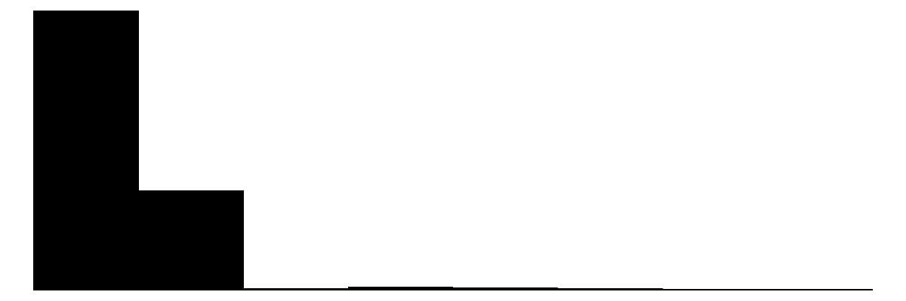
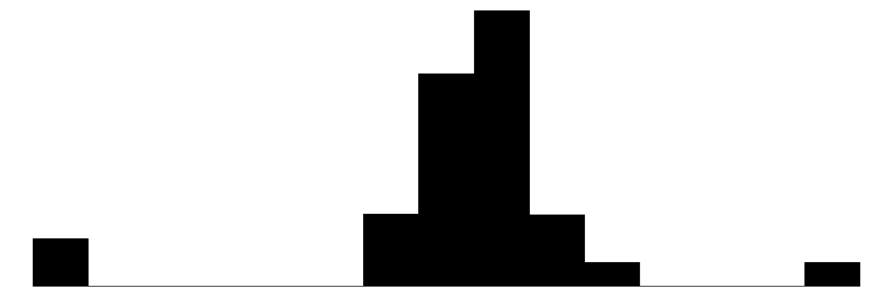
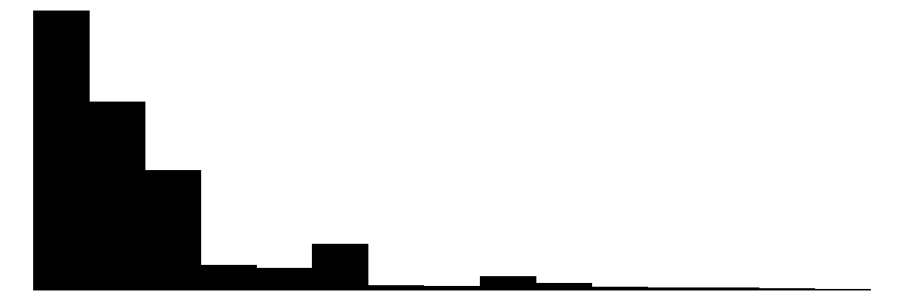
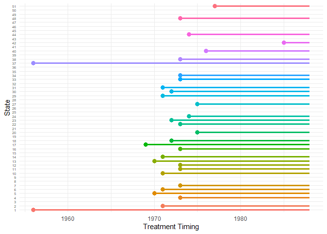
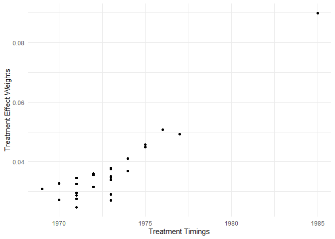
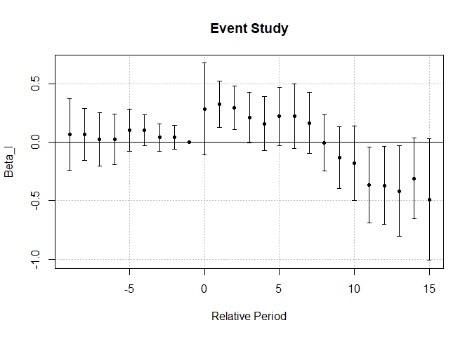
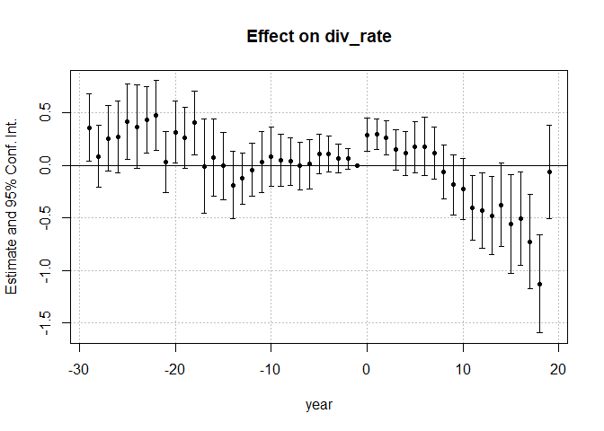
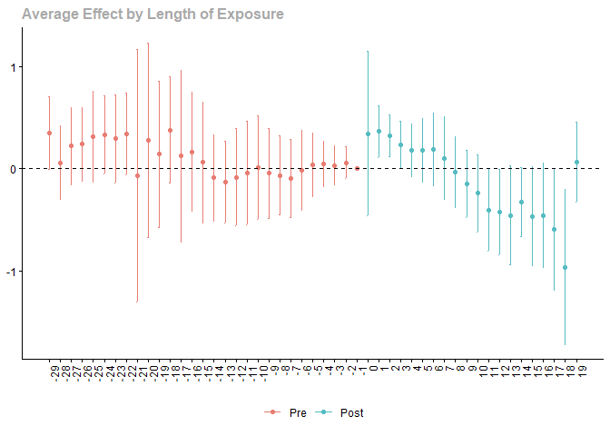
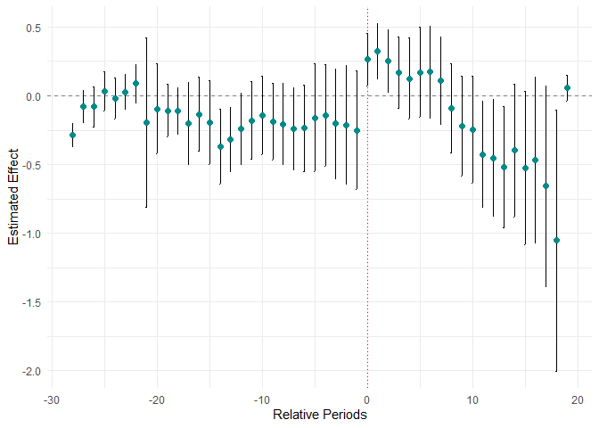

# The First Casualty of Statistics: Part Twenty Seven
<big>**Differences-in-Differences V: Variation in Treatment Timing**</big>

<br/>
Jiří Fejlek

2026-10-21
<br/>

<br/> We can summarize the results from the first four parts on the two-way
fixed effects estimator (TWFE) and the difference-in-differences (DID)
designs as follows. The TWFE estimates ATT under the parallel trend
assumption for the classical DID design (absorbing binary treatment,
without variation in treatment timing). In non-classical settings, TWFE
estimates a weighted sum of treatment effects under the parallel trend
assumption. To get the ATT, we need homogeneous treatment effects.
Consequently, we will now seek methods that provide an unbiased estimate
of ATT in the presence of treatment heterogeneity. We will start with
the methods for staggered designs, i.e., designs with variation in
treatment timings. <br/>


## Table of Contents

- [Wolfers Dataset](#wolfers-dataset)
- [Binary and Staggered Design](#binary-and-staggered-design)
- [TWFE Estimator for BST Design](#twfe-estimator-for-bst-design)
  - [Negative Weights in TWFE](#negative-weights-in-twfe)
  - [TWFE Event-Study Regression](#twfe-event-study-regression)
- [Heterogeneity-robust Estimators](#heterogeneity-robust-estimators)
  - [DID Estimators](#did-estimators)
  - [Imputation Estimators](#imputation-estimators)
  - [Heterogeneity-robust Estimators for Wolfers
    Dataset](#heterogeneity-robust-estimators-for-wolfers-dataset)
- [References](#references)


``` r
library(tidyr)
library(dplyr)
library(tibble)
library(ggplot2)
library(patchwork)
library(dagitty)
library(ggdag)
library(modelsummary)
library(fixest)
library(pretrends)
library(HonestDiD)
library(WeightIt)
library(cobalt)
```

## Wolfers Dataset

The dataset we will use in this presentation contains the data on the
effect of unilateral divorce law (UDL) on the divorce rate
in USA states (<span class="nocase">De Chaisemartin and d’Haultfoeuille</span> 2026). 
The main variables of interest are as follows.

- **state**
- **year**
- **cohort**: the year when the state adopted UDL
- **udl**: the state has UDL (1: Yes, 0: No)
- **div_rate**: the number of divorces per 1,000 people
- **stpop**: state population

``` r
options(width = 5000)
library(haven)
wolfers2006 <- read_dta("C:/Users/elini/Desktop/first casualty/wolfers2006_didtextbook.dta")
wolfers2006 <- wolfers2006[is.na(wolfers2006$div_rate) == FALSE,]
head(wolfers2006)
```

    ## # A tibble: 6 × 35
    ##    year div_rate  stpop rel_time1 rel_time2 rel_time3 rel_time4 rel_time5 rel_time6 rel_time7 rel_time8 rel_time9 rel_time10 rel_time11 rel_time12 rel_time13 rel_time14 rel_time15 rel_time16 rel_timeminus1 rel_timeminus2 rel_timeminus3 rel_timeminus4 rel_timeminus5 rel_timeminus6 rel_timeminus7 rel_timeminus8 rel_timeminus9 state     cohort controlgroup early_late_never   udl exposurelength stpop1968
    ##   <dbl>    <dbl>  <dbl>     <dbl>     <dbl>     <dbl>     <dbl>     <dbl>     <dbl>     <dbl>     <dbl>     <dbl>      <dbl>      <dbl>      <dbl>      <dbl>      <dbl>      <dbl>      <dbl>          <dbl>          <dbl>          <dbl>          <dbl>          <dbl>          <dbl>          <dbl>          <dbl>          <dbl> <dbl+lbl>  <dbl>        <dbl>            <dbl> <dbl>          <dbl>     <dbl>
    ## 1  1956     2.70 224000         0         0         0         0         0         0         0         0         0          0          0          0          0          0          0          1              0              0              0              0              0              0              0              0              0 1 [AK]      1956            0               NA     1              1    285000
    ## 2  1957     2.40 231000         0         0         0         0         0         0         0         0         0          0          0          0          0          0          0          1              0              0              0              0              0              0              0              0              0 1 [AK]      1956            0               NA     1              2    285000
    ## 3  1958     2.5  224000         0         0         0         0         0         0         0         0         0          0          0          0          0          0          0          1              0              0              0              0              0              0              0              0              0 1 [AK]      1956            0               NA     1              3    285000
    ## 4  1959     3    224000         0         0         0         0         0         0         0         0         0          0          0          0          0          0          0          1              0              0              0              0              0              0              0              0              0 1 [AK]      1956            0               NA     1              4    285000
    ## 5  1960     3.5  229000         0         0         0         0         0         0         0         0         0          0          0          0          0          0          0          1              0              0              0              0              0              0              0              0              0 1 [AK]      1956            0               NA     1              5    285000
    ## 6  1961     3.90 238000         0         0         0         0         0         0         0         0         0          0          0          0          0          0          0          1              0              0              0              0              0              0              0              0              0 1 [AK]      1956            0               NA     1              6    285000

``` r
wolfers2006$udl_factor <- factor(wolfers2006$udl)
wolfers2006$cohort_na <- wolfers2006$cohort
wolfers2006$cohort_na[wolfers2006$cohort_na == 0] <- NA

datasummary_skim(wolfers2006[,c('year','div_rate','udl_factor','cohort_na', 'stpop')])
```

<table>
  <thead>
    <tr>
      <th></th>
      <th>Unique</th>
      <th>Missing Pct.</th>
      <th>Mean</th>
      <th>SD</th>
      <th>Min</th>
      <th>Median</th>
      <th>Max</th>
      <th>Histogram</th>
    </tr>
  </thead>
  <tbody>
    <tr>
      <td>Year of observation</td>
      <td>33</td>
      <td>0</td>
      <td>1972.1</td>
      <td>9.5</td>
      <td>1956.0</td>
      <td>1972.0</td>
      <td>1988.0</td>
      <td></td>
    </tr>
    <tr>
      <td>Divorces per 1000 people, 1956-1998</td>
      <td>126</td>
      <td>0</td>
      <td>4.2</td>
      <td>3.2</td>
      <td>0.4</td>
      <td>3.8</td>
      <td>36.6</td>
      <td></td>
    </tr>
    <tr>
      <td>Initial treatment year (by state)</td>
      <td>12</td>
      <td>38</td>
      <td>1971.9</td>
      <td>5.1</td>
      <td>1956.0</td>
      <td>1973.0</td>
      <td>1985.0</td>
      <td></td>
    </tr>
    <tr>
      <td>State population</td>
      <td>1580</td>
      <td>0</td>
      <td>4082463.1</td>
      <td>4423616.7</td>
      <td>224000.0</td>
      <td>2750000.0</td>
      <td>28464249.0</td>
      <td></td>
    </tr>
    <tr>
      <td>udl_factor</td>
      <td>N</td>
      <td>%</td>
      <td></td>
      <td></td>
      <td></td>
      <td></td>
      <td></td>
      <td></td>
    </tr>
    <tr>
      <td>0</td>
      <td>1109</td>
      <td>68.0</td>
      <td></td>
      <td></td>
      <td></td>
      <td></td>
      <td></td>
      <td></td>
    </tr>
    <tr>
      <td>1</td>
      <td>522</td>
      <td>32.0</td>
      <td></td>
      <td></td>
      <td></td>
      <td></td>
      <td></td>
      <td></td>
    </tr>
  </tbody>
</table>

``` r
ggplot(wolfers2006, aes(y = factor(state), x = cohort_na, color = factor(state))) +
  geom_segment(aes(x = cohort_na, xend = 1988, y = factor(state), yend = factor(state),  color = factor(state)), linewidth = 1.2) +
  geom_point(size = 3) +
  labs(
    x = "Treatment Timing",
    y = "Country"
  ) + theme_minimal() + theme(axis.text.y = element_text(size = 5), legend.position = "none")
```

<!-- -->

## Binary and Staggered Design

We will assume an absorbing binary and staggered design (BST), i.e.,
(<span class="nocase">De Chaisemartin and d’Haultfoeuille</span> 2026)
``` math
D_{g,t} = I(t \geq F_g),
```
with $`\min_{g: F_g > 1 } < \max_g F_g`$ (not all groups get treated at
the same period). We define the treatment effect as
``` math
\tau_{g,t} = \mathbb{E}(Y_{g,t} - Y_{g,t}(0_t)) = \mathbb{E}(Y_{g,t}(0_{F_g -1}, 1_{t-F_g + 1}) - Y_{g,t}(0_t))
```
and
``` math
\text{ATT} = \frac{1}{|D_{g,t} = 1|} \sum_{(g,t):D_{g,t} = 1} \tau_{g,t}.
```
We will also define the treatment effect after being treated for $`l`$
periods as (<span class="nocase">De Chaisemartin and
d’Haultfoeuille</span> 2026)
``` math
\tau_{g,l}^r = \mathbb{E}(Y_{g, F_g - 1 + l}(0_{F_g -1},1_l) - Y_{g, F_g - 1 + l}(0_{ F_g - 1 + l}))
```
and
``` math
\text{ATT}_l = \frac{1}{|G_{\text{treated},l}|} \sum_{g: F_g \geq 2, F_g-1+l\leq T} \tau_{g,l}^r,
```
where $`|G_{\text{treated},l}|`$ is the number of groups that meet the
condition in the sum. This treatment effect denotes the average
treatment effect of having been exposed to treatment for $`l`$ periods,
across all initially untreated groups that reach $`l`$ treatment periods
before all groups are treated (<span class="nocase">De Chaisemartin and
d’Haultfoeuille</span> 2026).

If no group is treated at period one and there are never-treated groups,
then (<span class="nocase">De Chaisemartin and d’Haultfoeuille</span>
2026)
``` math
\text{ATT} = \sum_l \frac{|G_{\text{treated},l}|}{|D_{g,t} = 1|}  \text{ATT}_l
```

## TWFE Estimator for BST Design

We know from the previous part Twenty Seven that under the parallel
trend assumption and the no anticipation assumption
``` math
\mathbb{E}\hat\beta_\text{TFWE} = \frac{1}{|D_{g,t} = 1|}\sum_{(g,t):D_{g,t} = 1} w_{g,t}\tau_{g,t},
```
where
``` math
w_{g,t} = \frac{\hat u_{g,t}}{\sum_{(g,t) :D_{g',t'} = 1 } \hat u_{g',t'}}.
```
And
``` math
\hat u_{g,t} = D_{g,t} - D_{g,.} - D_{.,t} + D_{.,.},
```

where $`D_{g,.} = \frac{T - F_g + 1}{T}`$ in our case. Hence, the groups
that are treated early are the most likely to be negatively weighted. We
encountered this fact in the *WDI_FPE* dataset in Part Twenty Seven.

If some group is always-treated, it must be negatively weighted for the
last period $`T`$ for BST design since $`\hat u_{g,t}`$ reduces to
(<span class="nocase">De Chaisemartin and d’Haultfoeuille</span> 2026)
``` math
\hat u_{g,t} =  D_{.,.} - D_{.,t}.
```
Hence, we should always drop always-treated groups from the sample if we
wish to use TWFE (their treatment effect cannot be estimated under the
no anticipation and parallel trends assumptions without extrapolation,
since they are never observed without treatment).

In general, all the weights are positive if and only if
``` math
D_{g,.} +  \frac{T - F_g + 1}{T} \leq  1 + D_{.,.}.
```

Accordingly, there should be no group that is treated most of the time,
and no time period where most groups are treated
(<span class="nocase">De Chaisemartin and d’Haultfoeuille</span> 2026).
For example, this can be achieved when the majority of groups are
never-treated. If this is the case, TWFE estimates the weighted sum of
treatment effects (i.e., at least the sign of ATT is estimated
consistently).

For example, if we compute the proportion of the treated in our dataset

``` r
mean((wolfers2006 %>% group_by(state) %>% summarise(sum = sum(controlgroup)))==0)
```

    ## [1] 0.3039216

We see that about 70% of states belong to the control group.
Consequently, the number of negatively weighted treatment effects should
be relatively small. Let’s fit the TWFE model first (we will follow
(<span class="nocase">De Chaisemartin and d’Haultfoeuille</span> 2026)
and weight the data by state population).

``` r
summary(feols(div_rate ~ udl |  state + year, cluster ~  state, weights = wolfers2006$stpop, data = wolfers2006))
```

    ## OLS estimation, Dep. Var.: div_rate
    ## Observations: 1,631
    ## Weights: wolfers2006$stpop
    ## Fixed-effects: state: 51,  year: 33
    ## Standard-errors: Clustered (state) 
    ##      Estimate Std. Error  t value Pr(>|t|) 
    ## udl -0.054838   0.148391 -0.36955  0.71328 
    ## ---
    ## Signif. codes:  0 '***' 0.001 '**' 0.01 '*' 0.05 '.' 0.1 ' ' 1
    ## RMSE: 0.510489     Adj. R2: 0.926754
    ##                  Within R2: 7.661e-4

We compute the treatment effect weights using the *TwoWayFEWeights*
package.

``` r
library(TwoWayFEWeights)

twfe_weights <- twowayfeweights(
  data = wolfers2006, 
  Y = 'div_rate', 
  G = 'state',
  T = 'year', 
  D = 'udl',
  type = "feTR",
  weights = wolfers2006$stpop,
  summary_measures = TRUE)

twfe_weights
```

    ## 
    ## Under the common trends assumption,
    ## the TWFE coefficient beta, equal to -0.0548, estimates a weighted sum of 522 ATTs.
    ## 490 ATTs receive a positive weight, and 32 receive a negative weight.
    ## 
    ## ───────────────────────────────────── 
    ## Treat. var: udl     ATTs    Σ weights 
    ## ───────────────────────────────────── 
    ## Positive weights     490       1.0259 
    ## Negative weights      32      -0.0259 
    ## ───────────────────────────────────── 
    ## Total                522            1 
    ## ─────────────────────────────────────
    ## 
    ## Summary Measures:
    ##   TWFE Coefficient (β_fe): -0.0548
    ##   min σ(Δ) compatible with β_fe and Δ_TR = 0: 0.1096
    ##   min σ(Δ) compatible with treatment effect of opposite sign than β_fe in all (g,t) cells: 0.3395
    ##   Reference: Corollary 1, de Chaisemartin, C and D'Haultfoeuille, X (2020a)
    ## 
    ## The development of this package was funded by the European Union (ERC, REALLYCREDIBLE,GA N. 101043899).

The number of negative weights is indeed quite small. Still, that does
not mean that TWFE estimates ATT, since the treatment effect can be
heterogeneous. We can investigate this more. Provided that we have a
proxy variable that we suspect is correlated with $`\tau_{g,t}`$, we can
test whether the weights are correlated with this proxy variable (and
hence with $`\tau_{g,t}`$). For example, say that the treatment effect
is correlated with the length of exposure, **exposurelength**.

``` r
twfe_weights <- twowayfeweights(
  data = wolfers2006, 
  Y = 'div_rate', 
  G = 'state',
  T = 'year', 
  D = 'udl',
  type = "feTR",
  weights = wolfers2006$stpop,
  test_random_weights = 'exposurelength',
  summary_measures = TRUE)

twfe_weights$mat
```

    ##                        Coef        SE    t-stat Correlation
    ## RW_exposurelength -8.288361 0.2136059 -38.80212  -0.7325324

We see that the correlation is very significant and clearly negative.
The TWFE estimator for this dataset downweights the treatment effects of
longer lengths of exposure.

### Negative Weights in TWFE

(Goodman-Bacon 2021) showed that for the BST design
``` math
\hat \beta_\text{TWFE} = \sum_{g \neq g', t < t'} v_{g,g',t,t'} \text{DID}_{g,g',t,t'},
```
where $`\text{DID}_{g,g',t,t'}`$ is a $`2 \times 2`$ DID that compares
the outcome evolution of groups $`g`$ and $`g'`$ from $`t`$ to $`t'`$
and where $`v_{g,g',t,t'}`$ are non-negative weights summing to one,
with $`v_{g,g',t,t'} > 0`$ if and only if $`g`$’s treatment changes
between $`t`$ and $`t'`$ while $`g'`$’s treatment does not change
(<span class="nocase">De Chaisemartin and d’Haultfoeuille</span> 2026).

The TWFE estimator is weighted sum of all $`2 \times 2`$ DID
comparisons, in which $`D_{g,t} = 0`$, $`D_{g,t'} = 1`$ and
$`D_{g',t} = 0 = D_{g',t'} = 0`$ or $`D_{g',t} = D_{g',t'} = 1`$. It
turns out that the second type of comparison is problematic. It is the
comparisons with groups already treated, $`D_{g’,t} = D_{g’,t’} = 1`$,
that cause the negative weights $`w_{g,t}`$ for some treatment effects.
Consequently, these $`2 \times 2`$ DIDs are known as *forbidden*
comparisons (<span class="nocase">De Chaisemartin and
d’Haultfoeuille</span> 2026).

To illustrate the issue, let us consider two individuals over three
periods. The first individual $`i`$ receives the treatment in the second
period, and the second individual $`j`$ receives the treatment in the
third period. Using the expansion above, the TWFE estimator equals
``` math
\hat \beta_\text{TWFE} = \frac{\text{DID}_{i,j,1,2} + \text{DID}_{j,i,2,3}}{2},
```
where
``` math
\text{DID}_{i,j,1,2} = (Y_{i,2} - Y_{i,1}) - (Y_{j,2} - Y_{j,1})
```
and
``` math
\text{DID}_{j,i,2,3} = (Y_{j,3} - Y_{j,2}) - (Y_{i,3} - Y_{i,2}).
```
Let’s assume that without treatment, the outcomes increase linearly,
say, $`Y_{g,t+1}(0) = Y_{g,t} + 1`$. The treatment reduces, but its
effectiveness is heterogeneous: it increases with the duration of
exposure. For example, $`Y_{g,F_g} = Y_{g,F_g-1} - 1.5`$ and
$`Y_{g,F_g+1} = Y_{g,F_g} - 5`$. Then,
``` math
\text{DID}_{i,j,1,2} = (Y_{i,2} - Y_{i,1}) - (Y_{j,2} - Y_{j,1}) = -1.5 - 1 = -2.5.
```
But
``` math
\text{DID}_{j,i,2,3} = (Y_{j,3} - Y_{j,2}) - (Y_{i,3} - Y_{i,2}) = -1.5 - (-5) = 3.5.
```
Consequently,
``` math
\hat \beta_\text{TWFE} = \frac{-2.5 + 3.5}{2} = 0.5.
```
The $`\hat \beta_\text{TWFE}`$ has the opposite sign to the true
treatment effect! And the result will be more biased, the stronger the
treatment effect in the second period is. In terms of the weights
$`w_{g,t}`$, it can be derived that (<span class="nocase">De
Chaisemartin and d’Haultfoeuille</span> 2026)
``` math
\mathbb{E}\hat \beta_\text{TWFE} = 0.5\tau_{i,2} +  \tau_{j,2} - 0.5\tau_{j,3} = 0.5(-1.5 - 1) + (-1.5 - 1) - 0.5(-5 - 1.5 - 2) = 0.5.
```

We see that the treatment after the two periods for individual $`i`$ has
a negative sign, which causes the issue with $`\hat\beta_\text{TWFE}`$.

The issue disappears when the treatment effect is homogeneous. If we
assume, that $`Y_{g,F_g+1} = Y_{g,F_{g}} + 1`$, the forbidden comparison
equals
``` math
\text{DID}_{j,i,2,3} = (Y_{j,3} - Y_{j,2}) - (Y_{i,3} - Y_{i,2}) = -1.5 - 1 = -2.5,
```
and hence, we get the estimate
``` math
\hat \beta_\text{TWFE} = \frac{-2.5 - 2.5}{2} = -2.5.
```
In terms of the treatment effect, we derive
``` math
\tau_{i,2} = \tau_{j,2} = -1.5 - 1 = -2.5
```

and
``` math
\tau_{i,3} = -1.5 + 1 - 1 - 1 = -2.5.
```
Consequently,
``` math
\mathbb{E}\hat \beta_\text{TWFE} = 0.5\tau_{i,2} +  \tau_{j,2} - 0.5\tau_{j,3} = \tau_{j,2} = -2.5.
```

In general, $`\hat \beta_\text{TWFE}`$ is a weighted average of
treatment effects in the BST design if the treatment effects do not
change over time ($`\tau_{g,t}`$ must not depend on $`t`$)
(<span class="nocase">De Chaisemartin and d’Haultfoeuille</span> 2026).

The weights under the assumption that treatment effects do not change
over time can be computed explicitly using *twowayfeweights* as follows.

``` r
twfe_weights2 <- twowayfeweights(
  data = wolfers2006, 
  Y = 'div_rate', 
  G = 'state',
  T = 'year', 
  D = 'udl',
  type = "feS", 
  weights = wolfers2006$stpop,
  summary_measures = TRUE)

twfe_weights2
```

    ## 
    ## Under the common trends, treatment monotonicity, and if groups' treatment effect does not change over time,
    ## the TWFE coefficient beta, equal to -0.0548, estimates a weighted sum of 27 ATTs.
    ## 27 ATTs receive a positive weight, and 0 receive a negative weight.
    ## 
    ## ───────────────────────────────────── 
    ## Treat. var: udl     ATTs    Σ weights 
    ## ───────────────────────────────────── 
    ## Positive weights      27            1 
    ## Negative weights       0            0 
    ## ───────────────────────────────────── 
    ## Total                 27            1 
    ## ─────────────────────────────────────
    ## 
    ## Summary Measures:
    ##   TWFE Coefficient (β_fe): -0.0548
    ##   min σ(Δ) compatible with β_fe and Δ_TR = 0: 0.0336
    ##   Reference: Corollary 1, de Chaisemartin, C and D'Haultfoeuille, X (2020a)
    ## 
    ## The development of this package was funded by the European Union (ERC, REALLYCREDIBLE,GA N. 101043899).

We can check what weight was assigned to each group.

``` r
twfe_weights2$dat_result[twfe_weights2$dat_result$weight>0]
```

    ##         T     G     weight
    ##     <num> <num>      <num>
    ##  1:  1971     2 0.03257600
    ##  2:  1973     4 0.02907324
    ##  3:  1970     5 0.02713672
    ##  4:  1971     6 0.02756103
    ##  5:  1973     7 0.03790028
    ##  6:  1971    10 0.02477358
    ##  7:  1973    11 0.03508578
    ##  8:  1973    12 0.03392702
    ##  9:  1970    13 0.03274615
    ## 10:  1971    14 0.02953948
    ## 11:  1969    17 0.03079752
    ## 12:  1972    18 0.03159337
    ## 13:  1975    20 0.04580058
    ## 14:  1973    22 0.03761102
    ## 15:  1972    23 0.03562809
    ## 16:  1974    24 0.04103666
    ## 17:  1975    27 0.04489337
    ## 18:  1971    29 0.03452483
    ## 19:  1972    30 0.03613255
    ## 20:  1971    31 0.02870931
    ## 21:  1973    34 0.02696476
    ## 22:  1973    38 0.03471117
    ## 23:  1976    40 0.05068987
    ## 24:  1985    42 0.08981197
    ## 25:  1974    44 0.03685518
    ## 26:  1973    48 0.03465723
    ## 27:  1977    51 0.04926326
    ##         T     G     weight
    ##     <num> <num>      <num>

Notice that the weights are not the same. The weights clearly depend on
the year the treatment was adopted.

``` r
cohort <- wolfers2006 %>% group_by(state) %>% summarise(cohort = max(cohort))
cohort[cohort$cohort>1956,]
```

    ## # A tibble: 29 × 2
    ##    state     cohort
    ##    <dbl+lbl>  <dbl>
    ##  1  2 [AL]     1971
    ##  2  4 [AZ]     1973
    ##  3  5 [CA]     1970
    ##  4  6 [CO]     1971
    ##  5  7 [CT]     1973
    ##  6 10 [FL]     1971
    ##  7 11 [GA]     1973
    ##  8 12 [HI]     1973
    ##  9 13 [IA]     1970
    ## 10 14 [ID]     1971
    ## # ℹ 19 more rows

``` r
ggplot(twfe_weights2$dat_result[twfe_weights2$dat_result$weight > 0,], aes(x = T, y = weight)) +
  geom_point() + labs(x = "Treatment Timings", y = "Treatment Effect Weights") + theme_minimal()
```

<!-- -->

We must remember that the weights are constructed only under the
assumption that groups’ treatment effects do not change over time; the
effect across groups can still be heterogeneous. This means that
$`\hat \beta_\text{TWFE}`$ can still be far from ATT.

### TWFE Event-Study Regression

We can also consider the event-study regression, which for the BST
design takes the form
``` math
Y_{g,t} = \alpha_g + \gamma_t + \sum_{l \neq 0} \beta_l I(t = F_g -1 + l) + \varepsilon_{g,t}.
```

Let’s fit the event-study regression model. We need to compute the
relative time (with respect to the treatment adoption). We assign a
dummy value to the never-treated and employ binning to keep the relative
time within the interval $`[K, L]`$. Without binning, the regression
implicitly assumes that the treatment effect is zero after $`L`$
periods, whereas with binning, it assumes that the treatment effect is
constant after $`L`$ periods (<span class="nocase">De Chaisemartin and
d’Haultfoeuille</span> 2026).

Another benefit of binning is that it makes event-study regression
identified. It can be shown that, provided all groups are eventually
treated (i.e., there are no never-treated groups), the fully dynamic
regression (without binning) yields a singular model matrix
(<span class="nocase">De Chaisemartin and d’Haultfoeuille</span> 2026).

``` r
wolfers2006$rel_time <- wolfers2006$year - wolfers2006$cohort       # relative time
wolfers2006$rel_time[wolfers2006$rel_time >= 16] <- 15              # K
wolfers2006$rel_time[wolfers2006$rel_time <= -9] <-  -9             # L
wolfers2006$rel_time[wolfers2006$controlgroup == 1] <- -1000        # dummy value for never-treated
```

``` r
twfe_es <- feols(div_rate ~ i(rel_time, ref = c(-1, -1000)) | year + state, cluster ~  state, data = wolfers2006, weights = wolfers2006$stpop)
summary(twfe_es)
```

    ## OLS estimation, Dep. Var.: div_rate
    ## Observations: 1,631
    ## Weights: wolfers2006$stpop
    ## Fixed-effects: year: 33,  state: 51
    ## Standard-errors: Clustered (state) 
    ##               Estimate Std. Error   t value  Pr(>|t|)    
    ## rel_time::-9  0.065508   0.153515  0.426723 0.6714130    
    ## rel_time::-8  0.066503   0.110251  0.603196 0.5491048    
    ## rel_time::-7  0.023865   0.113049  0.211103 0.8336649    
    ## rel_time::-6  0.025216   0.108219  0.233009 0.8167057    
    ## rel_time::-5  0.102784   0.089049  1.154235 0.2538911    
    ## rel_time::-4  0.103013   0.066239  1.555162 0.1262152    
    ## rel_time::-3  0.039730   0.057467  0.691355 0.4925402    
    ## rel_time::-2  0.041363   0.051337  0.805708 0.4242264    
    ## rel_time::0   0.283042   0.195456  1.448109 0.1538286    
    ## rel_time::1   0.321938   0.098364  3.272936 0.0019341 ** 
    ## rel_time::2   0.294202   0.092446  3.182422 0.0025116 ** 
    ## rel_time::3   0.210401   0.107924  1.949526 0.0568524 .  
    ## rel_time::4   0.158164   0.115528  1.369051 0.1771023    
    ## rel_time::5   0.219705   0.124618  1.763027 0.0840068 .  
    ## rel_time::6   0.222124   0.136729  1.624553 0.1105460    
    ## rel_time::7   0.164953   0.129662  1.272173 0.2091967    
    ## rel_time::8  -0.006622   0.119653 -0.055345 0.9560845    
    ## rel_time::9  -0.132133   0.132261 -0.999031 0.3225903    
    ## rel_time::10 -0.180168   0.157713 -1.142379 0.2587376    
    ## rel_time::11 -0.363542   0.161249 -2.254542 0.0285740 *  
    ## rel_time::12 -0.370923   0.165636 -2.239390 0.0296089 *  
    ## rel_time::13 -0.417134   0.193707 -2.153425 0.0361326 *  
    ## rel_time::14 -0.310338   0.171843 -1.805939 0.0769492 .  
    ## rel_time::15 -0.489643   0.259228 -1.888850 0.0647191 .  
    ## ---
    ## Signif. codes:  0 '***' 0.001 '**' 0.01 '*' 0.05 '.' 0.1 ' ' 1
    ## RMSE: 0.494682     Adj. R2: 0.930182
    ##                  Within R2: 0.061689

``` r
iplot(twfe_es, 
      main = "Event Study",
      xlab = "Relative Period",
      ylab = "Beta_l")
```

<!-- -->

What is interesting for this dataset is that the effect of UDL appears
to change sign. Early on, the effect is positive on the divorce rate,
but later the effect is negative.

TWFE event-study regression is subject to a similar decomposition as
ordinary TWFE (<span class="nocase">De Chaisemartin and
d’Haultfoeuille</span> 2026). Let’s assume the BST design, the parallel
trend assumption, the no anticipation assumption, and that there are
some never-treated groups. Then, (Sun and Abraham 2021)
``` math
\mathbb{E}\hat\beta_\text{TFWE, l} = \sum_{g: F_g - 1 + l \leq T} w_{g,l}^l \tau_{g,l}^r + \sum_{l' = 1, l' \neq l}^{\bar L}  \sum_{g: F_g - 1 + l' \leq T} w_{g,l'}^l \tau_{g,l'}^r,
```
where $`\bar L = T - \min_{g:F_g > 1} F_g + 1`$ and where
$`\sum_{g: F_g - 1 + l \leq T} w_{g,l}^l = 1`$ and
$`\sum_{g: F_g - 1 + l' \leq T} w_{g,l'}^l = 1`$ for every
$`l' \in \{1, \ldots, \bar L\}, l' \neq l`$.

The first sum is reminiscent of the definition of $`\text{ATT}_l`$
``` math
\text{ATT}_l = \frac{1}{|G_{\text{treated},l}|} \sum_{g: F_g \geq 2, F_g-1+l\leq T} \tau_{g,l}^r,
```
but again, some of the weights can be negative, and thus the first sum
will be a biased estimate of $`\text{ATT}_l`$ under treatment effect
heterogeneity. There is also an additional second sum that equals zero
under treatment homogeneity, but it further contaminates the estimate
under treatment-effect heterogeneity. (Sun and Abraham 2021) also showed
that similar results apply to regressions with no never-treated groups.

Lastly, (Sun and Abraham 2021) showed that, under treatment-effect
heterogeneity, the TWFE event-study regression cannot be used to test
the no-anticipation and parallel-trend assumptions. The estimated
differences in outcome pre-treatment have the same two-sum structure as
above: the first sum is zero under the no anticipation and parallel
trend assumptions, as expected, but the second term might not be.

We can compute the weights for $`\hat \beta_l`$ using *twowayfeweights*.
For example, the decomposition of $`\hat \beta_1`$ is as follows.

``` r
twfe_weights3 <- twowayfeweights(data = wolfers2006,
                Y = 'div_rate', 
                G = 'state',
                T = 'year', 
                D = 'rel_time1', 
                type = "feTR", 
                weight = wolfers2006$stpop, 
                other_treatments = c('rel_time2','rel_time3','rel_time4','rel_time5','rel_time6','rel_time7','rel_time8','rel_time9','rel_time10','rel_time11','rel_time12','rel_time13','rel_time14','rel_time15','rel_time16'),
                controls = c('rel_timeminus1','rel_timeminus2','rel_timeminus3','rel_timeminus4','rel_timeminus5','rel_timeminus6','rel_timeminus7','rel_timeminus8','rel_timeminus9'))

twfe_weights3
```

    ## 
    ## Under the common trends assumption,
    ## the TWFE coefficient beta, equal to 0.2892, estimates the sum of several terms.
    ## 
    ## The first term is a weighted sum of 27 ATTs.
    ## 27 ATTs receive a positive weight, and 0 receive a negative weight.
    ## 
    ## ────────────────────────────────────────── 
    ## Treat. var: rel_time1    ATTs    Σ weights 
    ## ────────────────────────────────────────── 
    ## Positive weights           27            1 
    ## Negative weights            0            0 
    ## ────────────────────────────────────────── 
    ## Total                      27            1 
    ## ──────────────────────────────────────────
    ## 
    ## The next term is a weighted sum of 29 ATTs.
    ## 16 ATTs receive a positive weight, and 13 receive a negative weight.
    ## 
    ## ──────────────────────────────────────────── 
    ## Other treat.: rel_time2    ATTs    Σ weights 
    ## ──────────────────────────────────────────── 
    ## Positive weights             16       0.0119 
    ## Negative weights             13      -0.0119 
    ## ──────────────────────────────────────────── 
    ## Total                        29            0 
    ## ────────────────────────────────────────────
    ## 
    ## The next term is a weighted sum of 28 ATTs.
    ## 10 ATTs receive a positive weight, and 18 receive a negative weight.
    ## 
    ## ──────────────────────────────────────────── 
    ## Other treat.: rel_time3    ATTs    Σ weights 
    ## ──────────────────────────────────────────── 
    ## Positive weights             10       0.0102 
    ## Negative weights             18      -0.0102 
    ## ──────────────────────────────────────────── 
    ## Total                        28            0 
    ## ────────────────────────────────────────────
    ## 
    ## The next term is a weighted sum of 30 ATTs.
    ## 21 ATTs receive a positive weight, and 9 receive a negative weight.
    ## 
    ## ──────────────────────────────────────────── 
    ## Other treat.: rel_time4    ATTs    Σ weights 
    ## ──────────────────────────────────────────── 
    ## Positive weights             21       0.0083 
    ## Negative weights              9      -0.0083 
    ## ──────────────────────────────────────────── 
    ## Total                        30            0 
    ## ────────────────────────────────────────────
    ## 
    ## The next term is a weighted sum of 29 ATTs.
    ## 21 ATTs receive a positive weight, and 8 receive a negative weight.
    ## 
    ## ──────────────────────────────────────────── 
    ## Other treat.: rel_time5    ATTs    Σ weights 
    ## ──────────────────────────────────────────── 
    ## Positive weights             21       0.0105 
    ## Negative weights              8      -0.0105 
    ## ──────────────────────────────────────────── 
    ## Total                        29            0 
    ## ────────────────────────────────────────────
    ## 
    ## The next term is a weighted sum of 29 ATTs.
    ## 26 ATTs receive a positive weight, and 3 receive a negative weight.
    ## 
    ## ──────────────────────────────────────────── 
    ## Other treat.: rel_time6    ATTs    Σ weights 
    ## ──────────────────────────────────────────── 
    ## Positive weights             26       0.0065 
    ## Negative weights              3      -0.0065 
    ## ──────────────────────────────────────────── 
    ## Total                        29            0 
    ## ────────────────────────────────────────────
    ## 
    ## The next term is a weighted sum of 29 ATTs.
    ## 19 ATTs receive a positive weight, and 10 receive a negative weight.
    ## 
    ## ──────────────────────────────────────────── 
    ## Other treat.: rel_time7    ATTs    Σ weights 
    ## ──────────────────────────────────────────── 
    ## Positive weights             19       0.0023 
    ## Negative weights             10      -0.0023 
    ## ──────────────────────────────────────────── 
    ## Total                        29            0 
    ## ────────────────────────────────────────────
    ## 
    ## The next term is a weighted sum of 29 ATTs.
    ## 19 ATTs receive a positive weight, and 10 receive a negative weight.
    ## 
    ## ──────────────────────────────────────────── 
    ## Other treat.: rel_time8    ATTs    Σ weights 
    ## ──────────────────────────────────────────── 
    ## Positive weights             19       0.0017 
    ## Negative weights             10      -0.0017 
    ## ──────────────────────────────────────────── 
    ## Total                        29            0 
    ## ────────────────────────────────────────────
    ## 
    ## The next term is a weighted sum of 28 ATTs.
    ## 17 ATTs receive a positive weight, and 11 receive a negative weight.
    ## 
    ## ──────────────────────────────────────────── 
    ## Other treat.: rel_time9    ATTs    Σ weights 
    ## ──────────────────────────────────────────── 
    ## Positive weights             17       0.0011 
    ## Negative weights             11      -0.0011 
    ## ──────────────────────────────────────────── 
    ## Total                        28            0 
    ## ────────────────────────────────────────────
    ## 
    ## The next term is a weighted sum of 28 ATTs.
    ## 14 ATTs receive a positive weight, and 14 receive a negative weight.
    ## 
    ## ───────────────────────────────────────────── 
    ## Other treat.: rel_time10    ATTs    Σ weights 
    ## ───────────────────────────────────────────── 
    ## Positive weights              14        9e-04 
    ## Negative weights              14       -9e-04 
    ## ───────────────────────────────────────────── 
    ## Total                         28            0 
    ## ─────────────────────────────────────────────
    ## 
    ## The next term is a weighted sum of 29 ATTs.
    ## 13 ATTs receive a positive weight, and 16 receive a negative weight.
    ## 
    ## ───────────────────────────────────────────── 
    ## Other treat.: rel_time11    ATTs    Σ weights 
    ## ───────────────────────────────────────────── 
    ## Positive weights              13        9e-04 
    ## Negative weights              16       -9e-04 
    ## ───────────────────────────────────────────── 
    ## Total                         29            0 
    ## ─────────────────────────────────────────────
    ## 
    ## The next term is a weighted sum of 29 ATTs.
    ## 17 ATTs receive a positive weight, and 12 receive a negative weight.
    ## 
    ## ───────────────────────────────────────────── 
    ## Other treat.: rel_time12    ATTs    Σ weights 
    ## ───────────────────────────────────────────── 
    ## Positive weights              17        0.001 
    ## Negative weights              12       -0.001 
    ## ───────────────────────────────────────────── 
    ## Total                         29            0 
    ## ─────────────────────────────────────────────
    ## 
    ## The next term is a weighted sum of 28 ATTs.
    ## 17 ATTs receive a positive weight, and 11 receive a negative weight.
    ## 
    ## ───────────────────────────────────────────── 
    ## Other treat.: rel_time13    ATTs    Σ weights 
    ## ───────────────────────────────────────────── 
    ## Positive weights              17        0.001 
    ## Negative weights              11       -0.001 
    ## ───────────────────────────────────────────── 
    ## Total                         28            0 
    ## ─────────────────────────────────────────────
    ## 
    ## The next term is a weighted sum of 26 ATTs.
    ## 13 ATTs receive a positive weight, and 13 receive a negative weight.
    ## 
    ## ───────────────────────────────────────────── 
    ## Other treat.: rel_time14    ATTs    Σ weights 
    ## ───────────────────────────────────────────── 
    ## Positive weights              13        7e-04 
    ## Negative weights              13       -7e-04 
    ## ───────────────────────────────────────────── 
    ## Total                         26            0 
    ## ─────────────────────────────────────────────
    ## 
    ## The next term is a weighted sum of 24 ATTs.
    ## 11 ATTs receive a positive weight, and 13 receive a negative weight.
    ## 
    ## ───────────────────────────────────────────── 
    ## Other treat.: rel_time15    ATTs    Σ weights 
    ## ───────────────────────────────────────────── 
    ## Positive weights              11       0.0012 
    ## Negative weights              13      -0.0012 
    ## ───────────────────────────────────────────── 
    ## Total                         24            0 
    ## ─────────────────────────────────────────────
    ## 
    ## The next term is a weighted sum of 100 ATTs.
    ## 65 ATTs receive a positive weight, and 35 receive a negative weight.
    ## 
    ## ───────────────────────────────────────────── 
    ## Other treat.: rel_time16    ATTs    Σ weights 
    ## ───────────────────────────────────────────── 
    ## Positive weights              65       0.0068 
    ## Negative weights              35      -0.0068 
    ## ───────────────────────────────────────────── 
    ## Total                        100            0 
    ## ─────────────────────────────────────────────
    ## 
    ## The development of this package was funded by the European Union (ERC, REALLYCREDIBLE,GA N. 101043899).

We see that the estimate is a combination of a weighted sum of treatment
effects after the first period, with weights that sum to one, and a
weighted sum of treatment effects for more than one period, with weights
that sum to zero; exactly as the theory states. We can also note that,
fortunately, the weights in these “contamination” terms are quite small,
which indicates that $`\hat \beta_1`$ is approximately a weighted
average of the treatment effect $`\tau_{g,1}^r`$.

We can also check the correlation of the weights with other covariates.
For example, the correlation with **year** is

``` r
twfe_weights3 <- twowayfeweights(data = wolfers2006,
                Y = 'div_rate', 
                G = 'state',
                T = 'year', 
                D = 'rel_time1', 
                type = "feTR", 
                weight = wolfers2006$stpop, 
                other_treatments = c('rel_time2','rel_time3','rel_time4','rel_time5','rel_time6','rel_time7','rel_time8','rel_time9','rel_time10','rel_time11','rel_time12','rel_time13','rel_time14','rel_time15','rel_time16'),
                controls = c('rel_timeminus1','rel_timeminus2','rel_timeminus3','rel_timeminus4','rel_timeminus5','rel_timeminus6','rel_timeminus7','rel_timeminus8','rel_timeminus9'),
                test_random_weights = 'year')

twfe_weights3$mat
```

    ##              Coef       SE    t-stat Correlation
    ## RW_year -15.33387 13.42876 -1.141868  -0.2322456

the estimate upweights effects in states passing a law early, and
downweights effects in states passing a law late.

## Heterogeneity-robust Estimators

We learned in the previous section that TWFE fails to estimate ATT in
the BST design unbiasedly unless the treatment effect is homogeneous.
Hence, we will introduce quite recent estimators by (Callaway and
Sant’Anna 2021), (Sun and Abraham 2021), and (Borusyak et al. 2024).

### DID Estimators

Let $`\mathcal{C} = \{c \in \{2, \ldots, T\}: \exists g: F_g = c\}`$
denote the set of dates at which at least one group adopts the
treatment. For all $`c \in \mathcal{C}`$ and $`t \in {1, \ldots, T}`$,
we denote by $`\bar{Y}_{c,t}`$ the average outcome at period $`t`$
across groups belonging to cohort $`c`$. We define the cohort-specific
treatment effect (<span class="nocase">De Chaisemartin and
d’Haultfoeuille</span> 2026)
``` math
\tau_{c,l}^r = \mathbb{E}(\bar{Y}_{c,c-1+l}(0_{c-1},1_l) - \bar{Y}_{c,c-1+l}(0_{c-1+l})).
```
It can be shown that for all $`l \leq T - (\underline{F}-1)`$
``` math
\text{ATT}_l = \sum_{c:c-1+l\leq T} \frac{|G_{c}|}{|G_{\text{treated},l}|} \tau_{c,l}^r,
```
where $`G_c`$ denotes the groups in adoption-cohort $`c`$ and
$`\underline{F} =  \min c`$ (<span class="nocase">De Chaisemartin and
d’Haultfoeuille</span> 2026).

Based on these definitions, (Callaway and Sant’Anna 2021) and (Sun and
Abraham 2021) proposed the DID estimator

``` math
\hat\tau_{c,l}^\text{DID} = (\bar{Y}_{c,c-1+l} - \bar{Y}_{c,c-1}) - (\bar{Y}_{n,c-1+l} - \bar{Y}_{n,c-1}),
```
where $`\bar{Y}_{n,t}`$ denotes the average outcome at period $`t`$
across the groups that remain untreated from period $`1`$ to $`T`$. We
should note that (Callaway and Sant’Anna 2021) proposed using
not-yet-treated as the controls for the comparisons rather than
never-treated. This approach allows us to estimate treatment effects up
to the period where the last group is untreated.

We notice that this DID estimator avoids forbidden comparisons by
explicitly comparing the treatment effect only to the untreated group in
the given period. Consequently, (<span class="nocase">De Chaisemartin
and d’Haultfoeuille</span> 2026)

*In a BST design under the no anticipation and parallel trend
assumptions*, $`\mathbb{E}\hat\tau_{c,l}^\text{DID} = \tau_{c,l}^r`$ for
all $`c \in \mathcal{C}`$ and all $`l \in \{1, \ldots, T - (c-1)\}`$.

Hence,
``` math
\widehat{\text{ATT}}_l^\text{DID} = \sum_{c:c-1+l\leq T} \frac{|G_{c}|}{|G_{\text{treated},l}|} \hat\tau_{c,l}^\text{DID},
```
is an unbiased estimate of $`\text{ATT}_l`$, and
``` math
\widehat{\text{ATT}}^\text{DID} = \sum_{c:c-1+l\leq T} \frac{|G_{\text{treated},l}|}{|G_{\text{treated}}|} \widehat{\text{ATT}}_l^\text{DID}
```
is an unbiased estimate of $`\text{ATT}`$.

In addition, we can use the following treatment effect estimate for a
pre-trend test of the no anticipation assumption and the parallel trend
assumption (<span class="nocase">De Chaisemartin and
d’Haultfoeuille</span> 2026)
``` math
\widehat{\text{ATT}}_{-l}^\text{DID} = \sum_{c:c-1-l\geq 1} \frac{|G_{c}|}{|G_{\text{placebo},-l}|} \hat\tau_{c,-l}^\text{DID},
```
where $`|G_{\text{placebo},-l}| = \sum_{c:c-1-l\geq 1} |G_{c}|`$.

Lastly, (Sun and Abraham 2021) showed that $`\hat\tau_{c,l}^\text{DID}`$
can be obtained using the TWFE event-study regression
``` math
Y_{g,t} = \alpha_c + \gamma_t + \sum_{c \in \mathcal{C}} \sum_{l = -(c-2), l \neq 0}^{T-(c-1)} \beta_{c,l} I(F_g = c, t = c-1+l) + \varepsilon_{g,t}.
```
We see that the group fixed effects are replaced with cohort fixed
effects, and the relative time indicators are interacted with cohort
fixed effects, thus allowing for heterogeneous effects across adoption
cohorts (<span class="nocase">De Chaisemartin and d’Haultfoeuille</span>
2026). We should note that including covariates will result in biased
estimates and hence, we must use IPW/doubly robust estimators proposed
in (Callaway and Sant’Anna 2021), which are analogous to the estimators
we explored in Part Twenty Six for the classical design.

### Imputation Estimators

The alternative to the DID estimators by (Callaway and Sant’Anna 2021)
and (Sun and Abraham 2021) is the imputation estimator (Borusyak et al.
2024).

We can obtain the imputation estimator by running the regression
``` math
Y_{g,t} = \alpha_g + \gamma_t + \sum_{g',t'} \beta_{g,t} I(g = g', t = t')D_{g,t} + \varepsilon_{g,t}.
```

From this regression we obtain $`\hat \beta_{g,t}`$ which we denote as
$`\hat\tau_{g,t}^\text{imp}`$. We can then estimate $`\tau_{c,l}^r`$ as
the average of all $`\hat\tau_{g,t}^\text{imp}`$ such that $`g`$ started
receiving the treatment at period $`c`$ and $`t = c−1+l`$
(<span class="nocase">De Chaisemartin and d’Haultfoeuille</span> 2026).

It can be shown that this estimator is numerically equivalent to the one
by (Wooldridge 2025)
``` math
Y_{g,t} = \alpha_c + \gamma_t + \sum_{c \in \mathcal{C}} \sum_{l = 1}^{T-(c-1)} \beta_{c,l} I(F_g = c, t = c-1+l) + \varepsilon_{g,t}.
```
We note that this regression is almost identical to the TWFE event-study
regression that computes $`\hat\tau_{c,l}^\text{DID}`$. The only
difference is that this regression is missing the periods before the
first cohort is treated.

Another numerically equivalent way of computing these estimators is to
fit a TWFE regression of the outcome on group and time in the sample of
untreated cells and use the resulting model to predict the
counterfactuals for the treated cells. The treatment effect estimates
are then simply the differences between the observed outcomes and the
predicted counterfactuals. The nice thing about these methods is that
they readily generalize to include covariates; we add the covariates to
the first stage (<span class="nocase">De Chaisemartin and
d’Haultfoeuille</span> 2026).

### Heterogeneity-robust Estimators for Wolfers Dataset

Let’s use the heterogeneity-robust estimators we discussed on the
Wolfers Dataset. We start with the (Sun and Abraham 2021) DID estimator,
which is implemented in *fixest* as follows.

``` r
sun_abraham <- feols(div_rate ~ sunab(cohort, year) | state + year, cluster ~  state, data = wolfers2006, weights = wolfers2006$stpop)
iplot(sun_abraham)
```

<!-- -->

We see that the result is similar to the naive TWFE estimate. We can get
the ATT estimate as follows.

``` r
aggregate(sun_abraham, agg = "att")
```

    ##       Estimate Std. Error   t value  Pr(>|t|)
    ## ATT -0.1329899  0.1228806 -1.082269 0.2843249

We can also compute the average treatment effects for individual
cohorts.

``` r
aggregate(sun_abraham, agg = "cohort")
```

    ##                 Estimate Std. Error    t value     Pr(>|t|)
    ## cohort::1969  0.13667519 0.15016684  0.9101556 3.671073e-01
    ## cohort::1970 -0.33731066 0.14334193 -2.3531890 2.258716e-02
    ## cohort::1971  0.03238392 0.15812655  0.2047975 8.385618e-01
    ## cohort::1972 -0.20772420 0.11355055 -1.8293545 7.331265e-02
    ## cohort::1973 -0.23070533 0.29827510 -0.7734650 4.428888e-01
    ## cohort::1974  0.16694514 0.11353921  1.4703744 1.477257e-01
    ## cohort::1975 -0.16342682 0.09731386 -1.6793786 9.931753e-02
    ## cohort::1976  0.59035655 0.10080408  5.8564749 3.655008e-07
    ## cohort::1977  0.13309086 0.12749607  1.0438821 3.015608e-01
    ## cohort::1985  0.22689009 0.04785387  4.7413114 1.804321e-05

Next, we will consider the (Callaway and Sant’Anna 2021) DID estimator,
which is implemented in the package *did*.

``` r
library(did)
callaway_santanna <- att_gt(
  yname = "div_rate",                  
  tname = "year",             
  idname = "state",                 
  gname = "cohort", 
  clustervars = "state", 
  control_group = "notyettreated",
  data = wolfers2006,
  weightsname  = 'stpop'
)

ggdid(aggte(callaway_santanna, type = "dynamic")) +  theme(axis.text.x = element_text(angle = 90, vjust = 1, hjust = 1))
```

<!-- -->

The ATT estimate and cohort averages are obtained as follows.

``` r
aggte(callaway_santanna, type = "group")
```

    ## 
    ## Call:
    ## aggte(MP = callaway_santanna, type = "group")
    ## 
    ## Reference: Callaway, Brantly and Pedro H.C. Sant'Anna.  "Difference-in-Differences with Multiple Time Periods." Journal of Econometrics, Vol. 225, No. 2, pp. 200-230, 2021. <https://doi.org/10.1016/j.jeconom.2020.12.001>, <https://arxiv.org/abs/1803.09015> 
    ## 
    ## 
    ## Overall summary of ATT's based on group/cohort aggregation:  
    ##      ATT    Std. Error     [ 95%  Conf. Int.] 
    ##  -0.0603        0.0983     -0.253      0.1325 
    ## 
    ## 
    ## Group Effects:
    ##  Group Estimate Std. Error [95% Simult.  Conf. Band]  
    ##   1969   0.2363     0.1174       -0.0436      0.5161  
    ##   1970  -0.2403     0.0906       -0.4563     -0.0244 *
    ##   1971   0.1112     0.1117       -0.1548      0.3773  
    ##   1972  -0.2072     0.0858       -0.4116     -0.0027 *
    ##   1973  -0.2420     0.2753       -0.8979      0.4138  
    ##   1974   0.2223     0.1038       -0.0250      0.4696  
    ##   1975  -0.1063     0.0708       -0.2749      0.0624  
    ##   1976   0.5656     0.0975        0.3333      0.7979 *
    ##   1977   0.1943     0.1474       -0.1570      0.5455  
    ##   1985   0.2840     0.0458        0.1748      0.3933 *
    ## ---
    ## Signif. codes: `*' confidence band does not cover 0
    ## 
    ## Control Group:  Not Yet Treated,  Anticipation Periods:  0
    ## Estimation Method:  Doubly Robust

Lastly, we will use the (Borusyak et al. 2024) imputation estimator from
the package *didimputation*. By default, it only returns ATT.

``` r
library(didimputation)
did_imputation(
  data = wolfers2006,
  yname = "div_rate",
  gname = "cohort", 
  tname = "year",
  idname = "state",
  wname = 'stpop',
  cluster_var = "state", 
)
```

    ##      term   estimate std.error   conf.low conf.high
    ##    <char>      <num>     <num>      <num>     <num>
    ## 1:  treat -0.1374946 0.1734921 -0.4775391 0.2025499

To get the event-study plot, we have to specify the *horizon* and
*pretrends* and plot it ourselves.

``` r
borusyak <- did_imputation(
  data = wolfers2006,
  yname = "div_rate",
  gname = "cohort", 
  tname = "year",
  idname = "state",
  wname = 'stpop',
  horizon = 0:19, 
  pretrends = -28:-1,
  cluster_var = "state", 
)

borusyak$event_time <- as.numeric(gsub("tp", "", gsub("tm", "-", borusyak$term)))

ggplot(borusyak, aes(x = event_time, y = estimate)) +
  geom_hline(yintercept = 0, linetype = "dashed", color = "gray50") +
  geom_vline(xintercept = 0, linetype = "dotted", color = "red") +
  geom_errorbar(aes(ymin = conf.low, ymax = conf.high), width = 0.1, color = "black") +
  geom_point(color = "darkcyan", size = 2) +
  labs(x = "Relative Periods",
    y = "Estimated Effect"
  ) + theme_minimal()
```

<!-- -->

The results are similar across all methods.

## References

<div id="refs" class="references csl-bib-body hanging-indent">

<div id="ref-borusyak2024revisiting" class="csl-entry">

Borusyak, Kirill, Xavier Jaravel, and Jann Spiess. 2024. “Revisiting
Event-Study Designs: Robust and Efficient Estimation.” *Review of
Economic Studies* 91 (6): 3253–85.

</div>

<div id="ref-callaway2021difference" class="csl-entry">

Callaway, Brantly, and Pedro HC Sant’Anna. 2021.
“Difference-in-Differences with Multiple Time Periods.” *Journal of
Econometrics* 225 (2): 200–230.

</div>

<div id="ref-de2026causal" class="csl-entry">

<span class="nocase">De Chaisemartin, Clément, and Xavier
d’Haultfoeuille</span>. 2026. *Causal Inference with
Differences-in-Differences: Credible Answers to Hard Questions*.
Princeton University Press.

</div>

<div id="ref-goodman2021difference" class="csl-entry">

Goodman-Bacon, Andrew. 2021. “Difference-in-Differences with Variation
in Treatment Timing.” *Journal of Econometrics* 225 (2): 254–77.

</div>

<div id="ref-sun2021estimating" class="csl-entry">

Sun, Liyang, and Sarah Abraham. 2021. “Estimating Dynamic Treatment
Effects in Event Studies with Heterogeneous Treatment Effects.” *Journal
of Econometrics* 225 (2): 175–99.

</div>

<div id="ref-wooldridge2025two" class="csl-entry">

Wooldridge, Jeffrey M. 2025. “Two-Way Fixed Effects, the Two-Way Mundlak
Regression, and Difference-in-Differences Estimators.” *Empirical
Economics* 69 (5): 2545–87.

</div>

</div>
