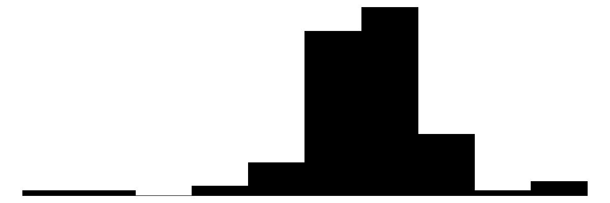
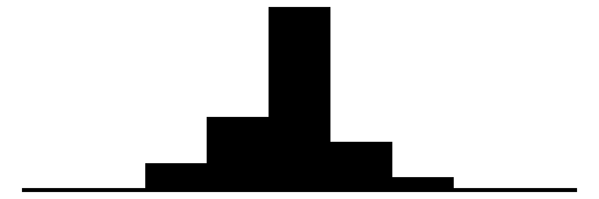
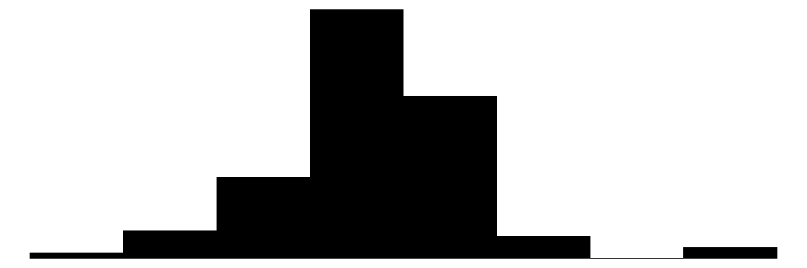
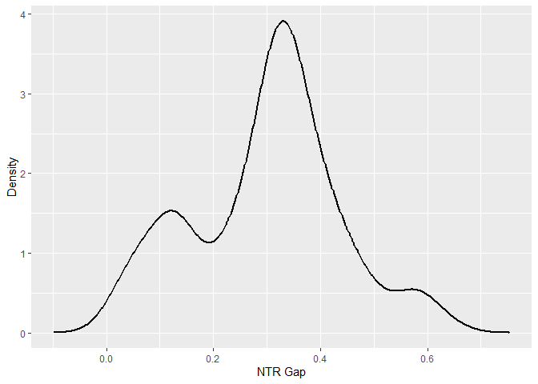
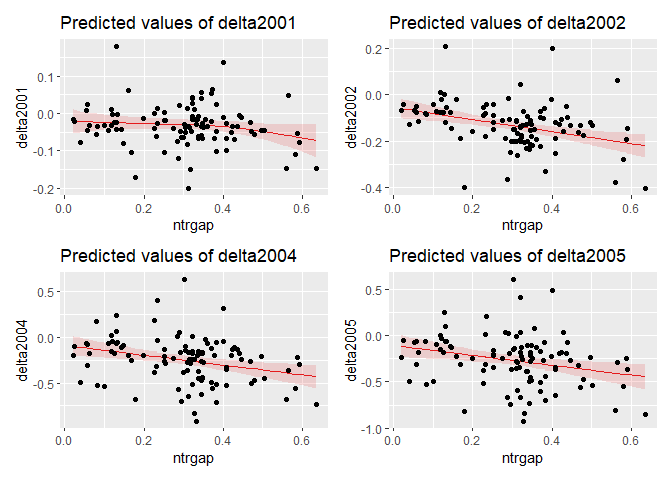
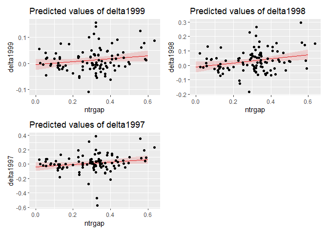
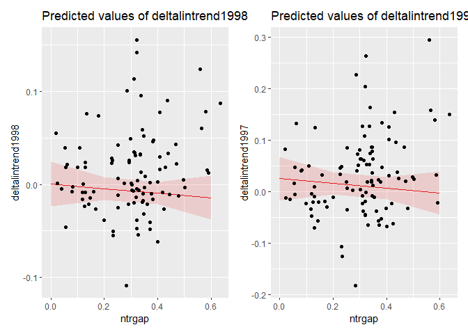
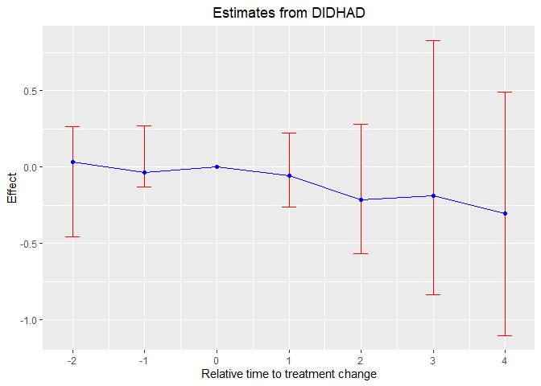

# The First Casualty of Statistics: Part Twenty Nine
<big>**Differences-in-Differences VI: Variation in Treatment Dose**</big>

<br/>
Jiří Fejlek

2026-10-24
<br/>

<br/> In this part, we will investigate the second main type of violation of
the classical design apart of variation in treatment timing (staggered
design) across treated groups: variation in *treatment doses*. In other
words, we will assume that the treatment is no longer binary. We will
see that using TWFE in these cases leads to similar problems encountered
in staggered designs. <br/>

## Table of Contents

- [Pierce and Schott Dataset](#pierce-and-schott-dataset)
- [Heterogeneous Adoption Design](#heterogeneous-adoption-design)
  - [Treatment Effects](#treatment-effects)
- [WTFE Regression in HAD Designs](#wtfe-regression-in-had-designs)
  - [Constant-and-linear-effect
    Assumption](#constant-and-linear-effect-assumption)
- [Heterogeneity-robust Estimators](#heterogeneity-robust-estimators)
- [References](#references)

``` r
library(tidyr)
library(dplyr)
library(tibble)
library(ggplot2)
library(patchwork)
library(dagitty)
library(ggdag)
library(modelsummary)
library(fixest)
library(WeightIt)
library(cobalt)
```

## Pierce and Schott Dataset

We will use the dataset from (<span class="nocase">De Chaisemartin and
d’Haultfoeuille</span> 2026), following the work of (Pierce and Schott
2016).

Before 2001, China was not a member of the WTO, but it was subject to
NTR tariffs (normal trade relations tariffs are the standard tariffs the
US gives to its WTO trading partners). However, these tariffs had to be
renewed each year by Congress, and it was uncertain that the renewal
would pass. In 2001, when China joined the WTO, the US granted permanent
NTR tariffs to China. This reform eliminated a potential tariff spike
equal to the difference between NTR and non-NTR tariffs that would have
been imposed on Chinese imports if the NTR tariffs were not renewed.
(Pierce and Schott 2016) studied the effect of removing the risk of this
potential **NTR-gap** tariff spike on US manufacturing employment.

``` r
options(width = 1000)
pierce_schott<- read.csv("C:/Users/elini/Desktop/first casualty/pierce_schott.csv")
head(pierce_schott)
```

    ##   indusid     ntrgap  lemp2000    delta2001   delta2002   delta2004   delta2005    delta1999    delta1998     delta1997 deltalintrend2001 deltalintrend2002 deltalintrend2004 deltalintrend2005 deltalintrend1998 deltalintrend1997 lemp1999  lemp1998 lemp1997     ntrgapsq    ntrgapcub cons
    ## 1    2412 0.02028472  9.983823 -0.015999794 -0.06811047 -0.19799328 -0.23401070  0.055331230  0.082760811  0.0659275055        0.03933144        0.04255199       0.023331642        0.04264545       0.027901649       0.044734955 10.03915 10.066584 10.04975 0.0004114700 8.346554e-06    1
    ## 2    2694 0.02358311 10.009783 -0.021954536 -0.04341412 -0.10180569 -0.04510593  0.001437187 -0.012076378 -0.0002250671       -0.02051735       -0.04053974      -0.096056938       -0.03792000       0.014950752       0.003099442 10.01122  9.997706 10.00956 0.0005561631 1.311606e-05    1
    ## 3    2010 0.03937878 12.061082 -0.077571869 -0.12716579 -0.49425507 -0.49629498 -0.005001068 -0.015564919 -0.0167045593       -0.08257294       -0.13716793      -0.514259338       -0.52130032       0.005562782       0.006702423 12.05608 12.045517 12.04438 0.0015506886 6.106423e-05    1
    ## 4    1554 0.05329811 11.228837  0.006541252 -0.06796837 -0.06906414 -0.07547665  0.039491653  0.016117096  0.0356779099        0.04603291        0.01101494       0.088902473        0.12198162       0.062866211       0.043305397 11.26833 11.244954 11.26451 0.0028406882 1.514033e-04    1
    ## 5    1553 0.05688533 10.411990  0.022919655 -0.04937077 -0.30674648 -0.31400585 -0.045712471 -0.005335808  0.0670146942       -0.02279282       -0.14079571      -0.489596367       -0.54256821      -0.086089134      -0.158439636 10.36628 10.406654 10.47900 0.0032359411 1.840776e-04    1
    ## 6    1512 0.05711033 10.639934 -0.046930313 -0.07729530 -0.07365513 -0.06240559  0.018125534  0.047660828 -0.0244035721       -0.02880478       -0.04104424      -0.001152992        0.02822208      -0.011409760       0.060654640 10.65806 10.687594 10.61553 0.0032615897 1.862705e-04    1

The main variables of the dataset are

- **indusid**: an industry identifier
- **ntrgap**: the industry’s NTR (normal trade relations) gap
- **lemp2000**: industry’s log employment in 2000
- **delta1997**, …, **delta2005**: change in the industry’s log
  employment with respect to the year 2000

``` r
datasummary_skim(pierce_schott[,c('ntrgap','lemp2000','delta1997','delta1998', 'delta2001', 'delta2002', 'delta2004', 'delta2005')])
```
<table>
  <thead>
    <tr>
      <th></th>
      <th>Unique</th>
      <th>Missing Pct.</th>
      <th>Mean</th>
      <th>SD</th>
      <th>Min</th>
      <th>Median</th>
      <th>Max</th>
      <th>Histogram</th>
    </tr>
  </thead>
  <tbody>
    <tr>
      <td><strong>ntrgap</strong></td>
      <td>103</td>
      <td>0</td>
      <td>0.3</td>
      <td>0.1</td>
      <td>0.0</td>
      <td>0.3</td>
      <td>0.6</td>
      <td></td>
    </tr>
    <tr>
      <td><strong>lemp2000</strong></td>
      <td>103</td>
      <td>0</td>
      <td>11.3</td>
      <td>1.1</td>
      <td>7.9</td>
      <td>11.4</td>
      <td>13.7</td>
      <td></td>
    </tr>
    <tr>
      <td><strong>delta1997</strong></td>
      <td>102</td>
      <td>0</td>
      <td>0.0</td>
      <td>0.1</td>
      <td>-0.6</td>
      <td>0.0</td>
      <td>0.4</td>
      <td></td>
    </tr>
    <tr>
      <td><strong>delta1998</strong></td>
      <td>103</td>
      <td>0</td>
      <td>0.0</td>
      <td>0.1</td>
      <td>-0.2</td>
      <td>0.0</td>
      <td>0.3</td>
      <td></td>
    </tr>
    <tr>
      <td><strong>delta2001</strong></td>
      <td>103</td>
      <td>0</td>
      <td>-0.0</td>
      <td>0.1</td>
      <td>-0.2</td>
      <td>-0.0</td>
      <td>0.2</td>
      <td></td>
    </tr>
    <tr>
      <td><strong>delta2002</strong></td>
      <td>103</td>
      <td>0</td>
      <td>-0.1</td>
      <td>0.1</td>
      <td>-0.4</td>
      <td>-0.1</td>
      <td>0.2</td>
      <td></td>
    </tr>
    <tr>
      <td><strong>delta2004</strong></td>
      <td>103</td>
      <td>0</td>
      <td>-0.2</td>
      <td>0.3</td>
      <td>-0.9</td>
      <td>-0.2</td>
      <td>0.6</td>
      <td></td>
    </tr>
    <tr>
      <td><strong>delta2005</strong></td>
      <td>103</td>
      <td>0</td>
      <td>-0.3</td>
      <td>0.3</td>
      <td>-0.9</td>
      <td>-0.2</td>
      <td>0.6</td>
      <td></td>
    </tr>
  </tbody>
</table>

We can more closely check the distribution of the **NTR-gap**.

``` r
dens <- density(pierce_schott$ntrgap)
dens_data <- data.frame(x = dens$x, y = dens$y)
ggplot(dens_data, aes(x = x, y = y)) +  geom_line(linewidth = 1) + xlab('NTR Gap') + ylab('Density')
```

<!-- -->

We see that NTR gaps vary substantially across industries: in some
industries, there would have been a large increase in tariffs on Chinese
imports without NTR renewal.

## Heterogeneous Adoption Design

We will assume a two-period design in which all groups are untreated in
the first period, and some are treated in the second. However, unlike
the classical design, we will assume the treatment “dose” is strictly
positive and can vary across groups. Another slight change is that we
will assume that groups are *independent and identically distributed*
(up to this point, we only assumed that the groups are independent).
Formally, we define the heterogeneous adoption design (HAD)
(<span class="nocase">De Chaisemartin and d’Haultfoeuille</span> 2026)
as (we drop the index $`g`$ since the groups are i.i.d.)

$`D_1 = 0, D_2 \geq 0, \mathbb{E}_u(D_2) > 0`$ *and*
$`\text{Var}_u (D_2 \mid D_2 > 0) > 0,`$

where $`\mathbb{E}_u`$ and $`\text{Var}_u`$ denote the expectation and
variance with respect to the distribution of groups’ potential outcomes
and treatments.

Other than that, we will make the standard assumptions of no
anticipation and no dynamic treatment effects. However, since the treatment is
not binary, we have to replace the parallel trend assumption. Our “new”
parallel trend assumption for non-binary treatment will be
``` math
 \mathbb{E}_u (Y_2(0)-Y_1(0) \mid D_2) = \gamma_2.
```
This assumption is analogous to the traditional parallel trend
assumption; it requires that the untreated potential outcomes are
mean-independent of their period-two treatment.

### Treatment Effects

We denote group-specific treatment effects
(*“actual-versus-no-treatment* slopes) as
``` math
\tau_2 = \frac{Y(D_2) - Y(0)}{D_2}
```
and we define the *conditional average slope function* (CAS)
(<span class="nocase">De Chaisemartin and d’Haultfoeuille</span> 2026)
``` math
\text{CAS}(d_2) = \mathbb{E}_u(\tau_2 \mid D_2 = d_2).
```
Importantly, CAS combines a dose-slope relationship and a selection
bias, since groups that received dose $`d_2`$ might not be comparable to
groups that received dose $`d_2'`$, and hence,
$`\text{CAS}(d_2) > \text{CAS}(d_2')`$ does not imply that the dose
$`d_2`$ is more effective.

Consequently, we also define the average slope function (ASF)
(<span class="nocase">De Chaisemartin and d’Haultfoeuille</span> 2026)
``` math
\text{ASF}(d_2) = \mathbb{E}_u\left( \frac{Y_2(d_2) - Y_2(0)}{d_2}\right).
```

Provided that for all $`d_2 > 0`$ in the support of $`D`$
``` math
\mathbb{E}_u\left( \frac{Y_2(d_2) - Y_2(0)}{d_2}\right) = \mathbb{E}_u\left( \frac{Y_2(d_2) - Y_2(0)}{d_2} \middle| D_2 = d_2\right),
```
CAS equals ASF; however, this is a strong restriction unless the
treatment doses are randomly assigned (<span class="nocase">De
Chaisemartin and d’Haultfoeuille</span> 2026).

In terms of average effects, we define ATT as (<span class="nocase">De
Chaisemartin and d’Haultfoeuille</span> 2026)
``` math
\text{ATT} = \mathbb{E}_u(\tau_2 \mid D_2 > 0) =\mathbb{E}_u (\text{CAS}(D_2) \mid D_2 > 0).
```
We also consider the weighted ATT
``` math
\text{WATT} = \mathbb{E}_u\left[\frac{D_2}{\mathbb{E}_u(D_2 \mid D_2 >0)}\tau_2 \middle| D_2 > 0 \right]
```
The WATT is a weighted average of group-specific treatment effects, with
greater weights assigned to groups that receive larger treatment. WATT
equals ATT if and only if
``` math
 \text{Cov }(\tau_2, D_2 \mid D_2) = 0.
```
There are several reasons to consider WATT as the target estimand
instead of ATT. First, estimating the ATT may be more difficult than
estimating the WATT. ATT suffers from a small-denominator problem: it is
an expectation of a ratio, and this ratio can be heavily influenced by
treated groups with $`D_2`$ close to zero. WATT is a ratio of two
expectations (<span class="nocase">De Chaisemartin and
d’Haultfoeuille</span> 2026)
``` math
\text{WATT} = \mathbb{E}_u\left[\frac{D_2}{\mathbb{E}_u(D_2 \mid D_2 >0)}\frac{Y(D_2) - Y(0)}{D_2} \mid D_2 > 0 \right] = \frac{\mathbb{E}_u (Y(D_2) - Y(0) \mid D_2 >0)}{\mathbb{E}_u (D_2 \mid D_2 >0)}
```
and thus, it is much more stable estimand. Secondly, WATT is the
relevant quantity in a cost-benefit analysis. Let us assume that the
treatment is costly, with a cost linear in dose: $`c \times d`$. Then,
$`D_2`$ is beneficial relative to a no-treatment counterfactual if and
only if (<span class="nocase">De Chaisemartin and d’Haultfoeuille</span>
2026)
``` math
\text{WATT} > c.
```

## WTFE Regression in HAD Designs

Let’s assume the TWFE regression model for the HAD
``` math
Y_{g,t}  =  \alpha_g + \gamma_2 + \beta D_{g,t} + \varepsilon_{g,t}.
```
Since $`T = 2`$, estimating $`\beta`$ is numerically equivalent to
regressing $`Y_{g,2} - Y_{g,1}`$ on $`D_{g,2}`$. Hence, the estimate
$`\hat\beta_\text{TWFE}`$ of $`\beta`$ equals (<span class="nocase">De
Chaisemartin and d’Haultfoeuille</span> 2026)
``` math
\hat\beta_\text{TWFE} =  \frac{\sum_g (D_{g,2} - D_{.,2})(Y_{g,2} - Y_{g,1})}{\sum_g (D_{g,2} - D_{.,2})^2}.
```

Let’s compute the TWFE estimators for our dataset. Since the outcome is
defined as the difference between the pre- and post-treatment periods,
we fit a simple OLS model.

``` r
library(lmtest)
library(sandwich)

coefs <- rbind(
  coeftest(lm(delta2001 ~ ntrgap, data = pierce_schott), vcov = vcovHC(lm(delta2001 ~ ntrgap, data = pierce_schott), type = "HC2"))[2,],
  
  coeftest(lm(delta2002 ~ ntrgap, data = pierce_schott), vcov = vcovHC(lm(delta2002 ~ ntrgap, data = pierce_schott), type = "HC2"))[2,],
  
  coeftest(lm(delta2004 ~ ntrgap, data = pierce_schott), vcov = vcovHC(lm(delta2004 ~ ntrgap, data = pierce_schott), type = "HC2"))[2,],
  
  coeftest(lm(delta2005 ~ ntrgap, data = pierce_schott), vcov = vcovHC(lm(delta2005 ~ ntrgap, data = pierce_schott), type = "HC2"))[2,])

rownames(coefs) <- c('2001','2002','2004','2005')
coefs
```

    ##        Estimate Std. Error   t value     Pr(>|t|)
    ## 2001 -0.0612112 0.04018333 -1.523298 0.1308091387
    ## 2002 -0.2598747 0.07545118 -3.444276 0.0008350642
    ## 2004 -0.5397825 0.15274467 -3.533888 0.0006193242
    ## 2005 -0.5317591 0.16667645 -3.190367 0.0018934007

We see that the estimate suggests that PNTR with China had a negative
impact on US manufacturing employment in later periods.

As usual, the question is what the relationship between
$`\hat\beta_\text{TWFE}`$ and the average treatment effects, such as
ATT, actually is. It can be shown that under no anticipation, no dynamic
effects, and the parallel trends assumption (<span class="nocase">De
Chaisemartin and d’Haultfoeuille</span> 2026)
``` math
\hat\beta_\text{TWFE} \rightarrow \mathbb{E}_u \left(\frac{(D_2 - \mathbb{E}_u D_2)D_2}{\mathbb{E}_u((D_2 - \mathbb{E}_uD_2)D_2 \mid D_2>0)} \mathbb{E}_u (\tau_2 \mid D_2) \middle| D_2 >0\right) 
```
for $`|G| \rightarrow + \infty`$.

We observe that $`\hat\beta_\text{TWFE}`$ is a weighted sum of
conditional average slopes, where weights are proportional to
$`(d_2 - \mathbb{E}_uD_2)d_2f_{D_2 \mid D_2 >0}(d_2)`$ for continuous
treatment doses and
$`(d_2 - \mathbb{E}_uD_2)P_u(D_2 = d_2 \mid D_2 > 0)`$ for discrete
treatment doses.

In addition, it is possible that $`P_u((D_2 - \mathbb{E}uD_2) < 0)> 0`$,
which implies that some weights can be negative. These negative weights
can be understood as *forbidden comparisons*, similar to those in
staggered designs.

Let’s assume two patients: one is given a treatment dose of $`m`$ and
the other is given a treatment dose of $`l`$, with $`m > l`$. The
estimate $`\hat\beta\text{TWFE}`$ reduces to (<span class="nocase">De
Chaisemartin and d’Haultfoeuille</span> 2026)
``` math
\hat\beta_\text{TWFE} = \frac{Y_{2,1}(m) - Y_{1,1} - (Y_{2,2}(l) - Y_{1,2})}{m -l}.
```
Provided that $`0 < Y_{2,1}(m) - Y_{1,1} < Y_{2,2}(l) - Y_{1,2}`$,
$`\hat\beta_\text{TWFE}`$ will be negative even though the treatment has
a positive effect on the outcome for both patients.

We can compute the TWFE weights using *TwoWayFEWeights* as follows.

``` r
pierce_schott$D0 <- pierce_schott$ntrgap

library(TwoWayFEWeights)
twfe_weights <- twowayfeweights(
  data = pierce_schott, 
  Y = 'delta2001',
  G = 'indusid',
  T = 'cons',
  D = 'ntrgap',
  D0 = 'D0',
  type = "fdTR",
  summary_measures = TRUE)
twfe_weights
```

    ## 
    ## Under the common trends assumption,
    ## the TWFE coefficient beta, equal to -0.0612, estimates a weighted sum of 103 ATTs.
    ## 62 ATTs receive a positive weight, and 41 receive a negative weight.
    ## 
    ## ─────────────────────────────────────── 
    ## Treat. var: ntrgap    ATTs    Σ weights 
    ## ─────────────────────────────────────── 
    ## Positive weights        62        1.319 
    ## Negative weights        41       -0.319 
    ## ─────────────────────────────────────── 
    ## Total                  103            1 
    ## ───────────────────────────────────────
    ## 
    ## Summary Measures:
    ##   TWFE Coefficient (β_fd): -0.0612
    ##   min σ(Δ) compatible with β_fd and Δ_TR = 0: 0.0317
    ##   min σ(Δ) compatible with treatment effect of opposite sign than β_fd in all (g,t) cells: 0.0642
    ##   Reference: Corollary 1, de Chaisemartin, C and D'Haultfoeuille, X (2020a)
    ## 
    ## The development of this package was funded by the European Union (ERC, REALLYCREDIBLE,GA N. 101043899).

We notice that many weights are negative and the sum of negative weights
is quite large. Hence, the estimated weighted sum of treatment effects
could be far away from a weighted average.

### Constant-and-linear-effect Assumption

Let’s assume that the conditional average slopes of groups receiving
different doses do not differ (the *constant-and-linear-effect
assumption*), i.e., (<span class="nocase">De Chaisemartin and
d’Haultfoeuille</span> 2026)  
``` math
\mathbb{E}_u(\tau_2 \mid D_2 = d_2) =  \text{ATT}.
```
for all $`d>0`$ in the support of $`D`$. Then, (<span class="nocase">De
Chaisemartin and d’Haultfoeuille</span> 2026)  
``` math
\hat\beta_\text{TWFE} \rightarrow \text{ATT}.
```

In other words, the assumption above is a sufficient condition for
$`\hat\beta_\text{TWFE}`$ to estimate ATT. The reason this result is
interesting is that this condition has *testable* implications
(<span class="nocase">De Chaisemartin and d’Haultfoeuille</span> 2026).

*Let us assume a HAD design and that the parallel trend assumption
holds. Then, the constant-and-linear-effect assumption implies*
$`\mathbb{E} (Y_2(D_2) - Y_1(0) \mid D_2) =  \beta_0 + \beta D_2`$. *If,
in addition, the support of $`D_2`$ includes 0,*
$`\mathbb{E} (Y_2(D_2) - Y_1(0) \mid D_2) =  \beta_0 + \beta D_2`$
*implies the constant-and-linear-effect assumption* .

If the support of $`D_2`$ includes 0 (there is an untreated group or,
e.g., treatment dose is distributed continuously on and
$`f_{D_2}(0) > 0`$), we can test the parallel trend assumption using a
pre-trend test and test the constant-and-linear-effect assumption using
a regression of $`Y_2 - Y_1`$ on $`D_2`$. If both conditions are met,
then  
$`\hat\beta_\text{TWFE}`$ estimates ATT.

If the support of $`D_2`$ does not include 0, we can falsify the
constant-and-linear-effect assumption, but that does not imply that
$`\hat\beta_\text{TWFE}`$ does not estimate ATT, since the
constant-and-linear-effect assumption is only a sufficient condition,
not a necessary one (<span class="nocase">De Chaisemartin and
d’Haultfoeuille</span> 2026).

Let’s check the linearity
$`\mathbb{E} (Y_2(D_2) - Y_1(0) \mid D_2) =  \beta_0 + \beta D_2`$ for
our data. We can do so informally by fitting a corresponding generalized
additive model.

``` r
library(mgcv)
library(sjPlot)

gam_test <- gam(delta2001 ~ s(ntrgap, k = 10, bs = 'tp'), data = pierce_schott, method = 'REML')
p1 <- plot_model(gam_test , type = "pred", terms = c('ntrgap')) + geom_point(data = pierce_schott, aes(x = ntrgap, y = delta2001))

gam_test <- gam(delta2002 ~ s(ntrgap, k = 10, bs = 'tp'), data = pierce_schott, method = 'REML')
p2 <- plot_model(gam_test , type = "pred", terms = c('ntrgap')) + geom_point(data = pierce_schott, aes(x = ntrgap, y = delta2002))

gam_test <- gam(delta2004 ~ s(ntrgap, k = 10, bs = 'tp'), data = pierce_schott, method = 'REML')
p3 <- plot_model(gam_test , type = "pred", terms = c('ntrgap')) + geom_point(data = pierce_schott, aes(x = ntrgap, y = delta2004))

gam_test <- gam(delta2005 ~ s(ntrgap, k = 10, bs = 'tp'), data = pierce_schott, method = 'REML')
p4 <- plot_model(gam_test , type = "pred", terms = c('ntrgap')) + geom_point(data = pierce_schott, aes(x = ntrgap, y = delta2005))

(p1 + p2 + p3 + p4) + plot_layout(ncol = 2)
```

<!-- -->

We see that the trends are fairly linear. There is also a formal test of
linearity known as the Stute test (<span class="nocase">De Chaisemartin
and d’Haultfoeuille</span> 2026).

``` r
library(StuteTest)

stute_test_results <- rbind(
stute_test(df = pierce_schott, Y = 'delta2001', D = 'ntrgap', brep = 1000)$results,
stute_test(df = pierce_schott, Y = 'delta2002', D = 'ntrgap', brep = 1000)$results,
stute_test(df = pierce_schott, Y = 'delta2004', D = 'ntrgap', brep = 1000)$results,
stute_test(df = pierce_schott, Y = 'delta2005', D = 'ntrgap', brep = 1000)$results
)

rownames(stute_test_results) <- c('2001','2002','2004','2005')
stute_test_results
```

    ##            t stat p-value
    ## 2001 0.0004426038   0.058
    ## 2002 0.0011319213   0.141
    ## 2004 0.0039214796   0.484
    ## 2005 0.0033582282   0.693

We did not reject linearity. We should note that the dataset does not
include an untreated group (so-called stayers) (<span class="nocase">De
Chaisemartin and d’Haultfoeuille</span> 2026).

``` r
min(pierce_schott$ntrgap)
```

    ## [1] 0.02028472

Consequently, we should ensure that the support of $`D_2`$ includes 0.
(Chaisemartin, D’Haultfœuille, et al. 2024) proposed to reject the
hypothesis if
``` math
\text{QS} =  \frac{D_{(1),2}}{D_{(2),2} - D_{(1),2}} > \frac{1}{\alpha} - 1
```

``` r
# QS
sort(pierce_schott$ntrgap)[1]/(sort(pierce_schott$ntrgap)[2] - sort(pierce_schott$ntrgap)[1])
```

    ## [1] 6.149888

``` r
# critical value
1/0.05-1
```

    ## [1] 19

We do not reject the hypothesis that $`D_2`$ attains zero with
probability greater than one.

However, as the theorem states, this is not enough. We also need to test
the parallel trend assumption, which we do using a pre-trend test. Since
these are outcomes before the treatment was assigned, there should be a
difference between the groups.

``` r
lm_pre_test <- lm(delta1999 ~ ntrgap, data = pierce_schott)
p1 <- plot_model(lm_pre_test , type = "pred", terms = c('ntrgap')) + geom_point(data = pierce_schott, aes(x = ntrgap, y = delta1999))

lm_pre_test <- lm(delta1998 ~ ntrgap, data = pierce_schott)
p2 <- plot_model(lm_pre_test , type = "pred", terms = c('ntrgap')) + geom_point(data = pierce_schott, aes(x = ntrgap, y = delta1998))

lm_pre_test <- lm(delta1997 ~ ntrgap, data = pierce_schott)
p3 <- plot_model(lm_pre_test , type = "pred", terms = c('ntrgap')) + geom_point(data = pierce_schott, aes(x = ntrgap, y = delta1997))

(p1 + p2 + p3 ) + plot_layout(ncol = 2)
```

<!-- -->

``` r
pretest <- rbind(
coeftest(lm(delta1999 ~ ntrgap, data = pierce_schott), vcov = vcovHC(lm(delta1999 ~ ntrgap, data = pierce_schott), type = "HC2"))[2,],
coeftest(lm(delta1998 ~ ntrgap, data = pierce_schott), vcov = vcovHC(lm(delta1998 ~ ntrgap, data = pierce_schott), type = "HC2"))[2,],
coeftest(lm(delta1997 ~ ntrgap, data = pierce_schott), vcov = vcovHC(lm(delta1997 ~ ntrgap, data = pierce_schott), type = "HC2"))[2,]
)

rownames(pretest) <- c('1999','1998','1997')
pretest
```

    ##        Estimate Std. Error  t value   Pr(>|t|)
    ## 1999 0.05807076 0.02795912 2.076988 0.04034048
    ## 1998 0.14070518 0.05479825 2.567695 0.01170231
    ## 1997 0.16250662 0.07128454 2.279690 0.02472885

There is clear evidence of differential pre-trends, i.e., the parallel
trend assumption does not seem to hold. However, we should note that
these differences are much smaller than those we observed
post-treatment, indicating that differential pre-trends do not fully
account for the post-treatment differences.

Since the parallel trend assumption does not seem to hold, we will use a
simple trick. We will correct the observed differences for the
group-specific trends from the last pre-treatment period. In other
words, we will regress
``` math
Y_{g,t+1} - T_{g,1} - t(Y_{g,1} - Y_{g,0})
```
on the treatment instead of $`Y_{g,t+1} - T_{g,1}`$ relaying on the
parallel trend assumption
``` math
\mathbb{E}_u (Y_{g,t+1} - Y_{g,1} - t(Y_{g,1} - Y_{g,0}) \mid D_{g,1}) = \gamma_t.
```

The dataset has these modified outcomes already precomputed.

``` r
max(abs(pierce_schott$delta2001 + pierce_schott$delta1999 - pierce_schott$deltalintrend2001))
```

    ## [1] 6.973588e-16

``` r
max(abs(pierce_schott$delta2002 + 2*pierce_schott$delta1999 - pierce_schott$deltalintrend2002))
```

    ## [1] 1.013079e-15

``` r
max(abs(pierce_schott$delta2004 + 4*pierce_schott$delta1999 - pierce_schott$deltalintrend2004))
```

    ## [1] 4.218847e-15

``` r
max(abs(pierce_schott$delta2005 + 5*pierce_schott$delta1999 - pierce_schott$deltalintrend2005))
```

    ## [1] 2.88658e-15

We get the following corrected estimates of the treatment effect.

``` r
coefs <- rbind(
  coeftest(lm(deltalintrend2001 ~  ntrgap, data = pierce_schott), vcov = vcovHC(lm(deltalintrend1998 ~ ntrgap, data = pierce_schott), type = "HC2"))[2,],
  
  coeftest(lm(deltalintrend2002 ~  ntrgap, data = pierce_schott), vcov = vcovHC(lm(deltalintrend1998 ~ ntrgap, data = pierce_schott), type = "HC2"))[2,],
  
  coeftest(lm(deltalintrend2004 ~  ntrgap, data = pierce_schott), vcov = vcovHC(lm(deltalintrend1998 ~ ntrgap, data = pierce_schott), type = "HC2"))[2,],
  
  coeftest(lm(deltalintrend2005 ~  ntrgap, data = pierce_schott), vcov = vcovHC(lm(deltalintrend1998 ~ ntrgap, data = pierce_schott), type = "HC2"))[2,])

rownames(coefs) <- c('2001','2002','2004','2005')
coefs
```

    ##          Estimate Std. Error     t value     Pr(>|t|)
    ## 2001 -0.003140439 0.03392526 -0.09256933 9.264291e-01
    ## 2002 -0.143733212 0.03392526 -4.23676020 5.017473e-05
    ## 2004 -0.307499476 0.03392526 -9.06402577 1.031450e-14
    ## 2005 -0.241405347 0.03392526 -7.11579841 1.647220e-10

After adjusting for non-parallel trends, the treatment effect is a bit
smaller but still significant and negative. The removal of the risk of
tariff spikes on imports from China substantially decreased employment
in US manufacturing.

The linear trends assumption still seems to hold.

``` r
stute_test_results <- rbind(
stute_test(df = pierce_schott, Y = 'deltalintrend2001', D = 'ntrgap', brep = 1000)$results,
stute_test(df = pierce_schott, Y = 'deltalintrend2002', D = 'ntrgap', brep = 1000)$results,
stute_test(df = pierce_schott, Y = 'deltalintrend2004', D = 'ntrgap', brep = 1000)$results,
stute_test(df = pierce_schott, Y = 'deltalintrend2005', D = 'ntrgap', brep = 1000)$results
)

rownames(stute_test_results) <- c('2001','2002','2004','2005')
stute_test_results
```

    ##            t stat p-value
    ## 2001 0.0002960738   0.405
    ## 2002 0.0018016151   0.059
    ## 2004 0.0050583346   0.377
    ## 2005 0.0047902495   0.520

The parallel trends assumptions seem to hold as well.

``` r
lm_pre_test <- lm(deltalintrend1998 ~ ntrgap, data = pierce_schott)
p1 <- plot_model(lm_pre_test , type = "pred", terms = c('ntrgap')) + geom_point(data = pierce_schott, aes(x = ntrgap, y = delta1999))

lm_pre_test <- lm(deltalintrend1997 ~ ntrgap, data = pierce_schott)
p2 <- plot_model(lm_pre_test , type = "pred", terms = c('ntrgap')) + geom_point(data = pierce_schott, aes(x = ntrgap, y = delta1998))

(p1 + p2) + plot_layout(ncol = 2)
```

<!-- -->

``` r
pretest <- rbind(
coeftest(lm(deltalintrend1998 ~ ntrgap, data = pierce_schott), vcov = vcovHC(lm(delta1999 ~ ntrgap, data = pierce_schott), type = "HC2"))[2,],
coeftest(lm(deltalintrend1997 ~ ntrgap, data = pierce_schott), vcov = vcovHC(lm(delta1998 ~ ntrgap, data = pierce_schott), type = "HC2"))[2,]
)

rownames(pretest) <- c('1998','1997')
pretest
```

    ##         Estimate Std. Error    t value  Pr(>|t|)
    ## 1998 -0.02456367 0.02795912 -0.8785565 0.3817271
    ## 1997 -0.04636511 0.05479825 -0.8461056 0.3994940

## Heterogeneity-robust Estimators

Since the constant-and-linear-effect assumption is not guaranteed to
hold, we will explore estimators that do not rely on this assumption to
estimate ATT.

In principle, we need an estimator that avoids the forbidden
comparisons. To do that in HAD designs, we employ the following
“fundamental” decomposition under the parallel trends assumption
(<span class="nocase">De Chaisemartin and d’Haultfoeuille</span> 2026)
``` math
\mathbb{E} (Y_2(D_2) - Y_1(0) \mid D_2) = \mathbb{E} (Y_2(D_2) - Y_2(0) + Y_2(0) - Y_1(0) \mid D_2) = \gamma_2 + D_2\text{CAS}(D_2)
```
We can directly estimate $`\gamma2`$ using the stayers (i.e., the
never-treated group) as
$`\mathbb{E}_u(Y_2(D_2) - Y_1(0) \mid D_2 = 0)`$. In addition, under no
anticipation, no dynamic effects, and parallel trend assumptions,
(<span class="nocase">De Chaisemartin and d’Haultfoeuille</span> 2026)
``` math
\text{CAS}(d_2) = \frac{\mathbb{E}_u(Y_2(D_2) - Y_1(0) \mid D_2 = d_2) - \mathbb{E}_u(Y_2(D_2) - Y_1(0) \mid D_2 = 0)}{d_2}
```
for all $`d_2 > 0`$ from the support of $`D`$.

Using the decomposition, we can compute ATT and WATT as (assuming that
there are stayers $`P(D_2 = 0)>0`$, but $`P(0 < D_2 < \eta) = 0`$ for
some $`\eta > 0`$) (<span class="nocase">De Chaisemartin and
d’Haultfoeuille</span> 2026)
``` math
\text{ATT} = \mathbb{E}_u \left[ \frac{Y_2 - Y_1 - \mathbb{E}_u(Y_2(D_2) - Y_1(0) \mid D_2 = 0)}{D_2} \middle| D_2 > 0\right],
```
and
``` math
\text{WATT} =   \frac{\mathbb{E}_u(Y_2(D_2) - Y_1(0) \mid D_2 = d_2)  - \mathbb{E}_u(Y_2(D_2) - Y_1(0) \mid D_2 = 0)}{\mathbb{E}_u(D_2 \mid D_2 >0)}.
```
Consequently, we get the natural estimates
``` math
\widehat{\text{CAS}}(d_2) = \frac{\frac{1}{|G_{\text{treated},d_2}|} \sum_{g:D_{g,2} = d_2} (Y_{g,2} - Y_{g,1}) - \frac{1}{|G_\text{control}|} \sum_{g:D_{g,2} = 0}(Y_{g,2} - Y_{g,1})}{d_2},
```

``` math
\widehat{\text{ATT}} = \frac{1}{G_\text{treated}}\sum_{g: D_{g,2}>0}\frac{ (Y_{g,2} - Y_{g,1}) - \frac{1}{|G_\text{control}|} \sum_{g:D_{g,2} = 0}(Y_{g,2} - Y_{g,1})}{D_{g,2}},
```
and
``` math
\widehat{\text{WATT}} = \frac{\frac{1}{|G_\text{control}|} \sum_{g:D_{g,2} > 0} (Y_{g,2} - Y_{g,1}) - \frac{1}{|G_\text{control}|} \sum_{g:D_{g,2} = 0}(Y_{g,2} - Y_{g,1})}{\frac{1}{|G_\text{control}|} \sum_{g: D_{g,2}>0} D_{g,2}}.
```
We should note that $`\widehat{\text{CAS}}(d_2)`$ requires the treatment
to attain only a small number of values to estimate the averages for
each stratum $`D_2 = d_2`$. In other cases, e.g., $`D_2`$ is
continuously distributed, we have to use a nonparametric estimate
proposed in (Callaway and Sant’Anna 2021). Additionally,
$`\widehat{\text{WATT}}`$ can be shown to be equivalent to 2SLS
regression of $`Y_{g,2} - Y_{g,1}`$ on $`D_{g,2}`$ with instrument
$`I(D_{g,2}>0)`$. (<span class="nocase">De Chaisemartin and
d’Haultfoeuille</span> 2026)

If the dataset does not have stayers, only groups with very small
treatments (so-called quasi-stayers), as is the case in our dataset, we
can no longer easily estimate the trend without treatment $`\gamma_2`$.
The estimator of ATT above no longer works. ATT can still be estimated
since (<span class="nocase">De Chaisemartin and d’Haultfoeuille</span>
2026)
``` math
\text{ATT} = \lim_{\eta \rightarrow 0}\mathbb{E}_u \left[ \frac{Y_2 - Y_1 - \mathbb{E}_u(Y_2(D_2) - Y_1(0) \mid D_2 = 0)}{D_2} \middle| D_2 > \eta\right].
```
However, ATT cannot be estimated at the standard $`\sqrt{n}`$−rate.
Hence, (Chaisemartin, Ciccia, et al. 2024) considers WATT as the target
estimand. The algorithm for estimating WATT uses weighted local
regressions to estimate the counterfactual trend without treatment,
using observations with $`D_2`$ close to 0 (<span class="nocase">De
Chaisemartin and d’Haultfoeuille</span> 2026).

Since we do not have any stayers in the dataset, we will use this WATT
estimate, which is implemented as did_had in the package *DIDHAD*
(*bw_method* and *kernel* are parameters for local regression to
estimate untreated counterfactuals; we select *trends_lin = TRUE* to
adjust for violation of the parallel trend assumption we explored
earlier) (Chaisemartin, Ciccia, et al. 2024).

First, we need to prepare the dataset in the long format.

``` r
n <- dim(pierce_schott)[1]

pierce_schott_full <- data.frame(
  indusid = rep(pierce_schott$indusid,8),
  ntrgap  = c(rep(rep(0,n),4),rep(pierce_schott$ntrgap,4)),
  lemp = c(pierce_schott$lemp2000 + pierce_schott$delta1997,
           pierce_schott$lemp2000 + pierce_schott$delta1998,
           pierce_schott$lemp2000 + pierce_schott$delta1999, 
           pierce_schott$lemp2000, 
           pierce_schott$lemp2000 + pierce_schott$delta2001,
           pierce_schott$lemp2000 + pierce_schott$delta2002,
           pierce_schott$lemp2000 + pierce_schott$delta2004,
           pierce_schott$lemp2000 + pierce_schott$delta2005),
  year = c(rep(1997,n),rep(1998,n),rep(1999,n),rep(2000,n),rep(2001,n),rep(2002,n),rep(2004,n),rep(2005,n)))
```

Then, we fit the model.

``` r
library('DIDHAD')
did_had(
  df = pierce_schott_full,
  outcome = 'lemp',
  group = 'indusid',
  time = 'year',
  treatment = 'ntrgap',
  bw_method = 'imse-dpi',
  kernel = 'epa',
  trends_lin = TRUE,
  placebo = 3,
  effects = 4)
```

<!-- -->

    ## -----------------------------------------------------------------------------
    ##                            Effect Estimates                       QUG* Test
    ##          ---------------------------------------------------- ---------------
    ##          Estimate SE       LB.CI    UB.CI    N   BW      N.BW T       p.val  
    ## Effect_1 -0.05469  0.12345 -0.26183  0.22209 103 0.26957 34   6.14989 0.13986
    ## Effect_2 -0.21700  0.21609 -0.56748  0.27959 103 0.19123 24   6.14989 0.13986
    ## Effect_3 -0.18607  0.42378 -0.83618  0.82500 103 0.26166 34   6.14989 0.13986
    ## Effect_4 -0.30227  0.40685 -1.10205  0.49278 103 0.33711 61   6.14989 0.13986
    ## *Quasi-Untreated Group
    ## 
    ## ------------------------------------------------------------
    ##                           Placebo Estimates
    ##           --------------------------------------------------
    ##           Estimate SE      LB.CI    UB.CI   N   BW      N.BW
    ## Placebo_1 -0.03496 0.10161 -0.12975 0.26856 103 0.21540 25  
    ## Placebo_2 0.03006  0.18332 -0.45702 0.26160 103 0.27692 35  
    ## 
    ## The development of this package was funded by the European Union (ERC, REALLYCREDIBLE,GA N. 101043899).

We obtained somewhat similar results to those of TWFE; however, the
confidence intervals are much larger.

## References

<div id="refs" class="references csl-bib-body hanging-indent">

<div id="ref-callaway2021difference" class="csl-entry">

Callaway, Brantly, and Pedro HC Sant’Anna. 2021.
“Difference-in-Differences with Multiple Time Periods.” *Journal of
Econometrics* 225 (2): 200–230.

</div>

<div id="ref-de2024difference" class="csl-entry">

Chaisemartin, Clément de, Diego Ciccia, Xavier D’Haultfœuille, and Felix
Knau. 2024. “Difference-in-Differences Estimators When No Unit Remains
Untreated.” *arXiv Preprint arXiv:2405.04465*.

</div>

<div id="ref-de2024two" class="csl-entry">

Chaisemartin, Clément de, Diego Ciccia Xavier D’Haultfœuille, and Felix
Knau. 2024. “Two-Way Fixed Effects and Differences-in-Differences
Estimators in Heterogeneous Adoption Designs.” *arXiv e-Prints*,
arXiv–2405.

</div>

<div id="ref-de2026causal" class="csl-entry">

<span class="nocase">De Chaisemartin, Clément, and Xavier
d’Haultfoeuille</span>. 2026. *Causal Inference with
Differences-in-Differences: Credible Answers to Hard Questions*.
Princeton University Press.

</div>

<div id="ref-pierce2016surprisingly" class="csl-entry">

Pierce, Justin R, and Peter K Schott. 2016. “The Surprisingly Swift
Decline of US Manufacturing Employment.” *American Economic Review* 106
(7): 1632–62.

</div>

</div>
