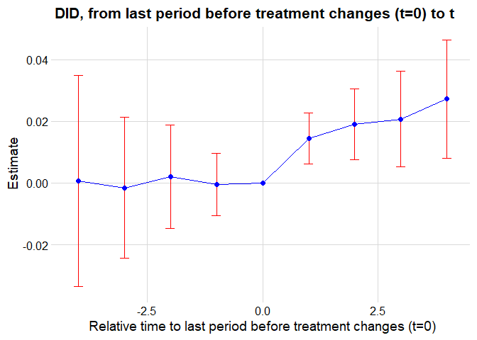
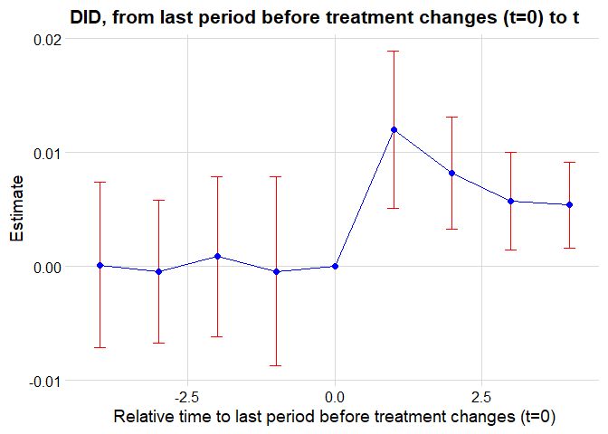

- [Gentzkow et al. Dataset](#gentzkow-et-al.-dataset)
- [Static Two-Way Fixed Effects
  Estimator](#static-two-way-fixed-effects-estimator)
- [Distributed-Lag Two-Way Fixed Effects
  Estimators](#distributed-lag-two-way-fixed-effects-estimators)
- [Heterogeneity-Robust Estimators](#heterogeneity-robust-estimators)
  - [Actual-versus-Status-Quo
    Effects](#actual-versus-status-quo-effects)
  - [Cost-Benefit Analysis](#cost-benefit-analysis)
- [Heterogeneity-robust Estimators without Dynamic
  Effects](#heterogeneity-robust-estimators-without-dynamic-effects)
- [References](#references)

Differences-in-Differences VII: General Designs

In this last part dedicated to differences-in-differences, we will cover
general designs in which treatment may be non-binary and/or
non-absorbing, treatment timings may vary across groups, and where the
outcome may be affected by treatment lags.

``` r
library(tidyr)
library(dplyr)
library(tibble)
library(ggplot2)
library(patchwork)
library(dagitty)
library(ggdag)
library(modelsummary)
library(fixest)
library(pretrends)
library(HonestDiD)
library(WeightIt)
library(cobalt)
```

## Gentzkow et al. Dataset

We will return to the dataset used by (Gentzkow et al. 2011) to study
the effect of newspapers on voters’ participation. We used it in Part
Twenty Seven to introduce the limitations of TWFE in complex designs.
Here, we will continue in this presentation and eventually introduce
unbiased estimators of the effect of the number of daily newspapers
(**numdailies**) on turnout rate (**prestout**).

As the remainder, the variables of interest to us are as follows
(<span class="nocase">De Chaisemartin and d’Haultfoeuille</span> 2026).

- **cnty90**: county $`g`$
- **st**: state
- **year**: election-year $`t`$
- **prestout**: turnout rate in county $`g`$ and election-year $`t`$
  (outcome)
- **numdailies**: number of daily newspapers circulating in county $`g`$
  and election-year $`t`$ (treatment)

``` r
gentzkowetal <- read.csv("C:/Users/elini/Desktop/first casualty/gentzkowetal.csv")
head(gentzkowetal)
```

    ##   cnty90 year prestout st numdailies styr lag_numdailies changedailies
    ## 1   1005 1868    1.016  1          0   12             NA            NA
    ## 2   1005 1872    0.849  1          0   13              0             0
    ## 3   1005 1876    0.586  1          0   14              0             0
    ## 4   1005 1880    0.580  1          0   15              0             0
    ## 5   1005 1884    0.428  1          2   16              0             2
    ## 6   1005 1888    0.623  1          2   17              2             0
    ##   changeprestout lag_ishare_urb share_urb_baseline first_change
    ## 1             NA             NA                  0         1884
    ## 2   -0.166999996              0                  0         1884
    ## 3   -0.263000071              0                  0         1884
    ## 4   -0.005999982              0                  0         1884
    ## 5   -0.151999980              0                  0         1884
    ## 6    0.194999963              0                  0         1884
    ##   same_treat_after_first_change
    ## 1                             1
    ## 2                             1
    ## 3                             1
    ## 4                             1
    ## 5                             1
    ## 6                             1

## Static Two-Way Fixed Effects Estimator

We will first discuss the properties of the TWFE estimator designs. Let
us first limit our attention to a design with no dynamic treatment
effects and two treatment periods $`T = 2`$. As in Part Twenty Seven, we
define the treatment effect as
``` math
\tau_{g,t} = \frac{\mathbb{E}(Y(D_{g,t}) - Y_{g,t}(0))}{D_{g,t}}
```
and we will use the decomposition from Part Twenty Seven, which holds
under the parallel trend assumption
``` math
\mathbb{E}\hat\beta_\text{TFWE} = \frac{1}{|D_{g,t} \neq 0|}\sum_{(g,t):D_{g,t} \neq 0} w_{g,t}\tau_{g,t},
```
where
``` math
w_{g,t} = \frac{\hat u_{g,t} D_{g,t}}{\sum_{(g,t) :D_{g',t'} \neq 0 } \hat u_{g',t'} D_{g',t'}}.
```
Since we assume only two periods, the formula can be simplified as
(<span class="nocase">De Chaisemartin and d’Haultfoeuille</span> 2026)
``` math
\mathbb{E}\hat\beta_\text{TFWE} = \frac{1}{|D_{g,t} \neq 0|}\sum_{g = 1}^{|G|} \sum_{t = 1}^2 \frac{(\Delta D_{g} - \Delta D_{.})D_{g,t}(I(t=2) - I(t=1))}{\sum_{g' = 1}^{|G|} \sum_{t' = 1}^2 (\Delta D_{g'} - \Delta D_{.})D_{g',t'}(I(t'=2) - I(t'=1))}\tau_{g,t},
```
where $`\Delta`$ denotes the first difference
($`\Delta D_{g} = D_{g,2} - D_{g,2}`$). Dots denote averaging over the
given variable (e.g., $`D_{.,.}`$ is the average across all $`g`$ and
$`t`$, and $`D_{.,t}`$ is the average across $`g`$ for a given $`t`$).
Again, we see that some weights can be negative in general, making the
estimate non-causal.

Since most of the observations might be treated in a general design, we
can consider an alternative parallel trend assumption
(<span class="nocase">De Chaisemartin and d’Haultfoeuille</span> 2026)
``` math
\mathbb{E}(Y_{g,2}(D_{g,1}) - Y_{g,1}(D_{g,1})) \text{ does not vary across }g,
```
i.e., the parallel trend assumption holds in a counterfactual, for which
the treatment does not change. In this case, we define the treatment
effect as
``` math
\tau_{g,2}^\Delta = \frac{\mathbb{E}(Y(D_{g,2}) - Y_{g,t}(D_{g,1}))}{D_{g,2} - D_{g,1}}
```
and it can be shown that under no anticipation, no dynamic effects, and
under the parallel trends assumption (<span class="nocase">De
Chaisemartin and d’Haultfoeuille</span> 2026)
``` math
\mathbb{E}\hat\beta_\text{TFWE} = \sum_{g: \Delta g \neq 0} w_{g}^\Delta \tau_{g,2}^\Delta,
```
where
``` math
w_{g}  = \frac{(\Delta D_g - \Delta D_{.}) \Delta D_g}{\sum_{g'} (\Delta D_g - \Delta D_{.}) \Delta D_g}.
```

As usual, some of the weight might be negative. Interestingly, for
binary treatment these weights are always positive. However, the
parallel trend assumption in
$`\mathbb{E}(Y_{g,2}(D_{g,1}) - Y_{g,1}(D_{g,1}))`$ is quite strict;
(Fabre 2025) derived weaker condition
``` math
\mathbb{E}(Y_{g,2}(0) - Y_{g,1}(0)) \text{ does not vary across }g,
```
and
``` math
\mathbb{E}(Y_{g,2}(1) - Y_{g,1}(1)) \text{ does not vary across }g.
```

Lastly, we could assume that the treatment is assigned at random. Let’s
assume i.i.d. groups and a linear effect of treatment
``` math
Y_t(d) = Y_t(0) + S_td,
```
and let $`\Delta D \perp (Y_2(0) - Y_1(0), S_1, S_2)`$. Under this
assumption (<span class="nocase">De Chaisemartin and
d’Haultfoeuille</span> 2026) ($`u`$ denotes expectation with respect to
the distribution of groups’ potential outcomes and treatments)
``` math
\beta_\text{TFWE} =  \frac{\text{Cov}_u (D_2- D_1, Y_2 - Y_1)}{\text{Var}_u (D_2-D_1)}  = \frac{\text{Cov}_u (D_2- D_1, D_1\Delta S)}{\text{Var}_u (D_2-D_1)} + \mathbb{E}_u(S_2)
```
The term $`\mathbb{E}_u(S_2)`$ is the average treatment effect for
$`t = 2`$, but it includes an additional bias term. Provided that the
treatment effect change in time $`(\Delta S \neq 0)`$, we must have that
``` math
\Delta D \perp D_1
```
to obtain an estimate with zero bias.

Let’s assume an even more stringent condition
``` math
(D_1, D_2) \perp (Y_2(0) - Y_1(0), S_1, S_2).
```
Then, under no anticipation, no dynamic effects,
(<span class="nocase">De Chaisemartin and d’Haultfoeuille</span> 2026)
``` math
\beta_\text{TFWE} =  \sum_{t=1}^2\frac{\text{Var}_u(D_t) - \text{Cov}_u(D_1, D_2)}{\sum_{t'=1}^2\text{Var}_u(D_t') - \text{Cov}_u(D_1, D_2)} \mathbb{E}_u(S_t),
```
i.e., $`\beta_\text{TFWE}`$ is not a weighted average of treatment
effects even when the *assignment of treatment paths* is randomized. The
sufficient conditions for all weights to be positive are binary
treatments or $`\text{Var}_u(D_1) = \text{Var}_u(D_2)`$
(<span class="nocase">De Chaisemartin and d’Haultfoeuille</span> 2026).
Weights are also guaranteed to be positive if the treatments are not
serially correlated or are negatively correlated.

These results show that using TWFE (i.e., including fixed effects in the
regression) might be a very bad idea. If the assignment of treatment
paths is randomized, there is no need to use TWFE. We can analyze the
data by regressing $`Y_1`$ on $`D_1`$ and $`Y_2`$ on $`D_2`$
(<span class="nocase">De Chaisemartin and d’Haultfoeuille</span> 2026)
to get an unbiased treatment effect.

Let’s demonstrate the result on the *gentzkowetal* dataset. In Part
Twenty Seven, we computed the TWFE estimate

``` r
summary(feols(prestout ~ numdailies |  year + cnty90, cluster ~  cnty90, data = gentzkowetal))
```

    ## OLS estimation, Dep. Var.: prestout
    ## Observations: 16,872
    ## Fixed-effects: year: 16,  cnty90: 1,195
    ## Standard-errors: Clustered (cnty90) 
    ##            Estimate Std. Error t value Pr(>|t|)    
    ## numdailies 0.002939    0.00157 1.87273  0.06135 .  
    ## ---
    ## Signif. codes:  0 '***' 0.001 '**' 0.01 '*' 0.05 '.' 0.1 ' ' 1
    ## RMSE: 0.120932     Adj. R2: 0.677445
    ##                  Within R2: 4.556e-4

To justify the causality of this estimate, we could assume that the
treatment, the change in counties’ number of newspapers, is as good as
random. Consequently, we need to investigate that $`\Delta D \perp D_1`$
(similar results to those above apply for more designs with more than
two periods (<span class="nocase">De Chaisemartin and
d’Haultfoeuille</span> 2026)). Hence, let us regress **changedailies**
on **lag_numdailies**.

``` r
summary(lm(changedailies ~ lag_numdailies, data = gentzkowetal))
```

    ## 
    ## Call:
    ## lm(formula = changedailies ~ lag_numdailies, data = gentzkowetal)
    ## 
    ## Residuals:
    ##     Min      1Q  Median      3Q     Max 
    ## -8.2190 -0.1420 -0.1000 -0.0161  9.4103 
    ## 
    ## Coefficients:
    ##                 Estimate Std. Error t value Pr(>|t|)    
    ## (Intercept)     0.141994   0.006754   21.02   <2e-16 ***
    ## lag_numdailies -0.041953   0.002551  -16.44   <2e-16 ***
    ## ---
    ## Signif. codes:  0 '***' 0.001 '**' 0.01 '*' 0.05 '.' 0.1 ' ' 1
    ## 
    ## Residual standard error: 0.7067 on 15625 degrees of freedom
    ##   (1245 observations deleted due to missingness)
    ## Multiple R-squared:  0.01701,    Adjusted R-squared:  0.01695 
    ## F-statistic: 270.4 on 1 and 15625 DF,  p-value: < 2.2e-16

We see a significant correlation between $`\Delta D`$ and $`D_1`$,
suggesting that the TWFE estimator may be biased, even if the change in
the number of newspapers per county is random.

## Distributed-Lag Two-Way Fixed Effects Estimators

Let us allow dynamic treatment effects and let the number of periods be
greater than or equal to two. The commonly used TWFE estimator for such
general designs is the *distributed-lag TWFE estimator*
(<span class="nocase">De Chaisemartin and d’Haultfoeuille</span> 2026)
``` math
Y_{g,t} =  \alpha_g + \gamma_t + \sum_{l = 0}^K \beta^\text{dl}_l D_{g,t-l} + \varepsilon_{g,t}
```
for a subsample such that $`t\geq K + 1`$. We notice that, since we no
longer assume no dynamic treatment effects, the regression model now
includes lagged treatments.

As one would suspect by now, $`\hat\beta_l^\text{dl}`$ is a weighted sum
of treatment effects. Namely, let’s assume no anticipation and parallel
trends and let the functional form of the distributed-lag regression be
correctly specified, i.e.,
``` math
Y_{g,t}(d) = Y_{g,t}(0_t) + \sum_{l = 0}^K \gamma^l_{g,t}d_{t-l}.
```
Then (<span class="nocase">De Chaisemartin and d’Haultfoeuille</span>
2026),
``` math
\hat\beta_l^\text{dl} = \sum_{(g,t):D_{g,t-l} \neq 0,\\ t \geq K +1} w_{g,t}^{\text{dl},l} \gamma_{g,t}^l + \sum_{l' = 0, \\ l' \neq l }^K \sum_{(g,t):D_{g,t-l'} \neq 0,\\ t \geq K +1} w_{g,t}^{\text{dl},l'} \gamma_{g,t}^{l'},
```
where
``` math
\sum_{(g,t):D_{g,t-l} \neq 0,\\ t \geq K +1} w_{g,t}^{\text{dl},l} = 1
```
and
``` math
\sum_{l' = 0, \\ l' \neq l }^K \sum_{(g,t):D_{g,t-l'} \neq 0,\\ t \geq K +1} w_{g,t}^{\text{dl},l'} = 0.
```

The first term is a weighted sum of the effect of the $`l`$th treatment
lag, and the second term represents contamination of the estimate by
other lagged treatment effects.

Let’s use the distributed-lag TWFE estimator on the *gentzkowetal*
dataset. We will assume that **numdailies** has an effect on
**prestout** with a lag of one period.

``` r
summary(feols(prestout ~ numdailies + lag_numdailies |  year + cnty90, cluster ~  cnty90, data = gentzkowetal))
```

    ## OLS estimation, Dep. Var.: prestout
    ## Observations: 15,629
    ## Fixed-effects: year: 15,  cnty90: 1,195
    ## Standard-errors: Clustered (cnty90) 
    ##                 Estimate Std. Error   t value  Pr(>|t|)    
    ## numdailies     -0.000796   0.001386 -0.574582 0.5656823    
    ## lag_numdailies  0.005035   0.001447  3.480673 0.0005182 ***
    ## ---
    ## Signif. codes:  0 '***' 0.001 '**' 0.01 '*' 0.05 '.' 0.1 ' ' 1
    ## RMSE: 0.109485     Adj. R2: 0.732206
    ##                  Within R2: 0.001291

We see that the effect of current **numdailies** is insignificant.
However, the effect of **lag_numdailies** is positive and very
significant. Let’s check the causality of the estimate by computing
treatment-effect weights with *TwoWayFEWeights*.

``` r
library(TwoWayFEWeights)
twowayfeweights(
  data = gentzkowetal, 
  Y = 'prestout', 
  G = 'cnty90',
  T = 'year', 
  D = 'numdailies',
  other_treatments = 'lag_numdailies',
  type = "feTR",
  summary_measures = TRUE)
```

    ## 
    ## Under the common trends assumption,
    ## the TWFE coefficient beta, equal to -0.0008, estimates the sum of several terms.
    ## 
    ## The first term is a weighted sum of 10056 ATTs.
    ## 5754 ATTs receive a positive weight, and 4302 receive a negative weight.
    ## 
    ## ──────────────────────────────────────────── 
    ## Treat. var: numdailies     ATTs    Σ weights 
    ## ──────────────────────────────────────────── 
    ## Positive weights           5754       1.8541 
    ## Negative weights           4302      -0.8541 
    ## ──────────────────────────────────────────── 
    ## Total                     10056            1 
    ## ────────────────────────────────────────────
    ## 
    ## The next term is a weighted sum of 9339 ATTs.
    ## 4721 ATTs receive a positive weight, and 4618 receive a negative weight.
    ## 
    ## ───────────────────────────────────────────────── 
    ## Other treat.: lag_numdailies    ATTs    Σ weights 
    ## ───────────────────────────────────────────────── 
    ## Positive weights                4721       1.2137 
    ## Negative weights                4618      -1.2137 
    ## ───────────────────────────────────────────────── 
    ## Total                           9339            0 
    ## ─────────────────────────────────────────────────
    ## 
    ## Summary Measures:
    ##   TWFE Coefficient (β_fe): -0.0008
    ## 
    ## The development of this package was funded by the European Union (ERC, REALLYCREDIBLE,GA N. 101043899).

We see that the magnitudes of the negative weights in the first sum and
the “contamination” weights in the second sum are very large.
Consequently, $`\hat\beta_l^\text{dl}`$ does not estimate a causal
effect unless the treatment effects are homogeneous.

## Heterogeneity-Robust Estimators

We learned that TWFE estimators do not estimate treatment effects
unbiasedly in general designs unless treatment effects are homogeneous.
Hence, we will now discuss heterogeneity-robust estimators for such
designs (the treatment may be non-binary and/or non-absorbing, and the
outcome may be affected by treatment lags). We will define
(<span class="nocase">De Chaisemartin and d’Haultfoeuille</span> 2026)
``` math
F_g =  \min\{t: t \geq 2, D_{g,t} \neq D_{g,t-1} \}
```
and we will assume that $`\exists(g,g')`$ such that
$`D_{g,1} = D_{g',1}`$ and $`F_g \neq F_{g'}`$, i.e., the groups do not
all experience their first treatment change at the same date. If the
groups change their treatment at the same date, we are actually dealing
with a design with variation in treatment dose, which we covered in the
previous part.

We will assume the following parallel trend assumption
(<span class="nocase">De Chaisemartin and d’Haultfoeuille</span> 2026)
``` math
\forall (g,g'): D_{g,1} = D_{g',1} \in \mathcal{D}_1^r \Rightarrow \mathbb{E}(Y_{g,t}(D_{g,1,t}) - Y_{g,t-1}(D_{g,1,t-1})) = \mathbb{E}(Y_{g',t}(D_{g',1,t}) - Y_{g',t-1}(D_{g',1,t-1}))
```
for all $`t \geq 2`$, where
$`\mathcal{D}_1^r = \{d : \exists(g,g') \in G \times G: D_{g,1} = D_{g',1}, F_g \neq F_{g'} \}`$
and $`D_{g,1,t}`$ is a vector of length $`t`$ with elements $`D_{g,1}`$.
In other words, this assumption requires that if two groups have the
same period-one treatment, then their expected outcomes are the same if
their treatment never changes.

### Actual-versus-Status-Quo Effects

The target treatment effect estimand we consider for this design is
*actual-versus-status-quo* treatment effect of group $`g`$ at
$`F_g − 1 + l`$ (<span class="nocase">De Chaisemartin and
d’Haultfoeuille</span> 2026)
``` math
\text{AVSQ}_{g,l} = \mathbb{E}(Y_{g,F_g-1+l} - Y_{g,F_g-1+l}(D_{g,1}, \ldots D_{g,1})),
```
the expected difference in outcomes with the same treatment as in the
period but whose treatment has not changed.

We denote for all $`(g,l)`$
``` math
C_{g,l} = \{ g': D_{g',1} = D_{g,1}, F_{g'} > F_g -1 + l\},
```
then we consider a DID estimator
``` math
\widehat{\text{AVSQ}}_{q,l} = Y_{g,F_g-1+l} - Y_{g,F_g-1} - \frac{1}{|C_{g,l}|}\sum_{g' \in C_{g,l}}(Y_{g',F_g-1+l} - Y_{g',F_{g'}-1}).
```
It can be shown that under the parallel trends and no anticipation
(<span class="nocase">De Chaisemartin and d’Haultfoeuille</span> 2026),
``` math
\mathbb{E} \widehat{\text{AVSQ}}_{q,l} = \text{AVSQ}_{q,l}
```
for all $`1 \leq l \leq T_g - (F_g - 1)`$, where
$`T_g = \max_{g':D_{g',1} = D_{g,1}} F_{g'}-1`$.

Let’s assume $`D_{g,1} = 1`$, $`D_{g,2} = 2`$, and $`D_{g,3} = 0`$.
Then,
``` math
\text{AVSQ}_{g,2} = \mathbb{E}(Y_{g,3}(1,2,0) - Y_{g,3}(1,1,1)) = \mathbb{E}(Y_{g,3}(1,2,0) - Y_{g,3}(1,1,0)) - \mathbb{E}(Y_{g,3}(1,1,1) - Y_{g,3}(1,1,0)).
```
Notice that both $`\mathbb{E}(Y_{g,3}(1,2,0) - Y_{g,3}(1,1,0))`$ and
$`\mathbb{E}(Y_{g,3}(1,1,1) - Y_{g,3}(1,1,0))`$ can be positive, but
$`\text{AVSQ}{g,2}`$ can be negative. In general, for all $`(g,l)`$ such
that $`l`$ periods after its first treatment change, $`g`$ has
experienced both a treatment strictly below and a treatment strictly
above, $`\text{AVSQ}{g,l}`$ can be written as a linear combination of
the treatment effects of increasing treatment lags, with negative
weights (<span class="nocase">De Chaisemartin and d’Haultfoeuille</span>
2026).

To ensure that these situations cannot happen, we will assume the
*no-crossing condition*
``` math
\forall g \in  G: D_{g,t} \geq D_{g,1} \forall t \text {, or } D_{g,t} \leq D_{g,1} \forall t.
```
In practice, when the data does not meet this condition, one can drop
cells until it is met (<span class="nocase">De Chaisemartin and
d’Haultfoeuille</span> 2026).

Next, we will define aggregated actual-versus-status-quo treatment
effects. Let (<span class="nocase">De Chaisemartin and
d’Haultfoeuille</span> 2026)
``` math
S_l = \{g: F_g-1+l \leq T_g\}
```
and
``` math
S_g = I(D_{g,F_g} > D_{g,1}) - I(D_{g,F_g} < D_{g,1}).
```
We define
``` math
\text{AVSQ}_l = \frac{1}{|S_l|}\sum_{g \in S_l}S_g \text{AVSQ}_{g,l}
```
This definition ensures that $`\text{AVSQ}_l`$ is the average treatment
effect of having been exposed to a weakly larger dose (i.e., greater
than or equal to) for $`l`$ periods. For a binary staggered design,
$`\text{AVSQ}_l`$ reduces to $`\text{ATT}_l`$; the average treatment
effect of being exposed to treatment for $`l`$ periods
(<span class="nocase">De Chaisemartin and d’Haultfoeuille</span> 2026).
We estimate $`\text{AVSQ}_l`$ as
``` math
\widehat{\text{AVSQ}_l} = \frac{1}{|S_l|}\sum_{g \in S_l}S_g \widehat{\text{AVSQ}_{g,l}}.
```

While the interpretation of $`\text{ATT}_l`$ is quite straightforward,
the interpretation of $`\text{AVSQ}_l`$ is much more complicated, since
$`\text{AVSQ}_{q,l}`$s depend on treatment paths in the dataset. If the
number of treatment paths in the dataset is low, one can precisely
estimate the average of $`\text{AVSQ}_{q,l}`$s across all groups with
the same path for each path and report the result. For more complicated
designs with many treatment paths, (<span class="nocase">De Chaisemartin
and d’Haultfoeuille</span> 2026) recommend reporting treatment paths and
their distribution in the data.

Let’s estimate $`\text{AVSQ}_l`$ for four periods in our dataset (we
will also estimate four placebo effects).

``` r
library(DIDmultiplegtDYN)
library('polars')
did_multiplegt_dyn(
  df = gentzkowetal,
  outcome = 'prestout',
  group = 'cnty90',
  time = 'year',
  treatment = 'numdailies',
  effects = 4,
  placebo = 4,
  effects_equal = 'all',
  normalized = FALSE
)
```

<!-- -->

    ## 
    ## ----------------------------------------------------------------------
    ##        Estimation of treatment effects: Event-study effects
    ## ----------------------------------------------------------------------
    ##              Estimate SE      LB CI   UB CI   N     Switchers
    ## Effect_1     0.01442  0.00425 0.00610 0.02275 5,674 1,119    
    ## Effect_2     0.01909  0.00584 0.00764 0.03054 4,648 1,054    
    ## Effect_3     0.02071  0.00792 0.00520 0.03623 3,750 984      
    ## Effect_4     0.02727  0.00979 0.00807 0.04646 2,980 917      
    ## 
    ## Test of joint nullity of the effects : p-value = 0.0068
    ## Test of equality of the effects : p-value = 0.4152
    ## 
    ## ----------------------------------------------------------------------
    ##     Average cumulative (total) effect per treatment unit
    ## ----------------------------------------------------------------------
    ##  Estimate        SE     LB CI     UB CI         N Switchers 
    ##   0.01606   0.00478   0.00670   0.02542     8,659     4,074 
    ## Average number of time periods over which a treatment effect is accumulated: 2.4376
    ## 
    ## ----------------------------------------------------------------------
    ##      Testing the parallel trends and no anticipation assumptions
    ## ----------------------------------------------------------------------
    ##              Estimate SE      LB CI    UB CI   N     Switchers
    ## Placebo_1    -0.00050 0.00513 -0.01056 0.00956 4,418 902      
    ## Placebo_2    0.00206  0.00850 -0.01461 0.01873 2,764 746      
    ## Placebo_3    -0.00154 0.01168 -0.02443 0.02136 1,636 604      
    ## Placebo_4    0.00066  0.01750 -0.03365 0.03496 907   441      
    ## 
    ## Test of joint nullity of the placebos : p-value = 0.9922
    ## 
    ## 
    ## The development of this package was funded by the European Union.
    ## ERC REALLYCREDIBLE - GA N. 101043899

The results show that being exposed to a weakly larger number of
newspapers for one period increases turnout by 1.44 on average. We also
see that we estimated this effect from 1119 counties (out of 1195
total). The treatment effect over longer periods increases slightly, but
the test of equality of the effects was not rejected. The placebo
effects are very small, but the confidence intervals are quite large,
i.e., we do not have enough power to detect violation of parallel
trends.

To better understand the aggregated treatment effects, we can check the
most common treatment paths.

``` r
did_multiplegt_dyn(
  df = gentzkowetal,
  outcome = 'prestout',
  group = 'cnty90',
  time = 'year',
  treatment = 'numdailies',
  effects = 1,
  design =  list(0.80, 'console'),
  graph_off = TRUE,
  normalized = FALSE
)
```

    ## 
    ## ----------------------------------------------------------------------
    ##        Estimation of treatment effects: Event-study effects
    ## ----------------------------------------------------------------------
    ##  Estimate        SE     LB CI     UB CI         N Switchers 
    ##   0.01442   0.00425   0.00610   0.02275     5,674     1,119 
    ## 
    ## ----------------------------------------------------------------------
    ##     Average cumulative (total) effect per treatment unit
    ## ----------------------------------------------------------------------
    ##  Estimate        SE     LB CI     UB CI         N Switchers 
    ##   0.01202   0.00354   0.00508   0.01896     5,674     1,119 
    ## Average number of time periods over which a treatment effect is accumulated: 1.0000
    ## 
    ## 
    ## ----------------------------------------------------------------------
    ##     Detection of treatment paths - 1 periods after first switch
    ## ----------------------------------------------------------------------
    ##            N   Share ℓ=0 ℓ=1
    ## TreatPath1 721 64.03 0   1  
    ## TreatPath2 139 12.34 0   2  
    ## TreatPath3 54  4.80  1   2  
    ## 
    ## Treatment paths detected in at least 80.00% of the 1126 switching groups for which 1 effects could be estimated (Total % = 81.17%)
    ## 
    ## Design interpretation (first row):
    ## 721 groups started with treatment 0 and experienced treatment path (1)
    ## 
    ## The development of this package was funded by the European Union.
    ## ERC REALLYCREDIBLE - GA N. 101043899

We see that the aggregated effect of a weakly larger number of
newspapers for one period is mostly driven by the treatment path from 0
to 1 (over 60%), followed by paths from 0 to 2 and from 1 to 2. We can
explicitly compute average $`\widehat{\text{AVSQ}_{g,l}}`$ for these
paths as follows.

``` r
did_multiplegt_dyn(
  df = gentzkowetal,
  outcome = 'prestout',
  group = 'cnty90',
  time = 'year',
  treatment = 'numdailies',
  effects = 1,
  by_path = 3,
  graph_off = TRUE,
  normalized = FALSE
)
```

    ## 
    ## ######################################## By treatment path: (0,1) ###
    ## 
    ## ----------------------------------------------------------------------
    ##        Estimation of treatment effects: Event-study effects
    ## ----------------------------------------------------------------------
    ##  Estimate        SE     LB CI     UB CI         N Switchers 
    ##   0.01546   0.00533   0.00501   0.02592     4,869       721 
    ## 
    ## ----------------------------------------------------------------------
    ##     Average cumulative (total) effect per treatment unit
    ## ----------------------------------------------------------------------
    ##  Estimate        SE     LB CI     UB CI         N Switchers 
    ##   0.01546   0.00533   0.00501   0.02592     4,869       721 
    ## Average number of time periods over which a treatment effect is accumulated: 1.0000
    ## 
    ## ######################################## By treatment path: (0,2) ###
    ## 
    ## ----------------------------------------------------------------------
    ##        Estimation of treatment effects: Event-study effects
    ## ----------------------------------------------------------------------
    ##  Estimate        SE     LB CI     UB CI         N Switchers 
    ##   0.01967   0.00921   0.00162   0.03773     4,275       139 
    ## 
    ## ----------------------------------------------------------------------
    ##     Average cumulative (total) effect per treatment unit
    ## ----------------------------------------------------------------------
    ##  Estimate        SE     LB CI     UB CI         N Switchers 
    ##   0.00984   0.00461   0.00081   0.01886     4,275       139 
    ## Average number of time periods over which a treatment effect is accumulated: 1.0000
    ## 
    ## ######################################## By treatment path: (1,2) ###
    ## 
    ## ----------------------------------------------------------------------
    ##        Estimation of treatment effects: Event-study effects
    ## ----------------------------------------------------------------------
    ##  Estimate        SE     LB CI     UB CI         N Switchers 
    ##   0.01467   0.02634  -0.03697   0.06630       202        54 
    ## 
    ## ----------------------------------------------------------------------
    ##     Average cumulative (total) effect per treatment unit
    ## ----------------------------------------------------------------------
    ##  Estimate        SE     LB CI     UB CI         N Switchers 
    ##   0.01467   0.02634  -0.03697   0.06630       202        54 
    ## Average number of time periods over which a treatment effect is accumulated: 1.0000
    ## 
    ## 
    ## The development of this package was funded by the European Union.
    ## ERC REALLYCREDIBLE - GA N. 101043899

We see that the estimated effect of jumping from 0 to 2 is slightly
greater than from 0 to 1 and from 1 to 2. We can also look at two-period
paths.

``` r
did_multiplegt_dyn(
  df = gentzkowetal,
  outcome = 'prestout',
  group = 'cnty90',
  time = 'year',
  treatment = 'numdailies',
  effects = 2,
  design =  list(0.80, 'console'),
  graph_off = TRUE,
  normalized = FALSE
)
```

    ## 
    ## ----------------------------------------------------------------------
    ##        Estimation of treatment effects: Event-study effects
    ## ----------------------------------------------------------------------
    ##              Estimate SE      LB CI   UB CI   N     Switchers
    ## Effect_1     0.01442  0.00425 0.00610 0.02275 5,674 1,119    
    ## Effect_2     0.01909  0.00584 0.00764 0.03054 4,648 1,054    
    ## 
    ## Test of joint nullity of the effects : p-value = 0.0015
    ## ----------------------------------------------------------------------
    ##     Average cumulative (total) effect per treatment unit
    ## ----------------------------------------------------------------------
    ##  Estimate        SE     LB CI     UB CI         N Switchers 
    ##   0.01433   0.00399   0.00651   0.02215     6,754     2,173 
    ## Average number of time periods over which a treatment effect is accumulated: 1.5211
    ## 
    ## 
    ## ----------------------------------------------------------------------
    ##     Detection of treatment paths - 2 periods after first switch
    ## ----------------------------------------------------------------------
    ##            N   Share ℓ=0 ℓ=1 ℓ=2
    ## TreatPath1 343 32.15 0   1   1  
    ## TreatPath2 187 17.53 0   1   0  
    ## TreatPath3 131 12.28 0   1   2  
    ## TreatPath4 57  5.34  0   2   2  
    ## TreatPath5 47  4.40  0   2   1  
    ## TreatPath6 33  3.09  1   2   2  
    ## TreatPath7 30  2.81  0   1   3  
    ## TreatPath8 22  2.06  2   3   2  
    ## TreatPath9 20  1.87  2   1   1  
    ## 
    ## Treatment paths detected in at least 80.00% of the 1067 switching groups for which 2 effects could be estimated (Total % = 81.54%)
    ## 
    ## Design interpretation (first row):
    ## 343 groups started with treatment 0 and experienced treatment path (1,1)
    ## 
    ## The development of this package was funded by the European Union.
    ## ERC REALLYCREDIBLE - GA N. 101043899

Two-period paths are more varied. About 32% of paths is $`(0,1,1)`$,
about 18% is $`(0,1,0)`$, and about 12% is $`(0,1,2)`$. Again, let’s
compute $`\widehat{\text{AVSQ}_{g,l}}`$ for these paths.

``` r
did_multiplegt_dyn(
  df = gentzkowetal,
  outcome = 'prestout',
  group = 'cnty90',
  time = 'year',
  treatment = 'numdailies',
  effects = 2,
  by_path = 3,
  graph_off = TRUE,
  normalized = FALSE
)
```

    ## 
    ## ###################################### By treatment path: (0,1,1) ###
    ## 
    ## ----------------------------------------------------------------------
    ##        Estimation of treatment effects: Event-study effects
    ## ----------------------------------------------------------------------
    ##              Estimate SE      LB CI    UB CI   N     Switchers
    ## Effect_1     0.01326  0.00714 -0.00074 0.02725 4,479 343      
    ## Effect_2     0.01003  0.00906 -0.00773 0.02779 3,675 343      
    ## 
    ## Test of joint nullity of the effects : p-value = 0.1739
    ## ----------------------------------------------------------------------
    ##     Average cumulative (total) effect per treatment unit
    ## ----------------------------------------------------------------------
    ##  Estimate        SE     LB CI     UB CI         N Switchers 
    ##   0.01164   0.00745  -0.00296   0.02624     4,843       686 
    ## Average number of time periods over which a treatment effect is accumulated: 1.5000
    ## 
    ## ###################################### By treatment path: (0,1,0) ###
    ## 
    ## ----------------------------------------------------------------------
    ##        Estimation of treatment effects: Event-study effects
    ## ----------------------------------------------------------------------
    ##              Estimate SE      LB CI    UB CI   N     Switchers
    ## Effect_1     0.01468  0.01039 -0.00569 0.03504 4,323 187      
    ## Effect_2     0.00920  0.01156 -0.01346 0.03187 3,519 187      
    ## 
    ## Test of joint nullity of the effects : p-value = 0.3324
    ## ----------------------------------------------------------------------
    ##     Average cumulative (total) effect per treatment unit
    ## ----------------------------------------------------------------------
    ##  Estimate        SE     LB CI     UB CI         N Switchers 
    ##   0.02388   0.02065  -0.01660   0.06436     4,531       374 
    ## Average number of time periods over which a treatment effect is accumulated: 2.0000
    ## 
    ## ###################################### By treatment path: (0,1,2) ###
    ## 
    ## ----------------------------------------------------------------------
    ##        Estimation of treatment effects: Event-study effects
    ## ----------------------------------------------------------------------
    ##              Estimate SE      LB CI   UB CI   N     Switchers
    ## Effect_1     0.02171  0.01030 0.00151 0.04190 4,267 131      
    ## Effect_2     0.03239  0.01328 0.00637 0.05842 3,463 131      
    ## 
    ## Test of joint nullity of the effects : p-value = 0.0484
    ## ----------------------------------------------------------------------
    ##     Average cumulative (total) effect per treatment unit
    ## ----------------------------------------------------------------------
    ##  Estimate        SE     LB CI     UB CI         N Switchers 
    ##   0.01803   0.00742   0.00348   0.03258     4,419       262 
    ## Average number of time periods over which a treatment effect is accumulated: 1.3333
    ## 
    ## 
    ## The development of this package was funded by the European Union.
    ## ERC REALLYCREDIBLE - GA N. 101043899

Let’s conclude by printing the distribution of four-period paths.

``` r
did_multiplegt_dyn(
  df = gentzkowetal,
  outcome = 'prestout',
  group = 'cnty90',
  time = 'year',
  treatment = 'numdailies',
  effects = 4,
  design =  list(0.80, 'console'),
  graph_off = TRUE,
  normalized = FALSE
)
```

    ## 
    ## ----------------------------------------------------------------------
    ##        Estimation of treatment effects: Event-study effects
    ## ----------------------------------------------------------------------
    ##              Estimate SE      LB CI   UB CI   N     Switchers
    ## Effect_1     0.01442  0.00425 0.00610 0.02275 5,674 1,119    
    ## Effect_2     0.01909  0.00584 0.00764 0.03054 4,648 1,054    
    ## Effect_3     0.02071  0.00792 0.00520 0.03623 3,750 984      
    ## Effect_4     0.02727  0.00979 0.00807 0.04646 2,980 917      
    ## 
    ## Test of joint nullity of the effects : p-value = 0.0068
    ## ----------------------------------------------------------------------
    ##     Average cumulative (total) effect per treatment unit
    ## ----------------------------------------------------------------------
    ##  Estimate        SE     LB CI     UB CI         N Switchers 
    ##   0.01606   0.00478   0.00670   0.02542     8,659     4,074 
    ## Average number of time periods over which a treatment effect is accumulated: 2.4376
    ## 
    ## 
    ## ----------------------------------------------------------------------
    ##     Detection of treatment paths - 4 periods after first switch
    ## ----------------------------------------------------------------------
    ##             N   Share ℓ=0 ℓ=1 ℓ=2 ℓ=3 ℓ=4
    ## TreatPath1  141 15.11 0   1   1   1   1  
    ## TreatPath2  127 13.61 0   1   0   0   0  
    ## TreatPath3  43  4.61  0   1   2   2   2  
    ## TreatPath4  40  4.29  0   1   1   1   2  
    ## TreatPath5  32  3.43  0   1   1   2   2  
    ## TreatPath6  19  2.04  0   1   2   1   1  
    ## TreatPath7  18  1.93  0   1   1   1   0  
    ## TreatPath8  18  1.93  0   2   1   1   1  
    ## TreatPath9  16  1.71  0   1   1   0   0  
    ## TreatPath10 16  1.71  0   2   2   2   2  
    ## TreatPath11 15  1.61  0   1   0   0   1  
    ## TreatPath12 15  1.61  0   1   1   2   1  
    ## TreatPath13 15  1.61  0   1   2   2   1  
    ## TreatPath14 12  1.29  0   1   0   1   1  
    ## TreatPath15 12  1.29  0   2   1   2   2  
    ## TreatPath16 11  1.18  0   1   2   1   2  
    ## TreatPath17 10  1.07  1   2   2   2   2  
    ## TreatPath18 8   0.86  0   1   2   2   3  
    ## TreatPath19 8   0.86  0   2   2   1   1  
    ## TreatPath20 8   0.86  1   0   0   0   0  
    ## TreatPath21 7   0.75  0   1   1   0   1  
    ## TreatPath22 7   0.75  0   1   1   3   3  
    ## TreatPath23 7   0.75  0   1   2   3   2  
    ## TreatPath24 7   0.75  0   1   2   3   3  
    ## TreatPath25 7   0.75  0   1   3   2   2  
    ## TreatPath26 6   0.64  0   1   0   1   2  
    ## TreatPath27 6   0.64  0   1   1   2   3  
    ## TreatPath28 6   0.64  0   2   0   0   0  
    ## TreatPath29 6   0.64  0   2   2   3   2  
    ## TreatPath30 6   0.64  1   2   2   2   1  
    ## TreatPath31 6   0.64  2   1   1   1   1  
    ## TreatPath32 5   0.54  0   1   3   3   3  
    ## TreatPath33 5   0.54  0   2   1   1   2  
    ## TreatPath34 5   0.54  0   2   2   1   2  
    ## TreatPath35 5   0.54  0   2   2   2   3  
    ## TreatPath36 5   0.54  0   2   3   2   2  
    ## TreatPath37 5   0.54  2   3   2   2   2  
    ## TreatPath38 4   0.43  0   1   1   1   3  
    ## TreatPath39 4   0.43  0   1   3   2   3  
    ## TreatPath40 4   0.43  0   2   2   2   1  
    ## TreatPath41 4   0.43  0   2   2   3   3  
    ## TreatPath42 4   0.43  0   3   2   3   2  
    ## TreatPath43 4   0.43  1   2   2   3   3  
    ## TreatPath44 3   0.32  0   1   0   0   2  
    ## TreatPath45 3   0.32  0   1   0   1   0  
    ## TreatPath46 3   0.32  0   1   1   0   2  
    ## TreatPath47 3   0.32  0   1   1   2   4  
    ## TreatPath48 3   0.32  0   1   1   3   2  
    ## TreatPath49 3   0.32  0   1   3   3   2  
    ## TreatPath50 3   0.32  0   2   1   2   1  
    ## TreatPath51 3   0.32  0   2   3   4   3  
    ## TreatPath52 3   0.32  1   0   0   0   1  
    ## TreatPath53 3   0.32  1   2   1   2   2  
    ## TreatPath54 3   0.32  1   2   2   1   1  
    ## TreatPath55 3   0.32  1   2   2   2   3  
    ## TreatPath56 3   0.32  2   1   1   2   2  
    ## 
    ## Treatment paths detected in at least 80.00% of the 933 switching groups for which 4 effects could be estimated (Total % = 80.17%)
    ## 
    ## Design interpretation (first row):
    ## 141 groups started with treatment 0 and experienced treatment path (1,1,1,1)
    ## 
    ## The development of this package was funded by the European Union.
    ## ERC REALLYCREDIBLE - GA N. 101043899

We see that the distribution is even more varied. The most represented
path is $`(0,1,1,1)`$ (15%), followed by $`(0,1,0,0)`$ (14%); the rest
is below 5%. The treatment effects we considered up to this point are
known as *non-normalized*. There are also normalized treatment effects.
We define *normalized* actual-versus-status-quo effect of group $`g`$ at
$`F_g − 1 + l`$ as (<span class="nocase">De Chaisemartin and
d’Haultfoeuille</span> 2026)
``` math
\text{AVSQ}^n_{g,l} = \frac{\text{AVSQ}_{g,l}}{\text{AVSQ}^D_{g,l}},
```
where
``` math
\text{AVSQ}^D_{g,l} = \sum_{k = 0}^{l-1} (D_{g, F_g +k} - D_{g,1}).
```
is the total increment in treatment doses received by $`g`$ from $`F_g`$
to $`F_g−1+l`$, with respect to the status-quo dose.

It can be shown that (<span class="nocase">De Chaisemartin and
d’Haultfoeuille</span> 2026)
``` math
\text{AVSQ}^n_{g,l} = \sum_{k = 0}^{l-1} w_{g,l,k}s_{g,l,k},
```
where  
``` math
w_{g,l,k} = \frac{D_{g,F_g - 1 + l- k} -D_{g,1}}{\text{AVSQ}^D_{g,l}},
```

and where $`\sum_{k =0}^{l-1 }w_{g,l,k} = 1`$. In addition,
$`w_{g,l,k} \geq 0`$ under the no-crossing condition.

Terms $`s_{g,l,k}`$ are average treatment effects of the form
``` math
s_{g,l,k} = (\mathbb{E}(Y_{g,F_g-1+l+}(D_{g,1,F_g-1}, D_{g,F_g}, D_{g,F_{g}+1}, \ldots D_{g,F_{g}-1+l-k-1}, D_{g,F_{g}+l-k-1}, D_{g,1,k}) \\- Y_{g,F_g-1+l+}(D_{g,1,F_g-1}, D_{g,F_g}, D_{g,F_{g}+1}, \ldots D_{g,F_{g}-1+l-k-1}, D_{g,1}, D_{g,1,k}))/(D_{g, F_g -1+l-k} - D_{g,1}),
```
i.e., for a given group $`g`$, we compute the expected potential outcome
for its treatment in which we replace treatments after period
$`F_g - 1 + l - k`$ with $`D_{g,1}`$ and compare it with the treatment
in which we additionally replace the treatment at period
$`F_g - 1 + l - k`$ with $`D_{g,1}`$. Consequently, $`s_{g,l,k}`$
represents a treatment effect of $`D_{g,F_{g}+l-k-1}`$. Consequently, we
can interpret $`\text{AVSQ}^n_{g,l}`$ as a weighted average of the
treatment effects $`s_{g,l,k}`$.

We define the aggregated normalized $`\text{AVSQ}`$ as
(<span class="nocase">De Chaisemartin and d’Haultfoeuille</span> 2026)
``` math
\text{AVSQ}^n_{l} = \frac{1}{|S_l|}\sum_{g \in S_l}\frac{|\text{AVSQ}^D_{g,l}|}{\text{AVSQ}^D_{l}} \text{AVSQ}^n_{g,l},
```
where
``` math
\text{AVSQ}^D_{l} = \frac{1}{|S_l|}\sum_{g \in S_l} |\text{AVSQ}^D_{g,l}|.
```
Hence,
``` math
\text{AVSQ}^n_{l} = \frac{\text{AVSQ}_l}{\text{AVSQ}^D_{l}}.
```
In addition, if we use the formula
$`\text{AVSQ}^n_{g,l} = \sum_{k = 0}^{l-1} w_{g,l,k}s_{g,l,k},`$ we
derive

``` math
\text{AVSQ}^n_{l} = \frac{1}{|S_l|} \sum_{k = 0}^{l-1} \sum_{g \in S_l}\frac{|\text{AVSQ}^D_{g,l}|}{\text{AVSQ}^D_{l}}  \frac{D_{g,F_g - 1 + l- k} -D_{g,1}}{\text{AVSQ}^D_{g,l}} s_{g,l,k} = \frac{1}{|S_l|} \sum_{k = 0}^{l-1}\sum_{g \in S_l} \frac{|D_{g,F_g - 1 + l- k} -D_{g,1}|}{\text{AVSQ}^D_{l}}s_{g,l,k},
```
i.e., $`\text{AVSQ}^n_{l}`$ is a weighted average of the current
treatment and first $`l-1`$ lags.

Let’s return to our dataset and compute the normalized
actual-versus-status-quo effects.

``` r
did_multiplegt_dyn(
  df = gentzkowetal,
  outcome = 'prestout',
  group = 'cnty90',
  time = 'year',
  treatment = 'numdailies',
  effects = 4,
  placebo = 4,
  effects_equal = 'all',
  normalized = TRUE,
  normalized_weights= TRUE
)
```

<!-- -->

    ## 
    ## ----------------------------------------------------------------------
    ##        Estimation of treatment effects: Event-study effects
    ## ----------------------------------------------------------------------
    ##              Estimate SE      LB CI   UB CI   N     Switchers
    ## Effect_1     0.01202  0.00354 0.00508 0.01896 5,674 1,119    
    ## Effect_2     0.00821  0.00251 0.00329 0.01314 4,648 1,054    
    ## Effect_3     0.00572  0.00219 0.00144 0.01000 3,750 984      
    ## Effect_4     0.00539  0.00193 0.00160 0.00918 2,980 917      
    ## 
    ## Test of joint nullity of the effects : p-value = 0.0068
    ## Test of equality of the effects : p-value = 0.1653
    ## 
    ## ----------------------------------------------------------------------
    ##     Average cumulative (total) effect per treatment unit
    ## ----------------------------------------------------------------------
    ##  Estimate        SE     LB CI     UB CI         N Switchers 
    ##   0.01606   0.00478   0.00670   0.02542     8,659     4,074 
    ## Average number of time periods over which a treatment effect is accumulated: 2.4376
    ## 
    ## ----------------------------------------------------------------------
    ##      Testing the parallel trends and no anticipation assumptions
    ## ----------------------------------------------------------------------
    ##              Estimate SE      LB CI    UB CI   N     Switchers
    ## Placebo_1    -0.00042 0.00425 -0.00874 0.00791 4,418 902      
    ## Placebo_2    0.00087  0.00359 -0.00617 0.00791 2,764 746      
    ## Placebo_3    -0.00042 0.00319 -0.00668 0.00584 1,636 604      
    ## Placebo_4    0.00014  0.00371 -0.00714 0.00742 907   441      
    ## 
    ## Test of joint nullity of the placebos : p-value = 0.9922
    ## 
    ## 
    ## ------------------------------------------------------------
    ##              Weights on treatment lags
    ## ------------------------------------------------------------
    ##       ℓ=1   ℓ=2   ℓ=3   ℓ=4  
    ## k=0   1.000 0.485 0.355 0.278
    ## k=1   NA    0.515 0.313 0.257
    ## k=2   NA    NA    0.332 0.227
    ## k=3   NA    NA    NA    0.238
    ## Total 1.000 1.000 1.000 1.000
    ## 
    ## 
    ## The development of this package was funded by the European Union.
    ## ERC REALLYCREDIBLE - GA N. 101043899

We see that normalized treatment effects are significant. Now, the
output also includes the weights. For example, we see that
$`\text{AVSQ}^n_{2}`$ is a weighted average of the effect of
contemporaneous newspapers and the effect of the first lag, with
approximately equal weights. $`\text{AVSQ}^n_{3}`$ is a weighted average
of contemporaneous newspapers and two treatment lags, and weights are
again almost equal. The same hold for $`\text{AVSQ}^n_{4}`$. This,
together with the fact that the treatment effect per unit of treatment
decreases with the number of periods, indicates that lagged newspapers
have a smaller effect on turnout than contemporaneous newspapers.

### Cost-Benefit Analysis

Let’s assume that all treatment paths are weakly-larger, i.e.,
``` math
D_{g,t} \geq D_{g,1}
```
for all $`t`$ and all groups $`g`$. If this is not the case in a
dataset, we do separate analyses for $`D_{g,t} \geq D_{g,1}`$ and for
$`D_{g,t} \leq D_{g,1}`$.

We define an *average cumulative effect per unit of treatment* as
(<span class="nocase">De Chaisemartin and d’Haultfoeuille</span> 2026)
``` math
\text{ACE} = \frac{\sum_{g:F_g \leq T_g} \sum_{l=1}^{T_g-(F_g-1)} \text{AVSQ}_{g,l}}{\sum_{g:F_g \leq T_g} \sum_{l=1}^{T_g-(F_g-1)} (D_{g, F_g - 1 +l} - D_{g,1})}.
```
ACE indeed expresses average cumulative effect per unit of treatment,
since (<span class="nocase">De Chaisemartin and d’Haultfoeuille</span>
2026)
``` math
\text{ACE} = \frac{\sum_{g:F_g \leq T_g} \sum_{l=1}^{T_g-(F_g-1)} \sum_{k=0}^{l-1} \text{AVSQ}_{g,l,k}}{\sum_{g:F_g \leq T_g} \sum_{l=1}^{T_g-(F_g-1)} (D_{g, F_g - 1 +l} - D_{g,1})},
```
where $`\text{AVSQ}_{g,l,k}`$ is the numerator of $`s_{g,l,k}`$, i.e.,
the unnormalized effect of $`k`$th lag (and it can be shown that
$`\text{AVSQ}_{g,l} = \sum_{k=0}^{l-1} \text{AVSQ}_{g,l,k}`$ for
weakly-larger paths (<span class="nocase">De Chaisemartin and
d’Haultfoeuille</span> 2026)).

The motivation behind the definition of ACE is that
``` math
\sum_{g:F_g \leq T_g} \sum_{l=1}^{T_g-(F_g-1)} \text{AVSQ}_{g,l} - \sum_{g:F_g \leq T_g} \sum_{l=1}^{T_g-(F_g-1)} c_{g,l}(D_{g, F_g - 1 +l} - D_{g,1}) > 0\Leftrightarrow \text{ACE} > c,
```
where
``` math
c = \frac{\sum_{g:F_g \leq T_g} \sum_{l=1}^{T_g-(F_g-1)} c_{g,l}(D_{g, F_g - 1 +l} - D_{g,1})}{\sum_{g:F_g \leq T_g} \sum_{l=1}^{T_g-(F_g-1)}(D_{g, F_g - 1 +l} - D_{g,1})}.
```
Here, $`c_{g,l}\geq 0`$ denotes the cost of administering one unit of
treatment in group $`g`$ at period $`F_g −1+l`$, and $`c`$ is the
average cost. Consequently, the cumulative cost of the treatment is
exceeded by its cumulative benefit if and only if $`\text{ACE}`$ exceeds
the average cost $`c`$ (<span class="nocase">De Chaisemartin and
d’Haultfoeuille</span> 2026). It can be shown that for binary and
staggered designs, ACE reduces to ATT (<span class="nocase">De
Chaisemartin and d’Haultfoeuille</span> 2026).

If we return to our first call of *did_multiplegt_dyn*,

``` r
did_multiplegt_dyn(
  df = gentzkowetal,
  outcome = 'prestout',
  group = 'cnty90',
  time = 'year',
  treatment = 'numdailies',
  effects = 4,
  normalized = FALSE,
  graph_off = TRUE
)
```

    ## 
    ## ----------------------------------------------------------------------
    ##        Estimation of treatment effects: Event-study effects
    ## ----------------------------------------------------------------------
    ##              Estimate SE      LB CI   UB CI   N     Switchers
    ## Effect_1     0.01442  0.00425 0.00610 0.02275 5,674 1,119    
    ## Effect_2     0.01909  0.00584 0.00764 0.03054 4,648 1,054    
    ## Effect_3     0.02071  0.00792 0.00520 0.03623 3,750 984      
    ## Effect_4     0.02727  0.00979 0.00807 0.04646 2,980 917      
    ## 
    ## Test of joint nullity of the effects : p-value = 0.0068
    ## ----------------------------------------------------------------------
    ##     Average cumulative (total) effect per treatment unit
    ## ----------------------------------------------------------------------
    ##  Estimate        SE     LB CI     UB CI         N Switchers 
    ##   0.01606   0.00478   0.00670   0.02542     8,659     4,074 
    ## Average number of time periods over which a treatment effect is accumulated: 2.4376
    ## 
    ## 
    ## The development of this package was funded by the European Union.
    ## ERC REALLYCREDIBLE - GA N. 101043899

we notice that ACE (0.01606) is included in the output together with the
average number of time periods over which the treatment effect is
accumulated (<span class="nocase">De Chaisemartin and
d’Haultfoeuille</span> 2026)
``` math
\frac{\sum_{g:F_g \leq T_g} \sum_{k=0}^{T_g - F_g} (D_{g,F_g+k} - D_{g_1})(T_g-F_g - k +1)}{\sum_{g:F_g \leq T_g} \sum_{k=0}^{T_g - F_g} (D_{g,F_g+k} - D_{g_1})}.
```
period. One may then divide ACE by this average number of time periods,
to get an average effect of being exposed to one dose of treatment for
one period (<span class="nocase">De Chaisemartin and
d’Haultfoeuille</span> 2026).

``` r
0.01606/2.4376
```

    ## [1] 0.006588448

We notice that this value is much lower (about half of) our estimate
$`\widehat{\text{AVSQ}^n_{l}}`$. We need to remember that
$`\widehat{\text{AVSQ}^n_{l}}`$ is an average treatment effect over one
period after the first change in treatment, whereas ACE averages over
the whole paths. What this indicates is that there is heterogeneity in
the treatment effect, i.e., the result aggregation depends on which
particular effects are aggregated.

## Heterogeneity-robust Estimators without Dynamic Effects

The issue with the treatment effect estimators when dynamic effects are
present is that the treatment effects depend on treatment paths, making
the interpretation of the aggregated estimators challenging. We can
obtain a much easier interpretation provided we are willing to assume
there are no dynamic treatment effects.

We will assume a discrete treatment $`D \in \{0,1, \ldots, \bar d\}`$
and that
``` math
\exists(g,g') \text{ such that } D_{g,t-1} = D_{g',t-1} \text { and }  D_{g,t} \neq D_{g,t-1} \text{ while } D_{g',t} = D_{g',t-1}.
```
We will refer to groups whose treatment changes from $`t−1`$ to $`t`$ as
$`t−1`$-to-$`t`$ switchers, to groups whose treatment does not change as
$`t−1`$-to-$`t`$ stayers (<span class="nocase">De Chaisemartin and
d’Haultfoeuille</span> 2026).

As usual, we need a new variant of the parallel trend assumption.
Namely, we will assume for all $`g,g' \in G`$ and all
$`t \in \{2, \ldots T\}`$ (<span class="nocase">De Chaisemartin and
d’Haultfoeuille</span> 2026)
``` math
\mathbb{E}(Y_{g,t}(D_{g,t-1})-Y_{g,t-1}(D_{g,t-1})) = \mathbb{E}(Y_{g',t}(D_{g,t-1})-Y_{g',t-1}(D_{g,t-1})),
```
where $`D_{g,t-1} = D_{g',t-1} =  D_{g',t} \neq D_{g,t}.`$

The group-specific treatment effect is defined
as(<span class="nocase">De Chaisemartin and d’Haultfoeuille</span> 2026)
``` math
\tau_{g,t}^\Delta =  \frac{\mathbb{E}(Y_{g,t}(D_{g,t-1})-Y_{g,t-1}(D_{g,t-1}))}{D_{g,t} - D_{g,t-1}}
```
We also define an aggregated treatment effect (average treatment effect
of the switchers) (<span class="nocase">De Chaisemartin and
d’Haultfoeuille</span> 2026)
``` math
\text{ATS} = \frac{1}{|S|} \sum_{(g,t) \in S}\tau_{g,t}^\Delta,
```
where
$`S = \{(g,t): t \in \{2, \ldots T\}, \exists g', D_{g,t-1} = D_{g',t-1} =  D_{g',t} \neq D_{g,t}\}`$
denotes the set of all $`t−1`$-to-$`t`$ switchers with the same lagged
treatment as at least one $`t−1`$-to-$`t`$ stayers.

We can also define the weighted ATS (analogous to WATT)
(<span class="nocase">De Chaisemartin and d’Haultfoeuille</span> 2026)
``` math
\text{WATS} =  \sum_{(g,t) \in S} \frac{D_{g,t} - D_{g,t-1}}{\sum_{(g',t') \in S} D_{g',t'} - D_{g',t'-1}}\tau_{g,t}^\Delta.
```

The estimator for $`\tau_{g,t}^\Delta`$ is simply
(<span class="nocase">De Chaisemartin and d’Haultfoeuille</span> 2026)
``` math
\widehat{\tau_{g,t}^\Delta} = \frac{Y_{g,t} - Y_{g,t-1} - \frac{1}{|(g',t'): D_{g,t-1} = D_{g',t-1} =  D_{g',t}|}\sum_{(g',t'): D_{g,t-1} = D_{g',t-1} =  D_{g',t}} Y_{g',t} - Y_{g',t-1}}{D_{g,t} - D_{g,t-1}}
```
Under no anticipation, no dynamic effects, and parallel trends
``` math
\mathbb{E}\widehat{\tau_{g,t}^\Delta} = \tau_{g,t}^\Delta.
```
The unbiased estimate of ATS is
``` math
\widehat{\text{ATS}} = \frac{1}{|S|} \sum_{(g,t) \in S}\widehat{\tau_{g,t}^\Delta},
```
and of WATS is
``` math
\widehat{\text{WATS}} = \sum_{(g,t) \in S}\frac{D_{g,t} - D_{g,t-1}}{\sum_{(g',t') \in S} D_{g',t'} - D_{g',t'-1}}\widehat{\tau_{g,t}^\Delta}.
```

Let’s return to our dataset. (<span class="nocase">De Chaisemartin and
d’Haultfoeuille</span> 2026) provides a simple test that lagged
treatments do not affect the outcome and that treatment effects do not
change over time.

``` r
did_multiplegt_dyn(
  df = gentzkowetal[gentzkowetal$year<=gentzkowetal$first_change|gentzkowetal$same_treat_after_first_change==1,],
  outcome = 'prestout',
  group = 'cnty90',
  time = 'year',
  treatment = 'numdailies',
  effects = 2,
  effects_equal = 'all',
  same_switchers = TRUE,
  graph_off = TRUE
)
```

    ## 
    ## ----------------------------------------------------------------------
    ##        Estimation of treatment effects: Event-study effects
    ## ----------------------------------------------------------------------
    ##              Estimate SE      LB CI   UB CI   N     Switchers
    ## Effect_1     0.01525  0.00590 0.00369 0.02681 5,019 512      
    ## Effect_2     0.01641  0.00736 0.00198 0.03084 4,101 512      
    ## 
    ## Test of joint nullity of the effects : p-value = 0.0291
    ## Test of equality of the effects : p-value = 0.8302
    ## 
    ## ----------------------------------------------------------------------
    ##     Average cumulative (total) effect per treatment unit
    ## ----------------------------------------------------------------------
    ##  Estimate        SE     LB CI     UB CI         N Switchers 
    ##   0.01383   0.00533   0.00339   0.02427     5,605     1,024 
    ## Average number of time periods over which a treatment effect is accumulated: 1.5000
    ## 
    ## 
    ## The development of this package was funded by the European Union.
    ## ERC REALLYCREDIBLE - GA N. 101043899

To get a better idea of what this model is estimating, let us write down
the 5 most prevalent treatment paths..

``` r
did_multiplegt_dyn(
  df = gentzkowetal[gentzkowetal$year<=gentzkowetal$first_change|gentzkowetal$same_treat_after_first_change==1,],
  outcome = 'prestout',
  group = 'cnty90',
  time = 'year',
  treatment = 'numdailies',
  effects = 2,
  effects_equal = 'all',
  same_switchers = TRUE,
  graph_off = TRUE,
  by_path = 5,
)
```

    ## 
    ## ###################################### By treatment path: (0,1,1) ###
    ## 
    ## ----------------------------------------------------------------------
    ##        Estimation of treatment effects: Event-study effects
    ## ----------------------------------------------------------------------
    ##              Estimate SE      LB CI    UB CI   N     Switchers
    ## Effect_1     0.01321  0.00714 -0.00079 0.02721 4,470 343      
    ## Effect_2     0.01017  0.00906 -0.00759 0.02793 3,668 343      
    ## 
    ## Test of joint nullity of the effects : p-value = 0.1769
    ## Test of equality of the effects : p-value = 0.6471
    ## 
    ## ----------------------------------------------------------------------
    ##     Average cumulative (total) effect per treatment unit
    ## ----------------------------------------------------------------------
    ##  Estimate        SE     LB CI     UB CI         N Switchers 
    ##   0.01169   0.00745  -0.00291   0.02629     4,834       686 
    ## Average number of time periods over which a treatment effect is accumulated: 1.5000
    ## 
    ## ###################################### By treatment path: (0,2,2) ###
    ## 
    ## ----------------------------------------------------------------------
    ##        Estimation of treatment effects: Event-study effects
    ## ----------------------------------------------------------------------
    ##              Estimate SE      LB CI    UB CI   N     Switchers
    ## Effect_1     0.03262  0.01610 0.00106  0.06417 4,127 57       
    ## Effect_2     0.02888  0.01664 -0.00373 0.06150 3,351 57       
    ## 
    ## Test of joint nullity of the effects : p-value = 0.1120
    ## Test of equality of the effects : p-value = 0.7812
    ## 
    ## ----------------------------------------------------------------------
    ##     Average cumulative (total) effect per treatment unit
    ## ----------------------------------------------------------------------
    ##  Estimate        SE     LB CI     UB CI         N Switchers 
    ##   0.01537   0.00746   0.00074   0.03001     4,262       114 
    ## Average number of time periods over which a treatment effect is accumulated: 1.5000
    ## 
    ## ###################################### By treatment path: (1,2,2) ###
    ## 
    ## ----------------------------------------------------------------------
    ##        Estimation of treatment effects: Event-study effects
    ## ----------------------------------------------------------------------
    ##              Estimate SE      LB CI    UB CI   N   Switchers
    ## Effect_1     0.02598  0.02977 -0.03237 0.08434 154 31       
    ## Effect_2     0.07164  0.03802 -0.00287 0.14615 120 31       
    ## 
    ## Test of joint nullity of the effects : p-value = 0.1284
    ## Test of equality of the effects : p-value = 0.0787
    ## 
    ## ----------------------------------------------------------------------
    ##     Average cumulative (total) effect per treatment unit
    ## ----------------------------------------------------------------------
    ##  Estimate        SE     LB CI     UB CI         N Switchers 
    ##   0.04881   0.03158  -0.01308   0.11071       215        62 
    ## Average number of time periods over which a treatment effect is accumulated: 1.5000
    ## 
    ## ###################################### By treatment path: (2,1,1) ###
    ## 
    ## ----------------------------------------------------------------------
    ##        Estimation of treatment effects: Event-study effects
    ## ----------------------------------------------------------------------
    ##              Estimate SE      LB CI    UB CI   N   Switchers
    ## Effect_1     -0.02786 0.01921 -0.06551 0.00980 127 20       
    ## Effect_2     -0.04293 0.02496 -0.09185 0.00600 94  20       
    ## 
    ## Test of joint nullity of the effects : p-value = 0.1008
    ## Test of equality of the effects : p-value = 0.6139
    ## 
    ## ----------------------------------------------------------------------
    ##     Average cumulative (total) effect per treatment unit
    ## ----------------------------------------------------------------------
    ##  Estimate        SE     LB CI     UB CI         N Switchers 
    ##  -0.03539   0.01652  -0.06778  -0.00300       190        40 
    ## Average number of time periods over which a treatment effect is accumulated: 1.5000
    ## 
    ## ###################################### By treatment path: (2,3,3) ###
    ## 
    ## ----------------------------------------------------------------------
    ##        Estimation of treatment effects: Event-study effects
    ## ----------------------------------------------------------------------
    ##              Estimate SE      LB CI    UB CI   N   Switchers
    ## Effect_1     0.05472  0.04308 -0.02971 0.13915 126 17       
    ## Effect_2     0.09389  0.04194 0.01168  0.17610 88  17       
    ## 
    ## Test of joint nullity of the effects : p-value = 0.0437
    ## Test of equality of the effects : p-value = 0.1046
    ## 
    ## ----------------------------------------------------------------------
    ##     Average cumulative (total) effect per treatment unit
    ## ----------------------------------------------------------------------
    ##  Estimate        SE     LB CI     UB CI         N Switchers 
    ##   0.07430   0.04076  -0.00559   0.15420       189        34 
    ## Average number of time periods over which a treatment effect is accumulated: 1.5000
    ## 
    ## 
    ## The development of this package was funded by the European Union.
    ## ERC REALLYCREDIBLE - GA N. 101043899

We see that we are estimating the treatment effect two periods after the
switch, and the treatment did not change. Hence, if the treatment
effects after the first and second periods are the same, this suggests
that the lagged treatment effect is zero.

Since the dynamic effects seem to be small, let us estimate ATS and
WATS.

``` r
library('DIDmultiplegtSTAT')
did_multiplegt_stat(
  df = gentzkowetal,
  Y = 'prestout',
  ID = 'cnty90',
  Time = 'year',
  D  = 'numdailies',
  estimator = 'aoss',
  placebo = TRUE,
  exact_match = TRUE
)
```

    ## 
    ## -----------------------------------
    ## N                =            15466 
    ## Common Support   =   Exact Matching 
    ## -----------------------------------
    ## 
    ## ----------------------------------------------------------------------
    ##                     Estimation of AOSS(s)
    ## ----------------------------------------------------------------------
    ##      Estimate SE      LB CI   UB CI   Switchers Stayers
    ## AOSS 0.00624  0.00143 0.00343 0.00904 4,423     11,043 
    ## 
    ## 
    ## ----------------------------------------------------------------------
    ##                Estimation of AOSS(s) - Placebo
    ## ----------------------------------------------------------------------
    ##      Estimate SE      LB CI    UB CI   Switchers Stayers
    ## AOSS -0.00092 0.00147 -0.00381 0.00196 2,287     7,743

``` r
did_multiplegt_stat(
  df = gentzkowetal,
  Y = 'prestout',
  ID = 'cnty90',
  Time = 'year',
  D  = 'numdailies',
  estimator = 'waoss',
  placebo = TRUE,
  exact_match = TRUE
)
```

    ## 
    ## -----------------------------------
    ## N                =            15466 
    ## WAOSS Method     =  Reg. Adjustment 
    ## Common Support   =   Exact Matching 
    ## -----------------------------------
    ## 
    ## ----------------------------------------------------------------------
    ##                     Estimation of WAOSS(s)
    ## ----------------------------------------------------------------------
    ##       Estimate SE      LB CI   UB CI   Switchers Stayers
    ## WAOSS 0.00590  0.00130 0.00335 0.00846 4,423     11,043 
    ## 
    ## 
    ## ----------------------------------------------------------------------
    ##                Estimation of WAOSS(s) - Placebo
    ## ----------------------------------------------------------------------
    ##       Estimate SE      LB CI    UB CI   Switchers Stayers
    ## WAOSS 0.00022  0.00134 -0.00241 0.00284 2,287     7,743

We got estimates quite close to the one obtained from
$`\widehat{\text{ACE}}`$, much lower than
$`\widehat{\text{AVSQ}^n_{l}}`$. Again, this is probably due to
heterogeneous treatment effects. As (<span class="nocase">De
Chaisemartin and d’Haultfoeuille</span> 2026) note,
$`\widehat{\text{AVSQ}^n_{l}}`$ mostly averages across first switches
from $`0`$ to some positive value of **numdailies**, whereas
$`\widehat{\text{ATS}}`$ also incorporates later switches when
**numdailies** is already non-zero baseline in the vast majority of
cases. In other words, the effect of switching from 0 to 2 is probably
different from the effect of switching from 3 to 5.

## References

<div id="refs" class="references csl-bib-body hanging-indent">

<div id="ref-de2026causal" class="csl-entry">

<span class="nocase">De Chaisemartin, Clément, and Xavier
d’Haultfoeuille</span>. 2026. *Causal Inference with
Differences-in-Differences: Credible Answers to Hard Questions*.
Princeton University Press.

</div>

<div id="ref-fabre2025robustness" class="csl-entry">

Fabre, Anaı̈s. 2025. *Robustness of Two-Way Fixed Effects Estimators to
Heterogeneous Treatment Effects*.

</div>

<div id="ref-gentzkow2011effect" class="csl-entry">

Gentzkow, Matthew, Jesse M Shapiro, and Michael Sinkinson. 2011. “The
Effect of Newspaper Entry and Exit on Electoral Politics.” *American
Economic Review* 101 (7): 2980–3018.

</div>

</div>
