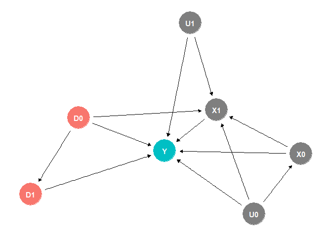
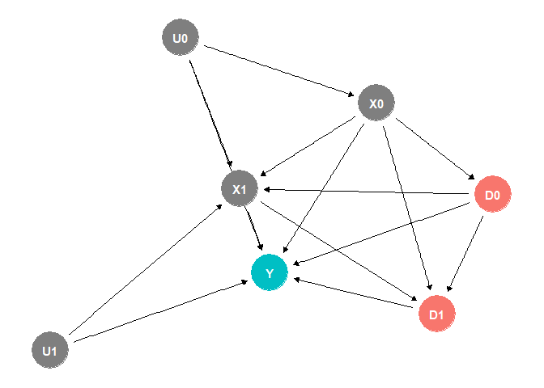
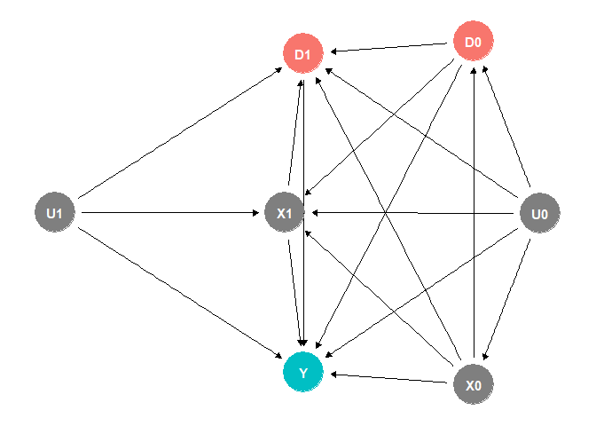
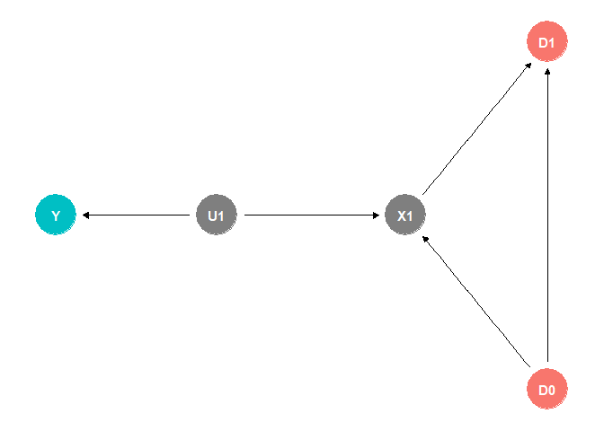
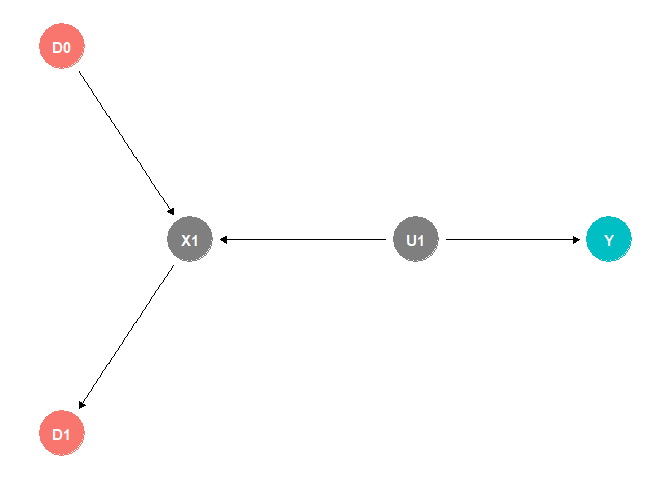

# The First Casualty of Statistics: Part Thirty One
<big>**G-computation**</big>

<br/>
Jiří Fejlek

2026-10-31
<br/>

<br/> In the last seven parts, we explored causal inference in longitudinal
data using differences-in-differences, which required various forms of
the (conditional) parallel trends assumption. However, the methods of
causal inference we used for cross-sectional data, such as inverse
propensity score weighting that adjusts for observed confounders, still
apply to longitudinal data. Hence, we will take a step back and
investigate causal inference of longitudinal data from these alternative
perspectives. We will start with g-computation, which is based on
constructing the outcome model and predicting counterfactuals; it is the
approach we previously referred to as regression adjustment. <br/>

## Table of Contents

- [Time-Varying Treatment](#time-varying-treatment)
- [Treatment-Confounder Feedback](#treatment-confounder-feedback)
- [G-formula for Time-Varying
  Treatments](#g-formula-for-time-varying-treatments)
- [References](#references)

``` r
library(tidyr)
library(dplyr)
library(tibble)
library(ggplot2)
library(patchwork)
library(dagitty)
library(ggdag)
library(modelsummary)
library(fixest)
library(pretrends)
library(HonestDiD)
library(WeightIt)
library(cobalt)
```

## Time-Varying Treatment

Let’s assume a binary, time-varying treatment path up to time period k
is given by $`\bar D_k = (D_0, D_1, \ldots, D_k)`$. One particular
difficulty to consider with time-varying treatments is that there are
many contrasts $`\mathbb{E}(Y(\bar D_k) - Y(\bar D’_k))`$ that we could
investigate as measures of the treatment effect. For example, we could
compare the treatment strategies “always treat” ($`\bar D_k = \bar 1`$)
and “never treat” ($`\bar D’_k = \bar 0`$) (Hernán and Robins 2020). In
addition, the treatment assignment strategy might be dynamic; i.e., the
treatment assignment for $`D_k`$ may depend on the evolution of an
individual’s time-varying covariates $`\bar X_k`$. Consequently, we must 
always keep in mind that there is no single treatment effect; we are merely 
comparing several of a multitude of possible treatment strategies.

Overall, three main situations can occur in studies with time-varying
treatments (Hernán and Robins 2020).

``` r
set.seed(1)
dag <- dagify(Y ~ X1 + X0 + D1 + D0 + U1 + U0, D1 ~ D0, X1 ~ D0 + X0 + U0 + U1, X0 ~ U0, exposure = c('D0','D1'), outcome = 'Y')
ggdag_status(dag) + theme_dag() + theme(legend.position = "none")
```

<!-- -->

``` r
set.seed(2)
dag <- dagify(Y ~ X1 + X0 + D1 + D0 + U1 + U0, D1 ~ D0, X1 ~ D0 + X0 + U0 + U1, X0 ~ U0, D0 ~ X0, D1 ~ X1 + X0, exposure = c('D0','D1'), outcome = 'Y')
ggdag_status(dag) + theme_dag() + theme(legend.position = "none")
```

<!-- -->

``` r
set.seed(4)
dag <- dagify(Y ~ X1 + X0 + D1 + D0 + U1 + U0, D1 ~ D0, X1 ~ D0 + X0 + U0 + U1, X0 ~ U0, D0 ~ X0 + U0, D1 ~ X1 + X0 + U1 + U0, exposure = c('D0','D1'), outcome = 'Y')
ggdag_status(dag) + theme_dag() + theme(legend.position = "none")
```

<!-- -->

The first DAG represents a randomized experiment with a static treatment
strategy. Treatments $`D_k`$ at each time $`k`$ are randomly assigned
with a probability that depends only on prior treatment history. For the
static treatment strategy, counterfactual $`\mathbb{E}Y(d)`$ can be
obtained simply as $`\mathbb{E}(Y \mid \bar D = d)`$ (Hernán and Robins
2020).

The second DAG corresponds to a randomized experiment with a dynamic
treatment strategy. The treatment $`D_k`$ at each time $`k`$ is randomly
assigned with a probability that depends on prior treatment and measured
covariate history. In this case, we will need an appropriate causal
inference method, such as g-computation, to identify $`\mathbb{E}Y(d)`$
without bias. The last DAG represents an observational study, in which
the treatment assignment depends on unobserved confounders.

These first two DAGs represent a sequentially randomized experiment that
meets *sequential exchangeability*
``` math
Y(g) \perp D_k \mid \bar D_{k-1} = g(\bar D_{k-2}, \bar X_{k-1}), \bar X_k
```
for all strategies $`g`$ and for $`k = 0, 1, \ldots, K`$. Therefore,
sequential exchangeability holds when the probability of receiving
treatment in each time period depends only on the treatment and measured
covariate history and does not depend on any unmeasured causes of the
outcome. When the treatment assignment strategy is static, we get a
simplified *static sequential exchangeability*
``` math
Y(\bar D_K) \perp D_k \mid \bar D_{k-1}, \bar X_k
```
for $`k  = 0,1, \ldots, K.`$

We will also assume a generalized version of the *positivity condition*
(the probability of treatment assignment is never 0 nor 1) (Hernán and
Robins 2020)  
``` math
\text{If } f_{\bar D_{k-1}, \bar X_k}(d_{k-1}, \bar x_k) \neq 0 \text{, then }  f_{D_k \mid \bar D_{k-1}, \bar X_k}(d_k \mid \bar d_{k-1}, \bar x_k) > 0
```
for all $`d_{k-1}`$ and $`\bar x_k`$.

## Treatment-Confounder Feedback

Let’s return to the DAG with a dynamic treatment assignment.

``` r
set.seed(2)
dag <- dagify(Y ~ X1 + X0 + D1 + D0 + U1 + U0, D1 ~ D0, X1 ~ D0 + X0 + U0 + U1, X0 ~ U0, D0 ~ X0, D1 ~ X1 + X0, exposure = c('D0','D1'), outcome = 'Y')
ggdag_status(dag) + theme_dag() + theme(legend.position = "none")
```

<!-- -->

We will demonstrate that standard adjustment methods cannot be used to
adjust for observed confounders due to **treatment-confounder
feedback**: the DAG shows an arrow from $`X_k`$ to $`D_k`$, but also
from $`D_{k-1}`$ to $`X_k`$. That is, the confounder affects the
treatment and the treatment affects the confounder (Hernán and Robins
2020).

To illustrate the issues that treatment-confounder feedback can cause,
let us simplify the DAG.

``` r
set.seed(2)
dag <- dagify(Y ~ U1, D1 ~ X1, X1 ~ D0 + U1, exposure = c('D0','D1'), outcome = 'Y')
ggdag_status(dag) + theme_dag() + theme(legend.position = "none")
```

<!-- -->

In this simplified form, the treatment $`D`$ no longer has a causal
effect on the outcome, nor the observed confounder $`X`$. The confounder
is associated with the outcome $`Y`$ only through the unobserved common
cause $`U`$. However, the treatment-confounder feedback *is present*.

Let’s simulate some data that corresponds to the DAG above.

``` r
set.seed(123)

n_sample <- 10000

D0 <- (runif(n_sample, 0, 1) < 0.5) + 0
U1 <- rnorm(n_sample)

rand1 <- runif(n_sample, 0, 1)
rand2 <- runif(n_sample, 0, 1)

X1  <- (plogis(-5*D0 + 7.5*U1) > rand1) + 0
D1 <- (plogis(5*X1 - 2.5) > rand2) + 0

Y <- 10 + U1 + rnorm(n_sample,0,0.5)
```

The treatment $`D_0`$ does not affect the outcome, and there are no
confounders; thus,
$`\mathbb{E}(Y \mid D_0 =1) - \mathbb{E}(Y \mid D_0 =0)`$ estimates the
total effect of $`D_0`$ on $`Y`$, which is zero.

``` r
mean(Y[D0 == 1]) - mean(Y[D0 == 0])
```

    ## [1] 0.0164388

The treatment $`D_1`$ also does not affect the outcome. However, $`D_1`$
is confounded with the outcome due to the non-causal path
$`D_1 \leftarrow X \leftarrow U_1 \rightarrow Y`$. Consequently,
$`\mathbb{E}(Y \mid D_1 = 1) - \mathbb{E}(Y \mid D_1 =0)`$ does not
estimate a causal treatment effect.

``` r
mean(Y[D1 == 1]) - mean(Y[D1 == 0])
```

    ## [1] 1.256044

To remove confounding and estimate the treatment effect, we can adjust
for $`X`$ by stratifying.

``` r
d1_eff <- c(mean(Y[X1 == 0 & D1 == 1]) - mean(Y[X1 == 0 & D1 == 0]),
mean(Y[X1 == 1 & D1 == 1]) - mean(Y[ X1 == 1 & D1 == 0]))

names(d1_eff) <- c('X1 = 0','X1 = 1')
d1_eff
```

    ##       X1 = 0       X1 = 1 
    ##  0.030949816 -0.001785176

We can additionally stratify by $`D_0`$.

``` r
d1_eff <- c(mean(Y[D0 == 0 & X1 == 0 & D1 == 1]) - mean(Y[D0 == 0 & X1 == 0 & D1 == 0]),
mean(Y[D0 == 0 & X1 == 1 & D1 == 1]) - mean(Y[D0 == 0 & X1 == 1 & D1 == 0]),
mean(Y[D0 == 1 & X1 == 0 & D1 == 1]) - mean(Y[D0 == 1 & X1 == 0 & D1 == 0]),
mean(Y[D0 == 1 & X1 == 1 & D1 == 1]) - mean(Y[D0 == 1 & X1 == 1 & D1 == 0]))

names(d1_eff) <- c('D0 = 0, X1 = 0','D0 = 0, X1 = 1','D0 = 1, X1 = 0','D0 = 1, X1 = 1')
d1_eff
```

    ## D0 = 0, X1 = 0 D0 = 0, X1 = 1 D0 = 1, X1 = 0 D0 = 1, X1 = 1 
    ##    -0.03168799    -0.03152231     0.05405201    -0.01723608

Again, we verified that $`D_1`$ does not affect the outcome.
Consequently, we expect that the strategy with $`D_0 = D_1 = 1`$ will
also not change the outcome. However, if we compute the observed
difference
$`\mathbb{E}(Y \mid D_0 = 1, D_1 = 1) - \mathbb{E}(Y \mid D_0 = 0, D_1 =0)`$,
we get

``` r
mean(Y[D0 == 1 & D1 == 1]) - mean(Y[D0 == 0 & D1 == 0])
```

    ## [1] 1.579229

This is a clearly biased result. We note that $`D_1`$ is confounded
because it depends on $`X_1`$. So let’s stratify by $`X`$.

``` r
mean(Y[D0 == 1 & D1 == 1 & X1 == 1]) - mean(Y[D0 == 0 & D1 == 0 & X1 == 1])
```

    ## [1] 0.4181613

``` r
mean(Y[D0 == 1 & D1 == 1 & X1 == 0]) - mean(Y[D0 == 0 & D1 == 0 & X1 == 0])
```

    ## [1] 0.4211333

Both estimates remain biased even after adjusting for the observed
confounder! The reason why the adjustment did not work is that $`X_1`$
is also a collider. By adjusting for $`X_1`$, we blocked the non-causal
path $`D_1 \leftarrow X \leftarrow U_1 \rightarrow Y`$, but we opened
the non-causal path $`D_0 \rightarrow X \leftarrow U_1 \rightarrow Y`$,
and hence, our estimate of the treatment effect of the treatment
strategy $`D_0 = D_1 = 1`$ is biased even after adjustment.

We should note that the bias will appear even when *there is* a
treatment effect on the outcome.

``` r
set.seed(123)
Y_alt <- 10 + U1 + D0 + 0.5*D1 + rnorm(n_sample,0,0.5)
```

``` r
mean(Y_alt[D0 == 1 & D1 == 1 & X1 == 1]) - mean(Y_alt[D0 == 0 & D1 == 0 & X1 == 1])
```

    ## [1] 2.008646

``` r
mean(Y_alt[D0 == 1 & D1 == 1 & X1 == 0]) - mean(Y_alt[D0 == 0 & D1 == 0 & X1 == 0])
```

    ## [1] 1.852624

We see that the bias of about $`+0.4`$ remains.

We demonstrated this problem by estimating the treatment using
stratification. But we would encounter the same problem when modeling
the outcome using regression. This regression model is correct for
estimating the effect of $`D_0`$.

``` r
summary(lm(Y ~ D0))
```

    ## 
    ## Call:
    ## lm(formula = Y ~ D0)
    ## 
    ## Residuals:
    ##     Min      1Q  Median      3Q     Max 
    ## -4.1962 -0.7550 -0.0115  0.7458  4.3909 
    ## 
    ## Coefficients:
    ##             Estimate Std. Error t value Pr(>|t|)    
    ## (Intercept)  9.99401    0.01595 626.402   <2e-16 ***
    ## D0           0.01644    0.02244   0.733    0.464    
    ## ---
    ## Signif. codes:  0 '***' 0.001 '**' 0.01 '*' 0.05 '.' 0.1 ' ' 1
    ## 
    ## Residual standard error: 1.122 on 9998 degrees of freedom
    ## Multiple R-squared:  5.369e-05,  Adjusted R-squared:  -4.632e-05 
    ## F-statistic: 0.5369 on 1 and 9998 DF,  p-value: 0.4638

This regression model is also correct (in terms of estimating the effect
of $`D_1`$).

``` r
summary(lm(Y ~ D1 + X1))
```

    ## 
    ## Call:
    ## lm(formula = Y ~ D1 + X1)
    ## 
    ## Residuals:
    ##     Min      1Q  Median      3Q     Max 
    ## -3.6510 -0.5542  0.0104  0.5856  3.4713 
    ## 
    ## Coefficients:
    ##             Estimate Std. Error t value Pr(>|t|)    
    ## (Intercept)  9.43054    0.01113 847.679   <2e-16 ***
    ## D1           0.01831    0.03238   0.566    0.572    
    ## X1           1.48121    0.03263  45.389   <2e-16 ***
    ## ---
    ## Signif. codes:  0 '***' 0.001 '**' 0.01 '*' 0.05 '.' 0.1 ' ' 1
    ## 
    ## Residual standard error: 0.8543 on 9997 degrees of freedom
    ## Multiple R-squared:   0.42,  Adjusted R-squared:  0.4199 
    ## F-statistic:  3620 on 2 and 9997 DF,  p-value: < 2.2e-16

But this one clearly leads to a biased estimate of treatment effects.

``` r
summary(lm(Y ~ D0 + D1 + X1))
```

    ## 
    ## Call:
    ## lm(formula = Y ~ D0 + D1 + X1)
    ## 
    ## Residuals:
    ##     Min      1Q  Median      3Q     Max 
    ## -3.4349 -0.5451  0.0120  0.5685  3.3242 
    ## 
    ## Coefficients:
    ##             Estimate Std. Error t value Pr(>|t|)    
    ## (Intercept) 9.189913   0.014955 614.498   <2e-16 ***
    ## D0          0.400987   0.017179  23.342   <2e-16 ***
    ## D1          0.003492   0.031536   0.111    0.912    
    ## X1          1.596004   0.032159  49.628   <2e-16 ***
    ## ---
    ## Signif. codes:  0 '***' 0.001 '**' 0.01 '*' 0.05 '.' 0.1 ' ' 1
    ## 
    ## Residual standard error: 0.832 on 9996 degrees of freedom
    ## Multiple R-squared:   0.45,  Adjusted R-squared:  0.4498 
    ## F-statistic:  2726 on 3 and 9996 DF,  p-value: < 2.2e-16

We could try to be a bit more clever and assume regression on
$`Y_1 + Y_2`$ (i.e., an average treatment in time). But this will not
work either (Hernán and Robins 2020).

``` r
summary(lm(Y ~ I(D0 + D1)))
```

    ## 
    ## Call:
    ## lm(formula = Y ~ I(D0 + D1))
    ## 
    ## Residuals:
    ##     Min      1Q  Median      3Q     Max 
    ## -4.2792 -0.6218  0.0228  0.6489  4.0366 
    ## 
    ## Coefficients:
    ##             Estimate Std. Error t value Pr(>|t|)    
    ## (Intercept)  9.29998    0.01774  524.33   <2e-16 ***
    ## I(D0 + D1)   0.77701    0.01613   48.18   <2e-16 ***
    ## ---
    ## Signif. codes:  0 '***' 0.001 '**' 0.01 '*' 0.05 '.' 0.1 ' ' 1
    ## 
    ## Residual standard error: 1.011 on 9998 degrees of freedom
    ## Multiple R-squared:  0.1884, Adjusted R-squared:  0.1884 
    ## F-statistic:  2321 on 1 and 9998 DF,  p-value: < 2.2e-16

``` r
summary(lm(Y ~ I(D0 + D1) + X1))
```

    ## 
    ## Call:
    ## lm(formula = Y ~ I(D0 + D1) + X1)
    ## 
    ## Residuals:
    ##     Min      1Q  Median      3Q     Max 
    ## -3.7335 -0.5515  0.0145  0.5749  3.2686 
    ## 
    ## Coefficients:
    ##             Estimate Std. Error t value Pr(>|t|)    
    ## (Intercept)  9.22308    0.01473  625.98   <2e-16 ***
    ## I(D0 + D1)   0.30823    0.01505   20.49   <2e-16 ***
    ## X1           1.31364    0.01941   67.67   <2e-16 ***
    ## ---
    ## Signif. codes:  0 '***' 0.001 '**' 0.01 '*' 0.05 '.' 0.1 ' ' 1
    ## 
    ## Residual standard error: 0.8369 on 9997 degrees of freedom
    ## Multiple R-squared:  0.4434, Adjusted R-squared:  0.4433 
    ## F-statistic:  3982 on 2 and 9997 DF,  p-value: < 2.2e-16

Both regressions, adjusted and unadjusted, are biased.

We should not that if $`D_1`$ depends on $`D_0`$

``` r
set.seed(2)
dag <- dagify(Y ~ U1, D1 ~ X1 + D0, X1 ~ D0 + U1, exposure = c('D0','D1'), outcome = 'Y')
ggdag_status(dag) + theme_dag() + theme(legend.position = "none")
```

<!-- -->

``` r
set.seed(123)

n_sample <- 10000

D0 <- (runif(n_sample, 0, 1) < 0.5) + 0
U1 <- rnorm(n_sample)

rand1 <- runif(n_sample, 0, 1)
rand2 <- runif(n_sample, 0, 1)

X1  <- (plogis(-5*D0 + 7.5*U1) > rand1) + 0
D1 <- (plogis(5*X1 - 2.5 - 3*D0) > rand2) + 0

Y <- 10 + U1 + rnorm(n_sample,0,0.5)
```

stratification or regression adjustment on $`X_1`$ alone does not work
when estimating the effect of $`D_1`$.

``` r
d1_eff <- c(mean(Y[X1 == 0 & D1 == 1]) - mean(Y[X1 == 0 & D1 == 0]),
mean(Y[X1 == 1 & D1 == 1]) - mean(Y[ X1 == 1 & D1 == 0]))

names(d1_eff) <- c('X1 = 0','X1 = 1')
d1_eff
```

    ##     X1 = 0     X1 = 1 
    ## -0.2120106 -0.2873747

We also need to control for $`D_0`$ to estimate the effect of $`D_1`$
without bias (note that this is the model we wanted to use to estimate
the effect of $`D_0`$ and $`D_1`$ on the outcome).

``` r
d1_eff <- c(mean(Y[D0 == 0 & X1 == 0 & D1 == 1]) - mean(Y[D0 == 0 & X1 == 0 & D1 == 0]),
mean(Y[D0 == 0 & X1 == 1 & D1 == 1]) - mean(Y[D0 == 0 & X1 == 1 & D1 == 0]),
mean(Y[D0 == 1 & X1 == 0 & D1 == 1]) - mean(Y[D0 == 1 & X1 == 0 & D1 == 0]),
mean(Y[D0 == 1 & X1 == 1 & D1 == 1]) - mean(Y[D0 == 1 & X1 == 1 & D1 == 0]))

names(d1_eff) <- c('D0 = 0, X1 = 0','D0 = 0, X1 = 1','D0 = 1, X1 = 0','D0 = 1, X1 = 1')
d1_eff
```

    ## D0 = 0, X1 = 0 D0 = 0, X1 = 1 D0 = 1, X1 = 0 D0 = 1, X1 = 1 
    ##   -0.031687992   -0.031522311    0.119167492   -0.007029848

``` r
summary(lm(Y ~ D0 + D1 + X1))
```

    ## 
    ## Call:
    ## lm(formula = Y ~ D0 + D1 + X1)
    ## 
    ## Residuals:
    ##     Min      1Q  Median      3Q     Max 
    ## -3.4327 -0.5444  0.0142  0.5675  3.3315 
    ## 
    ## Coefficients:
    ##             Estimate Std. Error t value Pr(>|t|)    
    ## (Intercept)  9.19673    0.01566 587.179   <2e-16 ***
    ## D0           0.39204    0.01855  21.139   <2e-16 ***
    ## D1          -0.03773    0.02941  -1.283      0.2    
    ## X1           1.62314    0.02583  62.837   <2e-16 ***
    ## ---
    ## Signif. codes:  0 '***' 0.001 '**' 0.01 '*' 0.05 '.' 0.1 ' ' 1
    ## 
    ## Residual standard error: 0.8319 on 9996 degrees of freedom
    ## Multiple R-squared:  0.4501, Adjusted R-squared:  0.4499 
    ## F-statistic:  2727 on 3 and 9996 DF,  p-value: < 2.2e-16

## G-formula for Time-Varying Treatments

We learned in the previous section that naively applying the
stratification/regression adjustment to estimate the effect of
time-varying treatment-strategy feedback does not work due to
treatment-confounder feedback. Let us return to our simple DAG

``` r
set.seed(2)
dag <- dagify(Y ~ U1, D1 ~ X1, X1 ~ D0 + U1, exposure = c('D0','D1'), outcome = 'Y')
ggdag_status(dag) + theme_dag() + theme(legend.position = "none")
```

<!-- -->

We observed that we can still estimate the effect of the treatment
$`D_1`$ as usual
``` math
\mathbb{E}Y(d_1) = \sum_{x \in \mathcal{X}} \mathbb{E}(Y \mid  D_1 = d_1, X =x) P(X = x).
```
However, we learned that
``` math
\mathbb{E}Y(d_0,d_1) \neq \sum_{x \in \mathcal{X}} \mathbb{E}(Y \mid  D_1 = d_1, D_0 =  d_0, X = x) P(X = x).
```

The correct formula for our simple case is actually pretty similar; we
need to replace $`P(X = x)`$ by the conditional probability conditioned
on the history of the system, which reduces in our case to
``` math
\mathbb{E}Y(d_0,d_1) =  \sum_{x \in \mathcal{X}} \mathbb{E}(Y \mid  D_1 = d_1, D_0 =  d_0, X_1 = x_1) P(X_1 = x_1 \mid D_0 =  d_0)
```
One way to understand this formula is to see it as the simulation of
potential outcomes. Before we can compute the expected potential outcome
$`Y`$, we need to determine the distribution of $`X_1`$ conditional on
the individual having previously received the treatment $`D_0 = d_0`$
(Hernán and Robins 2020).

Let’s check the result for our simulated data.

``` r
set.seed(123)

n_sample <- 10000

D0 <- (runif(n_sample, 0, 1) < 0.5) + 0
U1 <- rnorm(n_sample)

rand1 <- runif(n_sample, 0, 1)
rand2 <- runif(n_sample, 0, 1)

X1  <- (plogis(-5*D0 + 7.5*U1) > rand1) + 0
D1 <- (plogis(5*X1 - 2.5) > rand2) + 0

Y <- 10 + U1 + rnorm(n_sample,0,0.5)
```

The biased ATE is computed as follows.

``` r
(mean(Y[D0 == 1 & D1 == 1 & X1 == 1]) - mean(Y[D0 == 0 & D1 == 0 & X1 == 1]))*mean(X1 == 1) + (mean(Y[D0 == 1 & D1 == 1 & X1 == 0]) - mean(Y[D0 == 0 & D1 == 0 & X1 == 0]))*mean(X1 == 0) 
```

    ## [1] 0.4200007

To get the correct estimate, we first compute the conditional
distribution of $`X1`$.

``` r
px1_d0_1 <- mean(X1[D0 == 1])
px1_d0_0 <- mean(X1[D0 == 0])
```

And we substitute into the formula.

``` r
(1-px1_d0_1)*mean(Y[D0 == 1 & D1 == 1 & X1 == 0]) + px1_d0_1*mean(Y[D0 == 1 & D1 == 1 & X1 == 1]) - ((1-px1_d0_0)*mean(Y[D0 == 0 & D1 == 0 & X1 == 0]) + px1_d0_0*mean(Y[D0 == 0 & D1 == 0 & X1 == 1]))
```

    ## [1] 0.0372867

We get the effect close to zero as expected.

The general *extended g-formula* of the potential outcomes under sequential
exchangeability for any deterministic or random, static or dynamic,
strategy $`d`$ derived by James Robins in 1986 (Robins 1986) is (Hernán
and Robins 2020)
``` math
\mathbb{E}Y(d)  = \sum_{\bar X} \mathbb{E}(Y \mid \bar D =  \bar d, \bar X = \bar x)\prod_{k = 0}^Kf(x_k \mid \bar d_{k-1}, \bar x_{k-1}) \prod_{k = 0}^K f(d_k \mid \bar d_{k-1}, \bar x_k).
```
Again, we can interpret the formula as simulating counterfactuals using
each individual’s history.

Estimating can get pretty complicated to do manually. Fortunately,
g-computation can be performed in R using the *gfoRmula* package. First,
we need to transform into the long format.

``` r
library('gfoRmula')
library('data.table')

id <- rep(seq(1,n_sample),2)
t0 <- c(rep(0,n_sample),rep(1,n_sample))
X0 <- rep(NA, n_sample)  
Y0 <- rep(NA, n_sample)


df_long <- data.table(
  id = id,
  t0 = t0,
  X = c(X0, X1),
  D = c(D0, D1),
  Y = c(Y0, Y)
)

df_long <- setorder(df_long, id, t0) # data must be ordered by id and time
head(df_long)
```

    ##       id    t0     X     D         Y
    ##    <int> <num> <num> <num>     <num>
    ## 1:     1     0    NA     1        NA
    ## 2:     1     1     0     0  9.108222
    ## 3:     2     0    NA     0        NA
    ## 4:     2     1     1     0 10.560038
    ## 5:     3     0    NA     1        NA
    ## 6:     3     1     0     0  9.143101

We can now use the *gfoRmula* package
(<https://cran.r-project.org/web/packages/gfoRmula/index.html>), which
uses the so-called *noniterative conditional expectation (NICE)*
algorithm. It first fits models to estimate
$`f(x_k \mid \bar d_{k-1}, \bar x_{k-1})`$. Then it approximates the
expected potential outcome of a given treatment strategy $`g`$ using
multiple Monte Carlo simulations starting from the observed baseline
confounders, via the models
$`\hat f(x_k \mid \bar d_{k-1}, \bar x_{k-1})`$.

``` r
options(width=2000)
id <- 'id'
time_points <- 2
time_name <- 't0'
covnames <- c('X', 'D')
outcome_name <- 'Y'
outcome_type <- 'continuous_eof'
covtypes <- c('binary', 'binary')
histories <- c(lagged)
histvars <- list(c('D'))
covparams <- list(covlink = c('logit', 'logit'),
covmodels = c(X ~ lag1_D,
D ~ lag1_D + X))
ymodel <- Y ~ X + D + lag1_D
int_descript <- c('Never treat', 'Always treat')

gform_basic <- gformula(obs_data = df_long, id = id,
                        time_points = time_points,
                        time_name = time_name, covnames = covnames,
                        outcome_name = outcome_name,
                        outcome_type = outcome_type, covtypes = covtypes,
                        covparams = covparams, ymodel = ymodel,
                        histories = histories, histvars = histvars,
                        seed = 123, 
                        nsamples = 100,
                        intvars = list(c('D'), c('D')),
                        interventions = list(
                          list(c(static, rep(1, 2))),
                          list(c(static, rep(0, 2)))),
                        int_descr = c('Always Treat', 'Never Treat'))
gform_basic
```

    ## PREDICTED RISK UNDER MULTIPLE INTERVENTIONS
    ## 
    ## Intervention      Description
    ## 0         Natural course
    ## 1         Always Treat
    ## 2         Never Treat
    ## 
    ## Sample size = 10000, Monte Carlo sample size = 10000
    ## Number of bootstrap samples = 100
    ## Reference intervention = natural course (0)
    ##  
    ## 
    ##      k Interv.  NP mean g-form mean    Mean SE Mean lower 95% CI Mean upper 95% CI Mean ratio       MR SE MR lower 95% CI MR upper 95% CI Mean difference      MD SE MD lower 95% CI MD upper 95% CI % Intervened On Aver % Intervened On
    ##  <num>   <num>    <num>       <num>      <num>             <num>             <num>      <num>       <num>           <num>           <num>           <num>      <num>           <num>           <num>           <num>                <num>
    ##      1       0 10.00232    9.994483 0.01193977          9.980735          10.02479  1.0000000 0.000000000       1.0000000        1.000000     0.000000000 0.00000000      0.00000000      0.00000000            0.00                0.000
    ##      1       1       NA   10.011747 0.02899361          9.962499          10.07387  1.0017274 0.002554995       0.9957004        1.005858     0.017264664 0.02557065     -0.04306174      0.05860500           85.09               59.740
    ##      1       2       NA    9.988394 0.02200719          9.953905          10.04496  0.9993908 0.002211359       0.9950856        1.003071    -0.006088978 0.02213610     -0.04925050      0.03072652           75.00               50.095

Clearly, the always-treat strategy and the never-treat strategy have the
same predicted potential outcomes.

Overall, we obtained a universal approach for causal inference with
tabular data provided that we can assume (conditional) sequential
exchangeability. Apart from that, another important limitation to keep
in mind, shared with any methods based on imputing potential outcomes,
is that our estimates will be unbiased only if our outcome model is
specified correctly. This observation is related to the *g-null
paradox*, in which model misspecification with the g-formula is
*guaranteed* in certain settings (e.g., under a sharp null hypothesis
when using standard logistic/linear regression models). Hence, (McGrath
et al. 2022) recommends avoiding overly parsimonious models for the
components in the g-formula.

As one might suspect, an alternative (and complementary) approach would
be to focus on modeling treatment assignments rather than potential
outcomes. This brings us to marginal structural models and inverse
propensity score weighting, which we will explore a bit in the next
part.

## References

<div id="refs" class="references csl-bib-body hanging-indent">

<div id="ref-Hernan2020WhatIf" class="csl-entry">

Hernán, Miguel A., and James M. Robins. 2020. *Causal Inference: What
If*. Chapman & Hall/CRC.

</div>

<div id="ref-mcgrath2022revisiting" class="csl-entry">

McGrath, Sean, Jessica G Young, and Miguel A Hernán. 2022. “Revisiting
the g-Null Paradox.” *Epidemiology (Cambridge, Mass.)* 33 (1): 114.

</div>

<div id="ref-robins1986new" class="csl-entry">

Robins, James. 1986. “A New Approach to Causal Inference in Mortality
Studies with a Sustained Exposure Period—Application to Control of the
Healthy Worker Survivor Effect.” *Mathematical Modelling* 7 (9-12):
1393–512.

</div>

</div>
