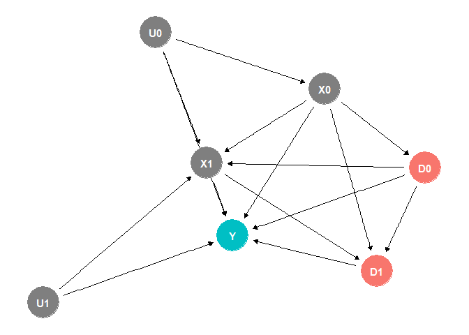
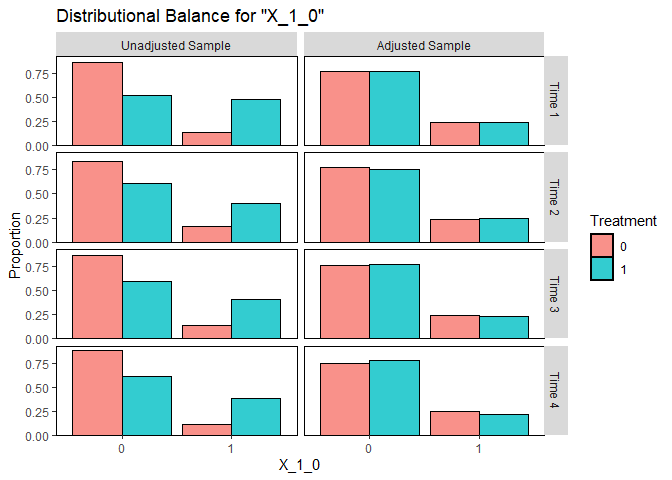
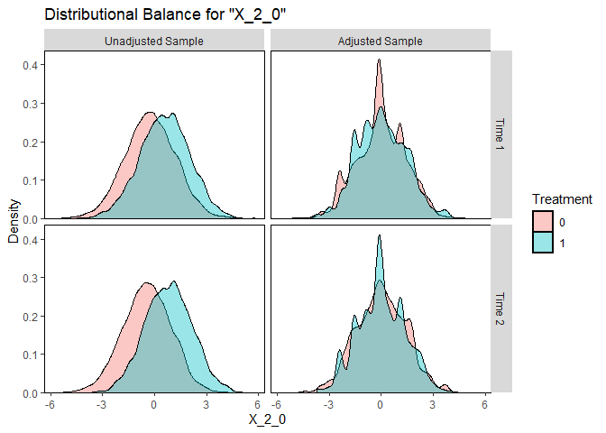
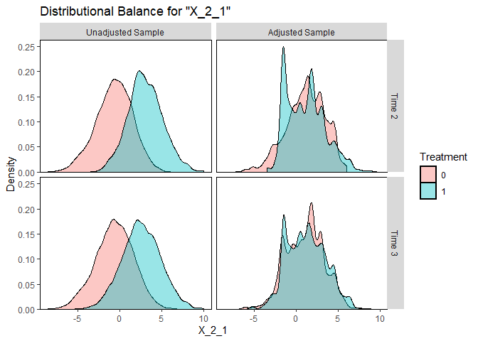
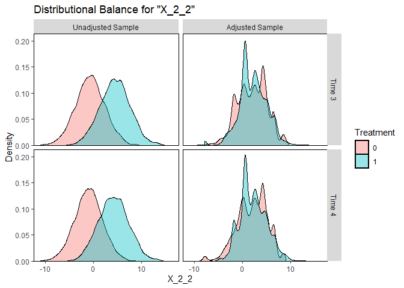
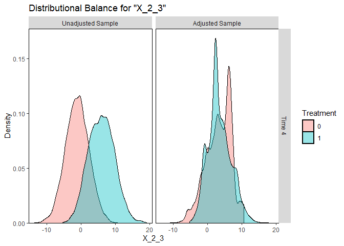
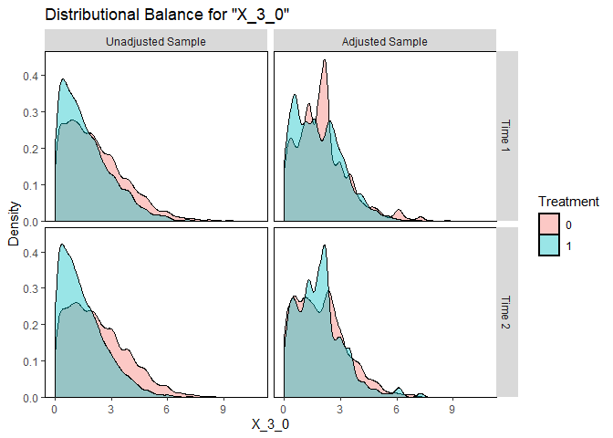
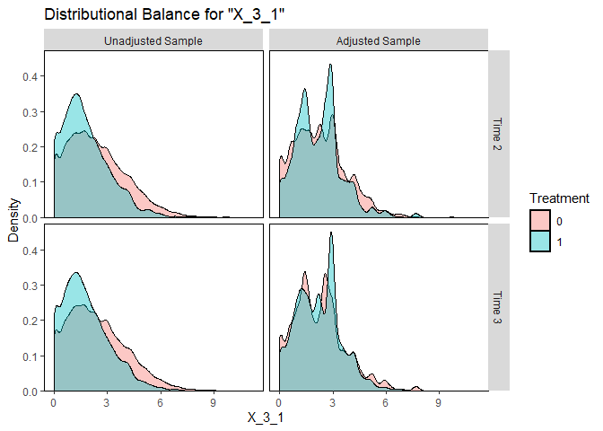
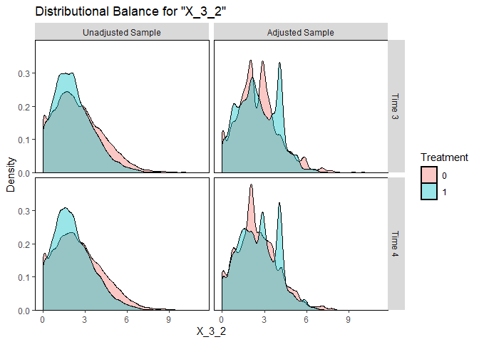
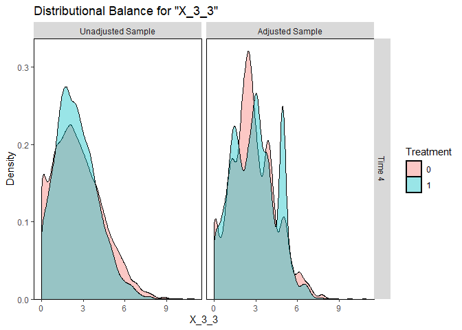

# The First Casualty of Statistics: Part Thirty Two
<big>**Marginal Structural Models**</big>

<br/>
Jiří Fejlek

2026-11-06
<br/>

<br/> We will continue our exploration of causal inference for longitudinal
data under *sequential exchangeability*, which replaces the standard
assumption of exchangeability (i.e., unconfoundedness) used in
cross-sectional data. In the previous part, we learned that causal
inference for longitudinal data is a bit more complicated due to
*treatment-confounder feedback*. Hence, we stated the *extended
g-formula*, which allows us to compute the expected potential outcome
under a given treatment strategy using the conditional densities
$`f(x_k \mid \bar d_{k-1}, \bar x_{k-1})`$, where $`d_{k-1}`$ denotes a
past evolution of treatments and $`\bar x_{k-1}`$ denotes a past
evolution of confounders. However, as with causal inference for
cross-sectional data, we can construct models of treatment assignment
rather than relying on potential outcome models. This strategy leads to
causal inference for longitudinal data, known as inverse probability of
treatment weighting (IPW) *marginal structural models*. <br/>


## Table of Contents

- [IPW and Marginal Structural
  Models](#ipw-and-marginal-structural-models)
- [Simulated Dataset](#simulated-dataset)
  - [Naive Estimates of Treatment
    Effect](#naive-estimates-of-treatment-effect)
  - [G-computation](#g-computation)
  - [Marginal Structural Models](#marginal-structural-models)
- [References](#references)


``` r
library(tidyr)
library(dplyr)
library(tibble)
library(ggplot2)
library(patchwork)
library(dagitty)
library(ggdag)
library(modelsummary)
library(cobalt)
```

## IPW and Marginal Structural Models

Let’s assume panel data with observed confounding, which we demonstrated
in the previous part using the following DAG for two periods.

``` r
set.seed(2)
dag <- dagify(Y ~ X1 + X0 + D1 + D0 + U1 + U0, D1 ~ D0, X1 ~ D0 + X0 + U0 + U1, X0 ~ U0, D0 ~ X0, D1 ~ X1 + X0, exposure = c('D0','D1'), outcome = 'Y')
ggdag_status(dag) + theme_dag() + theme(legend.position = "none")
```

<!-- -->

We will again assume sequential exchangeability
``` math
Y(g) \perp D_k \mid \bar D_{k-1} = g(\bar D_{k-2}, \bar X_{k-1}), \bar X_k
```
for all strategies $`g`$ and for $`k = 0, 1, \ldots, K`$, and the
positivity condition
``` math
\text{If } f_{\bar D_{k-1}, \bar X_k}(d_{k-1}, \bar x_k) \neq 0 \text{, then }  f_{D_k \mid \bar D_{k-1}, \bar X_k}(d_k \mid \bar d_{k-1}, \bar x_k) > 0.
```
Let’s assume a deterministic strategy $`g`$, then the extended g-formula
reduces to (Hernán and Robins 2020)
``` math
\mathbb{E}Y(g)  = \sum_{\bar X} \mathbb{E}(Y \mid \bar D =  \bar d, \bar X = \bar x)\prod_{k = 0}^Kf(x_k \mid \bar d_{k-1}, \bar x_{k-1}),
```
which leads to estimating the causal effect using g-computation.

An alternative way to express $`\mathbb{E}Y(g)`$ is to use inverse
probability of treatment weighting (IPW). It can be shown that (Hernán
and Robins 2020)
``` math
\mathbb{E}Y(g) = \mathbb{E}\left(\frac{I(D_0 = d_0, D_1 = d_1, \ldots , D_K = d_k)}{\prod_{k = 0}^K f(d_k \mid \bar d_{k-1}, \bar x_k)}Y\right).
```

Consequently, we can estimate the causal effect
$`\mathbb{E}Y(g) - \mathbb{E}Y(g')`$ using the IPW estimator as
``` math
\mathbb{E}\left(\frac{I(D_0 = d_0, D_1 = d_1, \ldots , D_K = d_k)}{\prod_{k = 0}^K f(d_k \mid \bar d_{k-1}, \bar x_k)}Y\right) - \mathbb{E}\left(\frac{I(D_0 = d_0', D_1 = d_1', \ldots , D_K = d_k')}{\prod_{k = 0}^K f(d_k' \mid \bar d'_{k-1}, \bar x'_k)}Y\right).
```
We should note that the inverse probability of treatment weights we used
here are known as the *nonstabilized*. The *stabilized* propensity score
weights (we encountered these when we discussed generalized propensity
scores for continuous treatment) are (Hernán and Robins 2020)
``` math
\frac{\prod_{k = 0}^K f(d_k' \mid \bar d'_{k-1})}{\prod_{k = 0}^K f(d_k' \mid \bar d'_{k-1}, \bar x'_k)}.
```

As we explained at the very beginning of the previous part, there are
many contrasts $`\mathbb{E}Y(g) - \mathbb{E}Y(g’)`$ one could consider
to estimate. Hence, it is convenient to combine information on treatment
effects into a single *marginal structural model*. For example, one
could consider a model
``` math
\mathbb{E}Y(g) = \gamma + \beta_0d_0 + \beta_1 d_1 +  \cdots + \beta_K d_K
```
or
``` math
\mathbb{E}Y(g) = \gamma + \beta (d_0 + d_1 +  \cdots + d_K).
```
We estimate these simply by fitting the observed outcomes $`Y`$ weighted
by the propensity scores using the corresponding marginal structural
model, e.g.,
``` math
\mathbb{E}_{ps}[Y \mid \bar D_K = \bar d_k] = \gamma + \beta_0d_0 + \beta_1 d_1 +  \cdots + \beta_K d_K.
```
Marginal structural models are called *marginal* because they are
describing marginal, i.e., population-level, effects.

We should note that we can include *baseline covariates* (including
post-treatment covariates would introduce mediator/collider bias!) into
the marginal structural model, e.g., (Shinozaki and Suzuki 2020)
``` math
\mathbb{E}_{ps}[Y \mid \bar D_K = \bar d_k, X = x] = \gamma + \beta_0d_0 + \beta_1 d_1 +  \cdots + \beta_K d_K + \delta_0xd_0 + \delta_1 xd_1 +  \cdots + \delta_K xd_K
```
to investigate the treatment effect heterogeneity.

Lastly, we will add three remarks before we conclude. Firstly, a
marginal structural model can be misspecified, though we can largely
avoid this by using a sufficiently expressive model (even a saturated
one).

Secondly, we see that IPW estimators and marginal structural models are
two different concepts (we can estimate a marginal structural model
using g-computation, if we really wanted to) even though they are often
bundled together (as we did here), because estimating a marginal
structural model via IPW is the most natural thing to do.

Thirdly, we have to keep in mind the problem of insufficient overlap and
the resulting extreme inverse probability of treatment weights, as with
any other IPW estimator. This is even more pertinent for table data,
since we are multiplying the probabilities of treatment assignment
across time, which might force us to limit the number of time horizons
we use to compute the weights (we are then essentially assuming that the
far past does not matter). One typical example is when treatment is
heavily correlated with past treatments.

## Simulated Dataset

Let’s assume the following panel data with binary treatment and three
confounders across four periods. The dataset also includes a strong
treatment-confounder feedback. Consequently, naive methods of estimating
treatment effect will fail.

``` r
set.seed(123)
n_sample <- 10000

# T = 0
X_1_0 <- (runif(n_sample, 0,1) > 0.75) + 0
X_2_0 <- rnorm(n_sample, 0, 1.5)
X_3_0 <- abs(rnorm(n_sample, 0, 2.5))
D_0 <- (plogis(2*X_1_0 + 0.5*X_2_0 - 0.25*X_3_0 - 1) > runif(n_sample, 0,1)) + 0
Y_0 <- 50 + 10*X_1_0 - 5*X_2_0 + 3*X_3_0 + 5*D_0 + rnorm(n_sample,0,0.5)

# T = 1
X_1_1 <- X_1_0
X_2_1 <- X_2_0 + 2*D_0 + rnorm(n_sample, 0, 2)
X_3_1 <- pmax(X_3_0 + 0.5*D_0 + rnorm(n_sample, 0, 0.5),0)
D_1 <- (plogis(2*X_1_1 + X_2_1 - 0.5*X_3_1 + 0.25*X_1_0 + 0.1*X_2_0 - 0.2*X_3_0 - 0.02*Y_0 + 0.25*D_0) > runif(n_sample, 0,1)) + 0
Y_1 <-  50 + 10*X_1_1 - 5*X_2_1 + 3*X_3_1 + 5*D_1 + 2.5*D_0 + rnorm(n_sample,0,0.5)

# T = 2
X_1_2 <- X_1_1
X_2_2 <- X_2_1 + 2*D_1 + rnorm(n_sample, 0, 2)
X_3_2 <- pmax(X_3_1 + 0.5*D_1 + rnorm(n_sample, 0, 0.5),0)
D_2 <- (plogis(2*X_1_2 + 0.5*X_2_2 - 0.25*X_3_2 + 0.25*X_1_1 + 0.1*X_2_1 - 0.2*X_3_1 - 0.02*Y_1 + 0.25*D_1) > runif(n_sample, 0,1)) + 0
Y_2 <-  50 + 10*X_1_2 - 5*X_2_2 + 3*X_3_2 + 5*D_2 + 2.5*D_1 + rnorm(n_sample,0,0.5)

# T = 3
X_1_3 <- X_1_2
X_2_3 <- X_2_2 + 2*D_2 + rnorm(n_sample, 0, 2)
X_3_3 <- pmax(X_3_2 + 0.5*D_2 + rnorm(n_sample, 0, 0.5),0)
D_3 <- (plogis(2.5*X_1_3 + 0.5*X_2_3 - 0.25*X_3_3 + 0.25*X_1_2 + 0.1*X_2_2 - 0.2*X_3_2 - 0.02*Y_2 + 0.25*D_2) > runif(n_sample, 0,1)) + 0
Y_3 <-  50 + 10*X_1_3 - 5*X_2_3 + 3*X_3_3 + 5*D_3 + 2.5*D_2 + rnorm(n_sample,0,0.5) 


sim_data_wide <- data.frame(id = seq(1,n_sample),
                               X_1_0 = X_1_0, X_2_0 = X_2_0, X_3_0 = X_3_0, Y_0 = Y_0, D_0 = D_0,
                               X_1_1 = X_1_1, X_2_1 = X_2_1, X_3_1 = X_3_1, Y_1 = Y_1, D_1 = D_1,
                               X_1_2 = X_1_2, X_2_2 = X_2_2, X_3_2 = X_3_2, Y_2 = Y_2, D_2 = D_2,
                               X_1_3 = X_1_3, X_2_3 = X_2_3, X_3_3 = X_3_3, Y_3 = Y_3, D_3 = D_3)

head(sim_data_wide)
```

    ##   id X_1_0      X_2_0    X_3_0      Y_0 D_0 X_1_1       X_2_1    X_3_1      Y_1
    ## 1  1     0 -0.7412608 3.384622 63.76337   0     0  0.22379393 3.514417 59.65672
    ## 2  2     1  1.6913902 1.448443 61.01745   1     1  5.13411951 2.407198 48.87379
    ## 3  3     0 -1.7204243 2.152610 64.79080   0     0 -2.73600892 1.791451 68.60261
    ## 4  4     1  2.2215279 2.431696 60.59792   1     1  4.09211040 2.527554 55.47780
    ## 5  5     1  1.3742868 1.547864 63.22248   1     1  5.97852916 1.977188 44.29888
    ## 6  6     0  0.5026965 3.463614 57.86924   0     0  0.06542278 4.592121 62.96125
    ##   D_1 X_1_2     X_2_2    X_3_2      Y_2 D_2 X_1_3      X_2_3    X_3_3      Y_3
    ## 1   0     0  0.404573 4.238194 60.82421   0     0 -2.8932246 3.569003 75.62043
    ## 2   1     1  8.009485 3.269762 38.17724   1     1 10.5398566 3.251577 24.42706
    ## 3   0     0 -2.299000 2.974454 70.38867   0     0 -1.8049960 2.528629 67.08667
    ## 4   1     1  6.059588 2.277897 44.00914   1     1  8.6452125 2.895225 33.99781
    ## 5   1     1  6.143374 1.886090 42.66035   1     1  8.3554836 2.301598 32.79555
    ## 6   0     0  1.125810 4.407372 58.26179   0     0 -0.1386252 3.999582 61.79865
    ##   D_3
    ## 1   0
    ## 2   1
    ## 3   0
    ## 4   1
    ## 5   1
    ## 6   0

Let’s compute the effect of never-treated and always-treated strategies.

``` r
# never-treated
set.seed(123)
n_sample <- 10000

D_0 <- rep(0,n_sample)
D_1 <- rep(0,n_sample)
D_2 <- rep(0,n_sample)
D_3 <- rep(0,n_sample)

# T = 0
X_1_0 <- (runif(n_sample, 0,1) > 0.75) + 0
X_2_0 <- rnorm(n_sample, 0, 1.5)
X_3_0 <- abs(rnorm(n_sample, 0, 2.5))
Y_0 <- 50 + 10*X_1_0 - 5*X_2_0 + 3*X_3_0 + 5*D_0 + rnorm(n_sample,0,0.5)

# T = 1
X_1_1 <- X_1_0
X_2_1 <- X_2_0 + 2*D_0 + rnorm(n_sample, 0, 2)
X_3_1 <- pmax(X_3_0 + 0.5*D_0 + rnorm(n_sample, 0, 0.5),0)
Y_1 <-  50 + 10*X_1_1 - 5*X_2_1 + 3*X_3_1 + 5*D_1 + 2.5*D_0 + rnorm(n_sample,0,0.5)

# T = 2
X_1_2 <- X_1_1
X_2_2 <- X_2_1 + 2*D_1 + rnorm(n_sample, 0, 2)
X_3_2 <- pmax(X_3_1 + 0.5*D_1 + rnorm(n_sample, 0, 0.5),0)
Y_2 <-  50 + 10*X_1_2 - 5*X_2_2 + 3*X_3_2 + 5*D_2 + 2.5*D_1 + rnorm(n_sample,0,0.5)

# T = 3
X_1_3 <- X_1_2
X_2_3 <- X_2_2 + 2*D_2 + rnorm(n_sample, 0, 2)
X_3_3 <- pmax(X_3_2 + 0.5*D_2 + rnorm(n_sample, 0, 0.5),0)
Y_3 <-  50 + 10*X_1_3 - 5*X_2_3 + 3*X_3_3 + 5*D_3 + 2.5*D_2 + rnorm(n_sample,0,0.5) 


sim_data_wide_no_treat <- data.frame(id = seq(1,n_sample),
                                     X_1_0 = X_1_0, X_2_0 = X_2_0, X_3_0 = X_3_0, Y_0 = Y_0, D_0 = D_0,
                                     X_1_1 = X_1_1, X_2_1 = X_2_1, X_3_1 = X_3_1, Y_1 = Y_1, D_1 = D_1,
                                     X_1_2 = X_1_2, X_2_2 = X_2_2, X_3_2 = X_3_2, Y_2 = Y_2, D_2 = D_2,
                                     X_1_3 = X_1_3, X_2_3 = X_2_3, X_3_3 = X_3_3, Y_3 = Y_3, D_3 = D_3)
```

``` r
# always-treated 
set.seed(123)
n_sample <- 10000

D_0 <- rep(1,n_sample)
D_1 <- rep(1,n_sample)
D_2 <- rep(1,n_sample)
D_3 <- rep(1,n_sample)

# T = 0
X_1_0 <- (runif(n_sample, 0,1) > 0.75) + 0
X_2_0 <- rnorm(n_sample, 0, 1.5)
X_3_0 <- abs(rnorm(n_sample, 0, 2.5))
Y_0 <- 50 + 10*X_1_0 - 5*X_2_0 + 3*X_3_0 + 5*D_0 + rnorm(n_sample,0,0.5)

# T = 1
X_1_1 <- X_1_0
X_2_1 <- X_2_0 + 2*D_0 + rnorm(n_sample, 0, 2)
X_3_1 <- pmax(X_3_0 + 0.5*D_0 + rnorm(n_sample, 0, 0.5),0)
Y_1 <-  50 + 10*X_1_1 - 5*X_2_1 + 3*X_3_1 + 5*D_1 + 2.5*D_0 + rnorm(n_sample,0,0.5)

# T = 2
X_1_2 <- X_1_1
X_2_2 <- X_2_1 + 2*D_1 + rnorm(n_sample, 0, 2)
X_3_2 <- pmax(X_3_1 + 0.5*D_1 + rnorm(n_sample, 0, 0.5),0)
Y_2 <-  50 + 10*X_1_2 - 5*X_2_2 + 3*X_3_2 + 5*D_2 + 2.5*D_1 + rnorm(n_sample,0,0.5)

# T = 3
X_1_3 <- X_1_2
X_2_3 <- X_2_2 + 2*D_2 + rnorm(n_sample, 0, 2)
X_3_3 <- pmax(X_3_2 + 0.5*D_2 + rnorm(n_sample, 0, 0.5),0)
Y_3 <-  50 + 10*X_1_3 - 5*X_2_3 + 3*X_3_3 + 5*D_3 + 2.5*D_2 + rnorm(n_sample,0,0.5) 

sim_data_wide_always_treat <- data.frame(id = seq(1,n_sample),
                                         X_1_0 = X_1_0, X_2_0 = X_2_0, X_3_0 = X_3_0, Y_0 = Y_0, D_0 = D_0,
                                         X_1_1 = X_1_1, X_2_1 = X_2_1, X_3_1 = X_3_1, Y_1 = Y_1, D_1 = D_1,
                                         X_1_2 = X_1_2, X_2_2 = X_2_2, X_3_2 = X_3_2, Y_2 = Y_2, D_2 = D_2,
                                         X_1_3 = X_1_3, X_2_3 = X_2_3, X_3_3 = X_3_3, Y_3 = Y_3, D_3 = D_3)
```

The difference between the strategies is as follows.

``` r
mean(sim_data_wide_always_treat$Y_3) - mean(sim_data_wide_no_treat$Y_3)
```

    ## [1] -18.2011

We see that the treatment effect of the always-treated strategy is
negative, even though the direct effect of treatment is positive. This
is because $`D`$ increases $`X_2`$, which has a significant negative
effect on the outcome.

### Naive Estimates of Treatment Effect

First, perform some naive regression-based estimates of the treatment
effect. Let us start with the regression of the outcome $`Y`$ in the
last period on the last treatment and all lags.

``` r
summary(lm(Y_3 ~ D_0 + D_1 + D_2 + D_3, data = sim_data_wide))
```

    ## 
    ## Call:
    ## lm(formula = Y_3 ~ D_0 + D_1 + D_2 + D_3, data = sim_data_wide)
    ## 
    ## Residuals:
    ##     Min      1Q  Median      3Q     Max 
    ## -63.616 -11.336  -0.547  10.788  67.429 
    ## 
    ## Coefficients:
    ##             Estimate Std. Error t value Pr(>|t|)    
    ## (Intercept)  67.6701     0.2349 288.027   <2e-16 ***
    ## D_0           0.2908     0.4002   0.727    0.468    
    ## D_1         -12.8433     0.4512 -28.462   <2e-16 ***
    ## D_2         -11.4920     0.4542 -25.301   <2e-16 ***
    ## D_3         -12.9382     0.4377 -29.559   <2e-16 ***
    ## ---
    ## Signif. codes:  0 '***' 0.001 '**' 0.01 '*' 0.05 '.' 0.1 ' ' 1
    ## 
    ## Residual standard error: 16.34 on 9995 degrees of freedom
    ## Multiple R-squared:  0.4711, Adjusted R-squared:  0.4709 
    ## F-statistic:  2226 on 4 and 9995 DF,  p-value: < 2.2e-16

This regression is biased due to the observed confounding. The estimated
effect of the always-treated strategy is negative as expected, but it is
overestimated by about a factor of 2.

We can try to correct for the confounders.

``` r
summary(lm(Y_3 ~ D_3 + D_2 + D_1 + D_0 + X_1_3 + X_2_3 + X_2_2 + X_2_1 + X_2_0 + X_3_3 + X_3_2 + + X_3_1 + + X_3_0, data = sim_data_wide )) 
```

    ## 
    ## Call:
    ## lm(formula = Y_3 ~ D_3 + D_2 + D_1 + D_0 + X_1_3 + X_2_3 + X_2_2 + 
    ##     X_2_1 + X_2_0 + X_3_3 + X_3_2 + +X_3_1 + +X_3_0, data = sim_data_wide)
    ## 
    ## Residuals:
    ##      Min       1Q   Median       3Q      Max 
    ## -1.92035 -0.34194 -0.00533  0.34340  2.02132 
    ## 
    ## Coefficients:
    ##               Estimate Std. Error   t value Pr(>|t|)    
    ## (Intercept) 50.0043392  0.0129057  3874.598   <2e-16 ***
    ## D_3          4.9766110  0.0154453   322.210   <2e-16 ***
    ## D_2          2.5164859  0.0162956   154.427   <2e-16 ***
    ## D_1          0.0019854  0.0165398     0.120    0.904    
    ## D_0          0.0004473  0.0144069     0.031    0.975    
    ## X_1_3        9.9983037  0.0138555   721.615   <2e-16 ***
    ## X_2_3       -4.9975398  0.0026559 -1881.702   <2e-16 ***
    ## X_2_2       -0.0027745  0.0036569    -0.759    0.448    
    ## X_2_1        0.0016138  0.0038338     0.421    0.674    
    ## X_2_0        0.0017689  0.0042849     0.413    0.680    
    ## X_3_3        2.9876658  0.0103424   288.874   <2e-16 ***
    ## X_3_2        0.0165340  0.0146731     1.127    0.260    
    ## X_3_1        0.0089606  0.0144065     0.622    0.534    
    ## X_3_0       -0.0153034  0.0108106    -1.416    0.157    
    ## ---
    ## Signif. codes:  0 '***' 0.001 '**' 0.01 '*' 0.05 '.' 0.1 ' ' 1
    ## 
    ## Residual standard error: 0.5061 on 9986 degrees of freedom
    ## Multiple R-squared:  0.9995, Adjusted R-squared:  0.9995 
    ## F-statistic: 1.514e+06 on 13 and 9986 DF,  p-value: < 2.2e-16

We notice that we quite accurately estimated the outcome model
``` math
\mathbb{E}Y_{t}=  50 + X_{1,t} - 5X_{2,t} + 3X_{3,t} + 5D_{t} + 2.5D_{t-1}.
```
However, this model only described the direct effect of the treatment
and ignored the treatment-confounder feedback; hence, it would lead to a
completely wrong conclusion that the treatment increases the outcome.

### G-computation

Let’s use the appropriate methods next. We start with g-computation from
the last part. First, we transform the dataset into long format.

``` r
library('data.table')

sim_data_long <- sim_data_wide  %>%
  pivot_longer(
    cols = -id, 
    names_to = c(".value", "time"), 
    names_pattern = "(.*)_([0-3])$" 
  )

sim_data_long$time <- as.numeric(sim_data_long$time)

sim_data_table <- data.table(sim_data_long)
sim_data_table$outcome <- sim_data_table$Y
sim_data_table$outcome[sim_data_table$time != 3] <- NA
sim_data_table <- setorder(sim_data_table, id, time) # 

head(sim_data_table)
```

    ##       id  time   X_1        X_2      X_3        Y     D  outcome
    ##    <int> <num> <num>      <num>    <num>    <num> <num>    <num>
    ## 1:     1     0     0 -0.7412608 3.384622 63.76337     0       NA
    ## 2:     1     1     0  0.2237939 3.514417 59.65672     0       NA
    ## 3:     1     2     0  0.4045730 4.238194 60.82421     0       NA
    ## 4:     1     3     0 -2.8932246 3.569003 75.62043     0 75.62043
    ## 5:     2     0     1  1.6913902 1.448443 61.01745     1       NA
    ## 6:     2     1     1  5.1341195 2.407198 48.87379     1       NA

Then, we compare the always-treated and never-treated strategies using
the g-formula.

``` r
library('gfoRmula')

options(width=2000)
id <- 'id'
time_points <- 10
time_name <- 'time'
basecovs <- c('X_1')
covnames <- c('X_2', 'X_3', 'D', 'Y')
outcome_name <- 'outcome'
outcome_type <- 'continuous_eof'
covtypes <- c('normal', 'normal', 'binary', 'normal')
histories <- c(lagged)
histvars <- list(c('X_2', 'X_3', 'D', 'Y'))
covparams <- list(covlink = c('identity', 'identity', 'logit', 'identity'),
covmodels = c(X_2 ~ X_1 + lag1_X_2 + lag1_X_3 + lag1_D + lag1_Y,
              X_3 ~ X_1 + lag1_X_2 + lag1_X_3 + lag1_D + lag1_Y,
              D ~ X_1 + X_2 + X_3 + lag1_X_2 + lag1_X_3 + lag1_D + lag1_Y,
              Y ~ D + X_1 + X_2 + X_3 + lag1_X_2 + lag1_X_3 + lag1_D + lag1_Y))
ymodel <- outcome ~ D + X_1 + X_2 + X_3 + lag1_X_2 + lag1_X_3 + lag1_D + lag1_Y

gform_est <- gformula(obs_data = sim_data_table, id = 'id',
                        time_points = time_points,
                        time_name = time_name, basecovs = basecovs,
                        covnames = covnames,
                        outcome_name = outcome_name,
                        outcome_type = outcome_type, covtypes = covtypes,
                        covparams = covparams, ymodel = ymodel,
                        histories = histories, histvars = histvars,
                        seed = 123, 
                        nsamples = 10,
                        intvars = list(c('D'), c('D')),
                        interventions = list(
                          list(c(static, rep(1, 4))),
                          list(c(static, rep(0, 4)))),
                        int_descr = c('Always Treat', 'Never Treat'))
gform_est
```

    ## PREDICTED RISK UNDER MULTIPLE INTERVENTIONS
    ## 
    ## Intervention      Description
    ## 0         Natural course
    ## 1         Always Treat
    ## 2         Never Treat
    ## 
    ## Sample size = 10000, Monte Carlo sample size = 10000
    ## Number of bootstrap samples = 10
    ## Reference intervention = natural course (0)
    ##  
    ## 
    ##      k Interv.  NP mean g-form mean   Mean SE Mean lower 95% CI Mean upper 95% CI Mean ratio       MR SE MR lower 95% CI MR upper 95% CI Mean difference     MD SE MD lower 95% CI MD upper 95% CI % Intervened On Aver % Intervened On
    ##  <num>   <num>    <num>       <num>     <num>             <num>             <num>      <num>       <num>           <num>           <num>           <num>     <num>           <num>           <num>           <num>                <num>
    ##      3       0 52.51553    52.67360 0.3151395          51.98849          53.02860  1.0000000 0.000000000       1.0000000       1.0000000        0.000000 0.0000000        0.000000        0.000000            0.00               0.0000
    ##      3       1       NA    40.65628 0.6686165          39.73783          41.86036  0.7718531 0.011387498       0.7560898       0.7933827      -12.017321 0.5965825      -12.819067      -10.864342           84.74              46.9050
    ##      3       2       NA    58.14327 0.4058463          57.41135          58.58811  1.1038407 0.006550588       1.0925980       1.1139487        5.469664 0.3359169        4.879418        5.988674           61.72              30.5775

We recovered the correct difference of -18.

### Marginal Structural Models

Let’s use IPW marginal structural models next. We can check the initial
balance (e.g., for the respective time period and the first lag) using
*WeightIt* as follows.

``` r
library(WeightIt)
bal.tab(
  list(
    D_0 ~ X_1_0 + X_2_0 + X_3_0,
    D_1 ~ X_1_0 + X_2_1 + X_3_1 + Y_0 + X_2_0 + X_3_0,
    D_2 ~ X_1_0 + X_2_2 + X_3_2 + Y_1 + X_2_1 + X_3_1,
    D_3 ~ X_1_0 + X_2_3 + X_3_3 + Y_2 + X_2_2 + X_3_2
    ), 
  data = sim_data_wide, stats = c("m", "v", "ks"), which.time = .all)
```

    ## Balance by Time Point
    ## 
    ##  - - - Time: 1 - - - 
    ## Balance Measures
    ##          Type Diff.Un V.Ratio.Un  KS.Un
    ## X_1_0  Binary  0.3429          . 0.3429
    ## X_2_0 Contin.  0.5840     0.9629 0.2385
    ## X_3_0 Contin. -0.3179     0.7202 0.1333
    ## 
    ## Sample sizes
    ##     Control Treated
    ## All    6922    3078
    ## 
    ##  - - - Time: 2 - - - 
    ## Balance Measures
    ##          Type Diff.Un V.Ratio.Un  KS.Un
    ## X_1_0  Binary  0.2376          . 0.2376
    ## X_2_1 Contin.  1.7489     0.8941 0.6291
    ## X_3_1 Contin. -0.4054     0.6287 0.1725
    ## Y_0   Contin. -0.4148     1.1534 0.1713
    ## X_2_0 Contin.  0.9072     0.9539 0.3418
    ## X_3_0 Contin. -0.5359     0.5780 0.2147
    ## 
    ## Sample sizes
    ##     Control Treated
    ## All    6423    3577
    ## 
    ##  - - - Time: 3 - - - 
    ## Balance Measures
    ##          Type Diff.Un V.Ratio.Un  KS.Un
    ## X_1_0  Binary  0.2677          . 0.2677
    ## X_2_2 Contin.  1.6659     1.0592 0.5947
    ## X_3_2 Contin. -0.2254     0.6670 0.1107
    ## Y_1   Contin. -0.9474     1.0055 0.3577
    ## X_2_1 Contin.  1.3927     1.0125 0.5152
    ## X_3_1 Contin. -0.4043     0.6319 0.1683
    ## 
    ## Sample sizes
    ##     Control Treated
    ## All    5978    4022
    ## 
    ##  - - - Time: 4 - - - 
    ## Balance Measures
    ##          Type Diff.Un V.Ratio.Un  KS.Un
    ## X_1_0  Binary  0.2679          . 0.2679
    ## X_2_3 Contin.  1.9640     1.2182 0.6697
    ## X_3_3 Contin. -0.0724     0.7180 0.0590
    ## Y_2   Contin. -1.3441     1.1149 0.5060
    ## X_2_2 Contin.  1.7229     1.1659 0.6118
    ## X_3_2 Contin. -0.2512     0.6592 0.1137
    ## 
    ## Sample sizes
    ##     Control Treated
    ## All    5341    4659
    ##  - - - - - - - - - - -

There is clearly some observed confounding. Hence, let us compute the
IPW weighting by fitting the following treatment assignment models

``` r
ipw_weights <- weightitMSM(
  list(
    D_0 ~ X_1_0 + X_2_0 + X_3_0,
    D_1 ~ X_1_0 + X_2_1 + X_3_1 + Y_0 + X_2_0 + X_3_0 + D_0,
    D_2 ~ X_1_0 + X_2_2 + X_3_2 + Y_1 + X_2_1 + X_3_1 + D_1,
    D_3 ~ X_1_0 + X_2_3 + X_3_3 + Y_2 + X_2_2 + X_3_2 + D_2
    ),
  stabilize = TRUE,
  data = sim_data_wide,
  method = "glm")

summary(ipw_weights)
```

    ##                         Time 1                        
    ## - Weight ranges:
    ## 
    ##           Min                                    Max
    ## treated 0.028 ||                              83.368
    ## control 0.053 |---------------------------| 1099.458
    ## 
    ## - Units with the 5 most extreme weights by group:
    ##                                                
    ##            9711   1206    2848    2089     1125
    ##  treated 27.073 44.151  48.544  58.945   83.368
    ##            8308   5827    9055    9811     1777
    ##  control  79.64 98.757 140.102 439.233 1099.458
    ## 
    ## - Weight statistics:
    ## 
    ##         Coef of Var   MAD Entropy # Zeros
    ## treated       3.21  0.88    0.914       0
    ## control      13.229 0.949   1.798       0
    ## 
    ## - Mean of Weights = 0.8
    ## 
    ## - Mean of Weights = 1.1
    ## 
    ## - Effective Sample Sizes:
    ## 
    ##            Control Treated
    ## Unweighted 6922.   3078.  
    ## Weighted     39.34  272.39
    ## 
    ##                         Time 2                        
    ## - Weight ranges:
    ## 
    ##           Min                                    Max
    ## treated 0.028 |---------------------------| 1099.458
    ## control 0.057 |----------|                   439.233
    ## 
    ## - Units with the 5 most extreme weights by group:
    ##                                               
    ##            8308   1125   5827    9055     1777
    ##  treated  79.64 83.368 98.757 140.102 1099.458
    ##            5272   3630   2848    4392     9811
    ##  control 36.075 36.359 48.544  50.642  439.233
    ## 
    ## - Weight statistics:
    ## 
    ##         Coef of Var   MAD Entropy # Zeros
    ## treated      16.137 1.172   2.513       0
    ## control       6.278 0.761   0.927       0
    ## 
    ## - Mean of Weights = 1.17
    ## 
    ## - Mean of Weights = 0.92
    ## 
    ## - Effective Sample Sizes:
    ## 
    ##            Control Treated
    ## Unweighted 6423.   3577.  
    ## Weighted    158.95   13.69
    ## 
    ##                         Time 3                        
    ## - Weight ranges:
    ## 
    ##           Min                                    Max
    ## treated 0.028 |---------------------------| 1099.458
    ## control 0.053 |----------|                   439.233
    ## 
    ## - Units with the 5 most extreme weights by group:
    ##                                               
    ##            2367   2089   1125    5827     1777
    ##  treated 55.769 58.945 83.368  98.757 1099.458
    ##            2848   4392   8308    9055     9811
    ##  control 48.544 50.642  79.64 140.102  439.233
    ## 
    ## - Weight statistics:
    ## 
    ##         Coef of Var   MAD Entropy # Zeros
    ## treated      16.519 1.079   2.266       0
    ## control       6.548 0.814   1.092       0
    ## 
    ## - Mean of Weights = 1.06
    ## 
    ## - Mean of Weights = 0.97
    ## 
    ## - Effective Sample Sizes:
    ## 
    ##            Control Treated
    ## Unweighted 5978.   4022.  
    ## Weighted    136.27   14.69
    ## 
    ##                         Time 4                        
    ## - Weight ranges:
    ## 
    ##           Min                                    Max
    ## treated 0.057 |---------------------------| 1099.458
    ## control 0.028 |----------|                   439.233
    ## 
    ## - Units with the 5 most extreme weights by group:
    ##                                               
    ##            2089   8308   1125    5827     1777
    ##  treated 58.945  79.64 83.368  98.757 1099.458
    ##            1206   2848   4392    9055     9811
    ##  control 44.151 48.544 50.642 140.102  439.233
    ## 
    ## - Weight statistics:
    ## 
    ##         Coef of Var   MAD Entropy # Zeros
    ## treated      15.781 1.052   2.114       0
    ## control       6.747 0.81    1.109       0
    ## 
    ## - Mean of Weights = 1.04
    ## 
    ## - Mean of Weights = 0.98
    ## 
    ## - Effective Sample Sizes:
    ## 
    ##            Control Treated
    ## Unweighted 5341.   4659.  
    ## Weighted    114.81   18.64

``` r
bal.tab(ipw_weights, stats = c("m", "v", "ks"), un =  TRUE)
```

    ## Balance summary across all time points
    ##            Times    Type Max.Diff.Un Max.V.Ratio.Un Max.KS.Un Max.Diff.Adj Max.V.Ratio.Adj Max.KS.Adj
    ## X_1_0 1, 2, 3, 4  Binary      0.3429              .    0.3429       0.0669               .     0.0669
    ## X_2_0       1, 2 Contin.      0.9072         1.0483    0.3418       0.2150          1.2810     0.2086
    ## X_3_0       1, 2 Contin.      0.5359         1.7302    0.2147       0.1009          1.8622     0.1691
    ## X_2_1       2, 3 Contin.      1.7489         1.1185    0.6291       0.3531          1.1657     0.1877
    ## X_3_1       2, 3 Contin.      0.4054         1.5905    0.1725       0.1598          1.7507     0.1905
    ## Y_0            2 Contin.      0.4148         1.1534    0.1713       0.0106          1.2537     0.1634
    ## D_0            2  Binary      0.4139              .    0.4139       0.2622               .     0.2622
    ## X_2_2       3, 4 Contin.      1.7229         1.1659    0.6118       0.5695          1.2350     0.3750
    ## X_3_2       3, 4 Contin.      0.2512         1.5170    0.1137       0.4434          1.3231     0.2326
    ## Y_1            3 Contin.      0.9474         1.0055    0.3577       0.1126          1.1349     0.1632
    ## D_1            3  Binary      0.5616              .    0.5616       0.6094               .     0.6094
    ## X_2_3          4 Contin.      1.9640         1.2182    0.6697       0.8561          1.2218     0.4016
    ## X_3_3          4 Contin.      0.0724         1.3928    0.0590       0.6823          1.0972     0.3023
    ## Y_2            4 Contin.      1.3441         1.1149    0.5060       0.1133          1.3315     0.1606
    ## D_2            4  Binary      0.6013              .    0.6013       0.6761               .     0.6761
    ## 
    ## Effective sample sizes
    ##  - Time 1
    ##            Control Treated
    ## Unadjusted 6922.   3078.  
    ## Adjusted     39.34  272.39
    ##  - Time 2
    ##            Control Treated
    ## Unadjusted 6423.   3577.  
    ## Adjusted    158.95   13.69
    ##  - Time 3
    ##            Control Treated
    ## Unadjusted 5978.   4022.  
    ## Adjusted    136.27   14.69
    ##  - Time 4
    ##            Control Treated
    ## Unadjusted 5341.   4659.  
    ## Adjusted    114.81   18.64

We see that weighting improved the balance slightly, but the differences
in means remain quite large. In addition, the effective sample size is
very low. Let’s compute the estimate using the marginal structural model
and bootstrap the result.

``` r
sum(lm(Y_3 ~ (D_3 + D_2 + D_1 + D_0), data = sim_data_wide, weights = ipw_weights$weights)$coefficients[-1])
```

    ## [1] -18.93891

``` r
set.seed(123)
nb <- 100

ipw_ests <- numeric(nb)
  
for(i in 1:nb){
  sim_data_wide_new <-  sim_data_wide[sample(nrow(sim_data_wide) , rep=TRUE),]
  
  ipw_weights_new <- weightitMSM(
  list(
    D_0 ~ X_1_0 + X_2_0 + X_3_0,
    D_1 ~ X_1_0 + X_2_1 + X_3_1 + Y_0 + X_2_0 + X_3_0 + D_0,
    D_2 ~ X_1_0 + X_2_2 + X_3_2 + Y_1 + X_2_1 + X_3_1 + D_1,
    D_3 ~ X_1_0 + X_2_3 + X_3_3 + Y_2 + X_2_2 + X_3_2 + D_2
    ),
  stabilize = TRUE,
  data = sim_data_wide_new,
  method = "glm")

  ipw_ests[i] <- sum(lm(Y_3 ~ (D_3 + D_2 + D_1 + D_0), data = sim_data_wide_new, weights = ipw_weights_new$weights)$coefficients[-1])
}

quantile(ipw_ests, c(0.025,0.975))
```

    ##      2.5%     97.5% 
    ## -27.54715 -10.27729

We got the correct answer, but the variance of the estimate is extremely
high due to the extremely low sample size. We can increase the sample
size by truncating the weights, but in our case, the resulting bias in
the estimate increases quite rapidly.

``` r
ipw_weights_trunc <- trim(ipw_weights, at = .999)
bal.tab(ipw_weights_trunc, stats = c("m", "v", "ks"), un =  TRUE)
```

    ## Balance summary across all time points
    ##            Times    Type Max.Diff.Un Max.V.Ratio.Un Max.KS.Un Max.Diff.Adj Max.V.Ratio.Adj Max.KS.Adj
    ## X_1_0 1, 2, 3, 4  Binary      0.3429              .    0.3429       0.0834               .     0.0834
    ## X_2_0       1, 2 Contin.      0.9072         1.0483    0.3418       0.2319          1.0752     0.0885
    ## X_3_0       1, 2 Contin.      0.5359         1.7302    0.2147       0.2298          1.3792     0.1249
    ## X_2_1       2, 3 Contin.      1.7489         1.1185    0.6291       0.8851          1.0253     0.3113
    ## X_3_1       2, 3 Contin.      0.4054         1.5905    0.1725       0.1127          1.4094     0.0869
    ## Y_0            2 Contin.      0.4148         1.1534    0.1713       0.0340          1.0288     0.0747
    ## D_0            2  Binary      0.4139              .    0.4139       0.4159               .     0.4159
    ## X_2_2       3, 4 Contin.      1.7229         1.1659    0.6118       0.9183          1.0293     0.3706
    ## X_3_2       3, 4 Contin.      0.2512         1.5170    0.1137       0.0855          1.3188     0.0818
    ## Y_1            3 Contin.      0.9474         1.0055    0.3577       0.3588          1.1241     0.1495
    ## D_1            3  Binary      0.5616              .    0.5616       0.5293               .     0.5293
    ## X_2_3          4 Contin.      1.9640         1.2182    0.6697       1.1633          1.0190     0.4174
    ## X_3_3          4 Contin.      0.0724         1.3928    0.0590       0.2758          1.1905     0.1443
    ## Y_2            4 Contin.      1.3441         1.1149    0.5060       0.5758          1.1369     0.2272
    ## D_2            4  Binary      0.6013              .    0.6013       0.6004               .     0.6004
    ## 
    ## Effective sample sizes
    ##  - Time 1
    ##            Control Treated
    ## Unadjusted 6922.   3078.  
    ## Adjusted   1008.91  377.84
    ##  - Time 2
    ##            Control Treated
    ## Unadjusted  6423.  3577.  
    ## Adjusted    1179.3  330.81
    ##  - Time 3
    ##            Control Treated
    ## Unadjusted  5978.  4022.  
    ## Adjusted     893.7  492.95
    ##  - Time 4
    ##            Control Treated
    ## Unadjusted 5341.   4659.  
    ## Adjusted    802.44  583.59

``` r
sum(lm(Y_3 ~ (D_3 + D_2 + D_1 + D_0), data = sim_data_wide, weights = ipw_weights_trunc$weights)$coefficients[-1])
```

    ## [1] -26.50713

Instead, we can try alternative weighting methods. For example,
covariate balancing propensity scores were adapted for time-varying
treatments in (Huffman and Van Gameren 2018). We can construct them
using the option *cbps*.

``` r
cbps_weights <- weightitMSM(
  list(
    D_0 ~ X_1_0 + X_2_0 + X_3_0,
    D_1 ~ X_1_0 + X_2_1 + X_3_1 + Y_0 + X_2_0 + X_3_0 + D_0,
    D_2 ~ X_1_0 + X_2_2 + X_3_2 + Y_1 + X_2_1 + X_3_1 + D_1,
    D_3 ~ X_1_0 + X_2_3 + X_3_3 + Y_2 + X_2_2 + X_3_2 + D_2
    ),
  stabilize = TRUE,
  data = sim_data_wide,
  method = "cbps", over = TRUE)

summary(cbps_weights)
```

    ##                         Time 1                        
    ## - Weight ranges:
    ## 
    ##           Min                                    Max
    ## treated 1.056 |-----|                       2028.512
    ## control 1.011 |---------------------------| 8550.332
    ## 
    ## - Units with the 5 most extreme weights by group:
    ##                                                      
    ##               758     4190     2848     1499     1206
    ##  treated 1085.939 1091.881 1190.827 1406.441 2028.512
    ##              9811     1622     8308     9055     1777
    ##  control 1345.189 1625.289 3501.379 4549.336 8550.332
    ## 
    ## - Weight statistics:
    ## 
    ##         Coef of Var   MAD Entropy # Zeros
    ## treated       3.299 1.231   1.443       0
    ## control      10.031 1.285   2.162       0
    ## 
    ## - Effective Sample Sizes:
    ## 
    ##            Control Treated
    ## Unweighted 6922.   3078.  
    ## Weighted     68.12  259.14
    ## 
    ##                         Time 2                        
    ## - Weight ranges:
    ## 
    ##           Min                                    Max
    ## treated 1.056 |---------------------------| 8550.332
    ## control 1.011 |---|                         1345.189
    ## 
    ## - Units with the 5 most extreme weights by group:
    ##                                                      
    ##              1622     1206     8308     9055     1777
    ##  treated 1625.289 2028.512 3501.379 4549.336 8550.332
    ##              8194     2432     4190     2848     9811
    ##  control  701.341   745.08 1091.881 1190.827 1345.189
    ## 
    ## - Weight statistics:
    ## 
    ##         Coef of Var   MAD Entropy # Zeros
    ## treated       7.592 1.353   2.193       0
    ## control       3.501 1.218   1.41        0
    ## 
    ## - Effective Sample Sizes:
    ## 
    ##            Control Treated
    ## Unweighted 6423.   3577.  
    ## Weighted    484.63   61.02
    ## 
    ##                         Time 3                        
    ## - Weight ranges:
    ## 
    ##           Min                                    Max
    ## treated 1.056 |---------------------------| 8550.332
    ## control 1.011 |-------------|               4549.336
    ## 
    ## - Units with the 5 most extreme weights by group:
    ##                                                      
    ##               758     5827     1499     1622     1777
    ##  treated 1085.939 1134.012 1406.441 1625.289 8550.332
    ##              2848     9811     1206     8308     9055
    ##  control 1190.827 1345.189 2028.512 3501.379 4549.336
    ## 
    ## - Weight statistics:
    ## 
    ##         Coef of Var   MAD Entropy # Zeros
    ## treated       6.982 1.261   1.808       0
    ## control       6.583 1.297   1.909       0
    ## 
    ## - Effective Sample Sizes:
    ## 
    ##            Control Treated
    ## Unweighted 5978.   4022.  
    ## Weighted    134.88   80.87
    ## 
    ##                         Time 4                        
    ## - Weight ranges:
    ## 
    ##           Min                                    Max
    ## treated 1.056 |---------------------------| 8550.332
    ## control 1.011 |-------------|               4549.336
    ## 
    ## - Units with the 5 most extreme weights by group:
    ##                                                      
    ##              2367     4190     5827     8308     1777
    ##  treated  884.636 1091.881 1134.012 3501.379 8550.332
    ##              9811     1499     1622     1206     9055
    ##  control 1345.189 1406.441 1625.289 2028.512 4549.336
    ## 
    ## - Weight statistics:
    ## 
    ##         Coef of Var   MAD Entropy # Zeros
    ## treated       7.77  1.184   1.719       0
    ## control       5.922 1.385   2.04        0
    ## 
    ## - Effective Sample Sizes:
    ## 
    ##            Control Treated
    ## Unweighted 5341.   4659.  
    ## Weighted    148.12   75.94

``` r
bal.tab(cbps_weights, stats = c("m", "v", "ks"), un =  TRUE)
```

    ## Balance summary across all time points
    ##            Times    Type Max.Diff.Un Max.V.Ratio.Un Max.KS.Un Max.Diff.Adj Max.V.Ratio.Adj Max.KS.Adj
    ## X_1_0 1, 2, 3, 4  Binary      0.3429              .    0.3429       0.0323               .     0.0323
    ## X_2_0       1, 2 Contin.      0.9072         1.0483    0.3418       0.0150          1.1125     0.0644
    ## X_3_0       1, 2 Contin.      0.5359         1.7302    0.2147       0.1136          1.1562     0.1149
    ## X_2_1       2, 3 Contin.      1.7489         1.1185    0.6291       0.0673          1.0323     0.0931
    ## X_3_1       2, 3 Contin.      0.4054         1.5905    0.1725       0.0457          1.3496     0.1097
    ## Y_0            2 Contin.      0.4148         1.1534    0.1713       0.0344          1.2375     0.0914
    ## D_0            2  Binary      0.4139              .    0.4139       0.0309               .     0.0309
    ## X_2_2       3, 4 Contin.      1.7229         1.1659    0.6118       0.0864          1.2348     0.1156
    ## X_3_2       3, 4 Contin.      0.2512         1.5170    0.1137       0.0398          1.0960     0.0999
    ## Y_1            3 Contin.      0.9474         1.0055    0.3577       0.0666          1.1047     0.0866
    ## D_1            3  Binary      0.5616              .    0.5616       0.0107               .     0.0107
    ## X_2_3          4 Contin.      1.9640         1.2182    0.6697       0.0538          1.1770     0.1006
    ## X_3_3          4 Contin.      0.0724         1.3928    0.0590       0.0588          1.0038     0.0889
    ## Y_2            4 Contin.      1.3441         1.1149    0.5060       0.0861          1.1132     0.0856
    ## D_2            4  Binary      0.6013              .    0.6013       0.0118               .     0.0118
    ## 
    ## Effective sample sizes
    ##  - Time 1
    ##            Control Treated
    ## Unadjusted 6922.   3078.  
    ## Adjusted     68.12  259.14
    ##  - Time 2
    ##            Control Treated
    ## Unadjusted 6423.   3577.  
    ## Adjusted    484.63   61.02
    ##  - Time 3
    ##            Control Treated
    ## Unadjusted 5978.   4022.  
    ## Adjusted    134.88   80.87
    ##  - Time 4
    ##            Control Treated
    ## Unadjusted 5341.   4659.  
    ## Adjusted    148.12   75.94

Covariate balancing propensity scores did a much better job. The
effective sample size is larger, and the balance is much better.

We can check the overlap visually as follows.

``` r
bal.plot(cbps_weights, var.name = 'X_1_0', which = 'both')
```

<!-- -->

``` r
bal.plot(cbps_weights, var.name = 'X_2_0', which = 'both')
```

<!-- -->

``` r
bal.plot(cbps_weights, var.name = 'X_2_1', which = 'both')
```

<!-- -->

``` r
bal.plot(cbps_weights, var.name = 'X_2_2', which = 'both')
```

<!-- -->

``` r
bal.plot(cbps_weights, var.name = 'X_2_3', which = 'both')
```

<!-- -->

``` r
bal.plot(cbps_weights, var.name = 'X_3_0', which = 'both')
```

<!-- -->

``` r
bal.plot(cbps_weights, var.name = 'X_3_1', which = 'both')
```

<!-- -->

``` r
bal.plot(cbps_weights, var.name = 'X_3_2', which = 'both')
```

<!-- -->

``` r
bal.plot(cbps_weights, var.name = 'X_3_3', which = 'both')
```

<!-- -->

We see that the overlap is decent. The estimated effect of the
always-treat strategy vs never-treat is as follows.

``` r
sum(lm(Y_3 ~ (D_3 + D_2 + D_1 + D_0), data = sim_data_wide, weights = cbps_weights$weights)$coefficients[-1])
```

    ## [1] -18.07652

We recovered the correct value. Let’s perform a bootstrap; we will only
do 10 iterations since covariate balancing propensity scores take quite
a bit of time to fit for the dataset (remember that they are estimated
using the generalized method of moments; see Part Eleven).

``` r
set.seed(123)
nb <- 10

cbps_ests <- numeric(nb)
  
for(i in 1:nb){
  sim_data_wide_new <-  sim_data_wide[sample(nrow(sim_data_wide) , rep=TRUE),]
  
  cbps_weights_new <- weightitMSM(
  list(
    D_0 ~ X_1_0 + X_2_0 + X_3_0,
    D_1 ~ X_1_0 + X_2_1 + X_3_1 + Y_0 + X_2_0 + X_3_0 + D_0,
    D_2 ~ X_1_0 + X_2_2 + X_3_2 + Y_1 + X_2_1 + X_3_1 + D_1,
    D_3 ~ X_1_0 + X_2_3 + X_3_3 + Y_2 + X_2_2 + X_3_2 + D_2
    ),
  stabilize = TRUE,
  data = sim_data_wide_new,
  method = "cbps", over = TRUE)

  cbps_ests[i] <- sum(lm(Y_3 ~ (D_3 + D_2 + D_1 + D_0), data = sim_data_wide_new, weights = cbps_weights_new$weights)$coefficients[-1])
}

quantile(cbps_ests, c(0.025,0.975))
```

    ##      2.5%     97.5% 
    ## -25.02921 -13.43536

The variance of the estimate is a bit better. Overall, we recovered the
correct treatment effect using both *g-methods*.

## References

<div id="refs" class="references csl-bib-body hanging-indent">

<div id="ref-Hernan2020WhatIf" class="csl-entry">

Hernán, Miguel A., and James M. Robins. 2020. *Causal Inference: What
If*. Chapman & Hall/CRC.

</div>

<div id="ref-huffman2018covariate" class="csl-entry">

Huffman, Curtis, and Edwin Van Gameren. 2018. “Covariate Balancing
Inverse Probability Weights for Time-Varying Continuous Interventions.”
*Journal of Causal Inference* 6 (2): 20170002.

</div>

<div id="ref-shinozaki2020understanding" class="csl-entry">

Shinozaki, Tomohiro, and Etsuji Suzuki. 2020. “Understanding Marginal
Structural Models for Time-Varying Exposures: Pitfalls and Tips.”
*Journal of Epidemiology* 30 (9): 377–89.

</div>

</div>
