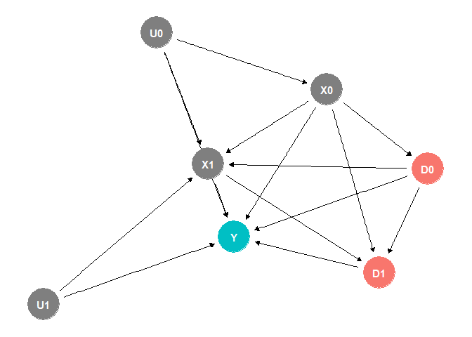

# The First Casualty of Statistics: Part Thirty Three
<big>**G-estimation**</big>

<br/>
Jiří Fejlek

2026-11-10
<br/>

<br/> We will wrap our discussion of Robins’ *g-methods* (Naimi et al. 2017)
for time-varying treatments by describing *structural mean models* and
estimating the treatment effect using *g-estimation.* <br/>

## Table of Contents

- [Structural Mean Models](#structural-mean-models)
- [G-estimation](#g-estimation)
- [Simulated Dataset](#simulated-dataset)
- [References](#references)


``` r
library(tidyr)
library(dplyr)
library(tibble)
library(ggplot2)
library(patchwork)
library(dagitty)
library(ggdag)
library(modelsummary)
```

## Structural Mean Models

We will again assume panel data with observed confounding, which can be
represented for two periods using the following DAG

``` r
set.seed(2)
dag <- dagify(Y ~ X1 + X0 + D1 + D0 + U1 + U0, D1 ~ D0, X1 ~ D0 + X0 + U0 + U1, X0 ~ U0, D0 ~ X0, D1 ~ X1 + X0, exposure = c('D0','D1'), outcome = 'Y')
ggdag_status(dag) + theme_dag() + theme(legend.position = "none")
```

<!-- -->

Again, we will also assume sequential exchangeability and the positivity
condition. In the previous part, we introduced *marginal structural
models*, which assumed parametrization of the marginal causal effect
$`\mathbb{E}Y(g)`$ such as
``` math
\mathbb{E}Y(g) = \gamma + \beta_0 d_0 + \beta_1 d_1 +  \cdots + \beta_K d_K,
```
where $`g`$ is a deterministic treatment strategy
$`(d_1, d_2, \ldots, d_K)`$. Since the treatment effect is subject to
confounding, we cannot fit the marginal model directly. We first need to
reweight the panel data for each time period using the (normalized)
inverse treatment probability weights (IPW)
``` math
\frac{\prod_{k = 0}^K f(d_k’ \mid \bar d’{k-1})}{\prod{k = 0}^K f(d_k’ \mid \bar d’_{k-1}, \bar x’_k)},
```
which balances the distributions of confounders’ histories for each time
period, making the treated and control groups at each time period
comparable.

*Structural nested mean models* (Hernán and Robins 2020) and
(Vansteelandt and Joffe 2014) differ from marginal structural models by
parametrizing the conditional causal effects instead.
``` math
\mathbb{E}(Y(g) \mid \bar X = \bar x, \bar D = \bar d)
```

In particular, let’s assume, for simplicity, a time-varying binary
treatment. For the first period $`T= 0`$, we will model the conditional
treatment effect of treatment $`D_0 =  d_0`$ *assuming zero treatment
strategy from that point forward* (Hernán and Robins 2020) as
``` math
\mathbb{E}(Y(d_0, d_1 = 0, \ldots) - Y(d_0 = 0, \ldots) \mid X_0 = x_0) = d_0\gamma(x_0; \beta)  \equiv d_0 (\beta_{0,1} + \beta_{0,2} x_0).
```
We should note that $`\gamma(x_0; \beta)`$ does not have to be a linear
model of covariates in general (Vansteelandt and Joffe 2014).

Keeping the notation simple by assuming a linear model (with
interactions), we next consider a model of the treatment effect in the
second period, $`T = 1`$, conditional on the system’s history, and again
assume a zero treatment strategy from that point forward.
``` math
\begin{aligned}
\mathbb{E}(Y(d_0,d_1, d_2 = 0, \ldots, d_K = 0) - &Y(d_0, d_1 = 0, \ldots, d_K = 0 ) \mid X_0 = x_0, D_0 = d_0) = \\ &= d_1\gamma(d_0, x_0, x_1; \beta) = d_1(\beta_{1,1} + \beta_{1,2}x_0 + \beta_{1,3}d_0 + \beta_{1,4}x_1 + \beta_{1,5}x_1x_0 + \beta_{1,6}x_1d_0 + \beta_{1,7}x_0d_0)
\end{aligned}
```
For the third period, we would get
``` math
\begin{aligned}
\mathbb{E}(Y(d_0, d_1, d_2, d_3 = 0, \ldots, d_K = 0) - &Y(d_0, d_1, d_2 = 0, \ldots, d_K = 0) \mid X_0 = x_0, D_0 = d_0, X_1 = x_1, D_1 = d_1) = \\ &= d_2\gamma(d_0, d_1, x_0, x_1, x_2; \beta) = d_2(\beta_{2,1} + \beta_{2,2}x_0 + \beta_{2,3}d_0 + \beta_{2,4}x_1 + \beta_{2,5}d_1 + \beta_{2,6}x_2 + \cdots).
\end{aligned}
```
And so on. Functions $`\gamma(\bar d_{k-1}, \bar x_k; \beta)`$ are
referred to as *blip functions* (Vansteelandt and Joffe 2014), since
they model the effect of treatment “blip”, while otherwise following the
given deterministic strategy.

## G-estimation

Let’s show how to recover the treatment effect using the blip functions
via the so-called *g-estimation* (Hernán and Robins 2020). The general
formula for the blip functions is
``` math
\mathbb{E}(Y(\bar d_{k-1}, d_k, 0, \ldots,0) - Y(\bar d_{k-1}, 0, 0, \ldots,0) \mid \bar D_{k-1} = \bar d_{k-1}, \bar X_k = \bar x_k) = d_k \gamma(\bar d_{k-1}, \bar x_k; \beta)
```
Hence, we get for the period $`T = K`$
``` math
\mathbb{E}(Y(\bar d_{K-1}, d_K) - Y(\bar d_{K-1}, 0) \mid \bar D_{K-1} = \bar d_{K-1}, \bar X_K = \bar x_K) = d_k \gamma(\bar d_{K-1}, \bar x_k; \beta).
```

Consequently, we can estimate a counterfactual $`Y(\bar d_{K-1}, 0)`$
for an individual with outcome $`Y`$ that followed strategy $`\bar d_K`$
as
``` math
Y(\bar d_{K-1}, 0)  = Y -  d_K\gamma(\bar d_{K-1}, \bar x_K; \beta).
```
We will apply the definition of blip functions again. We know that
``` math
\mathbb{E}(Y(\bar d_{K-2}, d_{K-1},0) - Y(\bar d_{K-2}, 0, 0) \mid \bar D_{K-2} = \bar d_{K-2}, \bar X_{K-1} = \bar x_{K-1}) = d_{K-1} \gamma(\bar d_{K-2}, \bar x_{K-1}; \beta).
```
Consequently, we can estimate a counterfactual $`Y(\bar d_{K-2}, 0, 0)`$
for an individual with outcome $`Y`$ that followed strategy $`\bar d_K`$
as
``` math
Y(\bar d_{K-2}, 0, 0) = Y(\bar d_{K-1}, 0) - d_{K-1}\gamma(\bar d_{K-2}, \bar x_{K-1}; \beta) =  Y - d_K\gamma(\bar d_{K-1}, \bar x_K; \beta) - d_{K-1}\gamma(\bar d_{K-2}, \bar x_{K-1}; \beta).
```
After repeating these steps till $`T = 0`$, we get the final
counterfactual $`Y(\bar 0)`$ for an individual with outcome $`Y`$ that
followed strategy $`\bar d_K`$ as (Hernán and Robins 2020)
``` math
Y(\bar 0) =  Y -  \sum_{k = 0}^K d_k\gamma(\bar d_{k-1}, \bar x_k; \beta).
```

When we introduced g-computation in Part Thirty One, we assumed models
of the evolution of the system
$`f(x_k \mid \bar x_{k-1}, \bar d_{k-1})`$, which we used to simulate
the system forward in time to obtain counterfactuals for any given
strategy. In g-estimation, we proceed backward in time by “blipping
down” the contribution of individual treatment periods from the observed
outcome $`Y`$.

Naturally, the hard part is finding the correct parameters $`\beta`$ for
our blip functions. Fortunately, there are packages in R that can do
computations for us.

## Simulated Dataset

Let’s return to our example from Part Thirty Two, where we assumed the
following panel data with a binary treatment and three confounders
across four periods, with strong treatment-confounder feedback.

``` r
options(width=2000)

set.seed(123)
n_sample <- 10000

# T = 0
X_1_0 <- (runif(n_sample, 0,1) > 0.75) + 0
X_2_0 <- rnorm(n_sample, 0, 1.5)
X_3_0 <- abs(rnorm(n_sample, 0, 2.5))
D_0 <- (plogis(2*X_1_0 + 0.5*X_2_0 - 0.25*X_3_0 - 1) > runif(n_sample, 0,1)) + 0
Y_0 <- 50 + 10*X_1_0 - 5*X_2_0 + 3*X_3_0 + 5*D_0 + rnorm(n_sample,0,0.5)

# T = 1
X_1_1 <- X_1_0
X_2_1 <- X_2_0 + 2*D_0 + rnorm(n_sample, 0, 2)
X_3_1 <- pmax(X_3_0 + 0.5*D_0 + rnorm(n_sample, 0, 0.5),0)
D_1 <- (plogis(2*X_1_1 + X_2_1 - 0.5*X_3_1 + 0.25*X_1_0 + 0.1*X_2_0 - 0.2*X_3_0 - 0.02*Y_0 + 0.25*D_0) > runif(n_sample, 0,1)) + 0
Y_1 <-  50 + 10*X_1_1 - 5*X_2_1 + 3*X_3_1 + 5*D_1 + 2.5*D_0 + rnorm(n_sample,0,0.5)

# T = 2
X_1_2 <- X_1_1
X_2_2 <- X_2_1 + 2*D_1 + rnorm(n_sample, 0, 2)
X_3_2 <- pmax(X_3_1 + 0.5*D_1 + rnorm(n_sample, 0, 0.5),0)
D_2 <- (plogis(2*X_1_2 + 0.5*X_2_2 - 0.25*X_3_2 + 0.25*X_1_1 + 0.1*X_2_1 - 0.2*X_3_1 - 0.02*Y_1 + 0.25*D_1) > runif(n_sample, 0,1)) + 0
Y_2 <-  50 + 10*X_1_2 - 5*X_2_2 + 3*X_3_2 + 5*D_2 + 2.5*D_1 + rnorm(n_sample,0,0.5)

# T = 3
X_1_3 <- X_1_2
X_2_3 <- X_2_2 + 2*D_2 + rnorm(n_sample, 0, 2)
X_3_3 <- pmax(X_3_2 + 0.5*D_2 + rnorm(n_sample, 0, 0.5),0)
D_3 <- (plogis(2.5*X_1_3 + 0.5*X_2_3 - 0.25*X_3_3 + 0.25*X_1_2 + 0.1*X_2_2 - 0.2*X_3_2 - 0.02*Y_2 + 0.25*D_2) > runif(n_sample, 0,1)) + 0
Y_3 <-  50 + 10*X_1_3 - 5*X_2_3 + 3*X_3_3 + 5*D_3 + 2.5*D_2 + rnorm(n_sample,0,0.5) 


sim_data_wide <- data.frame(id = seq(1,n_sample),
                               X_1_0 = X_1_0, X_2_0 = X_2_0, X_3_0 = X_3_0, Y_0 = Y_0, D_0 = D_0,
                               X_1_1 = X_1_1, X_2_1 = X_2_1, X_3_1 = X_3_1, Y_1 = Y_1, D_1 = D_1,
                               X_1_2 = X_1_2, X_2_2 = X_2_2, X_3_2 = X_3_2, Y_2 = Y_2, D_2 = D_2,
                               X_1_3 = X_1_3, X_2_3 = X_2_3, X_3_3 = X_3_3, Y_3 = Y_3, D_3 = D_3)

head(sim_data_wide)
```

    ##   id X_1_0      X_2_0    X_3_0      Y_0 D_0 X_1_1       X_2_1    X_3_1      Y_1 D_1 X_1_2     X_2_2    X_3_2      Y_2 D_2 X_1_3      X_2_3    X_3_3      Y_3 D_3
    ## 1  1     0 -0.7412608 3.384622 63.76337   0     0  0.22379393 3.514417 59.65672   0     0  0.404573 4.238194 60.82421   0     0 -2.8932246 3.569003 75.62043   0
    ## 2  2     1  1.6913902 1.448443 61.01745   1     1  5.13411951 2.407198 48.87379   1     1  8.009485 3.269762 38.17724   1     1 10.5398566 3.251577 24.42706   1
    ## 3  3     0 -1.7204243 2.152610 64.79080   0     0 -2.73600892 1.791451 68.60261   0     0 -2.299000 2.974454 70.38867   0     0 -1.8049960 2.528629 67.08667   0
    ## 4  4     1  2.2215279 2.431696 60.59792   1     1  4.09211040 2.527554 55.47780   1     1  6.059588 2.277897 44.00914   1     1  8.6452125 2.895225 33.99781   1
    ## 5  5     1  1.3742868 1.547864 63.22248   1     1  5.97852916 1.977188 44.29888   1     1  6.143374 1.886090 42.66035   1     1  8.3554836 2.301598 32.79555   1
    ## 6  6     0  0.5026965 3.463614 57.86924   0     0  0.06542278 4.592121 62.96125   0     0  1.125810 4.407372 58.26179   0     0 -0.1386252 3.999582 61.79865   0

We need to transform the dataset into the wide format first. We also
need to add the lagged variables.

``` r
options(width=2000)

sim_data_long <- sim_data_wide  %>%
  pivot_longer(
    cols = -id, 
    names_to = c(".value", "time"), 
    names_pattern = "(.*)_([0-3])$" 
  )


sim_data_long <- sim_data_long %>%
  group_by(id) %>%  
  arrange(time, .by_group = TRUE) %>% 
  mutate(
    across(
      .cols = starts_with(c("X_", "Y", "D")), 
      .fns = ~lag(.x, n = 1), 
      .names = "Lag1{ .col }"
    )
  )

sim_data_long$time <- as.numeric(sim_data_long$time) + 1
sim_data_long <- as.data.frame(sim_data_long)
sim_data_long[is.na(sim_data_long)] <- 0
head(sim_data_long)
```

    ##   id time X_1        X_2      X_3        Y D Lag1X_1    Lag1X_2  Lag1X_3    Lag1Y Lag1D
    ## 1  1    1   0 -0.7412608 3.384622 63.76337 0       0  0.0000000 0.000000  0.00000     0
    ## 2  1    2   0  0.2237939 3.514417 59.65672 0       0 -0.7412608 3.384622 63.76337     0
    ## 3  1    3   0  0.4045730 4.238194 60.82421 0       0  0.2237939 3.514417 59.65672     0
    ## 4  1    4   0 -2.8932246 3.569003 75.62043 0       0  0.4045730 4.238194 60.82421     0
    ## 5  2    1   1  1.6913902 1.448443 61.01745 1       0  0.0000000 0.000000  0.00000     0
    ## 6  2    2   1  5.1341195 2.407198 48.87379 1       1  1.6913902 1.448443 61.01745     1

To perform g-computation, we will use the R package *gesttools*, which
estimates structural nested mean models using outcome regression models
and propensity score (i.e., treatment) regression models. First, let us
specify the models (we have to specify one propensity score model and
outcome models for each period).

``` r
outcomemodels <- list("Y~D+X_1+X_2+X_3+Lag1D+Lag1X_2+Lag1X_3+Lag1Y",
                      "Y~D+X_1+X_2+X_3+Lag1D+Lag1X_2+Lag1X_3+Lag1Y", 
                      "Y~D+X_1+X_2+X_3+Lag1D+Lag1X_2+Lag1X_3+Lag1Y",
                      "Y~D+X_1+X_2+X_3")
propensitymodel <- c("D ~ X_1+X_2+X_3+Lag1D+Lag1X_2+Lag1X_3+Lag1Y")
```

We perform the g-estimation using *gesttools* as follows.

``` r
library(gesttools)
gest <- gestMultiple(
  data = sim_data_long,
  idvar = 'id',
  timevar = 'time',
  Yn = "Y",
  An = 'D',
  outcomemodels = outcomemodels,
  propensitymodel = propensitymodel,
  type = 3
)
gest$psi
```

    ##     c=1.D     c=2.D     c=3.D     c=4.D 
    ##  5.003563 -6.185352 -8.875333 -8.895203

The treatment effect always-treated vs never treated is

``` r
sum(gest$psi)
```

    ## [1] -18.95232

We again recovered the true value, see Part Thirty Two. We obtain a
confidence interval for the estimate using bootstrapping.

``` r
library('rsample')
set.seed(123)
nb <- 25

gest_ests <- numeric(nb)

for(i in 1:nb){
  sampled_ids <- sample(n_sample, n_sample, replace = TRUE)
  sim_data_long_new <- do.call(rbind, lapply(sampled_ids, function(id_val) {
    sim_data_long[sim_data_long$id == id_val, ]
  }))
  
  sim_data_long_new$id <- rep(1:n_sample, each = 4)
  
  gest_new <- gestMultiple(
    data = sim_data_long_new,
    idvar = 'id',
    timevar = 'time',
    Yn = "Y",
    An = 'D',
    outcomemodels = outcomemodels,
    propensitymodel = propensitymodel,
    type = 3)

  gest_ests[i] <- sum(gest_new$psi)
}

quantile(gest_ests, c(0.025,0.975))
```

    ##      2.5%     97.5% 
    ## -19.97918 -17.84492

We obtained a result similar to that from g-computation.

## References

<div id="refs" class="references csl-bib-body hanging-indent">

<div id="ref-Hernan2020WhatIf" class="csl-entry">

Hernán, Miguel A., and James M. Robins. 2020. *Causal Inference: What
If*. Chapman & Hall/CRC.

</div>

<div id="ref-naimi2017introduction" class="csl-entry">

Naimi, Ashley I, Stephen R Cole, and Edward H Kennedy. 2017. “An
Introduction to g Methods.” *International Journal of Epidemiology* 46
(2): 756–62.

</div>

<div id="ref-vansteelandt2014structural" class="csl-entry">

Vansteelandt, Stijn, and Marshall Joffe. 2014. *Structural Nested Models
and g-Estimation: The Partially Realized Promise*.

</div>

</div>
