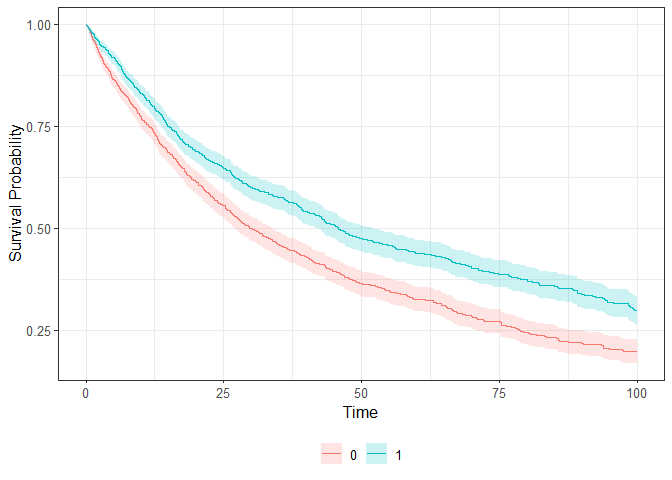
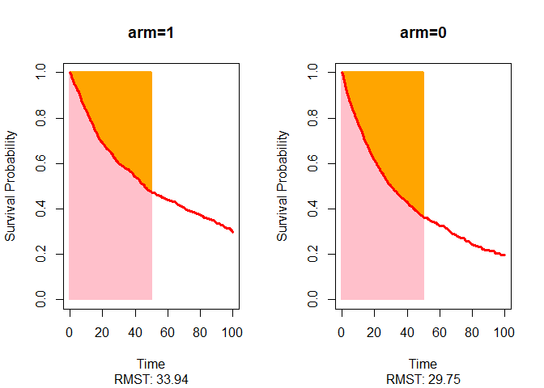
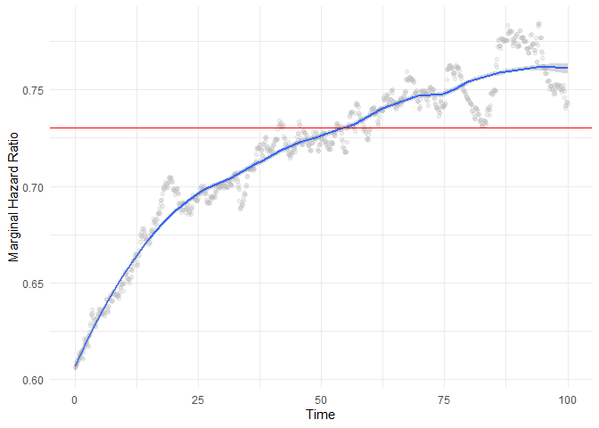
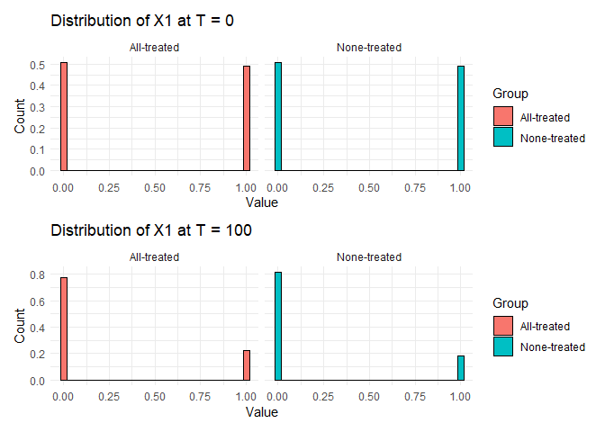
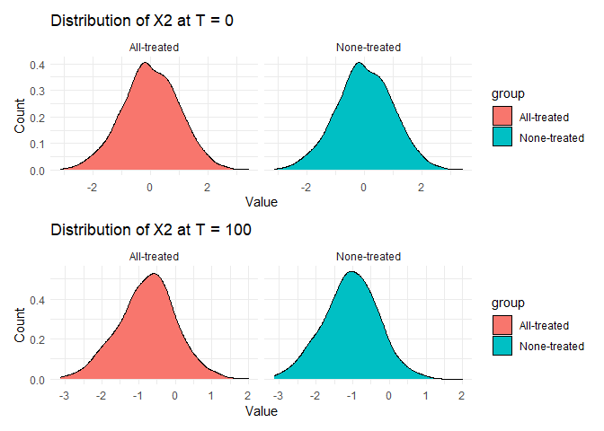
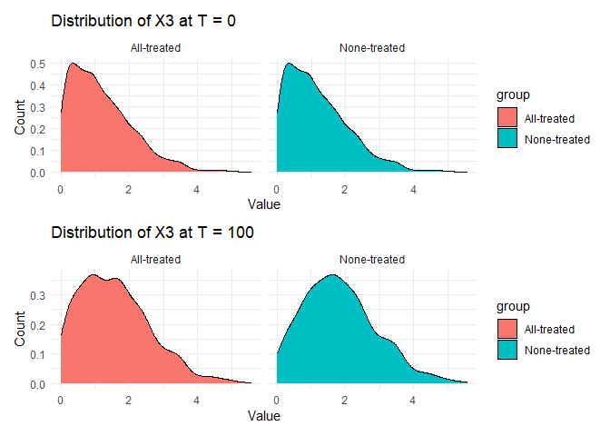
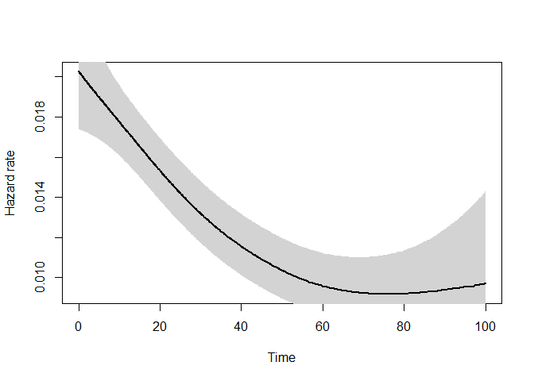
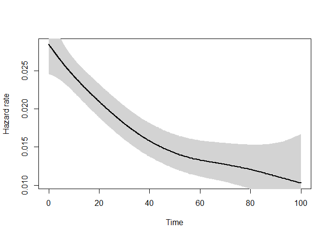

# The First Casualty of Statistics: Part Thirty Four
<big>**Causal Survival Analysis I: Introduction**</big>

<br/>
Jiří Fejlek

2026-11-16
<br/>

<br/> In the next few parts, we will have a look at causal inference for
survival data. In this first introductory text, we will explore two main
methods of survival analysis: the Kaplan-Meier estimator and the Cox
proportional hazards model. We will also discuss their causal
interpretation in the simplest survival data design: a completely
randomized experiment with time-invariant treatment, independent
censoring, and no competing events. <br/>


## Table of Contents

- [Survival Analysis](#survival-analysis)
- [Kaplan–Meier Estimator](#kaplanmeier-estimator)
- [Cox Proportional Hazards Model](#cox-proportional-hazards-model)
- [On Causality of Hazards Ratios](#on-causality-of-hazards-ratios)
- [References](#references)


``` r
library(tidyr)
library(dplyr)
library(tibble)
library(ggplot2)
library(patchwork)
library(dagitty)
library(ggdag)
library(modelsummary)
library(GGally)
library(estimatr)
library(WeightIt)
library(MatchIt)
library(cobalt)
library(mgcv)
library(marginaleffects)
library(ivreg)
```

## Survival Analysis

Since we are not often dealing with survival data, let us start with a
brief review of the fundamentals (see Nine Circles of Statistical
Modeling, Part Five for more details). In essence, the outcome variable
in survival analysis is the time to the first occurrence of an event
(the *survival time*), $`T`$, e.g., mechanical failure of a component or
the occurrence/recurrence of a disease in an individual. Since the usual
question of interest is the probability that $`T`$ is greater than some
threshold, survival analysis often expresses probabilities in terms of
the *survival function* (also known as the reliability function)
``` math
S(t) = P[T>t] = 1 - F(t)
```
instead of cumulative distribution function $`F(t)`$.

Another commonly used function to describe survival probabilities is the
hazard function
``` math
h(t) = \lim_{\Delta t \rightarrow 0} \frac{P[t \leq T < t + \Delta t\mid T\geq t]}{\Delta t},
```
where is $`f(t)`$ the probability density. The hazard function
(intensity function or force of mortality) is the probability that an
individual experiences the event in the next small time interval,
divided by the length of that interval. It can be shown that
``` math
 h(t) = - \frac{\text{d}}{\text{d}t}\log S(t) = \frac{f(t)}{S(t)}
```

For example, if the distribution of $`T`$ is exponential
($`S(t) = e^{-\lambda t}`$), the hazard function is constant (equal to
$`\lambda`$). In practice, we can expect the hazard to evolve. For
example, a (population-level) hazard function starts high because
defective components fail early, and thereafter there are very few
additional observed failures, i.e., the hazard is low.

Now, putting causal inference aside and looking at survival analysis
purely through the lens of statistical modeling, it faces a unique
challenge: the ubiquitous missing-data problem of *censoring*.

Let’s assume a completely randomized experiment in which we investigate
the effect of treatment on a group of individuals. Survival analysis, by
its nature, involves following these individuals over time. However, any
realistic experiment will run for only a limited time. Thus, some
individuals might not experience the event by the time the experiment
ends, i.e., their survival times $`T_i`$ are not observed. In addition,
some individuals may leave the experiment; hence, they might experience
the event in the time period of the experiment, but we did not observe
it.

Finally, some individuals may experience another event that causes them
to no longer be able to experience the event of interest (these are
known as *competing risks*). For example, we might be interested in the
recurrence of cancer after chemotherapy. However, some individuals may
die due to other causes unrelated to cancer, and hence, we can no longer
observe their individual $`T_i`$. Overall, almost any survival dataset
will have individuals with unobserved outcomes; hence, we need to use
methods that account for this.

## Kaplan–Meier Estimator

We will start with the simplest survival analysis problem. We will
assume a binary treatment $`D`$ (non-staggered and absorbing) and denote
the survival time by $`T`$. We will also assume that the treatment
assignment is completely randomized, i.e., it is independent of the
potential outcomes $`T(0)`$ and $`T(1)`$ and any relevant
(pre-treatment) covariates $`X`$
``` math
D \perp T(0), T(1), X.
```
In addition, we will assume that censoring $`C`$ is also completely
independent of other variables
``` math
C \perp T(0), T(1), D, X.
```
Lastly, we will assume no competing risks.

In this simplest case, we can estimate the causal effect of the
treatment using the *Kaplan–Meier estimator*. The Kaplan–Meier estimator
is a non-parametric estimator of the survival function, which equals
``` math
\hat{S}(t) = \prod_{t_i \leq t} \left(1-\frac{r_i}{n_i}\right),
```
where $`n_i`$ is a number of subjects at risk at time $`t_i`$ and
$`r_i`$ is a number of subjects that failed at time $`t_i`$. To compare
the treated and control groups, we compute the Kaplan–Meier estimator
for each group. Then we can measure the treatment effect by taking the
difference between the survival functions (i.e., the difference in
survival probabilities, i.e., the risk difference). Another metric that
is commonly used is *restricted mean survival time* (RMST) (Voinot et
al. 2025)
``` math
 \mathbb{E}(T(d) \wedge \tau) =  \int_0^ \infty P(T(d) \wedge \tau > t)\text{ d}t = \int_0^\tau S_d(t)\text{d} t,
```
where $`a wedge b`$ denotes the minimum of $`a`$ and $`b`$.
Consequently, RMST yields the expected survival time
$`\min (T, \tau )`$. The treatment effect then is
``` math
\text{RMST} =  \mathbb{E}(T(1) \wedge \tau) - \mathbb{E}(T(0) \wedge \tau).
```
It can be shown that the *Kaplan–Meier* estimator consistently estimates
RMST under our assumptions (Voinot et al. 2025).

Let’s simulate some survival data to demonstrate the result. We can
simulate survival data in R using the package *simsurv*. We will assume
an exponential survival model with the hazard function
$`h(t; D) = 0.025\text{ exp}(X_1 + 0.75X_2 - 0.5X_3 - D)`$ with
deterministic censoring that ends the study after $`T_\text{max} = 100`$
and randomized censoring $`C \sim \text{exp}(0.01)`$.

``` r
library(simsurv)
options(width=2000)

set.seed(123)
n_sample <- 2500
maxt <- 100

# generate covariates
covariates <- data.frame(
  X1 = rbinom(n_sample, 1, 0.5),
  X2 = rnorm(n_sample, 0, 1),
  X3 = abs(rnorm(n_sample, 0, 1.5))
)

# generate T(0) 
covariates$D <- 0

sim_surv_data_control <- simsurv(
  dist = "exponential",
  x = covariates,
  lambdas = 0.025,
  betas = c(X1 = 1, X2 = 0.75, X3 = -0.5, D = -0.5),
  maxt = maxt
)

# generate T(1) 
covariates$D <- 1 

sim_surv_data_treat <- simsurv(
  dist = "exponential",
  x = covariates,
  lambdas = 0.025,
  betas = c(X1 = 1, X2 = 0.75, X3 = -0.5, D = -0.5),
  maxt = maxt
)

sim_surv_data <- data.frame(T_0 = sim_surv_data_control$eventtime, 
                            T_1 = sim_surv_data_treat$eventtime,
                            status_0 = sim_surv_data_control$status,
                            status_1 = sim_surv_data_treat$status)

# completely randomized treatment assignment
sim_surv_data$D <- rbinom(n_sample, 1, 0.5)
sim_surv_data$status <- ifelse(sim_surv_data$D == 0,sim_surv_data$status_0,sim_surv_data$status_1) 

# randomized censoring
cens_times <- pmin(rexp(n_sample, 0.01),maxt)
sim_surv_data$cens_times <- cens_times
sim_surv_data$T <- ifelse(sim_surv_data$D == 0,sim_surv_data$T_0,sim_surv_data$T_1)
sim_surv_data$C <- (sim_surv_data$T >= cens_times) + 0
sim_surv_data$T[sim_surv_data$C == 1] <- cens_times[sim_surv_data$C == 1]
sim_surv_data$status[sim_surv_data$C == 1] <- 0
head(sim_surv_data)
```

    ##         T_0        T_1 status_0 status_1 D status cens_times         T C
    ## 1 45.639992 100.000000        1        0 1      0   33.73728 33.737279 1
    ## 2  3.211537   2.495525        1        1 1      1   92.71287  2.495525 0
    ## 3  7.810661  40.691408        1        1 0      1   47.28301  7.810661 0
    ## 4  2.145434  45.706122        1        1 1      1  100.00000 45.706122 0
    ## 5  2.908381  20.343071        1        1 0      1  100.00000  2.908381 0
    ## 6  9.687689  27.526637        1        1 0      1  100.00000  9.687689 0

The data we would actually observe are as follows.

``` r
options(width=2000)
sim_surv_data_obs <- data.frame(D = sim_surv_data$D, 
                                X1 = covariates$X1, 
                                X2 = covariates$X2, 
                                X3 = covariates$X3, 
                                T = sim_surv_data$T, 
                                status = sim_surv_data$status, 
                                C = sim_surv_data$C)
head(sim_surv_data_obs)
```

    ##   D X1         X2         X3         T status C
    ## 1 1  0  1.0517013 2.13494158 33.737279      0 1
    ## 2 1  1  0.6229055 1.53345549  2.495525      1 0
    ## 3 0  0  0.4336204 1.03172262  7.810661      1 0
    ## 4 1  1  0.3860844 0.46118233 45.706122      1 0
    ## 5 0  1  1.2913233 0.02962358  2.908381      1 0
    ## 6 0  0 -1.0022599 0.73259758  9.687689      1 0

Since the treatment assignment was completely randomized, we can
directly compare the treated and control groups. First, we estimate the
survival function (i.e., survival probabilities) for both groups using
the Kaplan-Meier estimator implemented in the *survival* package.

``` r
library(survival)
library(ggsurvfit)

survfit2(Surv(T, status) ~ D, data = sim_surv_data_obs,conf.type ='log-log') %>% 
  ggsurvfit() +
  labs(
    x = "Time",
    y = "Survival Probability"
  ) + add_confidence_interval()
```

<!-- -->

We see that the survival probability in the treated groups is clearly
higher than that in the control group.

We can also compute RMST for each group. It equals the integral of the
respective survival function (i.e., the area under the survival function
curve). We will use the package *survRM2*. Let’s compute RMST for
$`\tau = 50`$.

``` r
library(survRM2)

RMST <- rmst2(
  time = sim_surv_data_obs$T,
  status = sim_surv_data_obs$status,
  arm = sim_surv_data_obs$D,
  tau = 50
)

RMST
```

    ## 
    ## The truncation time: tau = 50  was specified. 
    ## 
    ## Restricted Mean Survival Time (RMST) by arm 
    ##                Est.    se lower .95 upper .95
    ## RMST (arm=1) 33.943 0.558    32.849    35.037
    ## RMST (arm=0) 29.748 0.559    28.653    30.843
    ## 
    ## 
    ## Restricted Mean Time Lost (RMTL) by arm 
    ##                Est.    se lower .95 upper .95
    ## RMTL (arm=1) 16.057 0.558    14.963    17.151
    ## RMTL (arm=0) 20.252 0.559    19.157    21.347
    ## 
    ## 
    ## Between-group contrast 
    ##                       Est. lower .95 upper .95 p
    ## RMST (arm=1)-(arm=0) 4.195     2.647     5.743 0
    ## RMST (arm=1)/(arm=0) 1.141     1.087     1.198 0
    ## RMTL (arm=1)/(arm=0) 0.793     0.727     0.865 0

``` r
plot(RMST, xlab = "Time", ylab = "Survival Probability")
```

<!-- -->

We estimate the difference in RMST as 4.2, i.e., on average, the
treatment increases the survival time by 4.2 time units at 50 time
units. We can compare the estimate with the grand truth.

``` r
# RMST for T(1)
mean(pmin(sim_surv_data$T_1,50))
```

    ## [1] 34.32168

``` r
# RMST for T(0)
mean(pmin(sim_surv_data$T_0,50))
```

    ## [1] 29.02376

We see that our estimated RMST is close to the actual potential
outcomes.

## Cox Proportional Hazards Model

The *Cox proportional hazards* model is arguably the best-known model
for survival data. The model assumes a *semiparametric* hazard function
``` math
h(t) = h_0(t)e^{X\beta + \alpha D},
```
where $`h_0(t)`$ is the baseline hazard and $`X`$ are observed
covariates and $`D`$ is the treatment. This form of the hazard function
implies the *proportional hazards assumption*: the effect of the
covariates $`X`$ and treatment $`D`$ on the individual hazard function
does not change in time.

We generated our data so that the Cox proportional hazards model is well
specified: the proportional hazards assumption holds. Indeed, if we fit
the model,

``` r
coxmodel_rce <- coxph(Surv(T, status) ~ X1 + X2 + X3 + D, data = sim_surv_data_obs)
summary(coxmodel_rce)
```

    ## Call:
    ## coxph(formula = Surv(T, status) ~ X1 + X2 + X3 + D, data = sim_surv_data_obs)
    ## 
    ##   n= 2500, number of events= 1422 
    ## 
    ##        coef exp(coef) se(coef)       z Pr(>|z|)    
    ## X1  1.00546   2.73317  0.05586  18.000   <2e-16 ***
    ## X2  0.80552   2.23786  0.03075  26.199   <2e-16 ***
    ## X3 -0.46826   0.62609  0.03353 -13.967   <2e-16 ***
    ## D  -0.45968   0.63148  0.05386  -8.535   <2e-16 ***
    ## ---
    ## Signif. codes:  0 '***' 0.001 '**' 0.01 '*' 0.05 '.' 0.1 ' ' 1
    ## 
    ##    exp(coef) exp(-coef) lower .95 upper .95
    ## X1    2.7332     0.3659    2.4497    3.0494
    ## X2    2.2379     0.4469    2.1070    2.3769
    ## X3    0.6261     1.5972    0.5863    0.6686
    ## D     0.6315     1.5836    0.5682    0.7018
    ## 
    ## Concordance= 0.747  (se = 0.007 )
    ## Likelihood ratio test= 1086  on 4 df,   p=<2e-16
    ## Wald test            = 994.1  on 4 df,   p=<2e-16
    ## Score (logrank) test = 1012  on 4 df,   p=<2e-16

we get an estimate that is close to the true values of covariates’
coefficients. If we wished to estimate RMST, we need to predict survival
probabilities from the Cox model.

``` r
sim_surv_data_obs_treat <- sim_surv_data_obs
sim_surv_data_obs_control <- sim_surv_data_obs

sim_surv_data_obs_treat$D <- 1
sim_surv_data_obs_control$D <- 0

mean(summary(survfit(coxmodel_rce, newdata = sim_surv_data_obs_treat), rmean = 50)$table[, "rmean"])
```

    ## [1] 34.21345

``` r
mean(summary(survfit(coxmodel_rce, newdata = sim_surv_data_obs_control), rmean = 50)$table[, "rmean"])
```

    ## [1] 29.44437

We again recover the true causal effect. We should emphasize that,
unlike the Kaplan–Meier estimator, the Cox model is (semi)parametric and
can yield a biased estimate of RMST when misspecified. In particular,
let’s assume that the treatment effect on the hazard function increases
in time, i.e., the proportional hazards assumption is not met.

We can simulate such survival data using options *tde* and *tdefunction*
(we assume simple linear interaction of $`X_3`$ and $`D`$ with time in
the linear predictor of the hazards model).

``` r
set.seed(123)

# generate T(0) 
covariates$D <- 0

sim_surv_data_nonprop_control <- simsurv(
  dist = "exponential",
  x = covariates,
  lambdas = 0.025,
  betas = c(X1 = 1, X2 = 0.75, X3 = -0.5, D = 0),
  tde = c(X1 = 0, X2 = 0, X3 = 0.01, D = -0.1),      # coefficients
  tdefunction = function(t) t,                       # linear interaction
  maxt = maxt
)

# generate T(1) 
covariates$D <- 1 

sim_surv_data_nonprop_treat <- simsurv(
  dist = "exponential",
  x = covariates,
  lambdas = 0.025,
  betas = c(X1 = 1, X2 = 0.75, X3 = -0.5, D = 0),
  tde = c(X1 = 0, X2 = 0, X3 = 0.01, D = -0.1),
  tdefunction = function(t) t,
  maxt = maxt
)

sim_surv_data_nonprop <- data.frame(T_0 = sim_surv_data_nonprop_control$eventtime, 
                                    T_1 = sim_surv_data_nonprop_treat$eventtime,
                                    status_0 = sim_surv_data_nonprop_control$status,
                                    status_1 = sim_surv_data_nonprop_treat$status)


# completely randomized treatment assignment
sim_surv_data_nonprop$D <- rbinom(n_sample, 1, 0.5)
sim_surv_data_nonprop$status <- ifelse(sim_surv_data_nonprop$D == 0,
                                       sim_surv_data_nonprop$status_0,sim_surv_data_nonprop$status_1) 

# randomized censoring
cens_times <- pmin(rexp(n_sample, 0.005),maxt)
sim_surv_data_nonprop$cens_times <- cens_times
sim_surv_data_nonprop$T <- ifelse(sim_surv_data_nonprop$D == 0,
                                  sim_surv_data_nonprop$T_0,sim_surv_data_nonprop$T_1)
sim_surv_data_nonprop$C <- (sim_surv_data_nonprop$T >= cens_times) + 0
sim_surv_data_nonprop$T[sim_surv_data_nonprop$C == 1] <- cens_times[sim_surv_data_nonprop$C == 1]
sim_surv_data_nonprop$status[sim_surv_data_nonprop$C == 1] <- 0

sim_surv_data_obs_nonprop <- data.frame(D = sim_surv_data_nonprop$D, 
                                        X1 = covariates$X1, 
                                        X2 = covariates$X2, 
                                        X3 = covariates$X3, 
                                        T = sim_surv_data_nonprop$T, 
                                        status = sim_surv_data_nonprop$status, 
                                        C = sim_surv_data_nonprop$C)
```

The RMST treatment effect for this dataset is as follows.

``` r
# RMST for T(1)
mean(pmin(sim_surv_data_nonprop$T_1,50))
```

    ## [1] 38.00042

``` r
# RMST for T(0)
mean(pmin(sim_surv_data_nonprop$T_0,50))
```

    ## [1] 26.76468

Let’s fit the misspecified Cox model.

``` r
coxmodel_rce_miss <- coxph(Surv(T, status) ~ X1 + X2 + X3 + D, data = sim_surv_data_obs_nonprop)

sim_surv_data_obs_treat_nonprop <- sim_surv_data_obs_nonprop
sim_surv_data_obs_control_nonprop <- sim_surv_data_obs_nonprop

sim_surv_data_obs_treat_nonprop$D <- 1
sim_surv_data_obs_control_nonprop$D <- 0

mean(summary(survfit(coxmodel_rce_miss, 
                     newdata = sim_surv_data_obs_treat_nonprop), rmean = 50)$table[, "rmean"])
```

    ## [1] 42.48801

``` r
mean(summary(survfit(coxmodel_rce_miss, 
                     newdata = sim_surv_data_obs_control_nonprop), rmean = 50)$table[, "rmean"])
```

    ## [1] 24.65549

We see that the estimates from the Cox model are clearly biased: the
treatment effect is overestimated by about 60%. However, if we use the
non-parametric Kaplan–Meier estimator, the RMST estimate is unbiased.

``` r
RMST <- rmst2(
  time = sim_surv_data_obs_nonprop$T,
  status = sim_surv_data_obs_nonprop$status,
  arm = sim_surv_data_obs_nonprop$D,
  tau = 50
)

RMST
```

    ## 
    ## The truncation time: tau = 50  was specified. 
    ## 
    ## Restricted Mean Survival Time (RMST) by arm 
    ##                Est.    se lower .95 upper .95
    ## RMST (arm=1) 38.219 0.553    37.135    39.303
    ## RMST (arm=0) 27.695 0.533    26.650    28.739
    ## 
    ## 
    ## Restricted Mean Time Lost (RMTL) by arm 
    ##                Est.    se lower .95 upper .95
    ## RMTL (arm=1) 11.781 0.553    10.697    12.865
    ## RMTL (arm=0) 22.305 0.533    21.261    23.350
    ## 
    ## 
    ## Between-group contrast 
    ##                        Est. lower .95 upper .95 p
    ## RMST (arm=1)-(arm=0) 10.524     9.019    12.029 0
    ## RMST (arm=1)/(arm=0)  1.380     1.316     1.447 0
    ## RMTL (arm=1)/(arm=0)  0.528     0.476     0.586 0

## On Causality of Hazards Ratios

We saw that the Cox model can be used to indirectly estimate RMST for
the completely randomized experiment under independent censoring
provided that it is well specified (i.e., the proportional hazards
assumption holds). In addition, the Cox model naturally estimates
*conditional hazards ratio*
``` math
\text{CHR} = \frac{h(t, D = 1)}{h(t, D = 0)} = \frac{h_0(t)e^{\alpha + X\beta}}{h_0(t)e^{X\beta}} = e^{\alpha}
```

For our original dataset, the conditional hazard ratio of the treatment
is $`e^\alpha \approx 0.63`$.

``` r
coxmodel_rce <- coxph(Surv(T, status) ~ X1 + X2 + X3 + D, data = sim_surv_data_obs)
summary(coxmodel_rce)
```

    ## Call:
    ## coxph(formula = Surv(T, status) ~ X1 + X2 + X3 + D, data = sim_surv_data_obs)
    ## 
    ##   n= 2500, number of events= 1422 
    ## 
    ##        coef exp(coef) se(coef)       z Pr(>|z|)    
    ## X1  1.00546   2.73317  0.05586  18.000   <2e-16 ***
    ## X2  0.80552   2.23786  0.03075  26.199   <2e-16 ***
    ## X3 -0.46826   0.62609  0.03353 -13.967   <2e-16 ***
    ## D  -0.45968   0.63148  0.05386  -8.535   <2e-16 ***
    ## ---
    ## Signif. codes:  0 '***' 0.001 '**' 0.01 '*' 0.05 '.' 0.1 ' ' 1
    ## 
    ##    exp(coef) exp(-coef) lower .95 upper .95
    ## X1    2.7332     0.3659    2.4497    3.0494
    ## X2    2.2379     0.4469    2.1070    2.3769
    ## X3    0.6261     1.5972    0.5863    0.6686
    ## D     0.6315     1.5836    0.5682    0.7018
    ## 
    ## Concordance= 0.747  (se = 0.007 )
    ## Likelihood ratio test= 1086  on 4 df,   p=<2e-16
    ## Wald test            = 994.1  on 4 df,   p=<2e-16
    ## Score (logrank) test = 1012  on 4 df,   p=<2e-16

Hazard ratios are often used to summarize the treatment effect. However,
there are notable difficulties that make their interpretation more
challenging than the difference in RMST. Firstly, hazard ratios (being a
nonlinear metric) suffer from noncollapsibility similar to risk ratios
and odds ratios. We can check this quite simply by fitting the
*marginal* Cox model.

``` r
coxmodel_rce <- coxph(Surv(T, status) ~ D, data = sim_surv_data_obs)
summary(coxmodel_rce)
```

    ## Call:
    ## coxph(formula = Surv(T, status) ~ D, data = sim_surv_data_obs)
    ## 
    ##   n= 2500, number of events= 1422 
    ## 
    ##       coef exp(coef) se(coef)      z Pr(>|z|)    
    ## D -0.31360   0.73081  0.05344 -5.869 4.39e-09 ***
    ## ---
    ## Signif. codes:  0 '***' 0.001 '**' 0.01 '*' 0.05 '.' 0.1 ' ' 1
    ## 
    ##   exp(coef) exp(-coef) lower .95 upper .95
    ## D    0.7308      1.368    0.6581    0.8115
    ## 
    ## Concordance= 0.54  (se = 0.007 )
    ## Likelihood ratio test= 34.68  on 1 df,   p=4e-09
    ## Wald test            = 34.44  on 1 df,   p=4e-09
    ## Score (logrank) test = 34.72  on 1 df,   p=4e-09

Indeed, we notice that the coefficient changed even though the data come
from a completely randomized experiment. This means that to correctly
estimate the conditional (i.e., individual) hazard ratio, we need to
measure *all* relevant covariates, not just confounders.

Now, our solution in the past was to estimate marginal effects, which we
can estimate under no confounding. However, the value 0.73 we got from
the marginal Cox model *is not* an actual estimate of the marginal
hazard ratio. The reason is that the true model was
``` math
h(t) = h_0(t)e^{X\beta + \alpha D}
```
and hence, the marginal Cox model is
``` math
h_i(t) = h_{0,i}(t; X_i)e^{\alpha D}.
```
The model is no longer proportional! This is because the new baseline
hazard is specific to each individual. This means that the marginal Cox
model is misspecified. The actual marginal hazard ratio at $`T = 0`$
(when the whole population is part of the experiment) is
``` math
\text{MHR}(0) = \frac{\sum_i e^{X_i\beta + \alpha}}{\sum_i e^{X_i\beta}}.
```

``` r
mean(exp(cbind(covariates$X1,covariates$X2,covariates$X3, rep(1,n_sample)) %*% c(1,0.75,-0.5, -0.5)))/
mean(exp(cbind(covariates$X1,covariates$X2,covariates$X3, rep(0,n_sample)) %*% c(1,0.75,-0.5, -0.5)))
```

    ## [1] 0.6065307

Which is quite a different value from the one that the marginal Cox
model provided. What is happening here is that, by the definition of the
hazard function, at any given time its value depends only on individuals
at risk at that time (i.e., those who are uncensored and have not
experienced the event). In other words, the population that is averaged
over changes in time, and hence the marginal hazard ratio also changes
over time in general!
``` math
\text{MHR}(t) = \frac{\sum_{\min (T_i(1), C_i(1)) \geq t} e^{X_i\beta + \alpha}}{\sum_{\min (T_i(0), C_i(0)) \geq t} e^{X_i\beta}}.
```

For our simulated potential outcomes and censoring times, the marginal
hazard function looks like this.

``` r
T_seq <- seq(0, 100, 0.1)
marg_hazard <- numeric(length(T_seq))

for (i in 1:length(T_seq)){
  
  covariates_seq_treat <- covariates[pmin(sim_surv_data$cens_times, sim_surv_data$T_1) >= T_seq[i],]
  covariates_seq_control <- covariates[pmin(sim_surv_data$cens_times, sim_surv_data$T_0) >= T_seq[i],]
  
  marg_hazard[i] <- mean(exp(cbind(covariates_seq_treat$X1,covariates_seq_treat$X2,covariates_seq_treat$X3, rep(1,dim(covariates_seq_treat)[1])) %*% c(1,0.75,-0.5,-0.5)))/mean(exp(cbind(covariates_seq_control$X1,covariates_seq_control$X2,covariates_seq_control$X3, rep(0,dim(covariates_seq_control)[1])) %*% c(1,0.75,-0.5, -0.5)))
}


ggplot(data.frame(T_seq = T_seq, marg_hazard = marg_hazard), aes(x = T_seq, y = marg_hazard)) + geom_point(color = 'gray', alpha = 0.25) +  geom_smooth(method = "loess", span = 0.5) + geom_hline(yintercept = 0.73, color = "red") + xlab('Time') + ylab('Marginal Hazard Ratio') + theme_minimal()
```

<!-- -->

We see that the marginal hazard ratio is *time-varying* and tends to
increase in time. The single value the marginal Cox model actually
estimates (denoted by the red line) is a *weighted average* of the
observed time-varying marginal hazard ratios (Xu and O’Quigley 2000).

However, the issues with marginal hazard ratios do not end here. We said
that marginal hazard ratios depend on individuals at risk at the given
time. However, the distribution of individuals in the treated and
control groups differs, provided that the treatment has any effect, even
though the distributions are the same at the start!

Let’s demonstrate this by computing and examining the distribution of
individuals’ covariates based on expected survival times (without
censoring) for the whole population, once with an all-treated strategy
and once with a none-treated strategy.

``` r
T_1 <- 1/0.025*exp(-cbind(covariates$X1,covariates$X2,covariates$X3, rep(1,dim(covariates)[1])) %*% c(1,0.75,-0.5,-0.5))

T_0 <- 1/0.025*exp(-cbind(covariates$X1,covariates$X2,covariates$X3, rep(0,dim(covariates)[1])) %*% c(1,0.75,-0.5,-0.5))

t <- 0

df <- data.frame(
  Group = c(rep("All-treated", sum(T_1 >= t)), rep("None-treated",sum(T_0 >= t))),
  value = c(covariates$X1[T_1 >= t], covariates$X1[T_0 >= t])
)

# Plot side-by-side panels
p1 <- ggplot(df, aes(x = value, fill = Group)) +
  geom_histogram(aes(y = after_stat(density * width)), color = "black") +
  facet_wrap(~ Group) +
  theme_minimal() +
  labs(title = "Distribution of X1 at T = 0", x = "Value", y = "Count")


t <- 100

df <- data.frame(
  Group = c(rep("All-treated", sum(T_1 >= t)), rep("None-treated",sum(T_0 >= t))),
  value = c(covariates$X1[T_1 >= t], covariates$X1[T_0 >= t])
)

p2 <- ggplot(df, aes(x = value, fill = Group)) +
  geom_histogram(aes(y = after_stat(density * width)), color = "black") +
  facet_wrap(~ Group) +
  theme_minimal() +
  labs(title = "Distribution of X1 at T = 100", x = "Value", y = "Count")


(p1 + p2) + plot_layout(ncol = 1)
```

<!-- -->

``` r
t <- 0

df <- data.frame(
  group = c(rep("All-treated", sum(T_1 >= t)), rep("None-treated",sum(T_0 >= t))),
  value = c(covariates$X2[T_1 >= t], covariates$X2[T_0 >= t])
)

# Plot side-by-side panels
p1 <- ggplot(df, aes(x = value, fill = group)) +
  geom_density() +
  facet_wrap(~ group) +
  theme_minimal() +
  labs(title = "Distribution of X2 at T = 0", x = "Value", y = "Count")


t <- 100

df <- data.frame(
  group = c(rep("All-treated", sum(T_1 >= t)), rep("None-treated",sum(T_0 >= t))),
  value = c(covariates$X2[T_1 >= t], covariates$X2[T_0 >= t])
)

p2 <- ggplot(df, aes(x = value, fill = group)) +
  geom_density() +
  facet_wrap(~ group) +
  theme_minimal() +
  labs(title = "Distribution of X2 at T = 100", x = "Value", y = "Count")

(p1 + p2) + plot_layout(ncol = 1)
```

<!-- -->

``` r
t <- 0

df <- data.frame(
  group = c(rep("All-treated", sum(T_1 >= t)), rep("None-treated",sum(T_0 >= t))),
  value = c(covariates$X3[T_1 >= t], covariates$X3[T_0 >= t])
)

# Plot side-by-side panels
p1 <- ggplot(df, aes(x = value, fill = group)) +
  geom_density() +
  facet_wrap(~ group) +
  theme_minimal() +
  labs(title = "Distribution of X3 at T = 0", x = "Value", y = "Count")

t <- 100

df <- data.frame(
  group = c(rep("All-treated", sum(T_1 >= t)), rep("None-treated",sum(T_0 >= t))),
  value = c(covariates$X3[T_1 >= t], covariates$X3[T_0 >= t])
)

p2 <- ggplot(df, aes(x = value, fill = group)) +
  geom_density() +
  facet_wrap(~ group) +
  theme_minimal() +
  labs(title = "Distribution of X3 at T = 100", x = "Value", y = "Count")

(p1 + p2) + plot_layout(ncol = 1)
```

<!-- -->

We see that the distributions at time $`t = 100`$ are clearly different,
which means that the marginal hazard ratio, which looks at the number of
events for the population under the risk in the treated group and the
control group, compares two fundamentally incomparable groups unless the
treatment has no effect or individuals are perfectly homogeneous, which
can be expressed as $`T(0)`$ being independent of $`T(1)`$ (Martinussen
2022). This effect is known as *depletion of susceptibles*: provided
that the treatment has the effect of decreasing the risk, those that are
susceptible to the risk in the control group will experience the event
earlier than those in the treatment group.

What this means in practice is that the marginal hazard ratios are
almost impossible to interpret causally, as we see in our simplest
example. The treatment effect is the same for each and constant over
time. Yet the marginal hazard ratio increases over time, which would
naively suggest that treatment effectiveness decreases.

Last but not least, hazard functions are more difficult to estimate
non-parametrically than survival functions. It is a similar situation to
estimating the cumulative distribution function versus estimating the
probability density, since
``` math
h(t) = - \frac{\text{d}}{\text{d}t}\log S(t)
```
and keep in mind that the Kaplan-Meier estimator of $`S(t)`$ is a step
function; i.e., $`h(t)`$ can be estimated only with local
smoothing/averaging.

For example, we can compute hazard functions for the treated and control
groups using the *bshazard* package as follows.

``` r
library(bshazard)
# treated group
fit_trt  <- bshazard(Surv(T, status) ~ 1, data = subset(sim_surv_data_obs, D == 1), verbose = FALSE)
plot(fit_trt)
```

<!-- -->

``` r
# control group
fit_trt  <- bshazard(Surv(T, status) ~ 1, data = subset(sim_surv_data_obs, D == 0), verbose = FALSE)
plot(fit_trt)
```

<!-- -->

To summarize, conditional hazard ratios measure the individual treatment
effect and are consequently of great interest, but are difficult to
estimate in practice due to noncollapsibility. Switching to marginal
hazard ratios does not really work, since they lack causal
interpretation, and hence, we should use other population-based
treatment effect metrics such as comparing population-level survival
probabilities (i.e., survival functions) or restricted mean survival
times (i.e., integrals of survival functions).

## References

<div id="refs" class="references csl-bib-body hanging-indent">

<div id="ref-martinussen2022causality" class="csl-entry">

Martinussen, Torben. 2022. “Causality and the Cox Regression Model.”
*Annual Review of Statistics and Its Application* 9: 249–59.

</div>

<div id="ref-voinot2025treatment" class="csl-entry">

Voinot, Charlotte, Clément Berenfeld, Imke Mayer, Bernard Sebastien, and
Julie Josse. 2025. “Treatment Effect Estimation in Causal Survival
Analysis: Practical Recommendations.” *arXiv Preprint arXiv:2501.05836*.

</div>

<div id="ref-xu2000estimating" class="csl-entry">

Xu, Ronghui, and John O’Quigley. 2000. “Estimating Average Regression
Effect Under Non-Proportional Hazards.” *Biostatistics* 1 (4): 423–39.

</div>

</div>
