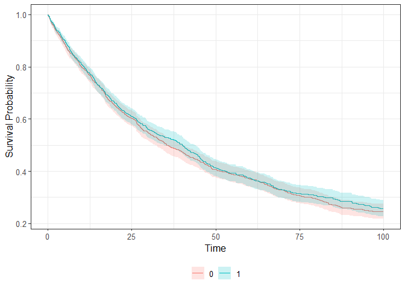
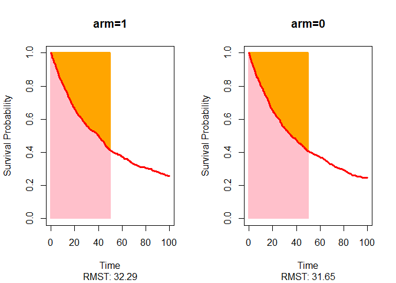

# The First Casualty of Statistics: Part Thirty Five
<big>**Causal Survival Analysis II**</big>

<br/>
Jiří Fejlek

2026-11-23
<br/>

<br/> In the second part, we will continue exploring causal survival analysis
with randomized treatment assignment. However, we will now assume that
censoring is no longer unconditionally independent. <br/>

## Table of Contents

- [Conditionally Independent
  Censoring](#conditionally-independent-censoring)
- [Inverse Probability of Censoring
  Weighting](#inverse-probability-of-censoring-weighting)
- [References](#references)


``` r
library(tidyr)
library(dplyr)
library(tibble)
library(ggplot2)
library(patchwork)
library(dagitty)
library(ggdag)
library(modelsummary)
library(GGally)
library(estimatr)
library(WeightIt)
library(MatchIt)
library(cobalt)
library(mgcv)
library(marginaleffects)
library(ivreg)
```

## Conditionally Independent Censoring

We will still assume a completely randomized experiment with a binary,
non-staggered, and absorbing treatment $`D`$, but we will relax the
condition of independent censoring from the previous part
``` math
C \perp T(0), T(1), D, X
```
to the conditional independence
``` math
C \perp T(0), T(1) \mid D, X.
```

In this case, the Kaplan-Meier estimator is no longer suitable for
estimating the treatment effect. Let’s illustrate the problem on
simulated data. We will assume the same proportional hazard model of the
survival times as in the last part.

``` r
library(simsurv)

set.seed(123)
n_sample <- 2500
maxt <- 100

# generate covariates
covariates <- data.frame(
  X1 = rbinom(n_sample, 1, 0.5),
  X2 = rnorm(n_sample, 0, 1),
  X3 = abs(rnorm(n_sample, 0, 1.5))
)

# generate T(0) 
covariates$D <- 0

sim_surv_data_control <- simsurv(
  dist = "exponential",
  x = covariates,
  lambdas = 0.025,
  betas = c(X1 = 1, X2 = 0.75, X3 = -0.5, D = -0.5),
  maxt = maxt
)

# generate T(1) 
covariates$D <- 1 

sim_surv_data_treat <- simsurv(
  dist = "exponential",
  x = covariates,
  lambdas = 0.025,
  betas = c(X1 = 1, X2 = 0.75, X3 = -0.5, D = -0.5),
  maxt = maxt
)

sim_surv_data <- data.frame(T_0 = sim_surv_data_control$eventtime, 
                            T_1 = sim_surv_data_treat$eventtime,
                            status_0 = sim_surv_data_control$status,
                            status_1 = sim_surv_data_treat$status)
```

However, we will no longer assume independent censoring. Instead, we
create proportional hazard models that simulate the censoring times.

``` r
set.seed(123)
options(width=2000)

# conditionally independent censoring
covariates$D <- 0

sim_cens_data_control <- simsurv(
  dist = "exponential",
  x = covariates,
  lambdas = 0.005,
  betas = c(X1 = 1, X2 = 2, X3 = -0.25),
  maxt = maxt
)

covariates$D <- 1 

sim_cens_data_treat <- simsurv(
  dist = "exponential",
  x = covariates,
  lambdas = 0.005,
  betas = c(X1 = 1, X2 = -2, X3 = -0.25),
  maxt = maxt
)

sim_surv_data$cens_times_treat <- sim_cens_data_treat$eventtime
sim_surv_data$cens_times_control <- sim_cens_data_control$eventtime


# completely randomized treatment assignment
sim_surv_data$D <- rbinom(n_sample, 1, 0.5)
sim_surv_data$status <- ifelse(sim_surv_data$D == 0,sim_surv_data$status_0,sim_surv_data$status_1) 
sim_surv_data$cens_times <- ifelse(sim_surv_data$D == 0,
                                   sim_surv_data$cens_times_control,sim_surv_data$cens_times_treat)

sim_surv_data$T <- ifelse(sim_surv_data$D == 0,sim_surv_data$T_0,sim_surv_data$T_1)
sim_surv_data$C <- (sim_surv_data$T >= sim_surv_data$cens_times) + 0
sim_surv_data$T[sim_surv_data$C == 1] <- sim_surv_data$cens_times[sim_surv_data$C == 1]
sim_surv_data$status[sim_surv_data$C == 1] <- 0
head(sim_surv_data)
```

    ##         T_0        T_1 status_0 status_1 cens_times_treat cens_times_control D status cens_times          T C
    ## 1 45.639992 100.000000        1        0       100.000000           34.04637 1      0 100.000000 100.000000 1
    ## 2  3.211537   2.495525        1        1       100.000000           21.38151 0      1  21.381512   3.211537 0
    ## 3  7.810661  40.691408        1        1       100.000000           25.53696 1      1 100.000000  40.691408 0
    ## 4  2.145434  45.706122        1        1       100.000000           68.27533 0      1  68.275334   2.145434 0
    ## 5  2.908381  20.343071        1        1       100.000000            2.16807 0      0   2.168070   2.168070 1
    ## 6  9.687689  27.526637        1        1         4.042711          100.00000 1      0   4.042711   4.042711 1

If we compute the RMST based on the potential outcomes, we get the same
values as the last time.

``` r
# RMST for T(1)
mean(pmin(sim_surv_data$T_1,50))
```

    ## [1] 34.32168

``` r
# RMST for T(0)
mean(pmin(sim_surv_data$T_0,50))
```

    ## [1] 29.02376

The Kaplan-Meier estimator now yields a biased estimate, since censoring
is no longer independent of the treatment and covariates.

``` r
library(survival)
library(ggsurvfit)

survfit2(Surv(T, status) ~ D, data = sim_surv_data,conf.type ='log-log') %>% 
  ggsurvfit() +
  labs(
    x = "Time",
    y = "Survival Probability"
  ) + add_confidence_interval()
```

<!-- -->

``` r
library(survRM2)

RMST <- rmst2(
  time = sim_surv_data$T,
  status = sim_surv_data$status,
  arm = sim_surv_data$D,
  tau = 50
)

RMST
```

    ## 
    ## The truncation time: tau = 50  was specified. 
    ## 
    ## Restricted Mean Survival Time (RMST) by arm 
    ##                Est.    se lower .95 upper .95
    ## RMST (arm=1) 32.288 0.581    31.150    33.426
    ## RMST (arm=0) 31.651 0.567    30.539    32.763
    ## 
    ## 
    ## Restricted Mean Time Lost (RMTL) by arm 
    ##                Est.    se lower .95 upper .95
    ## RMTL (arm=1) 17.712 0.581    16.574    18.850
    ## RMTL (arm=0) 18.349 0.567    17.237    19.461
    ## 
    ## 
    ## Between-group contrast 
    ##                       Est. lower .95 upper .95     p
    ## RMST (arm=1)-(arm=0) 0.637    -0.955     2.228 0.433
    ## RMST (arm=1)/(arm=0) 1.020     0.971     1.072 0.433
    ## RMTL (arm=1)/(arm=0) 0.965     0.884     1.054 0.433

``` r
plot(RMST, xlab = "Time", ylab = "Survival Probability")
```

<!-- -->

We see that the survival curves estimated by the Kaplan-Meier estimator
are almost identical; the treatment appears to have no effect. The
reason is that $`X_2`$ increases the risk of the event but also
significantly increases the censoring probability for the untreated and
decreases it for the treated. Consequently, the events for the untreated
individuals with large $`X_2`$ are not observed in the data, causing the
naive estimate of RMST to be higher for the untreated group than it
actually is.

## Inverse Probability of Censoring Weighting

To correct for the fact that censoring depends on observed covariates,
we can use the inverse probability of censoring weighting (IPCW)
Kaplan-Meier estimator (Voinot et al. 2025)
``` math
\hat{S}^\text{IPCW}(t) = \prod_{t_i \leq t} \left(1-\frac{r^\text{IPCW}_i}{n^\text{IPCW}_i}\right),
```
where $`n^\text{IPCW}_i`$ is a weight-corrected number of subjects at
risk at time $`t_i`$ and $`r^\text{IPCW}_i`$ is a weight-corrected
number of subjects that failed at time $`t_i`$. These can be computed as
``` math
r^\text{IPCW}_i = \sum_{j = 1}^n \frac{I(T_j = t_i, C_j = 0)}{P[C_j \geq t_i \mid X_j]}
```
and
``` math
n^\text{IPCW}_i = \sum_{j = 1}^n \frac{I(T_j \geq t_i)}{P[C_j \geq t_i \mid X_j]}.
```
To determine $`P[C \geq t_i \mid X_i]`$, we need to fit a model to the
observed data for censoring times, e.g., a Cox model.

Let’s demonstrate the computation of the IPCW Kaplan-Meier estimator in
R. First, we have to keep in mind that the censoring we considered in
our example consists of two independent processes. The first is
*administrativ*e censoring, which arises because the study only ran for
$`T_\text{max} = 100`$. This censoring is independent of the covariates
and the treatment assignment, and we ignore it in our censoring model.
The second censoring is random *informative* censoring, which is
conditional on the covariates and is the one we need to adjust for.

Hence, let us first split these into distinct censoring events.

``` r
options(width=2000)

sim_surv_data_obs <- data.frame(D = sim_surv_data$D, 
                                X1 = covariates$X1, 
                                X2 = covariates$X2, 
                                X3 = covariates$X3, 
                                T = sim_surv_data$T, 
                                status = sim_surv_data$status, 
                                C = sim_surv_data$C)


sim_surv_data_obs$C_inf <- (sim_surv_data_obs$C == 1 & sim_surv_data_obs$T < 100) + 0
sim_surv_data_obs$C_adm <- (sim_surv_data_obs$C == 1 & sim_surv_data_obs$T == 100) + 0
sim_surv_data_obs$id <- seq(1,n_sample)
head(sim_surv_data_obs)
```

    ##   D X1         X2         X3          T status C C_inf C_adm id
    ## 1 1  0  1.0517013 2.13494158 100.000000      0 1     0     1  1
    ## 2 0  1  0.6229055 1.53345549   3.211537      1 0     0     0  2
    ## 3 1  0  0.4336204 1.03172262  40.691408      1 0     0     0  3
    ## 4 0  1  0.3860844 0.46118233   2.145434      1 0     0     0  4
    ## 5 0  1  1.2913233 0.02962358   2.168070      0 1     1     0  5
    ## 6 1  0 -1.0022599 0.73259758   4.042711      0 1     1     0  6

The next step is to model the informative censoring events, which we
denoted as *C_inf*. However, if we check the IPCW Kaplan-Meier
estimator, we notice that the inverse probability weights
$`P[C_i \geq t_i \mid X_i]`$ actually vary over time. In other words, we
need to predict the weights at each time $`t_i`$ when some events occur.

To do that, we need to transform the dataset into a *long format* that
explicitly records the status of each individual at each time $`t_i`$.
We can perform this step using the function *survSplit*.

``` r
options(width=2000)

sim_surv_data_obs_control <- subset(sim_surv_data_obs, D == 0)
cut_times <- sort(unique(sim_surv_data_obs_control$T))

control_long <- survSplit(
  Surv(T, status) ~ .,
  data = sim_surv_data_obs_control,
  cut = cut_times,
  episode = "episode"
) %>%
  group_by(id) %>%
  arrange(T, .by_group = TRUE) %>%
  mutate(
    cens_ev = if_else(row_number() == n() & C_inf == 1, 1, 0)  # individuals are censored only at the end
  ) %>%
  ungroup()

head(control_long)
```

    ## # A tibble: 6 × 13
    ##       D    X1    X2    X3     C C_inf C_adm    id tstart      T status episode cens_ev
    ##   <int> <int> <dbl> <dbl> <dbl> <dbl> <dbl> <int>  <dbl>  <dbl>  <dbl>   <dbl>   <dbl>
    ## 1     0     1 0.623  1.53     0     0     0     2 0      0.0357      0       1       0
    ## 2     0     1 0.623  1.53     0     0     0     2 0.0357 0.0371      0       2       0
    ## 3     0     1 0.623  1.53     0     0     0     2 0.0371 0.0386      0       3       0
    ## 4     0     1 0.623  1.53     0     0     0     2 0.0386 0.0425      0       4       0
    ## 5     0     1 0.623  1.53     0     0     0     2 0.0425 0.0567      0       5       0
    ## 6     0     1 0.623  1.53     0     0     0     2 0.0567 0.0593      0       6       0

Next, we fit the Cox model for the informative censoring events
*cens_ev*.

``` r
cox_cens_control <- coxph(Surv(tstart, T, cens_ev) ~ X1 + X2 + X3, data = control_long)
summary(cox_cens_control)
```

    ## Call:
    ## coxph(formula = Surv(tstart, T, cens_ev) ~ X1 + X2 + X3, data = control_long)
    ## 
    ##   n= 763425, number of events= 304 
    ## 
    ##        coef exp(coef) se(coef)      z Pr(>|z|)    
    ## X1  1.24964   3.48909  0.12671  9.862  < 2e-16 ***
    ## X2  2.01126   7.47275  0.08845 22.740  < 2e-16 ***
    ## X3 -0.26395   0.76801  0.06485 -4.070  4.7e-05 ***
    ## ---
    ## Signif. codes:  0 '***' 0.001 '**' 0.01 '*' 0.05 '.' 0.1 ' ' 1
    ## 
    ##    exp(coef) exp(-coef) lower .95 upper .95
    ## X1     3.489     0.2866    2.7218    4.4727
    ## X2     7.473     0.1338    6.2834    8.8872
    ## X3     0.768     1.3021    0.6763    0.8721
    ## 
    ## Concordance= 0.872  (se = 0.009 )
    ## Likelihood ratio test= 664.7  on 3 df,   p=<2e-16
    ## Wald test            = 532.5  on 3 df,   p=<2e-16
    ## Score (logrank) test = 569.4  on 3 df,   p=<2e-16

We note that we recovered the true coefficients we used to generate the
dataset. Lastly, we predict the hazard function using our Cox model and
using the fact that
``` math
P[T > t] = S(t) =  \exp\left(-\int_0^t h(\tau) \text{ d}\tau \right),
```
which we compute the IPCW weights.

``` r
cumhaz_c <- predict(
  cox_cens_control, 
  newdata = control_long %>% mutate(tstart = 0, time = tstart), 
  type = "expected"
)

control_long$ipcw <- 1/exp(-cumhaz_c)
```

Finally, we can compute the weighted Kaplan-Meier estimator and estimate
RMST for the control group.

``` r
km_ipcw_control <- survfit(
  Surv(tstart, T, status) ~ 1,
  data = control_long,
  weights = ipcw,
  id = id
)
summary(km_ipcw_control, rmean = 50)$table[5]
```

    ##    rmean 
    ## 29.59426

We recovered an estimate that is much closer to the true value than the
naive estimate. We can compute the RMST for the treated group
analogously.

``` r
sim_surv_data_obs_treat <- subset(sim_surv_data_obs, D == 1)
cut_times <- sort(unique(sim_surv_data_obs_treat$T))

treat_long <- survSplit(
  Surv(T, status) ~ .,
  data = sim_surv_data_obs_treat,
  cut = cut_times,
  episode = "episode"
) %>%
  group_by(id) %>%
  arrange(T, .by_group = TRUE) %>%
  mutate(
    cens_ev = if_else(row_number() == n() & C_inf == 1, 1, 0)  # individuals are censored only at the end
  ) %>%
  ungroup()

cox_cens_treat <- coxph(Surv(tstart, T, cens_ev) ~ X1 + X2 + X3, data = treat_long)
summary(cox_cens_treat)
```

    ## Call:
    ## coxph(formula = Surv(tstart, T, cens_ev) ~ X1 + X2 + X3, data = treat_long)
    ## 
    ##   n= 770614, number of events= 442 
    ## 
    ##        coef exp(coef) se(coef)       z Pr(>|z|)    
    ## X1  1.00766   2.73920  0.10272   9.810  < 2e-16 ***
    ## X2 -2.08988   0.12370  0.07958 -26.260  < 2e-16 ***
    ## X3 -0.23422   0.79119  0.05328  -4.396  1.1e-05 ***
    ## ---
    ## Signif. codes:  0 '***' 0.001 '**' 0.01 '*' 0.05 '.' 0.1 ' ' 1
    ## 
    ##    exp(coef) exp(-coef) lower .95 upper .95
    ## X1    2.7392     0.3651    2.2397    3.3501
    ## X2    0.1237     8.0839    0.1058    0.1446
    ## X3    0.7912     1.2639    0.7127    0.8783
    ## 
    ## Concordance= 0.873  (se = 0.008 )
    ## Likelihood ratio test= 918.5  on 3 df,   p=<2e-16
    ## Wald test            = 710.3  on 3 df,   p=<2e-16
    ## Score (logrank) test = 777.1  on 3 df,   p=<2e-16

``` r
cumhaz_c <- predict(
  cox_cens_treat, 
  newdata = treat_long %>% mutate(tstart = 0, time = tstart), 
  type = "expected"
)

treat_long$ipcw <- 1/exp(-cumhaz_c)

km_ipcw_treat <- survfit(
  Surv(tstart, T, status) ~ 1,
  data = treat_long,
  weights = ipcw,
  id = id
)
summary(km_ipcw_treat, rmean = 50)$table[5]
```

    ##   rmean 
    ## 33.7275

Overall, we get the following treatment effect estimate,

``` r
summary(km_ipcw_treat, rmean = 50)$table[5] - summary(km_ipcw_control, rmean = 50)$table[5]
```

    ##    rmean 
    ## 4.133248

which is much closer to the true value

``` r
mean(pmin(sim_surv_data$T_1,50)) - mean(pmin(sim_surv_data$T_0,50))
```

    ## [1] 5.297918

than our original naive estimate of the treatment effect of 0.637.

## References

<div id="refs" class="references csl-bib-body hanging-indent">

<div id="ref-voinot2025treatment" class="csl-entry">

Voinot, Charlotte, Clément Berenfeld, Imke Mayer, Bernard Sebastien, and
Julie Josse. 2025. “Treatment Effect Estimation in Causal Survival
Analysis: Practical Recommendations.” *arXiv Preprint arXiv:2501.05836*.

</div>

</div>
