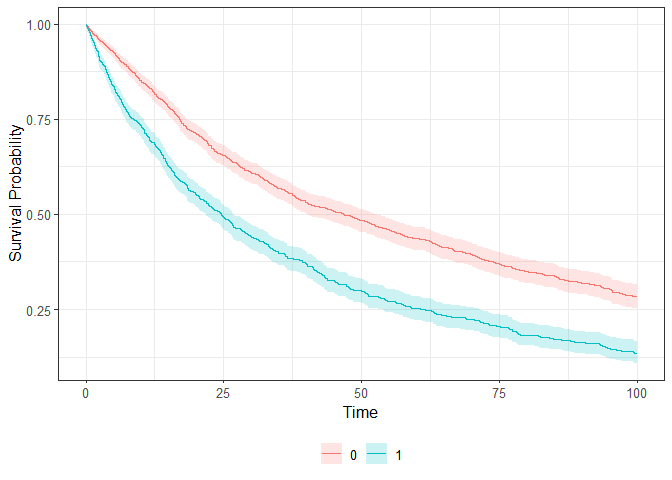
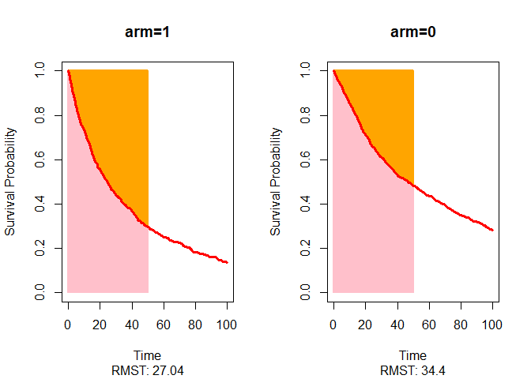
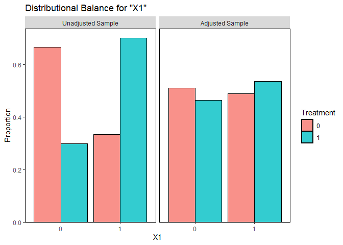
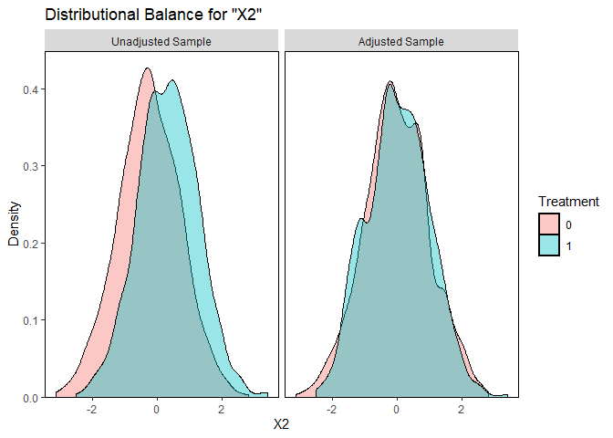
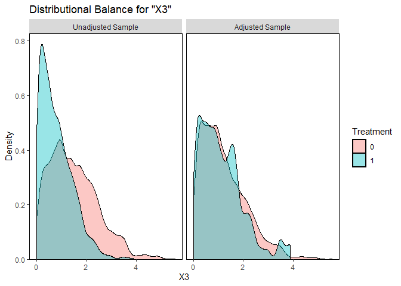
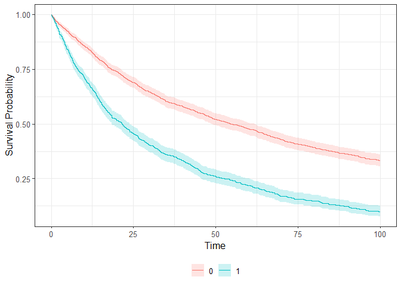

# The First Casualty of Statistics: Part Thirty Six
<big>**Causal Survival Analysis III: Observational Studies**</big>

<br/>
Jiří Fejlek

2026-11-25
<br/>

<br/> In this part, we will move to causal survival analysis for observational
studies. As we will see, when dealing with confounding with respect to
observed pre-treatment covariates, we can combine the Kaplan-Meier
estimator with the standard inverse probability of treatment (aka
propensity score) weighting. <br/>

## Table of Contents

- [Observational Study with Independent
  Censoring](#observational-study-with-independent-censoring)
- [Inverse Probability of Treatment
  Weighting](#inverse-probability-of-treatment-weighting)
- [Observational Study with Conditionally Independent
  Censoring](#observational-study-with-conditionally-independent-censoring)
- [References](#references)


``` r
library(tidyr)
library(dplyr)
library(tibble)
library(ggplot2)
library(patchwork)
library(dagitty)
library(ggdag)
library(modelsummary)
library(GGally)
library(estimatr)
library(WeightIt)
library(MatchIt)
library(cobalt)
library(mgcv)
library(marginaleffects)
```

## Observational Study with Independent Censoring

Let us assume survival data with a binary, non-staggered, and absorbing
treatment $`D`$. We will assume that the treatment assignment is subject
to observed confounding with respect to pre-treatment covariates $`X`$.
Further, we will assume that the censoring $`C`$ is independent, i.e.,
``` math
D \perp T(0), T(1) \mid X
```
and
``` math
C \perp T(0), T(1), D, X.
```

We will return to the dataset from Part Thirty Four, but with the
treatment assignment that depends on the observed covariates.

``` r
library(simsurv)
options(width=2000)

set.seed(123)
n_sample <- 2500
maxt <- 100

# generate covariates
covariates <- data.frame(
  X1 = rbinom(n_sample, 1, 0.5),
  X2 = rnorm(n_sample, 0, 1),
  X3 = abs(rnorm(n_sample, 0, 1.5))
)

# generate T(0) 
covariates$D <- 0

sim_surv_data_control <- simsurv(
  dist = "exponential",
  x = covariates,
  lambdas = 0.025,
  betas = c(X1 = 1, X2 = 0.75, X3 = -0.5, D = -0.5),
  maxt = maxt
)

# generate T(1) 
covariates$D <- 1 

sim_surv_data_treat <- simsurv(
  dist = "exponential",
  x = covariates,
  lambdas = 0.025,
  betas = c(X1 = 1, X2 = 0.75, X3 = -0.5, D = -0.5),
  maxt = maxt
)

sim_surv_data <- data.frame(T_0 = sim_surv_data_control$eventtime, 
                            T_1 = sim_surv_data_treat$eventtime,
                            status_0 = sim_surv_data_control$status,
                            status_1 = sim_surv_data_treat$status)

# treatment assignment
sim_surv_data$D <- (plogis(2.5*covariates$X1 + covariates$X2 - 1.5*covariates$X3) > runif(n_sample, 0, 1)) + 0
sim_surv_data$status <- ifelse(sim_surv_data$D == 0,sim_surv_data$status_0,sim_surv_data$status_1) 

# randomized censoring
cens_times <- rexp(n_sample, 0.01)
sim_surv_data$cens_times <- cens_times
sim_surv_data$T <- ifelse(sim_surv_data$D == 0,sim_surv_data$T_0,sim_surv_data$T_1)
sim_surv_data$C <- (sim_surv_data$T >= cens_times) + 0
sim_surv_data$T[sim_surv_data$C == 1] <- cens_times[sim_surv_data$C == 1]
sim_surv_data$status[sim_surv_data$C == 1] <- 0
head(sim_surv_data)
```

    ##         T_0        T_1 status_0 status_1 D status cens_times         T C
    ## 1 45.639992 100.000000        1        0 0      0   33.73728 33.737279 1
    ## 2  3.211537   2.495525        1        1 1      1   92.71287  2.495525 0
    ## 3  7.810661  40.691408        1        1 1      1   47.28301 40.691408 0
    ## 4  2.145434  45.706122        1        1 1      1  261.96566 45.706122 0
    ## 5  2.908381  20.343071        1        1 1      1  200.75746 20.343071 0
    ## 6  9.687689  27.526637        1        1 0      1  209.01920  9.687689 0

To remind ourselves, the true treatment effect in terms of the
restricted mean survival time (RMST) is as follows.

``` r
# RMST for T(1)
mean(pmin(sim_surv_data$T_1,50))
```

    ## [1] 34.32168

``` r
# RMST for T(0)
mean(pmin(sim_surv_data$T_0,50))
```

    ## [1] 29.02376

Due to confounding, the naive Kaplan-Meier estimator gives a biased
estimate.

``` r
library(survival)
library(ggsurvfit)

survfit2(Surv(T, status) ~ D, data = sim_surv_data,conf.type ='log-log') %>% 
  ggsurvfit() +
  labs(
    x = "Time",
    y = "Survival Probability"
  ) + add_confidence_interval()
```

<!-- -->

``` r
library(survRM2)
RMST <- rmst2(
  time = sim_surv_data$T,
  status = sim_surv_data$status,
  arm = sim_surv_data$D,
  tau = 50
)

RMST
```

    ## 
    ## The truncation time: tau = 50  was specified. 
    ## 
    ## Restricted Mean Survival Time (RMST) by arm 
    ##                Est.    se lower .95 upper .95
    ## RMST (arm=1) 27.040 0.608    25.849    28.231
    ## RMST (arm=0) 34.401 0.506    33.409    35.393
    ## 
    ## 
    ## Restricted Mean Time Lost (RMTL) by arm 
    ##                Est.    se lower .95 upper .95
    ## RMTL (arm=1) 22.960 0.608    21.769    24.151
    ## RMTL (arm=0) 15.599 0.506    14.607    16.591
    ## 
    ## 
    ## Between-group contrast 
    ##                        Est. lower .95 upper .95 p
    ## RMST (arm=1)-(arm=0) -7.361    -8.911    -5.811 0
    ## RMST (arm=1)/(arm=0)  0.786     0.746     0.829 0
    ## RMTL (arm=1)/(arm=0)  1.472     1.356     1.598 0

``` r
plot(RMST, xlab = "Time", ylab = "Survival Probability")
```

<!-- -->

The treatment effect appears to be negative due to confounding.

## Inverse Probability of Treatment Weighting

To account for observed confounding, we can use inverse probability of
treatment weighting (IPTW). First, we fit the propensity score model
$`\hat e(X)`$ of treatment assignment probabilities
``` math
e(X) = P(T = 1 \mid X).
```
The adjusted IPTW Kaplan-Meier estimator for treatment assignment
$`D = d`$ is (Voinot et al. 2025)
``` math
\hat{S}_{d}^\text{IPCW}(t) = \prod_{t_i \leq t} \left(1-\frac{r^\text{IPTW}_i(d)}{n^\text{IPTW}_i(d)}\right),
```
where $`n^\text{IPTW}_i`$ is a weight-corrected number of subjects at
risk at time $`t_i`$ and $`r^\text{IPTW}_i`$ is a weight-corrected
number of subjects that failed at time $`t_i`$, which equal
``` math
r^\text{IPCW}_i(d) = \sum_{j = 1}^n \left(\frac{d}{\hat e(X_j)} + \frac{1-d}{1-\hat e(X_j)}\right) I(T_j = t_i, C_j = 0, D_j = d)
```
and
``` math
n^\text{IPCW}_i(d) = \sum_{j = 1}^n \left(\frac{d}{\hat e(X_j)} + \frac{1-d}{1-\hat e(X_j)}\right) I(T_j \geq t_i, D_j = d).
```

Let’s compute the estimator. First, we fit the propensity score model.

``` r
sim_surv_data_obs <- data.frame(D = sim_surv_data$D, 
                                X1 = covariates$X1, 
                                X2 = covariates$X2, 
                                X3 = covariates$X3, 
                                T = sim_surv_data$T, 
                                status = sim_surv_data$status, 
                                C = sim_surv_data$C)

ps_model <- glm(D ~ X1 + X2 + X3, data = sim_surv_data_obs, family = binomial(link = "logit"))
summary(ps_model)
```

    ## 
    ## Call:
    ## glm(formula = D ~ X1 + X2 + X3, family = binomial(link = "logit"), 
    ##     data = sim_surv_data_obs)
    ## 
    ## Coefficients:
    ##             Estimate Std. Error z value Pr(>|z|)    
    ## (Intercept)  0.19161    0.09530    2.01   0.0444 *  
    ## X1           2.37454    0.11863   20.02   <2e-16 ***
    ## X2           1.00048    0.06203   16.13   <2e-16 ***
    ## X3          -1.57634    0.08121  -19.41   <2e-16 ***
    ## ---
    ## Signif. codes:  0 '***' 0.001 '**' 0.01 '*' 0.05 '.' 0.1 ' ' 1
    ## 
    ## (Dispersion parameter for binomial family taken to be 1)
    ## 
    ##     Null deviance: 3420.4  on 2499  degrees of freedom
    ## Residual deviance: 2250.2  on 2496  degrees of freedom
    ## AIC: 2258.2
    ## 
    ## Number of Fisher Scoring iterations: 5

Next, we compute the weights and compute the IPTW Kaplan-Meier
estimator.

``` r
ps <- predict(ps_model, type = "response")
iptw <- ifelse(sim_surv_data_obs$D == 1, 1/ps, 1/(1 - ps))

km_ipcw <- survfit(
  Surv(T, status) ~ D,
  data = sim_surv_data_obs,
  weights = iptw)

print(km_ipcw, rmean = 50)
```

    ## Call: survfit(formula = Surv(T, status) ~ D, data = sim_surv_data_obs, 
    ##     weights = iptw)
    ## 
    ##     records    n events rmean* se(rmean) median 0.95LCL 0.95UCL
    ## D=0    1418 2463   1534   28.7     0.403   27.3    22.8    32.0
    ## D=1    1082 2409   1267   33.7     0.403   43.7    39.9    55.8
    ##     * restricted mean with upper limit =  50

We recovered the true treatment effect. As usual, we should assess the
balance by comparing the treated and control groups.

``` r
bal.tab(D ~ X1 + X2 + X3, data = sim_surv_data_obs, weights = iptw, un = TRUE, stats = c("m", "v", "ks"))
```

    ## Balance Measures
    ##       Type Diff.Un V.Ratio.Un  KS.Un Diff.Adj V.Ratio.Adj KS.Adj
    ## X1  Binary  0.3663          . 0.3663   0.0457           . 0.0457
    ## X2 Contin.  0.6155     0.9177 0.2467   0.0427      0.9348 0.0344
    ## X3 Contin. -0.8338     0.4384 0.3182  -0.1069      0.9307 0.0646
    ## 
    ## Effective sample sizes
    ##            Control Treated
    ## Unadjusted 1418.   1082.  
    ## Adjusted    705.65  396.75

``` r
bal.plot(D ~ X1 + X2 + X3, data = sim_surv_data_obs, weights = iptw, which = "both", var.name = "X1")
```

<!-- -->

``` r
bal.plot(D ~ X1 + X2 + X3, data = sim_surv_data_obs, weights = iptw, which = "both", var.name = "X2")
```

<!-- -->

``` r
bal.plot(D ~ X1 + X2 + X3, data = sim_surv_data_obs, weights = iptw, which = "both", var.name = "X3")
```

<!-- -->

We observe a decent overlap between the treated and control groups. The
IPTW clearly improved the balance, and the effective sample size remains
satisfactory.

We can compute the IPTW Kaplan-Meier estimator (and many other
estimators) more straightforwardly using the package *adjustedCurves*
(<https://cran.r-project.org/web/packages/adjustedCurves/index.html>).

``` r
sim_surv_data_obs$D <- factor(sim_surv_data_obs$D)

library(adjustedCurves)
iptw_km <- adjustedsurv(
  data = sim_surv_data_obs,
  variable = "D",
  ev_time = "T",
  event = "status",
  method = "iptw_km",
  treatment_model = D ~ X1 + X2 + X3,
  weight_method = "ps",      
  bootstrap = TRUE,          
  n_boot = 25           
)


rmst_res <- adjusted_rmst(iptw_km, to = 50, conf_int = TRUE)
print(rmst_res)
```

    ##   to group     rmst        se ci_lower ci_upper n_boot
    ## 1 50     0 28.74007 0.5994095 27.56525 29.91489     25
    ## 2 50     1 33.72399 0.8950498 31.96972 35.47825     25

We notice that we got exactly the same estimate as expected.

The package *adjustedCurves* also includes the *augmented* IPTW
estimator, i.e., the doubly robust estimator that combines weighting
with an outcome model (Voinot et al. 2025).

``` r
aiptw <- adjustedsurv(
  data = sim_surv_data_obs,
  variable = "D",
  ev_time = "T",
  event = "status",
  method = "aiptw",
  outcome_model = coxph(Surv(T, status) ~  X1 + X2 + X3 + D, data = sim_surv_data_obs, x = TRUE),
  treatment_model = D ~ X1 + X2 + X3,
  weight_method = "ps",
  bootstrap = TRUE,          
  n_boot = 25 
)

rmst_res <- adjusted_rmst(aiptw, to = 50, conf_int = TRUE)
print(rmst_res)
```

    ##   to group     rmst        se ci_lower ci_upper n_boot
    ## 1 50     0 28.27947 0.5955178 27.11228 29.44666     25
    ## 2 50     1 34.60182 0.7619893 33.10835 36.09529     25

## Observational Study with Conditionally Independent Censoring

When dealing with conditionally independent censoring, we can combine
IPTW and IPCW weights. The IPTW-IPCW Kaplan-Meier estimator for
treatment assignment $`D = d`$ is (Voinot et al. 2025)
``` math
\hat{S}_{d}^\text{IPTW-IPCW}(t) = \prod_{t_i \leq t} \left(1-\frac{r^\text{IPTW-IPCW}_i(d)}{n^\text{IPTW-IPCW}_i(d)}\right),
```
where
``` math
r^\text{IPTW-IPCW}_i(d) = \sum_{j = 1}^n \left(\frac{d}{\hat e(X_j)} + \frac{1-d}{1-\hat e(X_j)}\right) \frac{ I(T_j = t_i, C_j = 0, D_j = d)}{P[C_j \geq t_i \mid X_j, D_j = d]}
```
and
``` math
n^\text{IPTW-IPCW}_i(d) = \sum_{j = 1}^n \left(\frac{d}{\hat e(X_j)} + \frac{1-d}{1-\hat e(X_j)}\right) \frac{I(T_j \geq t_i, D_j = d)}{P[C_j \geq t_i \mid X_j, D_j = d]}.
```

Let’s generate the dataset that combines confounding with the informed
censoring.

``` r
set.seed(123)
n_sample <- 2500
maxt <- 100

# generate covariates
covariates <- data.frame(
  X1 = rbinom(n_sample, 1, 0.5),
  X2 = rnorm(n_sample, 0, 1),
  X3 = abs(rnorm(n_sample, 0, 1.5))
)

# generate T(0) 
covariates$D <- 0

sim_surv_data_control <- simsurv(
  dist = "exponential",
  x = covariates,
  lambdas = 0.025,
  betas = c(X1 = 1, X2 = 0.75, X3 = -0.5, D = -0.5),
  maxt = maxt
)

# generate T(1) 
covariates$D <- 1 

sim_surv_data_treat <- simsurv(
  dist = "exponential",
  x = covariates,
  lambdas = 0.025,
  betas = c(X1 = 1, X2 = 0.75, X3 = -0.5, D = -0.5),
  maxt = maxt
)

sim_surv_data <- data.frame(T_0 = sim_surv_data_control$eventtime, 
                            T_1 = sim_surv_data_treat$eventtime,
                            status_0 = sim_surv_data_control$status,
                            status_1 = sim_surv_data_treat$status)

sim_cens_data_control <- simsurv(
  dist = "exponential",
  x = covariates,
  lambdas = 0.005,
  betas = c(X1 = 1, X2 = 2, X3 = -0.25),
  maxt = maxt
)

# conditionally independent censoring
covariates$D <- 1 

sim_cens_data_treat <- simsurv(
  dist = "exponential",
  x = covariates,
  lambdas = 0.005,
  betas = c(X1 = 1, X2 = -2, X3 = -0.25),
  maxt = maxt
)

sim_surv_data$cens_times_treat <- sim_cens_data_treat$eventtime
sim_surv_data$cens_times_control <- sim_cens_data_control$eventtime

# treatment assignment
sim_surv_data$D <- (plogis(2.5*covariates$X1 + covariates$X2 - 1.5*covariates$X3) > runif(n_sample, 0, 1)) + 0

sim_surv_data$status <- ifelse(sim_surv_data$D == 0,sim_surv_data$status_0,sim_surv_data$status_1) 
sim_surv_data$cens_times <- ifelse(sim_surv_data$D == 0,
                                   sim_surv_data$cens_times_control,sim_surv_data$cens_times_treat)

sim_surv_data$T <- ifelse(sim_surv_data$D == 0,sim_surv_data$T_0,sim_surv_data$T_1)
sim_surv_data$C <- (sim_surv_data$T >= sim_surv_data$cens_times) + 0
sim_surv_data$T[sim_surv_data$C == 1] <- sim_surv_data$cens_times[sim_surv_data$C == 1]
sim_surv_data$status[sim_surv_data$C == 1] <- 0
head(sim_surv_data)
```

    ##         T_0        T_1 status_0 status_1 cens_times_treat cens_times_control D status cens_times         T C
    ## 1 45.639992 100.000000        1        0        100.00000          36.086417 0      0   36.08642 36.086417 1
    ## 2  3.211537   2.495525        1        1        100.00000          51.395784 1      1  100.00000  2.495525 0
    ## 3  7.810661  40.691408        1        1        100.00000          98.372845 1      1  100.00000 40.691408 0
    ## 4  2.145434  45.706122        1        1        100.00000          11.459966 1      1  100.00000 45.706122 0
    ## 5  2.908381  20.343071        1        1        100.00000           2.657106 1      1  100.00000 20.343071 0
    ## 6  9.687689  27.526637        1        1         17.89846         100.000000 0      1  100.00000  9.687689 0

The treatment effect is the same as previously.

``` r
# RMST for T(1)
mean(pmin(sim_surv_data$T_1,50))
```

    ## [1] 34.32168

``` r
# RMST for T(0)
mean(pmin(sim_surv_data$T_0,50))
```

    ## [1] 29.02376

The naive estimator does not work as expected.

``` r
survfit2(Surv(T, status) ~ D, data = sim_surv_data,conf.type ='log-log') %>% 
  ggsurvfit() +
  labs(
    x = "Time",
    y = "Survival Probability"
  ) + add_confidence_interval()
```

<!-- -->

Let’s compute the IPTW estimate.

``` r
# observed dataset
sim_surv_data_obs <- data.frame(D = sim_surv_data$D, 
                                X1 = covariates$X1, 
                                X2 = covariates$X2, 
                                X3 = covariates$X3, 
                                T = sim_surv_data$T, 
                                status = sim_surv_data$status, 
                                C = sim_surv_data$C)


sim_surv_data_obs$C_inf <- (sim_surv_data_obs$C == 1 & sim_surv_data_obs$T < 100) + 0
sim_surv_data_obs$C_adm <- (sim_surv_data_obs$C == 1 & sim_surv_data_obs$T == 100) + 0
sim_surv_data_obs$id <- seq(1,n_sample)
```

``` r
sim_surv_data_obs$D <- factor(sim_surv_data_obs$D)

iptw_km <- adjustedsurv(
  data = sim_surv_data_obs,
  variable = "D",
  ev_time = "T",
  event = "status",
  method = "iptw_km",
  treatment_model = D ~ X1 + X2 + X3,
  weight_method = "ps",      
  conf_int = TRUE,          
  bootstrap = TRUE,          
  n_boot = 25           
)

rmst_res <- adjusted_rmst(iptw_km, to = 50, conf_int = TRUE)
print(rmst_res)
```

    ##   to group     rmst        se ci_lower ci_upper n_boot
    ## 1 50     0 31.02976 0.6434565 29.76861 32.29091     25
    ## 2 50     1 31.62894 0.8811261 29.90197 33.35592     25

We see that the result is still biased; the treatment appears to have no
effect. This is because IPTW alone does not adjust for informative
censoring; it only accounts for confounding.

Consequently, let’s combine IPTW with IPCW. First, we compute the
propensity scores.

``` r
ps_model <- glm(D ~ X1 + X2 + X3, data = sim_surv_data_obs, family = binomial(link = "logit"))
ps <- predict(ps_model, type = "response")
iptw <- ifelse(sim_surv_data_obs$D == 1, 1/ps, 1/(1 - ps))
sim_surv_data_obs$iptw <- iptw
```

Then we compute IPCW weights as in the previous part. The result for the
control group is as follows.

``` r
# control group
sim_surv_data_obs_control <- subset(sim_surv_data_obs, D == 0)

# survival data into long format
cut_times <- sort(unique(sim_surv_data_obs_control$T))
control_long <- survSplit(
  Surv(T, status) ~ .,
  data = sim_surv_data_obs_control,
  cut = cut_times,
  episode = "episode"
) %>%
  group_by(id) %>%
  arrange(T, .by_group = TRUE) %>%
  mutate(
    cens_ev = if_else(row_number() == n() & C_inf == 1, 1, 0)  # individuals are censored only at the end
  ) %>%
  ungroup()


# compute IPCW weights
cox_cens_control <- coxph(Surv(tstart, T, cens_ev) ~ X1 + X2 + X3, data = control_long)

cumhaz_c <- predict(
  cox_cens_control, 
  newdata = control_long %>% mutate(tstart = 0, time = tstart), 
  type = "expected"
)
control_long$ipcw <- 1/exp(-cumhaz_c)
```

The resulting weights are simply the product of the two weights.

``` r
km_ipcw_control <- survfit(
  Surv(tstart, T, status) ~ 1,
  data = control_long,
  weights = ipcw*iptw,
  id = id
)
summary(km_ipcw_control, rmean = 50)$table[5]
```

    ##   rmean 
    ## 28.6175

We recovered the true value of RMST for the control group. The RMST for
the treated group is as follows.

``` r
# control group
sim_surv_data_obs_treat <- subset(sim_surv_data_obs, D == 1)

# survival data into long format
cut_times <- sort(unique(sim_surv_data_obs_treat$T))
treat_long <- survSplit(
  Surv(T, status) ~ .,
  data = sim_surv_data_obs_treat,
  cut = cut_times,
  episode = "episode"
) %>%
  group_by(id) %>%
  arrange(T, .by_group = TRUE) %>%
  mutate(
    cens_ev = if_else(row_number() == n() & C_inf == 1, 1, 0)  # individuals are censored only at the end
  ) %>%
  ungroup()


# compute IPCW weights
cox_cens_control <- coxph(Surv(tstart, T, cens_ev) ~ X1 + X2 + X3, data = treat_long)

cumhaz_c <- predict(
  cox_cens_control, 
  newdata = treat_long %>% mutate(tstart = 0, time = tstart), 
  type = "expected"
)
treat_long$ipcw <- 1/exp(-cumhaz_c)

km_ipcw_treat <- survfit(
  Surv(tstart, T, status) ~ 1,
  data = treat_long,
  weights = ipcw*iptw,
  id = id
)
summary(km_ipcw_treat, rmean = 50)$table[5]
```

    ##    rmean 
    ## 32.34566

We obtained an unbiased result.

## References

<div id="refs" class="references csl-bib-body hanging-indent">

<div id="ref-voinot2025treatment" class="csl-entry">

Voinot, Charlotte, Clément Berenfeld, Imke Mayer, Bernard Sebastien, and
Julie Josse. 2025. “Treatment Effect Estimation in Causal Survival
Analysis: Practical Recommendations.” *arXiv Preprint arXiv:2501.05836*.

</div>

</div>
