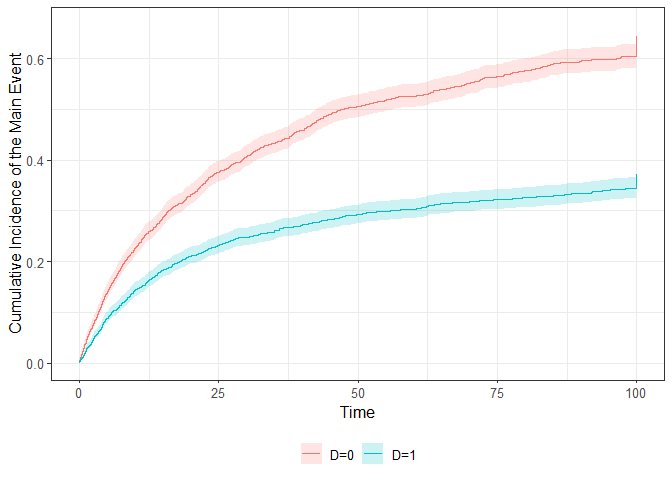
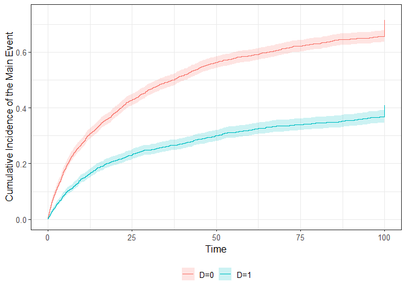
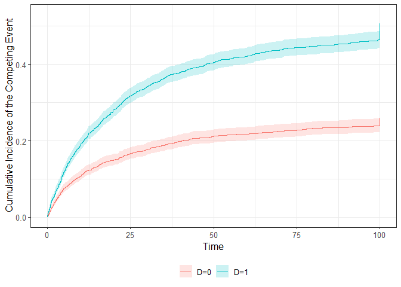

# The First Casualty of Statistics: Part Thirty Seven
<big>**Causal Survival Analysis IV: Competing Events**</big>

<br/>
Jiří Fejlek

2026-11-25
<br/>

<br/> We mentioned in the introduction to survival analysis that the
fundamental challenge with survival data is a ubiquitous missing-data
problem: we do not observe the time at which the outcome of interest
occurs for each individual. Up to this point, we have discussed
censoring, which refers to situations in which individuals leave the
study before experiencing the event or when the study is ended. The
crucial observation about censoring is that individuals will experience
the event after censoring; the event is not observed in the data.

*Competing events* are fundamentally different from censoring since they
*prevent* individuals from experiencing the event of interest in the
future. A typical example of a competing event in survival data is death
from causes unrelated to the cause of interest. What makes causal
inference for survival data with competing events more challenging is
that treatment influences both the risk of the primary event of interest
and the risk of competing events. This fact also implies that there is
no single treatment causal effect of interest. <br/>

## Table of Contents

- [Simulated Survival Dataset with Competing
  Events](#simulated-survival-dataset-with-competing-events)
- [Composite Event Effect](#composite-event-effect)
- [Total Effect](#total-effect)
- [Controlled Direct Effect](#controlled-direct-effect)
- [References](#references)

``` r
library(tidyr)
library(dplyr)
library(tibble)
library(ggplot2)
library(patchwork)
library(dagitty)
library(ggdag)
library(modelsummary)
library(GGally)
library(estimatr)
library(WeightIt)
library(MatchIt)
library(cobalt)
library(mgcv)
library(marginaleffects)
```

## Simulated Survival Dataset with Competing Events

Let us first simulate a survival dataset with competing events. First,
we will generate potential outcomes $`T_m(0)`$ and $`T_m(1)`$ for the
main event of the interest and $`T_c(0)`$ and $`T_c(1)`$ for the
competing event using the *simsurv* package. We will again assume an
administrative censoring $`T_\text{max} = 100.`$

``` r
library(simsurv)
options(width=2000)

set.seed(123)
n_sample <- 5000
maxt <- 100

# generate covariates
covariates <- data.frame(
  X1 = rbinom(n_sample, 1, 0.5),
  X2 = rnorm(n_sample, 0, 1),
  X3 = abs(rnorm(n_sample, 0, 1.5))
)

covariates$D <- 0

# generate T_m(0) 
sim_surv_data_control <- simsurv(
  dist = "exponential",
  x = covariates,
  lambdas = 0.025,
  betas = c(X1 = 1, X2 = 0.75, X3 = -0.5, D = -0.5),
  maxt = maxt
)

# generate T_comp(0) 
sim_compsurv_data_control <- simsurv(
  dist = "exponential",
  x = covariates,
  lambdas = 0.01,
  betas = c(X1 = 1.5, X2 = -1.5, X3 = -2, D = 1.5),
  maxt = maxt
)

covariates$D <- 1

# generate T_m(1)
sim_surv_data_treat <- simsurv(
  dist = "exponential",
  x = covariates,
  lambdas = 0.025,
  betas = c(X1 = 1, X2 = 0.75, X3 = -0.5, D = -0.5),
  maxt = maxt
)

# generate T_comp(1) 
sim_compsurv_data_treat <- simsurv(
  dist = "exponential",
  x = covariates,
  lambdas = 0.01,
  betas = c(X1 = 1.5, X2 = -1.5, X3 = -1.5, D = 1.5),
  maxt = maxt
)

sim_surv_data <- data.frame(T_m_0 = sim_surv_data_control$eventtime, 
                            T_m_1 = sim_surv_data_treat$eventtime,
                            T_c_0 = sim_compsurv_data_control$eventtime, 
                            T_c_1 = sim_compsurv_data_treat$eventtime)


sim_surv_data$T_0 <- pmin(sim_surv_data$T_m_0, sim_surv_data$T_c_0)
sim_surv_data$T_1 <- pmin(sim_surv_data$T_m_1, sim_surv_data$T_c_1)
sim_surv_data$status_0[sim_surv_data$T_m_0 <= sim_surv_data$T_c_0] <- 1
sim_surv_data$status_0[sim_surv_data$T_m_0 > sim_surv_data$T_c_0] <- 2
sim_surv_data$status_0[sim_surv_data$T_m_0 == maxt & sim_surv_data$T_c_0 == maxt] <- 0


sim_surv_data$status_1[sim_surv_data$T_m_1 <= sim_surv_data$T_c_1] <- 1
sim_surv_data$status_1[sim_surv_data$T_m_1 > sim_surv_data$T_c_1] <- 2
sim_surv_data$status_1[sim_surv_data$T_m_1 == maxt & sim_surv_data$T_c_1 == maxt] <- 0
head(sim_surv_data)
```

    ##         T_m_0      T_m_1 T_c_0      T_c_1         T_0       T_1 status_0 status_1
    ## 1 100.0000000 100.000000   100   4.753652 100.0000000  4.753652        0        2
    ## 2   0.2753701   7.191678   100  19.977353   0.2753701  7.191678        1        1
    ## 3   8.4416262 100.000000   100  23.849513   8.4416262 23.849513        1        2
    ## 4   5.2320590  25.003760   100 100.000000   5.2320590 25.003760        1        1
    ## 5   0.8494801   1.711563   100  55.878837   0.8494801  1.711563        1        1
    ## 6  68.3449276 100.000000   100  58.751348  68.3449276 58.751348        1        2

Next, we will generate the treatment assignment (we assume a completely
randomized experiment) and additional independent censoring.

``` r
options(width=2000)

# completely randomized treatment assignment
sim_surv_data$D <- rbinom(n_sample, 1, 0.5)
sim_surv_data$status <- ifelse(sim_surv_data$D == 0,sim_surv_data$status_0,sim_surv_data$status_1) 

# randomized censoring
cens_times <- pmin(rexp(n_sample, 0.005),maxt)
sim_surv_data$cens_times <- cens_times
sim_surv_data$T <- ifelse(sim_surv_data$D == 0,sim_surv_data$T_0,sim_surv_data$T_1)
sim_surv_data$C <- (sim_surv_data$T >= cens_times) + 0
sim_surv_data$T[sim_surv_data$C == 1] <- cens_times[sim_surv_data$C == 1]
sim_surv_data$status[sim_surv_data$C == 1] <- 0
head(sim_surv_data)
```

    ##         T_m_0      T_m_1 T_c_0      T_c_1         T_0       T_1 status_0 status_1 D status cens_times           T C
    ## 1 100.0000000 100.000000   100   4.753652 100.0000000  4.753652        0        2 0      0  100.00000 100.0000000 1
    ## 2   0.2753701   7.191678   100  19.977353   0.2753701  7.191678        1        1 0      1  100.00000   0.2753701 0
    ## 3   8.4416262 100.000000   100  23.849513   8.4416262 23.849513        1        2 0      1   12.55719   8.4416262 0
    ## 4   5.2320590  25.003760   100 100.000000   5.2320590 25.003760        1        1 0      1   56.87137   5.2320590 0
    ## 5   0.8494801   1.711563   100  55.878837   0.8494801  1.711563        1        1 0      1   73.84024   0.8494801 0
    ## 6  68.3449276 100.000000   100  58.751348  68.3449276 58.751348        1        2 1      2  100.00000  58.7513478 0

Overall, the observed dataset would look like this.

``` r
options(width=2000)

sim_surv_data_obs <- data.frame(
  id = seq(1,n_sample),
  D = sim_surv_data$D, 
  X1 = covariates$X1, 
  X2 = covariates$X2, 
  X3 = covariates$X3, 
  T = sim_surv_data$T, 
  main = (sim_surv_data$status == 1) + 0,
  comp = (sim_surv_data$status == 2) + 0,
  C = sim_surv_data$C)

head(sim_surv_data_obs)
```

    ##        id D X1            X2          X3            T main comp C
    ## 1       1 0  0 -6.788076e-01 0.525003782 1.000000e+02    0    0 1
    ## 2       2 0  1  5.743127e-01 1.221662564 2.753701e-01    1    0 0
    ## 3       3 0  0 -7.045145e-01 0.774999190 8.441626e+00    1    0 0
    ## 4       4 0  1 -5.339841e-01 4.038396604 5.232059e+00    1    0 0
    ## 5       5 0  1  7.743846e-01 1.645431961 8.494801e-01    1    0 0
    ## 6       6 1  0 -4.756214e-01 1.883212613 5.875135e+01    0    1 0
    ## 7       7 1  1 -2.442738e-02 0.955816167 8.905463e+00    1    0 0
    ## 8       8 1  1  1.019008e+00 0.586374228 2.906470e+00    0    0 1
    ## 9       9 1  1 -1.205580e+00 1.491632958 2.518981e+01    0    1 0
    ## 10     10 0  0  1.595294e+00 2.134529495 4.180389e+01    1    0 0
 

## Composite Event Effect

Let us start with the composite event effect, which combines all events
(the “main” event of interest and competing events) into a *single
composite* event. We then compute the standard treatment effect for the
composite event.

Since we assumed a completely randomized experiment with independent
censoring, we can estimate the treatment effect using an unadjusted
Kaplan-Meier estimator.

``` r
library(survRM2)

RMST <- rmst2(
  time = sim_surv_data_obs$T,
  status = sim_surv_data_obs$main == 1 | sim_surv_data_obs$comp == 1,
  arm = sim_surv_data_obs$D,
  tau = 50
)

RMST
```

    ## 
    ## The truncation time: tau = 50  was specified. 
    ## 
    ## Restricted Mean Survival Time (RMST) by arm 
    ##                Est.    se lower .95 upper .95
    ## RMST (arm=1) 21.306 0.385    20.551    22.061
    ## RMST (arm=0) 23.822 0.391    23.055    24.589
    ## 
    ## 
    ## Restricted Mean Time Lost (RMTL) by arm 
    ##                Est.    se lower .95 upper .95
    ## RMTL (arm=1) 28.694 0.385    27.939    29.449
    ## RMTL (arm=0) 26.178 0.391    25.411    26.945
    ## 
    ## 
    ## Between-group contrast 
    ##                        Est. lower .95 upper .95 p
    ## RMST (arm=1)-(arm=0) -2.516    -3.592    -1.439 0
    ## RMST (arm=1)/(arm=0)  0.894     0.853     0.938 0
    ## RMTL (arm=1)/(arm=0)  1.096     1.054     1.140 0

``` r
plot(RMST, xlab = "Time", ylab = "Survival Probability")
```

<!-- -->

We see that the treatment decreased the restricted mean survival time
(RMST) after 50 time units. We can compare the estimate with the true
values.

``` r
# RMST for composite T(0)
mean(pmin(sim_surv_data$T_0,50))
```

    ## [1] 24.38351

``` r
# RMST for composite T(1)
mean(pmin(sim_surv_data$T_1,50))
```

    ## [1] 20.88253

We see that the values match as expected.

The main issue with the composite event effect is that when events are
highly heterogeneous in severity, increasing overall RMST can be either
beneficial or detrimental depending on which event occurs most often.
Consequently, we usually need other measures of treatment effect.

## Total Effect

Let $`Y^t_m`$ denote the indicator that the main event occurred in the
follow-up period $`[0,t]`$, and let $`Y^t_c`$ denote the indicator that
the competing event occurred in the follow-up period $`[0,t]`$. The
total effect evaluates the treatment effect on the event of interest in
the presence of competing events (Young et al. 2020)
``` math
\text{Total Effect} = P[Y^t_m(D = 1) = 1]  - P[Y^t_m(D = 0) = 1].
```
Since we assume a completely randomized experiment with independent
censoring, we can estimate this causal effect using the unadjusted
*cumulative incidence function*
``` math
F_m(t) = P[T \leq t \mid Y_m^t = 1, D = d],
```

which can be estimated non-parametrically using the *Aalen–Johansen
estimator*.

The Aalen–Johansen estimator of cumulative incidence function $`F_m(t)`$
for event $`m`$ is given as
``` math
\hat F_m(t) =  \sum_{t_i \leq t} \frac{r_{i,m}}{n_i} \hat S(t_{i-1}),
```
where $`n_i`$ is the number of individuals at risk at time $`t_i`$,
$`r_{i,m}`$ is the number of events of type $`m`$ occurring at time
$`t_i`$, and $`\hat S`$ is the estimated overall event-free survival
probability (using the Kaplan-Meier estimator).

Let’s compute the Aalen–Johansen estimator for our data.

``` r
library(tidycmprsk)
library(ggsurvfit)

sim_surv_data_obs$status <- factor(sim_surv_data$status)

cif_fit <- survfit(Surv(T, status) ~ D, data = sim_surv_data_obs)

ggcuminc(cif_fit, outcome = "1") +
  add_confidence_interval() +
  labs(
    x = "Time",
    y = "Cumulative Incidence of the Main Event"
  )
```

<!-- -->

``` r
ggcuminc(cif_fit, outcome = "2") +
  add_confidence_interval() +
  labs(
    x = "Time",
    y = "Cumulative Incidence of the Competing Event"
  )
```

<!-- -->

We see that our treatment decreases the probability of the main event
and increases the probability of the competing event. However, we have
to keep one observation in mind when interpreting the total effect.
Anything that increases the probability of one event must decrease the
probability of competing events, and vice versa. This is a direct
consequence of the fact that an individual can experience only one of
the events.

Hence, we need to ask: does the treatment actually decrease the risk of
the event of interest, merely increase the risk of competing events, or
is it some combination of both? To demonstrate that the total effect
alone cannot help us distinguish between these possibilities, let’s
simulate another dataset in which treatment has no direct effect on the
probability of the main event.

``` r
set.seed(123)

covariates$D <- 0

# generate T_m(0) 
sim_surv_data_control <- simsurv(
  dist = "exponential",
  x = covariates,
  lambdas = 0.05,
  betas = c(X1 = 1, X2 = 0.75, X3 = -1.5, D = 0),
  maxt = maxt
)

# generate T_comp(0) 
sim_compsurv_data_control <- simsurv(
  dist = "exponential",
  x = covariates,
  lambdas = 0.015,
  betas = c(X1 = 1.5, X2 = -1.5, X3 = -2.5, D = 1.5),
  maxt = maxt
)

covariates$D <- 1

# generate T_m(1)
sim_surv_data_treat <- simsurv(
  dist = "exponential",
  x = covariates,
  lambdas = 0.05,
  betas = c(X1 = 1, X2 = 0.75, X3 = -1.5, D = 0),
  maxt = maxt
)

# generate T_comp(1) 
sim_compsurv_data_treat <- simsurv(
  dist = "exponential",
  x = covariates,
  lambdas = 0.015,
  betas = c(X1 = 1.5, X2 = -1.5, X3 = -1.5, D = 1.5),
  maxt = maxt
)

sim_surv_data_alt <- data.frame(T_m_0 = sim_surv_data_control$eventtime,
                                T_m_1 = sim_surv_data_treat$eventtime,
                                T_c_0 = sim_compsurv_data_control$eventtime, 
                                T_c_1 = sim_compsurv_data_treat$eventtime)


sim_surv_data_alt$T_0 <- pmin(sim_surv_data_alt$T_m_0, sim_surv_data_alt$T_c_0)
sim_surv_data_alt$T_1 <- pmin(sim_surv_data_alt$T_m_1, sim_surv_data_alt$T_c_1)
sim_surv_data_alt$status_0[sim_surv_data_alt$T_m_0 <= sim_surv_data_alt$T_c_0] <- 1
sim_surv_data_alt$status_0[sim_surv_data_alt$T_m_0 > sim_surv_data_alt$T_c_0] <- 2
sim_surv_data_alt$status_0[sim_surv_data_alt$T_m_0 == maxt & sim_surv_data_alt$T_c_0 == maxt] <- 0


sim_surv_data_alt$status_1[sim_surv_data_alt$T_m_1 <= sim_surv_data_alt$T_c_1] <- 1
sim_surv_data_alt$status_1[sim_surv_data_alt$T_m_1 > sim_surv_data_alt$T_c_1] <- 2
sim_surv_data_alt$status_1[sim_surv_data_alt$T_m_1 == maxt & sim_surv_data_alt$T_c_1 == maxt] <- 0

# completely randomized treatment assignment
sim_surv_data_alt$D <- rbinom(n_sample, 1, 0.5)
sim_surv_data_alt$status <- 
  ifelse(sim_surv_data_alt$D == 0,sim_surv_data_alt$status_0,sim_surv_data_alt$status_1) 

# randomized censoring
cens_times <- pmin(rexp(n_sample, 0.005),maxt)
sim_surv_data_alt$cens_times <- cens_times
sim_surv_data_alt$T <- ifelse(sim_surv_data_alt$D == 0,sim_surv_data_alt$T_0,sim_surv_data_alt$T_1)
sim_surv_data_alt$C <- (sim_surv_data_alt$T >= cens_times) + 0
sim_surv_data_alt$T[sim_surv_data_alt$C == 1] <- cens_times[sim_surv_data_alt$C == 1]
sim_surv_data_alt$status[sim_surv_data_alt$C == 1] <- 0

sim_surv_data_obs_alt <- data.frame(
  id = seq(1,n_sample),
  D = sim_surv_data_alt$D, 
  X1 = covariates$X1, 
  X2 = covariates$X2, 
  X3 = covariates$X3, 
  T = sim_surv_data$T, 
  status = factor(sim_surv_data_alt$status))

cif_fit <- survfit(Surv(T, status) ~ D, data = sim_surv_data_obs_alt)

ggcuminc(cif_fit, outcome = "1") +
  add_confidence_interval() +
  labs(
    x = "Time",
    y = "Cumulative Incidence of the Main Event"
  )
```

<!-- -->

``` r
ggcuminc(cif_fit, outcome = "2") +
  add_confidence_interval() +
  labs(
    x = "Time",
    y = "Cumulative Incidence of the Competing Event"
  )
```

<!-- -->

Let’s also simulate a dataset in which the treatment affects the event
of interest but has no direct effect on the competing event.

``` r
set.seed(123)

covariates$D <- 0

# generate T_m(0) 
sim_surv_data_control <- simsurv(
  dist = "exponential",
  x = covariates,
  lambdas = 0.04,
  betas = c(X1 = 1, X2 = 0.75, X3 = -0.5, D = -1.25),
  maxt = maxt
)

# generate T_comp(0) 
sim_compsurv_data_control <- simsurv(
  dist = "exponential",
  x = covariates,
  lambdas = 0.015,
  betas = c(X1 = 1, X2 = 0.75, X3 = -0.5, D = 0),
  maxt = maxt
)

covariates$D <- 1

# generate T_m(1)
sim_surv_data_treat <- simsurv(
  dist = "exponential",
  x = covariates,
  lambdas = 0.04,
  betas = c(X1 = 1, X2 = 0.75, X3 = -0.5, D = -1.25),
  maxt = maxt
)

# generate T_comp(1) 
sim_compsurv_data_treat <- simsurv(
  dist = "exponential",
  x = covariates,
  lambdas = 0.015,
  betas = c(X1 = 1, X2 = 0.75, X3 = -0.5, D = 0),
  maxt = maxt
)

sim_surv_data_alt <- data.frame(T_m_0 = sim_surv_data_control$eventtime,
                                T_m_1 = sim_surv_data_treat$eventtime,
                                T_c_0 = sim_compsurv_data_control$eventtime, 
                                T_c_1 = sim_compsurv_data_treat$eventtime)


sim_surv_data_alt$T_0 <- pmin(sim_surv_data_alt$T_m_0, sim_surv_data_alt$T_c_0)
sim_surv_data_alt$T_1 <- pmin(sim_surv_data_alt$T_m_1, sim_surv_data_alt$T_c_1)
sim_surv_data_alt$status_0[sim_surv_data_alt$T_m_0 <= sim_surv_data_alt$T_c_0] <- 1
sim_surv_data_alt$status_0[sim_surv_data_alt$T_m_0 > sim_surv_data_alt$T_c_0] <- 2
sim_surv_data_alt$status_0[sim_surv_data_alt$T_m_0 == maxt & sim_surv_data_alt$T_c_0 == maxt] <- 0


sim_surv_data_alt$status_1[sim_surv_data_alt$T_m_1 <= sim_surv_data_alt$T_c_1] <- 1
sim_surv_data_alt$status_1[sim_surv_data_alt$T_m_1 > sim_surv_data_alt$T_c_1] <- 2
sim_surv_data_alt$status_1[sim_surv_data_alt$T_m_1 == maxt & sim_surv_data_alt$T_c_1 == maxt] <- 0

# completely randomized treatment assignment
sim_surv_data_alt$D <- rbinom(n_sample, 1, 0.5)
sim_surv_data_alt$status <- 
  ifelse(sim_surv_data_alt$D == 0,sim_surv_data_alt$status_0,sim_surv_data_alt$status_1) 

# randomized censoring
cens_times <- pmin(rexp(n_sample, 0.005),maxt)
sim_surv_data_alt$cens_times <- cens_times
sim_surv_data_alt$T <- ifelse(sim_surv_data_alt$D == 0,sim_surv_data_alt$T_0,sim_surv_data_alt$T_1)
sim_surv_data_alt$C <- (sim_surv_data_alt$T >= cens_times) + 0
sim_surv_data_alt$T[sim_surv_data_alt$C == 1] <- cens_times[sim_surv_data_alt$C == 1]
sim_surv_data_alt$status[sim_surv_data_alt$C == 1] <- 0

sim_surv_data_obs_alt <- data.frame(
  id = seq(1,n_sample),
  D = sim_surv_data_alt$D, 
  X1 = covariates$X1, 
  X2 = covariates$X2, 
  X3 = covariates$X3, 
  T = sim_surv_data$T, 
  status = factor(sim_surv_data_alt$status))

cif_fit <- survfit(Surv(T, status) ~ D, data = sim_surv_data_obs_alt)

ggcuminc(cif_fit, outcome = "1") +
  add_confidence_interval() +
  labs(
    x = "Time",
    y = "Cumulative Incidence of the Main Event"
  )
```

<!-- -->

``` r
ggcuminc(cif_fit, outcome = "2") +
  add_confidence_interval() +
  labs(
    x = "Time",
    y = "Cumulative Incidence of the Competing Event"
  )
```

<!-- -->

We see that, from the cumulative incidence functions, we cannot
distinguish the *underlying mechanism* of the treatment.

## Controlled Direct Effect

To address this issue with total effects, we will discuss another
treatment effect known as the controlled direct effect (Young et al.
2020). Controlled direct effect is the treatment effect on the
probability of the event of interest *under a hypothetical intervention,
in which competing events cannot happen*. The controlled direct effect
``` math
\text{Controlled Direct Effect} = P[Y^t_m(D= d, Y^t_c = 0) = 1] - P[Y^t_m(D= d, Y^t_c = 0) = 1] 
```
Notice that $`Y^t_c`$ is understood the same way as the treatment $`D`$;
it is an intervention.

We can compute the controlled direct effect by treating the competing
events as censoring. Since the probability of competing events will
almost certainly depend on the same causes as the event of interest, we
have to use an IPCT estimator. The unfortunate consequence is that even
randomization of treatment assignment *is not sufficient* to estimate
the direct effects unbiasedly. We also need to measure all common causes
of the individual’s events such that competing events behave like
conditionally independent censoring, i.e., competing event times are
conditionally independent on the main event times. This is a very strong
assumption that might be quite hard to meet in practice.

Still, we can do so in our example. Let’s transform the data into a long
format and fit a Cox model of competing events. We start with the
control group.

``` r
library(survival)
library(ggsurvfit)

sim_surv_data_obs_control <- subset(sim_surv_data_obs, D == 0)
cut_times <- sort(unique(sim_surv_data_obs_control$T))

control_long <- survSplit(
  Surv(T, main) ~ .,
  data = sim_surv_data_obs_control,
  cut = cut_times,
  episode = "episode"
) %>%
  group_by(id) %>%
  arrange(T, .by_group = TRUE) %>%
  mutate(
    comp_ev = if_else(row_number() == n() & comp == 1, 1, 0)
  ) %>%
  ungroup()

cox_cens_control <- coxph(Surv(tstart, T, comp_ev) ~ X1 + X2 + X3, data = control_long)
summary(cox_cens_control)
```

    ## Call:
    ## coxph(formula = Surv(tstart, T, comp_ev) ~ X1 + X2 + X3, data = control_long)
    ## 
    ##   n= 2899854, number of events= 449 
    ## 
    ##        coef exp(coef) se(coef)      z Pr(>|z|)    
    ## X1  1.53873   4.65866  0.10792  14.26   <2e-16 ***
    ## X2 -1.57537   0.20693  0.06741 -23.37   <2e-16 ***
    ## X3 -2.15009   0.11647  0.09993 -21.52   <2e-16 ***
    ## ---
    ## Signif. codes:  0 '***' 0.001 '**' 0.01 '*' 0.05 '.' 0.1 ' ' 1
    ## 
    ##    exp(coef) exp(-coef) lower .95 upper .95
    ## X1    4.6587     0.2147   3.77049    5.7560
    ## X2    0.2069     4.8325   0.18132    0.2362
    ## X3    0.1165     8.5856   0.09576    0.1417
    ## 
    ## Concordance= 0.9  (se = 0.007 )
    ## Likelihood ratio test= 1218  on 3 df,   p=<2e-16
    ## Wald test            = 794.9  on 3 df,   p=<2e-16
    ## Score (logrank) test = 908.5  on 3 df,   p=<2e-16

We see that we recover the parameter values we used to generate the
competing events ($`X_1 = 1.5, X_2 = -1.5, X_3 = -2`$). Next, we compute
the weights and estimate the RMST for the event of interest using the
weighted Kaplan-Meier estimator.

``` r
# compute IPCW weights
cumhaz_c <- predict(
  cox_cens_control, 
  newdata = control_long %>% mutate(tstart = 0, time = tstart), 
  type = "expected"
)
control_long$ipcw <- 1/exp(-cumhaz_c)

km_ipcw_control <- survfit(
  Surv(tstart, T, main) ~ 1,
  data = control_long,
  weights = ipcw,
  id = id
)
summary(km_ipcw_control, rmean = 50)$table[5]
```

    ##    rmean 
    ## 28.31098

We repeat the computation for the treated group.

``` r
sim_surv_data_obs_treat <- subset(sim_surv_data_obs, D == 1)
cut_times <- sort(unique(sim_surv_data_obs_treat$T))

treat_long <- survSplit(
  Surv(T, main) ~ .,
  data = sim_surv_data_obs_treat,
  cut = cut_times,
  episode = "episode"
) %>%
  group_by(id) %>%
  arrange(T, .by_group = TRUE) %>%
  mutate(
    comp_ev = if_else(row_number() == n() & comp == 1, 1, 0)
  ) %>%
  ungroup()

cox_cens_treat <- coxph(Surv(tstart, T, comp_ev) ~ X1 + X2 + X3, data = treat_long)
summary(cox_cens_treat)
```

    ## Call:
    ## coxph(formula = Surv(tstart, T, comp_ev) ~ X1 + X2 + X3, data = treat_long)
    ## 
    ##   n= 3329940, number of events= 1145 
    ## 
    ##        coef exp(coef) se(coef)      z Pr(>|z|)    
    ## X1  1.50397   4.49953  0.06680  22.52   <2e-16 ***
    ## X2 -1.47131   0.22962  0.04240 -34.70   <2e-16 ***
    ## X3 -1.47322   0.22919  0.05114 -28.81   <2e-16 ***
    ## ---
    ## Signif. codes:  0 '***' 0.001 '**' 0.01 '*' 0.05 '.' 0.1 ' ' 1
    ## 
    ##    exp(coef) exp(-coef) lower .95 upper .95
    ## X1    4.4995     0.2222    3.9474    5.1289
    ## X2    0.2296     4.3549    0.2113    0.2495
    ## X3    0.2292     4.3633    0.2073    0.2533
    ## 
    ## Concordance= 0.856  (se = 0.005 )
    ## Likelihood ratio test= 2110  on 3 df,   p=<2e-16
    ## Wald test            = 1590  on 3 df,   p=<2e-16
    ## Score (logrank) test = 1648  on 3 df,   p=<2e-16

We again obtained an estimate of the true parameter values
($`X_1 = 1.5, X_2 = -1.5, X_3 = -1.5`$).

``` r
# compute IPCW weights
cumhaz_c <- predict(
  cox_cens_treat, 
  newdata = treat_long %>% mutate(tstart = 0, time = tstart), 
  type = "expected"
)
treat_long$ipcw <- 1/exp(-cumhaz_c)

km_ipcw_treat <- survfit(
  Surv(tstart, T, main) ~ 1,
  data = treat_long,
  weights = ipcw,
  id = id
)

summary(km_ipcw_treat, rmean = 50)$table[5]
```

    ##   rmean 
    ## 34.2466

Overall, the controlled direct effect of treatment on RMST is

``` r
summary(km_ipcw_treat, rmean = 50)$table[5] - summary(km_ipcw_control, rmean = 50)$table[5]
```

    ##    rmean 
    ## 5.935621

This treatment effect corresponds to the difference in RMST given by
$`T_m(1)`$ and $`T_m(0)`$

``` r
# RMST for T_m(0)
mean(pmin(sim_surv_data$T_m_0,50))
```

    ## [1] 28.58642

``` r
# RMST for T_m(1)
mean(pmin(sim_surv_data$T_m_1,50))
```

    ## [1] 34.26612

``` r
mean(pmin(sim_surv_data$T_m_1,50)) - mean(pmin(sim_surv_data$T_m_0,50))
```

    ## [1] 5.679702

We can also compute the controlled direct effect for the competing event
by treating the main event as censoring.

``` r
control_long <- survSplit(
  Surv(T, comp) ~ .,
  data = sim_surv_data_obs_control,
  cut = cut_times,
  episode = "episode"
) %>%
  group_by(id) %>%
  arrange(T, .by_group = TRUE) %>%
  mutate(
    comp_ev = if_else(row_number() == n() & main == 1, 1, 0)
  ) %>%
  ungroup()

cox_cens_control <- coxph(Surv(tstart, T, comp_ev) ~ X1 + X2 + X3, data = control_long)
summary(cox_cens_control)
```

    ## Call:
    ## coxph(formula = Surv(tstart, T, comp_ev) ~ X1 + X2 + X3, data = control_long)
    ## 
    ##   n= 3409929, number of events= 1458 
    ## 
    ##        coef exp(coef) se(coef)      z Pr(>|z|)    
    ## X1  0.98072   2.66636  0.05535  17.72   <2e-16 ***
    ## X2  0.73789   2.09153  0.03160  23.35   <2e-16 ***
    ## X3 -0.47911   0.61933  0.03266 -14.67   <2e-16 ***
    ## ---
    ## Signif. codes:  0 '***' 0.001 '**' 0.01 '*' 0.05 '.' 0.1 ' ' 1
    ## 
    ##    exp(coef) exp(-coef) lower .95 upper .95
    ## X1    2.6664     0.3750    2.3922    2.9719
    ## X2    2.0915     0.4781    1.9659    2.2252
    ## X3    0.6193     1.6146    0.5809    0.6603
    ## 
    ## Concordance= 0.729  (se = 0.007 )
    ## Likelihood ratio test= 1006  on 3 df,   p=<2e-16
    ## Wald test            = 925.6  on 3 df,   p=<2e-16
    ## Score (logrank) test = 938.6  on 3 df,   p=<2e-16

``` r
cumhaz_c <- predict(
  cox_cens_control, 
  newdata = control_long %>% mutate(tstart = 0, time = tstart), 
  type = "expected"
)
control_long$ipcw <- 1/exp(-cumhaz_c)

km_ipcw_control <- survfit(
  Surv(tstart, T, comp) ~ 1,
  data = control_long,
  weights = ipcw,
  id = id
)
summary(km_ipcw_control, rmean = 50)$table[5]
```

    ##    rmean 
    ## 41.94679

``` r
sim_surv_data_obs_treat <- subset(sim_surv_data_obs, D == 1)
cut_times <- sort(unique(sim_surv_data_obs_treat$T))

treat_long <- survSplit(
  Surv(T, comp) ~ .,
  data = sim_surv_data_obs_treat,
  cut = cut_times,
  episode = "episode"
) %>%
  group_by(id) %>%
  arrange(T, .by_group = TRUE) %>%
  mutate(
    comp_ev = if_else(row_number() == n() & main == 1, 1, 0)
  ) %>%
  ungroup()

cox_cens_treat <- coxph(Surv(tstart, T, comp_ev) ~ X1 + X2 + X3, data = treat_long)
summary(cox_cens_treat)
```

    ## Call:
    ## coxph(formula = Surv(tstart, T, comp_ev) ~ X1 + X2 + X3, data = treat_long)
    ## 
    ##   n= 3329940, number of events= 938 
    ## 
    ##        coef exp(coef) se(coef)      z Pr(>|z|)    
    ## X1  1.11670   3.05477  0.07059  15.82   <2e-16 ***
    ## X2  0.75508   2.12778  0.04143  18.23   <2e-16 ***
    ## X3 -0.57729   0.56142  0.04152 -13.90   <2e-16 ***
    ## ---
    ## Signif. codes:  0 '***' 0.001 '**' 0.01 '*' 0.05 '.' 0.1 ' ' 1
    ## 
    ##    exp(coef) exp(-coef) lower .95 upper .95
    ## X1    3.0548     0.3274    2.6601     3.508
    ## X2    2.1278     0.4700    1.9618     2.308
    ## X3    0.5614     1.7812    0.5175     0.609
    ## 
    ## Concordance= 0.755  (se = 0.009 )
    ## Likelihood ratio test= 782.6  on 3 df,   p=<2e-16
    ## Wald test            = 719.5  on 3 df,   p=<2e-16
    ## Score (logrank) test = 720.8  on 3 df,   p=<2e-16

``` r
# compute IPCW weights
cumhaz_c <- predict(
  cox_cens_treat, 
  newdata = treat_long %>% mutate(tstart = 0, time = tstart), 
  type = "expected"
)
treat_long$ipcw <- 1/exp(-cumhaz_c)

km_ipcw_treat <- survfit(
  Surv(tstart, T, comp) ~ 1,
  data = treat_long,
  weights = ipcw,
  id = id
)
summary(km_ipcw_treat, rmean = 50)$table[5]
```

    ##    rmean 
    ## 30.42646

The controlled direct effect of treatment on the competing event, in
terms of RMST, is as follows:

``` r
summary(km_ipcw_treat, rmean = 50)$table[5] - summary(km_ipcw_control, rmean = 50)$table[5]
```

    ##     rmean 
    ## -11.52033

This value corresponds to the true effect given by $`T_c(0)`$ and
$`T_c(1)`$.

``` r
# RMST for T_c(0)
mean(pmin(sim_surv_data$T_c_0,50))
```

    ## [1] 41.73157

``` r
# RMST for T_c(1)
mean(pmin(sim_surv_data$T_c_1,50))
```

    ## [1] 29.8507

``` r
mean(pmin(sim_surv_data$T_c_1,50)) - mean(pmin(sim_surv_data$T_c_0,50))
```

    ## [1] -11.88086

Overall, we conclude that the controlled direct effect of treatment on
the main event increases restricted mean survival time, whereas it
decreases restricted mean survival time for the competing event. These
observations imply that the treatment influenced the risk of both
events, thereby answering the question we posed when discussing the
treatment’s total effect.

## References

<div id="refs" class="references csl-bib-body hanging-indent">

<div id="ref-young2020causal" class="csl-entry">

Young, Jessica G, Mats J Stensrud, Eric J Tchetgen Tchetgen, and Miguel
A Hernán. 2020. “A Causal Framework for Classical Statistical Estimands
in Failure-Time Settings with Competing Events.” *Statistics in
Medicine* 39 (8): 1199–236.

</div>

</div>
