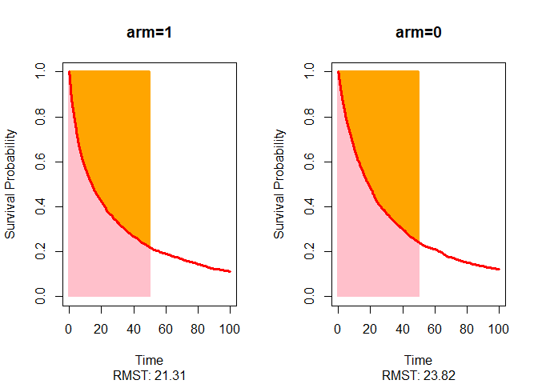
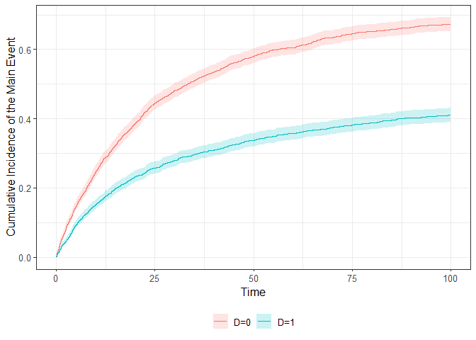
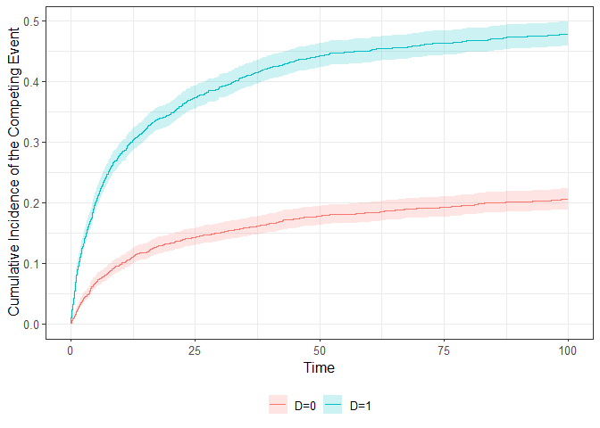
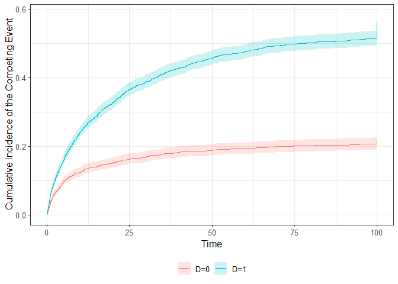

# The First Casualty of Statistics: Part Thirty Seven
<big>**Causal Survival Analysis IV: Competing Events**</big>

<br/>
Jiří Fejlek

2026-11-25
<br/>

<br/> We mentioned in the introduction to survival analysis that the
fundamental challenge with survival data is a ubiquitous missing-data
problem: we do not observe the time at which the outcome of interest
occurs for each individual. Up to this point, we have discussed
censoring, which refers to situations in which individuals leave the
study before experiencing the event or when the study is ended. The
crucial observation about censoring is that individuals will experience
the event after censoring; the event is not observed in the data.

*Competing events* are fundamentally different from censoring since they
*prevent* individuals from experiencing the event of interest in the
future. A typical example of a competing event in survival data is death
from causes unrelated to the cause of interest. What makes causal
inference for survival data with competing events more challenging is
that treatment influences both the risk of the primary event of interest
and the risk of competing events. This fact also implies that there is
no single treatment causal effect of interest. <br/>

## Table of Contents

- [Simulated Survival Dataset with Competing
  Events](#simulated-survival-dataset-with-competing-events)
- [Composite Event Effect](#composite-event-effect)
- [Total Effect](#total-effect)
- [Controlled Direct Effect](#controlled-direct-effect)
- [References](#references)

``` r
library(tidyr)
library(dplyr)
library(tibble)
library(ggplot2)
library(patchwork)
library(dagitty)
library(ggdag)
library(modelsummary)
library(GGally)
library(estimatr)
library(WeightIt)
library(MatchIt)
library(cobalt)
library(mgcv)
library(marginaleffects)
```

## Simulated Survival Dataset with Competing Events

Let us first simulate a survival dataset with competing events. First,
we will generate potential outcomes $`T_m(0)`$ and $`T_m(1)`$ for the
main event of the interest and $`T_c(0)`$ and $`T_c(1)`$ for the
competing event using the *simsurv* package. We will again assume an
administrative censoring $`T_\text{max} = 100.`$

``` r
library(simsurv)
options(width=2000)

set.seed(123)
n_sample <- 5000
maxt <- 100

# generate covariates
covariates <- data.frame(
  X1 = rbinom(n_sample, 1, 0.5),
  X2 = rnorm(n_sample, 0, 1),
  X3 = abs(rnorm(n_sample, 0, 1.5))
)

covariates$D <- 0

# generate T_m(0) 
sim_surv_data_control <- simsurv(
  dist = "exponential",
  x = covariates,
  lambdas = 0.025,
  betas = c(X1 = 1, X2 = 0.75, X3 = -0.5, D = -0.5),
  maxt = maxt
)

# generate T_comp(0) 
sim_compsurv_data_control <- simsurv(
  dist = "exponential",
  x = covariates,
  lambdas = 0.01,
  betas = c(X1 = 1.5, X2 = -1.5, X3 = -2, D = 1.5),
  maxt = maxt
)

covariates$D <- 1

# generate T_m(1)
sim_surv_data_treat <- simsurv(
  dist = "exponential",
  x = covariates,
  lambdas = 0.025,
  betas = c(X1 = 1, X2 = 0.75, X3 = -0.5, D = -0.5),
  maxt = maxt
)

# generate T_comp(1) 
sim_compsurv_data_treat <- simsurv(
  dist = "exponential",
  x = covariates,
  lambdas = 0.01,
  betas = c(X1 = 1.5, X2 = -1.5, X3 = -1.5, D = 1.5),
  maxt = maxt
)

sim_surv_data <- data.frame(T_m_0 = sim_surv_data_control$eventtime, 
                            T_m_1 = sim_surv_data_treat$eventtime,
                            T_c_0 = sim_compsurv_data_control$eventtime, 
                            T_c_1 = sim_compsurv_data_treat$eventtime)


sim_surv_data$T_0 <- pmin(sim_surv_data$T_m_0, sim_surv_data$T_c_0)
sim_surv_data$T_1 <- pmin(sim_surv_data$T_m_1, sim_surv_data$T_c_1)
sim_surv_data$status_0[sim_surv_data$T_m_0 <= sim_surv_data$T_c_0] <- 1
sim_surv_data$status_0[sim_surv_data$T_m_0 > sim_surv_data$T_c_0] <- 2
sim_surv_data$status_0[sim_surv_data$T_m_0 == maxt & sim_surv_data$T_c_0 == maxt] <- 0


sim_surv_data$status_1[sim_surv_data$T_m_1 <= sim_surv_data$T_c_1] <- 1
sim_surv_data$status_1[sim_surv_data$T_m_1 > sim_surv_data$T_c_1] <- 2
sim_surv_data$status_1[sim_surv_data$T_m_1 == maxt & sim_surv_data$T_c_1 == maxt] <- 0
head(sim_surv_data)
```

    ##         T_m_0      T_m_1 T_c_0      T_c_1         T_0       T_1 status_0 status_1
    ## 1 100.0000000 100.000000   100   4.753652 100.0000000  4.753652        0        2
    ## 2   0.2753701   7.191678   100  19.977353   0.2753701  7.191678        1        1
    ## 3   8.4416262 100.000000   100  23.849513   8.4416262 23.849513        1        2
    ## 4   5.2320590  25.003760   100 100.000000   5.2320590 25.003760        1        1
    ## 5   0.8494801   1.711563   100  55.878837   0.8494801  1.711563        1        1
    ## 6  68.3449276 100.000000   100  58.751348  68.3449276 58.751348        1        2

Next, we will generate the treatment assignment (we assume a completely
randomized experiment) and additional independent censoring.

``` r
options(width=2000)

# completely randomized treatment assignment
sim_surv_data$D <- rbinom(n_sample, 1, 0.5)
sim_surv_data$status <- ifelse(sim_surv_data$D == 0,sim_surv_data$status_0,sim_surv_data$status_1) 

# randomized censoring
cens_times <- pmin(rexp(n_sample, 0.005),maxt)
sim_surv_data$cens_times <- cens_times
sim_surv_data$T <- ifelse(sim_surv_data$D == 0,sim_surv_data$T_0,sim_surv_data$T_1)
sim_surv_data$C <- (sim_surv_data$T >= cens_times) + 0
sim_surv_data$T[sim_surv_data$C == 1] <- cens_times[sim_surv_data$C == 1]
sim_surv_data$status[sim_surv_data$C == 1] <- 0
head(sim_surv_data)
```

    ##         T_m_0      T_m_1 T_c_0      T_c_1         T_0       T_1 status_0 status_1 D status cens_times           T C
    ## 1 100.0000000 100.000000   100   4.753652 100.0000000  4.753652        0        2 0      0  100.00000 100.0000000 1
    ## 2   0.2753701   7.191678   100  19.977353   0.2753701  7.191678        1        1 0      1  100.00000   0.2753701 0
    ## 3   8.4416262 100.000000   100  23.849513   8.4416262 23.849513        1        2 0      1   12.55719   8.4416262 0
    ## 4   5.2320590  25.003760   100 100.000000   5.2320590 25.003760        1        1 0      1   56.87137   5.2320590 0
    ## 5   0.8494801   1.711563   100  55.878837   0.8494801  1.711563        1        1 0      1   73.84024   0.8494801 0
    ## 6  68.3449276 100.000000   100  58.751348  68.3449276 58.751348        1        2 1      2  100.00000  58.7513478 0

Overall, the observed dataset would look like this.

``` r
options(width=2000)

sim_surv_data_obs <- data.frame(
  id = seq(1,n_sample),
  D = sim_surv_data$D, 
  X1 = covariates$X1, 
  X2 = covariates$X2, 
  X3 = covariates$X3, 
  T = sim_surv_data$T, 
  main = (sim_surv_data$status == 1) + 0,
  comp = (sim_surv_data$status == 2) + 0,
  C = sim_surv_data$C)

sim_surv_data_obs
```

    ##        id D X1            X2          X3            T main comp C
    ## 1       1 0  0 -6.788076e-01 0.525003782 1.000000e+02    0    0 1
    ## 2       2 0  1  5.743127e-01 1.221662564 2.753701e-01    1    0 0
    ## 3       3 0  0 -7.045145e-01 0.774999190 8.441626e+00    1    0 0
    ## 4       4 0  1 -5.339841e-01 4.038396604 5.232059e+00    1    0 0
    ## 5       5 0  1  7.743846e-01 1.645431961 8.494801e-01    1    0 0
    ## 6       6 1  0 -4.756214e-01 1.883212613 5.875135e+01    0    1 0
    ## 7       7 1  1 -2.442738e-02 0.955816167 8.905463e+00    1    0 0
    ## 8       8 1  1  1.019008e+00 0.586374228 2.906470e+00    0    0 1
    ## 9       9 1  1 -1.205580e+00 1.491632958 2.518981e+01    0    1 0
    ## 10     10 0  0  1.595294e+00 2.134529495 4.180389e+01    1    0 0
    ## 11     11 1  1  2.041955e+00 0.916514006 1.680570e+00    1    0 0
    ## 12     12 1  0  6.144813e-01 1.108225116 8.916515e+01    1    0 0
    ## 13     13 1  1  4.219312e-01 2.143607461 1.734808e+01    1    0 0
    ## 14     14 0  1 -4.964217e-01 2.237377044 7.321886e+01    1    0 0
    ## 15     15 1  0  4.909614e-01 2.318592614 9.028280e+01    0    0 1
    ## 16     16 0  1 -5.019822e-01 1.559334377 3.351174e+01    0    0 1
    ## 17     17 1  0  2.881698e-01 0.051221041 1.271321e+01    0    1 0
    ## 18     18 0  0 -6.866260e-01 0.873738679 9.477088e+01    0    0 1
    ## 19     19 1  0  7.884038e-01 1.082051616 3.253524e+01    0    1 0
    ## 20     20 0  1  6.913688e-01 3.877343272 5.221483e+01    1    0 0
    ## 21     21 0  1  1.242999e+00 0.406843760 5.051964e+00    1    0 0
    ## 22     22 1  1  1.982210e+00 0.212989427 3.257369e+00    1    0 0
    ## 23     23 1  1 -6.464418e-01 1.655875967 1.179606e+01    0    1 0
    ## 24     24 1  1  9.661893e-01 0.714143488 7.802308e+00    1    0 0
    ## 25     25 1  1 -1.427267e+00 1.513574261 1.097496e+01    0    1 0
    ## 26     26 0  1 -4.574838e-01 0.378683678 2.902198e+01    1    0 0
    ## 27     27 0  1  9.454667e-01 1.111575024 1.567715e+00    1    0 0
    ## 28     28 0  1 -7.383892e-01 2.693961221 1.230294e+01    1    0 0
    ## 29     29 1  0  3.456407e-01 1.487569098 2.226186e+01    0    1 0
    ## 30     30 0  0 -9.004447e-01 1.174481608 4.610281e+01    1    0 0
    ## 31     31 1  1 -3.703507e-01 1.970327794 1.744413e+01    1    0 0
    ## 32     32 1  1 -4.079693e-02 0.083642395 2.206337e+00    0    1 0
    ## 33     33 0  1 -6.123188e-01 1.627255074 6.245945e+00    0    0 1
    ## 34     34 1  1 -1.945852e+00 0.212962028 2.518507e-01    0    1 0
    ## 35     35 0  0  2.430963e-01 1.132115003 1.000000e+02    0    0 1
    ## 36     36 1  0  4.749001e-01 1.322352723 8.319025e+00    0    1 0
    ## 37     37 0  1  1.367146e-01 1.994486852 1.776687e+00    1    0 0
    ## 38     38 0  0 -4.887477e-01 0.099545852 3.108197e+01    0    1 0
    ## 39     39 0  0  9.002037e-01 2.367897107 1.000000e+02    0    0 1
    ## 40     40 1  0  1.077536e+00 1.182619997 4.783811e+00    0    0 1
    ## 41     41 1  0 -2.373671e+00 4.019155519 5.538780e+01    0    0 1
    ## 42     42 0  0  1.124575e+00 0.343220289 4.933599e+00    1    0 0
    ## 43     43 1  0 -1.779548e+00 0.053215814 1.812376e+00    0    1 0
    ## 44     44 1  0 -3.445504e-01 1.956048780 4.478145e+01    0    1 0
    ## 45     45 0  0 -1.109173e+00 0.206829511 8.288955e+00    0    1 0
    ## 46     46 0  0 -6.301058e-01 1.854145177 1.000000e+02    0    0 1
    ## 47     47 1  0  1.316884e+00 1.253146430 1.000000e+02    0    0 1
    ## 48     48 1  0  5.345134e-01 2.098897160 1.000000e+02    0    0 1
    ## 49     49 0  0  4.938981e-01 4.587184120 7.857024e+01    0    0 1
    ## 50     50 0  1 -2.077992e+00 0.479757137 8.387873e-01    0    1 0
    ## 51     51 0  0  1.963253e-01 0.685283457 5.713853e+00    0    1 0
    ## 52     52 0  0  6.288032e-01 0.933235394 5.429176e+01    1    0 0
    ## 53     53 0  1  8.609471e-01 0.195920333 5.405182e+00    1    0 0
    ## 54     54 1  0 -9.732474e-01 0.724050266 1.044756e+00    0    1 0
    ## 55     55 1  1  9.375431e-01 0.800902005 4.747318e+00    0    1 0
    ## 56     56 0  0 -1.395206e+00 2.081058019 1.000000e+02    0    0 1
    ## 57     57 0  0  1.738743e+00 2.398835873 4.876483e+01    1    0 0
    ## 58     58 1  1 -7.986343e-01 1.358069613 4.605711e+00    0    1 0
    ## 59     59 1  1  7.650244e-01 1.902871970 9.917986e+00    0    1 0
    ## 60     60 0  0  3.179113e-01 0.470431649 3.233442e+01    1    0 0
    ## 61     61 1  1 -1.063601e+00 0.989084238 9.155933e-01    0    1 0
    ## 62     62 0  0  1.144259e+00 0.845078856 2.794884e+01    0    0 1
    ## 63     63 1  0  3.337684e-02 0.067300898 1.806474e+01    0    1 0
    ## 64     64 1  0  8.184078e-01 0.175621405 4.008936e+01    1    0 0
    ## 65     65 1  1  2.181921e-01 2.445845543 5.416472e+01    0    0 1
    ## 66     66 1  0  8.684973e-01 1.177487800 6.136634e+01    1    0 0
    ## 67     67 1  1  2.168052e-02 1.150461412 3.764179e+00    0    1 0
    ## 68     68 1  1  1.115229e+00 0.890131875 1.365631e+01    1    0 0
    ## 69     69 0  1 -3.521809e-01 0.414726915 2.713653e+00    1    0 0
    ## 70     70 0  0  5.272883e-01 0.074687295 9.657782e+01    0    1 0
    ## 71     71 0  1  3.785715e-01 0.468244285 1.003643e+00    0    1 0
    ## 72     72 1  1  8.438598e-01 0.160486013 6.624143e+00    1    0 0
    ## 73     73 0  1 -6.210425e-01 0.722133274 2.070969e+01    1    0 0
    ## 74     74 1  0  1.776915e-01 0.019064803 2.813558e+01    1    0 0
    ## 75     75 0  0 -5.801651e-01 0.379701783 1.346261e+01    1    0 0
    ## 76     76 0  0  9.086378e-01 0.627074750 1.327706e+01    1    0 0
    ## 77     77 0  0 -6.366864e-01 2.012426092 4.746035e+01    1    0 0
    ## 78     78 1  1  1.732239e+00 0.331309619 4.227573e+01    1    0 0
    ## 79     79 1  0  7.903716e-01 2.702390036 4.204116e+01    1    0 0
    ## 80     80 1  0 -1.370798e-02 0.852327540 4.665728e+01    1    0 0
    ## 81     81 1  0  1.206196e+00 0.078001852 4.606123e+01    0    0 1
    ## 82     82 1  1 -8.459094e-02 1.493589431 1.992325e+01    0    0 1
    ## 83     83 0  0  5.632623e-01 1.829880910 8.738023e+01    1    0 0
    ## 84     84 1  1  5.281944e-01 1.978842708 1.268458e+01    0    1 0
    ## 85     85 0  0  4.230384e-01 1.755281283 2.882195e+01    1    0 0
    ## 86     86 1  0 -5.967642e-01 0.942454904 1.000000e+02    0    0 1
    ## 87     87 1  1 -1.250844e+00 1.657333716 4.391918e+00    0    1 0
    ## 88     88 0  1 -1.681601e+00 2.216587108 1.000000e+02    0    0 1
    ## 89     89 1  1 -4.562964e-01 1.511932123 2.765827e+00    0    1 0
    ## 90     90 0  0  6.827932e-01 2.624292492 9.706863e+01    0    0 1
    ## 91     91 1  0 -2.390375e-01 1.814425162 1.000000e+02    0    0 1
    ## 92     92 1  1 -1.203351e+00 1.562565602 1.735982e+00    0    1 0
    ## 93     93 0  0  2.156478e+00 0.147242424 8.983079e+00    1    0 0
    ## 94     94 0  1  7.020094e-01 2.868924970 6.605730e+00    1    0 0
    ## 95     95 1  0  1.946618e+00 1.268090395 9.713259e+00    1    0 0
    ## 96     96 1  0  1.213036e+00 1.108111111 4.014651e+00    0    0 1
    ## 97     97 1  1 -6.113791e-01 1.150754166 1.672670e+01    0    0 1
    ## 98     98 1  0 -4.119212e-01 2.211833313 7.490450e+01    1    0 0
    ## 99     99 1  0 -1.440681e+00 0.019022737 7.504218e-01    0    0 1
    ## 100   100 1  1  7.404735e-01 2.796078360 2.177894e+01    0    1 0
    ## 101   101 0  1  1.623659e+00 1.327947193 2.782506e+00    1    0 0
    ## 102   102 0  0 -9.204849e-01 0.738645397 4.436291e+01    0    1 0
    ## 103   103 1  0 -1.202198e+00 2.620611013 4.792588e+01    0    1 0
    ## 104   104 1  1  8.826781e-01 0.392998928 2.748266e+00    1    0 0
    ## 105   105 0  0 -1.516479e+00 0.749631868 7.219743e+01    1    0 0
    ## 106   106 1  1  1.921612e+00 1.033348153 2.673384e+00    1    0 0
    ## 107   107 1  1  5.721358e-01 1.473869953 9.008601e+01    1    0 0
    ## 108   108 1  1 -1.714895e+00 1.471050744 6.212116e+00    0    1 0
    ## 109   109 0  0  3.549189e-01 1.384974719 1.013312e+01    0    0 1
    ## 110   110 1  0  1.051819e-01 0.496030928 1.000000e+02    0    0 1
    ## 111   111 0  1 -2.468414e+00 0.684993791 1.223383e+00    0    1 0
    ## 112   112 1  0 -4.185803e-02 0.475412760 1.162950e+01    0    0 1
    ## 113   113 1  0 -5.872608e-01 0.613720390 2.085635e+01    1    0 0
    ## 114   114 0  1 -8.872970e-01 0.284012696 6.796296e+00    0    1 0
    ## 115   115 0  1  2.387168e-01 1.979114081 2.061133e+01    1    0 0
    ## 116   116 0  0  8.508903e-01 3.001815014 1.000000e+02    0    0 1
    ## 117   117 1  1  1.727009e+00 1.977228075 1.048331e+01    1    0 0
    ## 118   118 1  1 -2.632508e+00 1.869823434 3.745237e-01    0    1 0
    ## 119   119 0  1  7.436113e-01 1.679674370 3.178661e+01    1    0 0
    ## 120   120 0  0 -9.523511e-01 0.900169646 4.564624e+01    0    1 0
    ## 121   121 1  1  1.156330e+00 1.197332639 8.546243e+00    1    0 0
    ## 122   122 1  0  3.458617e-01 0.275821181 8.724645e+00    0    0 1
    ## 123   123 0  0  1.444957e+00 0.485704459 1.206309e+01    1    0 0
    ## 124   124 1  0 -1.482761e+00 0.975741637 1.602547e+01    0    1 0
    ## 125   125 1  0  4.946313e-01 2.374469314 3.150017e+01    1    0 0
    ## 126   126 1  1  2.951593e-01 0.002929685 3.774473e+00    0    1 0
    ## 127   127 1  0  1.047862e+00 0.463232681 3.083171e+00    1    0 0
    ## 128   128 0  0 -2.311685e-01 0.934684027 1.000000e+02    0    0 1
    ## 129   129 0  0  1.144017e+00 1.407233838 3.123935e+01    1    0 0
    ## 130   130 1  1 -4.449609e-01 0.154018589 5.092408e-01    0    1 0
    ## 131   131 1  1 -4.292374e-01 1.631970113 3.291372e+01    0    1 0
    ## 132   132 1  1  2.537930e-02 2.026799993 2.999101e+01    0    1 0
    ## 133   133 0  1 -1.069252e+00 0.683671550 1.521878e+01    1    0 0
    ## 134   134 1  1 -4.565716e-01 0.376253437 8.482664e+00    0    1 0
    ## 135   135 1  1  1.110004e+00 0.758020656 5.067939e+00    1    0 0
    ## 136   136 1  1  1.651829e+00 0.981033430 2.549150e+00    1    0 0
    ## 137   137 0  1  1.114255e+00 0.323043466 4.163097e+01    1    0 0
    ## 138   138 0  1 -4.248652e-01 0.340113492 8.135454e-01    1    0 0
    ## 139   139 0  1  3.184799e-01 1.736008661 1.469995e+00    0    0 1
    ## 140   140 0  0  9.848965e-02 3.049200418 7.013060e+01    0    0 1
    ## 141   141 0  0 -1.259027e+00 0.387930822 7.846157e+01    0    1 0
    ## 142   142 0  0  2.574082e-01 0.147270185 2.717574e+01    1    0 0
    ## 143   143 1  0 -8.242933e-01 0.529741881 4.927489e+00    0    1 0
    ## 144   144 1  0 -1.060624e+00 1.489658152 2.699497e+01    0    1 0
    ## 145   145 1  1  7.255055e-01 1.303384724 9.937070e+00    1    0 0
    ## 146   146 0  0 -7.079319e-01 2.724576389 6.090423e+01    1    0 0
    ## 147   147 0  0 -1.440488e-01 0.478271673 1.814857e+00    1    0 0
    ## 148   148 0  0 -9.737156e-01 0.187261206 4.148421e+01    0    1 0
    ## 149   149 1  0  5.594443e-02 2.203487934 3.368952e+01    0    0 1
    ## 150   150 0  1  4.923466e-01 1.602762903 5.436822e+00    1    0 0
    ## 151   151 1  1  5.025453e-01 0.723269742 9.245733e+00    0    1 0
    ## 152   152 1  0 -1.075258e+00 0.989423178 2.957747e+01    0    0 1
    ## 153   153 1  0  1.258042e+00 2.726453682 1.000000e+02    0    0 1
    ## 154   154 0  0  1.492972e+00 0.417874682 1.306437e+00    1    0 0
    ## 155   155 0  0  3.729104e-01 0.101602882 2.531780e+01    1    0 0
    ## 156   156 0  0  1.574795e-01 2.026036155 4.195272e+01    0    0 1
    ## 157   157 1  1  7.734290e-02 1.379211544 1.894281e+01    1    0 0
    ## 158   158 1  0  2.575459e-01 0.408791617 4.181425e+01    1    0 0
    ## 159   159 0  0  3.764236e-01 0.141924292 3.756715e+01    1    0 0
    ## 160   160 1  0  1.368236e-01 0.267455650 1.777282e+01    1    0 0
    ## 161   161 1  1  6.538232e-01 0.080865672 1.487782e+00    0    1 0
    ## 162   162 1  0 -3.357685e-01 1.005429365 4.171798e+01    0    0 1
    ## 163   163 0  1  1.129345e+00 0.273207499 2.197485e+01    1    0 0
    ## 164   164 0  0 -3.768281e-02 2.307916979 6.768450e+01    1    0 0
    ## 165   165 0  0 -1.755694e+00 0.624828843 2.260338e+00    0    1 0
    ## 166   166 0  1 -9.972037e-02 1.311475749 2.307726e+01    1    0 0
    ## 167   167 1  1  4.470205e-01 0.211475460 1.142468e+01    0    1 0
    ## 168   168 1  0  1.230032e+00 3.242680900 2.980647e+01    1    0 0
    ## 169   169 1  0  6.021043e-02 0.041428852 3.103381e+01    1    0 0
    ## 170   170 0  0 -1.940069e+00 0.192514295 2.272430e+00    0    1 0
    ## 171   171 0  1  4.831766e-03 0.528903382 2.217525e-01    0    1 0
    ## 172   172 1  0 -1.199212e+00 3.130316984 1.000000e+02    0    0 1
    ## 173   173 1  1 -9.761057e-01 2.960798268 9.899718e+00    0    0 1
    ## 174   174 1  1 -1.025627e+00 0.204055021 7.009752e-01    0    1 0
    ## 175   175 1  1 -7.992269e-01 0.138288989 4.862424e+00    0    1 0
    ## 176   176 1  1  1.137129e+00 1.035395345 4.987782e+00    1    0 0
    ## 177   177 0  0 -8.315289e-01 0.923522449 8.178211e+01    0    1 0
    ## 178   178 0  1 -4.390628e-01 2.042738929 3.989426e+01    1    0 0
    ## 179   179 0  1  1.841735e-01 2.569704333 5.343253e+01    1    0 0
    ## 180   180 0  1  8.903796e-01 3.269326153 2.145466e+01    1    0 0
    ## 181   181 0  1 -6.667050e-01 1.214771702 2.561663e+01    1    0 0
    ## 182   182 1  0 -8.262239e-01 1.419969974 1.000000e+02    0    0 1
    ## 183   183 1  1 -5.186157e-01 1.039352066 4.526931e+00    0    1 0
    ## 184   184 0  0 -1.171719e+00 1.691785324 1.000000e+02    0    0 1
    ## 185   185 0  1  9.200333e-01 0.221095870 1.337675e+01    1    0 0
    ## 186   186 1  0 -2.181958e+00 0.431929059 9.790610e-01    0    1 0
    ## 187   187 1  0 -5.276921e-01 1.528991793 2.294964e+01    0    0 1
    ## 188   188 0  1 -1.441140e+00 1.014925701 2.211827e+01    0    1 0
    ## 189   189 0  1 -1.956785e+00 1.339239311 6.985421e-03    0    1 0
    ## 190   190 1  1  2.865820e-02 1.202528895 2.566066e+01    0    1 0
    ## 191   191 1  0  1.538236e+00 0.880767104 2.665685e+01    1    0 0
    ## 192   192 0  0  1.634640e+00 1.049122879 1.867741e+01    1    0 0
    ## 193   193 0  1 -5.627762e-01 1.324181380 3.063139e+00    0    0 1
    ## 194   194 1  1 -6.969557e-01 0.089832430 2.037680e-01    0    1 0
    ## 195   195 0  1 -5.382263e-01 0.807212597 6.934113e+00    1    0 0
    ## 196   196 0  0  7.101102e-01 3.564065780 4.709861e+01    0    0 1
    ## 197   197 0  0 -2.561697e+00 1.491161852 4.873982e+01    0    1 0
    ## 198   198 0  1  2.477005e-01 1.990784471 5.680286e+00    0    0 1
    ## 199   199 0  0 -4.055404e-01 0.935639472 3.570158e+01    1    0 0
    ## 200   200 1  1 -7.439385e-01 0.023123387 1.745514e-01    0    1 0
    ## 201   201 1  0 -2.006120e+00 1.771831485 4.967950e+00    0    1 0
    ## 202   202 1  1 -2.058264e-01 4.268197630 4.295480e+01    1    0 0
    ## 203   203 1  1 -1.649057e+00 2.487862073 4.301720e+00    0    1 0
    ## 204   204 1  1 -1.530787e-02 1.147037316 3.213281e+01    0    1 0
    ## 205   205 0  0 -8.949017e-01 1.688879358 1.000000e+02    0    0 1
    ## 206   206 0  1  4.631972e-02 2.330803913 2.260257e+00    1    0 0
    ## 207   207 0  0  4.610041e-01 0.660301849 1.870506e+01    1    0 0
    ## 208   208 0  0 -5.037388e-01 2.349858716 1.000000e+02    0    0 1
    ## 209   209 1  0 -1.022398e+00 0.679726743 4.442876e+00    0    1 0
    ## 210   210 0  0 -6.117422e-01 3.265068253 1.000000e+02    0    0 1
    ## 211   211 1  0 -6.673935e-01 0.297469094 1.651922e+01    0    1 0
    ## 212   212 0  0 -1.493276e+00 0.721811508 8.146083e+01    0    0 1
    ## 213   213 1  0 -7.806182e-01 1.089798639 1.563532e+01    0    1 0
    ## 214   214 0  1 -1.934051e-01 1.193847043 7.467506e+00    0    0 1
    ## 215   215 0  0 -2.208333e-01 1.440627517 9.382091e+00    1    0 0
    ## 216   216 0  1  3.295417e-01 0.796927416 1.215225e+01    1    0 0
    ## 217   217 1  0  1.291876e+00 0.535033643 5.582491e+01    1    0 0
    ## 218   218 0  0  3.336710e-01 1.608327890 3.677623e+01    0    0 1
    ## 219   219 1  1  1.475787e+00 0.113621994 5.745922e-01    1    0 0
    ## 220   220 1  1 -6.479260e-01 1.199386812 1.481506e+01    0    1 0
    ## 221   221 0  0  1.350668e+00 0.822106324 2.642370e+01    1    0 0
    ## 222   222 1  1  5.934089e-01 0.085218640 4.148369e+00    1    0 0
    ## 223   223 0  1 -1.191709e+00 0.262108493 3.995574e+00    0    1 0
    ## 224   224 1  1  4.021710e-01 2.416664266 4.796849e+01    1    0 0
    ## 225   225 1  0 -1.237693e+00 0.248701870 6.061515e+00    0    1 0
    ## 226   226 0  0  9.472307e-01 1.807385610 2.915447e+01    1    0 0
    ## 227   227 1  0 -5.397461e-01 0.381262198 3.695443e+01    0    1 0
    ## 228   228 0  1 -2.361102e-01 0.759226902 1.570145e+01    1    0 0
    ## 229   229 0  1 -6.795365e-01 0.940453533 2.201262e+01    0    0 1
    ## 230   230 0  1 -8.521783e-01 1.334152992 3.527479e+01    0    0 1
    ## 231   231 0  1  1.702140e+00 1.805778763 1.257334e+01    1    0 0
    ## 232   232 1  0  9.918045e-01 2.665811405 1.000000e+02    0    0 1
    ## 233   233 0  1  6.752131e-01 2.877688857 9.790038e+00    1    0 0
    ## 234   234 1  0  7.361996e-02 1.664801762 3.728033e+01    0    1 0
    ## 235   235 0  0  7.363338e-01 0.487262487 7.534034e-01    1    0 0
    ## 236   236 0  0  6.617128e-01 0.109079382 9.621824e+00    1    0 0
    ## 237   237 1  0  1.603521e+00 0.943648890 1.517509e+01    1    0 0
    ## 238   238 1  1  8.500398e-01 2.030018259 1.844595e+01    1    0 0
    ## 239   239 1  0 -2.061890e-01 0.140869642 1.669606e+00    0    1 0
    ## 240   240 1  1 -2.148929e-01 1.926484384 2.269241e+01    0    1 0
    ## 241   241 0  1 -4.680726e-01 0.746889894 7.807740e+00    0    1 0
    ## 242   242 0  1 -3.637386e-01 0.633825384 5.186229e+01    1    0 0
    ## 243   243 0  0 -2.366839e-01 1.545284291 4.937868e+01    1    0 0
    ## 244   244 0  1  1.222881e+00 1.651642436 2.512649e+00    1    0 0
    ## 245   245 1  0 -2.328360e+00 1.365046575 9.141819e+00    0    1 0
    ## 246   246 0  1 -7.018458e-01 0.413169286 6.792015e+00    1    0 0
    ## 247   247 0  0 -1.328807e-01 2.633978158 4.107616e+01    0    0 1
    ## 248   248 0  1 -1.283258e+00 2.342796504 4.280342e+01    1    0 0
    ## 249   249 1  1  1.619101e+00 1.027923620 1.003752e+01    1    0 0
    ## 250   250 1  1 -2.339483e-01 3.429614127 8.647600e+01    0    0 1
    ## 251   251 1  0 -1.116918e+00 1.112505768 4.542762e+01    0    1 0
    ## 252   252 0  0 -8.916138e-01 0.030100769 7.731891e+00    1    0 0
    ## 253   253 1  1  8.723952e-01 2.871209909 5.714106e+00    1    0 0
    ## 254   254 1  0  1.869009e+00 0.015979887 3.062566e+01    1    0 0
    ## 255   255 1  1 -1.242685e-01 3.215431143 1.993459e+01    0    0 1
    ## 256   256 0  1  1.070288e-01 1.236540647 1.683697e+00    1    0 0
    ## 257   257 1  0 -9.485351e-01 1.641577094 6.784625e+00    0    0 1
    ## 258   258 1  0  1.316645e+00 0.615350858 3.652377e+01    1    0 0
    ## 259   259 1  0  7.226569e-01 0.442487587 4.134073e+00    1    0 0
    ## 260   260 0  1 -2.329253e+00 0.605912454 1.420081e+00    0    1 0
    ## 261   261 0  1 -6.452325e-01 0.383163469 6.177786e+00    1    0 0
    ## 262   262 1  1 -2.341175e-01 0.021524443 1.834155e+00    1    0 0
    ## 263   263 0  1 -1.108161e+00 0.082881272 4.410928e-01    0    1 0
    ## 264   264 0  1 -2.732242e-01 2.974687563 5.391408e+01    1    0 0
    ## 265   265 1  1 -1.133441e+00 1.647909248 8.571748e-01    0    1 0
    ## 266   266 0  1  3.593080e-01 3.071383270 1.263199e+01    0    0 1
    ## 267   267 1  0  3.356448e-01 0.606423692 6.266082e+01    1    0 0
    ## 268   268 1  0  8.109844e-01 0.617518956 9.336936e+01    1    0 0
    ## 269   269 0  0  4.164561e-01 0.465402129 2.658215e-01    1    0 0
    ## 270   270 1  1  1.594114e+00 1.081925672 3.968202e+00    1    0 0
    ## 271   271 1  1 -3.861379e-01 2.675257053 3.295429e+01    0    0 1
    ## 272   272 1  0 -2.153303e+00 0.634038965 1.083052e+00    0    1 0
    ## 273   273 1  0  2.565921e-02 0.476917050 1.128658e+01    0    1 0
    ## 274   274 1  0  6.498488e-01 0.462378950 3.057629e+01    0    0 1
    ## 275   275 1  1 -4.012356e-01 0.503735880 7.550616e-01    0    1 0
    ## 276   276 1  1  1.400876e+00 0.285887988 1.884610e+01    1    0 0
    ## 277   277 0  1  1.094769e+00 1.454058038 1.512838e+01    1    0 0
    ## 278   278 0  0  5.374933e-01 0.213869258 1.177047e+01    1    0 0
    ## 279   279 0  0  6.977476e-02 0.629848827 2.669634e+00    0    0 1
    ## 280   280 0  1 -5.515006e-01 1.524434954 1.000000e+02    0    0 1
    ## 281   281 1  1 -1.769434e-01 0.017444552 1.073477e+01    0    1 0
    ## 282   282 0  0  4.691778e-01 0.721959810 1.482132e+01    1    0 0
    ## 283   283 1  0  9.677968e-01 0.237034769 8.455229e+00    1    0 0
    ## 284   284 1  0 -2.961147e-01 0.379802741 1.675975e+01    0    1 0
    ## 285   285 0  0 -7.282533e-01 0.353269446 2.712930e+01    0    1 0
    ## 286   286 0  0  2.475606e+00 1.482188612 2.132563e+01    1    0 0
    ## 287   287 1  0  5.185572e-01 1.087593377 8.506639e+01    0    1 0
    ## 288   288 0  0 -9.036032e-01 0.039506933 2.361432e+00    1    0 0
    ## 289   289 0  0  9.309791e-01 1.362712050 1.000000e+02    0    0 1
    ## 290   290 0  1  6.168650e-02 0.077900268 5.350202e+00    1    0 0
    ## 291   291 0  0  8.267892e-01 1.902594895 1.207607e+01    1    0 0
    ## 292   292 0  0  5.179695e-02 1.645716938 9.651867e+01    1    0 0
    ## 293   293 1  0 -5.842905e-02 0.554754154 4.680430e+01    1    0 0
    ## 294   294 0  1  9.061162e-02 2.231890153 1.045207e+01    1    0 0
    ## 295   295 1  1  4.127808e-01 1.636915117 1.404320e+01    1    0 0
    ## 296   296 1  1 -6.100857e-01 0.688758300 2.363266e+00    0    1 0
    ## 297   297 1  1 -6.553632e-01 0.697514345 3.490184e+00    0    1 0
    ## 298   298 0  0 -1.847792e-01 0.176209481 5.614545e+00    1    0 0
    ## 299   299 0  0  1.713014e-01 1.786578551 1.000000e+02    0    0 1
    ## 300   300 1  1 -3.173765e-01 0.299342713 1.174044e+00    0    1 0
    ## 301   301 1  1  3.169846e-01 1.744894622 7.580535e+00    0    0 1
    ## 302   302 0  0 -1.101735e+00 0.251843840 2.816933e+00    0    1 0
    ## 303   303 1  1 -1.430958e+00 0.242283019 8.610091e-02    0    1 0
    ## 304   304 1  1  1.892011e+00 0.651366997 3.906339e+00    1    0 0
    ## 305   305 1  1  3.978771e-01 1.987128572 6.350070e+01    1    0 0
    ## 306   306 0  0 -3.970281e-01 0.790144442 1.479123e+01    1    0 0
    ## 307   307 0  0 -2.799578e-01 1.275521767 2.208428e+01    1    0 0
    ## 308   308 1  0  7.851185e-01 0.432717153 3.420892e+01    1    0 0
    ## 309   309 1  0 -2.103208e-01 1.661385188 3.540920e+01    1    0 0
    ## 310   310 1  0  1.921150e-01 0.390660426 1.446689e+01    1    0 0
    ## 311   311 1  0 -2.647256e-01 0.060339088 6.958416e+00    0    1 0
    ## 312   312 0  0 -5.013911e-01 0.520885743 4.678224e+01    0    1 0
    ## 313   313 0  1  6.021898e-01 1.928576987 6.162093e+00    1    0 0
    ## 314   314 1  0  1.414946e-01 0.178112467 7.101162e+01    0    1 0
    ## 315   315 1  0  1.301813e+00 3.944267690 5.098000e+00    1    0 0
    ## 316   316 1  1 -1.125397e+00 2.965868697 7.681141e+01    0    1 0
    ## 317   317 0  1 -1.353074e-01 0.068885666 8.364520e+00    1    0 0
    ## 318   318 0  0 -2.089889e-01 1.335774227 8.301935e+01    0    1 0
    ## 319   319 1  0 -1.074862e+00 0.386597752 2.985767e+01    0    1 0
    ## 320   320 0  1  9.978587e-01 3.100267020 5.679713e+01    1    0 0
    ## 321   321 1  1 -1.073997e-01 0.016698913 2.812769e+00    1    0 0
    ## 322   322 1  0 -1.385558e+00 1.551436055 8.049914e+00    0    1 0
    ## 323   323 0  0 -5.921406e-01 0.659581997 1.571213e+01    0    1 0
    ## 324   324 0  1 -1.105334e+00 0.339039711 8.050082e-01    0    1 0
    ## 325   325 1  0  1.039089e+00 0.159651390 4.018118e+01    0    0 1
    ## 326   326 1  0  2.542904e+00 0.242137887 6.735989e+00    1    0 0
    ## 327   327 0  1 -6.737158e-01 2.233148862 2.717612e+01    0    0 1
    ## 328   328 0  0 -9.223001e-02 1.029039725 7.735861e+00    1    0 0
    ## 329   329 0  0  2.797350e-01 0.693530100 1.741798e+01    1    0 0
    ## 330   330 1  1  2.708959e+00 0.016343295 6.436046e-01    1    0 0
    ## 331   331 1  1 -2.329003e+00 1.729579550 3.960510e-01    0    1 0
    ## 332   332 1  0 -5.139557e-01 0.312197660 4.566736e-02    0    1 0
    ## 333   333 1  1 -1.202795e+00 0.423467424 1.980618e+00    0    1 0
    ## 334   334 1  1 -2.276248e-01 1.801214167 3.608520e+01    0    0 1
    ## 335   335 0  0 -2.758992e-01 1.871111417 7.637439e+01    1    0 0
    ## 336   336 0  0 -7.298088e-01 0.103936502 1.315460e+01    0    1 0
    ## 337   337 0  1  1.834156e+00 1.019875575 1.547160e+00    1    0 0
    ## 338   338 0  1  2.570653e-01 1.081813813 9.002526e+00    1    0 0
    ## 339   339 1  1  2.393585e+00 0.846487997 1.502416e+00    1    0 0
    ## 340   340 1  1  8.236166e-01 0.117931501 7.391874e+00    1    0 0
    ## 341   341 0  0 -1.265312e+00 0.663286389 6.248295e+01    0    1 0
    ## 342   342 0  0 -7.534912e-01 1.155906607 1.846247e+01    1    0 0
    ## 343   343 1  1  2.730384e-01 1.381645832 4.952451e+01    0    1 0
    ## 344   344 0  0 -5.778989e-01 0.458042035 3.154845e+00    1    0 0
    ## 345   345 0  0  3.542897e-01 3.383535413 2.297202e+01    0    0 1
    ## 346   346 0  0  7.325726e-01 0.475241533 6.150607e+01    1    0 0
    ## 347   347 1  1  4.211223e-01 2.956944774 2.178035e+01    1    0 0
    ## 348   348 0  0 -1.346128e-01 1.757898109 7.199591e+01    1    0 0
    ## 349   349 0  0 -6.435389e-01 0.014707564 1.398236e+01    0    1 0
    ## 350   350 0  1 -1.289321e+00 2.408121438 2.141851e+00    0    0 1
    ## 351   351 0  0  3.408949e-01 1.449591148 1.000000e+02    0    0 1
    ## 352   352 1  1  9.223357e-01 3.958446753 8.171423e+01    0    0 1
    ## 353   353 1  1 -7.966941e-02 2.124493372 7.093844e+01    1    0 0
    ## 354   354 1  0  7.536177e-01 0.304604635 2.359906e+01    1    0 0
    ## 355   355 0  1  2.227530e+00 1.673677673 2.414937e+00    1    0 0
    ## 356   356 0  1  1.933821e+00 0.117662370 3.081246e+00    1    0 0
    ## 357   357 0  1 -4.949055e-01 2.980980843 4.301135e+01    0    0 1
    ## 358   358 0  0  5.467118e-01 0.893735620 2.221023e+01    0    0 1
    ## 359   359 1  0 -7.022106e-01 0.255074469 8.821320e+00    0    1 0
    ## 360   360 1  1  6.898134e-01 1.548039014 9.990690e-01    1    0 0
    ## 361   361 1  0 -5.836314e-02 0.135981958 1.975374e+01    1    0 0
    ## 362   362 0  0  2.775876e-01 1.356472105 1.000000e+02    0    0 1
    ## 363   363 0  1 -8.590146e-01 2.607296818 1.000000e+02    0    0 1
    ## 364   364 1  0  1.205378e+00 0.484370447 3.529862e+01    0    1 0
    ## 365   365 1  0 -8.417997e-02 0.896619118 6.880099e+01    1    0 0
    ## 366   366 1  1 -4.459200e-01 1.687386154 3.228254e+01    0    1 0
    ## 367   367 0  0 -7.662137e-02 2.596992149 3.616272e+01    0    0 1
    ## 368   368 1  0  7.639838e-02 1.582625766 1.000000e+02    0    0 1
    ## 369   369 0  0  1.636864e+00 1.066876156 3.810681e+00    1    0 0
    ## 370   370 0  0 -1.110724e+00 0.286602479 1.671407e+01    0    1 0
    ## 371   371 1  0  2.458991e+00 2.006777325 7.775295e+01    0    0 1
    ## 372   372 0  0 -7.733124e-01 0.930613467 5.608373e+01    1    0 0
    ## 373   373 1  1  1.746434e-01 1.451794933 4.841801e+00    0    1 0
    ## 374   374 1  0 -2.058141e+00 0.521322716 2.680904e+00    0    1 0
    ## 375   375 1  1 -6.544605e-01 0.996907003 1.998970e+00    0    1 0
    ## 376   376 0  1  7.317734e-01 0.887828755 2.904680e-01    1    0 0
    ## 377   377 1  1  5.052331e-01 0.344531018 2.581197e+00    1    0 0
    ## 378   378 0  0  4.105722e-01 0.274900453 8.979397e+01    1    0 0
    ## 379   379 1  0 -4.667653e-01 0.652219065 1.476186e+00    0    1 0
    ## 380   380 1  1 -1.843572e+00 3.653118655 7.962650e+01    1    0 0
    ## 381   381 0  1 -1.072825e+00 2.642982503 7.970360e+01    1    0 0
    ## 382   382 1  1 -2.298288e-01 0.948031271 4.284812e+00    0    1 0
    ## 383   383 1  0  6.216372e-01 2.867482693 6.603912e+00    0    0 1
    ## 384   384 1  1  8.374455e-01 1.268310608 3.960410e+00    0    1 0
    ## 385   385 0  1 -3.028880e-01 2.560025863 2.051268e+00    1    0 0
    ## 386   386 1  1 -1.515525e-01 1.829177868 2.323309e+01    1    0 0
    ## 387   387 1  0 -1.628515e-01 0.168635719 1.472315e+01    0    1 0
    ## 388   388 1  0  5.784553e-02 2.125605161 3.777692e+00    1    0 0
    ## 389   389 0  0  1.537145e+00 1.019637401 2.430477e+01    1    0 0
    ## 390   390 0  0 -7.267125e-01 0.247835593 4.352145e+00    1    0 0
    ## 391   391 1  1 -2.047627e-01 1.517429967 1.672254e+01    0    1 0
    ## 392   392 1  0  7.872629e-02 1.129117588 2.748447e+01    0    1 0
    ## 393   393 0  1 -1.338266e+00 0.102073767 1.834000e+00    0    1 0
    ## 394   394 0  1 -9.210292e-01 0.101986925 5.384237e+00    0    1 0
    ## 395   395 0  0  2.002619e-01 0.233116554 5.662398e+00    1    0 0
    ## 396   396 0  0  4.270691e-01 2.769011370 3.709614e+01    1    0 0
    ## 397   397 1  0  1.140090e+00 0.377535817 9.320852e-01    1    0 0
    ## 398   398 1  0 -4.657060e-01 0.350336022 2.107032e+01    1    0 0
    ## 399   399 0  0  1.453901e+00 2.376055519 3.247460e+01    0    0 1
    ## 400   400 1  1 -8.645562e-01 2.606984652 7.584272e+01    1    0 0
    ## 401   401 1  1 -1.596283e+00 0.246787285 6.784026e-01    0    1 0
    ## 402   402 1  0 -1.946013e+00 1.352175577 1.024023e+01    0    1 0
    ## 403   403 1  1  1.104050e+00 2.746719342 2.061333e+01    1    0 0
    ## 404   404 0  1  3.048721e-01 0.145446024 1.443112e+01    1    0 0
    ## 405   405 1  0 -1.304219e-01 0.738545182 3.261478e+01    0    1 0
    ## 406   406 0  0 -2.936134e-01 1.543558585 7.149860e+01    0    0 1
    ## 407   407 0  1  1.586255e+00 1.489040338 1.338577e+00    1    0 0
    ## 408   408 0  0  1.201146e+00 0.052127243 4.485209e+01    1    0 0
    ## 409   409 1  0 -1.003740e+00 1.694725176 1.175733e+00    0    1 0
    ## 410   410 0  1 -1.391017e+00 2.233396929 2.477949e+01    0    1 0
    ## 411   411 0  0  1.085296e+00 1.713134991 5.071416e+01    1    0 0
    ## 412   412 1  1  5.606118e-01 2.734787265 4.934553e-01    0    0 1
    ## 413   413 1  0 -5.109810e-01 1.106809423 5.596565e+01    1    0 0
    ## 414   414 0  0  3.964520e-01 0.202928989 1.413234e+01    1    0 0
    ## 415   415 0  0 -2.023231e+00 5.767980254 1.000000e+02    0    0 1
    ## 416   416 0  0 -6.651415e-01 2.974327510 8.720950e+01    1    0 0
    ## 417   417 1  1  4.350072e-01 1.952843410 2.318377e+01    1    0 0
    ## 418   418 0  0 -7.291164e-02 4.365846435 4.080728e+01    0    0 1
    ## 419   419 0  0 -1.281888e+00 0.146910260 1.267527e+00    0    1 0
    ## 420   420 0  0  1.015266e+00 1.616940729 5.266576e+00    1    0 0
    ## 421   421 0  1  1.163059e+00 0.349818995 2.547485e-01    1    0 0
    ## 422   422 1  1 -9.400398e-01 0.927883839 3.891816e+00    0    1 0
    ## 423   423 1  1 -1.854666e-01 0.286564450 5.356386e+00    0    1 0
    ## 424   424 1  0  7.306139e-01 0.223553001 2.303349e+01    1    0 0
    ## 425   425 1  1  8.637248e-01 0.651971402 1.232503e+01    0    0 1
    ## 426   426 0  1 -5.287476e-01 0.442369386 5.590590e+01    0    1 0
    ## 427   427 1  0 -8.785398e-01 1.651230045 3.488221e+00    0    1 0
    ## 428   428 1  0  3.450754e-01 1.581200970 4.608039e+01    1    0 0
    ## 429   429 1  0 -1.916018e+00 0.074715198 1.096244e+00    0    1 0
    ## 430   430 0  1 -9.500776e-01 3.152492475 5.935812e+01    0    0 1
    ## 431   431 1  1  7.735871e-01 0.733820551 1.106836e+01    0    1 0
    ## 432   432 0  1 -1.703798e+00 0.221407117 3.513658e+00    0    1 0
    ## 433   433 1  0 -1.200777e+00 1.190723084 2.983325e+01    0    1 0
    ## 434   434 0  1 -2.407851e-01 2.090351367 2.144355e+01    1    0 0
    ## 435   435 1  0 -3.020735e-01 0.814824554 8.379316e+00    0    0 1
    ## 436   436 0  1 -1.754045e+00 1.813795314 3.453423e+00    0    1 0
    ## 437   437 0  0  5.093788e-01 0.118525596 1.521426e+01    1    0 0
    ## 438   438 0  0 -1.021456e+00 1.234940765 5.074179e+01    0    0 1
    ## 439   439 1  0 -1.580589e-01 0.452040642 4.674651e+00    1    0 0
    ## 440   440 0  0 -1.965722e-01 1.674407007 8.808999e+01    0    0 1
    ## 441   441 0  0  6.966287e-01 2.767023888 9.063605e+01    1    0 0
    ## 442   442 1  1 -6.598146e-02 2.896962063 6.010883e+01    0    0 1
    ## 443   443 1  1 -1.343480e-01 2.036248626 2.063831e+01    0    1 0
    ## 444   444 1  0  1.654741e+00 1.762929949 1.645139e+01    0    0 1
    ## 445   445 0  1  3.718949e-01 0.114964985 3.016845e+01    1    0 0
    ## 446   446 1  1  6.235405e-01 1.484135450 2.111471e+01    1    0 0
    ## 447   447 1  1  4.748986e-01 1.043169796 1.607260e+00    1    0 0
    ## 448   448 0  0  5.716346e-01 1.745447768 1.680430e+01    1    0 0
    ## 449   449 0  0  1.335736e+00 0.216965370 2.549315e+01    1    0 0
    ## 450   450 0  1 -5.710416e-02 0.554067837 4.188850e+01    1    0 0
    ## 451   451 1  1  2.428439e-01 1.186783153 6.952034e+01    1    0 0
    ## 452   452 0  0  1.969634e+00 1.015807948 8.116725e+00    1    0 0
    ## 453   453 0  0 -5.300383e-01 0.820779306 3.839923e+01    1    0 0
    ## 454   454 1  0  1.291009e+00 0.614243630 1.000000e+02    0    0 1
    ## 455   455 1  0 -6.070782e-01 1.456980586 1.000000e+02    0    0 1
    ## 456   456 1  1  1.710140e+00 0.527281662 5.362921e+00    1    0 0
    ## 457   457 1  1 -6.662474e-01 1.636786137 6.043518e+00    0    0 1
    ## 458   458 0  1 -8.143723e-01 0.618092887 1.752179e+00    0    1 0
    ## 459   459 0  0  1.036403e+00 0.560036945 5.797684e-01    1    0 0
    ## 460   460 0  0  9.649315e-01 1.484318477 9.411284e+00    1    0 0
    ## 461   461 0  1  5.517108e-01 1.504894787 3.198736e+01    1    0 0
    ## 462   462 1  0  2.731885e-01 0.527091329 8.169115e+00    0    0 1
    ## 463   463 1  0  2.418598e-01 0.672967275 5.064745e-01    1    0 0
    ## 464   464 0  0  2.054761e+00 0.982453707 2.427418e+00    1    0 0
    ## 465   465 1  1 -1.432534e+00 1.709699807 4.124246e+00    0    1 0
    ## 466   466 0  0 -9.863363e-01 1.269290958 1.000000e+02    0    0 1
    ## 467   467 0  0 -1.279140e+00 1.532257261 6.375015e+01    1    0 0
    ## 468   468 0  1  9.607555e-01 1.305061911 9.072035e+00    1    0 0
    ## 469   469 1  0 -2.456419e-01 0.917950957 1.193573e+01    1    0 0
    ## 470   470 0  1 -1.300085e-01 0.659952786 2.348801e+01    1    0 0
    ## 471   471 1  0  1.783307e+00 1.067948327 1.955686e+01    1    0 0
    ## 472   472 1  1 -5.790265e-01 0.315432371 5.816013e+00    0    0 1
    ## 473   473 1  0  2.022795e+00 1.664978484 3.492586e+01    1    0 0
    ## 474   474 1  1 -1.409441e+00 0.815000727 1.259102e+00    0    1 0
    ## 475   475 1  1  1.317836e+00 1.872437641 2.175072e+01    1    0 0
    ## 476   476 1  0  3.231210e-01 0.132403133 2.533306e+01    0    1 0
    ## 477   477 0  1 -3.886005e-01 0.395794306 1.312459e+01    1    0 0
    ## 478   478 0  0 -1.728369e-01 1.474575061 5.032541e+00    1    0 0
    ## 479   479 1  0  1.338975e+00 0.946360533 1.412766e+01    1    0 0
    ## 480   480 0  1  1.703806e+00 2.605169137 1.566873e+01    1    0 0
    ## 481   481 1  0 -1.678468e+00 2.033186354 4.580717e+01    0    1 0
    ## 482   482 1  1  3.421095e+00 0.546023193 1.256566e-01    1    0 0
    ## 483   483 1  0  2.577943e+00 1.379923003 3.836977e+01    1    0 0
    ## 484   484 1  1 -5.253218e-01 0.558540083 1.910578e+00    1    0 0
    ## 485   485 0  1 -6.438191e-02 1.944863254 9.782219e+00    1    0 0
    ## 486   486 0  0 -6.635474e-01 0.039881793 8.684537e-01    1    0 0
    ## 487   487 1  0 -9.300109e-02 2.537451582 1.000000e+02    0    0 1
    ## 488   488 1  1  7.398594e-01 0.711170287 2.983044e-01    1    0 0
    ## 489   489 1  0  1.033628e-01 2.638748440 1.000000e+02    0    0 1
    ## 490   490 1  1  1.920070e-01 0.400208811 2.949409e+00    0    1 0
    ## 491   491 0  1  1.478808e+00 0.015626425 9.111750e+00    1    0 0
    ## 492   492 0  0 -2.203868e+00 1.398584490 1.300235e+01    0    1 0
    ## 493   493 0  0 -4.914430e-01 3.558097066 1.000000e+02    0    0 1
    ## 494   494 0  1  1.444173e-01 2.689952783 2.524034e+01    0    0 1
    ## 495   495 1  0 -7.831006e-01 0.542229694 1.692617e+01    0    1 0
    ## 496   496 0  1  1.060966e+00 0.992115069 1.387614e+00    1    0 0
    ## 497   497 0  0 -4.455056e-01 1.021694670 9.538645e+01    0    1 0
    ## 498   498 1  0 -4.291802e-01 1.934054506 1.000000e+02    0    0 1
    ## 499   499 1  1  1.189012e+00 0.726550640 2.047721e+00    1    0 0
    ## 500   500 1  1  8.342941e-01 0.335164916 6.616163e+00    1    0 0
    ## 501   501 1  0 -1.503075e-01 0.766500593 1.427785e+01    1    0 0
    ## 502   502 1  0 -3.277571e-01 2.711989168 6.682270e+01    0    0 1
    ## 503   503 1  0 -1.448165e+00 2.553922440 2.919907e+01    0    0 1
    ## 504   504 1  0 -6.972846e-01 0.431173138 4.544995e+00    0    1 0
    ## 505   505 1  0  2.598490e+00 0.403671233 3.973524e+00    1    0 0
    ## 506   506 0  0 -3.741501e-02 0.569287082 2.989801e+01    1    0 0
    ## 507   507 1  1  9.134919e-01 1.041572316 1.924840e+01    1    0 0
    ## 508   508 1  1 -1.845265e-01 0.290314086 8.072550e-02    0    1 0
    ## 509   509 0  1  6.098243e-01 1.405340988 6.993425e+00    1    0 0
    ## 510   510 1  0 -5.272681e-02 1.233106649 1.000000e+02    0    0 1
    ## 511   511 0  0  1.363922e+00 0.465369872 3.713753e-01    1    0 0
    ## 512   512 0  0 -5.036334e-01 0.631740482 5.680671e+00    0    0 1
    ## 513   513 0  1 -1.709060e+00 0.678984611 8.487359e+00    0    1 0
    ## 514   514 1  0  8.985497e-01 2.622572348 5.132612e+01    1    0 0
    ## 515   515 0  1 -2.377340e-01 0.450092303 7.956332e-01    0    1 0
    ## 516   516 1  0  1.463408e+00 0.264799076 7.460510e+00    1    0 0
    ## 517   517 0  0  1.243783e-01 2.673035659 7.979858e+00    0    0 1
    ## 518   518 1  1  1.453741e+00 1.968023212 2.256759e+00    1    0 0
    ## 519   519 0  0  3.502270e-01 1.096260515 2.308610e+01    0    0 1
    ## 520   520 1  1 -3.490255e-01 1.488500609 2.492566e+01    1    0 0
    ## 521   521 0  0  7.255986e-01 1.499250081 2.743708e+00    1    0 0
    ## 522   522 0  0 -4.592384e-01 2.285561836 1.000000e+02    0    0 1
    ## 523   523 1  0  1.684759e+00 1.040263765 1.328620e+01    1    0 0
    ## 524   524 1  0  1.465840e-01 2.262395116 3.724154e+01    1    0 0
    ## 525   525 0  1 -2.029857e+00 0.058622601 2.009622e+00    0    1 0
    ## 526   526 0  1 -4.721701e-01 0.866859861 5.911305e+00    0    0 1
    ## 527   527 0  1 -1.632372e+00 0.221917279 7.601153e+00    0    1 0
    ## 528   528 0  0 -2.178355e+00 1.263711379 1.564673e+01    0    0 1
    ## 529   529 1  1  5.920865e-02 0.241205377 6.145257e+00    1    0 0
    ## 530   530 0  0  6.478606e-01 0.794737188 2.867514e+00    1    0 0
    ## 531   531 1  1 -7.614269e-01 1.531174447 4.906358e+00    0    1 0
    ## 532   532 0  1 -1.328842e+00 0.212949187 1.724808e+01    0    1 0
    ## 533   533 0  0 -6.020307e-01 1.330759338 1.000000e+02    0    0 1
    ## 534   534 0  1 -1.550525e+00 0.028184170 4.185146e+00    0    1 0
    ## 535   535 0  0  7.030018e-01 0.275595269 1.585696e+01    1    0 0
    ## 536   536 1  1  5.745030e-01 1.076503359 1.874522e+01    0    1 0
    ## 537   537 0  0 -1.595292e+00 1.274983848 9.014862e+00    0    0 1
    ## 538   538 0  1 -6.240689e-01 1.011134913 7.878251e+00    0    1 0
    ## 539   539 0  1  1.047216e+00 0.006981471 1.156139e-01    0    0 1
    ## 540   540 1  0 -1.680592e-01 0.540227664 4.715163e+01    1    0 0
    ## 541   541 0  1  9.515892e-03 1.676762844 4.272797e+01    1    0 0
    ## 542   542 1  0  4.172402e-01 0.370835417 1.246915e+01    1    0 0
    ## 543   543 1  1  6.268342e-01 1.182825820 5.514385e+00    1    0 0
    ## 544   544 1  0  1.206243e+00 1.901818842 2.253896e+01    1    0 0
    ## 545   545 1  1  7.725654e-01 0.512052161 2.641098e+00    0    1 0
    ## 546   546 0  1 -1.377567e+00 1.137018302 4.586473e+00    0    0 1
    ## 547   547 1  0 -3.624269e-01 2.712105168 1.000000e+02    0    0 1
    ## 548   548 1  1  3.022985e-01 0.817189076 3.988684e+01    0    0 1
    ## 549   549 1  1 -1.090799e-01 4.105011690 1.000000e+02    0    0 1
    ## 550   550 0  0 -2.179165e+00 1.533824518 2.521047e+01    0    1 0
    ## 551   551 1  0 -7.581147e-01 1.868677023 3.666930e+01    0    1 0
    ## 552   552 0  0  1.014551e+00 1.524962873 2.208487e+01    1    0 0
    ## 553   553 0  1  1.580472e-01 2.472059213 6.720548e+01    1    0 0
    ## 554   554 0  1 -1.472560e+00 0.781690178 1.009848e+01    0    1 0
    ## 555   555 1  1  2.159262e-01 0.565421295 1.508129e+01    0    1 0
    ## 556   556 1  1 -1.587075e-01 0.637956016 1.139264e+01    0    1 0
    ## 557   557 1  1  6.718539e-01 1.685133064 3.667743e+00    1    0 0
    ## 558   558 1  1  2.106559e+00 0.053027963 3.099702e-01    1    0 0
    ## 559   559 0  1 -1.515900e+00 2.157759635 3.108208e+01    0    0 1
    ## 560   560 1  0 -5.050635e-01 1.691942408 3.180027e+01    0    1 0
    ## 561   561 1  0 -1.387629e-01 1.028111295 5.903201e+00    0    1 0
    ## 562   562 0  1 -2.136205e+00 1.166889785 3.876816e+00    0    1 0
    ## 563   563 1  1 -3.122000e-02 0.566841926 7.693582e+00    0    1 0
    ## 564   564 1  0 -5.931690e-01 1.355876434 2.758063e+00    0    1 0
    ## 565   565 0  1  2.235603e+00 0.964721628 1.517550e+01    1    0 0
    ## 566   566 0  1 -2.917976e+00 0.192163164 4.252256e-02    0    1 0
    ## 567   567 1  0  1.488221e+00 1.666420409 2.120967e+00    0    0 1
    ## 568   568 0  1  1.008025e+00 2.289060939 1.363413e+01    1    0 0
    ## 569   569 1  1  7.350916e-01 2.297086303 2.179270e+00    0    0 1
    ## 570   570 1  1  1.468120e-01 1.018750295 1.346388e+00    1    0 0
    ## 571   571 0  1 -7.108003e-01 1.310059708 1.520326e+01    0    1 0
    ## 572   572 1  1  1.105631e+00 2.281476339 5.464124e+00    1    0 0
    ## 573   573 0  1 -8.857471e-01 0.588721631 2.166771e+00    0    1 0
    ## 574   574 0  0  6.947618e-01 1.004818622 2.019515e+01    1    0 0
    ## 575   575 1  1  4.026392e-01 1.977622567 9.722048e+01    0    0 1
    ## 576   576 1  1  1.076238e+00 0.768034063 5.691708e+00    1    0 0
    ## 577   577 1  0 -5.965464e-01 0.647086454 8.465847e+00    1    0 0
    ## 578   578 1  0 -5.809876e-01 1.956232853 4.923842e+01    0    0 1
    ## 579   579 0  1  3.020766e-01 0.583703836 3.106540e-01    1    0 0
    ## 580   580 0  0  3.056852e-01 0.191461911 4.194390e+00    1    0 0
    ## 581   581 1  1  1.373998e+00 0.434022669 1.239829e+01    1    0 0
    ## 582   582 1  1  4.853994e-01 3.559113948 5.482032e+01    1    0 0
    ## 583   583 0  1  1.448400e-01 0.645099532 2.312033e+01    1    0 0
    ## 584   584 1  0  8.426198e-01 1.178231517 2.731755e+01    0    1 0
    ## 585   585 0  1 -5.436078e-01 0.700691975 3.598241e+01    1    0 0
    ## 586   586 1  0  1.092972e+00 1.719034455 1.794379e+00    1    0 0
    ## 587   587 1  0 -1.022542e+00 1.672690704 2.689516e+01    1    0 0
    ## 588   588 0  1  3.381474e-01 1.816001533 4.512391e+01    1    0 0
    ## 589   589 0  1 -1.706846e+00 1.759310914 1.124707e+01    0    1 0
    ## 590   590 0  1  2.464493e-01 2.349850199 1.333472e+01    1    0 0
    ## 591   591 0  1 -1.567963e+00 0.705345591 7.999139e+00    0    1 0
    ## 592   592 0  0 -2.314849e-01 0.949029442 2.072228e+00    1    0 0
    ## 593   593 1  1 -1.757455e+00 0.469875548 7.246688e-02    0    1 0
    ## 594   594 0  0 -6.396198e-01 0.359756665 1.216579e+01    0    0 1
    ## 595   595 1  0 -7.761669e-01 3.969676818 1.000000e+02    0    0 1
    ## 596   596 1  1  5.547747e-01 2.000102379 5.703897e+00    1    0 0
    ## 597   597 0  1 -5.821221e-01 2.992392620 1.000000e+02    0    0 1
    ## 598   598 1  0 -7.685951e-01 0.479051098 5.542042e+00    0    1 0
    ## 599   599 0  1  1.221516e+00 0.616976708 1.137475e+01    1    0 0
    ## 600   600 0  0  1.669170e+00 1.163272364 1.749666e+01    1    0 0
    ## 601   601 1  0  1.093480e+00 1.524227782 4.827534e+01    0    0 1
    ## 602   602 0  1 -1.491243e+00 0.779974877 7.562312e+00    0    1 0
    ## 603   603 1  0  1.276653e+00 0.105882470 9.671861e+00    1    0 0
    ## 604   604 0  0 -1.228538e+00 0.614465448 2.814472e+01    0    1 0
    ## 605   605 1  0 -7.195102e-02 2.482225089 8.235097e+01    0    0 1
    ## 606   606 0  1  7.344582e-01 0.588936042 2.512234e+00    1    0 0
    ## 607   607 1  0 -2.138871e-01 3.060200456 4.857356e+01    0    0 1
    ## 608   608 0  1 -1.503928e-01 0.810998182 2.254832e+01    1    0 0
    ## 609   609 0  0  1.253824e-01 0.997981783 3.779271e+01    1    0 0
    ## 610   610 0  0  4.278580e-01 2.070780083 5.184359e+01    0    0 1
    ## 611   611 1  1  4.113507e-01 1.772787414 1.756411e+01    0    1 0
    ## 612   612 1  0 -1.726361e+00 1.172565479 1.533158e+01    0    1 0
    ## 613   613 1  0 -1.756482e-01 0.528267167 4.376627e+00    0    1 0
    ## 614   614 1  1  2.868385e-01 1.755334152 1.527943e+01    0    0 1
    ## 615   615 0  1  5.907400e-01 0.693869529 2.115172e+01    1    0 0
    ## 616   616 1  1 -3.173603e-01 1.665416455 7.431655e+00    0    1 0
    ## 617   617 1  1 -7.026516e-01 2.961782905 3.788660e+01    0    1 0
    ## 618   618 1  1 -1.367588e+00 0.367802723 1.372418e-01    0    1 0
    ## 619   619 0  1 -7.288072e-01 1.078385943 4.056666e+01    0    1 0
    ## 620   620 0  0 -1.215249e-01 2.059265876 4.772796e+01    0    0 1
    ## 621   621 0  1 -6.352060e-01 1.230927616 9.105660e+01    1    0 0
    ## 622   622 0  1  5.947027e-01 0.975686475 7.602652e+00    1    0 0
    ## 623   623 0  1  3.675012e-01 1.404476035 1.047602e+00    1    0 0
    ## 624   624 1  0 -1.608738e+00 1.194205294 1.504022e+00    0    1 0
    ## 625   625 0  0  3.173318e-01 2.532101226 8.711644e+01    1    0 0
    ## 626   626 0  0  5.417047e-01 2.209562074 3.897413e+00    1    0 0
    ## 627   627 0  0 -2.613270e-01 0.739199018 1.087779e+01    1    0 0
    ## 628   628 1  1 -2.649576e-02 1.563341255 3.448293e+01    1    0 0
    ## 629   629 0  0 -4.322383e-01 1.863510365 4.313722e+01    1    0 0
    ## 630   630 1  0 -2.933867e-01 2.786785606 3.970891e+01    0    1 0
    ## 631   631 0  1 -1.007040e+00 1.394012880 7.154313e+00    0    1 0
    ## 632   632 0  1  4.252076e-01 0.979810405 1.773163e+01    1    0 0
    ## 633   633 1  0 -1.224817e+00 0.036617524 8.680282e-01    0    1 0
    ## 634   634 1  1 -5.904647e-01 1.870191531 9.224893e+00    0    0 1
    ## 635   635 1  0 -9.136381e-01 2.870669131 2.228932e+01    0    1 0
    ## 636   636 0  0 -8.709177e-01 1.834247198 1.243707e+01    0    0 1
    ## 637   637 0  1 -3.685556e-01 2.623611609 1.000000e+02    0    0 1
    ## 638   638 0  1 -4.852525e-01 1.175959091 6.627835e+01    1    0 0
    ## 639   639 1  1 -6.999619e-01 3.203372471 6.525098e+01    1    0 0
    ## 640   640 1  0 -2.534339e-01 1.609667871 2.127366e+00    1    0 0
    ## 641   641 1  1 -1.584898e+00 0.578852004 1.669834e+00    0    1 0
    ## 642   642 0  1  1.110384e-01 1.048475010 1.391414e+01    0    1 0
    ## 643   643 1  1  6.318462e-01 0.008531797 3.342375e+00    1    0 0
    ## 644   644 0  0 -1.283099e+00 0.953858486 3.028398e+01    0    1 0
    ## 645   645 1  0 -1.413101e+00 0.528845356 9.270506e+00    0    1 0
    ## 646   646 0  1  2.231997e+00 1.193504327 1.111476e+01    1    0 0
    ## 647   647 1  1  2.395072e-01 2.305428261 1.797411e+01    0    0 1
    ## 648   648 0  0  5.319293e-02 0.585168820 3.341495e+01    0    0 1
    ## 649   649 1  0 -1.985075e-01 2.220951478 8.848513e+01    0    1 0
    ## 650   650 0  1  4.926478e-01 0.092369240 2.851883e-01    1    0 0
    ## 651   651 1  1  3.724106e-02 3.563625048 6.015225e+01    0    0 1
    ## 652   652 0  1 -5.459120e-01 0.364000685 7.455068e+00    0    1 0
    ## 653   653 1  0 -4.324761e-01 1.198598335 1.000000e+02    0    0 1
    ## 654   654 1  1 -3.444847e-01 1.388229560 4.395289e+00    0    1 0
    ## 655   655 0  1 -3.196694e-01 0.922900312 4.077034e+00    1    0 0
    ## 656   656 1  1 -7.516989e-01 5.771651559 5.507112e+01    0    0 1
    ## 657   657 0  1  1.074102e+00 1.499548072 1.379380e+01    1    0 0
    ## 658   658 0  0  9.382216e-02 1.367529803 5.986349e-01    1    0 0
    ## 659   659 0  1 -7.730668e-01 0.571620144 4.001714e+00    1    0 0
    ## 660   660 0  0  5.912487e-01 0.575996200 9.228670e+00    1    0 0
    ## 661   661 1  1  3.502285e-01 5.096841155 1.000000e+02    0    0 1
    ## 662   662 0  1 -1.375796e-01 0.039106754 7.610983e+00    1    0 0
    ## 663   663 0  0  4.008819e-01 0.224759437 2.408376e+01    0    0 1
    ## 664   664 0  1 -9.063790e-01 0.702524552 5.487343e+00    0    1 0
    ## 665   665 0  0 -1.988403e-01 1.688694939 1.205782e+01    1    0 0
    ## 666   666 1  0 -9.991547e-01 0.318029381 3.088206e+00    0    1 0
    ## 667   667 0  1 -1.183810e+00 0.705028331 2.983839e+01    1    0 0
    ## 668   668 0  0 -3.313987e-01 0.163310198 2.537368e+00    0    1 0
    ## 669   669 1  1  1.680248e-01 2.342137832 1.660637e+01    1    0 0
    ## 670   670 1  0 -9.130055e-01 1.216894931 1.378921e+01    0    1 0
    ## 671   671 1  0 -1.750581e-01 0.001723349 6.433402e+00    0    1 0
    ## 672   672 0  1 -1.830446e+00 1.804662632 1.217895e+01    0    1 0
    ## 673   673 0  0 -4.467373e-01 0.467539586 5.003037e+01    0    0 1
    ## 674   674 1  0  1.170667e+00 0.195897641 5.186298e+00    1    0 0
    ## 675   675 1  0 -1.151416e+00 1.207745196 1.109867e+01    0    1 0
    ## 676   676 0  1 -1.192932e+00 1.389131481 4.975338e+01    0    1 0
    ## 677   677 0  1 -2.198615e-01 1.420525490 1.714586e+01    0    1 0
    ## 678   678 0  0  5.346707e-01 0.482696953 1.031622e+00    0    0 1
    ## 679   679 0  0  1.236109e+00 1.158634906 3.374292e+00    1    0 0
    ## 680   680 1  0  2.653741e+00 0.362415754 1.664274e+01    1    0 0
    ## 681   681 1  1  8.008932e-01 0.319156463 4.095633e+00    1    0 0
    ## 682   682 1  1  6.714535e-01 1.238392147 2.230812e+01    1    0 0
    ## 683   683 0  1  2.027924e+00 0.844574215 1.491819e+00    1    0 0
    ## 684   684 0  1 -3.009243e-01 1.128551538 1.108096e+01    0    1 0
    ## 685   685 1  1 -2.133494e-01 0.567299899 1.939923e-01    0    0 1
    ## 686   686 1  1  2.532701e-01 0.787686730 3.375299e+01    1    0 0
    ## 687   687 0  1 -1.420088e+00 0.285826977 5.792912e-01    0    1 0
    ## 688   688 1  0 -1.835437e+00 1.353178044 6.098716e+00    0    1 0
    ## 689   689 0  0  1.806789e+00 0.036090274 3.320787e+01    1    0 0
    ## 690   690 1  0 -5.749957e-01 1.308595000 5.603839e+00    0    0 1
    ## 691   691 1  0 -4.578809e-01 0.468692569 1.631027e+01    0    1 0
    ## 692   692 1  1 -9.929558e-01 1.081076173 1.145731e+01    0    1 0
    ## 693   693 0  1  1.440726e-01 0.154243201 2.837294e+00    1    0 0
    ## 694   694 1  0  5.911405e-01 0.838533044 6.787429e+01    1    0 0
    ## 695   695 0  0 -2.286112e-01 2.331297568 2.201870e+01    0    0 1
    ## 696   696 1  1  1.470469e-02 1.064883944 1.011036e+00    1    0 0
    ## 697   697 1  0  9.513929e-01 0.977393629 2.196345e-01    1    0 0
    ## 698   698 0  0 -1.076808e-02 0.657121583 4.431153e+01    1    0 0
    ## 699   699 1  0 -5.613435e-01 0.388956211 1.770765e+01    0    1 0
    ## 700   700 1  0 -6.061008e-02 0.737305706 7.470200e+00    0    1 0
    ## 701   701 0  1 -8.423263e-01 0.742847436 2.660131e+01    0    1 0
    ## 702   702 0  0  1.018881e-01 1.547813038 2.306546e+01    1    0 0
    ## 703   703 1  0 -8.979258e-01 1.040739372 6.860214e-01    0    0 1
    ## 704   704 0  1  1.393925e+00 1.900131193 1.685403e+01    1    0 0
    ## 705   705 0  0 -2.486524e+00 1.684802615 9.369537e+00    0    1 0
    ## 706   706 1  1  4.012941e-01 0.571304986 3.419040e+00    0    1 0
    ## 707   707 0  1 -4.880272e-01 0.018285265 1.268618e+01    0    1 0
    ## 708   708 1  0  1.987149e+00 1.553419799 4.246710e+00    0    0 1
    ## 709   709 1  0 -2.344634e-01 1.289530109 4.052466e+01    0    1 0
    ## 710   710 0  0  4.818374e-01 0.284988972 4.154011e+01    1    0 0
    ## 711   711 1  1  3.868940e-01 2.588813384 8.744548e+01    1    0 0
    ## 712   712 1  1  2.476724e-01 0.581498535 5.928337e+00    0    1 0
    ## 713   713 0  1  5.181198e-01 0.478201854 1.972284e+00    1    0 0
    ## 714   714 0  1  1.997414e+00 0.486453888 4.571115e+00    1    0 0
    ## 715   715 1  0  9.275088e-01 0.045079778 9.518137e-01    0    0 1
    ## 716   716 0  0  1.964241e-01 0.588482429 2.915170e+01    1    0 0
    ## 717   717 1  0  1.790266e+00 1.793447129 4.752263e+01    1    0 0
    ## 718   718 0  0  5.831977e-01 0.170365075 3.325962e-01    1    0 0
    ## 719   719 0  1  6.503336e-01 0.945088284 3.942543e+00    0    1 0
    ## 720   720 1  0  1.245030e+00 1.781248699 1.485955e+00    1    0 0
    ## 721   721 1  0  1.611066e-01 0.503470895 2.398659e+01    0    1 0
    ## 722   722 1  1  7.254907e-01 0.641301559 1.579466e+00    0    1 0
    ## 723   723 0  1 -2.744802e-01 0.917248153 9.158885e+00    1    0 0
    ## 724   724 1  1  1.248361e-01 1.305602321 1.406818e+00    1    0 0
    ## 725   725 0  1  3.964263e-02 0.442576198 3.636484e+01    1    0 0
    ## 726   726 0  1 -6.397330e-01 1.886767360 7.817868e-01    1    0 0
    ## 727   727 0  1  2.034653e+00 0.831801302 2.259647e+01    1    0 0
    ## 728   728 1  1 -5.588976e-01 0.306617264 6.922109e-01    1    0 0
    ## 729   729 1  1 -3.557794e-01 4.192834385 4.794011e+01    0    0 1
    ## 730   730 0  0  1.324417e+00 0.656449664 5.080567e+01    1    0 0
    ## 731   731 1  0 -2.062223e-02 1.219127641 3.634789e+00    0    1 0
    ## 732   732 0  1  1.168126e+00 2.944543505 2.492155e+01    1    0 0
    ## 733   733 0  1 -6.073571e-01 2.892692678 1.787081e+01    1    0 0
    ## 734   734 0  1 -1.284166e-02 2.301270714 6.811225e+01    0    0 1
    ## 735   735 0  0 -2.509369e-01 0.479915999 6.614675e+01    1    0 0
    ## 736   736 1  0 -9.691136e-01 1.103651334 4.231857e+01    0    0 1
    ## 737   737 1  1 -3.033120e-01 1.390308839 3.269074e+01    0    1 0
    ## 738   738 0  1 -6.552671e-01 1.690864011 5.184227e+01    0    0 1
    ## 739   739 0  0  8.574473e-01 0.998204430 7.238286e+01    1    0 0
    ## 740   740 0  0 -2.909836e-01 1.186405334 3.175062e+01    0    0 1
    ## 741   741 1  1 -8.278120e-02 1.631500233 1.874878e+01    1    0 0
    ## 742   742 1  0 -8.278447e-01 1.759955675 7.123490e+01    0    0 1
    ## 743   743 0  0  2.151990e-01 0.583340082 1.459895e+01    0    0 1
    ## 744   744 0  1 -1.611936e+00 1.101773831 4.666621e+01    0    1 0
    ## 745   745 1  0 -2.949872e+00 3.071585505 1.024133e+01    0    1 0
    ## 746   746 0  1  1.880106e+00 1.461918630 1.311103e+01    1    0 0
    ## 747   747 0  1  7.572617e-01 0.791519451 1.115751e+01    1    0 0
    ## 748   748 1  0  6.347286e-01 0.294297273 3.829936e+00    1    0 0
    ## 749   749 1  1 -2.236508e+00 1.214154461 1.946369e-01    0    1 0
    ## 750   750 1  1  6.771291e-01 0.717275334 3.940407e+00    1    0 0
    ## 751   751 1  0  5.198143e-01 0.147407896 5.140247e+01    1    0 0
    ## 752   752 1  0 -7.765504e-02 0.334145328 4.556546e+01    1    0 0
    ## 753   753 0  0  8.250388e-01 0.489582130 3.977798e+01    0    1 0
    ## 754   754 0  0  1.120569e+00 3.901902939 4.019088e+01    0    0 1
    ## 755   755 1  1 -1.221636e-01 0.530765516 5.282669e+00    0    1 0
    ## 756   756 1  0  1.945337e+00 0.878321384 1.273776e+01    1    0 0
    ## 757   757 0  0  9.883627e-01 1.653694037 1.974717e+01    1    0 0
    ## 758   758 0  1  1.224385e+00 2.346642781 1.561700e+01    1    0 0
    ## 759   759 0  0 -3.151176e-01 1.315622081 3.118646e+01    1    0 0
    ## 760   760 0  0 -1.311229e-01 1.521935886 2.492271e+01    0    0 1
    ## 761   761 0  1 -9.225854e-01 0.633160379 5.195073e+00    0    1 0
    ## 762   762 0  0  4.073691e-01 0.820062695 2.354063e+01    1    0 0
    ## 763   763 1  1  2.640114e-01 1.297491737 1.667286e+00    0    1 0
    ## 764   764 1  0  9.128355e-02 2.450829907 1.077349e+00    1    0 0
    ## 765   765 0  1 -6.806874e-01 3.068502555 1.000000e+02    0    0 1
    ## 766   766 1  0 -2.319695e-01 0.385098668 3.310123e+01    0    1 0
    ## 767   767 0  0  1.985112e+00 0.059972803 4.040522e-01    1    0 0
    ## 768   768 0  0 -9.291594e-01 0.665827512 9.191081e+01    0    0 1
    ## 769   769 1  1 -4.060902e-01 1.261194587 3.476230e+00    0    1 0
    ## 770   770 0  1 -1.403433e+00 2.041833575 3.410179e+01    1    0 0
    ## 771   771 0  1 -1.240729e+00 1.198665359 2.795253e+01    1    0 0
    ## 772   772 0  1 -2.867652e-01 0.602836379 2.349899e-01    1    0 0
    ## 773   773 1  1 -3.912873e-01 0.096826632 2.998799e+00    0    1 0
    ## 774   774 1  1 -6.169016e-01 0.677902615 3.065931e+00    1    0 0
    ## 775   775 0  0 -7.738443e-01 0.587477571 1.000000e+02    0    0 1
    ## 776   776 1  0 -1.966269e-01 1.131341978 1.000000e+02    0    0 1
    ## 777   777 1  0  1.134021e+00 0.599774229 2.621477e+01    1    0 0
    ## 778   778 0  0 -3.578012e-01 0.013105073 3.361511e+01    0    1 0
    ## 779   779 1  1 -1.283204e+00 2.484430885 7.259944e+01    0    1 0
    ## 780   780 1  1 -1.069052e+00 2.600351744 5.091448e-01    0    0 1
    ## 781   781 0  0 -2.004348e+00 3.137002250 1.000000e+02    0    0 1
    ## 782   782 0  1 -1.710516e+00 1.595910093 1.489981e-01    0    0 1
    ## 783   783 1  0 -7.474202e-01 0.620132765 2.038256e+01    0    1 0
    ## 784   784 1  1 -9.764155e-01 0.883567405 1.973807e+00    0    1 0
    ## 785   785 0  1 -1.149026e+00 1.634650145 4.271920e+01    0    1 0
    ## 786   786 1  0  1.989244e+00 1.410647189 5.701859e+01    1    0 0
    ## 787   787 0  0  1.751131e+00 1.645046058 2.007656e+01    1    0 0
    ## 788   788 1  0  2.564409e+00 0.401192562 2.381641e+01    1    0 0
    ## 789   789 1  0  7.764959e-01 1.725787723 8.482102e+01    1    0 0
    ## 790   790 0  1 -1.612485e-01 2.676222150 6.327168e+01    0    0 1
    ## 791   791 0  1 -1.043261e+00 0.250245092 6.121472e+00    0    1 0
    ## 792   792 1  1 -1.100766e+00 0.278478738 8.507425e-01    0    1 0
    ## 793   793 0  0 -4.968739e-01 0.053172552 2.689607e+00    0    1 0
    ## 794   794 1  0  1.280521e+00 1.768210053 1.000000e+02    0    0 1
    ## 795   795 0  1  6.664706e-01 1.737435760 9.045311e+01    0    0 1
    ## 796   796 1  0  8.895002e-01 0.876208507 1.000000e+02    0    0 1
    ## 797   797 0  0 -1.871214e-01 0.694758016 6.644604e+01    1    0 0
    ## 798   798 1  0 -1.553636e+00 0.394186602 9.925035e+00    0    1 0
    ## 799   799 1  0  3.264027e-01 1.827592794 7.554560e+01    1    0 0
    ## 800   800 1  0 -2.146120e-01 1.336252340 4.499078e+01    0    0 1
    ## 801   801 1  0 -3.039583e-01 0.163889719 7.624499e+00    0    1 0
    ## 802   802 1  0  2.184173e+00 0.710260590 1.203505e+01    1    0 0
    ## 803   803 1  0  8.696913e-01 0.299253678 6.700674e+00    0    0 1
    ## 804   804 0  0 -2.284062e-01 0.941078342 6.372479e+01    1    0 0
    ## 805   805 1  0 -1.903446e+00 2.537943817 7.076971e+01    0    1 0
    ## 806   806 1  1 -2.866415e-01 2.495157465 4.208792e+01    1    0 0
    ## 807   807 0  0  9.903889e-01 2.779447347 3.420800e+00    1    0 0
    ## 808   808 1  0  3.728210e-01 0.933892689 2.332128e+01    1    0 0
    ## 809   809 1  1  2.721074e-01 2.705051297 4.575585e+01    0    0 1
    ## 810   810 0  1  1.045094e+00 1.658803438 5.179780e+00    1    0 0
    ## 811   811 1  0 -1.690100e-01 0.222273839 3.169288e+00    0    1 0
    ## 812   812 1  1 -3.458020e-01 2.174630985 3.373914e+01    0    1 0
    ## 813   813 1  0 -2.539661e-01 0.440794000 2.653383e+01    1    0 0
    ## 814   814 0  1  7.345129e-01 0.714055980 1.442680e+00    1    0 0
    ## 815   815 0  1 -2.693481e-01 1.143630012 2.334070e+00    0    1 0
    ## 816   816 1  0  7.603011e-01 0.317002542 8.366599e+00    1    0 0
    ## 817   817 1  0 -1.228184e+00 1.877881457 9.722149e+00    0    1 0
    ## 818   818 1  0 -1.271065e+00 0.815542065 1.155946e+00    0    1 0
    ## 819   819 1  1  1.273836e-01 1.184511146 5.751142e+00    0    1 0
    ## 820   820 1  1  7.603832e-01 1.767842947 4.458120e+01    1    0 0
    ## 821   821 0  1 -4.076529e-01 1.849071084 2.132098e+01    1    0 0
    ## 822   822 0  0 -5.774213e-01 1.414217993 1.868078e+01    0    0 1
    ## 823   823 1  1 -2.839376e+00 1.203255818 1.467748e+00    0    1 0
    ## 824   824 0  1  3.743209e-01 0.913613267 1.779111e+00    1    0 0
    ## 825   825 0  1 -9.028550e-01 0.663081020 2.396172e+01    0    1 0
    ## 826   826 1  0  4.025749e-01 1.762575136 1.000000e+02    0    0 1
    ## 827   827 1  0  1.427212e+00 0.626156485 3.787840e+01    0    1 0
    ## 828   828 0  0 -4.959190e-01 1.272841029 3.067619e+01    1    0 0
    ## 829   829 0  0  6.967254e-01 1.068331962 1.845992e+01    1    0 0
    ## 830   830 1  1 -1.525458e-01 0.137232487 4.856129e+00    0    1 0
    ## 831   831 1  0  3.686046e-01 1.586800678 7.757875e+01    1    0 0
    ## 832   832 0  1 -1.155799e+00 1.261116666 1.613320e+01    0    1 0
    ## 833   833 0  0  4.178236e-01 1.530148585 3.125172e+01    1    0 0
    ## 834   834 0  1  1.304962e+00 0.241833138 1.589250e+01    1    0 0
    ## 835   835 1  1  1.796712e+00 0.182429474 3.520926e+00    1    0 0
    ## 836   836 0  1 -1.187381e+00 0.003418147 2.074616e+00    0    1 0
    ## 837   837 0  1  5.336850e-01 3.476876734 1.000000e+02    0    0 1
    ## 838   838 0  1 -5.080242e-01 2.255112174 2.820860e+01    1    0 0
    ## 839   839 1  0  5.227206e-01 1.376935612 1.000000e+02    0    0 1
    ## 840   840 1  0 -1.784639e-01 1.235113240 6.040494e+00    1    0 0
    ## 841   841 1  1 -2.480333e-01 2.169955655 1.472154e+01    1    0 0
    ## 842   842 0  1  6.820995e-01 1.875266089 6.634470e+01    1    0 0
    ## 843   843 1  1  7.462015e-01 1.400192433 4.726701e+00    0    1 0
    ## 844   844 0  0  2.790770e-01 1.602145335 3.839500e+00    1    0 0
    ## 845   845 1  1  4.640494e-01 0.496312834 5.303648e+00    0    1 0
    ## 846   846 1  0  3.784604e-01 2.991036038 8.513014e+01    1    0 0
    ## 847   847 1  1  2.783740e-01 0.738858448 4.796037e+00    0    1 0
    ## 848   848 1  0  9.123016e-02 0.116494576 1.548362e+00    1    0 0
    ## 849   849 1  0  9.156102e-01 2.575346957 6.509839e+01    0    0 1
    ## 850   850 1  0  7.098993e-01 0.356871188 1.000000e+02    0    0 1
    ## 851   851 1  0  7.939328e-01 0.067615119 1.244686e+01    1    0 0
    ## 852   852 1  1  1.106968e+00 1.254775663 5.607397e+01    1    0 0
    ## 853   853 0  1  5.493373e-01 0.081987253 1.368860e+01    1    0 0
    ## 854   854 1  1 -1.529983e-01 1.069346313 1.150015e+01    0    1 0
    ## 855   855 0  1 -1.089470e+00 0.961864131 1.344539e+01    1    0 0
    ## 856   856 0  0 -4.880325e-01 2.027837855 2.784318e+01    1    0 0
    ## 857   857 1  1 -8.699549e-01 0.454837914 9.462881e-01    0    1 0
    ## 858   858 1  0 -2.985086e-01 0.447459781 3.690995e+01    0    0 1
    ## 859   859 0  0 -5.252946e-01 0.609009190 1.116982e+01    0    1 0
    ## 860   860 0  1 -1.966858e-01 0.666100380 2.828867e+00    1    0 0
    ## 861   861 1  0 -1.023900e+00 2.252639800 9.411828e+01    0    0 1
    ## 862   862 1  0 -6.223021e-01 1.030800790 1.650038e+01    0    1 0
    ## 863   863 0  1  3.555872e-01 1.781458791 1.829532e+01    1    0 0
    ## 864   864 0  0  2.136060e-01 3.082927671 1.000000e+02    0    0 1
    ## 865   865 1  1 -4.040697e-01 1.976237609 1.783926e+01    0    1 0
    ## 866   866 1  0  1.012822e+00 1.714031679 9.863488e+00    0    0 1
    ## 867   867 1  0 -1.641129e+00 0.661181246 6.090151e+00    0    1 0
    ## 868   868 1  0  4.827586e-01 0.759791016 3.031020e+01    0    0 1
    ## 869   869 1  1  1.569831e+00 1.876743766 3.383125e+00    0    0 1
    ## 870   870 1  1 -4.078478e-01 2.268920852 1.000000e+02    0    0 1
    ## 871   871 1  0  3.875849e-01 0.557895607 1.082041e+01    1    0 0
    ## 872   872 0  0 -5.582880e-01 0.579949201 1.656670e+01    0    1 0
    ## 873   873 1  1 -2.201504e-02 1.326746699 2.758318e+01    1    0 0
    ## 874   874 0  1  8.156035e-01 1.354418132 4.388798e+01    1    0 0
    ## 875   875 0  1 -9.140145e-01 0.168048049 3.210988e+00    0    1 0
    ## 876   876 1  1 -5.548208e-01 2.482668559 1.037523e+01    1    0 0
    ## 877   877 1  0  5.322233e-01 0.495203562 1.060405e+01    1    0 0
    ## 878   878 1  1  4.157097e-01 0.567632924 1.318585e+01    1    0 0
    ## 879   879 0  1  8.068592e-01 2.771475180 2.095460e+01    1    0 0
    ## 880   880 0  1  1.252748e+00 1.686009833 3.495087e+01    1    0 0
    ## 881   881 1  0  7.698527e-01 0.162588088 1.180419e+01    1    0 0
    ## 882   882 0  1 -1.077633e+00 1.674597636 1.335989e+01    1    0 0
    ## 883   883 0  1  1.537814e-01 0.409829768 1.674334e+01    1    0 0
    ## 884   884 0  0 -3.990874e-01 1.434349340 1.000000e+02    0    0 1
    ## 885   885 0  1 -5.857498e-03 0.875478277 7.302935e+00    1    0 0
    ## 886   886 0  1  9.173624e-01 0.608014593 1.276171e+00    1    0 0
    ## 887   887 1  0  2.761554e-01 3.540843551 2.521860e+01    0    0 1
    ## 888   888 1  0  1.551884e-01 0.279849184 7.230080e+00    0    1 0
    ## 889   889 1  0 -1.201147e-01 0.498686827 4.180327e+01    0    1 0
    ## 890   890 1  0  3.970185e-01 0.716221470 3.759700e+01    0    0 1
    ## 891   891 1  1 -1.178625e+00 1.418982838 7.796738e+00    0    1 0
    ## 892   892 0  1 -4.215480e-01 1.269678176 9.574828e+00    1    0 0
    ## 893   893 0  1  1.616576e+00 0.028882458 1.161162e+01    1    0 0
    ## 894   894 1  1  6.161228e-01 0.198131130 3.064875e+00    1    0 0
    ## 895   895 1  1 -9.617940e-01 1.619746697 1.212908e+01    1    0 0
    ## 896   896 0  1 -1.228557e+00 0.624576827 1.777566e+00    0    1 0
    ## 897   897 1  0 -9.593303e-01 1.070365552 2.605429e+01    0    1 0
    ## 898   898 1  0  5.801569e-01 0.631434659 1.173292e+01    0    1 0
    ## 899   899 0  0  4.331590e-01 1.279653433 5.015539e+01    1    0 0
    ## 900   900 1  1 -5.685823e-01 0.093565368 9.426022e-01    0    1 0
    ## 901   901 0  1 -3.686843e-01 0.786523001 1.455493e+01    0    1 0
    ## 902   902 0  1  9.782281e-01 1.113126222 1.059891e+01    1    0 0
    ## 903   903 1  1 -3.070736e-01 1.607209903 1.990196e+01    0    1 0
    ## 904   904 1  1 -5.840928e-02 1.935552679 7.950878e+00    0    1 0
    ## 905   905 1  1  3.525337e-01 3.147274755 5.751242e+00    1    0 0
    ## 906   906 0  1 -1.823276e-01 0.267808692 1.077808e+01    0    1 0
    ## 907   907 0  1 -7.350264e-01 2.107018646 4.239613e+01    0    0 1
    ## 908   908 1  1 -4.129413e-01 1.566702402 3.524310e+01    0    1 0
    ## 909   909 1  1 -1.081000e+00 3.001008433 6.050059e+01    0    0 1
    ## 910   910 0  0  4.693126e-01 0.306351905 4.431802e+01    1    0 0
    ## 911   911 0  0  1.332040e+00 0.283708167 1.030751e+01    1    0 0
    ## 912   912 1  0  2.442626e-01 0.965661804 9.606272e+01    0    1 0
    ## 913   913 1  1  8.127292e-01 0.253536152 1.427746e+01    0    1 0
    ## 914   914 1  1 -6.511350e-01 1.953425470 1.021991e+01    0    1 0
    ## 915   915 1  0 -1.403088e-01 1.525780636 4.188488e+00    0    1 0
    ## 916   916 0  1 -1.361122e-01 0.249125589 6.866106e-01    1    0 0
    ## 917   917 1  1 -1.430641e+00 0.428102611 1.334294e+00    0    1 0
    ## 918   918 1  1  8.889294e-02 3.183261287 8.785846e+01    1    0 0
    ## 919   919 0  0  4.792373e-01 1.464031577 7.070262e+01    0    0 1
    ## 920   920 1  0  6.834065e-01 1.780874439 2.282638e+01    1    0 0
    ## 921   921 1  1  1.315654e+00 1.687079621 1.250229e+01    1    0 0
    ## 922   922 1  0 -1.472649e+00 2.503558322 4.364993e+01    1    0 0
    ## 923   923 1  0  6.176515e-01 4.303991297 1.000000e+02    0    0 1
    ## 924   924 0  1  7.170741e-01 2.212662373 1.825980e+01    1    0 0
    ## 925   925 0  1 -2.100258e-01 2.339330730 1.144401e+00    1    0 0
    ## 926   926 0  1  6.024593e-01 1.261070085 1.427325e+01    1    0 0
    ## 927   927 1  0 -1.414532e+00 2.328194904 9.386891e+01    1    0 0
    ## 928   928 0  1  2.143947e-01 1.740224869 8.568846e+01    1    0 0
    ## 929   929 1  0 -3.129088e+00 3.599196737 7.048436e+01    0    0 1
    ## 930   930 0  1  3.120583e-01 1.988412777 4.766749e+01    1    0 0
    ## 931   931 0  1  1.601563e+00 1.253941223 4.338734e+00    1    0 0
    ## 932   932 0  0  1.541987e+00 0.678617621 1.179628e+01    1    0 0
    ## 933   933 0  1 -2.659669e+00 2.508307653 6.735552e+01    0    1 0
    ## 934   934 0  1  5.350268e-01 0.272499034 2.443272e+00    0    1 0
    ## 935   935 1  1 -3.497210e-01 1.623451042 6.389109e+01    1    0 0
    ## 936   936 1  0 -2.500806e-02 0.861509148 6.962711e+01    0    0 1
    ## 937   937 0  1 -2.216133e+00 1.219505217 4.517279e+00    0    1 0
    ## 938   938 0  1  3.850405e-01 1.458607518 3.160785e+01    1    0 0
    ## 939   939 1  1 -5.267207e-01 0.804006088 7.994514e+00    0    1 0
    ## 940   940 0  0  3.738895e-01 0.270440430 6.664663e+01    0    0 1
    ## 941   941 1  1 -1.912182e-01 1.803834822 2.140834e+01    0    1 0
    ## 942   942 1  0 -1.025438e+00 0.273951781 2.368963e+00    0    1 0
    ## 943   943 0  0  3.331963e-01 0.679387957 2.220753e+01    1    0 0
    ## 944   944 0  0  5.950691e-01 1.567549885 5.214904e+01    1    0 0
    ## 945   945 0  0  5.431929e-02 1.105904118 2.940695e+01    1    0 0
    ## 946   946 0  0  5.671016e-01 0.471318192 1.053274e+01    1    0 0
    ## 947   947 0  0 -4.640106e-01 0.537504821 1.057288e+01    0    0 1
    ## 948   948 0  0  1.284801e+00 0.427513443 1.530652e+01    1    0 0
    ## 949   949 0  0 -3.579723e-01 1.008557772 1.958751e+01    1    0 0
    ## 950   950 0  0 -5.796519e-01 3.107539347 3.740049e+01    0    1 0
    ## 951   951 0  1  1.041593e+00 0.567164658 1.576539e+01    1    0 0
    ## 952   952 0  0  1.114882e+00 0.558818739 1.829862e+00    1    0 0
    ## 953   953 0  1  6.806556e-01 0.068229690 1.044975e+01    1    0 0
    ## 954   954 1  0  2.205067e-01 0.206409065 4.624240e+01    0    1 0
    ## 955   955 1  0  1.594886e+00 3.068500467 7.527309e+00    0    0 1
    ## 956   956 1  1 -1.010641e+00 0.132202253 2.175597e+00    0    1 0
    ## 957   957 0  1  1.137770e+00 2.704887197 3.296709e+01    1    0 0
    ## 958   958 1  0  1.714394e+00 2.774134178 1.007129e+01    1    0 0
    ## 959   959 1  0  5.460957e-02 2.253095359 4.881286e+01    1    0 0
    ## 960   960 1  0  5.857220e-01 0.045775097 1.188388e+01    1    0 0
    ## 961   961 1  1  6.097022e-01 3.118938519 1.141630e+00    0    0 1
    ## 962   962 1  0  1.193582e+00 0.887687395 3.305404e+01    1    0 0
    ## 963   963 1  1 -8.588104e-01 2.606487041 9.095749e-01    0    0 1
    ## 964   964 1  0  8.957062e-01 1.248303561 4.628635e+01    0    0 1
    ## 965   965 0  1 -1.708947e+00 0.514844677 2.490587e+00    0    1 0
    ## 966   966 0  1  2.076904e+00 0.592933934 1.223174e+00    1    0 0
    ## 967   967 1  1 -5.713398e-01 0.122798004 8.791735e-02    0    1 0
    ## 968   968 1  0 -3.161910e-01 1.774682856 3.167954e+01    0    0 1
    ## 969   969 1  1  2.588852e-01 0.150381913 5.300204e+00    0    1 0
    ## 970   970 1  0 -1.250312e+00 1.261823334 8.707291e+00    0    1 0
    ## 971   971 0  1 -2.628948e-01 2.031913372 1.000000e+02    0    0 1
    ## 972   972 0  0  6.148744e-02 1.236378915 1.000000e+02    0    0 1
    ## 973   973 1  1 -3.399675e-01 1.568233576 4.543367e+01    1    0 0
    ## 974   974 0  0  2.026294e+00 1.579599649 1.905418e+01    1    0 0
    ## 975   975 0  0 -1.786761e+00 1.436200836 2.031006e+01    1    0 0
    ## 976   976 1  1 -1.053884e-01 3.486748375 1.000000e+02    0    0 1
    ## 977   977 1  1  1.178847e+00 0.813005739 1.235673e+00    1    0 0
    ## 978   978 0  0 -8.361648e-01 0.130910950 5.729252e+01    0    1 0
    ## 979   979 1  0 -1.389511e-01 0.580352709 3.146718e+01    0    0 1
    ## 980   980 0  0  1.943285e+00 1.360826972 1.090338e+01    1    0 0
    ## 981   981 1  0 -1.867346e+00 0.030700844 1.548247e+00    0    1 0
    ## 982   982 0  1 -8.035979e-01 0.862662630 1.671097e+01    1    0 0
    ## 983   983 0  1 -1.198409e+00 0.630794270 1.446935e+01    1    0 0
    ## 984   984 1  1  6.295214e-01 0.952099995 1.685022e+01    0    1 0
    ## 985   985 0  1 -8.661285e-01 1.654174269 1.428502e+01    1    0 0
    ## 986   986 0  1  4.678056e-01 1.250201184 3.211641e-01    1    0 0
    ## 987   987 1  0 -6.458064e-01 1.370690931 2.851718e+00    0    1 0
    ## 988   988 0  0 -1.525256e-01 0.624663037 8.382696e+01    1    0 0
    ## 989   989 0  0  8.562149e-01 0.183354722 3.565778e+01    1    0 0
    ## 990   990 1  0  1.370038e-01 1.303061026 1.000000e+02    0    0 1
    ## 991   991 1  0 -1.940705e+00 2.967851916 3.454004e+00    0    1 0
    ## 992   992 1  0 -5.358875e-01 0.231505552 2.011591e+00    0    1 0
    ## 993   993 0  1  7.135951e-01 0.515950499 2.213668e+00    1    0 0
    ## 994   994 1  0  1.860148e+00 2.655614912 4.304937e+01    0    0 1
    ## 995   995 0  1 -1.114826e+00 2.529606263 1.000000e+02    0    0 1
    ## 996   996 0  1 -2.286210e-01 0.999170865 1.183382e+01    1    0 0
    ## 997   997 1  1 -8.158988e-02 0.003890990 7.245567e-01    0    1 0
    ## 998   998 1  0 -7.325665e-01 0.429000418 3.057552e+01    0    1 0
    ## 999   999 0  1 -1.382633e+00 1.434967528 8.256313e+00    1    0 0
    ## 1000 1000 0  0  1.838797e+00 0.469578829 3.936981e+00    1    0 0
    ## 1001 1001 0  0  1.478334e+00 0.408970608 3.170514e+01    1    0 0
    ## 1002 1002 1  1 -1.406787e+00 0.062178184 6.188074e-02    0    1 0
    ## 1003 1003 0  0 -1.883972e+00 0.007322779 6.188881e-01    0    1 0
    ## 1004 1004 0  1 -2.773662e-01 1.464328843 1.106527e+01    1    0 0
    ## 1005 1005 0  1  4.304278e-01 0.216075126 3.539775e+00    1    0 0
    ## 1006 1006 0  0 -1.287867e-01 0.684928828 5.058187e+00    0    1 0
    ## 1007 1007 1  1  1.129265e+00 0.056624902 1.516867e+01    1    0 0
    ## 1008 1008 1  0 -2.465285e-01 0.556460468 6.283814e+00    0    0 1
    ## 1009 1009 1  0 -1.165548e+00 0.847722796 6.812353e+00    0    1 0
    ## 1010 1010 0  0  1.519882e+00 0.182433964 1.443324e+01    1    0 0
    ## 1011 1011 0  0 -2.340267e-01 1.249341954 4.049149e+01    0    0 1
    ## 1012 1012 1  0 -2.839736e-01 1.535714908 2.310320e+01    0    1 0
    ## 1013 1013 0  0 -2.631583e-01 2.920756834 7.554863e+01    1    0 0
    ## 1014 1014 0  1  5.600430e-02 1.566231123 3.975212e+01    1    0 0
    ## 1015 1015 1  0 -2.318662e+00 0.737002394 3.451173e-01    0    1 0
    ## 1016 1016 0  1  6.832971e-01 1.126039955 9.680941e+00    0    0 1
    ## 1017 1017 1  1  7.212319e-01 0.584546421 5.138832e+00    1    0 0
    ## 1018 1018 0  1  6.292452e-01 2.229609264 4.928448e+00    1    0 0
    ## 1019 1019 0  0 -4.111256e-01 0.946532825 1.900475e+01    0    0 1
    ## 1020 1020 0  0  9.930843e-02 1.090686918 2.729091e+01    1    0 0
    ## 1021 1021 0  0 -1.434913e+00 3.224174998 2.408791e+01    0    0 1
    ## 1022 1022 1  1  3.597804e-01 2.569376187 1.000000e+02    0    0 1
    ## 1023 1023 1  1 -8.170554e-01 2.931236992 1.000000e+02    0    0 1
    ## 1024 1024 1  0  1.316893e+00 1.712482899 1.852149e+01    1    0 0
    ## 1025 1025 1  1 -9.258236e-01 0.728796791 7.720368e+00    0    1 0
    ## 1026 1026 1  0 -2.059085e+00 0.417164862 1.666274e+00    0    1 0
    ## 1027 1027 0  1  1.726592e-01 1.010441567 2.067244e+01    1    0 0
    ## 1028 1028 1  0 -1.630556e+00 0.920580236 5.736141e+00    0    1 0
    ## 1029 1029 1  0 -9.278466e-01 3.004733796 2.570626e+01    0    0 1
    ## 1030 1030 1  1  8.040323e-01 1.818421520 2.632807e+01    1    0 0
    ## 1031 1031 0  0  1.872332e+00 0.774254911 4.338052e+00    1    0 0
    ## 1032 1032 0  1 -2.626781e-01 1.090232404 3.961416e+01    1    0 0
    ## 1033 1033 1  0  9.716513e-01 2.587954542 1.361105e+01    1    0 0
    ## 1034 1034 1  0 -1.377364e+00 5.201235211 1.000000e+02    0    0 1
    ## 1035 1035 1  1  1.730501e+00 0.170049334 4.002533e+00    1    0 0
    ## 1036 1036 1  1 -5.087181e-03 2.170757918 7.185066e+00    1    0 0
    ## 1037 1037 1  0 -7.798802e-01 0.553867104 1.732359e+01    0    0 1
    ## 1038 1038 0  1  3.975439e-01 0.509342009 8.940148e+00    1    0 0
    ## 1039 1039 1  0 -8.092489e-01 0.804253528 1.435674e+01    0    0 1
    ## 1040 1040 0  0  5.032303e-02 0.045338527 1.000000e+02    0    0 1
    ## 1041 1041 0  1  1.017720e-01 1.087414613 6.940460e+01    0    1 0
    ## 1042 1042 1  1  1.169124e+00 1.645859278 3.904482e+01    0    0 1
    ## 1043 1043 1  0 -5.665911e-01 0.355345888 8.491809e+00    0    1 0
    ## 1044 1044 0  1 -3.753403e-01 1.519339479 1.861608e+01    1    0 0
    ## 1045 1045 0  0  1.239935e-01 1.652338244 5.875902e+00    1    0 0
    ## 1046 1046 1  0  8.973745e-01 1.312630291 2.675899e+01    1    0 0
    ## 1047 1047 1  0  1.895597e+00 0.815041929 1.163589e+01    1    0 0
    ## 1048 1048 0  0  1.582186e+00 1.987788863 2.072369e+01    1    0 0
    ## 1049 1049 1  1  9.602554e-01 0.952405505 3.542378e+00    1    0 0
    ## 1050 1050 1  1 -1.903077e+00 1.095304557 6.869099e-01    0    1 0
    ## 1051 1051 0  1  9.473248e-01 1.749782314 9.818150e+00    1    0 0
    ## 1052 1052 0  1  7.534204e-01 0.889109045 1.047231e+01    1    0 0
    ## 1053 1053 1  1 -6.977971e-01 0.064416968 4.764918e-01    0    1 0
    ## 1054 1054 1  1 -5.649302e-01 2.281525067 7.589811e-01    0    1 0
    ## 1055 1055 0  1 -1.369150e+00 0.656044573 4.049643e+00    0    1 0
    ## 1056 1056 1  0 -1.254697e-02 0.127815844 2.017721e+01    0    1 0
    ## 1057 1057 1  1  9.063002e-02 0.495452031 6.791042e+00    0    1 0
    ## 1058 1058 1  0 -1.753550e+00 1.118355735 1.287853e+01    0    1 0
    ## 1059 1059 0  0 -1.581338e+00 0.562678468 2.591692e+00    0    1 0
    ## 1060 1060 0  1  1.744851e-01 0.977689418 1.211940e+01    1    0 0
    ## 1061 1061 0  1 -1.026884e+00 2.152116320 5.771465e+00    1    0 0
    ## 1062 1062 1  0 -2.992163e-01 1.168736451 2.728745e+01    0    1 0
    ## 1063 1063 0  0  1.007717e+00 0.440102848 6.191757e+01    1    0 0
    ## 1064 1064 1  0 -4.259112e-01 0.290856054 4.815717e+01    0    1 0
    ## 1065 1065 0  0  1.270643e-01 1.048652554 4.473651e+01    1    0 0
    ## 1066 1066 0  1  6.157710e-01 2.087323298 1.096428e+01    1    0 0
    ## 1067 1067 1  1 -1.124658e+00 1.228587952 2.984954e+00    0    1 0
    ## 1068 1068 1  0  1.242677e+00 0.129291629 2.764035e+01    0    0 1
    ## 1069 1069 0  1  9.170154e-01 0.442689014 1.904328e+01    1    0 0
    ## 1070 1070 0  1  1.272965e+00 0.401271530 2.749942e+00    1    0 0
    ## 1071 1071 1  1 -4.262011e-01 1.825975618 2.263861e+00    0    1 0
    ## 1072 1072 0  1 -1.464320e+00 0.555890557 7.481066e+00    0    1 0
    ## 1073 1073 0  1  5.111629e-01 3.001081413 2.526130e+01    1    0 0
    ## 1074 1074 0  1  6.185323e-01 0.047645909 1.563911e+01    1    0 0
    ## 1075 1075 1  1  2.540369e+00 0.074371295 1.280204e-01    1    0 0
    ## 1076 1076 1  1  1.719493e+00 1.525821413 6.538309e-02    1    0 0
    ## 1077 1077 1  0 -4.648828e-01 0.553750666 4.463760e-01    0    1 0
    ## 1078 1078 1  0 -1.006777e+00 2.573950689 6.199295e+01    0    0 1
    ## 1079 1079 1  0  6.209890e-01 3.803020614 4.119899e+01    1    0 0
    ## 1080 1080 1  0  1.993242e+00 1.634487622 3.998374e+00    0    0 1
    ## 1081 1081 1  0 -1.183134e+00 0.666767323 4.679646e+00    0    1 0
    ## 1082 1082 1  0 -7.805016e-01 1.488697271 1.000000e+02    0    0 1
    ## 1083 1083 0  0  1.747695e+00 1.051238041 2.538761e+01    1    0 0
    ## 1084 1084 0  0  1.837187e+00 2.636422587 5.306283e+01    1    0 0
    ## 1085 1085 1  1  1.945564e-01 0.974529280 2.396732e+01    1    0 0
    ## 1086 1086 0  0 -1.620230e+00 1.330427917 2.017750e+01    1    0 0
    ## 1087 1087 0  0 -5.425705e-01 3.928712803 1.000000e+02    0    0 1
    ## 1088 1088 1  0  1.167419e+00 3.152616108 7.512781e+01    1    0 0
    ## 1089 1089 1  1  2.153734e+00 1.316745920 4.635110e+00    1    0 0
    ## 1090 1090 0  0 -1.587654e-02 1.983049221 1.288183e+01    0    0 1
    ## 1091 1091 1  1 -6.314451e-01 0.733192350 5.162895e-01    0    1 0
    ## 1092 1092 1  0  3.052873e-01 0.861321814 4.442341e+01    1    0 0
    ## 1093 1093 1  0  1.448786e-01 1.131694903 4.996103e+01    0    1 0
    ## 1094 1094 1  0 -9.093353e-01 1.103248257 2.326852e+01    0    1 0
    ## 1095 1095 0  1  5.918842e-01 1.537696448 1.948373e-01    1    0 0
    ## 1096 1096 1  1  1.390444e+00 2.578893546 8.623563e+01    1    0 0
    ## 1097 1097 1  1  1.312043e-02 0.649260874 1.724089e+01    0    1 0
    ## 1098 1098 0  1  6.257502e-01 0.166210735 1.237760e+01    1    0 0
    ## 1099 1099 0  0  2.520850e-01 0.044230624 4.609342e+00    1    0 0
    ## 1100 1100 0  0  4.615661e-01 0.235599927 3.227100e+01    1    0 0
    ## 1101 1101 1  1 -2.136231e-01 0.620727188 3.513266e+00    0    1 0
    ## 1102 1102 1  1  1.197876e+00 2.655030920 7.665307e+00    1    0 0
    ## 1103 1103 0  0  2.318031e-01 0.536057006 1.816411e+00    0    0 1
    ## 1104 1104 1  1 -5.028415e-01 0.031107639 9.768914e-01    0    1 0
    ## 1105 1105 1  1  6.304571e-01 1.589558013 6.923613e+01    1    0 0
    ## 1106 1106 0  1  9.572975e-01 1.472859424 1.644265e+01    1    0 0
    ## 1107 1107 0  1 -7.448286e-02 1.124421128 2.373204e+01    1    0 0
    ## 1108 1108 1  1 -2.678164e+00 0.704814253 1.449186e-01    0    1 0
    ## 1109 1109 0  1  1.636164e+00 1.374430503 1.444722e+01    0    0 1
    ## 1110 1110 1  1 -7.506305e-01 0.848931371 4.329886e+00    0    1 0
    ## 1111 1111 1  0 -3.491439e-01 1.260983025 3.429138e+01    0    1 0
    ## 1112 1112 0  1  1.618631e+00 1.095737664 1.118534e+01    1    0 0
    ## 1113 1113 1  0 -1.898040e+00 1.626189483 4.516043e+00    0    1 0
    ## 1114 1114 0  0 -1.106544e+00 0.164443883 2.315503e+01    1    0 0
    ## 1115 1115 0  0 -7.494507e-01 1.836687240 1.000000e+02    0    0 1
    ## 1116 1116 1  0 -1.312881e+00 3.909611057 2.804588e+01    0    0 1
    ## 1117 1117 0  0  1.103288e+00 0.118554447 1.166455e+01    1    0 0
    ## 1118 1118 1  1  1.264496e+00 1.966517151 8.774033e+00    1    0 0
    ## 1119 1119 1  0  5.008761e-01 1.182727151 6.460399e+00    1    0 0
    ## 1120 1120 1  1 -4.394058e-01 0.161781760 1.045482e+00    0    1 0
    ## 1121 1121 1  0 -4.236800e-01 1.191786661 1.324333e+01    0    1 0
    ## 1122 1122 1  0 -5.680731e-01 0.548217072 8.650327e+00    1    0 0
    ## 1123 1123 1  1 -5.247064e-01 0.495383908 1.681691e+01    0    1 0
    ## 1124 1124 1  0  4.828256e-01 3.430241020 8.786735e+00    0    0 1
    ## 1125 1125 1  0  9.092634e-01 0.616638803 7.121577e+00    0    0 1
    ## 1126 1126 1  0 -4.565777e-01 0.282775325 1.260595e+01    0    1 0
    ## 1127 1127 1  1  3.189904e-01 1.590684785 3.857554e+01    1    0 0
    ## 1128 1128 1  1 -2.385793e+00 0.478041936 5.515438e-02    0    1 0
    ## 1129 1129 0  0  7.583697e-02 1.136920079 4.165117e+01    1    0 0
    ## 1130 1130 0  1 -8.784419e-01 1.281965142 1.607482e+01    0    1 0
    ## 1131 1131 1  1  1.098533e+00 2.174212511 9.652869e+00    1    0 0
    ## 1132 1132 1  1  1.185824e+00 0.812692771 2.228866e+00    0    1 0
    ## 1133 1133 1  1 -2.196495e+00 0.761653148 7.226855e-01    0    1 0
    ## 1134 1134 1  1  9.223175e-01 1.934759053 4.765936e+01    1    0 0
    ## 1135 1135 1  1 -5.657284e-01 3.130941062 8.120109e+01    0    0 1
    ## 1136 1136 1  1 -1.639410e-01 0.366273751 2.527025e+00    0    1 0
    ## 1137 1137 1  0  8.985008e-01 0.685503896 2.758448e+01    0    1 0
    ## 1138 1138 1  0  6.891673e-01 1.037667408 2.420645e+01    0    0 1
    ## 1139 1139 0  1 -8.190232e-01 1.536939117 1.368694e+00    1    0 0
    ## 1140 1140 1  0  3.200668e-01 2.051958922 2.646950e+01    1    0 0
    ## 1141 1141 1  1 -4.670752e-01 2.905287381 1.000000e+02    0    0 1
    ## 1142 1142 0  0  1.251855e+00 0.923020060 3.184128e+00    1    0 0
    ## 1143 1143 0  0 -1.571473e+00 2.235308687 7.228258e+00    1    0 0
    ## 1144 1144 1  1  8.197545e-01 1.224403642 1.011808e+00    1    0 0
    ## 1145 1145 0  0  1.391096e+00 0.517598534 1.650890e+01    1    0 0
    ## 1146 1146 0  0 -2.609525e+00 0.588832101 7.012573e-01    0    1 0
    ## 1147 1147 0  1  6.477466e-01 1.928885436 7.374776e+00    1    0 0
    ## 1148 1148 0  1 -3.629796e-01 1.672561414 2.242320e-01    1    0 0
    ## 1149 1149 1  0  1.102218e-01 0.377888788 9.050289e+00    0    1 0
    ## 1150 1150 1  0 -2.700741e-01 3.077348042 9.493802e+01    0    0 1
    ## 1151 1151 0  1  6.920973e-01 1.579843721 4.846151e+00    1    0 0
    ## 1152 1152 0  1  9.282803e-01 1.955034870 2.480389e+01    1    0 0
    ## 1153 1153 1  1  5.931301e-01 3.688446929 2.245696e+01    0    0 1
    ## 1154 1154 1  1 -1.062928e-01 1.190120630 9.610366e+00    1    0 0
    ## 1155 1155 0  1 -4.241291e-01 2.387024157 1.143469e+01    0    0 1
    ## 1156 1156 1  0 -1.403138e-01 1.232277297 1.525974e+01    0    1 0
    ## 1157 1157 0  0 -2.272912e-01 0.643912346 5.111245e+01    1    0 0
    ## 1158 1158 1  1  2.050619e-01 0.021444073 9.238864e+00    1    0 0
    ## 1159 1159 1  1 -8.245955e-01 0.603659102 5.694106e+00    0    0 1
    ## 1160 1160 0  0  5.845806e-01 0.147968529 7.812296e+00    1    0 0
    ## 1161 1161 1  0 -9.982987e-01 0.743835677 6.929173e+00    0    1 0
    ## 1162 1162 1  0 -1.484282e+00 1.611307893 3.185184e+00    0    1 0
    ## 1163 1163 0  0  2.577775e-01 1.031593578 5.280089e+00    1    0 0
    ## 1164 1164 1  0  4.152900e-01 0.440917640 3.300590e+01    0    1 0
    ## 1165 1165 0  0  1.025420e+00 0.279167904 4.318093e+01    1    0 0
    ## 1166 1166 0  0  7.260761e-01 0.523374727 2.262109e+01    1    0 0
    ## 1167 1167 1  1  2.197874e-01 0.520113574 2.138666e+00    1    0 0
    ## 1168 1168 1  0  6.915996e-01 1.469760600 4.084002e+01    0    0 1
    ## 1169 1169 1  0 -9.804977e-01 0.497217842 8.528297e+00    0    1 0
    ## 1170 1170 1  1 -1.140610e+00 0.778055465 1.395846e+00    0    1 0
    ## 1171 1171 0  0 -1.215488e+00 0.340207298 7.020129e+01    0    1 0
    ## 1172 1172 1  0  4.472854e-02 0.740480015 1.918051e+01    0    1 0
    ## 1173 1173 0  1  6.614704e-01 0.087981716 2.169151e+00    1    0 0
    ## 1174 1174 1  1  9.063922e-01 0.660309882 1.044822e+00    1    0 0
    ## 1175 1175 0  0  1.483701e+00 1.294105260 3.197332e+01    1    0 0
    ## 1176 1176 0  1  3.292006e-01 0.856484844 9.475427e+00    1    0 0
    ## 1177 1177 0  1 -1.281914e-01 0.193567379 3.894499e+00    0    1 0
    ## 1178 1178 1  0 -6.612769e-01 2.396197978 2.898825e+01    1    0 0
    ## 1179 1179 0  0  2.540682e-01 0.180401480 6.778043e+01    1    0 0
    ## 1180 1180 0  1 -6.435527e-02 2.478137228 9.091380e+00    1    0 0
    ## 1181 1181 1  0 -3.251293e-01 0.543016291 1.234916e+01    0    1 0
    ## 1182 1182 0  0 -6.770231e-01 0.058804110 4.942646e-01    0    1 0
    ## 1183 1183 0  1 -1.005865e+00 1.650994159 1.000000e+02    0    0 1
    ## 1184 1184 0  1 -9.829470e-01 0.499422540 9.812265e+00    0    1 0
    ## 1185 1185 0  1  1.468830e+00 0.776199379 3.237108e+00    1    0 0
    ## 1186 1186 1  0  2.506178e-01 1.178968932 4.174593e+00    1    0 0
    ## 1187 1187 0  0 -4.300718e-01 0.238195399 8.855452e+00    1    0 0
    ## 1188 1188 0  1 -1.579191e+00 0.351275449 3.185569e+00    0    1 0
    ## 1189 1189 0  1  1.928637e-01 1.764310434 6.418167e+01    1    0 0
    ## 1190 1190 1  1 -4.973001e-01 0.020007771 1.251922e+00    0    1 0
    ## 1191 1191 1  0 -8.589155e-02 0.464438598 3.819229e+00    0    1 0
    ## 1192 1192 1  1 -2.071488e-01 0.567941996 9.324739e+00    0    1 0
    ## 1193 1193 0  0  7.760554e-01 1.420675717 1.328182e+01    1    0 0
    ## 1194 1194 1  1 -6.863526e-02 0.345614080 2.110566e+00    0    1 0
    ## 1195 1195 1  0 -1.780014e-01 1.430276085 7.866410e+01    0    1 0
    ## 1196 1196 1  0  2.372838e+00 0.547621284 5.104018e+00    1    0 0
    ## 1197 1197 0  1  1.087204e+00 0.947537468 3.012793e+01    1    0 0
    ## 1198 1198 0  0  1.300182e-01 1.901187474 6.480858e-01    0    0 1
    ## 1199 1199 0  1 -7.311980e-01 1.699253825 2.367513e+01    1    0 0
    ## 1200 1200 1  0  1.179130e+00 0.526797753 3.865484e+01    1    0 0
    ## 1201 1201 1  1 -9.326496e-01 1.114874892 2.088477e+01    0    1 0
    ## 1202 1202 0  1 -4.806417e-02 0.223080306 1.180816e+01    0    1 0
    ## 1203 1203 1  0  8.525857e-01 2.864225011 4.261802e+01    1    0 0
    ## 1204 1204 1  1 -4.113121e-01 2.047960469 1.455657e+01    0    1 0
    ## 1205 1205 1  0 -3.672098e-01 2.057527779 3.171695e+01    0    1 0
    ## 1206 1206 1  1  4.403091e-01 0.537329622 5.478126e+00    0    1 0
    ## 1207 1207 1  0  1.394711e-01 0.387453786 1.741617e+01    0    1 0
    ## 1208 1208 1  0 -2.492526e-01 1.199561134 1.507022e+01    1    0 0
    ## 1209 1209 0  1 -2.093740e-01 0.107973222 4.148866e+00    0    1 0
    ## 1210 1210 0  1  2.508992e-01 1.843977478 5.509000e-01    1    0 0
    ## 1211 1211 1  0  4.667287e-01 1.226200379 6.912848e+01    0    0 1
    ## 1212 1212 1  1  1.294262e+00 3.067941485 1.306513e+01    1    0 0
    ## 1213 1213 1  0 -4.192323e-01 1.347922666 6.559550e+00    0    1 0
    ## 1214 1214 0  1  1.316659e+00 2.895573741 1.345771e+01    1    0 0
    ## 1215 1215 0  0 -1.465216e+00 0.048178398 3.557188e+00    0    1 0
    ## 1216 1216 0  1 -6.450866e-01 1.737180108 7.070972e+00    1    0 0
    ## 1217 1217 0  0 -1.352902e+00 1.611292801 1.000000e+02    0    0 1
    ## 1218 1218 0  1  3.094416e-01 0.458974901 4.252949e+00    1    0 0
    ## 1219 1219 1  0  4.208614e-01 0.723432879 5.943131e+01    1    0 0
    ## 1220 1220 1  1 -1.366025e+00 2.615226875 4.402051e+00    0    1 0
    ## 1221 1221 0  0  4.786447e-02 1.198773382 3.597361e+01    1    0 0
    ## 1222 1222 0  1 -9.138663e-01 2.247661012 6.899000e+00    1    0 0
    ## 1223 1223 0  0  4.938429e-01 2.264558602 4.778472e+01    0    0 1
    ## 1224 1224 0  1 -1.554914e+00 1.105767330 2.003572e+01    0    1 0
    ## 1225 1225 0  1  8.647173e-01 0.154142700 9.778139e+00    1    0 0
    ## 1226 1226 0  0 -4.440793e-02 1.006817970 3.080943e+01    1    0 0
    ## 1227 1227 0  0 -1.035943e+00 0.056641512 2.816414e-01    0    0 1
    ## 1228 1228 1  0 -8.292211e-02 1.941948081 1.000000e+02    0    0 1
    ## 1229 1229 1  1 -2.656670e-01 3.359815597 1.000000e+02    0    0 1
    ## 1230 1230 0  1 -3.644614e-01 1.170696385 1.256862e+01    1    0 0
    ## 1231 1231 1  0 -1.497349e+00 0.052669888 5.321167e+00    0    1 0
    ## 1232 1232 0  0 -5.852102e-01 1.840127347 1.000000e+02    0    0 1
    ## 1233 1233 1  0 -1.733276e-01 3.353989897 1.000000e+02    0    0 1
    ## 1234 1234 0  1 -1.483252e+00 0.881428525 1.113620e+01    1    0 0
    ## 1235 1235 0  0  3.023614e-01 1.170749780 1.000000e+02    0    0 1
    ## 1236 1236 0  0  1.373116e+00 0.069157637 2.060699e+01    0    0 1
    ## 1237 1237 1  0  7.820872e-01 3.612916233 3.548676e+01    1    0 0
    ## 1238 1238 1  1 -7.985330e-01 1.194432296 3.149957e+00    0    1 0
    ## 1239 1239 1  1 -6.568662e-01 1.374351879 6.655702e+00    0    1 0
    ## 1240 1240 0  0 -4.656923e-01 1.805537252 1.000000e+02    0    0 1
    ## 1241 1241 1  0  6.058934e-01 0.099000877 1.000000e+02    0    0 1
    ## 1242 1242 1  0 -3.951954e-02 0.318497390 2.878860e+01    1    0 0
    ## 1243 1243 0  1 -9.450565e-01 0.445883844 1.229268e+01    0    1 0
    ## 1244 1244 1  0 -1.511985e+00 0.159501972 4.817639e+00    0    1 0
    ## 1245 1245 1  1  5.592972e-01 0.975843054 9.234129e+00    0    1 0
    ## 1246 1246 0  0 -1.043963e+00 2.870644765 5.575364e+01    0    0 1
    ## 1247 1247 1  1  4.970121e-01 0.464727966 6.772669e+00    0    1 0
    ## 1248 1248 0  0  7.307092e-02 0.193125552 1.923464e+01    1    0 0
    ## 1249 1249 0  0  7.217710e-01 0.318227964 3.080864e+01    1    0 0
    ## 1250 1250 0  1  1.094172e+00 1.789724099 2.403263e+01    1    0 0
    ## 1251 1251 1  1 -1.423294e+00 0.263053014 1.003281e+00    0    1 0
    ## 1252 1252 0  1  1.022304e+00 2.113824951 1.487921e+01    1    0 0
    ## 1253 1253 1  1  6.878151e-01 1.639304608 4.010986e+01    1    0 0
    ## 1254 1254 0  0 -3.074549e-01 2.121569842 2.772736e+01    1    0 0
    ## 1255 1255 0  0 -1.974906e-02 2.302042067 1.687467e+01    1    0 0
    ## 1256 1256 1  1  4.883984e-01 3.196708172 3.948240e+01    0    0 1
    ## 1257 1257 1  0  6.605008e-01 1.052581188 7.883014e+01    0    1 0
    ## 1258 1258 1  0 -1.714043e+00 2.647476629 2.702672e+01    0    1 0
    ## 1259 1259 1  1  1.458857e+00 0.679034112 5.970846e+00    1    0 0
    ## 1260 1260 1  1 -1.407895e+00 0.281983116 7.856012e-02    0    1 0
    ## 1261 1261 1  0 -2.081164e+00 2.534385776 2.541665e+00    0    1 0
    ## 1262 1262 1  1  9.542394e-01 0.030355835 5.215921e+00    1    0 0
    ## 1263 1263 0  0 -1.511592e+00 0.631214131 7.892998e+00    0    1 0
    ## 1264 1264 0  0 -2.241431e-01 0.870037788 6.577108e+01    1    0 0
    ## 1265 1265 1  1 -1.346529e+00 0.818426048 1.016220e+00    0    1 0
    ## 1266 1266 0  0 -1.794584e+00 0.673578070 1.659101e+00    0    1 0
    ## 1267 1267 1  1 -4.421140e-01 0.592126256 2.259320e+00    0    1 0
    ## 1268 1268 0  1  6.471120e-01 0.096628018 5.608946e+00    1    0 0
    ## 1269 1269 1  0  3.158994e-01 2.738205271 2.022232e+00    0    0 1
    ## 1270 1270 0  1 -6.424738e-01 1.675494735 1.000000e+02    0    0 1
    ## 1271 1271 0  0 -1.575705e-02 3.397278932 1.000000e+02    0    0 1
    ## 1272 1272 1  1 -9.869515e-02 1.830205328 1.731502e+01    0    1 0
    ## 1273 1273 0  0 -2.352449e-02 2.773340866 1.000000e+02    0    0 1
    ## 1274 1274 1  1 -4.460383e-01 2.282967153 8.089517e+01    1    0 0
    ## 1275 1275 0  1  3.609499e-01 1.087736451 9.904686e+00    1    0 0
    ## 1276 1276 1  1 -1.082703e+00 1.871544635 4.306187e+00    0    1 0
    ## 1277 1277 0  1  3.775174e-01 0.205628829 1.231469e+01    0    1 0
    ## 1278 1278 0  1 -3.394077e-01 0.270599579 7.173752e-01    1    0 0
    ## 1279 1279 1  0 -3.355986e-01 1.579914532 1.000000e+02    0    0 1
    ## 1280 1280 1  0  7.058041e-01 0.193891630 3.332166e+00    0    1 0
    ## 1281 1281 0  0 -4.275718e-01 1.813027442 4.255668e+00    0    0 1
    ## 1282 1282 1  1 -9.853503e-01 0.439959385 5.484276e-01    0    1 0
    ## 1283 1283 1  1 -1.203038e+00 1.474063690 2.743606e+00    0    1 0
    ## 1284 1284 0  1  6.690327e-01 0.609631616 1.002613e+00    1    0 0
    ## 1285 1285 1  1 -2.333287e+00 0.055017236 1.216546e-01    0    1 0
    ## 1286 1286 1  0 -4.169156e-01 0.773951177 4.606583e+00    1    0 0
    ## 1287 1287 0  1  1.814564e-01 0.310020216 2.520066e+01    0    1 0
    ## 1288 1288 0  1 -1.374960e+00 0.014298910 3.477048e-01    0    1 0
    ## 1289 1289 1  0  6.962959e-03 0.941644079 6.427756e+00    0    1 0
    ## 1290 1290 0  1  6.702400e-01 0.106796951 2.959257e+01    1    0 0
    ## 1291 1291 1  1 -1.824429e+00 0.313244094 1.723440e-01    0    1 0
    ## 1292 1292 1  1 -8.872140e-01 1.912021172 5.607628e+01    0    1 0
    ## 1293 1293 0  0  1.762262e+00 0.281468460 2.230820e+00    0    0 1
    ## 1294 1294 0  1 -6.546244e-01 0.160341625 4.169476e-01    1    0 0
    ## 1295 1295 0  0 -9.660945e-01 0.540396618 2.880733e+01    0    1 0
    ## 1296 1296 0  0 -8.577186e-01 0.604983103 2.885141e+01    0    1 0
    ## 1297 1297 0  1 -4.343194e-01 0.015564727 2.406572e+00    0    1 0
    ## 1298 1298 0  1  1.859199e-01 0.003423775 2.936444e-01    1    0 0
    ## 1299 1299 0  1 -7.036673e-01 0.713200066 1.788125e+00    0    1 0
    ## 1300 1300 0  1  2.017196e-01 2.158715143 6.293971e+00    1    0 0
    ## 1301 1301 1  0  7.019527e-01 0.328978491 6.310176e+01    1    0 0
    ## 1302 1302 1  0  3.361815e-01 0.398480471 2.175792e+01    0    1 0
    ## 1303 1303 0  1  7.498257e-01 3.166428805 1.084945e+01    1    0 0
    ## 1304 1304 1  1 -8.008823e-01 0.613520681 8.746423e-01    0    1 0
    ## 1305 1305 0  1 -1.227414e-01 0.831696456 1.942144e+01    1    0 0
    ## 1306 1306 1  1  6.642886e-01 0.767305161 7.523965e+00    1    0 0
    ## 1307 1307 1  0  5.495788e-02 0.207048675 9.251857e-01    0    1 0
    ## 1308 1308 1  0  2.126950e-01 0.721338531 3.130706e+00    1    0 0
    ## 1309 1309 0  1  5.086068e-02 1.160151637 1.394034e+01    1    0 0
    ## 1310 1310 1  0  1.829169e-01 4.194228322 1.000000e+02    0    0 1
    ## 1311 1311 1  0 -2.467293e-02 1.844519716 1.000000e+02    0    0 1
    ## 1312 1312 1  0 -1.099391e+00 1.414163323 5.806868e+00    0    1 0
    ## 1313 1313 1  1  1.739993e-01 0.460161352 5.494356e+00    1    0 0
    ## 1314 1314 0  0 -4.553667e-01 0.596778931 4.365202e+01    1    0 0
    ## 1315 1315 0  1  1.435779e+00 0.075461833 9.222129e-01    1    0 0
    ## 1316 1316 1  0 -5.295902e-01 1.546704068 1.000000e+02    0    0 1
    ## 1317 1317 0  1  1.521514e-01 1.219042071 7.074607e+01    1    0 0
    ## 1318 1318 0  0 -1.973261e+00 0.947103489 1.155805e+00    1    0 0
    ## 1319 1319 0  1 -6.588788e-01 1.927840080 1.132907e+01    1    0 0
    ## 1320 1320 1  0 -8.284526e-01 1.501399481 1.000000e+02    0    0 1
    ## 1321 1321 0  1  1.231704e+00 0.392179344 1.014447e+01    1    0 0
    ## 1322 1322 0  0 -1.510860e-01 1.460796341 2.983178e+01    1    0 0
    ## 1323 1323 0  1  1.449563e-01 0.315899096 1.139847e+01    1    0 0
    ## 1324 1324 0  0  3.002969e-01 0.318165830 5.281783e+00    0    1 0
    ## 1325 1325 1  1 -5.311115e-01 1.245533815 1.140319e+01    0    1 0
    ## 1326 1326 1  0  3.007151e-01 0.449414132 3.123298e+01    0    1 0
    ## 1327 1327 0  0  1.506624e+00 0.929651179 3.821603e+01    1    0 0
    ## 1328 1328 0  0  6.169927e-01 0.134004640 5.992034e+00    1    0 0
    ## 1329 1329 1  0  7.144001e-01 1.442009465 4.033172e+01    1    0 0
    ## 1330 1330 0  1 -8.345228e-01 0.610771588 3.924127e+00    0    1 0
    ## 1331 1331 1  1  1.790475e-01 0.855879813 4.041417e+00    0    1 0
    ## 1332 1332 1  0  2.933464e-01 1.878317580 4.313149e+01    0    0 1
    ## 1333 1333 1  1 -6.551016e-01 1.147602508 5.748505e-01    0    1 0
    ## 1334 1334 1  1  1.174205e-01 1.402399767 7.314877e+00    1    0 0
    ## 1335 1335 0  0  1.973528e+00 0.977840691 9.461427e+00    1    0 0
    ## 1336 1336 1  0 -9.745332e-01 1.317183694 5.563162e+00    0    1 0
    ## 1337 1337 0  1  5.529477e-01 1.413948920 6.181889e+00    1    0 0
    ## 1338 1338 1  1 -1.073821e+00 1.339324608 3.296129e+00    0    1 0
    ## 1339 1339 1  1  3.519968e-01 1.988586589 3.079375e+01    1    0 0
    ## 1340 1340 0  1 -1.041825e+00 1.092404384 1.348146e+01    0    1 0
    ## 1341 1341 0  0  5.903512e-01 0.458030307 7.020415e+00    1    0 0
    ## 1342 1342 1  0 -1.268440e+00 0.897660318 2.263154e+00    0    1 0
    ## 1343 1343 0  0  2.047766e-02 2.717838661 1.000000e+02    0    0 1
    ## 1344 1344 1  0  1.341316e+00 0.282180539 1.570325e+01    0    1 0
    ## 1345 1345 1  1 -2.224741e-01 0.605511283 1.165769e+01    0    1 0
    ## 1346 1346 0  1 -1.063976e-01 0.872046338 3.209387e+01    0    1 0
    ## 1347 1347 1  0  1.404190e+00 1.727610712 1.000000e+02    0    0 1
    ## 1348 1348 1  1  2.036297e+00 0.307997244 1.756938e+00    1    0 0
    ## 1349 1349 0  1  2.483105e+00 0.765401740 4.911425e+00    1    0 0
    ## 1350 1350 0  1 -3.936253e-01 0.258101677 7.485990e+00    0    1 0
    ## 1351 1351 0  0 -1.055137e+00 0.528926587 3.834251e+01    0    1 0
    ## 1352 1352 0  0  6.511543e-01 0.226886676 1.041467e+00    1    0 0
    ## 1353 1353 1  0  4.355954e-01 0.705954809 1.896277e+01    1    0 0
    ## 1354 1354 0  0  1.285208e+00 1.242005304 3.308602e+01    1    0 0
    ## 1355 1355 1  0  1.502134e-01 0.332757071 3.307578e+01    0    1 0
    ## 1356 1356 1  0  1.608194e-01 0.059039497 3.832782e+01    1    0 0
    ## 1357 1357 0  0  1.513759e+00 1.983517750 4.966691e+01    1    0 0
    ## 1358 1358 1  1  1.619908e-01 3.089110150 4.498449e+01    0    0 1
    ## 1359 1359 0  0  6.822351e-01 3.409838282 1.892207e+01    1    0 0
    ## 1360 1360 0  0  4.845175e-01 1.050630995 1.625957e+01    1    0 0
    ## 1361 1361 0  1 -4.447192e-02 1.618889763 1.731967e+01    1    0 0
    ## 1362 1362 1  0 -5.348112e-01 0.397818334 1.213808e+01    1    0 0
    ## 1363 1363 0  1 -3.375478e-01 0.429978368 9.864716e-01    1    0 0
    ## 1364 1364 0  0 -1.948527e+00 0.195128875 4.852625e+00    0    1 0
    ## 1365 1365 0  0  1.278455e+00 3.656266016 2.599185e+01    1    0 0
    ## 1366 1366 0  0 -1.595111e+00 4.314986853 9.782444e+01    0    0 1
    ## 1367 1367 0  0 -5.907005e-01 0.386803233 3.047664e+01    0    1 0
    ## 1368 1368 1  1 -3.703310e-01 1.005124732 7.119753e+00    0    1 0
    ## 1369 1369 1  0  1.205528e+00 0.891665668 2.482550e+00    0    1 0
    ## 1370 1370 0  0  5.785070e-02 1.083775214 1.000000e+02    0    0 1
    ## 1371 1371 0  0  9.442253e-01 2.030590144 1.148393e+01    1    0 0
    ## 1372 1372 1  0 -2.942318e-01 1.185107954 1.000000e+02    0    0 1
    ## 1373 1373 0  0  1.671368e+00 1.677334430 4.533721e+01    1    0 0
    ## 1374 1374 0  1  4.869978e-01 0.473044340 1.707223e+00    1    0 0
    ## 1375 1375 1  1  5.472942e-01 2.002764266 1.801923e+01    0    0 1
    ## 1376 1376 0  1  8.775310e-01 0.911307570 3.386097e+01    1    0 0
    ## 1377 1377 1  0 -1.482232e+00 2.495313985 2.248985e+01    0    1 0
    ## 1378 1378 1  1 -1.052401e-02 2.354643344 3.132724e+01    1    0 0
    ## 1379 1379 0  0  2.144242e-01 2.653707124 6.968564e+01    1    0 0
    ## 1380 1380 0  1 -7.667292e-01 0.735777802 8.357240e+00    0    1 0
    ## 1381 1381 1  0  1.217052e-02 2.350969425 5.603859e+01    0    0 1
    ## 1382 1382 1  0 -7.213403e-01 1.705878882 4.120241e+00    0    1 0
    ## 1383 1383 0  1  2.197474e-01 0.524714389 1.627672e+01    1    0 0
    ## 1384 1384 1  0 -1.784828e+00 0.429984969 6.749544e+00    0    1 0
    ## 1385 1385 0  1  2.844096e-01 3.886681667 2.153461e+01    1    0 0
    ## 1386 1386 0  0 -6.362735e-01 0.552144860 4.219889e+01    0    0 1
    ## 1387 1387 1  0  9.393399e-01 2.356406010 1.628666e+01    1    0 0
    ## 1388 1388 1  1 -1.973110e+00 0.513831488 8.965210e-01    0    1 0
    ## 1389 1389 1  0  4.251331e-02 2.325134696 5.281919e+01    0    1 0
    ## 1390 1390 1  0 -2.209096e-01 1.025114085 1.886302e+01    1    0 0
    ## 1391 1391 0  1  9.405236e-01 1.110111358 2.640819e+01    1    0 0
    ## 1392 1392 0  1 -1.580011e+00 0.521353369 4.884907e-01    0    1 0
    ## 1393 1393 0  0 -5.487310e-01 1.361627991 1.000000e+02    0    0 1
    ## 1394 1394 1  0  7.118615e-01 2.773347424 1.000000e+02    0    0 1
    ## 1395 1395 0  0  6.128736e-01 0.305451081 2.390968e+00    1    0 0
    ## 1396 1396 1  1  3.563341e-01 2.035277536 1.817001e+01    1    0 0
    ## 1397 1397 1  1  2.885703e-01 1.266696584 2.180118e+01    1    0 0
    ## 1398 1398 1  0 -1.668542e+00 2.485518905 4.209428e+01    0    0 1
    ## 1399 1399 1  0  8.510622e-01 0.606890911 2.064991e+01    0    1 0
    ## 1400 1400 0  0  2.157761e-01 0.843018622 1.158140e+01    1    0 0
    ## 1401 1401 0  0 -1.814707e+00 1.664126831 1.000000e+02    0    0 1
    ## 1402 1402 1  0 -1.734513e-01 0.852958436 5.222447e+01    0    1 0
    ## 1403 1403 1  0  9.537678e-01 1.659813968 4.035571e+01    0    1 0
    ## 1404 1404 0  0  7.037876e-01 2.119405831 3.798741e+01    1    0 0
    ## 1405 1405 1  0 -6.312850e-01 0.379887058 4.525061e+00    0    1 0
    ## 1406 1406 0  1  9.075918e-01 2.614232503 1.925714e+01    1    0 0
    ## 1407 1407 0  1 -3.969633e-01 1.330793439 2.953984e+01    1    0 0
    ## 1408 1408 1  1  3.819590e-01 2.924693206 1.876754e+01    1    0 0
    ## 1409 1409 1  0  9.285327e-01 0.070683035 3.148095e+00    0    1 0
    ## 1410 1410 1  1  3.905761e-01 1.285436832 1.719672e+01    1    0 0
    ## 1411 1411 1  1 -6.527025e-01 2.432916255 4.118577e-01    0    0 1
    ## 1412 1412 1  1  8.199824e-01 3.264209317 6.111891e+00    0    0 1
    ## 1413 1413 0  1  1.477430e+00 1.439346686 1.516423e+01    1    0 0
    ## 1414 1414 0  0 -9.291964e-01 0.147011092 2.074101e+01    0    1 0
    ## 1415 1415 1  0 -1.821943e-01 2.432452295 5.579335e+01    0    0 1
    ## 1416 1416 1  1  1.003658e+00 1.565333574 8.103973e+00    1    0 0
    ## 1417 1417 0  1 -8.519919e-01 3.332991370 4.346799e+01    1    0 0
    ## 1418 1418 0  0 -1.719376e+00 1.804333291 1.892171e+01    0    0 1
    ## 1419 1419 1  1 -4.946990e-01 1.527262483 3.570637e+00    0    1 0
    ## 1420 1420 0  0  1.066490e+00 0.131195675 1.579899e+01    1    0 0
    ## 1421 1421 0  1 -1.361848e+00 0.390713760 1.298963e+00    0    1 0
    ## 1422 1422 0  1 -2.483038e-01 1.023864526 1.652373e+01    1    0 0
    ## 1423 1423 0  0  9.619301e-01 1.150521206 4.007941e+00    0    0 1
    ## 1424 1424 1  1  4.692745e-02 0.017623823 5.268469e+00    0    1 0
    ## 1425 1425 1  0  5.669191e-01 0.404724368 8.645300e+01    1    0 0
    ## 1426 1426 0  0  1.623980e+00 2.395878032 1.000000e+02    0    0 1
    ## 1427 1427 1  0  9.007712e-01 2.658131260 3.382974e+01    0    0 1
    ## 1428 1428 0  1  5.911907e-01 2.020421871 5.949195e+00    1    0 0
    ## 1429 1429 0  1  4.909864e-01 0.496024860 5.555939e+00    1    0 0
    ## 1430 1430 0  0 -1.158417e+00 2.538559156 7.990530e+00    1    0 0
    ## 1431 1431 1  1  8.391969e-01 1.537213921 1.449084e+01    1    0 0
    ## 1432 1432 0  0  5.421066e-01 3.026878365 5.462692e+01    0    0 1
    ## 1433 1433 0  1  4.036207e-01 1.676278503 3.043756e+01    0    0 1
    ## 1434 1434 1  1  5.720034e-02 0.243578394 4.872761e-01    0    1 0
    ## 1435 1435 0  0 -1.271048e+00 2.184773580 1.747102e+01    1    0 0
    ## 1436 1436 1  0  1.535938e-01 0.749848771 1.583955e+01    1    0 0
    ## 1437 1437 0  1  1.254956e+00 0.942725264 1.494524e+01    0    0 1
    ## 1438 1438 1  1 -6.117130e-01 2.174360880 2.193597e+00    1    0 0
    ## 1439 1439 0  1 -1.800849e+00 1.644957333 2.974546e+00    0    1 0
    ## 1440 1440 0  1  1.838028e+00 0.529467746 5.992293e+00    1    0 0
    ## 1441 1441 0  0 -5.642779e-01 0.813875016 4.134457e+01    0    1 0
    ## 1442 1442 1  1  1.140357e+00 0.026897810 2.797879e+00    1    0 0
    ## 1443 1443 0  0  6.240535e-01 0.175257443 3.751875e-01    1    0 0
    ## 1444 1444 0  0  1.657736e+00 2.945358284 1.000000e+02    0    0 1
    ## 1445 1445 1  1 -4.209058e-02 1.919622017 2.400241e+01    0    1 0
    ## 1446 1446 0  1 -3.004445e-01 0.220287547 4.455739e+00    1    0 0
    ## 1447 1447 1  0  1.732258e+00 0.702055095 8.330109e-01    1    0 0
    ## 1448 1448 1  0  2.156530e+00 2.174134785 9.254216e+00    1    0 0
    ## 1449 1449 0  1  3.185189e-01 0.880462804 4.201904e+01    1    0 0
    ## 1450 1450 1  0  1.698470e-01 0.036466927 1.406078e+01    0    1 0
    ## 1451 1451 1  1  7.423495e-01 0.908806344 8.148083e+00    1    0 0
    ## 1452 1452 1  1 -6.725367e-01 1.647580069 1.243692e+01    0    1 0
    ## 1453 1453 1  1  4.978262e-01 3.427733438 8.819760e+00    1    0 0
    ## 1454 1454 1  0 -9.896120e-01 0.366085849 6.363545e+00    0    1 0
    ## 1455 1455 1  1 -2.974796e-01 0.440922953 1.094529e+01    1    0 0
    ## 1456 1456 0  1  7.948835e-01 1.232014046 3.500837e+00    1    0 0
    ## 1457 1457 0  0 -7.629534e-01 3.366862956 4.854516e+01    1    0 0
    ## 1458 1458 0  1  8.508606e-01 2.048832292 3.457577e+00    1    0 0
    ## 1459 1459 0  1  5.021791e-01 2.238363308 4.765973e+01    1    0 0
    ## 1460 1460 0  0  1.433743e+00 1.673119872 7.770496e+01    1    0 0
    ## 1461 1461 1  1  2.165663e+00 0.033531837 1.167923e+01    1    0 0
    ## 1462 1462 1  1 -5.753758e-01 0.511459500 1.354666e+00    0    1 0
    ## 1463 1463 0  1  3.906388e-01 2.529728074 1.188220e+01    1    0 0
    ## 1464 1464 0  0  1.558664e+00 0.216106678 6.222835e+00    1    0 0
    ## 1465 1465 0  0  1.990454e-01 3.040846140 1.000000e+02    0    0 1
    ## 1466 1466 1  1 -6.538130e-01 1.567568242 2.317693e+01    1    0 0
    ## 1467 1467 1  1 -9.975708e-01 2.321310661 5.112966e+01    0    0 1
    ## 1468 1468 0  0  1.400444e+00 0.162459874 3.367190e+00    1    0 0
    ## 1469 1469 1  0  2.599492e+00 0.687164232 2.948640e+01    1    0 0
    ## 1470 1470 1  0 -1.047300e+00 0.947324115 4.354229e+00    1    0 0
    ## 1471 1471 0  1  1.105373e-01 0.578669193 1.813326e+01    1    0 0
    ## 1472 1472 0  0 -1.568069e+00 0.041447118 4.126372e+00    0    1 0
    ## 1473 1473 1  1  6.967121e-02 2.891811476 2.281373e+00    1    0 0
    ## 1474 1474 0  0 -3.071799e-01 3.209740137 1.000000e+02    0    0 1
    ## 1475 1475 1  0 -1.205329e-02 1.078177018 8.108558e+00    1    0 0
    ## 1476 1476 0  1  2.894854e+00 0.654467501 1.204283e+00    1    0 0
    ## 1477 1477 1  0 -1.398680e+00 1.693201833 3.178809e+00    0    1 0
    ## 1478 1478 1  1  4.321134e-01 3.638101272 9.910417e+01    1    0 0
    ## 1479 1479 1  1  1.832658e+00 0.324497193 3.321719e+01    1    0 0
    ## 1480 1480 0  1 -6.110225e-01 1.369015956 2.672320e+01    0    1 0
    ## 1481 1481 0  1 -8.193427e-01 0.891866049 1.384826e+01    1    0 0
    ## 1482 1482 1  0  4.830946e-02 1.486414682 9.494605e+01    0    0 1
    ## 1483 1483 1  1  1.300551e+00 3.021587514 9.137738e+00    1    0 0
    ## 1484 1484 1  1 -3.431248e-01 0.495273684 3.858052e+00    1    0 0
    ## 1485 1485 0  1 -1.025791e+00 0.072830178 1.858230e+01    0    1 0
    ## 1486 1486 1  0  7.054854e-02 2.624617785 1.000000e+02    0    0 1
    ## 1487 1487 0  1 -2.017819e+00 4.131256166 3.254646e-02    0    0 1
    ## 1488 1488 0  0 -1.475455e+00 0.047145410 1.325165e+01    0    1 0
    ## 1489 1489 1  1  1.086463e+00 1.066040834 1.487673e+01    0    1 0
    ## 1490 1490 1  1  4.588156e-01 0.692106635 5.487649e+00    1    0 0
    ## 1491 1491 1  0 -2.173996e+00 1.889040530 8.834068e+00    0    1 0
    ## 1492 1492 1  0  6.176163e-01 0.245772034 2.088388e+01    1    0 0
    ## 1493 1493 1  1 -2.304795e+00 1.974573813 1.546668e+00    0    1 0
    ## 1494 1494 1  1 -4.469687e-01 0.149228112 3.279593e+00    0    1 0
    ## 1495 1495 1  0  2.994907e-01 0.463873515 1.743686e+01    1    0 0
    ## 1496 1496 0  1 -1.428475e+00 1.455191191 6.063197e+01    0    0 1
    ## 1497 1497 1  1  1.267497e+00 2.062441802 7.176435e+01    1    0 0
    ## 1498 1498 0  0  1.214506e+00 0.090853199 1.147904e+00    1    0 0
    ## 1499 1499 0  1 -6.748559e-01 0.150321413 4.701297e+00    0    1 0
    ## 1500 1500 1  0  1.121022e+00 0.159829211 1.000000e+02    0    0 1
    ## 1501 1501 0  1  1.965498e-01 2.897363912 2.802006e+01    0    0 1
    ## 1502 1502 0  1  6.501132e-01 0.924711978 8.528408e+00    1    0 0
    ## 1503 1503 1  0  6.710042e-01 0.843851219 4.258847e+01    1    0 0
    ## 1504 1504 0  0 -1.284158e+00 1.484944687 2.539539e+00    1    0 0
    ## 1505 1505 0  1 -2.026110e+00 4.096841395 1.000000e+02    0    0 1
    ## 1506 1506 1  1  2.205326e+00 1.082499325 3.333797e+00    1    0 0
    ## 1507 1507 1  1  2.313899e-01 2.000257381 3.039921e+01    0    1 0
    ## 1508 1508 0  0  3.756423e-01 1.830012085 6.386159e+01    1    0 0
    ## 1509 1509 0  0 -1.192969e+00 2.102664444 1.000000e+02    0    0 1
    ## 1510 1510 1  1  1.132550e+00 0.498335065 2.804180e+01    1    0 0
    ## 1511 1511 1  0  1.839477e+00 1.227710962 2.190673e+01    1    0 0
    ## 1512 1512 1  1  1.527870e+00 0.461725783 5.351180e+00    0    1 0
    ## 1513 1513 0  1 -2.023627e+00 1.700475951 2.314293e+00    0    1 0
    ## 1514 1514 1  0 -1.040508e+00 1.399168360 3.463641e+01    0    1 0
    ## 1515 1515 1  0  9.779160e-02 0.336151965 1.521422e+01    1    0 0
    ## 1516 1516 0  0  6.968408e-01 0.626715001 3.400641e+01    1    0 0
    ## 1517 1517 1  0 -5.438885e-01 2.475497004 1.000000e+02    0    0 1
    ## 1518 1518 1  0 -8.585493e-01 1.469081858 1.529410e+01    0    1 0
    ## 1519 1519 0  0  2.297859e-01 1.661738062 1.000000e+02    0    0 1
    ## 1520 1520 1  0 -9.426432e-01 0.916365748 6.864211e+00    0    1 0
    ## 1521 1521 1  1  2.043504e+00 0.641698513 4.042612e+00    0    0 1
    ## 1522 1522 0  0 -1.825495e+00 0.739623672 5.471774e+00    0    1 0
    ## 1523 1523 0  1  5.087922e-01 1.155307364 5.613471e+00    1    0 0
    ## 1524 1524 0  0 -1.996327e+00 1.328874728 2.636957e+01    0    1 0
    ## 1525 1525 0  1 -4.943229e-01 2.756552269 1.122600e+01    0    0 1
    ## 1526 1526 0  0  1.484337e+00 0.603538899 2.268688e+01    1    0 0
    ## 1527 1527 0  0  1.121769e+00 0.479635927 2.489482e+01    1    0 0
    ## 1528 1528 1  0 -1.399861e+00 1.033075811 1.436492e+01    0    1 0
    ## 1529 1529 1  1 -1.476098e+00 1.981620405 1.317186e+00    0    1 0
    ## 1530 1530 0  0  5.810584e-02 0.635742765 2.561044e+01    0    0 1
    ## 1531 1531 1  1 -9.529766e-01 0.085115903 1.208468e+00    0    1 0
    ## 1532 1532 0  1  4.057701e-01 0.908578810 6.483513e+01    1    0 0
    ## 1533 1533 0  1 -9.839385e-01 0.384773278 1.697353e+00    0    1 0
    ## 1534 1534 1  0 -1.610123e+00 0.451896434 6.536024e+00    0    1 0
    ## 1535 1535 1  0 -4.301688e-01 1.407934931 5.365042e+01    0    0 1
    ## 1536 1536 0  0 -1.224211e+00 1.414215676 1.000000e+02    0    0 1
    ## 1537 1537 0  0  1.086642e+00 1.758240974 2.327454e+01    1    0 0
    ## 1538 1538 0  0 -3.348056e-01 1.277801068 1.810754e+01    0    1 0
    ## 1539 1539 0  1 -3.784070e-02 1.024325947 3.878315e+01    1    0 0
    ## 1540 1540 0  0  1.380591e+00 1.364797742 9.857968e+01    0    1 0
    ## 1541 1541 0  0  1.857821e+00 1.732798514 1.035498e+01    1    0 0
    ## 1542 1542 0  1 -5.295022e-02 0.019111860 1.197401e+00    1    0 0
    ## 1543 1543 0  0  3.333362e-01 0.321791347 6.255177e+00    1    0 0
    ## 1544 1544 0  1  1.309098e+00 2.121180914 2.554051e+01    1    0 0
    ## 1545 1545 1  1 -1.744622e-01 1.158319025 2.346007e+01    1    0 0
    ## 1546 1546 0  0 -1.043626e+00 0.122772142 1.580961e+01    0    0 1
    ## 1547 1547 0  0  9.942004e-01 1.426221920 6.348917e+00    1    0 0
    ## 1548 1548 0  0 -1.524635e+00 0.396193353 4.837122e+01    0    1 0
    ## 1549 1549 1  1 -2.452531e-01 0.562172189 9.603688e-02    0    1 0
    ## 1550 1550 1  1 -4.021551e-01 1.245251410 3.855308e+00    1    0 0
    ## 1551 1551 1  1 -5.227443e-01 1.685554520 4.103966e+00    1    0 0
    ## 1552 1552 1  0 -2.753609e+00 1.031694515 1.870925e-03    0    1 0
    ## 1553 1553 1  0 -5.869002e-01 4.283448294 5.846781e+01    0    0 1
    ## 1554 1554 0  0  1.266313e+00 2.006821222 1.670403e+01    1    0 0
    ## 1555 1555 0  0 -4.688707e-01 1.599138969 5.125578e+01    0    0 1
    ## 1556 1556 0  0 -6.190432e-01 0.762977215 1.444039e+00    0    0 1
    ## 1557 1557 1  1 -6.661395e-01 0.166965088 2.347164e+00    0    1 0
    ## 1558 1558 1  0 -8.747393e-01 1.121085833 1.000000e+02    0    0 1
    ## 1559 1559 0  0  1.460217e-01 1.319327953 1.364803e+01    1    0 0
    ## 1560 1560 1  1  5.927807e-01 0.374708461 1.417052e+00    1    0 0
    ## 1561 1561 1  1  1.448706e+00 2.383204836 4.142006e+00    1    0 0
    ## 1562 1562 0  0 -1.566091e+00 0.162053907 2.250299e+01    0    1 0
    ## 1563 1563 1  1  3.953533e-01 1.336646066 5.370594e+00    1    0 0
    ## 1564 1564 0  0 -1.532340e-01 0.515035243 1.566002e+01    0    1 0
    ## 1565 1565 0  1  2.852860e-01 2.121551518 3.427989e+01    1    0 0
    ## 1566 1566 1  0 -1.031717e+00 2.099856590 3.059024e+01    1    0 0
    ## 1567 1567 0  0  4.551142e-02 0.120051916 5.801796e+01    1    0 0
    ## 1568 1568 0  1 -1.153614e+00 2.659536218 4.953721e+01    0    0 1
    ## 1569 1569 0  0  6.597033e-01 1.399163900 1.899095e+01    1    0 0
    ## 1570 1570 0  1 -9.461898e-01 1.018387414 3.875801e+01    0    1 0
    ## 1571 1571 1  0  6.354728e-02 1.030671576 4.910324e+01    1    0 0
    ## 1572 1572 1  0 -2.127233e+00 0.686655866 9.403407e-01    0    1 0
    ## 1573 1573 1  1  3.269669e-01 0.076159745 4.354218e+00    1    0 0
    ## 1574 1574 0  0  1.107723e+00 1.759060598 9.182364e+01    1    0 0
    ## 1575 1575 1  0  7.661629e-01 0.160829712 5.235067e+00    0    1 0
    ## 1576 1576 1  1  1.053673e+00 1.349722012 1.000000e+02    0    0 1
    ## 1577 1577 0  0 -1.355943e+00 1.902718616 1.000000e+02    0    0 1
    ## 1578 1578 1  0 -1.693014e-01 1.889840791 1.509669e+00    1    0 0
    ## 1579 1579 0  0 -6.970099e-02 0.531174020 2.129920e+01    1    0 0
    ## 1580 1580 1  0  7.201956e-01 0.223820920 4.136765e+01    0    0 1
    ## 1581 1581 0  1 -1.677819e-01 0.237122447 8.925927e+00    0    1 0
    ## 1582 1582 0  0 -2.032789e-01 1.895995721 1.000000e+02    0    0 1
    ## 1583 1583 0  0  1.678128e+00 0.242106067 9.881388e+00    0    0 1
    ## 1584 1584 1  0  1.090935e+00 0.772093031 7.014639e+01    1    0 0
    ## 1585 1585 1  1 -1.756445e+00 2.396190116 2.236962e+01    0    1 0
    ## 1586 1586 1  1 -3.846108e-01 1.720775508 2.633117e+01    1    0 0
    ## 1587 1587 1  1 -9.921582e-01 0.846844013 5.345947e+00    0    1 0
    ## 1588 1588 1  0  2.971585e+00 0.473549007 1.343569e+00    1    0 0
    ## 1589 1589 0  0 -4.943345e-01 2.551448290 1.000000e+02    0    0 1
    ## 1590 1590 0  0  1.148040e+00 2.950705439 1.000000e+02    0    0 1
    ## 1591 1591 0  1  9.627125e-02 1.517864338 1.000000e+02    0    0 1
    ## 1592 1592 0  1  1.088302e-01 1.033196405 2.089856e+01    0    1 0
    ## 1593 1593 1  1  4.952369e-01 0.457204526 1.452943e+01    1    0 0
    ## 1594 1594 1  1 -1.426435e-01 0.450994022 4.860324e+00    0    1 0
    ## 1595 1595 0  0  8.329370e-01 0.192919060 2.208555e+01    1    0 0
    ## 1596 1596 0  0  5.598238e-01 2.275114178 1.000000e+02    0    0 1
    ## 1597 1597 0  1 -1.685096e+00 1.098966050 3.703910e+00    0    1 0
    ## 1598 1598 1  0 -5.556123e-01 0.955167876 2.808171e+00    0    1 0
    ## 1599 1599 1  1 -5.233531e-01 1.359905003 1.992218e+01    1    0 0
    ## 1600 1600 1  0 -5.061043e-01 0.323802629 6.846223e+00    0    1 0
    ## 1601 1601 0  1  1.065285e+00 0.155175125 1.771818e+01    1    0 0
    ## 1602 1602 1  0  1.487027e+00 1.400442936 6.926903e+00    1    0 0
    ## 1603 1603 1  0 -9.218009e-01 0.932786161 9.678513e+00    0    1 0
    ## 1604 1604 0  1  5.414355e-01 0.534872948 3.054620e+00    1    0 0
    ## 1605 1605 1  1 -1.169768e+00 1.536211570 5.727966e+00    0    1 0
    ## 1606 1606 1  0 -5.570804e-01 0.491630130 6.020766e+00    1    0 0
    ## 1607 1607 0  1  2.984655e-01 1.234851379 8.824763e-01    1    0 0
    ## 1608 1608 0  0 -1.889228e-01 0.513155739 4.760236e+00    1    0 0
    ## 1609 1609 0  1 -6.804502e-01 1.022171054 5.063261e+00    0    1 0
    ## 1610 1610 0  0 -1.257449e+00 1.130324234 9.479113e+00    0    0 1
    ## 1611 1611 1  1 -3.117665e-01 1.807533740 5.552592e+00    0    1 0
    ## 1612 1612 1  1  5.249805e-02 1.506436172 3.026924e+01    0    1 0
    ## 1613 1613 1  0  5.622338e-01 0.534052090 6.745076e-01    0    1 0
    ## 1614 1614 1  1 -8.758168e-01 0.008713125 9.798615e-01    1    0 0
    ## 1615 1615 1  1  5.867560e-01 0.017225996 1.264858e+00    0    1 0
    ## 1616 1616 1  0 -1.163840e+00 0.770109348 4.404820e+00    0    1 0
    ## 1617 1617 1  1 -5.461120e-01 0.732547097 6.395193e+00    1    0 0
    ## 1618 1618 1  0  4.503772e-01 2.038824200 5.653470e+01    1    0 0
    ## 1619 1619 1  0 -6.925155e-01 1.747885221 4.859116e+00    0    0 1
    ## 1620 1620 1  0 -7.795961e-01 0.996151653 2.351147e+01    0    1 0
    ## 1621 1621 1  0 -4.733266e-02 1.247495637 7.794652e+01    0    1 0
    ## 1622 1622 1  0  3.543457e-02 1.155620698 7.081680e+01    0    1 0
    ## 1623 1623 1  0  9.344820e-01 0.141921432 2.505024e+01    0    0 1
    ## 1624 1624 1  1 -2.333860e-01 0.340563624 4.143689e+00    0    1 0
    ## 1625 1625 0  0 -1.700788e+00 0.322520694 1.591591e+01    0    1 0
    ## 1626 1626 1  1 -6.558381e-01 0.723704751 7.085776e-01    0    1 0
    ## 1627 1627 1  1 -6.304705e-01 2.544148458 2.536475e+01    1    0 0
    ## 1628 1628 1  0 -9.323276e-01 0.582717899 2.016116e+01    0    1 0
    ## 1629 1629 1  1  3.219037e-01 3.685048250 9.304147e+01    0    0 1
    ## 1630 1630 0  1  2.501765e+00 0.371616763 2.057346e+00    1    0 0
    ## 1631 1631 0  1  7.941675e-01 0.062926653 1.194231e+01    0    0 1
    ## 1632 1632 1  1 -1.548396e-01 0.861668300 3.647032e+00    0    1 0
    ## 1633 1633 1  0  5.036672e-01 1.097580698 1.000000e+02    0    0 1
    ## 1634 1634 0  1  1.442768e+00 2.391141321 3.264355e+00    1    0 0
    ## 1635 1635 0  1 -3.092672e-01 0.190191963 4.187055e+00    0    1 0
    ## 1636 1636 1  1  6.644805e-01 0.291372844 1.407971e+00    1    0 0
    ## 1637 1637 0  0  5.618991e-01 1.931140859 4.550244e+01    0    0 1
    ## 1638 1638 1  0 -1.226348e-01 1.681554395 1.598135e+01    0    0 1
    ## 1639 1639 0  0  5.654601e-02 0.856358364 5.676722e+01    1    0 0
    ## 1640 1640 0  1  6.518910e-01 0.806971158 1.113955e+01    1    0 0
    ## 1641 1641 1  0 -2.623864e-02 0.716655329 1.337931e+01    1    0 0
    ## 1642 1642 0  1 -3.395090e-01 1.368748692 6.467920e+01    1    0 0
    ## 1643 1643 1  1 -5.939900e-01 2.238847613 6.845101e+00    0    1 0
    ## 1644 1644 1  1  2.909621e-01 2.661745652 4.754442e+01    1    0 0
    ## 1645 1645 0  0 -5.502200e-02 1.071399702 3.333702e+01    1    0 0
    ## 1646 1646 0  1 -3.717383e-01 1.195175421 6.621414e+00    1    0 0
    ## 1647 1647 0  1  1.765885e-01 1.932211592 7.377799e-01    1    0 0
    ## 1648 1648 1  1 -7.730669e-01 1.570529576 1.290324e+01    0    1 0
    ## 1649 1649 1  0 -8.024196e-01 0.109647256 3.002959e+00    0    1 0
    ## 1650 1650 1  0  1.373566e+00 3.054099221 5.104738e+01    1    0 0
    ## 1651 1651 1  0 -8.813561e-01 2.640454678 1.000000e+02    0    0 1
    ## 1652 1652 0  1  3.157881e-01 0.534803144 1.531616e+01    1    0 0
    ## 1653 1653 1  0 -9.683866e-01 1.105230500 2.313249e+00    0    1 0
    ## 1654 1654 0  0 -2.306096e-01 2.773323429 4.602562e+01    1    0 0
    ## 1655 1655 0  0  3.903623e-01 2.235478024 1.000000e+02    0    0 1
    ## 1656 1656 1  1 -1.009537e+00 2.470933222 1.250169e+01    1    0 0
    ## 1657 1657 0  0  5.950387e-01 1.762154360 1.303758e+00    1    0 0
    ## 1658 1658 1  1  2.189152e-01 1.092086144 9.283582e+00    0    0 1
    ## 1659 1659 0  0 -3.166063e-01 0.242662420 3.250465e+01    1    0 0
    ## 1660 1660 1  1  2.454665e-01 3.854930612 6.125595e+01    1    0 0
    ## 1661 1661 0  1  7.504484e-02 0.181111545 1.135163e+01    0    1 0
    ## 1662 1662 0  0 -8.396500e-01 2.400266231 7.026804e+01    0    0 1
    ## 1663 1663 0  0 -1.397064e+00 0.037296287 3.672532e-01    0    1 0
    ## 1664 1664 0  1  1.061318e-01 1.338087717 5.038469e+01    1    0 0
    ## 1665 1665 1  1 -1.004721e+00 1.287197575 1.265062e+01    0    1 0
    ## 1666 1666 1  0 -3.521999e-02 0.152715623 1.618964e+01    1    0 0
    ## 1667 1667 1  1 -1.648076e+00 1.422686015 1.158382e+00    0    1 0
    ## 1668 1668 1  0 -9.290325e-01 0.219726003 1.154064e+00    0    1 0
    ## 1669 1669 1  0  2.721108e-01 0.097105132 9.040108e+00    0    0 1
    ## 1670 1670 1  0  1.045323e+00 0.274514520 6.165199e+01    1    0 0
    ## 1671 1671 0  1  1.692785e-01 1.515954566 2.936235e+01    1    0 0
    ## 1672 1672 1  1 -9.944350e-01 1.232260286 2.606418e+01    0    1 0
    ## 1673 1673 0  0 -4.153374e-01 0.656865555 4.698333e+00    1    0 0
    ## 1674 1674 0  1  1.093636e+00 1.469183669 5.587556e+00    1    0 0
    ## 1675 1675 0  0  5.186843e-01 1.713711408 5.403776e+01    0    0 1
    ## 1676 1676 0  1  7.870403e-01 1.316862962 8.759590e+00    1    0 0
    ## 1677 1677 0  1  9.967010e-01 0.174058937 2.200620e-01    1    0 0
    ## 1678 1678 1  1  3.774680e-01 2.030799436 8.682110e+01    0    1 0
    ## 1679 1679 0  1  1.109380e+00 0.646857428 2.855866e+01    1    0 0
    ## 1680 1680 1  0 -9.732140e-01 1.088432657 3.374822e+01    0    1 0
    ## 1681 1681 0  0  2.996453e-01 0.324753508 3.392522e+00    0    1 0
    ## 1682 1682 1  1 -3.394823e-01 0.044090348 5.642296e+00    0    1 0
    ## 1683 1683 0  1  2.017389e-01 0.300459295 9.869494e+00    1    0 0
    ## 1684 1684 0  0  1.325398e+00 1.412076935 5.478584e+01    1    0 0
    ## 1685 1685 1  0  5.037935e-01 1.025070773 3.584318e+01    0    0 1
    ## 1686 1686 0  0 -6.296367e-01 0.902311453 7.734464e+01    0    0 1
    ## 1687 1687 0  1 -3.501541e-01 3.962105054 1.349436e+01    1    0 0
    ## 1688 1688 1  1 -9.513386e-01 1.828279830 2.708023e+00    0    1 0
    ## 1689 1689 0  1 -8.981425e-02 0.418799970 1.666518e+01    1    0 0
    ## 1690 1690 1  1 -4.995969e-01 2.269182936 4.277397e+01    0    1 0
    ## 1691 1691 1  0  7.915727e-01 2.850479853 1.000000e+02    0    0 1
    ## 1692 1692 0  0 -4.927276e-01 1.402552890 3.580353e+01    1    0 0
    ## 1693 1693 1  0  7.103147e-01 1.617772129 9.391064e+01    1    0 0
    ## 1694 1694 1  1  7.207301e-01 0.561192712 3.057084e+00    1    0 0
    ## 1695 1695 0  1 -4.353302e-01 0.392966053 1.831987e+01    1    0 0
    ## 1696 1696 1  1  1.426492e+00 0.343537696 1.505276e+00    1    0 0
    ## 1697 1697 0  1  2.692431e-02 1.884846896 3.306127e+01    1    0 0
    ## 1698 1698 1  1 -6.528184e-01 0.170592885 5.008111e-01    1    0 0
    ## 1699 1699 1  0  7.439935e-02 0.299725436 4.373248e+00    0    1 0
    ## 1700 1700 0  0 -9.909625e-01 0.518787512 5.551658e+01    0    0 1
    ## 1701 1701 1  1  6.509933e-01 0.306222127 9.280009e-02    0    1 0
    ## 1702 1702 1  0 -8.951680e-01 2.957213622 1.000000e+02    0    0 1
    ## 1703 1703 0  0  1.292993e+00 0.230535163 1.944714e+01    1    0 0
    ## 1704 1704 0  1 -2.074207e+00 3.446450218 3.058864e+01    0    0 1
    ## 1705 1705 1  1 -1.112460e+00 0.200911133 8.296000e-01    0    1 0
    ## 1706 1706 1  1 -3.383459e-01 0.984139521 9.978872e+00    1    0 0
    ## 1707 1707 0  0 -7.006975e-01 0.550179505 6.440189e+00    0    1 0
    ## 1708 1708 1  1  1.346945e+00 2.242660268 3.572001e+00    1    0 0
    ## 1709 1709 1  1 -6.042597e-02 1.051063980 3.738146e+01    0    1 0
    ## 1710 1710 0  1  3.548044e-01 0.119612265 7.015415e+00    1    0 0
    ## 1711 1711 1  0  7.073696e-01 0.524516627 1.044838e+01    1    0 0
    ## 1712 1712 1  0  1.528780e-01 0.682666624 9.634861e+01    1    0 0
    ## 1713 1713 0  0  9.610100e-01 1.206197057 5.021774e-01    0    0 1
    ## 1714 1714 0  1  4.397162e-01 0.818822811 6.277257e+00    1    0 0
    ## 1715 1715 1  0  6.982138e-01 0.357618087 1.352881e+01    0    1 0
    ## 1716 1716 1  1 -1.486007e+00 1.629769060 6.313099e-01    0    1 0
    ## 1717 1717 1  1 -1.126322e+00 0.860422257 2.775976e-01    0    1 0
    ## 1718 1718 1  1 -2.226407e+00 2.278526194 1.482548e+00    0    1 0
    ## 1719 1719 0  1 -2.532729e-01 2.941674400 1.000000e+02    0    0 1
    ## 1720 1720 0  0  1.431756e+00 3.629050404 2.573477e+01    1    0 0
    ## 1721 1721 1  1 -9.784028e-01 1.133951544 2.156255e+01    0    1 0
    ## 1722 1722 1  0  3.150632e-01 0.015912361 3.799791e-01    1    0 0
    ## 1723 1723 1  1  4.409562e-01 1.045127856 3.326446e+00    1    0 0
    ## 1724 1724 1  0  2.385264e-01 1.329460280 4.375242e+01    1    0 0
    ## 1725 1725 1  0 -2.842226e-01 0.928766836 3.423579e+01    1    0 0
    ## 1726 1726 1  1 -6.181440e-01 2.448665052 2.176925e+01    0    1 0
    ## 1727 1727 1  0 -6.367680e-01 3.098289110 1.224620e+01    1    0 0
    ## 1728 1728 1  1  1.745325e-02 0.236492821 2.766417e+01    0    1 0
    ## 1729 1729 0  0  1.299638e+00 0.355438449 1.070590e+01    1    0 0
    ## 1730 1730 1  0 -7.935075e-01 0.909527178 1.000000e+02    0    0 1
    ## 1731 1731 1  1 -1.225344e-01 1.348557801 3.157208e+01    0    1 0
    ## 1732 1732 1  0  9.926816e-02 1.997699068 1.000000e+02    0    0 1
    ## 1733 1733 1  0  7.914135e-01 1.092048532 4.044810e+00    0    0 1
    ## 1734 1734 0  1 -2.313281e-01 0.185805721 3.737044e+00    1    0 0
    ## 1735 1735 1  1  6.377173e-01 0.535901687 4.295840e+00    1    0 0
    ## 1736 1736 1  1 -1.496733e+00 0.600335171 6.209507e-01    0    1 0
    ## 1737 1737 0  0  7.183997e-01 1.385849994 1.196178e+01    1    0 0
    ## 1738 1738 0  1  9.637101e-02 2.216328740 4.703154e+01    1    0 0
    ## 1739 1739 0  1 -1.095645e+00 2.135813231 4.971890e+01    1    0 0
    ## 1740 1740 0  1 -2.330359e+00 0.595324062 2.267142e+00    0    1 0
    ## 1741 1741 1  0 -3.653366e-01 0.809288126 1.606355e+01    0    1 0
    ## 1742 1742 0  1  6.688607e-01 1.484887918 2.232800e+01    1    0 0
    ## 1743 1743 1  1  3.190553e-01 0.195698935 4.923086e+00    1    0 0
    ## 1744 1744 1  0 -3.641664e-01 0.359899314 3.123826e+00    0    1 0
    ## 1745 1745 0  0  5.006536e-02 2.691298001 5.008818e+01    0    0 1
    ## 1746 1746 0  0  1.559906e-01 0.369459321 1.551856e+01    1    0 0
    ## 1747 1747 0  1 -7.524105e-01 1.311542142 2.925743e+01    1    0 0
    ## 1748 1748 0  1  5.455508e-02 1.985914377 2.382008e+01    0    0 1
    ## 1749 1749 0  1  1.122685e-01 1.640791108 1.475812e+01    1    0 0
    ## 1750 1750 0  0 -7.228315e-01 0.628604735 6.596674e+00    1    0 0
    ## 1751 1751 1  1  1.981956e-01 0.540657192 6.343490e+00    0    1 0
    ## 1752 1752 1  1  3.105603e-01 1.730706299 4.327413e-01    0    1 0
    ## 1753 1753 1  1  5.263236e-01 3.316886964 8.571165e+01    1    0 0
    ## 1754 1754 1  1  7.110465e-01 0.723286595 1.099897e+01    1    0 0
    ## 1755 1755 0  1  4.103106e-01 0.169432580 2.935065e-01    1    0 0
    ## 1756 1756 1  0  3.013989e-01 2.653183842 4.417607e+00    1    0 0
    ## 1757 1757 1  1 -9.543010e-02 0.863286965 8.852710e-01    0    1 0
    ## 1758 1758 1  0  4.487603e-01 0.364742707 6.017991e+01    0    1 0
    ## 1759 1759 1  0 -1.269245e+00 1.823821973 7.321122e+00    0    0 1
    ## 1760 1760 0  1  6.542702e-01 2.371870403 2.595399e+01    1    0 0
    ## 1761 1761 1  1 -5.349094e-01 0.597503100 5.501792e+00    0    1 0
    ## 1762 1762 0  0  2.337529e+00 0.003379570 1.952836e+00    1    0 0
    ## 1763 1763 1  0 -5.963381e-01 1.380364801 6.552581e+01    0    0 1
    ## 1764 1764 1  0 -2.887630e+00 1.233022684 1.901313e+00    0    1 0
    ## 1765 1765 0  0  1.372085e+00 0.843798208 9.379255e+00    1    0 0
    ## 1766 1766 1  1 -5.986524e-01 1.575343898 1.347373e+01    0    1 0
    ## 1767 1767 1  1  5.929509e-01 0.524771332 1.110099e+01    1    0 0
    ## 1768 1768 0  0  2.257421e-01 1.168208542 7.008258e+01    1    0 0
    ## 1769 1769 0  1  1.096312e+00 1.264585697 1.431319e+01    1    0 0
    ## 1770 1770 1  1 -9.032660e-01 1.153222342 1.626316e+01    0    1 0
    ## 1771 1771 1  1 -1.189062e+00 0.482567478 3.748347e+00    0    1 0
    ## 1772 1772 0  1  1.064969e+00 1.140451552 1.844625e+01    1    0 0
    ## 1773 1773 1  0 -9.585675e-01 1.921149814 2.297411e+01    0    1 0
    ## 1774 1774 0  1 -1.533694e+00 0.930865295 1.287446e+01    0    1 0
    ## 1775 1775 1  0  7.779695e-01 0.597138235 2.883204e+01    1    0 0
    ## 1776 1776 1  0 -6.525828e-02 0.345784920 3.930201e+01    0    1 0
    ## 1777 1777 1  0  2.278204e+00 0.304153911 1.114747e+00    1    0 0
    ## 1778 1778 1  0  3.436096e-01 0.948817169 6.351034e+00    1    0 0
    ## 1779 1779 1  1 -3.530927e-01 3.099035877 1.779082e+01    1    0 0
    ## 1780 1780 1  0 -6.271845e-01 0.995115913 2.447008e+01    0    1 0
    ## 1781 1781 1  0  1.684609e+00 2.166427664 4.413331e+01    1    0 0
    ## 1782 1782 1  0 -1.214928e+00 0.099212418 4.214124e-01    0    1 0
    ## 1783 1783 0  1  6.169620e-01 2.628850648 2.929931e+00    1    0 0
    ## 1784 1784 0  1  5.616800e-01 0.354119766 5.189947e+00    1    0 0
    ## 1785 1785 0  0 -5.728059e-01 3.508021205 1.000000e+02    0    0 1
    ## 1786 1786 0  0  1.535718e+00 1.765734458 1.176726e+01    0    0 1
    ## 1787 1787 1  1 -7.476555e-01 1.492463774 2.938903e+00    0    1 0
    ## 1788 1788 1  0 -1.947186e-02 0.313894068 2.331404e+01    0    1 0
    ## 1789 1789 1  1  3.876284e-01 1.000759987 1.256234e+01    1    0 0
    ## 1790 1790 0  1  2.323126e+00 2.137664649 9.370152e+00    1    0 0
    ## 1791 1791 0  0  6.151522e-01 0.921846916 5.027753e+01    1    0 0
    ## 1792 1792 1  0  1.731548e+00 1.159160783 1.492895e+01    1    0 0
    ## 1793 1793 0  1 -7.285626e-01 1.260364583 8.119235e+01    0    1 0
    ## 1794 1794 1  1 -1.745440e+00 0.971998905 6.662033e-01    0    1 0
    ## 1795 1795 0  0  8.893568e-01 0.553202679 2.834855e+01    0    0 1
    ## 1796 1796 1  0 -1.628469e+00 2.234426621 5.179855e+01    0    1 0
    ## 1797 1797 0  1 -1.342210e+00 0.033689848 1.149252e+00    0    1 0
    ## 1798 1798 0  1  6.107702e-01 1.390857422 1.943170e+01    1    0 0
    ## 1799 1799 1  1 -5.577663e-02 2.079780638 1.792884e+01    1    0 0
    ## 1800 1800 0  1  8.470193e-01 1.738756135 4.672291e+01    1    0 0
    ## 1801 1801 1  0  1.433175e+00 0.185146496 1.509120e+01    1    0 0
    ## 1802 1802 1  1  9.127449e-01 0.328170256 8.131675e+00    0    1 0
    ## 1803 1803 0  0  3.823300e-01 1.307923254 6.597518e+00    0    0 1
    ## 1804 1804 1  1  5.520186e-01 2.940297131 1.160182e+01    1    0 0
    ## 1805 1805 0  1  1.448267e-01 2.318793594 1.277656e+01    1    0 0
    ## 1806 1806 1  0  1.708392e+00 1.354335689 7.887502e+01    1    0 0
    ## 1807 1807 0  1  5.238938e-02 0.502458281 1.955723e+01    1    0 0
    ## 1808 1808 0  1  8.071438e-01 1.476039422 3.732617e+00    1    0 0
    ## 1809 1809 0  1 -9.401163e-01 1.302362483 4.873620e+01    1    0 0
    ## 1810 1810 1  1  3.924224e-02 1.429938328 1.559349e+01    0    1 0
    ## 1811 1811 0  0 -1.997627e+00 0.326039420 2.488961e-01    0    1 0
    ## 1812 1812 0  1  1.387296e-01 1.796219121 1.000000e+02    0    0 1
    ## 1813 1813 1  1 -1.488277e+00 0.611947561 1.167866e+00    0    1 0
    ## 1814 1814 1  1 -1.328744e-01 1.433264906 9.759119e+00    1    0 0
    ## 1815 1815 0  0 -2.401169e-01 0.406512029 1.505775e+01    0    0 1
    ## 1816 1816 0  0  9.720193e-01 1.069401925 1.132280e+00    1    0 0
    ## 1817 1817 1  1 -6.422315e-01 1.592706377 1.798643e+01    1    0 0
    ## 1818 1818 1  0 -6.641784e-01 0.474292737 1.610375e+01    0    0 1
    ## 1819 1819 1  1 -1.973014e+00 0.132036144 6.938985e-02    0    1 0
    ## 1820 1820 1  0  6.203817e-01 0.119527488 1.004040e+01    1    0 0
    ## 1821 1821 0  1  1.088672e+00 0.075292313 1.784391e+01    1    0 0
    ## 1822 1822 1  0 -2.260772e-01 0.313551380 3.256574e+01    0    1 0
    ## 1823 1823 0  0  1.480238e+00 1.142965350 9.890150e+00    1    0 0
    ## 1824 1824 0  1 -4.097561e-01 0.284421844 1.012174e+00    0    1 0
    ## 1825 1825 0  1 -1.002322e+00 0.900190852 2.490213e+01    0    1 0
    ## 1826 1826 1  1  2.291454e-01 0.051331859 1.223398e+00    0    1 0
    ## 1827 1827 0  0  6.862845e-01 0.131829996 4.160164e+00    1    0 0
    ## 1828 1828 0  1 -1.493520e+00 1.906371280 2.528206e+00    0    1 0
    ## 1829 1829 1  1 -1.635633e+00 1.737035308 6.424522e+00    0    1 0
    ## 1830 1830 0  1  4.641988e-02 0.286193462 3.622792e+01    0    1 0
    ## 1831 1831 0  1  4.804353e-01 0.538330904 2.706474e+01    0    0 1
    ## 1832 1832 1  1 -2.344486e+00 0.767854055 7.865527e-02    0    1 0
    ## 1833 1833 0  1 -1.706187e+00 1.588608344 7.497279e-01    0    1 0
    ## 1834 1834 0  0  3.077699e-01 2.822169174 7.508350e+01    1    0 0
    ## 1835 1835 1  0  8.887345e-01 0.755301805 4.160875e+01    1    0 0
    ## 1836 1836 1  0 -3.809356e-01 0.432636863 8.376969e+00    0    1 0
    ## 1837 1837 1  1  1.200422e+00 1.698001096 1.080363e+01    1    0 0
    ## 1838 1838 1  0 -6.137864e-01 0.251553625 2.081189e+01    0    1 0
    ## 1839 1839 0  1 -1.666958e-01 0.881533267 1.959038e+01    0    1 0
    ## 1840 1840 1  1  1.349743e+00 2.103212913 2.413442e+01    1    0 0
    ## 1841 1841 0  0 -8.155736e-02 0.061135160 1.519420e+01    1    0 0
    ## 1842 1842 0  0  2.587310e-02 0.931213836 4.065306e+01    1    0 0
    ## 1843 1843 0  0 -8.998707e-01 0.489759672 3.564142e+01    0    1 0
    ## 1844 1844 0  1  6.701060e-02 2.095331834 2.179039e+01    1    0 0
    ## 1845 1845 1  0 -6.442656e-01 0.629010149 1.100976e+00    0    1 0
    ## 1846 1846 1  0 -1.799440e+00 0.831552350 1.240449e-01    0    1 0
    ## 1847 1847 0  1 -9.704919e-01 0.013848525 5.294768e+00    0    1 0
    ## 1848 1848 0  0 -2.386491e-01 1.870831193 6.261346e+01    0    0 1
    ## 1849 1849 0  1  1.636317e-01 0.501808422 1.901554e+01    1    0 0
    ## 1850 1850 1  0  1.068036e+00 0.792548840 1.918790e+01    0    1 0
    ## 1851 1851 1  1  3.853423e-02 1.246307237 1.390622e+01    1    0 0
    ## 1852 1852 0  1 -1.274067e-01 0.335418723 1.791740e+01    1    0 0
    ## 1853 1853 0  0  1.106133e+00 2.181188948 4.879586e+01    0    0 1
    ## 1854 1854 0  0  2.415056e+00 1.287226399 3.629504e+01    1    0 0
    ## 1855 1855 0  1 -8.543775e-02 1.141351666 2.394594e+01    1    0 0
    ## 1856 1856 1  1  1.177986e+00 1.815736563 2.655915e+01    1    0 0
    ## 1857 1857 1  1  4.861829e-01 1.289194505 6.709899e+00    1    0 0
    ## 1858 1858 0  0 -7.604598e-02 0.975687517 3.681275e+01    1    0 0
    ## 1859 1859 0  1 -1.920885e+00 0.278021689 3.723723e-01    0    1 0
    ## 1860 1860 1  1 -9.675527e-01 3.065715628 3.375534e+01    0    1 0
    ## 1861 1861 1  1 -5.567439e-01 3.264167093 1.000000e+02    0    0 1
    ## 1862 1862 1  1 -1.110207e+00 0.594372704 4.892490e+00    0    1 0
    ## 1863 1863 0  0 -1.161250e+00 1.331260194 9.185546e+01    0    1 0
    ## 1864 1864 0  1 -4.129255e-01 0.062491375 6.625256e+00    0    1 0
    ## 1865 1865 0  1  9.518894e-01 0.821326493 1.800675e+00    1    0 0
    ## 1866 1866 1  0 -9.201805e-01 0.650639293 7.115975e-01    0    1 0
    ## 1867 1867 0  0  1.181751e-01 0.429924247 6.722209e+01    1    0 0
    ## 1868 1868 1  1 -2.029928e-01 0.982435985 9.257755e-01    0    1 0
    ## 1869 1869 1  0  7.930998e-01 0.614568158 9.391087e+00    1    0 0
    ## 1870 1870 1  1  3.843684e-02 0.695078373 5.991094e+00    0    1 0
    ## 1871 1871 1  0 -1.681630e-01 2.731111453 1.000000e+02    0    0 1
    ## 1872 1872 0  1 -5.841894e-01 1.108745137 7.062756e+01    1    0 0
    ## 1873 1873 1  0  8.918987e-01 0.420533145 5.874557e+01    1    0 0
    ## 1874 1874 0  0  1.139333e+00 0.563333686 2.652682e+00    1    0 0
    ## 1875 1875 1  0  1.944248e-02 0.949398674 2.952162e+01    1    0 0
    ## 1876 1876 1  1  3.271783e+00 1.726540055 9.257927e+00    1    0 0
    ## 1877 1877 1  0 -2.993212e-03 1.183550832 1.000000e+02    0    0 1
    ## 1878 1878 0  0  2.923824e+00 1.173314840 8.577231e+00    1    0 0
    ## 1879 1879 1  1 -1.338795e-01 0.268689284 7.453428e-01    0    1 0
    ## 1880 1880 0  0 -1.570707e+00 0.102226564 1.402094e+00    0    1 0
    ## 1881 1881 0  1 -1.424767e+00 1.336309305 7.403674e+01    0    1 0
    ## 1882 1882 0  0 -8.714699e-01 0.334136219 1.063045e+01    0    0 1
    ## 1883 1883 0  0  1.478408e+00 0.434500188 7.573812e+00    1    0 0
    ## 1884 1884 1  0  1.703323e+00 1.691272688 7.290523e+01    1    0 0
    ## 1885 1885 0  0  3.976086e-01 1.032768552 4.354828e+01    0    0 1
    ## 1886 1886 1  1  3.084953e-01 0.579144792 1.417008e+01    1    0 0
    ## 1887 1887 1  0 -5.369553e-01 0.892520263 4.194487e+00    0    1 0
    ## 1888 1888 1  0 -6.766756e-01 0.483301799 1.197196e+01    0    1 0
    ## 1889 1889 1  0 -7.179031e-01 1.625999998 7.974055e+00    1    0 0
    ## 1890 1890 1  1 -8.705500e-01 0.255953155 2.023584e+00    0    1 0
    ## 1891 1891 0  1 -5.399224e-01 0.757436077 1.592252e+01    0    1 0
    ## 1892 1892 0  1 -6.226898e-01 1.521108363 4.819228e+01    0    0 1
    ## 1893 1893 1  0  5.285374e-01 0.387126529 7.647392e+00    0    1 0
    ## 1894 1894 0  1  7.708187e-01 0.474673538 4.258473e+00    1    0 0
    ## 1895 1895 0  1  1.603181e+00 1.562206562 3.598120e+00    1    0 0
    ## 1896 1896 1  1 -2.448621e+00 2.545243672 5.181277e+00    0    1 0
    ## 1897 1897 1  0  4.951197e-01 0.564223771 8.193939e+01    1    0 0
    ## 1898 1898 0  1 -3.184685e-01 0.157946047 8.493073e+00    1    0 0
    ## 1899 1899 0  0 -2.663906e-01 2.375234158 1.000000e+02    0    0 1
    ## 1900 1900 1  1 -1.641704e+00 0.267461319 7.464805e-02    0    1 0
    ## 1901 1901 1  0 -3.287805e-02 0.303498326 1.238299e+01    0    1 0
    ## 1902 1902 1  0 -7.760071e-01 1.913784136 1.000000e+02    0    0 1
    ## 1903 1903 1  0  3.557594e-01 0.517916906 4.369175e+00    0    1 0
    ## 1904 1904 0  1 -1.112809e+00 1.653628911 7.254595e+01    1    0 0
    ## 1905 1905 0  1  3.445992e+00 0.893153554 7.511560e-01    1    0 0
    ## 1906 1906 0  1 -7.820989e-01 0.123177390 4.161191e+00    0    1 0
    ## 1907 1907 0  1 -2.822033e-01 0.503795675 7.540712e+00    1    0 0
    ## 1908 1908 0  1 -1.228766e+00 0.391104430 1.764540e+01    0    1 0
    ## 1909 1909 1  1 -3.251730e-01 2.043544634 1.290430e+01    1    0 0
    ## 1910 1910 1  1  2.134255e+00 0.993107803 1.198971e+00    1    0 0
    ## 1911 1911 0  0 -3.868921e-01 0.786383063 1.000000e+02    0    0 1
    ## 1912 1912 0  1  6.102039e-01 0.048199950 2.391646e+00    1    0 0
    ## 1913 1913 0  1 -9.397798e-01 1.591088222 2.672913e-01    1    0 0
    ## 1914 1914 1  1  1.538364e+00 2.409848194 1.786772e-01    1    0 0
    ## 1915 1915 1  1  4.683516e-01 1.887798666 1.130048e+01    1    0 0
    ## 1916 1916 1  0 -7.166330e-01 2.315494480 1.784100e+01    0    0 1
    ## 1917 1917 1  0  2.304389e-01 1.839739739 1.487367e+01    0    1 0
    ## 1918 1918 1  1 -3.868637e-01 1.472620548 2.032323e+01    1    0 0
    ## 1919 1919 0  1  5.087085e-01 0.545248150 4.111839e-01    1    0 0
    ## 1920 1920 1  0 -8.093966e-01 2.909607317 5.396945e+01    0    0 1
    ## 1921 1921 1  1  4.632159e-01 1.129700016 2.403800e+00    1    0 0
    ## 1922 1922 1  0  1.583178e+00 0.989573072 3.416998e+00    1    0 0
    ## 1923 1923 1  1  1.262762e+00 2.750078459 4.246052e-01    1    0 0
    ## 1924 1924 1  0  3.049925e-01 1.691609636 7.303443e-01    0    0 1
    ## 1925 1925 1  1  3.336766e-01 0.719202482 8.925317e+00    0    1 0
    ## 1926 1926 0  0  4.215030e-01 0.794940639 2.987711e+00    1    0 0
    ## 1927 1927 1  1  8.983798e-01 0.624617201 4.196259e+00    0    1 0
    ## 1928 1928 0  0  3.859271e-01 1.633946958 2.841273e+01    1    0 0
    ## 1929 1929 1  1  6.060901e-01 0.139541188 3.333734e+00    0    1 0
    ## 1930 1930 0  1  6.378115e-01 0.305058775 8.286600e+00    1    0 0
    ## 1931 1931 0  1  2.277938e-01 1.394195330 1.106555e+01    1    0 0
    ## 1932 1932 1  0  7.204494e-01 2.779657283 7.820474e+01    0    0 1
    ## 1933 1933 0  0  5.783936e-02 0.091780037 6.211538e+01    0    1 0
    ## 1934 1934 1  0  1.011286e+00 3.603367501 1.000000e+02    0    0 1
    ## 1935 1935 1  0 -4.282514e-01 0.484355068 2.201842e+00    0    1 0
    ## 1936 1936 0  0  1.937709e-01 3.844325422 7.584255e+00    1    0 0
    ## 1937 1937 1  0  3.246411e-02 0.363802291 1.536976e+01    0    1 0
    ## 1938 1938 1  1 -1.074155e+00 0.565265997 3.842556e-01    0    1 0
    ## 1939 1939 1  0  1.198826e+00 0.830789770 6.372020e+00    0    1 0
    ## 1940 1940 0  1 -1.162433e+00 0.050472818 1.097378e+00    0    1 0
    ## 1941 1941 0  1  1.305129e+00 0.499806180 4.042505e+01    1    0 0
    ## 1942 1942 0  0 -1.068466e+00 0.577025686 1.460181e+00    0    1 0
    ## 1943 1943 0  0 -9.820835e-01 2.067415460 1.000000e+02    0    0 1
    ## 1944 1944 1  1  8.608885e-01 2.818888321 4.589601e+00    0    0 1
    ## 1945 1945 0  0 -8.174493e-02 1.219762932 2.737487e+01    1    0 0
    ## 1946 1946 1  1 -1.845191e+00 1.448938523 5.810421e+00    0    1 0
    ## 1947 1947 0  0  1.503420e+00 3.505566933 5.818076e+00    0    0 1
    ## 1948 1948 1  1 -2.488527e+00 0.199325033 1.965378e-01    0    1 0
    ## 1949 1949 0  1 -6.925260e-01 0.261282559 2.102194e+00    1    0 0
    ## 1950 1950 1  0 -1.520339e+00 2.331645836 1.000000e+02    0    0 1
    ## 1951 1951 0  0 -5.679675e-01 0.094650735 5.795688e+01    1    0 0
    ## 1952 1952 1  1  8.868113e-02 0.806742810 9.529935e+00    0    1 0
    ## 1953 1953 0  0 -3.335408e-01 0.211418110 3.453500e+01    0    1 0
    ## 1954 1954 0  0 -5.788541e-01 0.188824802 1.579661e+00    0    1 0
    ## 1955 1955 0  1 -1.637959e-01 0.199814417 2.257904e+01    0    1 0
    ## 1956 1956 1  0  2.691654e-01 0.426939555 2.446322e+01    1    0 0
    ## 1957 1957 1  0 -8.557596e-01 3.722049750 1.000000e+02    0    0 1
    ## 1958 1958 0  1 -2.074856e+00 1.826572264 9.692850e+00    0    1 0
    ## 1959 1959 0  1 -9.258459e-01 0.945752574 4.308663e+00    0    0 1
    ## 1960 1960 1  0 -1.904358e+00 2.700936692 1.543380e+01    0    1 0
    ## 1961 1961 1  1  6.353387e-01 0.048963450 1.324746e+01    1    0 0
    ## 1962 1962 0  0  1.870158e+00 2.151163321 7.497650e+00    1    0 0
    ## 1963 1963 1  0 -1.145462e+00 2.670463507 5.487543e+01    0    1 0
    ## 1964 1964 0  0 -8.854354e-01 3.697471777 8.945508e+01    1    0 0
    ## 1965 1965 0  0 -8.755339e-01 0.832509534 6.031949e+01    0    1 0
    ## 1966 1966 0  0  7.883905e-01 1.428228386 4.817636e+01    1    0 0
    ## 1967 1967 0  0  3.134468e-02 2.122756779 1.760215e+00    0    0 1
    ## 1968 1968 0  0  4.889478e-01 1.152307796 4.588701e+01    1    0 0
    ## 1969 1969 1  1  7.714699e-01 0.874792206 4.191931e+00    1    0 0
    ## 1970 1970 0  1  2.478346e-01 0.456847546 3.397312e+01    1    0 0
    ## 1971 1971 1  0  4.478316e-01 1.920779326 1.469560e+01    0    0 1
    ## 1972 1972 0  1 -1.162565e+00 0.384339208 1.178121e+00    0    1 0
    ## 1973 1973 0  0 -6.178828e-02 0.369633652 8.485042e+00    1    0 0
    ## 1974 1974 1  1 -6.161035e-01 0.729063317 2.659229e+00    1    0 0
    ## 1975 1975 0  1 -1.304829e+00 1.598421288 2.961374e+01    1    0 0
    ## 1976 1976 1  1 -1.168984e+00 0.995071537 7.499477e+00    0    1 0
    ## 1977 1977 0  0  9.376095e-01 0.545274902 1.481096e+01    1    0 0
    ## 1978 1978 0  0 -1.300547e+00 0.682619500 3.937197e+01    0    1 0
    ## 1979 1979 1  1 -4.043280e-01 0.345447592 4.436468e+00    0    1 0
    ## 1980 1980 0  0  9.825650e-01 0.422064497 2.425125e+01    1    0 0
    ## 1981 1981 1  1  3.292595e-01 1.085694889 1.296479e+01    1    0 0
    ## 1982 1982 0  0  6.523472e-01 0.163074945 6.903368e+00    1    0 0
    ## 1983 1983 0  0  3.313794e-01 0.653581825 1.244013e+01    0    0 1
    ## 1984 1984 0  0 -1.488753e-01 0.897900200 1.000000e+02    0    0 1
    ## 1985 1985 1  1 -2.199718e+00 3.024164161 8.336418e+00    0    1 0
    ## 1986 1986 0  0 -6.088385e-01 0.845215097 7.329399e+01    0    0 1
    ## 1987 1987 0  0 -1.378308e+00 1.824274988 8.689003e+01    0    1 0
    ## 1988 1988 0  0 -3.780843e-01 1.754355571 1.000000e+02    0    0 1
    ## 1989 1989 0  1  2.054107e+00 0.038623609 1.305756e+00    1    0 0
    ## 1990 1990 1  0  1.382254e-01 1.502355091 2.898561e+01    1    0 0
    ## 1991 1991 0  0 -7.191463e-01 2.126202488 4.798590e+01    0    0 1
    ## 1992 1992 0  0  8.886924e-01 1.661558634 7.482784e+00    1    0 0
    ## 1993 1993 0  1  4.913729e-01 0.156259971 6.061238e+00    1    0 0
    ## 1994 1994 1  0 -8.035007e-02 0.195284460 8.397603e+01    0    1 0
    ## 1995 1995 0  0 -2.276313e-01 0.165708228 3.210330e+00    0    0 1
    ## 1996 1996 0  1 -1.454856e-01 1.860013161 4.769904e+01    1    0 0
    ## 1997 1997 0  0 -7.142003e-02 0.937905460 8.383320e+00    1    0 0
    ## 1998 1998 1  1  6.195302e-01 2.869490420 9.802146e+01    1    0 0
    ## 1999 1999 0  0  1.276567e-01 1.032798908 2.101817e+01    1    0 0
    ## 2000 2000 1  0 -6.273766e-01 2.369041241 2.672353e+01    0    1 0
    ## 2001 2001 1  0  8.343715e-01 0.506793085 3.849027e+01    1    0 0
    ## 2002 2002 1  0 -6.984039e-01 0.220698224 1.397325e+01    0    1 0
    ## 2003 2003 0  0  1.309240e+00 1.010453151 3.239176e+01    1    0 0
    ## 2004 2004 1  1 -9.801776e-01 0.852941665 1.285443e+00    0    1 0
    ## 2005 2005 1  0  7.479851e-01 0.706284738 3.581030e+01    1    0 0
    ## 2006 2006 1  1  1.257797e+00 1.952005078 1.035445e+01    1    0 0
    ## 2007 2007 0  0  1.222183e+00 0.055063693 2.033716e+01    1    0 0
    ## 2008 2008 1  0 -1.121608e-01 0.892342230 3.817348e+01    0    1 0
    ## 2009 2009 0  0  6.922001e-01 0.997932443 4.498841e+00    0    0 1
    ## 2010 2010 0  0 -2.137641e+00 1.074256531 8.783360e+00    0    1 0
    ## 2011 2011 1  1  4.442360e-01 0.695586217 4.111038e+01    0    1 0
    ## 2012 2012 0  0 -1.092869e-01 2.321160440 1.000000e+02    0    0 1
    ## 2013 2013 0  1  5.998247e-01 0.065893686 1.010948e+01    1    0 0
    ## 2014 2014 0  1  1.087591e-01 1.365342170 1.310755e+01    1    0 0
    ## 2015 2015 0  1  1.294797e+00 0.692108114 1.847830e+01    1    0 0
    ## 2016 2016 1  0 -1.706508e-01 2.564535073 1.000000e+02    0    0 1
    ## 2017 2017 1  1  7.337395e-01 3.702566535 6.755684e+00    0    0 1
    ## 2018 2018 1  0 -1.059561e-01 0.937448094 7.205376e+00    0    1 0
    ## 2019 2019 1  0  6.557626e-01 0.268383617 5.617711e+01    0    1 0
    ## 2020 2020 0  0 -1.231266e+00 1.904831416 1.605567e+01    1    0 0
    ## 2021 2021 1  1  6.065695e-01 1.119919202 4.280835e+01    0    1 0
    ## 2022 2022 1  0 -3.895905e-01 3.180171984 1.000000e+02    0    0 1
    ## 2023 2023 0  1  3.948150e-01 0.519959764 2.954955e-02    1    0 0
    ## 2024 2024 1  0 -8.753185e-01 0.246702324 2.726922e+00    0    1 0
    ## 2025 2025 1  0  5.416409e-01 1.263030071 1.082316e+01    1    0 0
    ## 2026 2026 1  0  2.991525e+00 0.331839898 1.706013e+00    1    0 0
    ## 2027 2027 0  1  1.540521e+00 0.607534117 7.793490e+00    1    0 0
    ## 2028 2028 1  1  9.803788e-01 2.018139612 8.137359e+01    1    0 0
    ## 2029 2029 1  0 -6.190150e-01 1.905408296 1.344851e-01    1    0 0
    ## 2030 2030 0  1  3.248605e-01 0.895797667 2.150136e+00    1    0 0
    ## 2031 2031 1  1 -1.583383e-01 1.076873348 1.206206e+01    0    1 0
    ## 2032 2032 1  1 -1.985129e+00 1.371728890 1.859233e+00    0    1 0
    ## 2033 2033 0  1 -2.401679e-01 0.086035500 1.435654e+01    1    0 0
    ## 2034 2034 1  0 -3.165380e-01 0.713083285 3.623591e+01    1    0 0
    ## 2035 2035 1  0 -8.963032e-02 1.025898691 3.239870e+00    1    0 0
    ## 2036 2036 0  1 -5.320070e-01 1.932084994 4.141303e+01    1    0 0
    ## 2037 2037 1  1  6.518290e-01 1.023299186 5.182580e+01    1    0 0
    ## 2038 2038 1  1  1.918581e+00 0.619531342 1.109473e+01    1    0 0
    ## 2039 2039 0  1  1.155657e+00 0.473327076 9.064470e+00    1    0 0
    ## 2040 2040 0  1  6.601852e-01 1.399861894 7.094070e-01    1    0 0
    ## 2041 2041 1  0  5.506909e-02 0.384023757 4.472704e+00    0    1 0
    ## 2042 2042 0  0  7.573238e-02 1.177523626 1.344356e+01    1    0 0
    ## 2043 2043 1  0  1.157523e+00 1.595410769 6.883079e+01    1    0 0
    ## 2044 2044 0  1  1.281649e+00 2.747896597 7.413437e-01    1    0 0
    ## 2045 2045 0  1 -5.919469e-01 2.570592438 6.507703e+01    1    0 0
    ## 2046 2046 0  1  9.498033e-01 0.189678580 1.564579e+01    1    0 0
    ## 2047 2047 1  1 -1.183110e+00 0.500525665 5.624986e-01    0    1 0
    ## 2048 2048 0  0 -1.192659e+00 2.148231736 2.933665e+01    0    0 1
    ## 2049 2049 1  0  1.595783e+00 3.198946715 8.269807e+01    1    0 0
    ## 2050 2050 1  0  3.693927e-02 1.083538061 1.365977e+01    0    1 0
    ## 2051 2051 1  1  3.378210e-02 1.822888708 6.593909e+01    0    1 0
    ## 2052 2052 0  0  9.790230e-01 0.117130893 8.242734e+00    1    0 0
    ## 2053 2053 1  1 -1.966566e-01 2.178912619 9.611320e+00    0    1 0
    ## 2054 2054 1  0 -8.466644e-01 0.931492066 4.394167e+01    0    1 0
    ## 2055 2055 0  1  1.383573e-01 0.153348792 6.140262e+00    1    0 0
    ## 2056 2056 0  0 -1.708633e+00 0.786741843 3.118417e+00    0    1 0
    ## 2057 2057 1  1 -4.724661e-01 2.526889485 1.838332e+00    1    0 0
    ## 2058 2058 0  1 -1.567402e-01 0.350405894 1.728100e+01    1    0 0
    ## 2059 2059 0  1 -1.442563e+00 0.184314138 6.842395e+00    0    1 0
    ## 2060 2060 0  1  1.847643e-01 2.508060518 7.294002e+01    1    0 0
    ## 2061 2061 1  0 -7.327331e-01 2.265746264 4.917891e+01    0    1 0
    ## 2062 2062 0  1  1.114078e+00 0.475393681 3.109868e-02    1    0 0
    ## 2063 2063 0  1 -2.810420e-01 0.018058762 1.293280e+01    1    0 0
    ## 2064 2064 0  1 -1.091000e+00 1.442105134 7.236401e+01    1    0 0
    ## 2065 2065 1  0  2.392227e-01 1.030435666 6.461646e+01    0    1 0
    ## 2066 2066 0  0 -5.321768e-02 2.169321511 2.211645e+01    1    0 0
    ## 2067 2067 0  0  4.031788e-02 0.980682571 2.801239e-01    1    0 0
    ## 2068 2068 0  0  2.154547e-01 0.341530493 5.347458e+00    1    0 0
    ## 2069 2069 0  1 -3.940210e-01 0.844259998 3.285443e+00    1    0 0
    ## 2070 2070 0  1 -3.265909e-01 0.317313615 4.996994e+00    1    0 0
    ## 2071 2071 1  0  6.480038e-01 2.194023197 4.026108e+01    1    0 0
    ## 2072 2072 0  1  1.626737e+00 1.591196434 2.206127e+01    1    0 0
    ## 2073 2073 1  1 -1.925694e+00 1.119137594 3.700512e+00    0    1 0
    ## 2074 2074 0  0 -1.356804e-01 1.147342136 3.751068e+01    0    1 0
    ## 2075 2075 0  1  9.796823e-01 2.135362859 3.627689e+01    1    0 0
    ## 2076 2076 0  1 -1.179212e+00 2.429405749 2.380961e+01    1    0 0
    ## 2077 2077 0  1  1.166813e+00 0.891228502 2.629677e+01    0    0 1
    ## 2078 2078 1  0 -3.792274e-01 0.517534707 2.318608e+01    0    1 0
    ## 2079 2079 1  1  7.077521e-01 0.520194549 9.562889e+00    0    1 0
    ## 2080 2080 1  0  1.473766e+00 0.796320797 2.930175e+01    1    0 0
    ## 2081 2081 1  0  8.985768e-01 0.099996909 1.455263e+01    0    1 0
    ## 2082 2082 1  1  1.214315e+00 0.119233598 1.285781e+00    1    0 0
    ## 2083 2083 1  1 -2.207827e+00 1.411485354 2.226690e-02    0    1 0
    ## 2084 2084 0  0 -1.273363e+00 0.097060014 1.524703e+01    0    1 0
    ## 2085 2085 1  0  5.814667e-01 0.195758803 4.796369e+01    0    0 1
    ## 2086 2086 0  1 -9.107808e-01 0.554809575 8.593008e-01    1    0 0
    ## 2087 2087 1  0 -5.518745e-01 1.510651767 1.472441e+01    0    1 0
    ## 2088 2088 0  1  1.384222e+00 0.188555029 4.217206e+00    1    0 0
    ## 2089 2089 1  1  1.164941e-01 2.030313778 5.924064e+00    0    1 0
    ## 2090 2090 0  0  4.531788e-02 2.198293073 3.679769e+00    0    0 1
    ## 2091 2091 1  0 -2.455856e-01 0.305680914 1.197416e+01    0    1 0
    ## 2092 2092 0  0 -1.597896e+00 2.880014722 1.000000e+02    0    0 1
    ## 2093 2093 0  0 -1.880574e+00 1.910930028 1.000000e+02    0    0 1
    ## 2094 2094 1  0 -2.177662e-01 1.053054508 3.902537e+01    0    1 0
    ## 2095 2095 0  0  3.547388e-01 3.428048683 1.905287e+01    0    0 1
    ## 2096 2096 1  1 -1.318945e+00 1.028574009 9.732118e-01    0    1 0
    ## 2097 2097 1  1 -1.807780e+00 0.453042705 3.779743e-01    0    1 0
    ## 2098 2098 0  0  1.275509e+00 1.075411479 7.908266e+00    1    0 0
    ## 2099 2099 0  1  5.069984e-01 0.868730909 4.566593e+00    1    0 0
    ## 2100 2100 0  0  4.820949e-01 1.950339933 1.000000e+02    0    0 1
    ## 2101 2101 1  1  9.170965e-01 1.775185635 2.074830e-01    1    0 0
    ## 2102 2102 0  0  5.547436e-01 0.563703150 1.000000e+02    0    0 1
    ## 2103 2103 0  0 -1.055503e+00 2.200737253 1.000000e+02    0    0 1
    ## 2104 2104 1  1  1.250155e+00 0.443011076 2.346961e+01    1    0 0
    ## 2105 2105 0  1 -1.277360e+00 0.844719526 4.846594e+00    1    0 0
    ## 2106 2106 1  1 -4.785883e-01 0.229890044 2.426062e+00    1    0 0
    ## 2107 2107 1  0  3.335956e-01 0.755851779 2.137184e+01    0    0 1
    ## 2108 2108 0  0  2.809985e-01 0.387715363 6.263205e+00    1    0 0
    ## 2109 2109 0  1  5.893355e-01 0.922046232 3.280579e+00    0    0 1
    ## 2110 2110 1  1  8.765921e-01 0.240141411 1.282159e+00    1    0 0
    ## 2111 2111 0  1 -8.096723e-01 0.960699737 5.212757e+01    1    0 0
    ## 2112 2112 1  0 -1.287426e+00 0.350908057 4.441851e+00    0    1 0
    ## 2113 2113 0  0 -1.167733e+00 2.038320514 1.000000e+02    0    0 1
    ## 2114 2114 1  0  5.744831e-01 2.395313516 4.376578e+01    0    0 1
    ## 2115 2115 1  1 -4.627543e-01 0.686790178 7.473423e+00    0    0 1
    ## 2116 2116 1  0  4.129121e-01 1.564084999 5.963112e+01    1    0 0
    ## 2117 2117 1  1  1.182982e+00 0.494981816 1.792551e+01    1    0 0
    ## 2118 2118 0  0 -6.717340e-01 1.829086805 9.919989e+00    0    0 1
    ## 2119 2119 0  1  9.246989e-01 1.651128192 9.183353e+00    1    0 0
    ## 2120 2120 1  1 -6.448925e-01 1.672484225 5.861827e+00    0    1 0
    ## 2121 2121 0  1  6.168139e-01 2.306345496 4.543904e+00    1    0 0
    ## 2122 2122 0  1  3.407460e-02 0.304970410 1.481178e+01    1    0 0
    ## 2123 2123 0  0 -8.504394e-01 2.012258971 5.200809e+00    1    0 0
    ## 2124 2124 1  0  9.478504e-01 0.052781913 7.823519e+00    1    0 0
    ## 2125 2125 1  1  7.226044e-01 1.022017895 2.850409e+00    1    0 0
    ## 2126 2126 1  0 -8.686063e-01 0.174887371 1.264526e+01    0    1 0
    ## 2127 2127 1  1  3.770180e-02 1.179462122 1.240073e+01    1    0 0
    ## 2128 2128 0  1  2.522398e+00 1.976682516 3.887705e+00    1    0 0
    ## 2129 2129 1  0 -7.518628e-01 0.525844870 1.129322e+01    0    1 0
    ## 2130 2130 1  1 -1.667129e-01 0.732845702 1.765199e+00    0    1 0
    ## 2131 2131 1  0  1.402893e+00 1.888006707 4.543458e+01    0    1 0
    ## 2132 2132 1  0 -1.113698e+00 0.469457383 1.310517e+01    0    1 0
    ## 2133 2133 1  0  2.380414e+00 0.592065662 1.390699e+00    0    0 1
    ## 2134 2134 0  0 -6.673021e-01 1.084040090 4.884331e+01    0    0 1
    ## 2135 2135 1  1 -5.214322e-01 1.499846430 1.525657e+01    0    1 0
    ## 2136 2136 1  1 -3.855376e-02 2.778350210 3.464549e+00    1    0 0
    ## 2137 2137 1  0  1.074676e+00 0.009810703 3.675674e+01    1    0 0
    ## 2138 2138 0  1  3.235543e+00 0.240331680 9.375286e-01    1    0 0
    ## 2139 2139 0  1  4.833146e-01 0.593622644 2.726110e+00    1    0 0
    ## 2140 2140 0  1  6.196162e-01 1.064251000 2.744640e+01    1    0 0
    ## 2141 2141 0  1 -1.373529e+00 3.545044826 1.000000e+02    0    0 1
    ## 2142 2142 1  0  1.412417e-01 1.806587853 3.662389e+00    1    0 0
    ## 2143 2143 0  0 -2.359783e+00 0.955754698 9.914593e-01    1    0 0
    ## 2144 2144 0  0 -2.582732e-01 2.469984506 2.992764e+01    0    0 1
    ## 2145 2145 1  0  1.461425e+00 2.081534219 1.613380e+01    1    0 0
    ## 2146 2146 1  0 -1.980700e-01 1.119999686 3.132181e+01    0    0 1
    ## 2147 2147 1  0 -5.764263e-02 0.647910494 7.422432e+00    0    0 1
    ## 2148 2148 0  0  3.904464e-02 1.186782584 4.230557e+01    1    0 0
    ## 2149 2149 0  1 -1.237295e-01 2.615201450 2.685204e+01    1    0 0
    ## 2150 2150 1  1  1.000496e-01 1.439230524 2.268264e+01    0    1 0
    ## 2151 2151 0  0 -1.511233e+00 3.121196940 1.000000e+02    0    0 1
    ## 2152 2152 0  1 -4.808714e-01 0.446458377 1.633557e+01    0    1 0
    ## 2153 2153 1  1 -3.415876e-01 1.036379979 8.404476e+00    0    1 0
    ## 2154 2154 0  0  5.697734e-01 1.425223631 5.452839e+01    1    0 0
    ## 2155 2155 0  0  2.073766e-01 0.731853176 6.541609e+00    1    0 0
    ## 2156 2156 0  0 -7.585925e-01 0.199452452 5.247379e+01    0    1 0
    ## 2157 2157 1  0  8.490138e-01 4.601251224 1.000000e+02    0    0 1
    ## 2158 2158 1  1  1.226585e+00 1.438920829 2.676118e+01    1    0 0
    ## 2159 2159 1  0 -1.279418e+00 0.575551421 6.673628e-01    0    1 0
    ## 2160 2160 1  0  1.840111e-01 0.263478567 7.632392e+01    0    1 0
    ## 2161 2161 1  1 -7.490258e-01 1.208544095 5.890783e+00    0    1 0
    ## 2162 2162 0  0 -6.081485e-01 0.684814328 7.636793e+01    1    0 0
    ## 2163 2163 1  1  4.198636e-01 0.037456431 1.019831e+00    0    1 0
    ## 2164 2164 1  1  8.418498e-01 0.286696878 3.734427e+00    1    0 0
    ## 2165 2165 0  1  3.801569e-01 0.718700432 8.576533e+00    1    0 0
    ## 2166 2166 1  1 -5.348443e-01 0.885267631 2.462824e+01    0    0 1
    ## 2167 2167 1  0  1.129712e+00 0.380526184 2.112056e+01    1    0 0
    ## 2168 2168 1  1  1.031890e+00 1.193527879 3.096584e+01    1    0 0
    ## 2169 2169 1  1 -9.893826e-01 0.632916531 7.181994e+00    0    0 1
    ## 2170 2170 0  0  3.131685e-01 0.950602368 4.992486e+00    0    1 0
    ## 2171 2171 1  0 -1.159665e+00 1.670892847 4.442027e+00    0    0 1
    ## 2172 2172 1  0  1.466734e+00 1.364324838 1.540652e+01    1    0 0
    ## 2173 2173 1  0  2.700596e-01 1.903539126 6.689699e+01    1    0 0
    ## 2174 2174 0  0  1.067135e+00 0.683237668 6.039743e+00    1    0 0
    ## 2175 2175 1  1  3.881438e-01 2.376139628 3.338681e+01    1    0 0
    ## 2176 2176 1  0 -1.082704e-01 0.456366816 7.082162e+00    0    1 0
    ## 2177 2177 1  0  7.504885e-01 0.367168523 2.146482e+01    0    0 1
    ## 2178 2178 1  1 -1.103318e+00 2.332514597 8.643706e+00    0    1 0
    ## 2179 2179 0  0 -1.432682e+00 0.896208930 4.837884e+01    0    0 1
    ## 2180 2180 0  1 -6.311536e-01 3.050594341 3.533071e+01    1    0 0
    ## 2181 2181 1  1  2.636180e-01 1.149141642 2.090369e+01    0    1 0
    ## 2182 2182 0  1 -4.136881e-01 2.472961116 1.381032e+01    0    0 1
    ## 2183 2183 0  0 -4.651187e-01 1.172791883 1.058284e+01    1    0 0
    ## 2184 2184 0  0  9.208515e-01 0.160552907 2.604565e+01    1    0 0
    ## 2185 2185 0  1 -5.021927e-01 4.258546396 1.000000e+02    0    0 1
    ## 2186 2186 1  0  9.744569e-01 0.126071403 2.424330e+00    0    1 0
    ## 2187 2187 1  1 -7.729359e-01 1.602737589 6.161307e+00    0    1 0
    ## 2188 2188 0  1 -2.564834e-01 0.062280350 1.564188e+01    0    1 0
    ## 2189 2189 0  0 -8.263133e-01 0.190805407 6.813170e-01    0    1 0
    ## 2190 2190 1  1 -4.261993e-01 0.683043219 2.125835e+00    0    1 0
    ## 2191 2191 1  1 -1.161697e+00 0.455914281 1.106093e+00    0    0 1
    ## 2192 2192 1  0  4.469870e-01 0.228948916 3.766487e+01    0    0 1
    ## 2193 2193 0  1  1.182314e+00 0.731160814 4.000528e+00    1    0 0
    ## 2194 2194 0  1  2.833587e-01 0.188487838 2.675501e+01    1    0 0
    ## 2195 2195 0  1  1.712268e+00 0.977277033 3.377719e+00    1    0 0
    ## 2196 2196 1  1 -1.640100e+00 0.907548831 2.519944e+00    0    1 0
    ## 2197 2197 1  1 -7.515521e-01 1.433562079 5.296673e-01    0    1 0
    ## 2198 2198 1  1  5.246444e-01 1.964845333 4.525097e+00    0    1 0
    ## 2199 2199 0  0  6.333793e-01 0.129559188 2.320539e+01    1    0 0
    ## 2200 2200 1  0  3.269967e-01 0.685456541 1.982764e+01    1    0 0
    ## 2201 2201 1  1  1.745685e+00 0.674372364 7.057457e+00    1    0 0
    ## 2202 2202 0  1  1.675390e+00 2.292965421 2.932735e+01    1    0 0
    ## 2203 2203 1  1 -1.459304e+00 0.391956171 2.250325e-01    0    1 0
    ## 2204 2204 0  0 -4.174043e-01 1.468498398 1.205549e+00    1    0 0
    ## 2205 2205 0  0 -1.434033e+00 1.340348459 3.141415e+01    0    0 1
    ## 2206 2206 0  1 -1.030774e+00 1.164748845 4.339720e+01    0    0 1
    ## 2207 2207 0  0  2.482564e-01 1.240648344 6.530264e+00    0    1 0
    ## 2208 2208 1  1  3.514078e-01 0.885038638 1.372201e+01    0    1 0
    ## 2209 2209 1  1 -7.804517e-01 1.647626720 2.271556e+01    0    1 0
    ## 2210 2210 0  0  3.016004e-01 0.469991461 4.691429e+01    1    0 0
    ## 2211 2211 0  0 -7.278354e-01 0.486519761 4.031680e+00    1    0 0
    ## 2212 2212 1  1  2.494139e-01 2.158419096 5.111712e+01    0    1 0
    ## 2213 2213 0  0  1.131453e-01 1.269545221 9.346740e+01    1    0 0
    ## 2214 2214 0  0 -2.840126e-01 0.726005906 1.676942e+01    1    0 0
    ## 2215 2215 1  1 -9.600925e-01 1.610531244 2.319211e+01    0    1 0
    ## 2216 2216 0  0 -4.653251e-01 0.490610805 1.885033e+01    1    0 0
    ## 2217 2217 1  0  4.911462e-01 0.745286955 5.773774e+01    1    0 0
    ## 2218 2218 0  1 -4.941818e-01 0.952205727 1.457253e+01    1    0 0
    ## 2219 2219 1  1 -3.255078e-01 2.887919312 1.000000e+02    0    0 1
    ## 2220 2220 1  0 -1.069761e+00 0.510157039 8.611202e+00    0    1 0
    ## 2221 2221 1  0 -4.341148e-01 1.038026377 1.022390e+01    1    0 0
    ## 2222 2222 1  1 -2.485664e-02 1.693861357 6.715019e+00    1    0 0
    ## 2223 2223 0  1 -7.291088e-01 1.508626275 4.735342e+01    0    0 1
    ## 2224 2224 0  0 -3.827123e-01 0.600723483 3.428387e+01    1    0 0
    ## 2225 2225 1  1 -1.100694e+00 0.537045106 2.153948e+00    0    1 0
    ## 2226 2226 0  0  7.491648e-01 1.296804757 1.916130e+01    1    0 0
    ## 2227 2227 0  0  2.209775e+00 0.012687963 2.029034e+00    1    0 0
    ## 2228 2228 0  0 -4.252302e-01 0.706787385 1.000000e+02    0    0 1
    ## 2229 2229 0  1  4.666663e-01 0.147982704 1.004219e+01    1    0 0
    ## 2230 2230 1  0  1.581967e+00 0.515456258 4.221838e+00    1    0 0
    ## 2231 2231 0  1 -3.844442e-01 2.159419417 1.000000e+02    0    0 1
    ## 2232 2232 1  1 -3.891650e-01 0.083935171 6.130635e+00    0    1 0
    ## 2233 2233 1  0  6.472751e-01 0.309794713 1.021191e+01    0    0 1
    ## 2234 2234 1  1 -9.523458e-01 0.275854872 3.653675e+00    0    1 0
    ## 2235 2235 1  0 -1.731365e-01 0.932416511 7.772130e+01    0    1 0
    ## 2236 2236 0  0 -5.531651e-01 2.591957676 1.000000e+02    0    0 1
    ## 2237 2237 1  1 -9.678370e-01 1.259659884 1.612814e+00    0    1 0
    ## 2238 2238 1  0  4.206960e-01 0.420882705 7.428102e+01    1    0 0
    ## 2239 2239 1  0 -1.388139e-01 1.255941779 4.478336e+01    0    1 0
    ## 2240 2240 0  1  2.169526e+00 0.412252129 6.513304e-01    1    0 0
    ## 2241 2241 0  0 -2.843018e+00 0.708517044 5.103255e+00    0    1 0
    ## 2242 2242 1  1  6.452819e-01 3.338531853 8.001446e+00    1    0 0
    ## 2243 2243 0  0 -8.213217e-01 0.275387610 5.076210e+01    0    1 0
    ## 2244 2244 1  1 -2.862292e-01 0.441224520 4.895955e+00    0    1 0
    ## 2245 2245 0  1 -1.088801e+00 1.715996969 5.686201e+00    1    0 0
    ## 2246 2246 0  1  5.784005e-01 0.244205652 1.714678e+01    1    0 0
    ## 2247 2247 0  0  1.355418e+00 0.401645617 8.293484e-01    1    0 0
    ## 2248 2248 1  1  4.891122e-01 0.385202096 1.626905e+01    1    0 0
    ## 2249 2249 0  0 -9.118565e-01 0.755365087 8.358182e+01    1    0 0
    ## 2250 2250 1  0  1.614477e+00 3.470523597 6.799045e+00    1    0 0
    ## 2251 2251 0  1 -1.637267e-01 0.492716095 5.725083e+00    1    0 0
    ## 2252 2252 1  1  1.787387e-01 2.401037613 3.447125e+01    0    0 1
    ## 2253 2253 0  0 -4.923863e-02 0.826338375 3.066762e+00    1    0 0
    ## 2254 2254 0  1 -2.158007e-01 1.439761355 1.223825e+00    0    0 1
    ## 2255 2255 0  0  8.097708e-02 1.128694806 9.507856e+01    1    0 0
    ## 2256 2256 1  0 -1.030553e+00 0.101543227 3.589338e+00    0    1 0
    ## 2257 2257 1  1  1.153211e+00 0.597197925 1.236305e+01    1    0 0
    ## 2258 2258 1  0  6.463289e-01 1.028169097 2.113019e+01    0    1 0
    ## 2259 2259 0  0  7.882856e-02 1.978844546 5.695471e+01    1    0 0
    ## 2260 2260 1  1  9.454057e-01 2.780271931 1.000000e+02    0    0 1
    ## 2261 2261 1  1 -1.222149e+00 0.031267607 6.211096e-01    0    1 0
    ## 2262 2262 0  1  1.085129e+00 0.256526352 7.270352e+00    1    0 0
    ## 2263 2263 0  0  2.120019e-01 2.150327351 1.000000e+02    0    0 1
    ## 2264 2264 1  0  5.032210e-01 0.088878209 8.184426e+01    0    0 1
    ## 2265 2265 0  1 -4.557120e-01 1.551773178 8.203715e+01    1    0 0
    ## 2266 2266 1  0 -7.822936e-01 0.354673030 1.088190e+01    0    1 0
    ## 2267 2267 1  0 -5.462031e-01 1.254336713 1.440778e+01    0    0 1
    ## 2268 2268 0  1  1.036253e+00 0.569955137 2.253403e+00    1    0 0
    ## 2269 2269 1  0  1.090777e+00 1.656900453 1.107493e+01    1    0 0
    ## 2270 2270 1  0  1.554872e+00 1.780799649 1.710549e+01    1    0 0
    ## 2271 2271 1  0 -6.199721e-02 1.820733883 4.878642e+01    1    0 0
    ## 2272 2272 1  0 -7.560564e-01 0.317068720 3.629437e+01    0    1 0
    ## 2273 2273 1  0  1.472466e+00 2.376856515 1.324334e+01    0    0 1
    ## 2274 2274 0  0 -1.551945e+00 0.918109640 4.716221e+01    1    0 0
    ## 2275 2275 0  1 -1.588854e-01 0.912591946 8.699732e+00    1    0 0
    ## 2276 2276 0  1  6.032570e-01 0.417687790 1.643665e+01    1    0 0
    ## 2277 2277 0  1 -1.162285e+00 0.666808840 8.498105e+00    0    1 0
    ## 2278 2278 1  0 -1.560096e+00 1.420018893 3.313767e+01    0    1 0
    ## 2279 2279 1  0  4.891856e-01 0.401668902 5.757489e+01    1    0 0
    ## 2280 2280 1  0  1.621051e+00 1.360268071 1.646226e+01    1    0 0
    ## 2281 2281 0  0 -7.147365e-01 0.850223808 7.624768e+01    0    1 0
    ## 2282 2282 0  1 -6.866874e-01 1.441176828 1.000000e+02    0    0 1
    ## 2283 2283 1  0 -9.416038e-01 0.979965632 1.490624e+01    0    1 0
    ## 2284 2284 0  1  1.484726e+00 0.390032432 7.298505e+00    1    0 0
    ## 2285 2285 0  1 -7.079352e-01 2.731173636 8.371316e+01    0    0 1
    ## 2286 2286 1  0 -8.374438e-01 1.238151571 2.293800e+01    1    0 0
    ## 2287 2287 0  1 -8.040300e-01 0.979321195 8.814174e+00    0    1 0
    ## 2288 2288 1  0 -5.879040e-01 2.724183936 1.000000e+02    0    0 1
    ## 2289 2289 0  1 -5.977179e-01 1.246867290 4.680797e+01    0    0 1
    ## 2290 2290 0  1  6.064475e-01 1.480366435 3.109723e+00    1    0 0
    ## 2291 2291 0  0  3.017281e-01 0.353957473 1.845781e+01    0    1 0
    ## 2292 2292 1  1  4.747483e-01 0.586608945 4.693069e+00    1    0 0
    ## 2293 2293 0  0 -6.302003e-01 0.844266250 1.259034e+01    1    0 0
    ## 2294 2294 1  0  7.245143e-01 1.645412997 4.371373e+01    1    0 0
    ## 2295 2295 1  1 -3.043135e+00 1.149683810 3.495405e-01    0    1 0
    ## 2296 2296 1  0  1.127702e+00 1.261820532 8.275590e+01    1    0 0
    ## 2297 2297 0  0  1.998464e-01 2.821040557 4.371695e+01    0    0 1
    ## 2298 2298 1  1 -4.051022e-01 0.964805271 1.836543e+00    0    1 0
    ## 2299 2299 1  1  4.755275e-01 1.762438023 1.965394e+01    0    1 0
    ## 2300 2300 1  1 -1.223122e+00 1.060596768 4.561014e+00    0    1 0
    ## 2301 2301 1  0 -6.327136e-01 3.163303313 1.000000e+02    0    0 1
    ## 2302 2302 0  1  1.091716e-01 0.693580653 2.120328e+01    1    0 0
    ## 2303 2303 0  0 -1.562557e+00 1.180797445 4.358503e+01    0    1 0
    ## 2304 2304 1  1 -4.024543e-02 0.688343660 4.406632e+00    1    0 0
    ## 2305 2305 1  1 -3.632993e-02 3.588364537 9.796550e+00    0    0 1
    ## 2306 2306 0  0 -2.789256e-01 0.533764430 1.542050e+01    1    0 0
    ## 2307 2307 1  1 -1.293129e+00 0.433964939 2.731968e+00    0    1 0
    ## 2308 2308 0  1  1.166801e+00 1.633443463 6.942875e+00    1    0 0
    ## 2309 2309 0  1 -1.485374e+00 2.092608024 3.108706e+01    0    0 1
    ## 2310 2310 1  0 -1.477120e+00 0.176710728 5.082761e+00    0    1 0
    ## 2311 2311 0  1 -5.826404e-01 1.051988000 6.682233e+01    1    0 0
    ## 2312 2312 0  0  1.549304e+00 1.681252280 4.078367e+01    1    0 0
    ## 2313 2313 1  0  1.068829e-01 0.728090873 1.294296e+01    0    1 0
    ## 2314 2314 1  1  2.595667e-01 0.633856907 5.419853e-01    0    1 0
    ## 2315 2315 1  1 -2.159887e-01 2.085483082 3.509623e+01    0    1 0
    ## 2316 2316 1  1  2.708474e-01 3.034617995 1.000000e+02    0    0 1
    ## 2317 2317 0  0  6.331892e-01 0.436152114 7.074676e+00    1    0 0
    ## 2318 2318 1  1  7.074693e-01 3.053751554 8.226596e+00    1    0 0
    ## 2319 2319 0  0  1.370681e+00 1.194318756 4.312725e+01    1    0 0
    ## 2320 2320 1  1 -7.780561e-01 2.073497621 5.297440e+01    1    0 0
    ## 2321 2321 0  1 -1.581135e-01 0.183916048 1.237878e+01    1    0 0
    ## 2322 2322 0  1  4.135387e-01 1.849146238 1.238810e+01    0    0 1
    ## 2323 2323 1  0  8.250757e-01 1.411737782 6.880064e+01    1    0 0
    ## 2324 2324 1  1 -3.330222e-01 0.925575108 1.619067e+01    0    1 0
    ## 2325 2325 0  0  6.507740e-01 0.423407738 3.202892e+00    0    0 1
    ## 2326 2326 1  0 -5.484527e-01 2.950957154 3.455713e+01    1    0 0
    ## 2327 2327 1  0 -3.414765e-01 0.090374291 6.944336e+00    0    1 0
    ## 2328 2328 0  0  1.012144e+00 0.513165872 9.042184e+01    1    0 0
    ## 2329 2329 0  0 -1.882755e+00 0.330089356 3.979201e+00    0    1 0
    ## 2330 2330 0  1  2.215467e-01 0.190082077 2.794674e+00    1    0 0
    ## 2331 2331 1  0  9.259400e-01 1.301231091 6.862746e+01    1    0 0
    ## 2332 2332 1  0 -3.447770e-01 1.043357910 1.000000e+02    0    0 1
    ## 2333 2333 0  1  6.248557e-01 0.204740891 5.256154e+00    1    0 0
    ## 2334 2334 1  1 -7.064963e-01 1.983204023 2.538333e+01    0    1 0
    ## 2335 2335 1  1  1.712074e-01 2.024593754 2.469893e+01    1    0 0
    ## 2336 2336 0  0  9.778757e-03 1.179325821 1.016015e+01    0    1 0
    ## 2337 2337 0  0 -2.859172e-02 0.065319842 5.036252e+00    1    0 0
    ## 2338 2338 1  1 -1.275787e+00 1.852984661 5.475685e-01    0    1 0
    ## 2339 2339 1  1 -1.625880e-01 2.007884559 6.247714e+01    0    1 0
    ## 2340 2340 1  1 -8.139527e-01 0.432814203 2.459338e+00    0    1 0
    ## 2341 2341 0  1 -3.596073e-01 0.746381727 4.645075e+00    1    0 0
    ## 2342 2342 1  0  1.024244e+00 0.831571086 4.345083e+01    0    1 0
    ## 2343 2343 0  1 -5.665926e-01 0.583830661 4.497179e+00    0    1 0
    ## 2344 2344 1  1 -3.272916e-02 2.211902434 1.000000e+02    0    0 1
    ## 2345 2345 0  0  1.030236e-01 3.685351608 1.000000e+02    0    0 1
    ## 2346 2346 0  0 -1.894660e-01 0.731206714 5.321674e+01    1    0 0
    ## 2347 2347 0  1  8.060905e-01 3.586062293 3.329273e+01    1    0 0
    ## 2348 2348 1  0 -4.244782e-02 1.402553244 2.781989e+01    0    0 1
    ## 2349 2349 1  0  1.548982e-01 0.808743193 7.269342e+00    0    1 0
    ## 2350 2350 0  0 -8.902812e-01 0.969133534 2.774646e-01    1    0 0
    ## 2351 2351 0  1 -3.822591e-01 1.599971276 5.976241e-02    1    0 0
    ## 2352 2352 0  1 -6.470044e-01 0.937558587 1.180541e+01    0    1 0
    ## 2353 2353 0  0  4.742783e-01 0.024270389 1.262040e+01    1    0 0
    ## 2354 2354 1  1  1.151529e+00 0.811719939 2.367153e+00    0    0 1
    ## 2355 2355 0  0 -4.606315e-01 0.501645429 4.589614e+00    0    0 1
    ## 2356 2356 0  0 -2.215262e+00 1.072260187 5.909007e+01    0    1 0
    ## 2357 2357 0  0 -8.455128e-01 0.306711953 1.029406e+01    0    1 0
    ## 2358 2358 0  0 -9.342759e-01 2.787264234 6.452836e+01    0    0 1
    ## 2359 2359 1  0  1.180755e+00 0.305656863 5.496097e-01    1    0 0
    ## 2360 2360 0  0  1.429937e-01 0.782883747 5.942017e+01    1    0 0
    ## 2361 2361 1  1  1.564737e+00 0.032984385 1.083969e-01    1    0 0
    ## 2362 2362 1  1  4.009041e-01 2.423416213 1.000000e+02    0    0 1
    ## 2363 2363 0  0 -1.547557e+00 0.931709317 3.153809e+01    0    1 0
    ## 2364 2364 0  1  4.949106e-01 0.095081132 8.683726e+00    0    1 0
    ## 2365 2365 1  0 -7.478539e-01 1.612187187 6.291604e+01    0    0 1
    ## 2366 2366 0  0  6.033594e-04 1.913358694 6.053438e+01    0    0 1
    ## 2367 2367 0  0 -1.016534e-01 0.209895227 1.152800e+01    1    0 0
    ## 2368 2368 1  1 -1.440581e-01 2.581225227 2.015372e+01    0    1 0
    ## 2369 2369 1  1 -3.313691e-01 2.324144608 6.126793e+01    0    1 0
    ## 2370 2370 1  1  1.921208e+00 0.867287511 6.388294e+00    1    0 0
    ## 2371 2371 0  1  1.509855e+00 0.289991274 7.847569e+00    0    0 1
    ## 2372 2372 0  0 -8.892844e-01 2.432570840 1.000000e+02    0    0 1
    ## 2373 2373 0  0  1.986802e-01 0.975465402 7.928652e+00    1    0 0
    ## 2374 2374 1  0  1.151365e+00 0.091453381 1.516952e+01    0    1 0
    ## 2375 2375 0  0  1.102526e+00 0.395943784 9.862091e+00    1    0 0
    ## 2376 2376 0  0 -8.953830e-01 0.777282661 4.689112e+01    1    0 0
    ## 2377 2377 1  1  1.409801e+00 1.342305322 2.055211e+00    1    0 0
    ## 2378 2378 0  0 -7.045958e-01 0.313750204 5.833190e+01    1    0 0
    ## 2379 2379 1  0  1.266425e-01 0.939216867 4.156715e+01    0    0 1
    ## 2380 2380 0  1  1.687558e-01 0.803116058 5.153407e+01    1    0 0
    ## 2381 2381 0  0 -1.919991e+00 0.799071548 4.201666e+01    0    1 0
    ## 2382 2382 0  0 -1.333074e-01 1.420809709 6.666149e+01    0    0 1
    ## 2383 2383 0  1 -2.100387e+00 1.072080579 3.460147e-01    1    0 0
    ## 2384 2384 0  0 -1.966339e+00 1.256423649 1.000000e+02    0    0 1
    ## 2385 2385 1  1  3.205154e-01 1.459999883 3.592761e+01    0    0 1
    ## 2386 2386 1  0  3.412434e-01 1.804512391 8.752596e+01    0    1 0
    ## 2387 2387 1  1  9.743347e-01 0.526965000 4.673955e+00    0    1 0
    ## 2388 2388 1  1  3.795462e-01 2.188824565 6.761011e+01    1    0 0
    ## 2389 2389 0  0 -6.737693e-01 0.643669273 7.033717e+00    0    0 1
    ## 2390 2390 0  1 -8.007271e-01 2.217939963 2.329198e+01    1    0 0
    ## 2391 2391 1  1  8.045545e-01 1.074537504 4.922515e+00    1    0 0
    ## 2392 2392 1  0  1.451036e+00 1.210990924 5.356941e+01    1    0 0
    ## 2393 2393 1  0  7.987937e-01 0.682059868 6.222544e+01    1    0 0
    ## 2394 2394 1  0  2.169248e-01 0.570632732 1.000000e+02    0    0 1
    ## 2395 2395 0  1 -6.899720e-02 1.566866198 9.671237e+00    0    0 1
    ## 2396 2396 0  1  1.628417e+00 0.716551217 4.463510e+00    1    0 0
    ## 2397 2397 0  0 -2.491687e+00 0.189509132 3.986575e+00    0    1 0
    ## 2398 2398 0  1  9.929091e-01 2.332887915 2.486843e+01    1    0 0
    ## 2399 2399 1  1 -1.676953e-01 3.175322343 2.237715e+01    0    1 0
    ## 2400 2400 0  1 -1.127101e+00 2.819356368 1.000000e+02    0    0 1
    ## 2401 2401 1  1  8.366620e-01 1.208773404 5.812896e+00    1    0 0
    ## 2402 2402 1  1 -9.802786e-01 1.535898082 2.033974e+01    1    0 0
    ## 2403 2403 1  0  3.440060e-01 1.406337001 1.066138e+01    1    0 0
    ## 2404 2404 0  1  1.855346e-01 1.457318992 1.044355e+01    1    0 0
    ## 2405 2405 1  1  1.411996e-01 0.437036023 5.890594e+00    0    1 0
    ## 2406 2406 1  0 -1.852097e+00 1.642372159 3.372279e+01    0    1 0
    ## 2407 2407 0  0  1.624200e-01 0.886598044 4.085678e+01    1    0 0
    ## 2408 2408 1  1 -4.931790e-01 0.301769339 1.155398e+00    0    1 0
    ## 2409 2409 0  1 -7.037851e-01 1.038447622 3.415898e+00    1    0 0
    ## 2410 2410 1  0 -1.183621e+00 1.399669500 9.691922e+00    0    1 0
    ## 2411 2411 0  1 -1.138698e+00 0.137514644 1.712230e+00    0    1 0
    ## 2412 2412 1  1 -8.456035e-01 0.014061979 2.786226e+00    0    1 0
    ## 2413 2413 1  0  1.246990e+00 0.616790777 4.571794e+00    1    0 0
    ## 2414 2414 1  0  6.951650e-01 0.178664933 1.508607e+01    1    0 0
    ## 2415 2415 1  1  2.748325e-01 1.098510567 5.615366e+00    0    1 0
    ## 2416 2416 1  0  1.716485e+00 1.099720471 3.600223e+01    1    0 0
    ## 2417 2417 0  0  1.612081e+00 0.546667074 2.465296e+01    1    0 0
    ## 2418 2418 0  0  9.029608e-01 0.177874319 2.193161e+00    1    0 0
    ## 2419 2419 0  1 -1.183442e+00 0.639680325 4.911456e+00    1    0 0
    ## 2420 2420 1  0  1.433080e+00 1.176832459 4.670097e+01    1    0 0
    ## 2421 2421 1  1 -2.021266e-01 2.619111439 6.250405e+00    0    1 0
    ## 2422 2422 0  1 -2.426713e-01 2.204666719 5.084796e+01    1    0 0
    ## 2423 2423 0  0  2.375401e-01 0.695218859 2.003241e+01    1    0 0
    ## 2424 2424 0  0  6.293772e-02 0.163227881 1.332466e+01    0    1 0
    ## 2425 2425 1  1 -4.938801e-01 0.709909098 2.969459e+00    0    0 1
    ## 2426 2426 0  0  6.848695e-01 0.263302169 1.196925e+01    1    0 0
    ## 2427 2427 0  0 -4.820425e-01 0.500018139 7.236034e+01    0    0 1
    ## 2428 2428 0  1 -5.647952e-01 2.500033870 1.588087e+01    1    0 0
    ## 2429 2429 1  0 -2.542934e-01 0.519912623 3.067536e+00    1    0 0
    ## 2430 2430 1  1 -7.596829e-01 0.663209073 5.366566e+00    1    0 0
    ## 2431 2431 1  1  1.536820e-01 0.173699948 6.691017e+00    1    0 0
    ## 2432 2432 0  0 -9.725350e-02 0.281370452 7.814857e+01    1    0 0
    ## 2433 2433 0  0 -2.959006e-01 1.028000261 6.613206e+01    1    0 0
    ## 2434 2434 1  1  4.637914e-01 0.801944339 3.394213e+01    0    1 0
    ## 2435 2435 1  0 -1.824831e+00 2.369015535 8.429865e+01    0    1 0
    ## 2436 2436 1  1  2.524419e-01 0.989832035 5.195120e+01    0    1 0
    ## 2437 2437 0  0  9.012483e-01 0.647548210 3.002141e+01    1    0 0
    ## 2438 2438 1  1  8.804407e-01 1.415520256 2.207982e+01    0    1 0
    ## 2439 2439 1  0  2.231770e+00 0.030831183 4.874956e+01    1    0 0
    ## 2440 2440 0  1 -6.398348e-01 0.749384540 2.279949e+00    0    1 0
    ## 2441 2441 0  1 -9.801037e-01 0.117604800 2.731310e+00    0    1 0
    ## 2442 2442 1  0  3.260980e-01 0.659027515 5.386970e+00    1    0 0
    ## 2443 2443 0  0 -1.685262e+00 0.996885838 4.972597e+01    1    0 0
    ## 2444 2444 1  0  1.210692e+00 3.499902078 1.000000e+02    0    0 1
    ## 2445 2445 0  0 -1.047114e+00 0.010545484 2.224693e+01    0    1 0
    ## 2446 2446 1  1  4.385468e-01 5.103035707 1.000000e+02    0    0 1
    ## 2447 2447 1  0 -3.378052e-01 1.436829130 1.000000e+02    0    0 1
    ## 2448 2448 1  0 -2.379476e+00 0.339739787 1.425647e-01    0    1 0
    ## 2449 2449 0  0  2.593449e-01 2.334939913 2.413942e+01    1    0 0
    ## 2450 2450 1  1 -1.103005e+00 0.475395666 1.330087e+00    0    1 0
    ## 2451 2451 1  1  9.223011e-01 0.876221674 8.131093e+00    1    0 0
    ## 2452 2452 1  0 -2.451491e+00 1.045436499 6.947673e+00    0    0 1
    ## 2453 2453 1  0 -1.310038e-01 1.416784359 2.688210e+01    1    0 0
    ## 2454 2454 1  1 -1.053397e+00 2.721916023 7.786667e+01    0    0 1
    ## 2455 2455 1  1  1.127166e+00 0.845402104 6.407497e+00    1    0 0
    ## 2456 2456 0  1 -7.278346e-01 1.459210483 1.065543e+00    0    1 0
    ## 2457 2457 0  1  9.353406e-01 1.020725376 1.833535e+01    1    0 0
    ## 2458 2458 0  0 -4.682921e-01 1.389800471 1.000000e+02    0    0 1
    ## 2459 2459 1  1  1.298211e-01 2.903941402 1.361813e+00    0    0 1
    ## 2460 2460 1  0  1.462353e+00 1.445312854 1.190371e+01    1    0 0
    ## 2461 2461 0  0 -6.821694e-01 3.125528180 1.000000e+02    0    0 1
    ## 2462 2462 0  1  1.818618e+00 0.174656721 2.627214e+00    1    0 0
    ## 2463 2463 0  1  9.861584e-01 1.660041899 2.680675e+01    1    0 0
    ## 2464 2464 0  0  1.284601e+00 1.841614248 6.182682e+01    0    0 1
    ## 2465 2465 0  0 -2.246401e+00 0.151940628 2.492247e+00    0    1 0
    ## 2466 2466 0  0 -1.685166e-01 0.060257778 2.148835e+01    1    0 0
    ## 2467 2467 1  0 -1.466617e+00 3.078221984 8.176690e+01    1    0 0
    ## 2468 2468 0  0  7.592750e-01 0.670868306 7.658530e+01    0    0 1
    ## 2469 2469 1  0  1.222777e+00 1.772419020 2.270007e+01    1    0 0
    ## 2470 2470 0  0 -6.175354e-01 1.858084922 2.682798e+01    1    0 0
    ## 2471 2471 0  0 -5.117739e-01 0.897350536 4.532193e+01    0    1 0
    ## 2472 2472 1  0 -1.621580e+00 2.213564545 4.416016e+01    0    1 0
    ## 2473 2473 1  0  7.909376e-01 0.504247260 4.967229e+01    0    1 0
    ## 2474 2474 1  1  1.461522e+00 1.263061448 2.587942e+00    1    0 0
    ## 2475 2475 0  0 -1.699932e+00 1.491361447 4.018885e+00    0    0 1
    ## 2476 2476 0  0 -1.812515e+00 3.406415844 7.759117e+01    0    0 1
    ## 2477 2477 0  1  1.144141e+00 0.015281941 2.935879e+00    1    0 0
    ## 2478 2478 0  0  1.348542e+00 0.837318564 1.374464e+01    1    0 0
    ## 2479 2479 1  1  3.715565e-01 3.163330691 4.558846e+01    1    0 0
    ## 2480 2480 0  0  2.422490e-01 0.154899255 5.503539e+01    0    0 1
    ## 2481 2481 0  0 -6.212585e-01 2.700221668 2.251084e+01    0    0 1
    ## 2482 2482 1  0  3.390381e-01 0.710253217 3.993422e+01    0    1 0
    ## 2483 2483 1  1 -4.521401e-01 1.087551991 2.678975e+01    0    1 0
    ## 2484 2484 1  0  2.043233e+00 0.640298139 3.745070e+00    1    0 0
    ## 2485 2485 1  1 -4.493377e-01 0.805159582 1.497404e+01    1    0 0
    ## 2486 2486 1  0 -3.137385e+00 1.985790498 1.503019e+00    0    1 0
    ## 2487 2487 1  0  4.999622e-01 1.637029696 1.000000e+02    0    0 1
    ## 2488 2488 1  1 -1.257142e+00 0.464071660 1.176160e-01    0    1 0
    ## 2489 2489 1  0  8.227614e-01 0.738260960 4.554011e+00    1    0 0
    ## 2490 2490 1  1 -1.546096e+00 1.108560959 2.582418e-01    0    1 0
    ## 2491 2491 0  1 -2.587808e-01 0.176889231 1.509563e+00    0    1 0
    ## 2492 2492 0  0  3.904074e-01 0.237961550 1.569081e+01    0    0 1
    ## 2493 2493 0  1 -1.972702e-01 1.462559386 7.293756e+00    0    0 1
    ## 2494 2494 1  1 -1.946949e+00 1.410749082 1.456639e+00    0    1 0
    ## 2495 2495 0  1 -1.427638e+00 0.884458326 1.477116e+00    1    0 0
    ## 2496 2496 1  1 -8.504180e-01 1.537175933 4.426425e+01    0    1 0
    ## 2497 2497 1  1  1.624469e+00 0.550674584 1.622475e+01    1    0 0
    ## 2498 2498 0  0 -1.266382e-01 1.136209356 3.434562e+00    0    0 1
    ## 2499 2499 1  1  1.275602e+00 1.618993302 7.266163e+00    1    0 0
    ## 2500 2500 1  0  1.794962e-01 0.967386260 1.000000e+02    0    0 1
    ## 2501 2501 0  1 -4.941739e-01 3.556087831 1.292914e+01    0    0 1
    ## 2502 2502 1  1  1.127593e+00 0.250217936 5.601946e+00    1    0 0
    ## 2503 2503 0  1 -1.146950e+00 1.390442093 6.232000e+01    0    1 0
    ## 2504 2504 0  0  1.481019e+00 0.852227622 4.356663e+00    1    0 0
    ## 2505 2505 1  1  9.161912e-01 0.337635121 7.086146e-01    0    1 0
    ## 2506 2506 0  0  3.351310e-01 1.697978858 3.461215e+01    0    0 1
    ## 2507 2507 1  1  5.746753e-01 2.070722303 1.000000e+02    0    0 1
    ## 2508 2508 1  1  2.036197e-01 0.349205121 9.695797e-01    0    1 0
    ## 2509 2509 0  1 -4.470412e-01 2.400964991 3.649295e+01    0    0 1
    ## 2510 2510 1  1 -3.435259e-01 0.447553766 2.637950e+01    0    1 0
    ## 2511 2511 1  0 -6.038358e-01 0.413436125 1.445111e+01    0    1 0
    ## 2512 2512 1  0  1.238673e+00 0.045488360 2.759146e+01    1    0 0
    ## 2513 2513 1  0  5.994921e-01 1.634019031 4.396159e+00    1    0 0
    ## 2514 2514 1  0 -1.087338e-01 1.508132640 1.000000e+02    0    0 1
    ## 2515 2515 1  1 -1.138857e+00 2.448804383 1.848187e+00    0    1 0
    ## 2516 2516 1  1  3.198553e-01 1.160313668 1.030133e+01    0    1 0
    ## 2517 2517 1  0 -1.006548e+00 0.042312484 4.333095e-01    0    1 0
    ## 2518 2518 1  1 -8.516120e-01 0.534391635 1.457288e+00    0    1 0
    ## 2519 2519 0  1  2.038786e+00 1.990489675 1.742028e+00    1    0 0
    ## 2520 2520 1  0 -1.395982e+00 1.056806244 5.239918e+00    0    1 0
    ## 2521 2521 0  1 -8.829950e-01 0.330327789 6.780105e+00    1    0 0
    ## 2522 2522 0  1 -5.808061e-01 3.139931489 1.000000e+02    0    0 1
    ## 2523 2523 1  1 -5.957557e-01 2.595712424 2.841415e+01    0    0 1
    ## 2524 2524 0  0 -1.125525e+00 0.053720324 2.354017e+01    1    0 0
    ## 2525 2525 0  0 -1.877255e-01 1.597394883 2.796214e+01    0    0 1
    ## 2526 2526 1  1 -1.038042e+00 0.851672547 2.381793e+00    0    1 0
    ## 2527 2527 0  0  1.342461e+00 0.566161877 4.122773e+00    1    0 0
    ## 2528 2528 1  0  1.235129e-01 0.133791415 1.046083e+01    0    1 0
    ## 2529 2529 1  1  8.581478e-01 2.125938798 4.892131e+01    0    0 1
    ## 2530 2530 0  1 -1.405428e+00 0.010975113 8.980707e+00    0    1 0
    ## 2531 2531 0  1 -1.445710e-02 0.349336616 9.906480e+00    0    1 0
    ## 2532 2532 1  1  5.455757e-01 1.678320415 6.687869e+01    1    0 0
    ## 2533 2533 0  1  9.811209e-02 2.205270161 1.420313e+01    1    0 0
    ## 2534 2534 1  1  1.759663e-02 4.552777014 8.798179e+00    1    0 0
    ## 2535 2535 1  1 -1.034280e+00 0.714809749 5.995246e+00    0    0 1
    ## 2536 2536 0  0 -6.287171e-01 0.676969507 7.209502e+01    1    0 0
    ## 2537 2537 1  0 -4.049014e-01 0.776113693 6.095239e+00    0    1 0
    ## 2538 2538 1  1 -8.023712e-01 2.324137534 1.108881e+01    1    0 0
    ## 2539 2539 0  1  7.638072e-01 0.563960950 4.372558e+01    1    0 0
    ## 2540 2540 1  1  1.759613e+00 0.696627730 1.687372e+00    1    0 0
    ## 2541 2541 1  1  1.315180e+00 1.123917229 1.965472e-01    1    0 0
    ## 2542 2542 1  0  4.228402e-01 0.804897501 2.092732e+01    0    1 0
    ## 2543 2543 1  1 -1.183077e-01 0.950824723 2.143804e+01    0    1 0
    ## 2544 2544 0  1  5.760057e-01 1.598095872 4.540667e+00    0    0 1
    ## 2545 2545 1  1 -7.886142e-01 1.984062665 7.417909e+00    1    0 0
    ## 2546 2546 1  1  2.649171e-01 0.327450935 3.556387e-01    1    0 0
    ## 2547 2547 0  0  1.664662e-01 1.886377085 1.000000e+02    0    0 1
    ## 2548 2548 1  1 -2.345023e+00 1.237897071 9.311137e-01    0    1 0
    ## 2549 2549 0  0  1.896637e+00 1.120770598 1.232488e+00    1    0 0
    ## 2550 2550 0  0 -1.331561e+00 0.246090953 1.718121e+01    0    1 0
    ## 2551 2551 0  1 -2.625878e+00 2.045048091 3.463291e+01    0    1 0
    ## 2552 2552 0  0 -3.424721e-04 2.465799152 8.727913e+01    0    0 1
    ## 2553 2553 1  1  1.074123e-01 1.118003916 8.139122e+00    0    1 0
    ## 2554 2554 1  0 -8.005431e-03 0.439567146 2.122433e+01    0    1 0
    ## 2555 2555 1  1  1.405646e-01 0.405282728 2.167591e+00    0    1 0
    ## 2556 2556 1  1 -1.184927e+00 0.393358354 1.115882e+00    0    1 0
    ## 2557 2557 1  0  5.924971e-01 0.453494065 1.958511e+00    0    0 1
    ## 2558 2558 1  0  1.380688e+00 0.228718749 4.440658e+01    1    0 0
    ## 2559 2559 0  0 -8.387286e-01 0.506442223 6.521491e+01    0    1 0
    ## 2560 2560 1  0  3.058742e-01 0.371932503 2.390166e+01    1    0 0
    ## 2561 2561 1  0 -2.709003e-01 0.925592803 1.708138e+01    1    0 0
    ## 2562 2562 0  1 -6.078590e-02 0.471505095 2.112739e+01    1    0 0
    ## 2563 2563 1  0  9.757085e-01 2.211546217 3.121149e+01    1    0 0
    ## 2564 2564 1  0  2.777682e-01 1.414559880 8.945590e+01    1    0 0
    ## 2565 2565 0  0  1.931841e+00 0.711572230 5.355390e+00    1    0 0
    ## 2566 2566 0  1 -3.322906e-01 0.844917567 5.600105e+00    1    0 0
    ## 2567 2567 0  0  1.481943e+00 1.753396673 1.429182e+01    1    0 0
    ## 2568 2568 1  0 -4.556556e-01 0.499716532 6.645414e+00    0    1 0
    ## 2569 2569 0  0 -2.313224e-01 1.477945457 3.093521e+00    1    0 0
    ## 2570 2570 0  1 -3.271176e-01 0.082197499 7.602127e+00    0    1 0
    ## 2571 2571 1  0  2.879020e-01 0.963116259 5.743423e+01    0    0 1
    ## 2572 2572 0  1  4.665342e-01 1.250085561 1.766186e+01    1    0 0
    ## 2573 2573 1  0  1.451611e-01 0.969160698 2.460492e+01    1    0 0
    ## 2574 2574 0  0  5.993253e-01 0.715288409 1.785288e+00    1    0 0
    ## 2575 2575 1  0 -7.819323e-01 0.711332752 1.419469e+00    0    1 0
    ## 2576 2576 0  0 -2.388785e-01 1.433960192 4.260750e+01    0    0 1
    ## 2577 2577 0  0  6.521353e-01 3.168095123 3.613552e+01    1    0 0
    ## 2578 2578 1  0  1.038079e+00 2.020615317 1.081883e+01    1    0 0
    ## 2579 2579 0  0  3.383411e-01 1.294402595 7.627761e+01    1    0 0
    ## 2580 2580 1  1  7.093898e-01 1.555056252 7.607570e+01    1    0 0
    ## 2581 2581 1  1  8.400612e-01 1.917293355 4.676637e+00    1    0 0
    ## 2582 2582 0  0  6.093090e-01 0.274977200 1.072481e+01    1    0 0
    ## 2583 2583 1  1 -2.237177e-01 0.221987974 1.813090e+00    0    1 0
    ## 2584 2584 0  0 -1.643439e-01 0.559762855 8.018605e+00    0    1 0
    ## 2585 2585 0  0  6.219938e-01 0.761549763 1.118162e+01    1    0 0
    ## 2586 2586 1  1 -4.553838e-01 0.944656707 2.121564e+01    0    1 0
    ## 2587 2587 1  1 -1.319838e-01 3.061100154 5.148048e+01    1    0 0
    ## 2588 2588 1  1 -9.180701e-02 1.961919255 3.836659e+01    0    1 0
    ## 2589 2589 1  1 -1.586809e+00 0.163169417 1.727005e-02    0    1 0
    ## 2590 2590 0  0  3.341889e-01 1.280493272 1.000000e+02    0    0 1
    ## 2591 2591 0  1  5.700068e-01 0.121152740 1.053397e+01    1    0 0
    ## 2592 2592 1  1 -6.110337e-02 0.040002341 3.030248e+00    0    1 0
    ## 2593 2593 1  1  1.794067e+00 0.429610448 1.857855e+00    1    0 0
    ## 2594 2594 1  0 -1.757824e-01 0.840271232 1.579325e+01    1    0 0
    ## 2595 2595 0  0  5.787992e-01 1.511618880 7.107195e+00    1    0 0
    ## 2596 2596 0  1  5.325981e-01 0.128505097 9.228552e-01    1    0 0
    ## 2597 2597 0  0  7.846791e-01 1.827314872 1.987468e+01    1    0 0
    ## 2598 2598 1  1  4.177121e-01 0.618340663 6.514799e+00    0    1 0
    ## 2599 2599 1  1 -1.912806e-01 1.342280032 2.645597e+01    1    0 0
    ## 2600 2600 1  0  5.633532e-01 3.239038805 1.000000e+02    0    0 1
    ## 2601 2601 0  0  2.535223e-01 0.179659127 6.325717e+01    0    1 0
    ## 2602 2602 0  1  2.435221e-01 0.149385647 1.670668e+01    1    0 0
    ## 2603 2603 1  0  7.195902e-01 0.683124942 1.000000e+02    0    0 1
    ## 2604 2604 0  1  7.727330e-01 2.054984953 9.106714e+00    1    0 0
    ## 2605 2605 0  0 -8.522864e-03 1.367021845 1.000000e+02    0    0 1
    ## 2606 2606 0  0 -3.890692e-01 1.151434274 8.185596e+01    1    0 0
    ## 2607 2607 0  1  1.328233e+00 0.848539310 2.926538e+01    1    0 0
    ## 2608 2608 1  0  5.301255e-02 0.114395415 1.815091e+01    0    0 1
    ## 2609 2609 0  1 -3.762652e-01 0.749713033 4.003780e+00    1    0 0
    ## 2610 2610 1  1 -9.462383e-01 0.585179933 2.475446e-01    0    1 0
    ## 2611 2611 0  1  2.699895e-01 1.009760194 2.478526e+01    1    0 0
    ## 2612 2612 1  0  3.871506e-01 1.540751574 1.422316e+01    0    0 1
    ## 2613 2613 1  0 -1.138053e+00 0.166292268 1.545809e+01    0    1 0
    ## 2614 2614 1  0 -1.348354e+00 1.013262227 1.820494e+00    0    1 0
    ## 2615 2615 0  1  1.841971e-01 0.962774055 1.329471e+00    1    0 0
    ## 2616 2616 1  1 -8.188997e-01 4.151714356 2.507266e+01    0    0 1
    ## 2617 2617 1  0  1.348615e+00 0.702443869 1.904093e+01    1    0 0
    ## 2618 2618 0  1 -1.107199e+00 0.215287819 1.869118e+00    1    0 0
    ## 2619 2619 0  0 -1.548903e+00 3.014238085 7.636694e+01    0    0 1
    ## 2620 2620 1  1 -6.984794e-02 0.046499452 3.959254e+00    1    0 0
    ## 2621 2621 0  1  4.680051e-01 3.418752013 3.991291e+00    0    0 1
    ## 2622 2622 1  0  1.568811e-01 0.721888632 4.836610e+01    0    1 0
    ## 2623 2623 0  0 -1.208596e-01 1.483211624 4.523751e+01    1    0 0
    ## 2624 2624 1  1  3.788008e-01 0.754938562 4.453447e+00    0    1 0
    ## 2625 2625 1  1 -7.683856e-01 0.382941924 7.427062e+00    0    1 0
    ## 2626 2626 0  1  2.269919e-01 0.963384732 1.122936e+01    1    0 0
    ## 2627 2627 1  0 -8.336873e-01 1.352577137 2.696709e+00    0    1 0
    ## 2628 2628 1  0 -8.043949e-01 1.390423972 7.604014e+01    0    0 1
    ## 2629 2629 0  0  1.067155e-01 1.585255301 1.652343e+01    1    0 0
    ## 2630 2630 1  0  4.114649e-01 1.082685590 5.284951e+01    1    0 0
    ## 2631 2631 1  1 -8.691216e-01 0.274466064 2.789906e+00    0    1 0
    ## 2632 2632 0  1 -1.550978e+00 0.538968272 4.286854e-01    0    1 0
    ## 2633 2633 0  0 -1.026350e+00 3.154503797 1.000000e+02    0    0 1
    ## 2634 2634 1  0 -2.000203e+00 0.536193075 4.979916e+00    0    1 0
    ## 2635 2635 1  0  1.290172e-01 3.108911084 2.860264e+01    0    0 1
    ## 2636 2636 1  0  5.847688e-01 2.245725664 8.360738e+01    1    0 0
    ## 2637 2637 0  1  1.801929e+00 0.300553062 1.947798e+01    1    0 0
    ## 2638 2638 1  1 -8.947284e-01 0.502386345 2.853537e-02    0    1 0
    ## 2639 2639 1  1 -4.725378e-01 1.024044109 1.320134e+00    0    1 0
    ## 2640 2640 1  0 -1.085088e-01 0.994181879 4.354957e+01    0    1 0
    ## 2641 2641 0  0  2.375830e-01 0.746003567 8.294468e+00    1    0 0
    ## 2642 2642 0  1 -7.983483e-01 1.721062159 3.228812e+01    0    1 0
    ## 2643 2643 1  0  9.293322e-01 0.688682130 7.254783e+00    1    0 0
    ## 2644 2644 0  0 -3.796892e-01 0.848043072 4.250794e+01    1    0 0
    ## 2645 2645 1  1  9.851706e-01 2.503002162 8.642379e+00    1    0 0
    ## 2646 2646 0  1 -1.629218e+00 0.574593698 1.109968e+00    0    1 0
    ## 2647 2647 0  1 -1.622347e-01 0.012710501 1.528231e+00    0    1 0
    ## 2648 2648 1  0  3.457747e-01 0.765315555 7.234084e+00    1    0 0
    ## 2649 2649 0  1 -4.921909e-01 1.398017813 6.459398e+01    1    0 0
    ## 2650 2650 0  0 -4.786868e-01 0.386169271 9.271016e+01    0    1 0
    ## 2651 2651 1  1 -6.377343e-01 0.176734376 1.839131e+00    0    1 0
    ## 2652 2652 0  1  1.034207e-01 1.356059101 4.068152e+01    1    0 0
    ## 2653 2653 0  1  1.262298e+00 1.192944194 7.403751e+00    1    0 0
    ## 2654 2654 1  0 -1.024299e+00 0.246999283 2.475359e+00    0    1 0
    ## 2655 2655 0  0 -9.900346e-02 0.437823479 4.590002e-01    0    0 1
    ## 2656 2656 1  1 -4.825669e-01 0.432630182 4.291623e+00    0    1 0
    ## 2657 2657 0  0  1.413203e+00 1.174180447 1.000708e+01    1    0 0
    ## 2658 2658 0  1  1.927728e+00 3.572778555 3.512638e+01    1    0 0
    ## 2659 2659 0  0  5.007331e-01 0.313823425 9.157166e+00    1    0 0
    ## 2660 2660 0  1  6.631088e-02 0.721435248 1.744576e+01    1    0 0
    ## 2661 2661 1  0  1.366250e+00 1.997081897 6.128040e+01    0    0 1
    ## 2662 2662 0  0 -4.616151e-01 0.354345761 4.460423e+01    0    1 0
    ## 2663 2663 1  1 -5.682038e-02 0.267754981 1.489738e+00    1    0 0
    ## 2664 2664 0  0  1.050229e+00 1.210451258 8.636435e+01    0    0 1
    ## 2665 2665 0  0  1.057137e-01 0.736465850 8.327434e+00    0    0 1
    ## 2666 2666 1  1 -4.754128e-01 0.307493088 1.341949e+01    0    1 0
    ## 2667 2667 0  0  1.849864e-01 0.723203104 4.352606e+00    1    0 0
    ## 2668 2668 1  1 -4.476338e-01 0.570407913 4.198093e+00    0    1 0
    ## 2669 2669 0  0  1.869918e+00 1.564932816 1.619922e+01    0    0 1
    ## 2670 2670 1  0 -3.832236e-01 1.702786112 1.660497e+01    0    0 1
    ## 2671 2671 0  0  9.407626e-01 0.757919012 2.395973e+00    1    0 0
    ## 2672 2672 1  0  1.140379e-03 1.726672243 1.404991e+01    1    0 0
    ## 2673 2673 1  1  1.330351e+00 0.464117467 4.085237e+00    1    0 0
    ## 2674 2674 0  0  9.307243e-01 0.549636328 2.207640e+01    1    0 0
    ## 2675 2675 0  0 -6.487569e-01 2.296949036 2.576771e+01    0    1 0
    ## 2676 2676 0  0  2.820576e-01 0.317325817 2.033707e+01    1    0 0
    ## 2677 2677 0  0 -1.458164e-01 0.976337017 3.173996e+01    0    0 1
    ## 2678 2678 0  1  5.027829e-01 2.964122845 1.081074e+00    1    0 0
    ## 2679 2679 1  0 -4.636091e-02 2.354039669 1.000000e+02    0    0 1
    ## 2680 2680 0  0  4.703347e-01 0.170688747 4.015635e+01    1    0 0
    ## 2681 2681 1  0 -1.169791e-01 0.766056186 4.346895e+00    1    0 0
    ## 2682 2682 1  0  9.556424e-01 1.711005466 1.000000e+02    0    0 1
    ## 2683 2683 1  1  3.131669e-01 0.877601397 4.469464e+00    1    0 0
    ## 2684 2684 1  1 -1.315865e+00 0.844926117 3.621979e+00    0    1 0
    ## 2685 2685 1  0 -2.072968e-02 0.216465045 9.960927e+00    0    1 0
    ## 2686 2686 0  1 -3.366629e-01 1.256124644 7.956798e+00    1    0 0
    ## 2687 2687 1  0  1.116437e+00 3.192578147 2.239992e+01    0    1 0
    ## 2688 2688 0  1 -1.151669e+00 2.098569313 3.551640e+01    0    0 1
    ## 2689 2689 1  0 -2.044995e+00 1.263476882 7.339306e-01    0    1 0
    ## 2690 2690 1  1  4.676753e-01 2.024285935 2.133686e+01    0    0 1
    ## 2691 2691 1  0  9.419621e-01 0.897363714 3.919857e+00    1    0 0
    ## 2692 2692 0  0  4.529104e-01 1.433748510 1.093175e+01    1    0 0
    ## 2693 2693 1  0  1.352783e+00 0.217382084 1.847457e+01    0    0 1
    ## 2694 2694 1  1  9.019557e-01 0.890263299 2.685463e+01    1    0 0
    ## 2695 2695 0  1 -9.303101e-01 0.508905504 1.087871e+01    0    1 0
    ## 2696 2696 0  1  9.305250e-01 1.439242841 8.450994e+00    1    0 0
    ## 2697 2697 0  0 -5.887766e-01 0.890799286 1.000000e+02    0    0 1
    ## 2698 2698 0  1  1.105088e+00 0.171413191 6.343401e-02    1    0 0
    ## 2699 2699 0  1  9.928819e-01 2.151010538 2.196482e+01    1    0 0
    ## 2700 2700 1  1 -4.978804e-02 0.131339065 2.819456e+00    1    0 0
    ## 2701 2701 0  0  1.067937e+00 1.511838038 1.111864e+01    1    0 0
    ## 2702 2702 0  1 -2.678975e-01 0.572450064 2.127978e+01    1    0 0
    ## 2703 2703 1  0  1.011006e+00 1.402635240 7.727269e+01    1    0 0
    ## 2704 2704 0  1 -2.306435e+00 0.156349750 1.636972e-01    0    1 0
    ## 2705 2705 1  0 -1.051392e+00 0.802281570 1.538956e+00    1    0 0
    ## 2706 2706 1  1  1.475574e-01 0.106172516 1.313784e+00    1    0 0
    ## 2707 2707 0  1 -5.106597e-01 0.360272708 2.176210e+01    0    0 1
    ## 2708 2708 0  1 -2.667958e+00 2.534471901 1.000000e+02    0    0 1
    ## 2709 2709 0  1 -8.352306e-01 1.536223766 7.537011e+00    1    0 0
    ## 2710 2710 0  0  1.613959e+00 0.629608612 1.474394e+01    1    0 0
    ## 2711 2711 1  1 -1.208779e+00 0.055480060 1.200963e+00    0    1 0
    ## 2712 2712 1  0  1.669380e-01 1.147464806 8.699102e+01    0    1 0
    ## 2713 2713 0  0 -4.938986e-01 2.251238680 1.000000e+02    0    0 1
    ## 2714 2714 1  0  1.831600e-02 0.321021469 4.465907e+00    0    1 0
    ## 2715 2715 1  0 -1.773649e-01 0.367121308 3.162925e+01    0    1 0
    ## 2716 2716 0  1 -1.359142e-01 1.765391136 4.195124e+01    1    0 0
    ## 2717 2717 1  0 -1.225082e-01 0.949992581 2.903628e+01    0    1 0
    ## 2718 2718 1  0 -2.176994e+00 1.160917490 1.989130e+00    0    1 0
    ## 2719 2719 1  1  5.595846e-04 0.607060735 2.749471e+00    0    1 0
    ## 2720 2720 0  1  1.283520e-01 1.325990960 1.466309e+01    1    0 0
    ## 2721 2721 0  1  4.123367e-01 3.772731155 3.175628e+00    1    0 0
    ## 2722 2722 1  0  1.367239e+00 0.193694527 3.073106e+01    1    0 0
    ## 2723 2723 0  1  3.676014e-02 1.416258114 3.172724e+01    1    0 0
    ## 2724 2724 1  1  2.707719e-01 1.730718107 5.078870e+01    1    0 0
    ## 2725 2725 1  1 -1.427656e+00 1.884589508 1.694504e+01    0    1 0
    ## 2726 2726 1  1  9.957468e-02 0.112793300 4.013132e+00    0    1 0
    ## 2727 2727 0  1 -1.555452e+00 0.566874105 1.187303e+00    0    1 0
    ## 2728 2728 1  0  1.998489e+00 1.214038691 3.473924e+00    1    0 0
    ## 2729 2729 1  0 -3.570226e-01 1.185627034 6.985284e+00    0    1 0
    ## 2730 2730 0  0  3.521609e-01 0.943032163 2.433898e+01    1    0 0
    ## 2731 2731 1  0  4.413358e-01 0.956830060 2.753169e+01    1    0 0
    ## 2732 2732 0  1 -1.307493e+00 1.379745653 1.075975e+01    1    0 0
    ## 2733 2733 0  1  4.668809e-01 1.020092441 4.306511e+00    1    0 0
    ## 2734 2734 0  0 -1.072900e+00 0.113940617 3.400281e+01    0    1 0
    ## 2735 2735 0  1  4.585057e-01 0.020417678 1.951685e+01    1    0 0
    ## 2736 2736 0  0 -6.188051e-01 2.800890632 1.000000e+02    0    0 1
    ## 2737 2737 0  1 -6.799374e-01 2.001704455 5.389936e+00    1    0 0
    ## 2738 2738 1  1  4.142062e-01 0.273743996 1.106565e+01    0    1 0
    ## 2739 2739 1  1  3.664273e-01 0.976882862 2.742438e+01    0    1 0
    ## 2740 2740 0  1 -2.489067e-01 0.389488279 3.982626e+00    1    0 0
    ## 2741 2741 0  0 -7.363294e-01 0.666865981 2.368491e+01    0    0 1
    ## 2742 2742 1  0  1.940058e-01 0.687089612 3.074897e+01    1    0 0
    ## 2743 2743 0  0 -4.875378e-02 0.286522492 1.278021e+01    0    1 0
    ## 2744 2744 1  0  9.595005e-01 0.916062269 4.548978e+01    1    0 0
    ## 2745 2745 0  1 -6.320839e-01 0.014375301 6.337541e+00    0    1 0
    ## 2746 2746 1  1 -1.230675e-01 0.272200091 2.772632e+00    0    1 0
    ## 2747 2747 0  0  2.270783e+00 0.040499158 3.250849e+01    1    0 0
    ## 2748 2748 0  0 -1.283916e+00 1.773286525 1.038114e+01    0    0 1
    ## 2749 2749 1  0  3.172514e-01 1.388681965 1.000000e+02    0    0 1
    ## 2750 2750 1  1  4.106505e-01 1.261514730 1.939574e+01    1    0 0
    ## 2751 2751 0  1 -4.488905e-01 0.993916303 2.358860e+01    1    0 0
    ## 2752 2752 0  0 -7.096761e-01 1.345033710 1.366880e+01    0    0 1
    ## 2753 2753 1  0 -1.457204e+00 0.079357097 7.880233e-01    0    1 0
    ## 2754 2754 0  1 -1.417596e+00 1.268726360 8.267319e+00    0    1 0
    ## 2755 2755 0  0 -2.640207e-01 0.532640822 1.992998e+01    1    0 0
    ## 2756 2756 0  0  1.252787e+00 0.665379882 1.665590e+01    1    0 0
    ## 2757 2757 0  0  5.370768e-02 0.295283446 1.239572e+01    0    1 0
    ## 2758 2758 0  1  1.545720e+00 0.824789994 3.244332e+00    1    0 0
    ## 2759 2759 0  1 -6.022363e-01 0.480455271 2.544984e+00    1    0 0
    ## 2760 2760 1  0  5.786026e-01 2.549126103 1.000000e+02    0    0 1
    ## 2761 2761 0  1  1.243986e-01 2.115080776 1.142426e+01    1    0 0
    ## 2762 2762 0  0  3.626501e-01 0.627429582 1.099171e+01    1    0 0
    ## 2763 2763 1  1  2.054015e-01 0.731938570 4.603606e-01    0    1 0
    ## 2764 2764 0  0  7.777276e-01 1.813570385 6.276973e+01    0    0 1
    ## 2765 2765 1  1 -7.731831e-03 0.018024165 5.296531e+00    0    1 0
    ## 2766 2766 1  0  9.685023e-01 0.504112432 5.162303e+01    1    0 0
    ## 2767 2767 1  1  4.901849e-01 0.093953912 3.606302e+00    0    1 0
    ## 2768 2768 1  0 -9.537320e-03 1.769372051 4.394366e+01    1    0 0
    ## 2769 2769 0  1 -1.128100e-01 0.437005935 1.099863e+01    0    1 0
    ## 2770 2770 0  1 -1.276671e+00 0.356687311 3.251584e+00    1    0 0
    ## 2771 2771 1  0 -6.486006e-01 1.295969087 2.140981e+01    0    1 0
    ## 2772 2772 1  0 -2.633076e-01 1.416440353 3.235063e+01    1    0 0
    ## 2773 2773 1  0  9.356343e-01 0.752750161 3.504964e+01    1    0 0
    ## 2774 2774 1  0  7.913190e-01 2.275366234 3.657704e+01    0    1 0
    ## 2775 2775 1  1 -8.062750e-01 0.612250201 1.100930e+00    0    1 0
    ## 2776 2776 0  1 -4.763227e-01 0.292359581 1.875810e+01    0    1 0
    ## 2777 2777 0  1  1.737139e+00 0.659292696 5.685853e+00    1    0 0
    ## 2778 2778 1  0 -1.412517e+00 1.366689659 4.987700e+00    0    1 0
    ## 2779 2779 1  0  1.793521e-01 0.052576776 8.781311e+00    0    0 1
    ## 2780 2780 1  0  2.776560e-01 0.358801760 4.268947e+01    1    0 0
    ## 2781 2781 0  0 -5.017032e-01 4.474043435 1.705137e+01    1    0 0
    ## 2782 2782 0  1 -1.372490e+00 0.196021522 3.835532e+00    0    1 0
    ## 2783 2783 1  0 -3.935175e-01 0.235706959 3.228171e+00    0    1 0
    ## 2784 2784 1  1  2.688524e+00 4.140714027 7.011433e+01    0    0 1
    ## 2785 2785 1  1 -1.097668e-01 1.689864965 7.231178e+00    0    1 0
    ## 2786 2786 0  1 -2.231210e-01 1.229650949 3.396018e+00    1    0 0
    ## 2787 2787 0  1  1.793669e-01 0.855844651 2.447817e+00    1    0 0
    ## 2788 2788 1  0 -1.168816e+00 0.034831756 1.702800e+00    1    0 0
    ## 2789 2789 0  1  7.511965e-01 0.614675507 3.302167e+01    1    0 0
    ## 2790 2790 1  1  7.193961e-01 1.314417024 3.036771e+01    1    0 0
    ## 2791 2791 0  0 -3.481452e-01 0.308999121 9.802149e+00    1    0 0
    ## 2792 2792 0  0  5.933385e-02 0.932360746 2.159855e+01    0    0 1
    ## 2793 2793 1  1 -5.050385e-01 0.923100233 8.368991e+00    0    1 0
    ## 2794 2794 1  0  6.898917e-01 3.282079113 1.000000e+02    0    0 1
    ## 2795 2795 1  1 -1.658779e+00 0.352367365 1.243720e-01    0    1 0
    ## 2796 2796 0  0 -2.222510e-01 0.020452033 1.020352e+00    1    0 0
    ## 2797 2797 0  1  6.234217e-01 2.031353941 2.225016e+01    1    0 0
    ## 2798 2798 0  1  1.687336e+00 0.794723544 7.985174e-01    1    0 0
    ## 2799 2799 1  0 -9.085015e-01 1.305344063 4.256219e+01    0    1 0
    ## 2800 2800 1  1 -1.118622e+00 1.711626959 2.774066e+01    1    0 0
    ## 2801 2801 0  0 -1.082110e-01 0.761744238 3.953710e+00    0    0 1
    ## 2802 2802 1  1 -5.751924e-02 1.221717006 1.825591e+01    0    1 0
    ## 2803 2803 0  0  7.580423e-01 0.413071114 2.467922e+01    1    0 0
    ## 2804 2804 0  0 -1.143881e-01 2.508780153 7.498667e+01    1    0 0
    ## 2805 2805 0  1 -5.740183e-01 1.970533128 5.399453e+01    1    0 0
    ## 2806 2806 0  1  1.889939e+00 0.025945180 7.030469e-01    1    0 0
    ## 2807 2807 1  0 -3.291530e-01 0.114131311 1.282978e+01    0    1 0
    ## 2808 2808 0  1  8.808778e-01 0.926214683 2.113803e+01    0    0 1
    ## 2809 2809 1  1  7.444163e-01 3.053601586 4.345630e+01    1    0 0
    ## 2810 2810 0  1 -4.397427e-01 3.303839068 5.035356e+00    1    0 0
    ## 2811 2811 0  1  1.662436e+00 1.749929019 1.567171e+01    1    0 0
    ## 2812 2812 0  0 -1.155799e+00 1.062896704 8.761023e+00    1    0 0
    ## 2813 2813 1  1 -9.377387e-01 0.129632526 6.242517e-01    0    1 0
    ## 2814 2814 1  1  1.167122e+00 1.626820558 3.652496e+01    0    1 0
    ## 2815 2815 1  1 -1.557458e+00 2.294252248 9.608054e+00    0    1 0
    ## 2816 2816 0  0  6.373572e-01 2.202531174 1.000000e+02    0    0 1
    ## 2817 2817 0  0  1.974495e-01 2.651190968 1.000000e+02    0    0 1
    ## 2818 2818 1  1  7.394733e-01 3.123424177 2.886139e+00    1    0 0
    ## 2819 2819 1  0  7.814359e-01 0.828311265 4.151221e+00    1    0 0
    ## 2820 2820 1  1 -6.655509e-01 0.472302330 5.464198e-01    0    1 0
    ## 2821 2821 0  1 -6.844223e-01 0.861444506 3.547534e+01    1    0 0
    ## 2822 2822 1  0  8.142956e-01 1.383504084 3.893780e+01    0    0 1
    ## 2823 2823 1  1  8.883840e-01 0.683845946 1.286742e+00    1    0 0
    ## 2824 2824 0  1 -1.113672e+00 0.041070044 2.017364e+00    0    1 0
    ## 2825 2825 1  0 -1.231892e+00 2.736995933 4.903873e+01    1    0 0
    ## 2826 2826 0  0 -1.074660e+00 0.576108303 9.346370e-01    0    1 0
    ## 2827 2827 1  1 -1.477906e-02 0.078372393 6.252912e+00    0    1 0
    ## 2828 2828 0  0 -2.106036e-02 1.487271352 3.169685e+01    1    0 0
    ## 2829 2829 1  1  2.327592e+00 1.571926367 1.694683e+01    1    0 0
    ## 2830 2830 0  0  5.375786e-01 0.116347801 7.897629e+00    1    0 0
    ## 2831 2831 0  1 -1.509338e-01 1.692621562 8.012366e+00    1    0 0
    ## 2832 2832 0  1 -5.279402e-01 2.760874820 7.737040e+00    1    0 0
    ## 2833 2833 0  1 -5.350565e-01 1.128552067 1.383692e+01    1    0 0
    ## 2834 2834 0  1 -6.198713e-01 0.124788644 8.289143e+00    0    1 0
    ## 2835 2835 0  0 -1.094147e+00 1.961376156 3.035747e+01    0    0 1
    ## 2836 2836 0  0  1.747644e-01 1.104683004 2.121062e+01    1    0 0
    ## 2837 2837 0  1 -3.189186e+00 1.345240057 2.634440e-02    0    1 0
    ## 2838 2838 0  1 -1.169444e+00 0.336636475 4.707188e+00    1    0 0
    ## 2839 2839 0  1  9.915635e-01 2.371423067 1.927106e+01    1    0 0
    ## 2840 2840 0  1  1.491969e-01 0.358619647 3.522416e+00    0    1 0
    ## 2841 2841 0  0  5.546311e-01 0.808510425 2.012909e+01    1    0 0
    ## 2842 2842 0  0 -5.896907e-01 0.468722165 4.624952e+00    0    1 0
    ## 2843 2843 0  1  1.409565e+00 0.701220146 2.049468e+00    1    0 0
    ## 2844 2844 1  1 -2.974437e-01 0.125709969 4.307598e+00    0    1 0
    ## 2845 2845 0  1  5.873548e-01 0.893526244 1.173886e+01    1    0 0
    ## 2846 2846 1  1  1.367328e-02 0.195023774 4.649721e+00    1    0 0
    ## 2847 2847 1  1  4.790945e-01 0.058915682 7.242295e-01    1    0 0
    ## 2848 2848 1  0 -4.414539e-01 1.735680359 8.983039e-01    1    0 0
    ## 2849 2849 1  0  1.244008e+00 1.751243038 3.768345e+01    1    0 0
    ## 2850 2850 1  0 -5.176337e-01 1.479336053 1.398325e+01    0    0 1
    ## 2851 2851 1  1  2.859937e+00 0.074505384 6.622257e-01    1    0 0
    ## 2852 2852 1  0 -1.617287e-01 0.131874293 1.344683e+01    0    1 0
    ## 2853 2853 1  0  1.261265e-01 3.195867468 1.439993e+01    1    0 0
    ## 2854 2854 0  0 -6.201436e-01 1.790202060 6.073629e+01    1    0 0
    ## 2855 2855 0  1  7.330286e-01 1.771232112 2.505276e+01    1    0 0
    ## 2856 2856 1  0  1.888795e-01 1.054649225 5.307286e+01    1    0 0
    ## 2857 2857 0  0  6.353313e-01 0.457182120 1.071886e+01    1    0 0
    ## 2858 2858 0  1  7.131707e-01 0.599242509 3.358867e+00    1    0 0
    ## 2859 2859 0  0 -7.688877e-01 0.123850624 2.072777e+01    0    1 0
    ## 2860 2860 1  1  8.258664e-01 1.377288320 3.186558e+01    1    0 0
    ## 2861 2861 1  1 -1.189887e+00 0.484005212 3.636799e-01    0    1 0
    ## 2862 2862 1  0  1.533630e-01 1.246462470 6.652258e+00    0    0 1
    ## 2863 2863 1  0  9.126222e-01 3.554725219 1.000000e+02    0    0 1
    ## 2864 2864 1  0 -1.591464e+00 0.450684772 5.521927e+00    0    1 0
    ## 2865 2865 1  1 -4.413996e-01 0.040101212 2.291229e+00    0    1 0
    ## 2866 2866 1  1 -4.029610e-01 1.790491202 3.459930e+00    0    1 0
    ## 2867 2867 0  1 -2.062303e+00 1.947885224 1.000000e+02    0    0 1
    ## 2868 2868 1  1 -2.025649e-01 0.997954560 2.782993e+00    0    1 0
    ## 2869 2869 0  0  1.407589e+00 0.780802051 2.343266e+00    1    0 0
    ## 2870 2870 1  0 -1.407394e+00 1.941503687 3.586292e+01    0    1 0
    ## 2871 2871 0  1 -1.099452e+00 1.257656475 8.131488e+01    0    1 0
    ## 2872 2872 0  0 -3.930755e-01 0.778462818 3.840576e+01    0    0 1
    ## 2873 2873 1  0 -5.946304e-02 3.505590463 7.879353e+01    1    0 0
    ## 2874 2874 0  0  1.049254e-01 1.235625089 2.082748e+01    1    0 0
    ## 2875 2875 0  1  1.889952e-01 0.048413697 2.842664e+00    1    0 0
    ## 2876 2876 0  1 -2.782025e-01 0.662618594 1.308906e+01    1    0 0
    ## 2877 2877 1  0  2.359197e+00 0.761238751 3.936204e+01    1    0 0
    ## 2878 2878 1  0 -4.476345e-01 1.102107130 8.377398e+01    0    1 0
    ## 2879 2879 1  0 -1.335357e+00 1.270004453 1.554507e+01    0    1 0
    ## 2880 2880 1  1 -1.564781e+00 0.278460543 7.290249e-01    0    1 0
    ## 2881 2881 0  0 -1.994796e-01 0.343477020 7.272849e+00    0    0 1
    ## 2882 2882 1  1 -5.396837e-01 1.672252895 5.614477e-01    0    1 0
    ## 2883 2883 0  1  1.049569e+00 2.761892870 2.127509e+00    1    0 0
    ## 2884 2884 0  1 -1.871914e-01 0.618123665 1.603108e+01    1    0 0
    ## 2885 2885 1  0  7.920206e-02 1.042326962 6.991984e+01    1    0 0
    ## 2886 2886 0  1 -1.617653e+00 0.224356852 4.876722e+00    0    1 0
    ## 2887 2887 1  1 -2.399380e-01 1.227513269 2.007880e+01    0    1 0
    ## 2888 2888 0  0 -2.718869e-01 0.629150585 6.977490e+01    0    0 1
    ## 2889 2889 0  1 -1.403037e+00 1.229108870 1.997744e+01    0    1 0
    ## 2890 2890 0  1 -9.129517e-01 1.299113633 6.896104e-01    1    0 0
    ## 2891 2891 1  0 -8.731916e-01 1.198612388 3.673554e+01    0    0 1
    ## 2892 2892 0  1  8.271932e-01 1.331613532 3.585228e+01    1    0 0
    ## 2893 2893 1  0  5.580269e-01 0.378090976 1.496970e+01    0    0 1
    ## 2894 2894 1  0  6.944249e-01 0.841176111 7.526460e+01    1    0 0
    ## 2895 2895 1  0  1.405822e+00 4.896541939 1.321735e+01    0    0 1
    ## 2896 2896 1  0 -3.213946e-01 1.020725467 7.185523e+01    0    1 0
    ## 2897 2897 0  1  1.183057e+00 1.392843049 8.074038e+00    1    0 0
    ## 2898 2898 0  1 -2.657347e-01 2.576870015 2.729467e+00    0    0 1
    ## 2899 2899 0  0  1.156180e+00 0.350717344 2.198795e+01    1    0 0
    ## 2900 2900 1  0 -1.253046e+00 0.183796837 4.432571e+00    0    1 0
    ## 2901 2901 1  1 -6.042030e-01 1.429246744 8.882578e-01    0    1 0
    ## 2902 2902 0  1  9.134160e-01 0.997576534 1.034835e+01    1    0 0
    ## 2903 2903 0  1  1.657456e+00 0.664292668 1.109563e+01    1    0 0
    ## 2904 2904 0  0 -3.887758e-02 1.773683740 1.000000e+02    0    0 1
    ## 2905 2905 0  1 -3.312915e-01 0.331807043 1.146889e+01    1    0 0
    ## 2906 2906 1  1  6.260668e-01 2.737453615 2.986498e+01    1    0 0
    ## 2907 2907 0  1 -1.206436e-01 0.617700898 3.350309e+00    1    0 0
    ## 2908 2908 1  0  1.362570e-02 1.267029921 6.045978e+01    0    1 0
    ## 2909 2909 0  0  2.522135e-01 1.085998266 3.760693e+01    0    0 1
    ## 2910 2910 1  1  1.089506e+00 0.335189479 1.980374e-01    1    0 0
    ## 2911 2911 0  1 -1.065566e+00 1.950736698 1.000000e+02    0    0 1
    ## 2912 2912 0  0 -4.412548e-01 0.212617403 1.132663e+01    0    1 0
    ## 2913 2913 1  1  6.003196e-01 0.244414237 6.324521e+00    0    0 1
    ## 2914 2914 1  0 -2.143758e+00 0.197980231 7.143129e-01    0    1 0
    ## 2915 2915 1  1  1.295443e+00 1.025312453 4.615623e+00    1    0 0
    ## 2916 2916 0  1 -6.485997e-01 1.331732292 3.796458e+00    1    0 0
    ## 2917 2917 0  1 -1.044362e+00 1.875940838 4.699029e+01    1    0 0
    ## 2918 2918 1  1  1.675763e-01 1.503600250 7.591157e-01    1    0 0
    ## 2919 2919 1  1  2.233777e+00 0.763936490 8.756093e+00    1    0 0
    ## 2920 2920 1  1 -6.722819e-01 1.296585951 2.718403e+01    1    0 0
    ## 2921 2921 0  0 -1.494616e+00 0.581429221 2.185050e+01    0    1 0
    ## 2922 2922 1  1 -1.331601e-01 0.110183560 3.354601e+00    0    1 0
    ## 2923 2923 0  1  1.170234e+00 1.211266057 5.603562e+00    1    0 0
    ## 2924 2924 1  0 -2.771103e-01 1.618109471 5.424762e+00    1    0 0
    ## 2925 2925 1  1  5.997356e-01 2.355538280 1.195142e+01    1    0 0
    ## 2926 2926 0  0  1.156609e+00 0.182203687 5.959508e+00    1    0 0
    ## 2927 2927 1  1 -1.713837e+00 0.316200338 1.892163e-01    0    1 0
    ## 2928 2928 1  1  6.000740e-01 1.944300589 4.778437e+00    1    0 0
    ## 2929 2929 0  1 -5.170723e-01 0.591242703 1.890992e+00    1    0 0
    ## 2930 2930 1  1 -5.959246e-02 0.211115869 4.015764e+00    0    1 0
    ## 2931 2931 0  0  2.245010e+00 1.708297382 2.380875e+00    1    0 0
    ## 2932 2932 0  0  2.522683e-01 2.155551629 1.000000e+02    0    0 1
    ## 2933 2933 1  0  8.107789e-01 1.166456103 4.673711e+01    1    0 0
    ## 2934 2934 1  0 -9.896578e-01 0.076946876 2.218327e+00    0    1 0
    ## 2935 2935 1  1  4.301777e-01 0.521098322 1.229102e+01    1    0 0
    ## 2936 2936 1  0 -1.235681e-01 3.138836844 1.000000e+02    0    0 1
    ## 2937 2937 0  1 -2.319293e-01 2.071937156 3.473241e+01    1    0 0
    ## 2938 2938 0  0  5.579477e-01 2.487557727 9.664542e+00    1    0 0
    ## 2939 2939 1  0 -1.504295e+00 1.585918755 2.480017e+01    0    1 0
    ## 2940 2940 0  1  1.390528e+00 1.191449059 7.651537e+00    1    0 0
    ## 2941 2941 1  0  2.282636e+00 1.659535818 2.253599e+01    1    0 0
    ## 2942 2942 1  1 -4.412006e-01 1.109773098 1.491409e+00    0    1 0
    ## 2943 2943 0  0  5.188046e-01 0.288966503 3.242121e+00    0    0 1
    ## 2944 2944 1  0  2.053861e+00 0.755554962 2.350339e+00    1    0 0
    ## 2945 2945 0  0 -8.820591e-01 0.972886681 3.712791e+00    0    1 0
    ## 2946 2946 1  1  4.712648e-02 1.892006641 1.402977e+01    1    0 0
    ## 2947 2947 1  0  2.308635e+00 1.155265940 1.411878e+01    1    0 0
    ## 2948 2948 1  1 -9.252605e-01 0.527549694 2.596616e+00    0    1 0
    ## 2949 2949 1  0  9.554788e-01 1.958599513 9.194786e+01    0    1 0
    ## 2950 2950 1  0  4.735010e-01 2.764390096 1.000000e+02    0    0 1
    ## 2951 2951 0  0 -3.631295e-01 2.274070354 2.108194e+01    1    0 0
    ## 2952 2952 0  1  3.618537e-01 2.887283190 1.612734e+01    1    0 0
    ## 2953 2953 0  1 -3.321921e-01 1.313177359 5.584283e+01    1    0 0
    ## 2954 2954 1  0  7.603847e-01 1.901318211 5.452893e+01    0    0 1
    ## 2955 2955 0  0 -5.095695e-01 2.731249639 1.000000e+02    0    0 1
    ## 2956 2956 0  1 -1.757152e+00 1.155575614 9.195284e+00    0    0 1
    ## 2957 2957 0  0  8.131977e-01 0.367883107 6.133930e+01    1    0 0
    ## 2958 2958 0  1  1.132327e+00 0.597811136 1.050139e+00    1    0 0
    ## 2959 2959 0  0  1.115390e-01 2.207819873 1.000000e+02    0    0 1
    ## 2960 2960 0  0 -8.301266e-01 0.387672950 3.727149e+01    1    0 0
    ## 2961 2961 1  1 -4.825900e-01 1.160417246 2.223783e+01    0    1 0
    ## 2962 2962 0  0 -1.317184e+00 0.189126626 2.582096e+01    1    0 0
    ## 2963 2963 0  1 -1.387376e+00 0.063836722 1.161920e+00    1    0 0
    ## 2964 2964 1  0  1.132393e+00 0.164751636 2.341099e+01    1    0 0
    ## 2965 2965 1  1 -2.058515e+00 3.337201228 4.259449e+01    0    1 0
    ## 2966 2966 1  0  5.586935e-01 1.461630337 4.206135e+01    1    0 0
    ## 2967 2967 0  1 -3.841750e-01 0.885336542 1.638761e+01    1    0 0
    ## 2968 2968 1  0 -1.325656e+00 0.774473506 6.824166e+00    0    1 0
    ## 2969 2969 1  0 -2.325075e-01 2.321560783 4.739870e+01    0    1 0
    ## 2970 2970 1  0 -1.890513e-01 1.233302272 5.043914e+00    0    0 1
    ## 2971 2971 1  1  1.202302e+00 2.504995614 2.298635e+01    1    0 0
    ## 2972 2972 0  0  2.398833e+00 1.021795590 2.763419e-02    1    0 0
    ## 2973 2973 0  0  1.822909e+00 2.429095660 8.202546e+01    1    0 0
    ## 2974 2974 1  0  1.626991e+00 2.801385683 2.052383e+01    1    0 0
    ## 2975 2975 1  1  1.615886e+00 0.661129361 2.286805e+01    1    0 0
    ## 2976 2976 1  0  9.287354e-01 0.202232311 9.422431e+00    1    0 0
    ## 2977 2977 1  1 -4.545164e-01 1.700347399 3.496781e+01    0    1 0
    ## 2978 2978 1  0  1.711729e-01 1.891151877 1.726467e+00    1    0 0
    ## 2979 2979 0  1 -1.530595e+00 0.816787137 9.855300e+00    0    1 0
    ## 2980 2980 0  0 -7.778327e-01 0.601234444 1.673999e+01    0    0 1
    ## 2981 2981 0  1 -8.730345e-01 2.401901345 2.401456e+00    1    0 0
    ## 2982 2982 1  0 -1.090171e+00 0.029371021 1.931260e+00    0    1 0
    ## 2983 2983 1  0  1.412656e+00 0.879334359 2.672969e+01    1    0 0
    ## 2984 2984 0  0  5.000480e-01 0.664394904 1.030588e+01    1    0 0
    ## 2985 2985 1  0  2.645071e-01 0.327113634 2.417633e+01    0    0 1
    ## 2986 2986 1  1 -1.132663e-02 1.691538641 7.834718e+00    1    0 0
    ## 2987 2987 0  1  9.859353e-01 1.004110127 2.388991e+00    1    0 0
    ## 2988 2988 0  0  8.846378e-01 0.957721690 1.711083e+01    1    0 0
    ## 2989 2989 1  0 -9.048619e-01 0.119112196 7.576230e+00    0    1 0
    ## 2990 2990 0  1 -2.003824e+00 0.503202865 1.361545e+00    0    1 0
    ## 2991 2991 0  1 -1.178474e+00 2.742282070 2.703887e+00    1    0 0
    ## 2992 2992 1  0 -4.948711e-01 2.052966259 5.631813e+00    0    1 0
    ## 2993 2993 0  1 -3.242932e-03 0.066095432 6.855186e+00    0    1 0
    ## 2994 2994 1  0  1.503406e+00 1.310981180 1.212039e+01    1    0 0
    ## 2995 2995 0  1  6.347693e-01 0.313538478 5.611229e+00    1    0 0
    ## 2996 2996 1  0  6.854447e-01 0.919487470 1.846853e+00    0    0 1
    ## 2997 2997 1  1  8.104783e-01 0.314171407 2.229858e+01    1    0 0
    ## 2998 2998 0  0 -1.304258e-01 1.454788742 3.071757e+01    0    0 1
    ## 2999 2999 0  0 -1.074083e+00 1.144304400 4.992270e+01    0    0 1
    ## 3000 3000 1  1 -8.975433e-01 1.729318594 7.828940e+00    0    1 0
    ## 3001 3001 0  0 -1.357231e+00 1.479474977 1.262861e+01    0    1 0
    ## 3002 3002 0  1 -1.292698e+00 0.994451026 4.785581e+00    0    0 1
    ## 3003 3003 1  0 -1.517207e+00 0.865081643 9.767363e-01    0    1 0
    ## 3004 3004 0  1  8.591760e-01 0.206756649 5.657285e+00    1    0 0
    ## 3005 3005 1  0 -1.214618e+00 0.252265105 2.093039e+01    0    1 0
    ## 3006 3006 1  1  6.190554e-01 0.864289483 1.242872e+01    0    1 0
    ## 3007 3007 0  1  2.345380e+00 3.725350856 4.447004e+00    1    0 0
    ## 3008 3008 0  0 -1.980279e-01 0.048259835 2.398771e+01    1    0 0
    ## 3009 3009 0  1 -1.840077e-01 1.214307190 2.314217e+01    1    0 0
    ## 3010 3010 1  1  8.387375e-01 1.557147962 4.989037e+00    1    0 0
    ## 3011 3011 1  1 -1.450755e-02 0.462195354 3.590072e+00    0    1 0
    ## 3012 3012 0  1 -7.638332e-01 0.065735967 6.484831e+00    0    1 0
    ## 3013 3013 1  1 -1.419538e+00 1.403142189 3.223924e+00    0    1 0
    ## 3014 3014 1  0  9.331187e-02 0.653213598 6.464375e+00    0    0 1
    ## 3015 3015 0  0 -4.271505e-01 2.150964799 6.647404e-01    0    0 1
    ## 3016 3016 1  0  3.923675e-01 1.776562306 1.394801e+01    1    0 0
    ## 3017 3017 1  1  2.820138e-01 0.700467137 8.783555e-01    1    0 0
    ## 3018 3018 1  0  1.298028e+00 2.058676066 3.310934e+01    0    0 1
    ## 3019 3019 0  1  6.002188e-01 1.337085502 2.614774e+01    0    0 1
    ## 3020 3020 1  0  1.136411e+00 1.133725885 7.837061e+01    0    0 1
    ## 3021 3021 0  0  6.967441e-02 2.339417630 1.000000e+02    0    0 1
    ## 3022 3022 1  1  8.159187e-01 0.683131888 2.402739e+01    0    0 1
    ## 3023 3023 0  0 -2.473148e-01 1.083031786 2.376950e+01    1    0 0
    ## 3024 3024 0  0 -1.536369e-01 0.096046742 1.286260e+01    1    0 0
    ## 3025 3025 1  1  7.468094e-02 2.006724196 1.148434e+01    1    0 0
    ## 3026 3026 0  1 -1.110264e+00 2.310460820 1.276853e+01    1    0 0
    ## 3027 3027 1  1 -1.205584e+00 1.327984204 6.013192e+00    0    1 0
    ## 3028 3028 0  1 -2.906612e-01 2.734854205 2.731108e+01    0    0 1
    ## 3029 3029 0  0 -1.401646e+00 2.068604843 1.000000e+02    0    0 1
    ## 3030 3030 0  1  9.568259e-02 0.335910382 9.084589e+00    1    0 0
    ## 3031 3031 0  1  7.983166e-01 2.450695558 6.837144e+00    1    0 0
    ## 3032 3032 1  0 -8.824461e-01 0.842172327 1.348063e+00    0    1 0
    ## 3033 3033 1  0  5.198906e-02 1.354270918 5.868014e+01    0    1 0
    ## 3034 3034 0  0 -1.540982e+00 0.030518642 9.000929e+00    0    1 0
    ## 3035 3035 0  1  9.348757e-01 1.495823989 2.264424e+01    1    0 0
    ## 3036 3036 0  0 -3.571745e-01 1.279580681 4.775068e+01    1    0 0
    ## 3037 3037 0  0  1.530519e+00 0.135347667 2.403960e+00    1    0 0
    ## 3038 3038 0  0  4.180944e-02 1.506352093 1.923120e+01    1    0 0
    ## 3039 3039 1  0  1.859860e+00 0.272349064 8.635488e+00    1    0 0
    ## 3040 3040 0  1  3.348867e-01 0.115306600 1.245137e-01    1    0 0
    ## 3041 3041 1  1 -1.896649e-01 0.064997020 4.727446e+00    0    1 0
    ## 3042 3042 0  0  1.012065e+00 1.710017499 7.285581e-01    1    0 0
    ## 3043 3043 0  0  5.299493e-01 1.197078567 7.122288e+01    1    0 0
    ## 3044 3044 0  0 -5.555200e-01 1.528849774 1.988495e+01    0    0 1
    ## 3045 3045 1  0  7.022500e-01 0.465403303 2.378129e+01    0    1 0
    ## 3046 3046 0  1  6.308737e-01 0.164981821 3.208318e+00    1    0 0
    ## 3047 3047 1  0  3.729177e-01 0.860620060 1.446649e+01    1    0 0
    ## 3048 3048 1  1 -3.564636e-01 0.596502546 1.940166e+00    1    0 0
    ## 3049 3049 1  0 -5.022660e-02 2.670508667 9.843355e+01    0    0 1
    ## 3050 3050 1  1  8.788628e-01 0.431413437 1.216227e+01    1    0 0
    ## 3051 3051 1  1  1.124687e+00 2.860207074 9.245068e+01    1    0 0
    ## 3052 3052 1  0  2.978912e-01 2.105672158 2.551114e+00    1    0 0
    ## 3053 3053 1  1 -8.068749e-01 1.255656078 1.347143e+00    0    1 0
    ## 3054 3054 1  0  7.538129e-01 0.463627417 3.019059e+01    0    0 1
    ## 3055 3055 1  0  1.498934e-01 0.311528199 1.209523e+01    0    1 0
    ## 3056 3056 0  1  1.137372e+00 2.780491534 2.462241e+01    1    0 0
    ## 3057 3057 0  0 -1.601426e+00 2.268468802 5.500311e+01    1    0 0
    ## 3058 3058 1  1 -7.441602e-01 1.185919889 1.529781e+01    1    0 0
    ## 3059 3059 0  1  5.326564e-01 0.125650198 2.932737e+00    1    0 0
    ## 3060 3060 1  1 -1.352935e+00 1.889025857 9.229621e+00    1    0 0
    ## 3061 3061 1  1  2.748691e+00 1.434862782 8.421167e+00    1    0 0
    ## 3062 3062 0  0 -8.517971e-01 0.460646018 3.121825e+01    0    1 0
    ## 3063 3063 0  1  4.472107e-01 3.251570848 5.074393e+01    1    0 0
    ## 3064 3064 1  0 -1.727974e+00 3.679253672 1.000000e+02    0    0 1
    ## 3065 3065 1  0  2.205051e+00 0.291813230 1.982959e+01    1    0 0
    ## 3066 3066 0  1  7.258154e-01 2.838821183 1.000000e+02    0    0 1
    ## 3067 3067 1  0 -5.139071e-01 1.564421934 1.711678e+01    0    1 0
    ## 3068 3068 0  1  2.611317e-01 1.847733627 2.551531e+00    1    0 0
    ## 3069 3069 1  1 -7.104772e-01 1.159628739 2.221285e+00    0    1 0
    ## 3070 3070 0  0 -1.719449e+00 1.403993507 1.000000e+02    0    0 1
    ## 3071 3071 0  1 -1.089459e+00 0.322395253 3.170278e+00    1    0 0
    ## 3072 3072 0  1 -9.114193e-01 1.982568457 3.317777e+01    1    0 0
    ## 3073 3073 1  0  1.141345e+00 0.350969533 1.986480e+01    1    0 0
    ## 3074 3074 0  0  4.662088e-01 2.847357302 3.217348e+01    1    0 0
    ## 3075 3075 0  1 -3.703883e-01 2.849545999 2.975702e+01    1    0 0
    ## 3076 3076 1  1 -2.562579e-01 1.787780207 1.024591e+01    1    0 0
    ## 3077 3077 1  1  1.072265e+00 1.101555211 6.030181e+00    1    0 0
    ## 3078 3078 0  1 -1.004203e+00 1.906672115 8.342462e+00    1    0 0
    ## 3079 3079 1  1  5.994033e-01 1.386915970 6.593833e+00    1    0 0
    ## 3080 3080 1  1 -9.343654e-01 0.203696729 8.957535e-01    0    1 0
    ## 3081 3081 1  1  7.166538e-01 1.754447619 3.235773e+01    0    1 0
    ## 3082 3082 1  0  1.256940e+00 2.945540836 1.000000e+02    0    0 1
    ## 3083 3083 1  1 -4.373762e-01 0.756882452 6.806484e+00    0    1 0
    ## 3084 3084 1  0  4.568297e-01 0.794190709 4.676306e+01    1    0 0
    ## 3085 3085 1  0 -2.205557e+00 2.049156022 2.413067e+01    0    1 0
    ## 3086 3086 0  0  3.238453e-01 1.656429818 4.437234e+01    0    0 1
    ## 3087 3087 1  1  3.143995e-01 0.076147408 3.960790e+00    0    1 0
    ## 3088 3088 0  0  4.256334e-01 0.853594702 6.837222e+00    0    0 1
    ## 3089 3089 0  1  1.216334e+00 0.943906796 4.720247e+00    1    0 0
    ## 3090 3090 0  0 -9.535624e-01 1.022981888 2.572992e+01    1    0 0
    ## 3091 3091 1  1  1.399376e+00 1.242509329 2.280524e-01    1    0 0
    ## 3092 3092 1  1 -9.606769e-01 2.355048164 1.118084e+01    0    1 0
    ## 3093 3093 1  0 -1.634965e+00 0.838583267 8.216537e+00    0    1 0
    ## 3094 3094 0  0  2.205912e+00 0.031999657 4.142293e+00    1    0 0
    ## 3095 3095 1  1  8.164383e-01 1.126754718 2.956936e+01    1    0 0
    ## 3096 3096 1  1  7.634749e-01 0.005300472 1.476224e+01    1    0 0
    ## 3097 3097 0  0  6.312170e-01 1.510102674 2.926256e+00    0    0 1
    ## 3098 3098 1  0 -2.087117e-01 0.428480434 2.962131e+01    0    1 0
    ## 3099 3099 1  0  1.008678e+00 0.299400819 1.071812e+01    1    0 0
    ## 3100 3100 1  0  1.435968e+00 1.062194493 9.523767e+01    1    0 0
    ## 3101 3101 1  0 -1.561689e+00 0.079097464 3.354141e+00    0    1 0
    ## 3102 3102 1  1 -1.143026e+00 0.368334266 1.648059e+00    0    1 0
    ## 3103 3103 1  0 -7.225966e-01 0.052211870 4.636306e+00    0    1 0
    ## 3104 3104 0  1  5.258316e-01 1.228014569 1.487952e+01    1    0 0
    ## 3105 3105 0  0 -2.344144e+00 1.552199520 1.000000e+02    0    0 1
    ## 3106 3106 1  1 -1.574295e-01 2.112099005 4.338685e+01    0    0 1
    ## 3107 3107 0  1 -1.450851e+00 0.818646938 1.995676e+00    0    1 0
    ## 3108 3108 1  0 -3.451917e-01 0.568268247 9.457444e+00    0    1 0
    ## 3109 3109 1  1 -1.606990e+00 0.917827403 8.229825e+00    0    1 0
    ## 3110 3110 1  0  1.170452e+00 3.230210776 1.000000e+02    0    0 1
    ## 3111 3111 1  0 -2.760351e-01 3.846387620 1.000000e+02    0    0 1
    ## 3112 3112 1  0 -1.947059e-01 0.062366712 7.730241e+00    0    1 0
    ## 3113 3113 1  1  1.492095e+00 0.312880790 1.661603e+01    0    0 1
    ## 3114 3114 0  1 -8.648149e-01 0.407477963 1.093824e+01    0    1 0
    ## 3115 3115 0  0 -1.546561e+00 1.339278771 4.010434e+01    0    0 1
    ## 3116 3116 1  1 -6.193648e-01 0.041411418 1.033598e+00    0    1 0
    ## 3117 3117 0  0 -6.527219e-01 0.650358267 9.800127e+01    0    0 1
    ## 3118 3118 0  1  3.503566e-01 0.501726944 9.122234e-01    0    0 1
    ## 3119 3119 0  1 -3.157819e-01 1.379502000 1.896844e+01    1    0 0
    ## 3120 3120 0  1 -1.411193e+00 0.701358092 1.486895e+00    0    1 0
    ## 3121 3121 1  0 -1.839801e-01 0.871694995 4.174512e+01    0    1 0
    ## 3122 3122 0  0  5.965466e-01 0.400720427 6.189406e+01    1    0 0
    ## 3123 3123 0  1 -1.343420e+00 2.677025710 4.346179e+01    1    0 0
    ## 3124 3124 1  1  1.000975e+00 0.468496871 6.759987e+00    1    0 0
    ## 3125 3125 1  1  7.075301e-01 0.175338646 7.075119e+00    1    0 0
    ## 3126 3126 1  1  1.500481e+00 1.122961143 6.486085e-01    1    0 0
    ## 3127 3127 1  1 -3.278589e-01 2.421805892 8.367263e+00    1    0 0
    ## 3128 3128 1  0  4.226085e-01 0.054034388 5.177944e+00    1    0 0
    ## 3129 3129 1  0 -8.731926e-01 1.846123166 1.000000e+02    0    0 1
    ## 3130 3130 0  1 -2.566043e-01 0.057689841 3.750969e+00    0    1 0
    ## 3131 3131 1  0 -1.053872e+00 0.768139415 1.015546e+01    0    1 0
    ## 3132 3132 0  1  1.075479e+00 0.715689865 1.902352e+00    1    0 0
    ## 3133 3133 0  1 -1.448260e+00 1.457049113 1.068663e+00    1    0 0
    ## 3134 3134 1  0  6.146877e-01 0.057471667 1.248215e+01    0    0 1
    ## 3135 3135 1  1 -6.836457e-01 1.150294420 2.222881e+00    0    1 0
    ## 3136 3136 0  0 -1.047941e+00 0.167939376 6.876005e+01    0    0 1
    ## 3137 3137 0  0  1.460918e+00 1.413559063 2.149009e+01    1    0 0
    ## 3138 3138 1  0  1.069582e-01 0.181261901 7.348658e-01    0    1 0
    ## 3139 3139 1  1  3.333104e-01 1.368937273 2.694456e+01    1    0 0
    ## 3140 3140 1  1  1.945093e-01 3.030176125 1.000000e+02    0    0 1
    ## 3141 3141 0  1  6.525788e-01 1.341514124 5.396297e+00    1    0 0
    ## 3142 3142 0  0  1.474918e+00 2.211553050 1.013321e+01    1    0 0
    ## 3143 3143 1  0  6.202639e-02 1.802207314 6.079849e+01    1    0 0
    ## 3144 3144 0  0  1.220911e+00 1.089295209 2.988982e+01    1    0 0
    ## 3145 3145 1  0 -2.347382e+00 1.189717985 8.496562e-01    0    1 0
    ## 3146 3146 1  0  6.301156e-01 0.624343775 1.000000e+02    0    0 1
    ## 3147 3147 1  0  4.228482e-01 0.701214460 4.244252e+00    0    0 1
    ## 3148 3148 0  1  1.808876e-01 1.677945270 1.355929e+01    1    0 0
    ## 3149 3149 0  0  1.270994e-01 0.223711772 2.295830e+00    1    0 0
    ## 3150 3150 1  1 -4.576254e-01 1.434610415 4.577272e+00    0    1 0
    ## 3151 3151 0  1 -6.230761e-01 1.167883781 1.407135e+01    1    0 0
    ## 3152 3152 1  1  1.095648e+00 1.132477408 1.896543e+01    1    0 0
    ## 3153 3153 1  1 -1.866568e-01 0.680973304 5.440479e+00    0    1 0
    ## 3154 3154 0  0  1.181481e+00 1.785907136 3.532533e+01    1    0 0
    ## 3155 3155 0  1 -3.869388e-01 0.396437553 6.577162e+00    1    0 0
    ## 3156 3156 1  0 -1.013481e+00 0.912922071 2.364761e+01    0    1 0
    ## 3157 3157 0  0  1.446562e+00 0.278000356 7.615927e+00    1    0 0
    ## 3158 3158 1  0 -9.849013e-02 1.753845663 1.000000e+02    0    0 1
    ## 3159 3159 1  0  1.217281e+00 0.120072060 9.724033e+00    1    0 0
    ## 3160 3160 0  1 -1.232003e+00 0.588110869 5.440153e+00    0    1 0
    ## 3161 3161 0  0  3.579180e-01 0.685486161 8.107480e+00    1    0 0
    ## 3162 3162 1  0 -3.157001e-01 0.798886164 1.000000e+02    0    0 1
    ## 3163 3163 0  1  1.954052e+00 1.610334613 7.688060e+00    1    0 0
    ## 3164 3164 0  0  1.307690e+00 0.576296365 7.334626e+00    1    0 0
    ## 3165 3165 0  0  5.602848e-01 1.257665519 2.135164e+01    1    0 0
    ## 3166 3166 1  1 -5.069107e-01 1.455642163 7.475831e+01    0    1 0
    ## 3167 3167 0  1  9.835008e-01 0.777565470 2.767735e+00    1    0 0
    ## 3168 3168 0  1  7.216969e-01 3.080918102 1.829206e+01    1    0 0
    ## 3169 3169 1  0 -1.446746e+00 0.412982521 5.739267e+00    0    1 0
    ## 3170 3170 1  0  1.187971e+00 0.193031888 4.015239e+00    1    0 0
    ## 3171 3171 0  1  8.570059e-01 1.693986117 7.097809e+00    1    0 0
    ## 3172 3172 0  0 -1.875703e-01 0.693054922 8.451261e+00    1    0 0
    ## 3173 3173 0  0  2.311981e+00 2.145318129 6.655808e+00    1    0 0
    ## 3174 3174 1  1  9.528485e-01 1.332464608 7.703250e+00    0    1 0
    ## 3175 3175 1  0 -5.139298e-01 1.149399059 4.310094e+01    0    1 0
    ## 3176 3176 1  0  9.311408e-01 0.795439107 2.676058e+01    1    0 0
    ## 3177 3177 0  1  4.092984e-01 0.397231493 1.962086e+01    1    0 0
    ## 3178 3178 1  0 -1.749456e-01 0.655998119 2.462341e+01    0    1 0
    ## 3179 3179 1  1 -3.262149e+00 0.964176418 3.981023e-01    0    1 0
    ## 3180 3180 0  1 -4.315928e-01 1.337824831 1.000000e+02    0    0 1
    ## 3181 3181 1  0  2.428969e-02 0.133513050 4.082034e+01    0    0 1
    ## 3182 3182 1  1  7.233950e-01 0.692530614 6.084778e+00    1    0 0
    ## 3183 3183 1  1  3.526320e-01 0.707595351 1.120646e-01    1    0 0
    ## 3184 3184 0  0  2.267458e-01 1.119909077 4.180781e+01    1    0 0
    ## 3185 3185 0  0  1.513211e+00 0.105388291 8.256319e+00    1    0 0
    ## 3186 3186 1  1 -5.289137e-02 0.642198404 1.012761e+01    0    1 0
    ## 3187 3187 0  0 -1.055681e+00 0.835734553 4.722340e+01    0    0 1
    ## 3188 3188 0  0 -5.035273e-01 3.260073822 8.458918e+01    1    0 0
    ## 3189 3189 0  1 -1.842689e-01 1.404231389 8.810714e+00    1    0 0
    ## 3190 3190 0  1 -5.746850e-01 0.105643814 8.610466e+00    0    1 0
    ## 3191 3191 1  1 -1.864617e+00 1.213654310 2.064282e+00    0    1 0
    ## 3192 3192 1  1  5.954579e-01 1.374089279 2.279742e+01    1    0 0
    ## 3193 3193 1  0  7.915317e-01 0.091769696 2.270056e+01    1    0 0
    ## 3194 3194 0  1 -7.361574e-01 2.822899468 4.976818e+01    0    0 1
    ## 3195 3195 0  1  4.362238e-01 1.903498738 2.757307e+01    0    0 1
    ## 3196 3196 0  1 -3.156720e-01 0.346421134 2.339993e+00    1    0 0
    ## 3197 3197 1  0 -2.953868e-01 0.127451838 1.066279e+01    0    1 0
    ## 3198 3198 1  1  6.041187e-01 0.644387747 1.905633e+01    0    1 0
    ## 3199 3199 0  1  4.181149e-01 2.486626152 2.039258e+01    1    0 0
    ## 3200 3200 1  0 -5.836407e-01 2.448238220 3.927856e+01    0    0 1
    ## 3201 3201 0  0 -7.318938e-01 2.585811841 6.060232e+01    1    0 0
    ## 3202 3202 0  1  5.433130e-01 2.361745671 6.012018e+00    1    0 0
    ## 3203 3203 1  1 -9.990700e-01 1.900151821 1.357180e+01    1    0 0
    ## 3204 3204 1  0 -7.042872e-01 0.463908310 1.453945e+01    0    1 0
    ## 3205 3205 0  0  1.383112e+00 1.100405235 1.926958e+01    1    0 0
    ## 3206 3206 1  0  1.603042e-01 3.957235848 9.200702e+01    0    0 1
    ## 3207 3207 1  0 -4.437889e-01 3.827958047 1.000000e+02    0    0 1
    ## 3208 3208 1  1 -1.177891e+00 1.426871949 1.257655e+00    0    1 0
    ## 3209 3209 0  0  7.173104e-01 0.372719059 1.560099e+01    1    0 0
    ## 3210 3210 1  1 -5.537952e-01 0.061032181 6.707853e-01    0    1 0
    ## 3211 3211 0  0  9.688158e-02 0.597735708 2.124221e+01    1    0 0
    ## 3212 3212 1  0  1.190124e+00 0.946013319 1.492811e+01    1    0 0
    ## 3213 3213 0  1 -2.195156e-01 0.084332516 4.087548e+00    0    1 0
    ## 3214 3214 0  1  1.031149e+00 2.133497232 1.050105e+01    1    0 0
    ## 3215 3215 0  1 -1.146095e+00 2.005615577 1.924261e+01    1    0 0
    ## 3216 3216 1  0 -1.762907e+00 2.035753527 2.019075e+01    0    1 0
    ## 3217 3217 0  1  3.272500e-01 0.733925590 7.172177e+00    1    0 0
    ## 3218 3218 1  0  1.190378e+00 2.615743474 2.301003e+01    1    0 0
    ## 3219 3219 0  1 -5.263484e-01 2.327596255 2.725965e+01    1    0 0
    ## 3220 3220 0  0 -2.551340e-01 1.530580094 6.772960e+01    0    0 1
    ## 3221 3221 1  1  9.261099e-01 2.795179109 5.937917e+01    0    0 1
    ## 3222 3222 0  0 -4.546110e-01 1.473990960 1.634922e+01    1    0 0
    ## 3223 3223 1  1 -1.120222e+00 0.942245485 1.889861e+00    0    1 0
    ## 3224 3224 0  1 -8.257649e-01 0.301847509 1.198913e+01    0    1 0
    ## 3225 3225 0  1 -1.729936e-01 0.286962840 4.369304e+01    1    0 0
    ## 3226 3226 0  1 -1.548817e+00 2.812246508 2.177322e+01    1    0 0
    ## 3227 3227 0  0  8.087530e-01 1.843190132 2.826725e+01    1    0 0
    ## 3228 3228 1  1  5.739941e-01 1.229028600 4.380315e+00    1    0 0
    ## 3229 3229 1  0  8.426307e-01 3.805576781 2.435893e+01    0    0 1
    ## 3230 3230 0  1  1.545539e+00 0.670134833 3.554668e-01    1    0 0
    ## 3231 3231 1  0  9.874658e-01 2.132254015 3.093021e+01    0    0 1
    ## 3232 3232 1  0  1.447999e+00 0.236581169 3.173879e+01    1    0 0
    ## 3233 3233 1  0 -3.502535e-01 0.056794426 3.017254e+00    0    1 0
    ## 3234 3234 1  1  1.160468e+00 1.881783503 6.257998e+01    1    0 0
    ## 3235 3235 1  1 -1.350113e+00 0.707989212 1.501134e-01    0    1 0
    ## 3236 3236 0  1  6.134912e-01 0.815687278 1.159994e+01    1    0 0
    ## 3237 3237 1  1  1.657940e+00 1.263044889 1.057262e+00    1    0 0
    ## 3238 3238 0  1  2.057420e+00 0.596268411 3.715100e-02    1    0 0
    ## 3239 3239 0  1  2.909560e-01 0.736309657 1.975947e+01    1    0 0
    ## 3240 3240 0  1  7.645113e-01 1.544804057 9.389695e+00    1    0 0
    ## 3241 3241 1  0 -1.078619e+00 1.113504261 3.526045e+00    1    0 0
    ## 3242 3242 0  1 -1.533760e+00 1.122780335 1.892440e+01    0    1 0
    ## 3243 3243 0  1 -1.234086e-02 0.553834576 9.468095e+00    1    0 0
    ## 3244 3244 1  1  2.929008e-01 0.712869443 6.230595e+00    0    1 0
    ## 3245 3245 0  1 -1.324510e-01 0.637316432 2.420883e+01    1    0 0
    ## 3246 3246 1  1 -8.023898e-01 2.459987348 1.232919e+01    0    1 0
    ## 3247 3247 0  1 -1.222215e+00 1.508644230 2.558906e-01    0    1 0
    ## 3248 3248 1  1  9.412442e-01 0.291436325 9.255496e+00    1    0 0
    ## 3249 3249 1  0  1.005980e+00 3.950880601 1.000000e+02    0    0 1
    ## 3250 3250 1  1 -1.591379e-01 1.935325819 1.000000e+02    0    0 1
    ## 3251 3251 1  0  1.681095e+00 0.272614461 2.371339e+01    1    0 0
    ## 3252 3252 1  0  1.532301e-02 2.002304431 2.682832e+01    0    0 1
    ## 3253 3253 1  1  9.771188e-01 0.177657791 3.395186e+00    1    0 0
    ## 3254 3254 0  0 -6.714036e-01 0.032155058 1.709865e+01    1    0 0
    ## 3255 3255 1  1  6.057661e-01 0.689228441 4.972707e-01    0    0 1
    ## 3256 3256 0  0  6.601526e-01 1.543750926 5.546628e+01    1    0 0
    ## 3257 3257 1  0  2.896793e-01 1.260140879 8.608100e+01    1    0 0
    ## 3258 3258 1  1  1.090951e+00 0.273687064 1.025969e+01    1    0 0
    ## 3259 3259 1  1 -1.334020e-01 1.882713146 2.164114e+00    0    1 0
    ## 3260 3260 0  1 -2.006078e+00 0.563762668 6.086529e+00    0    1 0
    ## 3261 3261 1  0 -3.367352e-01 0.476004163 1.926532e+01    0    1 0
    ## 3262 3262 0  0  7.592686e-01 2.221715359 3.116360e+01    1    0 0
    ## 3263 3263 1  0 -1.874105e+00 0.552546776 5.632353e-01    0    1 0
    ## 3264 3264 1  1 -1.715114e+00 1.036574347 9.404933e+00    0    1 0
    ## 3265 3265 0  0  2.279442e-02 1.800441682 1.000000e+02    0    0 1
    ## 3266 3266 0  1  1.206188e-01 0.820822129 4.264409e+00    1    0 0
    ## 3267 3267 1  1  1.219051e+00 0.525285672 1.387799e+01    1    0 0
    ## 3268 3268 0  0 -6.146446e-02 3.300357718 1.000000e+02    0    0 1
    ## 3269 3269 1  0  5.079677e-01 0.702182553 3.342918e+00    0    0 1
    ## 3270 3270 0  0  2.732834e-01 1.735689676 1.763066e+01    0    0 1
    ## 3271 3271 0  0  7.444988e-01 1.002749568 1.426927e+01    1    0 0
    ## 3272 3272 1  0  9.161528e-01 2.019750568 7.504881e+00    0    0 1
    ## 3273 3273 0  1 -1.333703e+00 0.602843412 6.171564e+00    0    1 0
    ## 3274 3274 0  0 -6.834955e-01 0.788350789 1.000000e+02    0    0 1
    ## 3275 3275 1  1  9.186706e-01 2.462337356 6.352379e+01    1    0 0
    ## 3276 3276 1  1 -2.166992e+00 0.509494944 1.081138e+00    0    1 0
    ## 3277 3277 1  0 -2.568865e+00 0.979815375 1.250004e-01    0    1 0
    ## 3278 3278 0  0  1.362145e-01 0.734866792 2.224087e+01    1    0 0
    ## 3279 3279 0  1  3.353700e-02 4.203241344 2.577427e+00    1    0 0
    ## 3280 3280 1  0 -3.474241e-01 1.164406163 7.338839e+01    1    0 0
    ## 3281 3281 1  0  8.482844e-01 0.479458490 1.000000e+02    0    0 1
    ## 3282 3282 1  0  1.192263e+00 1.321558933 6.023971e+00    1    0 0
    ## 3283 3283 1  0  9.935388e-01 1.700313330 4.611044e+01    0    0 1
    ## 3284 3284 1  1 -1.766085e-01 0.636156693 1.562347e+01    1    0 0
    ## 3285 3285 1  1 -2.711680e-02 1.431492704 1.850392e+01    0    1 0
    ## 3286 3286 0  0  3.049634e-01 0.028251704 7.595355e+00    0    0 1
    ## 3287 3287 1  1 -2.126209e+00 1.195976600 4.115414e-01    0    1 0
    ## 3288 3288 1  0 -1.004181e+00 0.291003125 5.802534e+00    0    1 0
    ## 3289 3289 0  1  7.968631e-01 0.552875243 8.248736e+00    1    0 0
    ## 3290 3290 1  0  2.471196e-01 0.757047010 2.211145e+01    0    0 1
    ## 3291 3291 0  0 -1.302674e+00 1.039911847 4.860457e+00    0    0 1
    ## 3292 3292 1  0  1.288978e+00 0.374942949 3.708065e+00    0    1 0
    ## 3293 3293 0  0  4.897806e-01 0.984292153 8.628433e+01    1    0 0
    ## 3294 3294 1  0 -6.023535e-01 2.251175774 1.000000e+02    0    0 1
    ## 3295 3295 1  0  1.129203e-02 2.174341563 3.005556e+01    0    1 0
    ## 3296 3296 1  0  6.683174e-02 0.482434871 7.693136e+00    0    1 0
    ## 3297 3297 0  1 -2.978693e-01 0.395082422 2.775424e+00    1    0 0
    ## 3298 3298 1  0 -1.828332e-01 0.160770765 8.526675e+00    0    1 0
    ## 3299 3299 1  0 -1.482902e-01 0.152582079 3.564347e+00    0    1 0
    ## 3300 3300 0  1  6.600935e-01 1.225074066 1.141032e+01    1    0 0
    ## 3301 3301 1  0  9.996544e-01 0.952964696 6.071010e+01    0    0 1
    ## 3302 3302 1  0  5.521095e-01 0.766903204 6.225397e+01    1    0 0
    ## 3303 3303 1  0  1.745885e+00 1.415868772 8.838799e+00    1    0 0
    ## 3304 3304 1  1  6.204840e-01 1.454863240 2.975605e+01    0    1 0
    ## 3305 3305 0  1  3.226238e-01 1.156976217 3.438017e+00    1    0 0
    ## 3306 3306 1  1  8.404454e-01 1.382600418 5.570979e+00    1    0 0
    ## 3307 3307 0  1 -1.357116e-01 3.301332239 1.273580e+01    1    0 0
    ## 3308 3308 1  1  7.323061e-01 4.146279595 5.861304e+01    1    0 0
    ## 3309 3309 0  0  2.005172e+00 0.670926963 2.229004e+01    1    0 0
    ## 3310 3310 1  1 -2.080886e-01 2.592330671 3.702892e-01    0    1 0
    ## 3311 3311 0  0  1.034467e+00 0.817795325 6.501412e+00    1    0 0
    ## 3312 3312 1  1  2.483718e-02 1.096834793 1.105043e+01    0    0 1
    ## 3313 3313 0  0 -7.478934e-01 0.555685043 4.969489e+01    0    0 1
    ## 3314 3314 1  1  1.133690e+00 1.713693929 4.733296e+00    1    0 0
    ## 3315 3315 0  1  4.591638e-01 0.753270618 1.771820e+01    1    0 0
    ## 3316 3316 1  0 -3.168104e-01 1.827146489 1.000000e+02    0    0 1
    ## 3317 3317 1  1  1.761592e+00 2.911894529 8.615326e+01    1    0 0
    ## 3318 3318 1  0 -1.856582e+00 1.378293294 3.195185e+00    0    1 0
    ## 3319 3319 1  0 -6.285537e-02 1.686491195 9.143590e+00    1    0 0
    ## 3320 3320 1  1 -2.084251e-01 1.397105592 2.988614e+01    0    1 0
    ## 3321 3321 1  1 -1.308346e-01 0.597423427 4.428023e-01    1    0 0
    ## 3322 3322 1  0  1.212221e-01 0.677247415 4.910271e+01    0    0 1
    ## 3323 3323 0  1  1.861736e+00 1.019044339 2.477983e+00    1    0 0
    ## 3324 3324 0  0 -2.075497e+00 2.010648060 5.551169e+01    0    0 1
    ## 3325 3325 0  1  1.037201e+00 2.605564593 1.672396e+01    0    0 1
    ## 3326 3326 0  1 -7.603407e-01 0.348833529 2.079706e+01    0    1 0
    ## 3327 3327 1  0  9.421717e-01 1.657225167 1.598005e+01    1    0 0
    ## 3328 3328 1  1 -4.474088e-01 1.116494483 4.548043e+00    0    1 0
    ## 3329 3329 1  0  8.617082e-01 2.963540877 5.902465e+01    0    0 1
    ## 3330 3330 1  1 -2.219246e-01 0.193013588 2.451240e+00    0    0 1
    ## 3331 3331 0  0 -6.104517e-01 0.649272704 3.148815e+01    1    0 0
    ## 3332 3332 1  0 -1.228228e+00 0.769617170 5.250031e-01    0    1 0
    ## 3333 3333 0  1 -9.976044e-01 2.127487790 3.879966e+00    0    1 0
    ## 3334 3334 1  1 -3.628846e-01 0.629084591 1.606578e+01    0    1 0
    ## 3335 3335 1  1 -4.034927e-02 1.236792127 1.904864e+01    0    1 0
    ## 3336 3336 0  0  5.143316e-01 3.793879961 1.000000e+02    0    0 1
    ## 3337 3337 0  1 -7.625025e-02 0.711620070 1.147980e+01    1    0 0
    ## 3338 3338 1  1  1.232421e+00 0.806328575 1.754615e+01    1    0 0
    ## 3339 3339 0  1 -1.239867e+00 0.337694572 4.463624e+00    0    1 0
    ## 3340 3340 1  1  5.548753e-01 1.288160743 8.189313e+00    1    0 0
    ## 3341 3341 1  0  9.166668e-01 0.065751834 1.923756e+01    1    0 0
    ## 3342 3342 0  1  5.102651e-01 1.515217183 2.307503e+01    1    0 0
    ## 3343 3343 0  1 -1.290371e-01 1.382579940 1.000000e+02    0    0 1
    ## 3344 3344 1  0 -5.053699e-01 0.039303823 1.113484e+01    0    1 0
    ## 3345 3345 1  0 -1.409611e+00 1.510284998 2.034011e+01    0    1 0
    ## 3346 3346 0  1 -1.543659e+00 1.944707967 2.300790e+01    1    0 0
    ## 3347 3347 0  0  6.986202e-01 1.187798982 2.930891e+01    1    0 0
    ## 3348 3348 1  1 -3.181261e-01 1.835171736 1.228627e+01    0    1 0
    ## 3349 3349 1  1 -1.514295e+00 0.968415825 3.062059e-02    0    1 0
    ## 3350 3350 0  0  5.153794e-01 0.631807957 4.301864e+01    1    0 0
    ## 3351 3351 0  1  7.896068e-01 0.978564605 3.752180e+00    1    0 0
    ## 3352 3352 1  0 -2.151003e+00 3.241843231 6.536820e+00    0    0 1
    ## 3353 3353 0  1  1.838219e+00 1.204571249 7.548436e+00    1    0 0
    ## 3354 3354 0  0  1.235085e+00 0.408060834 4.617645e+00    1    0 0
    ## 3355 3355 0  0 -1.266260e+00 1.218921872 1.618877e+01    0    0 1
    ## 3356 3356 0  1 -8.042210e-01 0.226132178 3.767462e+00    0    1 0
    ## 3357 3357 0  0  2.083495e-01 0.576964516 9.213092e+01    1    0 0
    ## 3358 3358 0  1  3.644120e-01 0.523649103 7.588773e+00    1    0 0
    ## 3359 3359 0  1 -1.190533e+00 1.235710287 5.244249e+00    0    1 0
    ## 3360 3360 1  1 -6.371050e-01 1.778445110 1.140607e+01    0    1 0
    ## 3361 3361 0  1  3.083740e+00 0.251643267 7.991960e-01    1    0 0
    ## 3362 3362 1  0  9.374982e-01 0.395953412 3.405829e+01    1    0 0
    ## 3363 3363 1  1  1.390538e+00 0.076472603 6.938163e-01    1    0 0
    ## 3364 3364 1  1 -7.934248e-01 2.362482942 2.090336e+00    0    1 0
    ## 3365 3365 0  0 -3.076327e-01 1.252331989 2.289513e+01    1    0 0
    ## 3366 3366 1  0 -1.351378e+00 0.200196375 1.700284e+00    0    1 0
    ## 3367 3367 1  1  3.624373e-01 2.309082782 1.242015e+01    1    0 0
    ## 3368 3368 0  0 -5.024898e-02 0.952167815 3.776130e+01    0    0 1
    ## 3369 3369 1  0  2.311819e+00 0.234993977 1.366227e-01    1    0 0
    ## 3370 3370 1  1 -3.181633e-01 0.619920231 7.597826e-01    0    1 0
    ## 3371 3371 0  1  1.070438e-02 0.892757005 1.537849e+01    1    0 0
    ## 3372 3372 0  1 -9.411858e-01 0.530239784 3.117589e+00    0    0 1
    ## 3373 3373 1  0  2.303419e-01 0.093821133 7.515581e+00    0    1 0
    ## 3374 3374 0  1 -7.838510e-01 1.048231121 3.598193e+01    0    1 0
    ## 3375 3375 0  0 -1.038449e+00 1.704807130 7.715987e+01    0    0 1
    ## 3376 3376 1  1 -1.041947e-01 1.045529489 2.737365e+01    0    1 0
    ## 3377 3377 0  0 -9.033026e-01 1.675638327 2.946918e+01    1    0 0
    ## 3378 3378 1  1 -8.624892e-01 1.260259671 1.948054e+00    0    1 0
    ## 3379 3379 1  1  5.097641e-01 0.145541966 1.319724e+01    1    0 0
    ## 3380 3380 0  1  1.088880e+00 0.611319123 2.442492e+00    1    0 0
    ## 3381 3381 0  1  8.689835e-01 2.360398406 4.885184e+00    1    0 0
    ## 3382 3382 0  0 -5.173252e-03 0.046891255 2.373443e+00    0    1 0
    ## 3383 3383 0  0  9.104054e-02 0.292015277 9.843060e+01    1    0 0
    ## 3384 3384 0  0 -7.575457e-01 2.708856628 2.211947e+01    1    0 0
    ## 3385 3385 1  0  2.951470e-01 1.527803544 1.000000e+02    0    0 1
    ## 3386 3386 0  0  9.987046e-01 0.618167974 2.629363e+01    1    0 0
    ## 3387 3387 1  1 -9.718913e-01 3.237883185 4.318957e+00    0    1 0
    ## 3388 3388 0  0  9.992463e-01 1.971808240 4.039979e+01    1    0 0
    ## 3389 3389 1  0 -6.496968e-01 0.599066778 2.313199e+01    0    1 0
    ## 3390 3390 0  1  4.302026e-01 0.501478937 4.022515e+00    1    0 0
    ## 3391 3391 1  1 -1.388442e+00 1.585223712 4.255959e+00    0    1 0
    ## 3392 3392 0  0  1.711461e-01 0.777928510 2.160615e+01    1    0 0
    ## 3393 3393 0  0  1.310701e+00 0.098920163 6.574006e+01    1    0 0
    ## 3394 3394 0  0 -7.824649e-02 0.661455667 1.890095e+00    1    0 0
    ## 3395 3395 1  0 -1.582763e+00 1.991669593 5.681846e+01    0    1 0
    ## 3396 3396 1  1  1.631366e+00 1.774098037 2.166137e+01    0    1 0
    ## 3397 3397 1  1 -8.219208e-01 0.032205838 4.689704e-01    0    1 0
    ## 3398 3398 0  1 -9.805033e-01 0.913064016 2.438239e+01    1    0 0
    ## 3399 3399 1  1 -6.155044e-01 1.386209812 7.496095e+00    0    1 0
    ## 3400 3400 0  1 -9.955644e-01 1.206526463 3.902873e+01    1    0 0
    ## 3401 3401 0  0  1.972338e-01 0.418981120 7.204629e+00    1    0 0
    ## 3402 3402 0  0  3.331693e-01 2.494085030 2.334213e+01    1    0 0
    ## 3403 3403 1  0 -3.611044e-01 0.716277275 3.801056e+01    0    1 0
    ## 3404 3404 1  0  8.223251e-01 3.870979036 9.172471e+01    0    0 1
    ## 3405 3405 1  0  4.457936e-01 2.228449652 3.371515e+00    1    0 0
    ## 3406 3406 1  0 -1.279141e+00 0.879265217 3.250179e+01    0    0 1
    ## 3407 3407 1  1  6.596177e-01 1.707289598 3.325219e+01    0    0 1
    ## 3408 3408 0  0 -1.298996e+00 0.246893743 4.241503e+01    0    1 0
    ## 3409 3409 1  1 -8.377933e-02 0.672287438 6.103673e+00    0    0 1
    ## 3410 3410 0  0 -2.734745e-01 0.498559057 7.816892e+00    1    0 0
    ## 3411 3411 0  0 -7.988633e-01 0.552383626 4.025150e+01    0    0 1
    ## 3412 3412 0  1  1.126198e+00 0.884366099 4.192377e+00    1    0 0
    ## 3413 3413 0  0  2.580321e-02 0.361916234 2.109064e+01    0    0 1
    ## 3414 3414 0  1  5.185671e-01 1.592151655 2.045860e+01    1    0 0
    ## 3415 3415 1  1 -4.519528e-02 2.594042251 3.103121e+01    0    1 0
    ## 3416 3416 0  1 -8.843054e-01 0.044338949 1.747670e+00    0    1 0
    ## 3417 3417 1  1  5.811948e-01 3.303879189 1.805809e+01    1    0 0
    ## 3418 3418 0  0 -7.968534e-01 0.809724876 1.639998e+01    0    1 0
    ## 3419 3419 1  1  8.495509e-01 0.145097800 5.231606e-01    1    0 0
    ## 3420 3420 0  0  2.417071e+00 3.731917811 2.493131e+01    1    0 0
    ## 3421 3421 1  0  3.431703e-01 3.831279252 1.000000e+02    0    0 1
    ## 3422 3422 1  1  6.747475e-01 1.480475829 2.214323e+01    1    0 0
    ## 3423 3423 0  1  4.372137e-01 1.068988049 2.441323e+00    1    0 0
    ## 3424 3424 1  1  1.250950e+00 2.942251203 5.059400e+01    1    0 0
    ## 3425 3425 0  0 -1.249182e+00 1.882423095 7.579772e+01    0    0 1
    ## 3426 3426 1  0 -9.565868e-01 0.870741888 8.358921e+00    0    1 0
    ## 3427 3427 0  1  7.391983e-02 0.305194585 1.985574e+00    1    0 0
    ## 3428 3428 0  1 -5.973455e-02 0.076188486 3.839641e+00    0    1 0
    ## 3429 3429 1  1 -1.150868e+00 0.600222874 3.230235e-01    0    1 0
    ## 3430 3430 1  1 -1.753797e+00 0.200342997 2.303773e-01    0    1 0
    ## 3431 3431 0  0 -4.716325e-01 2.234679063 1.000000e+02    0    0 1
    ## 3432 3432 0  0  1.645175e+00 1.324979125 9.083029e+00    1    0 0
    ## 3433 3433 0  0  2.244164e+00 1.793765934 2.177534e+01    1    0 0
    ## 3434 3434 1  1  8.352053e-01 1.035896102 3.594662e+01    1    0 0
    ## 3435 3435 0  0 -1.620327e+00 1.863484281 1.000000e+02    0    0 1
    ## 3436 3436 1  0  7.496149e-01 0.480643864 2.876336e+01    1    0 0
    ## 3437 3437 1  1 -5.401836e-01 0.894567398 2.251047e+00    0    1 0
    ## 3438 3438 0  1  1.280025e-01 0.773841700 4.720297e+01    1    0 0
    ## 3439 3439 1  1  6.775099e-01 3.368533733 4.378625e+01    1    0 0
    ## 3440 3440 0  0  1.659933e+00 2.271173551 1.551660e+01    1    0 0
    ## 3441 3441 1  1  1.343846e-01 1.134609389 2.910349e+00    0    0 1
    ## 3442 3442 1  1 -7.034213e-01 2.795071007 1.000000e+02    0    0 1
    ## 3443 3443 1  1  7.649425e-01 1.268917050 7.747132e+00    1    0 0
    ## 3444 3444 0  1  8.197638e-01 0.585127716 1.794017e+00    1    0 0
    ## 3445 3445 0  0  9.038437e-01 1.417514736 6.363407e+00    1    0 0
    ## 3446 3446 1  0  1.143791e+00 0.245743236 1.393222e+01    1    0 0
    ## 3447 3447 1  0  2.887536e-01 1.968739619 2.379037e+01    1    0 0
    ## 3448 3448 1  0 -9.432638e-01 4.175580021 6.805936e+01    0    0 1
    ## 3449 3449 1  1  1.332183e-01 1.100692749 4.521599e+01    0    1 0
    ## 3450 3450 1  0 -1.762137e+00 1.366745107 3.383615e+01    0    1 0
    ## 3451 3451 1  0  1.150805e+00 0.463567389 1.772476e+01    1    0 0
    ## 3452 3452 0  0  5.056672e-01 0.392106899 8.454819e+01    0    0 1
    ## 3453 3453 0  0  7.026958e-01 2.244531827 1.560191e+01    1    0 0
    ## 3454 3454 0  0  1.610883e-01 0.570683738 4.217184e+00    1    0 0
    ## 3455 3455 1  0 -2.391224e+00 3.927066392 7.024888e+01    0    1 0
    ## 3456 3456 1  0 -6.096866e-01 0.044520223 1.123199e+01    0    1 0
    ## 3457 3457 1  0  9.443236e-01 1.237811992 7.311947e+00    1    0 0
    ## 3458 3458 1  1 -2.736944e-01 0.238873239 1.254067e+00    0    1 0
    ## 3459 3459 0  1  8.370358e-01 1.057854338 5.006552e-01    1    0 0
    ## 3460 3460 1  0 -9.376240e-01 1.926371556 6.966016e+01    0    1 0
    ## 3461 3461 1  1  2.581208e-01 1.461339486 1.495843e+01    0    1 0
    ## 3462 3462 0  1 -5.480267e-01 1.332465623 2.664773e+01    1    0 0
    ## 3463 3463 0  0 -6.491554e-01 2.904118290 1.000000e+02    0    0 1
    ## 3464 3464 1  0 -1.858355e-01 0.840660156 1.000000e+02    0    0 1
    ## 3465 3465 1  1  1.714761e+00 0.173485161 8.059987e+00    1    0 0
    ## 3466 3466 1  1  1.722152e-01 2.594299803 3.938138e+01    0    1 0
    ## 3467 3467 1  1  2.224385e-01 0.525520780 1.967091e+01    0    1 0
    ## 3468 3468 1  0  1.591841e+00 2.122641445 4.984062e+01    1    0 0
    ## 3469 3469 1  0 -2.876949e-01 0.343995139 3.185620e+00    0    1 0
    ## 3470 3470 1  0  5.177253e-01 0.054979894 5.443967e+00    0    1 0
    ## 3471 3471 0  0 -7.230909e-01 0.280328976 6.798065e+01    1    0 0
    ## 3472 3472 1  0  8.483556e-01 2.315513667 6.665704e+01    1    0 0
    ## 3473 3473 0  1 -1.346981e+00 1.106956827 1.435233e+00    0    1 0
    ## 3474 3474 1  1 -5.582607e-02 0.988109094 1.113429e+01    0    1 0
    ## 3475 3475 0  0  1.127718e+00 0.148662750 5.281944e+00    1    0 0
    ## 3476 3476 0  1  1.338440e+00 1.281937346 7.922371e+00    1    0 0
    ## 3477 3477 0  0 -8.647127e-02 3.946184633 2.060520e+01    0    0 1
    ## 3478 3478 0  0 -2.389744e+00 1.044542209 4.929691e+01    0    1 0
    ## 3479 3479 1  1  1.645249e+00 0.683034819 2.265818e+01    1    0 0
    ## 3480 3480 1  1 -6.225417e-01 0.850420058 6.176637e+00    0    1 0
    ## 3481 3481 1  0  7.181772e-01 1.268901748 1.000000e+02    0    0 1
    ## 3482 3482 0  1 -1.696643e+00 2.310193342 3.798531e+01    0    1 0
    ## 3483 3483 0  0 -4.461540e-01 0.478714488 4.429971e+01    1    0 0
    ## 3484 3484 1  0  1.631061e+00 0.468673647 2.566680e-01    1    0 0
    ## 3485 3485 1  0  3.429362e-01 0.186396086 1.981878e+01    0    1 0
    ## 3486 3486 0  0  3.435543e-01 0.921331022 1.105373e+00    1    0 0
    ## 3487 3487 1  1  8.979842e-01 1.822464972 2.495387e+01    0    0 1
    ## 3488 3488 1  1 -1.364734e+00 4.008253788 1.000000e+02    0    0 1
    ## 3489 3489 1  1  3.177687e-02 0.042171747 6.619630e+00    0    1 0
    ## 3490 3490 0  1  4.748746e-01 0.218454397 1.915914e-01    1    0 0
    ## 3491 3491 1  0  1.132840e+00 2.039609606 5.606733e+01    1    0 0
    ## 3492 3492 1  0 -8.093988e-01 1.121834988 2.949172e+00    0    0 1
    ## 3493 3493 1  0  2.342399e-01 0.825991035 9.266177e+01    0    1 0
    ## 3494 3494 0  1  6.662540e-01 1.870849512 4.856558e+00    1    0 0
    ## 3495 3495 1  0  3.715721e+00 0.632969667 4.330742e+00    1    0 0
    ## 3496 3496 0  1  1.589868e+00 1.949244947 6.509279e+00    1    0 0
    ## 3497 3497 0  1 -2.370587e+00 1.454710295 1.975153e+01    0    1 0
    ## 3498 3498 0  1  1.722741e-02 1.562259533 2.573153e+00    1    0 0
    ## 3499 3499 1  1  1.910821e-01 1.344434844 7.717359e+00    1    0 0
    ## 3500 3500 1  0  8.181622e-01 2.367471998 6.817556e+00    0    0 1
    ## 3501 3501 1  0 -6.992281e-01 0.401685656 4.697806e+00    0    1 0
    ## 3502 3502 1  0  9.964515e-01 0.599041323 4.098472e+01    1    0 0
    ## 3503 3503 1  1 -6.927454e-01 0.415325737 6.739182e+00    0    1 0
    ## 3504 3504 0  0 -1.034830e-01 1.850510111 2.887885e+01    1    0 0
    ## 3505 3505 1  0  6.038661e-01 1.130362378 1.853958e+01    1    0 0
    ## 3506 3506 1  1 -6.080450e-01 0.433891531 8.479634e-02    0    1 0
    ## 3507 3507 1  0  8.486612e-02 1.012704116 3.372029e+01    0    1 0
    ## 3508 3508 1  0  1.577990e+00 1.162702655 8.500794e+01    0    0 1
    ## 3509 3509 1  1 -4.636537e-01 1.514848852 6.516422e+00    0    1 0
    ## 3510 3510 1  1 -1.158527e+00 2.454838145 4.309920e+00    0    1 0
    ## 3511 3511 0  1  7.236856e-01 0.895981162 1.059365e+01    1    0 0
    ## 3512 3512 1  0 -7.845407e-01 1.237961467 4.960925e+00    0    1 0
    ## 3513 3513 0  1 -2.684000e-01 0.159711773 5.029642e+01    1    0 0
    ## 3514 3514 1  0  5.077993e-01 0.326121563 1.000000e+02    0    0 1
    ## 3515 3515 1  1  4.613310e-01 0.738694151 2.899127e+01    0    1 0
    ## 3516 3516 1  0  1.179450e+00 0.908578588 5.352637e+01    1    0 0
    ## 3517 3517 1  0 -6.793963e-01 0.011179176 2.032769e-01    0    1 0
    ## 3518 3518 1  0 -3.186116e-01 1.097149531 3.817148e+01    1    0 0
    ## 3519 3519 1  1 -6.580193e-01 1.975531412 5.199779e+01    0    1 0
    ## 3520 3520 0  0 -1.626160e-01 0.924939596 4.397471e+01    1    0 0
    ## 3521 3521 0  0  1.989349e+00 1.491664559 2.685579e+01    1    0 0
    ## 3522 3522 1  1 -6.105194e-02 2.212948406 2.713992e+00    1    0 0
    ## 3523 3523 0  0 -2.780998e-02 0.509240834 1.613408e+01    1    0 0
    ## 3524 3524 0  0  5.115259e-01 0.066311985 4.995664e+01    1    0 0
    ## 3525 3525 1  0 -1.216753e+00 0.791426331 4.151945e+00    0    1 0
    ## 3526 3526 1  0  9.536010e-01 0.704940597 9.824571e-01    1    0 0
    ## 3527 3527 0  0 -5.836405e-02 0.190514394 4.183165e+01    0    1 0
    ## 3528 3528 0  1 -7.049462e-01 0.906651913 1.096403e+01    0    1 0
    ## 3529 3529 1  1  3.743158e-01 0.895227879 1.655132e+01    1    0 0
    ## 3530 3530 0  1 -1.831673e-01 1.243466605 1.191000e+01    1    0 0
    ## 3531 3531 0  0 -1.516148e-01 0.892737719 8.341804e+01    0    1 0
    ## 3532 3532 1  1 -1.148746e-01 0.403849132 5.365175e+00    1    0 0
    ## 3533 3533 0  1  1.547205e+00 1.093544196 2.612417e+00    1    0 0
    ## 3534 3534 0  1 -5.529099e-01 0.381098103 5.672896e-01    1    0 0
    ## 3535 3535 1  1  9.542597e-01 3.549531257 1.000000e+02    0    0 1
    ## 3536 3536 1  0  1.644201e-01 1.428792631 7.884612e+00    1    0 0
    ## 3537 3537 1  1 -2.777254e-01 1.143214802 2.978237e+01    0    1 0
    ## 3538 3538 1  0 -6.444196e-01 3.906798035 1.000000e+02    0    0 1
    ## 3539 3539 1  0 -3.671060e-01 0.917477016 1.495913e+01    0    1 0
    ## 3540 3540 0  0 -2.759133e-01 0.330731092 3.869562e+01    1    0 0
    ## 3541 3541 1  0  1.090622e+00 1.888331504 3.679256e+01    0    1 0
    ## 3542 3542 0  1 -7.813729e-01 1.746847412 6.543185e+01    1    0 0
    ## 3543 3543 0  0  1.643324e+00 1.563295778 1.057142e+01    1    0 0
    ## 3544 3544 1  1 -1.707852e-01 1.275220248 1.635376e+01    1    0 0
    ## 3545 3545 0  1 -6.536419e-01 2.020149172 1.000000e+02    0    0 1
    ## 3546 3546 0  1 -7.079095e-01 2.116511307 2.093687e+01    0    0 1
    ## 3547 3547 1  1  1.881055e-01 0.083871853 2.725923e+00    0    1 0
    ## 3548 3548 1  1  1.748035e+00 0.382005068 4.034862e+00    1    0 0
    ## 3549 3549 0  0 -2.242608e-01 0.686362274 2.788660e+01    1    0 0
    ## 3550 3550 0  1 -9.571555e-02 2.624231425 4.150364e+01    1    0 0
    ## 3551 3551 1  1  2.050724e-01 0.184774985 3.159256e+00    0    1 0
    ## 3552 3552 0  0  6.341170e-02 1.341405399 9.370204e+01    0    0 1
    ## 3553 3553 0  1 -7.416644e-01 0.802591878 2.852493e+01    0    1 0
    ## 3554 3554 0  1  9.882912e-01 1.879417977 1.184635e+01    1    0 0
    ## 3555 3555 0  0 -1.230524e+00 0.658323252 3.950441e+01    0    1 0
    ## 3556 3556 0  1 -9.800804e-01 0.114143861 2.104690e+01    0    1 0
    ## 3557 3557 0  0 -4.154313e-01 0.058275542 5.204061e+01    0    1 0
    ## 3558 3558 1  0 -2.784409e-01 0.386543404 1.541382e+00    1    0 0
    ## 3559 3559 1  0  1.054099e+00 0.696779832 7.960479e+01    1    0 0
    ## 3560 3560 0  0 -6.230590e-01 1.440172400 1.000000e+02    0    0 1
    ## 3561 3561 0  1 -1.781918e-01 0.378269718 1.867936e+01    0    1 0
    ## 3562 3562 1  0 -3.323857e-01 1.988531710 2.891811e+01    0    1 0
    ## 3563 3563 0  0  1.603884e+00 2.211044796 9.123098e+00    1    0 0
    ## 3564 3564 1  1  1.448821e+00 0.807321469 3.468190e+00    1    0 0
    ## 3565 3565 1  1 -1.058400e+00 1.974851939 7.554933e-01    0    1 0
    ## 3566 3566 0  1  4.365143e-01 3.435228631 1.000000e+02    0    0 1
    ## 3567 3567 1  0 -1.297201e+00 0.520696246 2.442569e+00    0    0 1
    ## 3568 3568 0  1 -8.290734e-01 1.355672481 5.006679e+01    1    0 0
    ## 3569 3569 1  1 -5.816112e-01 0.772834610 9.569811e+00    0    1 0
    ## 3570 3570 1  1 -8.473018e-01 2.252911116 1.050468e+01    0    0 1
    ## 3571 3571 0  1  2.285933e-01 0.717058657 6.691721e+00    1    0 0
    ## 3572 3572 1  1 -3.131857e-01 1.769379245 1.825052e+00    0    1 0
    ## 3573 3573 0  1  3.062021e-01 1.614407790 4.082540e+00    1    0 0
    ## 3574 3574 1  1  1.229638e+00 1.245998883 3.026690e-01    1    0 0
    ## 3575 3575 0  1  1.171103e+00 2.946487197 4.149231e+00    1    0 0
    ## 3576 3576 1  1 -2.071289e+00 0.530659951 3.969593e-01    0    1 0
    ## 3577 3577 1  0 -2.544117e-01 0.444132235 2.233385e+00    0    0 1
    ## 3578 3578 1  0  4.763965e-01 1.249071315 1.531057e+01    1    0 0
    ## 3579 3579 0  1  1.164836e+00 0.934423003 5.757865e+00    0    0 1
    ## 3580 3580 0  0 -5.705154e-01 2.347421373 7.837508e-01    0    0 1
    ## 3581 3581 1  1  1.278279e-01 1.019038736 4.537334e+00    0    0 1
    ## 3582 3582 1  0  1.632059e+00 1.124199136 9.367383e-01    1    0 0
    ## 3583 3583 1  0  1.989939e-01 0.475391949 2.250988e+01    0    0 1
    ## 3584 3584 1  1  1.875903e+00 0.280716181 2.368147e+00    1    0 0
    ## 3585 3585 1  1 -2.216755e+00 0.666770308 2.870363e-01    0    1 0
    ## 3586 3586 0  0  2.033878e+00 0.461299745 8.230290e+00    1    0 0
    ## 3587 3587 1  0 -2.374986e+00 0.748240363 1.601929e+00    0    1 0
    ## 3588 3588 1  1  1.133083e+00 1.399963088 7.244997e+01    1    0 0
    ## 3589 3589 0  1  1.063223e+00 0.441418112 2.482838e+01    1    0 0
    ## 3590 3590 0  0 -3.799073e-01 1.621641363 6.921083e+01    0    0 1
    ## 3591 3591 1  1 -3.310006e-01 0.402192137 7.607436e-01    0    1 0
    ## 3592 3592 0  1  3.555481e-01 2.249379376 2.675807e+01    0    0 1
    ## 3593 3593 0  1  1.698886e-01 1.769571937 7.863888e+00    1    0 0
    ## 3594 3594 1  0  2.392386e-01 1.128348302 3.118591e+01    1    0 0
    ## 3595 3595 1  0  1.314007e+00 0.682082142 2.232803e+01    0    1 0
    ## 3596 3596 1  1  2.292750e-01 0.285169398 3.537687e+00    1    0 0
    ## 3597 3597 0  1 -2.064255e+00 2.250275011 9.687960e+01    0    0 1
    ## 3598 3598 0  1  4.162742e-01 1.738406858 4.667806e+01    1    0 0
    ## 3599 3599 0  0 -3.227306e-01 0.186532234 3.506066e+01    1    0 0
    ## 3600 3600 0  1  8.429135e-01 0.432302313 1.993756e+01    1    0 0
    ## 3601 3601 0  0 -8.749385e-01 0.469808342 3.329066e+00    0    1 0
    ## 3602 3602 0  1 -2.505702e-01 0.901653929 1.515131e+01    1    0 0
    ## 3603 3603 0  0 -1.537884e+00 0.259614108 5.981737e+00    0    1 0
    ## 3604 3604 0  0 -1.483534e+00 1.560556429 3.634357e+01    1    0 0
    ## 3605 3605 1  0 -1.744738e+00 0.934498515 8.514657e+00    0    1 0
    ## 3606 3606 1  1  2.423568e-02 1.431522471 6.049640e+00    1    0 0
    ## 3607 3607 0  1 -2.741614e+00 1.324129638 7.620636e+00    0    1 0
    ## 3608 3608 0  1  1.254509e+00 1.077839426 2.456507e+00    0    0 1
    ## 3609 3609 0  1 -6.506212e-01 0.978363581 4.198421e+00    1    0 0
    ## 3610 3610 0  0  1.466976e-02 0.689480580 4.458419e+00    0    0 1
    ## 3611 3611 0  1  1.198102e+00 1.384233765 2.140514e+01    1    0 0
    ## 3612 3612 0  1  3.012191e-01 0.765623828 2.139948e+01    1    0 0
    ## 3613 3613 0  1  4.216888e-01 3.771574475 7.341529e+01    1    0 0
    ## 3614 3614 0  0 -6.366102e-01 0.494569855 6.339017e+01    1    0 0
    ## 3615 3615 0  0 -1.294258e+00 0.803796524 4.256902e+01    0    1 0
    ## 3616 3616 0  0  6.415733e-01 0.483578198 2.389746e-01    1    0 0
    ## 3617 3617 1  1 -2.030058e-01 0.103066246 5.567444e-02    1    0 0
    ## 3618 3618 1  1 -3.848403e-05 0.913002003 4.844386e+00    1    0 0
    ## 3619 3619 0  0 -8.245946e-01 0.815551421 1.409481e+00    1    0 0
    ## 3620 3620 1  1 -5.567094e-01 1.965430664 3.193325e+01    0    0 1
    ## 3621 3621 0  1 -2.291428e+00 0.665441686 9.596163e-01    0    1 0
    ## 3622 3622 0  1 -1.652370e+00 0.694742190 2.781509e+00    0    1 0
    ## 3623 3623 1  0 -1.571251e+00 1.289958550 1.530739e+01    0    1 0
    ## 3624 3624 1  0 -1.803051e-01 1.992155458 5.443828e+01    0    0 1
    ## 3625 3625 1  1 -1.066400e+00 1.175230474 1.924462e+00    0    1 0
    ## 3626 3626 1  1  3.890905e-01 1.352173021 9.659369e+00    1    0 0
    ## 3627 3627 0  0  3.523360e-02 1.182778520 3.259313e+00    0    1 0
    ## 3628 3628 1  0 -4.984545e-01 2.854600761 1.000000e+02    0    0 1
    ## 3629 3629 1  0 -1.605432e+00 0.349748724 1.823819e-01    0    1 0
    ## 3630 3630 0  0 -6.709324e-01 2.468391292 3.903540e+01    0    0 1
    ## 3631 3631 0  0  8.927259e-01 1.813352611 5.321080e+01    1    0 0
    ## 3632 3632 1  0  4.767994e-01 0.646779840 1.035565e+00    0    1 0
    ## 3633 3633 1  0 -3.118674e-01 0.521242289 6.905826e+01    0    0 1
    ## 3634 3634 1  1 -2.244359e+00 1.501665289 1.633696e+00    0    1 0
    ## 3635 3635 1  1 -4.862007e-01 1.016980602 4.070110e+00    0    1 0
    ## 3636 3636 1  0 -2.924291e+00 0.747943656 6.279280e-01    0    1 0
    ## 3637 3637 0  1  1.773843e+00 0.398630114 4.938214e+00    1    0 0
    ## 3638 3638 0  0  3.371244e-02 2.346259979 2.994210e+01    1    0 0
    ## 3639 3639 1  1  1.261066e+00 2.655762162 1.602678e+01    0    0 1
    ## 3640 3640 1  1 -1.739609e-01 0.026199243 2.751249e+00    0    1 0
    ## 3641 3641 1  0  2.075549e+00 0.308197156 3.468290e+01    1    0 0
    ## 3642 3642 0  0 -8.986418e-01 0.909316590 1.000000e+02    0    0 1
    ## 3643 3643 0  1  8.379903e-01 1.570249117 2.885019e+01    1    0 0
    ## 3644 3644 0  0 -1.094363e-02 1.400257899 1.000000e+02    0    0 1
    ## 3645 3645 1  1  7.271299e-01 0.667229485 2.524658e+01    1    0 0
    ## 3646 3646 1  1 -1.325231e+00 1.157010237 2.659511e+00    0    1 0
    ## 3647 3647 1  0  2.238163e+00 0.724194031 4.749209e+01    1    0 0
    ## 3648 3648 1  0  3.024363e-01 1.646109785 1.422865e+01    1    0 0
    ## 3649 3649 1  1 -4.967130e-01 1.900253065 9.868081e+00    0    1 0
    ## 3650 3650 0  1 -1.186225e+00 1.749849101 2.517623e+01    1    0 0
    ## 3651 3651 0  1 -1.525342e+00 0.048350198 2.040245e+00    0    1 0
    ## 3652 3652 0  0 -1.816337e+00 1.911051809 9.734848e+01    0    1 0
    ## 3653 3653 1  0 -1.717540e+00 0.192586789 8.883368e-01    0    1 0
    ## 3654 3654 0  1  3.971205e-02 1.163659281 8.789465e+00    1    0 0
    ## 3655 3655 0  1  1.121556e+00 2.026117729 1.281321e+00    1    0 0
    ## 3656 3656 1  1  3.539157e-01 0.445454010 3.014920e+01    0    0 1
    ## 3657 3657 1  0 -1.932095e+00 0.919457375 1.348320e-01    0    1 0
    ## 3658 3658 0  1  8.575322e-02 1.280594254 1.829129e+01    1    0 0
    ## 3659 3659 1  1  1.500068e+00 1.793003980 4.151481e+00    1    0 0
    ## 3660 3660 1  1  1.014688e+00 0.277877048 1.118716e+01    0    0 1
    ## 3661 3661 1  1  1.843909e+00 0.605106018 2.503046e+00    1    0 0
    ## 3662 3662 0  1  4.195825e-01 2.360388844 1.563960e+01    1    0 0
    ## 3663 3663 0  0 -3.289376e+00 0.319638419 2.139378e-01    0    1 0
    ## 3664 3664 1  1  6.423831e-01 2.251885605 2.392800e+00    1    0 0
    ## 3665 3665 1  0  2.130936e-01 0.663976128 2.093593e+01    0    1 0
    ## 3666 3666 1  0 -1.718289e+00 2.279160490 6.777549e+01    0    1 0
    ## 3667 3667 1  0 -1.314522e-01 0.776676673 1.000000e+02    0    0 1
    ## 3668 3668 1  0 -6.718795e-01 3.817809020 9.654492e+01    0    0 1
    ## 3669 3669 0  0 -4.434649e-01 0.365163061 1.332797e+01    1    0 0
    ## 3670 3670 0  1  4.712708e-01 0.376701677 1.956347e+01    1    0 0
    ## 3671 3671 1  1 -5.918639e-01 0.636478104 5.575246e+00    1    0 0
    ## 3672 3672 1  0 -6.519159e-01 1.626728016 2.957432e+01    0    0 1
    ## 3673 3673 1  0 -1.456764e+00 1.511316554 3.494754e+01    0    1 0
    ## 3674 3674 0  1  1.722846e-01 2.137137641 4.837241e+00    0    0 1
    ## 3675 3675 0  1  5.509655e-01 2.313594199 5.199151e+01    1    0 0
    ## 3676 3676 0  1  5.717220e-01 2.173104653 8.184921e+00    1    0 0
    ## 3677 3677 1  1  1.189179e+00 0.556386524 1.183033e+01    1    0 0
    ## 3678 3678 0  1 -2.365334e+00 3.803841247 9.661796e+01    0    0 1
    ## 3679 3679 1  0  3.322404e-02 0.003095833 7.132950e+00    0    1 0
    ## 3680 3680 0  0 -1.334298e+00 0.920056038 3.848418e+01    0    0 1
    ## 3681 3681 1  1  6.087858e-01 1.201169377 5.317815e+00    0    0 1
    ## 3682 3682 1  1  8.002488e-02 0.404448539 7.062303e+00    0    1 0
    ## 3683 3683 1  0 -1.068728e+00 2.127507147 3.760584e+01    0    1 0
    ## 3684 3684 0  1 -3.775537e-01 1.259597736 1.905235e+01    1    0 0
    ## 3685 3685 1  0  1.402881e+00 0.001217294 2.267671e+01    1    0 0
    ## 3686 3686 0  0 -5.414419e-01 0.919563657 4.295445e+01    0    0 1
    ## 3687 3687 0  1 -1.724921e+00 1.329272366 4.034226e+01    0    1 0
    ## 3688 3688 1  1  1.089195e+00 2.108906644 6.238133e+01    0    0 1
    ## 3689 3689 1  1  1.169764e+00 0.423143901 1.896492e-01    1    0 0
    ## 3690 3690 1  0 -6.071567e-01 2.034313349 2.045353e+01    1    0 0
    ## 3691 3691 0  0  1.654123e+00 2.910639590 3.694040e+01    1    0 0
    ## 3692 3692 1  0 -1.660806e-01 1.003207260 1.414530e+01    0    1 0
    ## 3693 3693 0  0 -1.274019e+00 3.092502729 6.347098e+01    0    0 1
    ## 3694 3694 0  0 -3.060409e-01 0.850991179 3.501652e+01    1    0 0
    ## 3695 3695 1  0  2.543404e-01 1.198725113 1.000000e+02    0    0 1
    ## 3696 3696 1  0  5.624711e-01 1.213998009 3.203414e+00    1    0 0
    ## 3697 3697 0  1  3.851385e-01 1.449153611 2.849891e+01    1    0 0
    ## 3698 3698 1  1  1.236179e+00 1.773427310 1.404652e+01    1    0 0
    ## 3699 3699 1  0  2.309320e-01 1.804668175 1.000000e+02    0    0 1
    ## 3700 3700 0  0  5.167752e-01 1.229257825 4.575085e+00    0    0 1
    ## 3701 3701 0  0  1.025579e+00 0.426054764 1.666990e+01    1    0 0
    ## 3702 3702 0  0 -1.663136e-01 1.846623124 7.653131e+00    0    0 1
    ## 3703 3703 1  1 -7.915671e-01 0.060247592 8.889027e-01    0    1 0
    ## 3704 3704 1  0 -2.821523e-01 2.471592316 1.000000e+02    0    0 1
    ## 3705 3705 1  1 -1.333366e+00 1.843338112 5.836257e-02    0    1 0
    ## 3706 3706 0  1  4.969701e-02 1.609677433 2.337960e+01    1    0 0
    ## 3707 3707 1  0  5.037975e-01 1.557778426 5.172196e+01    0    0 1
    ## 3708 3708 1  0 -1.047128e+00 1.198384138 2.082662e+01    0    1 0
    ## 3709 3709 1  1 -8.694705e-01 0.138313476 1.212187e+00    0    1 0
    ## 3710 3710 1  0 -1.108419e+00 2.080367203 1.798304e+01    0    0 1
    ## 3711 3711 1  0 -4.044596e-02 1.399034161 1.000000e+02    0    0 1
    ## 3712 3712 1  0  1.416575e+00 0.103515667 3.437497e+01    1    0 0
    ## 3713 3713 1  1 -6.326939e-01 0.555936767 2.685701e+00    0    1 0
    ## 3714 3714 1  1 -6.285582e-01 0.736770003 1.085172e+01    0    0 1
    ## 3715 3715 1  1 -2.532616e-02 0.517977746 5.805269e-01    0    1 0
    ## 3716 3716 0  0 -9.754763e-01 2.938076072 1.000000e+02    0    0 1
    ## 3717 3717 1  1  1.014972e+00 0.707258753 2.729424e+00    1    0 0
    ## 3718 3718 1  1 -3.019073e-01 1.694180287 1.461598e-01    0    1 0
    ## 3719 3719 0  0  1.131054e+00 3.637472386 9.089042e+01    1    0 0
    ## 3720 3720 0  1  6.394516e-01 0.149997400 5.708103e+00    1    0 0
    ## 3721 3721 1  1  7.949588e-01 1.193301723 2.450843e+00    1    0 0
    ## 3722 3722 0  0 -1.479137e+00 1.044200647 1.701984e+01    1    0 0
    ## 3723 3723 1  0 -1.680681e+00 0.039171885 3.305839e+00    0    1 0
    ## 3724 3724 1  1  5.897547e-02 0.565373577 1.671583e+01    0    0 1
    ## 3725 3725 1  0 -3.583040e-01 0.484257462 9.663308e+00    0    1 0
    ## 3726 3726 1  1 -3.392499e-01 1.197119547 2.955817e+01    0    1 0
    ## 3727 3727 1  0 -1.021979e-01 0.510510682 4.378088e+01    0    1 0
    ## 3728 3728 0  0  1.600584e+00 2.378680098 4.568867e+01    1    0 0
    ## 3729 3729 1  0 -4.618030e-01 0.795086458 2.232093e+01    1    0 0
    ## 3730 3730 1  0 -6.176235e-01 2.917126177 1.000000e+02    0    0 1
    ## 3731 3731 1  1  1.627339e+00 0.548913909 8.027378e+00    1    0 0
    ## 3732 3732 1  1  2.236555e-01 0.107647920 6.716606e+00    0    1 0
    ## 3733 3733 0  0  2.424202e-01 2.098561783 1.000000e+02    0    0 1
    ## 3734 3734 1  0 -1.295033e+00 1.673255007 3.439983e+01    0    1 0
    ## 3735 3735 0  0  7.492417e-01 0.177349039 5.360968e+00    1    0 0
    ## 3736 3736 0  1  1.168655e+00 1.077578040 9.981459e+00    1    0 0
    ## 3737 3737 0  1  7.142934e-01 1.656704424 3.386586e+01    1    0 0
    ## 3738 3738 1  0 -1.149567e+00 0.011850839 1.764309e+00    0    1 0
    ## 3739 3739 1  1  1.450375e+00 0.693100674 7.444571e+00    1    0 0
    ## 3740 3740 1  0 -2.977833e-01 1.466550015 1.000000e+02    0    0 1
    ## 3741 3741 0  1  1.836611e+00 0.575642195 3.155381e+00    1    0 0
    ## 3742 3742 1  0  4.647404e-01 1.534551614 3.089522e+01    1    0 0
    ## 3743 3743 0  1  4.162793e-01 0.711305619 4.337878e+01    1    0 0
    ## 3744 3744 1  0  2.007674e+00 0.056701889 1.121690e+01    1    0 0
    ## 3745 3745 1  1  1.208334e+00 0.417086473 9.649010e+00    1    0 0
    ## 3746 3746 0  1  4.606900e-01 0.975468857 2.691243e+01    1    0 0
    ## 3747 3747 1  0 -7.860636e-01 1.889168711 5.539586e+01    1    0 0
    ## 3748 3748 0  0  9.016340e-01 0.741858721 1.678227e+01    0    1 0
    ## 3749 3749 0  1  7.687156e-01 0.203955706 4.489463e+00    1    0 0
    ## 3750 3750 1  0 -5.131580e-01 0.485218485 1.376282e+01    0    0 1
    ## 3751 3751 1  1 -2.191607e-01 0.290771949 5.384014e+00    0    1 0
    ## 3752 3752 0  0 -2.751435e-01 1.155432014 1.000000e+02    0    0 1
    ## 3753 3753 0  1 -1.643772e+00 0.080139154 4.316156e-01    0    1 0
    ## 3754 3754 1  0  6.782663e-01 1.534876852 5.766556e+00    0    0 1
    ## 3755 3755 0  0 -1.488609e+00 2.064181868 3.704782e+01    1    0 0
    ## 3756 3756 0  1  3.454580e-01 1.088759174 1.098771e+01    1    0 0
    ## 3757 3757 0  1 -1.546547e+00 2.059641833 3.120809e+00    0    0 1
    ## 3758 3758 0  0  9.564136e-01 2.668745643 1.659241e+01    1    0 0
    ## 3759 3759 1  1  8.223788e-01 0.702765104 1.895425e-01    1    0 0
    ## 3760 3760 1  0  1.872458e+00 3.919241546 6.122371e+00    0    0 1
    ## 3761 3761 1  0 -1.185829e+00 0.891219898 2.940557e+01    0    1 0
    ## 3762 3762 1  1  9.548998e-01 0.109404292 3.443583e+00    1    0 0
    ## 3763 3763 0  0 -2.154249e-01 1.215041154 5.380935e+01    1    0 0
    ## 3764 3764 1  1  2.159584e-01 0.362165747 5.833389e+00    0    1 0
    ## 3765 3765 1  1 -4.141643e-01 1.765352112 8.698290e+00    0    1 0
    ## 3766 3766 1  1  4.150463e-01 0.697159042 8.059306e+00    0    0 1
    ## 3767 3767 0  0 -1.111345e+00 0.322049947 3.146451e+01    1    0 0
    ## 3768 3768 1  1 -9.021311e-01 1.159146972 2.556631e+00    0    1 0
    ## 3769 3769 0  1  8.206070e-01 1.275462053 8.345334e-01    1    0 0
    ## 3770 3770 0  0 -2.886149e+00 0.031413665 1.827537e+00    0    1 0
    ## 3771 3771 0  1 -2.727731e-01 0.125996764 1.092701e+01    1    0 0
    ## 3772 3772 1  1 -4.440305e-01 1.098639058 8.989750e-01    0    1 0
    ## 3773 3773 0  1  7.465111e-01 0.979389797 5.744014e+00    1    0 0
    ## 3774 3774 1  0  4.306213e-01 0.165947945 2.136174e+01    0    1 0
    ## 3775 3775 1  0 -1.354258e+00 1.494129470 1.536195e+01    0    1 0
    ## 3776 3776 0  1  1.482880e+00 0.620601466 6.791153e-02    1    0 0
    ## 3777 3777 1  1  1.055728e+00 0.565406989 1.230801e+01    1    0 0
    ## 3778 3778 0  0  1.437735e+00 0.192338869 1.307780e+01    1    0 0
    ## 3779 3779 1  0 -9.728998e-01 1.700920236 1.000000e+02    0    0 1
    ## 3780 3780 0  1  1.904618e+00 2.122236344 1.365410e-01    1    0 0
    ## 3781 3781 1  0  1.205622e+00 2.552521032 1.433728e+01    1    0 0
    ## 3782 3782 1  0  1.156798e+00 0.837458418 9.926679e+00    1    0 0
    ## 3783 3783 1  1 -1.210173e+00 0.530035221 6.910788e-01    0    1 0
    ## 3784 3784 1  0 -6.802923e-02 0.337452329 1.115683e+01    0    1 0
    ## 3785 3785 0  1  1.882786e-01 0.228166597 3.766886e+01    1    0 0
    ## 3786 3786 1  0 -1.368508e+00 0.507628436 7.874391e+00    0    1 0
    ## 3787 3787 0  0 -2.014705e-01 0.477542010 2.462129e+01    1    0 0
    ## 3788 3788 1  0  7.775012e-01 0.740353368 9.420371e+00    1    0 0
    ## 3789 3789 1  1  3.149032e-01 0.234943481 1.569553e+00    0    1 0
    ## 3790 3790 1  1  2.412648e-01 0.848858726 1.856486e+01    1    0 0
    ## 3791 3791 1  0  1.446806e+00 0.716112724 2.772311e+01    1    0 0
    ## 3792 3792 1  0 -7.546245e-01 1.440303961 1.017905e+01    0    0 1
    ## 3793 3793 0  0  7.930904e-01 2.237067177 1.323205e+01    1    0 0
    ## 3794 3794 0  1  1.067629e+00 0.164253864 1.883429e+01    1    0 0
    ## 3795 3795 0  0 -1.307121e+00 1.509606206 1.552124e+01    0    0 1
    ## 3796 3796 1  1 -1.990688e+00 0.956420884 1.115625e+00    0    1 0
    ## 3797 3797 1  0  9.605748e-01 0.658953412 2.286951e+01    1    0 0
    ## 3798 3798 0  1 -2.507159e-01 0.243634628 8.891400e+00    1    0 0
    ## 3799 3799 1  1  2.395201e+00 0.520367617 6.946059e+00    1    0 0
    ## 3800 3800 0  0  3.186344e-01 0.746093929 3.281435e+00    1    0 0
    ## 3801 3801 0  1 -2.753503e-02 0.809415951 2.466575e+00    1    0 0
    ## 3802 3802 0  1 -1.730918e+00 1.283268310 2.760432e-01    0    1 0
    ## 3803 3803 0  0 -8.093974e-01 1.219859738 3.920620e+01    1    0 0
    ## 3804 3804 1  0 -1.378700e+00 0.354633338 1.135783e+01    0    1 0
    ## 3805 3805 1  0  2.848744e+00 0.497936024 3.978167e-01    1    0 0
    ## 3806 3806 0  1 -1.279630e+00 2.943047322 2.885811e+01    0    0 1
    ## 3807 3807 1  1  6.213931e-01 0.115753569 1.816972e+00    0    1 0
    ## 3808 3808 1  0  1.341494e+00 0.028151132 2.352867e+01    1    0 0
    ## 3809 3809 1  0 -3.238117e-01 0.599463006 9.132529e-01    0    1 0
    ## 3810 3810 0  0  1.443835e-01 1.446528763 1.881437e+01    0    0 1
    ## 3811 3811 1  0 -1.081853e+00 0.661303227 2.758667e+01    0    1 0
    ## 3812 3812 0  1 -5.977342e-03 2.091927134 1.172126e+01    1    0 0
    ## 3813 3813 1  1 -3.610057e-01 0.580581443 4.081920e+00    0    1 0
    ## 3814 3814 0  0 -7.533445e-01 0.052471279 5.776442e+01    0    1 0
    ## 3815 3815 0  0  5.969771e-01 0.877156481 6.691539e+00    1    0 0
    ## 3816 3816 1  1 -8.327394e-01 0.929157244 7.037301e+00    0    1 0
    ## 3817 3817 1  0 -1.545025e+00 1.039758142 1.843278e+01    1    0 0
    ## 3818 3818 0  0  8.229902e-01 0.566069868 5.339301e+00    1    0 0
    ## 3819 3819 1  1  2.019979e-01 1.142845673 2.418317e+00    0    0 1
    ## 3820 3820 0  0 -1.622848e+00 1.443380579 7.858368e+01    1    0 0
    ## 3821 3821 1  1 -7.038229e-01 0.021184238 1.087067e+00    0    1 0
    ## 3822 3822 1  1  8.512461e-01 0.982308167 2.190490e+01    1    0 0
    ## 3823 3823 1  0 -9.975123e-01 0.809917002 5.838055e+00    0    1 0
    ## 3824 3824 1  1  7.748948e-01 1.658400834 1.643933e+01    0    0 1
    ## 3825 3825 0  1 -3.274746e-01 0.880271919 3.277530e+01    1    0 0
    ## 3826 3826 0  1 -1.417957e+00 2.793279624 5.689674e+01    1    0 0
    ## 3827 3827 1  0  4.708004e-01 0.937365595 7.145963e+01    0    0 1
    ## 3828 3828 1  1 -2.488904e+00 0.050186706 2.362381e-01    0    1 0
    ## 3829 3829 1  1 -6.468399e-01 1.923973740 3.391640e+00    0    0 1
    ## 3830 3830 0  0 -8.598420e-02 1.281935643 2.725689e+01    1    0 0
    ## 3831 3831 0  1  2.509219e-01 1.249581049 4.929074e+01    1    0 0
    ## 3832 3832 0  0  2.570037e-01 1.963003260 1.000000e+02    0    0 1
    ## 3833 3833 1  1  1.145749e-01 3.093331121 4.287413e+00    1    0 0
    ## 3834 3834 1  0  1.384960e+00 1.397962383 9.894852e-01    1    0 0
    ## 3835 3835 1  0  1.714631e+00 1.334261135 2.524845e+01    1    0 0
    ## 3836 3836 1  1  1.831945e+00 1.277801685 7.010228e+00    1    0 0
    ## 3837 3837 0  0 -1.311313e+00 0.173752137 2.241543e+01    0    1 0
    ## 3838 3838 1  0 -8.064613e-01 1.428199434 9.694371e+00    0    0 1
    ## 3839 3839 0  1 -1.258682e+00 1.205370737 5.968421e+01    0    1 0
    ## 3840 3840 1  1 -4.184457e-01 0.028178090 5.302798e-01    0    1 0
    ## 3841 3841 1  0  3.053406e-01 1.245708821 3.453400e+01    0    1 0
    ## 3842 3842 1  0  1.870618e-01 1.884971048 1.890324e+01    1    0 0
    ## 3843 3843 1  1 -2.311924e-01 1.011116366 5.512213e+01    0    0 1
    ## 3844 3844 1  0 -1.553014e-01 1.434048922 3.853639e+01    0    1 0
    ## 3845 3845 0  0 -4.180837e-01 1.174189732 3.806515e+01    1    0 0
    ## 3846 3846 0  1 -8.606496e-01 3.093055619 3.891487e+01    0    0 1
    ## 3847 3847 0  1 -7.336471e-01 2.878117343 1.014360e+01    0    1 0
    ## 3848 3848 0  0 -8.290513e-01 1.243629355 2.826852e+01    1    0 0
    ## 3849 3849 0  0 -5.072111e-01 2.440318589 8.497116e+01    0    0 1
    ## 3850 3850 1  1 -1.394541e+00 0.786366891 2.206997e+00    0    1 0
    ## 3851 3851 1  1  1.232876e+00 0.379045871 6.411903e+00    1    0 0
    ## 3852 3852 1  0  1.951117e+00 0.690930757 2.458434e+01    1    0 0
    ## 3853 3853 0  1 -1.308884e+00 3.962937475 3.276930e+00    0    0 1
    ## 3854 3854 0  0  1.255521e+00 1.987320097 2.388416e+01    0    0 1
    ## 3855 3855 1  1  1.132441e-01 1.288804776 5.188952e+01    0    1 0
    ## 3856 3856 0  0  2.675455e-02 0.363021474 2.104985e+01    1    0 0
    ## 3857 3857 1  1  5.845697e-02 1.917609159 3.901905e+01    1    0 0
    ## 3858 3858 1  0  4.571537e-01 2.018032154 9.330018e+01    1    0 0
    ## 3859 3859 0  0  1.027137e-01 0.963727648 2.386366e+01    1    0 0
    ## 3860 3860 1  1 -8.609169e-01 0.936594846 6.157222e+00    0    1 0
    ## 3861 3861 1  0  1.380999e-01 1.207527734 4.135112e+01    0    1 0
    ## 3862 3862 0  1  8.745396e-01 0.171399300 4.689845e+00    1    0 0
    ## 3863 3863 1  1 -2.359095e-01 0.988087868 2.557007e+01    0    1 0
    ## 3864 3864 1  1 -1.224421e+00 0.140109761 3.121825e-01    0    1 0
    ## 3865 3865 1  1 -1.651303e+00 1.644481910 8.108257e+00    0    1 0
    ## 3866 3866 1  1  6.227056e-01 0.937752645 9.394486e+00    0    1 0
    ## 3867 3867 1  0 -6.392130e-02 0.996066271 4.698067e+01    0    1 0
    ## 3868 3868 1  1 -5.932431e-01 1.072031659 1.137177e+01    0    1 0
    ## 3869 3869 1  1  2.256034e-01 0.502175326 4.413245e+00    1    0 0
    ## 3870 3870 0  1 -6.959930e-01 0.953936520 1.532978e+01    1    0 0
    ## 3871 3871 1  0 -8.236859e-02 1.591822913 1.000000e+02    0    0 1
    ## 3872 3872 0  1  2.858761e-01 0.595565748 6.050969e-01    1    0 0
    ## 3873 3873 1  0 -2.038893e+00 1.403277143 4.326335e+00    0    1 0
    ## 3874 3874 0  0 -9.843205e-01 0.803762406 2.447430e+01    1    0 0
    ## 3875 3875 1  1 -1.321637e+00 0.963116189 1.068371e+00    0    1 0
    ## 3876 3876 1  0 -1.237310e+00 1.370697060 2.163526e+01    0    1 0
    ## 3877 3877 0  0  1.552502e+00 0.614146802 8.057204e+00    1    0 0
    ## 3878 3878 1  1  1.183604e+00 0.730537413 1.370379e+01    0    1 0
    ## 3879 3879 0  0  7.643355e-01 1.730152600 1.169635e+00    1    0 0
    ## 3880 3880 0  1 -3.707833e-01 0.532098470 5.812433e+00    0    1 0
    ## 3881 3881 1  1  1.184529e+00 0.309903760 5.402704e+00    1    0 0
    ## 3882 3882 0  0 -1.221144e+00 0.103566420 2.957039e+01    0    1 0
    ## 3883 3883 0  0 -1.995974e+00 2.472930056 1.000000e+02    0    0 1
    ## 3884 3884 1  1 -3.027046e+00 4.140056514 5.354183e+00    0    1 0
    ## 3885 3885 1  1  2.273135e-01 0.991776940 1.704523e+01    0    1 0
    ## 3886 3886 1  0  3.647061e-02 0.240361335 1.140653e+00    1    0 0
    ## 3887 3887 0  0 -7.900915e-01 1.006248753 8.182945e+00    0    0 1
    ## 3888 3888 1  0  4.891585e-01 1.050788022 8.136288e+01    1    0 0
    ## 3889 3889 0  1  4.236730e-02 0.762947453 3.480786e+01    1    0 0
    ## 3890 3890 0  0 -3.025586e-01 0.563356759 2.300083e+01    1    0 0
    ## 3891 3891 0  1  1.274222e+00 0.446058507 4.416666e+00    1    0 0
    ## 3892 3892 0  0  1.439949e+00 2.656890075 2.396650e+01    1    0 0
    ## 3893 3893 0  0  1.042425e+00 2.032758090 6.452732e+01    1    0 0
    ## 3894 3894 0  0  5.965907e-01 0.910511417 4.698662e+01    0    0 1
    ## 3895 3895 0  0 -1.001465e+00 0.510138465 4.550887e+00    0    1 0
    ## 3896 3896 0  1 -2.483265e-01 0.927369703 3.557315e+01    1    0 0
    ## 3897 3897 0  0 -4.440557e-02 0.852256314 3.409794e+01    1    0 0
    ## 3898 3898 1  0  1.495858e-01 0.743045671 3.137250e+01    1    0 0
    ## 3899 3899 0  1  1.117913e+00 2.816807062 2.670519e+01    1    0 0
    ## 3900 3900 0  0 -1.419471e+00 0.481814698 7.181241e+01    0    1 0
    ## 3901 3901 1  1 -1.355619e+00 2.042179384 4.495624e+00    0    1 0
    ## 3902 3902 0  0 -6.004596e-02 1.200717383 4.621089e+01    0    1 0
    ## 3903 3903 0  1 -1.470908e+00 0.159250946 8.364539e+00    0    1 0
    ## 3904 3904 0  0  1.116706e+00 0.072647867 1.525153e+01    1    0 0
    ## 3905 3905 0  0 -1.681466e-01 2.499680812 1.000000e+02    0    0 1
    ## 3906 3906 0  0 -2.692801e+00 3.964250917 1.000000e+02    0    0 1
    ## 3907 3907 1  0 -2.384791e-01 0.410514316 2.248749e+01    0    1 0
    ## 3908 3908 1  1  2.114111e-01 0.293969036 9.694672e+00    0    1 0
    ## 3909 3909 1  1 -7.712506e-01 1.174717183 4.901428e-01    0    1 0
    ## 3910 3910 1  1 -1.265810e+00 1.461594494 1.266307e+01    0    1 0
    ## 3911 3911 1  0  1.302619e-02 0.638744283 9.667171e+00    0    0 1
    ## 3912 3912 1  1  1.223885e+00 0.923358297 9.674300e-03    0    0 1
    ## 3913 3913 1  1 -4.794622e-01 0.466851161 9.034200e-01    0    1 0
    ## 3914 3914 0  0  1.110309e+00 0.037859296 4.463843e+00    0    1 0
    ## 3915 3915 0  1  1.401204e+00 0.691505039 2.219212e+01    1    0 0
    ## 3916 3916 0  1 -1.264063e+00 0.822844932 5.487990e+00    0    1 0
    ## 3917 3917 0  0  8.656132e-01 0.441689778 9.962181e-01    1    0 0
    ## 3918 3918 1  0 -1.079806e-01 0.231022765 2.556822e+01    1    0 0
    ## 3919 3919 1  1  2.457619e-01 0.357141034 5.610416e+00    1    0 0
    ## 3920 3920 1  1  1.755196e+00 1.839993874 9.012426e+00    0    0 1
    ## 3921 3921 0  0  9.804951e-01 2.616947959 5.379091e+01    1    0 0
    ## 3922 3922 0  1 -4.824571e-01 1.953623898 9.081602e+01    1    0 0
    ## 3923 3923 0  1 -1.500832e+00 0.206759028 3.605037e+00    1    0 0
    ## 3924 3924 1  0  3.631139e-01 0.075060456 1.779212e+00    0    1 0
    ## 3925 3925 0  0  5.275727e-01 1.078389447 6.094383e-01    1    0 0
    ## 3926 3926 1  0  1.213574e+00 0.468480617 1.254515e+01    0    0 1
    ## 3927 3927 0  1  1.429398e+00 2.155596300 4.432807e+00    1    0 0
    ## 3928 3928 1  1  2.154589e-01 0.758679703 5.132461e+00    0    1 0
    ## 3929 3929 1  0  1.675530e-01 3.017758250 1.000000e+02    0    0 1
    ## 3930 3930 0  1  4.407239e-01 1.554824444 9.842214e+00    1    0 0
    ## 3931 3931 0  1  1.083446e+00 2.931864191 4.701122e+01    1    0 0
    ## 3932 3932 1  1  1.674050e-01 0.117066270 4.850677e-01    1    0 0
    ## 3933 3933 1  1 -3.890526e-01 0.387523895 1.974423e+00    0    1 0
    ## 3934 3934 0  0 -1.054182e+00 0.175425992 6.461019e-01    1    0 0
    ## 3935 3935 0  0  1.363923e-02 0.779453163 2.939617e+00    0    0 1
    ## 3936 3936 0  1 -1.527700e-02 1.423145854 6.297331e+01    1    0 0
    ## 3937 3937 0  0  4.187242e-04 0.356234594 3.218213e+01    1    0 0
    ## 3938 3938 1  0 -3.941630e-01 1.072905452 1.141594e+01    0    1 0
    ## 3939 3939 1  1 -5.910025e-01 2.737082109 9.919558e+01    1    0 0
    ## 3940 3940 1  1  9.259727e-01 2.329172179 7.923308e+01    1    0 0
    ## 3941 3941 1  1 -1.434704e-01 0.701654364 1.129729e-01    0    1 0
    ## 3942 3942 1  0  1.558537e+00 0.067759088 1.052426e+01    1    0 0
    ## 3943 3943 0  0 -7.829443e-01 1.197773567 1.000000e+02    0    0 1
    ## 3944 3944 0  0 -1.843947e+00 1.194332794 3.353431e+01    0    0 1
    ## 3945 3945 0  0 -1.599726e-01 1.469324925 4.203870e+00    0    0 1
    ## 3946 3946 0  1  9.119440e-01 0.481164305 3.933499e+00    0    1 0
    ## 3947 3947 0  1 -1.534801e-01 2.092913494 2.893743e+01    0    0 1
    ## 3948 3948 0  1 -1.578862e+00 0.452245874 1.833993e+00    0    1 0
    ## 3949 3949 0  0 -5.826704e-01 0.244950438 1.818496e+01    1    0 0
    ## 3950 3950 1  0 -3.903861e-02 2.504659352 1.000000e+02    0    0 1
    ## 3951 3951 0  1  1.304306e+00 1.576902156 1.398346e+01    1    0 0
    ## 3952 3952 1  1  1.123302e+00 0.861159240 6.002134e+00    0    0 1
    ## 3953 3953 0  1  8.111161e-01 0.662848318 9.780534e+00    1    0 0
    ## 3954 3954 0  0  4.713821e-01 1.457561240 2.570971e+01    0    0 1
    ## 3955 3955 0  0 -8.136004e-01 0.952056647 5.846900e+01    1    0 0
    ## 3956 3956 1  0  8.111522e-01 3.318121327 1.000000e+02    0    0 1
    ## 3957 3957 0  0  1.218401e+00 2.924682225 9.770655e+01    0    0 1
    ## 3958 3958 1  0  7.422001e-01 1.167880986 1.000000e+02    0    0 1
    ## 3959 3959 1  1  1.176543e+00 1.133917192 3.583749e+01    1    0 0
    ## 3960 3960 1  0  3.041073e-01 1.176024401 1.805466e+01    1    0 0
    ## 3961 3961 0  1  1.018551e+00 0.609456213 1.358290e+01    1    0 0
    ## 3962 3962 1  1  1.403569e+00 1.317754891 1.453473e+01    1    0 0
    ## 3963 3963 0  1 -9.682836e-01 0.207350120 1.857112e+00    0    1 0
    ## 3964 3964 0  1  1.519132e+00 2.293477616 8.585563e+00    1    0 0
    ## 3965 3965 0  0  7.648683e-01 1.656091709 4.256359e+01    1    0 0
    ## 3966 3966 0  0  7.053718e-01 2.233682024 5.959000e+01    1    0 0
    ## 3967 3967 0  0  7.354777e-02 1.172593728 6.097589e+00    1    0 0
    ## 3968 3968 0  0 -9.550125e-01 1.380045336 6.937739e+01    0    0 1
    ## 3969 3969 1  1 -1.250090e+00 1.188784393 1.171311e+00    0    1 0
    ## 3970 3970 0  0  3.026970e-01 1.039320890 5.322310e+01    1    0 0
    ## 3971 3971 1  0 -1.443356e-01 1.465957336 7.188650e+01    0    0 1
    ## 3972 3972 0  1  1.065030e+00 0.414125188 4.958533e-01    1    0 0
    ## 3973 3973 1  1 -1.632054e-02 1.253512000 3.559824e+01    0    0 1
    ## 3974 3974 0  1 -3.710865e-01 1.147265879 1.983120e+00    1    0 0
    ## 3975 3975 0  1  1.511371e+00 1.805267179 5.451539e-01    1    0 0
    ## 3976 3976 1  1 -2.653427e-01 1.544008088 7.757223e+00    0    0 1
    ## 3977 3977 0  0 -6.744601e-01 2.541760152 1.000000e+02    0    0 1
    ## 3978 3978 0  1  6.715593e-01 1.788853872 2.705730e+01    0    0 1
    ## 3979 3979 1  1  1.503220e+00 2.306662119 4.275260e+00    1    0 0
    ## 3980 3980 0  1 -9.768736e-01 1.966999208 7.265241e+00    1    0 0
    ## 3981 3981 1  0 -2.732170e-01 0.748059236 6.153551e-01    0    1 0
    ## 3982 3982 0  1 -3.453336e-01 1.774697743 7.083216e+01    1    0 0
    ## 3983 3983 1  1  3.279477e-02 0.423087753 8.526531e+00    0    1 0
    ## 3984 3984 0  0  3.311783e-01 0.469445332 9.564072e+00    1    0 0
    ## 3985 3985 1  1  7.300686e-01 1.591912799 5.572631e+01    1    0 0
    ## 3986 3986 0  1  1.047065e+00 1.132610183 1.105924e+01    1    0 0
    ## 3987 3987 1  0 -7.296422e-01 2.200961498 1.000000e+02    0    0 1
    ## 3988 3988 0  0 -1.396034e-02 1.761759818 2.375273e+00    0    0 1
    ## 3989 3989 0  0  7.876060e-01 2.135402579 5.149497e+00    1    0 0
    ## 3990 3990 1  0 -5.944775e-01 1.892497949 3.939532e+01    0    1 0
    ## 3991 3991 0  1  4.563188e-01 2.641218578 2.599510e+01    1    0 0
    ## 3992 3992 0  0  1.744184e+00 0.740585314 1.842591e+01    1    0 0
    ## 3993 3993 1  1 -1.342511e+00 1.394353259 1.424778e+00    0    1 0
    ## 3994 3994 1  1  7.242092e-01 2.165268364 8.623075e+01    1    0 0
    ## 3995 3995 0  1 -7.222679e-02 2.968005228 5.080281e+01    1    0 0
    ## 3996 3996 0  0 -1.001183e+00 2.105818207 1.000000e+02    0    0 1
    ## 3997 3997 0  1  2.633129e-01 1.543932689 1.952087e+01    1    0 0
    ## 3998 3998 0  1 -4.946736e-02 2.111937869 9.891776e+00    1    0 0
    ## 3999 3999 0  0 -1.023763e+00 0.080363429 2.536397e+01    0    1 0
    ## 4000 4000 0  0  1.987578e-02 1.433514152 1.705562e+01    1    0 0
    ## 4001 4001 0  0  5.844478e-01 0.837421563 9.003916e+00    1    0 0
    ## 4002 4002 1  1 -1.975278e-01 0.188139474 1.584590e+01    0    1 0
    ## 4003 4003 1  1  1.797494e+00 2.722665515 1.898770e+01    0    0 1
    ## 4004 4004 0  1  1.562813e+00 0.244555223 9.502269e+00    1    0 0
    ## 4005 4005 0  0 -7.512625e-01 1.085199556 3.311675e+01    0    0 1
    ## 4006 4006 1  0  1.378411e+00 0.871432396 8.400937e-01    1    0 0
    ## 4007 4007 1  1  1.261468e+00 1.214569480 4.007486e+00    1    0 0
    ## 4008 4008 1  0 -6.474070e-01 0.247721651 2.848419e+01    0    1 0
    ## 4009 4009 0  1  1.568890e+00 1.254243539 4.526088e+00    1    0 0
    ## 4010 4010 0  1  1.665758e+00 1.250839867 7.124488e+00    1    0 0
    ## 4011 4011 0  0  6.261831e-01 2.124508910 3.641517e+01    1    0 0
    ## 4012 4012 0  1  8.921244e-01 1.601118513 1.685817e+01    1    0 0
    ## 4013 4013 0  0 -1.012615e+00 0.184647975 2.293003e+01    0    1 0
    ## 4014 4014 0  0  1.864118e+00 1.116364740 2.198536e+01    1    0 0
    ## 4015 4015 1  0 -5.936632e-01 1.991993431 1.116581e+01    0    1 0
    ## 4016 4016 0  1 -3.605586e-01 2.084920302 2.836608e+01    1    0 0
    ## 4017 4017 1  1  5.115708e-01 0.939591963 3.085819e+01    1    0 0
    ## 4018 4018 1  1  1.031418e-01 2.057206428 2.600521e+00    0    0 1
    ## 4019 4019 0  0  1.683084e+00 0.649104039 2.217890e+01    1    0 0
    ## 4020 4020 1  0 -7.348667e-01 2.249859092 1.758635e+01    0    1 0
    ## 4021 4021 1  0 -5.377570e-01 1.043474441 6.982716e+01    0    0 1
    ## 4022 4022 0  1  2.632652e-01 2.670214924 7.288312e-01    1    0 0
    ## 4023 4023 1  1  5.635871e-01 0.922874842 3.076262e+01    1    0 0
    ## 4024 4024 0  0  2.928901e+00 1.424019035 9.029120e+00    1    0 0
    ## 4025 4025 1  1 -1.300027e+00 3.779406211 1.000000e+02    0    0 1
    ## 4026 4026 1  1  1.116749e+00 2.080577041 4.057293e+00    1    0 0
    ## 4027 4027 1  1  8.895793e-01 0.416550150 1.859501e+00    0    1 0
    ## 4028 4028 1  1  1.102734e+00 3.343968275 1.140801e+01    0    0 1
    ## 4029 4029 0  0 -1.269046e+00 0.511977396 5.181278e+01    0    1 0
    ## 4030 4030 1  1  3.638932e-01 0.936024975 1.998028e+01    1    0 0
    ## 4031 4031 0  1 -4.957903e-01 0.687610103 4.790092e+00    0    1 0
    ## 4032 4032 1  0 -1.753147e+00 0.041949333 1.611453e+00    0    1 0
    ## 4033 4033 1  0 -9.022155e-01 1.417410010 8.869296e-01    0    0 1
    ## 4034 4034 1  1 -1.043983e+00 0.989500157 5.225652e+00    0    1 0
    ## 4035 4035 1  0  1.637715e+00 0.132643168 3.666502e+01    0    1 0
    ## 4036 4036 0  1 -7.077368e-01 1.882111122 2.903298e+01    1    0 0
    ## 4037 4037 0  0  8.979758e-01 0.955437155 6.756058e+01    1    0 0
    ## 4038 4038 1  1  6.059252e-01 1.815778700 1.590440e+01    1    0 0
    ## 4039 4039 0  1 -7.947163e-01 1.089035626 4.210143e+01    0    0 1
    ## 4040 4040 1  1  5.381720e-01 4.000370090 1.000000e+02    0    0 1
    ## 4041 4041 0  1  5.563735e-01 0.059973660 1.525668e+00    1    0 0
    ## 4042 4042 1  1 -1.152529e+00 0.868633009 5.252784e-01    0    1 0
    ## 4043 4043 1  1  7.251207e-01 1.794223169 2.478462e+00    1    0 0
    ## 4044 4044 1  0 -5.439508e-03 0.742358486 1.653974e+00    0    1 0
    ## 4045 4045 1  1 -2.394299e-01 1.951188976 1.268364e+01    1    0 0
    ## 4046 4046 1  0 -8.853215e-01 1.431474183 7.939518e+00    0    1 0
    ## 4047 4047 0  1 -1.740610e-01 2.754280092 1.286618e+01    1    0 0
    ## 4048 4048 0  0 -1.084852e+00 0.822918899 2.454198e+01    1    0 0
    ## 4049 4049 0  0 -2.398948e-02 0.203971030 5.483065e+00    0    1 0
    ## 4050 4050 1  1 -1.327534e-01 0.659057604 8.017514e-01    0    1 0
    ## 4051 4051 1  0 -2.452899e-01 0.269960257 2.280640e+01    1    0 0
    ## 4052 4052 1  1  1.113701e+00 1.603247539 8.350921e+00    1    0 0
    ## 4053 4053 0  0 -6.191078e-01 1.706175066 1.000000e+02    0    0 1
    ## 4054 4054 0  0 -1.323248e-01 1.646250613 1.763712e+01    1    0 0
    ## 4055 4055 0  0  8.638480e-01 1.709674899 2.336223e+01    0    0 1
    ## 4056 4056 0  1  1.320975e+00 0.309312963 1.552969e+00    0    1 0
    ## 4057 4057 0  1 -1.042388e-01 1.911033009 4.356591e+01    1    0 0
    ## 4058 4058 1  0  6.525367e-02 1.039131682 3.000147e+01    0    0 1
    ## 4059 4059 1  0  1.099134e+00 0.380669182 2.905024e+01    1    0 0
    ## 4060 4060 1  1  3.198356e-01 2.656192953 1.000000e+02    0    0 1
    ## 4061 4061 1  0  3.318270e-01 1.709203852 2.986017e+01    1    0 0
    ## 4062 4062 1  0 -2.600383e-01 2.472076514 1.000000e+02    0    0 1
    ## 4063 4063 1  0  9.981925e-02 0.303083057 6.172416e+00    1    0 0
    ## 4064 4064 1  0  7.240717e-03 0.146538302 3.234224e+01    0    1 0
    ## 4065 4065 0  1  5.760121e-01 0.205236343 1.318521e+01    1    0 0
    ## 4066 4066 0  1 -1.453213e-01 0.147454310 8.508258e-01    1    0 0
    ## 4067 4067 1  1 -3.071888e-01 2.091279867 8.821416e+01    1    0 0
    ## 4068 4068 1  0 -7.497967e-02 1.193784511 6.816432e+01    0    1 0
    ## 4069 4069 0  0 -4.592199e-01 1.827837580 1.393014e+01    1    0 0
    ## 4070 4070 1  0  1.548106e+00 0.125789951 1.443402e+01    1    0 0
    ## 4071 4071 0  1 -1.059804e+00 0.447875956 3.751818e-01    0    1 0
    ## 4072 4072 1  1  1.212605e+00 1.003076483 1.207853e+00    1    0 0
    ## 4073 4073 1  0 -1.044579e-02 1.868933717 3.160999e+01    0    0 1
    ## 4074 4074 0  0 -2.020557e+00 1.231981749 3.604023e+01    0    1 0
    ## 4075 4075 0  1 -5.448761e-01 0.094391849 1.534659e+01    0    1 0
    ## 4076 4076 0  1  1.155982e+00 0.898870541 1.322388e+01    1    0 0
    ## 4077 4077 0  1 -1.292920e+00 0.411872339 8.880331e-01    0    1 0
    ## 4078 4078 1  1  1.325145e-01 2.260259743 1.188364e+01    1    0 0
    ## 4079 4079 0  0 -1.227972e+00 1.848991111 1.443423e+01    0    0 1
    ## 4080 4080 0  1  8.104711e-02 0.386858281 2.387575e+01    1    0 0
    ## 4081 4081 1  1  1.023721e+00 0.178415460 4.730062e+00    1    0 0
    ## 4082 4082 1  0 -2.052380e-01 0.835764301 2.391991e+00    0    1 0
    ## 4083 4083 1  1  9.569984e-01 2.947604773 1.000000e+02    0    0 1
    ## 4084 4084 0  1  7.289548e-01 1.555174375 8.462159e-01    1    0 0
    ## 4085 4085 0  0  1.209444e+00 0.292071638 2.692194e+01    1    0 0
    ## 4086 4086 1  1  1.332685e+00 2.165777650 5.052434e+01    1    0 0
    ## 4087 4087 0  0  1.000410e+00 0.684172546 2.206252e+01    1    0 0
    ## 4088 4088 1  1  3.904765e-01 0.736605468 5.838158e+00    0    1 0
    ## 4089 4089 0  1  6.228819e-02 1.183603577 4.285172e+01    0    0 1
    ## 4090 4090 0  1  1.376388e-01 0.360308942 2.322081e+00    1    0 0
    ## 4091 4091 0  0  3.633146e-01 0.924955666 3.889134e+01    1    0 0
    ## 4092 4092 0  0 -9.004762e-01 1.728894478 6.232667e+01    1    0 0
    ## 4093 4093 0  0 -5.942977e-01 2.912544757 2.854991e+01    1    0 0
    ## 4094 4094 0  0 -4.980318e-01 1.023751493 4.845292e-01    1    0 0
    ## 4095 4095 1  0 -5.241788e-01 1.807016824 4.153587e+01    1    0 0
    ## 4096 4096 0  1 -2.815298e-01 3.041694533 1.353852e+01    1    0 0
    ## 4097 4097 1  0 -5.550257e-02 0.681790736 6.331861e+01    0    0 1
    ## 4098 4098 0  1 -7.947987e-01 2.285995601 1.000000e+02    0    0 1
    ## 4099 4099 0  0 -2.234325e+00 1.643310392 6.686494e+01    0    1 0
    ## 4100 4100 0  1  2.017523e+00 0.697580779 4.999526e-01    1    0 0
    ## 4101 4101 0  0 -8.164734e-01 1.224397900 1.042124e+01    0    0 1
    ## 4102 4102 0  0  1.022061e+00 0.482595319 3.613189e+00    1    0 0
    ## 4103 4103 0  0 -6.176477e-01 0.276602667 1.516391e-01    0    1 0
    ## 4104 4104 0  1  4.997156e-01 1.401958555 6.768054e+00    1    0 0
    ## 4105 4105 0  1 -1.368475e-01 1.087815773 7.845934e+01    0    1 0
    ## 4106 4106 0  0  6.013748e-01 1.323978668 1.366769e+01    1    0 0
    ## 4107 4107 0  1 -1.848962e+00 1.468630378 2.679496e+01    0    1 0
    ## 4108 4108 0  1  2.376772e-01 2.023262946 1.855930e+00    1    0 0
    ## 4109 4109 0  0 -1.493094e-01 1.324918571 2.142618e+01    1    0 0
    ## 4110 4110 1  1  1.387335e+00 1.904122672 1.675830e-01    0    1 0
    ## 4111 4111 0  1 -3.313212e-01 0.631006540 5.170040e-01    0    0 1
    ## 4112 4112 0  0 -3.880607e-01 1.760975652 1.000000e+02    0    0 1
    ## 4113 4113 0  0 -1.838953e+00 0.983561751 4.064206e+00    0    1 0
    ## 4114 4114 0  1  1.642341e-01 1.345959063 2.167997e+01    1    0 0
    ## 4115 4115 0  1  6.189060e-01 0.611871509 4.340876e+01    1    0 0
    ## 4116 4116 1  0 -2.345937e-01 0.470640331 5.093147e+01    0    1 0
    ## 4117 4117 1  1 -5.833119e-01 3.385898577 1.000000e+02    0    0 1
    ## 4118 4118 1  1  3.603321e-01 0.115684411 2.593745e-01    0    1 0
    ## 4119 4119 1  1 -1.196343e+00 1.154100567 2.160224e+00    0    1 0
    ## 4120 4120 0  1  3.147244e-01 0.616418082 9.633435e+00    1    0 0
    ## 4121 4121 0  1  1.012387e+00 0.608673226 5.296997e+00    1    0 0
    ## 4122 4122 0  1 -1.644070e-01 1.149158605 3.775544e+01    1    0 0
    ## 4123 4123 1  0 -3.882915e-01 1.784263855 1.154979e+01    1    0 0
    ## 4124 4124 1  0 -3.491469e-01 0.945548643 9.885226e-01    1    0 0
    ## 4125 4125 1  1  4.859237e-01 1.215338049 2.136219e-01    1    0 0
    ## 4126 4126 0  1 -1.272949e+00 0.193861819 1.234111e+00    0    1 0
    ## 4127 4127 1  1 -8.423512e-01 3.710497723 1.000000e+02    0    0 1
    ## 4128 4128 1  1 -1.493218e+00 0.369121778 4.770298e+00    0    1 0
    ## 4129 4129 1  1 -2.669229e-01 1.017529653 9.224651e+00    0    1 0
    ## 4130 4130 0  0 -3.780213e-02 1.461406206 1.000000e+02    0    0 1
    ## 4131 4131 1  0  8.609397e-02 1.892959557 3.268607e+01    0    0 1
    ## 4132 4132 1  0 -1.679138e-01 1.172509775 1.573408e+01    1    0 0
    ## 4133 4133 0  0 -1.829271e+00 0.228361883 2.210712e+01    0    1 0
    ## 4134 4134 0  1 -1.277044e+00 0.957046620 4.424719e+00    0    1 0
    ## 4135 4135 0  1 -2.959198e-01 1.775246107 1.000000e+02    0    0 1
    ## 4136 4136 0  0  2.758060e-01 1.029912675 1.730340e+01    1    0 0
    ## 4137 4137 0  0  1.879647e-01 0.147987274 6.511626e+01    1    0 0
    ## 4138 4138 1  0 -1.048715e+00 2.211529510 9.058198e-01    0    1 0
    ## 4139 4139 1  0  1.021678e+00 2.335283279 1.423615e+00    0    0 1
    ## 4140 4140 1  1  4.536310e-02 0.196021828 5.417717e+00    0    1 0
    ## 4141 4141 0  1 -3.492296e-01 1.971078483 6.140370e+00    1    0 0
    ## 4142 4142 1  1  2.686635e-01 0.349749094 2.688871e+00    0    1 0
    ## 4143 4143 0  0  8.527895e-01 1.311482089 1.205208e+01    1    0 0
    ## 4144 4144 1  0  6.020550e-01 0.539925129 2.596698e+01    0    0 1
    ## 4145 4145 0  0 -3.959554e-01 1.286949410 3.702965e+01    1    0 0
    ## 4146 4146 0  1 -1.181069e+00 0.502631500 3.834775e+00    0    1 0
    ## 4147 4147 0  0  8.629340e-01 0.830613950 4.327460e+01    1    0 0
    ## 4148 4148 0  0 -1.045145e+00 0.666118541 7.646946e+01    0    1 0
    ## 4149 4149 1  1 -6.864479e-01 0.309638944 1.223675e-01    0    1 0
    ## 4150 4150 0  0  1.145411e+00 1.095222135 2.485235e+00    0    0 1
    ## 4151 4151 1  0 -5.271610e-01 1.534281198 1.151298e+00    0    0 1
    ## 4152 4152 0  0 -2.557845e-01 0.682085144 8.103094e+01    1    0 0
    ## 4153 4153 1  1  4.730755e-01 2.129684310 9.943445e+00    1    0 0
    ## 4154 4154 0  1  1.335170e+00 1.219015368 6.635973e+00    1    0 0
    ## 4155 4155 1  0 -9.841441e-01 1.244458821 3.485512e+01    0    1 0
    ## 4156 4156 1  1  7.431831e-01 1.978752493 7.122256e+01    1    0 0
    ## 4157 4157 0  0 -2.864506e-02 0.415370853 1.052314e+01    1    0 0
    ## 4158 4158 0  1  1.421089e+00 1.403467800 1.112403e+01    1    0 0
    ## 4159 4159 1  0  9.605989e-01 0.804138736 6.982159e+00    0    0 1
    ## 4160 4160 0  1 -4.641161e-02 1.708326713 1.559467e+01    1    0 0
    ## 4161 4161 0  0 -7.547402e-01 1.426837572 6.561947e+01    1    0 0
    ## 4162 4162 1  0 -1.298289e+00 1.176231883 7.976239e+01    0    1 0
    ## 4163 4163 0  0 -1.009948e+00 2.358291304 1.000000e+02    0    0 1
    ## 4164 4164 0  0 -4.422554e-01 1.560512077 1.000000e+02    0    0 1
    ## 4165 4165 1  1 -1.207566e+00 1.033827954 1.120564e+00    0    1 0
    ## 4166 4166 1  0 -1.434483e-01 2.652206961 4.333902e+01    0    0 1
    ## 4167 4167 0  0 -5.357421e-01 1.624758949 3.356376e+01    1    0 0
    ## 4168 4168 1  0  1.978066e+00 1.747956957 1.585164e+01    0    0 1
    ## 4169 4169 0  0  1.099746e+00 2.869590812 2.437371e+01    0    0 1
    ## 4170 4170 1  1  5.082795e-01 0.645331010 1.198343e+01    1    0 0
    ## 4171 4171 0  0 -5.584924e-01 0.346890062 4.180715e+01    1    0 0
    ## 4172 4172 0  1  2.016854e+00 2.662921676 4.371212e+00    1    0 0
    ## 4173 4173 1  0 -2.786748e-01 2.414275606 1.000000e+02    0    0 1
    ## 4174 4174 0  0 -3.686372e-02 1.023387075 8.782246e+01    1    0 0
    ## 4175 4175 1  0 -1.930225e+00 0.743807453 5.078810e+00    0    1 0
    ## 4176 4176 1  1  1.094566e+00 0.707803772 3.913951e+00    0    1 0
    ## 4177 4177 1  0 -5.477181e-02 3.861215509 6.281914e+01    1    0 0
    ## 4178 4178 1  0 -1.015526e+00 0.473164636 8.801091e-01    0    1 0
    ## 4179 4179 1  0 -7.728665e-03 0.303284849 1.890868e+01    1    0 0
    ## 4180 4180 1  0  1.077273e+00 0.503332933 1.336867e+01    1    0 0
    ## 4181 4181 0  1  8.166067e-02 1.053969665 4.296993e+00    1    0 0
    ## 4182 4182 1  1  3.034003e-01 0.471502435 3.145193e+00    0    1 0
    ## 4183 4183 1  1  1.059793e+00 0.970144645 4.134540e+01    0    0 1
    ## 4184 4184 0  1 -9.169276e-01 0.476224471 7.334511e+00    0    1 0
    ## 4185 4185 1  0 -2.492821e-01 2.392587192 1.000000e+02    0    0 1
    ## 4186 4186 1  0  6.903091e-01 4.264493699 1.000000e+02    0    0 1
    ## 4187 4187 1  0 -1.395131e+00 1.592629021 4.989579e+01    0    1 0
    ## 4188 4188 0  0  1.197261e+00 1.067283723 1.714291e+00    1    0 0
    ## 4189 4189 1  0 -1.077868e+00 2.456495747 1.000000e+02    0    0 1
    ## 4190 4190 1  1  2.687257e-01 0.504869602 2.816221e+01    1    0 0
    ## 4191 4191 1  0  1.773041e-01 1.996941141 8.273812e+01    1    0 0
    ## 4192 4192 1  1 -5.942963e-01 0.740028366 7.257678e+00    0    1 0
    ## 4193 4193 1  0  2.163613e-01 0.953593359 2.333208e+01    0    1 0
    ## 4194 4194 1  1 -1.922394e-01 0.368075684 3.650493e+00    0    1 0
    ## 4195 4195 1  0  8.939445e-01 1.361004131 7.823880e+00    1    0 0
    ## 4196 4196 0  0 -1.345245e+00 1.513219197 4.414800e+01    1    0 0
    ## 4197 4197 0  1  1.297692e+00 1.331827572 6.655349e+00    1    0 0
    ## 4198 4198 1  1 -2.528289e-01 0.085761014 1.095936e+00    0    1 0
    ## 4199 4199 1  1 -7.417810e-01 1.939473137 3.174467e+01    0    1 0
    ## 4200 4200 1  1 -1.062949e+00 0.039857115 9.621716e-01    0    1 0
    ## 4201 4201 0  0  1.079916e+00 2.334958182 1.320913e+00    0    0 1
    ## 4202 4202 0  0 -1.538576e+00 1.156569853 2.260138e+01    0    1 0
    ## 4203 4203 0  1  1.379652e-01 2.935447315 1.673660e+01    0    0 1
    ## 4204 4204 0  1 -5.961697e-01 0.850866363 4.053274e-01    1    0 0
    ## 4205 4205 0  1 -7.685132e-01 0.229151883 1.457017e+01    1    0 0
    ## 4206 4206 0  1 -1.607486e-01 1.739340197 3.958803e+01    0    0 1
    ## 4207 4207 0  0  5.878069e-02 1.191896665 6.586774e+01    0    1 0
    ## 4208 4208 1  1 -3.690254e-01 1.598795296 3.017937e+00    0    1 0
    ## 4209 4209 0  1 -7.476748e-01 0.769938105 3.547578e+01    0    1 0
    ## 4210 4210 1  0  7.290493e-01 1.598864812 6.407161e+01    1    0 0
    ## 4211 4211 1  0  6.611186e-01 0.964763681 1.000000e+02    0    0 1
    ## 4212 4212 0  1  1.648819e+00 1.226121072 3.859226e+00    1    0 0
    ## 4213 4213 1  0 -9.887464e-01 0.943667012 1.166422e+01    0    0 1
    ## 4214 4214 0  1 -1.008125e+00 2.236599716 9.479547e+01    0    0 1
    ## 4215 4215 1  0 -8.152057e-01 0.350774706 1.181270e+01    0    1 0
    ## 4216 4216 1  1 -1.147365e+00 0.011699107 1.615893e-01    0    1 0
    ## 4217 4217 0  1  1.984132e+00 1.972375208 1.056386e+01    1    0 0
    ## 4218 4218 0  0 -2.509543e+00 0.503078667 3.874023e+00    0    1 0
    ## 4219 4219 1  1 -1.411804e+00 0.139751021 4.505712e-01    0    1 0
    ## 4220 4220 1  0 -7.593340e-01 0.969894321 2.536996e+01    0    1 0
    ## 4221 4221 0  0 -2.396342e-01 1.453997598 4.174610e+01    0    1 0
    ## 4222 4222 0  0 -1.479450e-01 2.521786781 2.081079e+00    1    0 0
    ## 4223 4223 0  0  1.014811e+00 0.535961119 9.735917e+00    1    0 0
    ## 4224 4224 1  0  1.280793e+00 1.410298712 1.000000e+02    0    0 1
    ## 4225 4225 1  0 -1.041541e+00 0.089334040 6.233546e-01    0    1 0
    ## 4226 4226 0  0  2.250965e-01 0.147969793 6.535363e+00    1    0 0
    ## 4227 4227 1  1 -1.688004e+00 0.486663354 3.197128e-01    0    1 0
    ## 4228 4228 1  0  8.915206e-01 2.121949781 3.895055e+01    0    0 1
    ## 4229 4229 1  1 -8.742872e-01 1.275422776 6.581178e+00    0    1 0
    ## 4230 4230 0  0  4.448440e-01 1.411340509 1.895724e+01    1    0 0
    ## 4231 4231 0  0 -9.949639e-01 0.778138126 6.085362e+01    1    0 0
    ## 4232 4232 1  1  1.689288e-02 0.786995471 2.889371e-02    1    0 0
    ## 4233 4233 0  0 -7.424581e-03 0.634191575 5.663883e+01    0    0 1
    ## 4234 4234 1  1 -1.072769e+00 0.260853037 1.700693e+00    0    1 0
    ## 4235 4235 1  1  3.796127e-01 1.272865278 6.103330e+00    0    1 0
    ## 4236 4236 1  0  3.275908e+00 1.249379519 1.407442e+01    1    0 0
    ## 4237 4237 1  0  2.035730e-02 0.906821216 8.864009e-01    0    1 0
    ## 4238 4238 0  0 -4.162194e-01 1.463162804 7.477194e+01    1    0 0
    ## 4239 4239 1  1 -5.151868e-01 1.733643418 6.537371e-01    0    1 0
    ## 4240 4240 1  0 -3.605015e-01 1.070698511 7.237533e+00    0    1 0
    ## 4241 4241 1  0  1.688067e-01 0.975309945 4.467428e+01    0    0 1
    ## 4242 4242 0  1 -8.717521e-01 2.550476094 1.707263e+01    1    0 0
    ## 4243 4243 0  0  1.521638e+00 0.324912144 3.317376e+01    1    0 0
    ## 4244 4244 1  0  6.023844e-01 0.359556317 1.793198e+00    0    0 1
    ## 4245 4245 1  1  9.234126e-01 0.068859810 6.198967e+00    1    0 0
    ## 4246 4246 0  0  1.383658e+00 0.483780733 8.662770e+00    1    0 0
    ## 4247 4247 1  1 -1.089346e+00 0.961450288 1.059706e+00    0    0 1
    ## 4248 4248 1  0 -9.369223e-01 4.108910787 1.000000e+02    0    0 1
    ## 4249 4249 0  1  3.285281e-01 3.483578103 4.051497e+01    1    0 0
    ## 4250 4250 1  1 -4.798940e-01 2.633760621 7.948985e+01    0    1 0
    ## 4251 4251 1  1  5.111606e-01 0.399355936 9.003371e+00    1    0 0
    ## 4252 4252 1  0 -6.976081e-02 2.223440519 1.000000e+02    0    0 1
    ## 4253 4253 1  0  7.059401e-01 2.338649425 4.375295e+01    1    0 0
    ## 4254 4254 0  1 -1.607072e+00 0.156045700 1.110463e-01    0    1 0
    ## 4255 4255 1  0  7.027523e-01 1.852567487 4.488419e+01    0    0 1
    ## 4256 4256 0  1 -1.845532e+00 1.328030357 2.938544e+01    0    1 0
    ## 4257 4257 0  1 -1.833236e-02 0.163935361 1.182241e+01    0    1 0
    ## 4258 4258 0  1  4.704999e-01 0.057506460 3.390892e+00    1    0 0
    ## 4259 4259 0  1 -7.948566e-01 0.920261047 5.415427e+01    1    0 0
    ## 4260 4260 0  0  1.500700e+00 0.323225831 4.111408e+00    0    0 1
    ## 4261 4261 1  0  2.181274e-01 2.480284018 1.000000e+02    0    0 1
    ## 4262 4262 0  0 -1.609759e+00 0.836260732 6.298915e+01    0    1 0
    ## 4263 4263 0  0  1.561941e+00 1.013389279 1.029167e+01    1    0 0
    ## 4264 4264 0  1  3.105915e-01 1.422218810 1.155566e+01    0    0 1
    ## 4265 4265 1  0 -2.761657e-01 0.615677989 2.618307e+01    0    0 1
    ## 4266 4266 1  1  7.249997e-01 1.955695292 4.691424e+00    1    0 0
    ## 4267 4267 1  1 -1.250215e+00 3.178565504 1.475954e+01    0    1 0
    ## 4268 4268 1  0  1.670624e-03 0.212129243 3.385871e+01    1    0 0
    ## 4269 4269 1  0  2.831325e-01 0.607635894 7.209896e+01    1    0 0
    ## 4270 4270 0  1 -2.921296e+00 0.559298838 1.263908e+00    0    1 0
    ## 4271 4271 0  0 -4.100888e-01 1.546503773 1.000000e+02    0    0 1
    ## 4272 4272 0  1 -6.906195e-01 2.105742424 1.000000e+02    0    0 1
    ## 4273 4273 0  1  3.555273e-01 0.191340462 4.575423e+00    0    1 0
    ## 4274 4274 1  0  1.113193e+00 1.710223996 8.193921e+01    0    0 1
    ## 4275 4275 1  0  1.476561e-01 1.053219999 1.984527e+01    1    0 0
    ## 4276 4276 0  0 -8.021665e-01 2.732767562 3.306936e+01    0    0 1
    ## 4277 4277 1  1 -7.678845e-02 0.770336277 7.674983e+00    0    1 0
    ## 4278 4278 1  0 -1.010228e+00 1.467312288 3.877698e+00    0    1 0
    ## 4279 4279 1  0 -1.008503e+00 1.388290800 7.566927e+00    0    1 0
    ## 4280 4280 1  0 -2.503407e+00 1.300913964 8.061114e+00    0    1 0
    ## 4281 4281 1  1 -2.609671e-01 1.073522215 2.586625e+00    0    1 0
    ## 4282 4282 1  1  5.877951e-01 1.566083385 2.373174e+00    0    0 1
    ## 4283 4283 0  0  2.714456e-01 1.199408812 7.634716e+01    0    0 1
    ## 4284 4284 1  1 -1.048581e+00 0.042104085 1.154347e+00    0    1 0
    ## 4285 4285 0  0 -4.684474e-01 1.796041953 1.000000e+02    0    0 1
    ## 4286 4286 1  1  1.130692e+00 0.371214299 1.307695e+01    1    0 0
    ## 4287 4287 1  0  7.393370e-01 1.707910657 2.300622e+01    1    0 0
    ## 4288 4288 0  1  5.394980e-01 0.538561219 4.197686e+00    1    0 0
    ## 4289 4289 0  1 -3.211641e-01 1.449070837 2.794584e+01    1    0 0
    ## 4290 4290 0  1 -5.270155e-02 0.567278119 1.580165e+01    0    1 0
    ## 4291 4291 0  0 -1.114248e+00 0.192224768 7.427013e+00    0    1 0
    ## 4292 4292 1  0  3.892000e-02 3.217069047 8.760719e+01    0    0 1
    ## 4293 4293 1  0  4.045753e-01 1.511613151 4.750204e+01    1    0 0
    ## 4294 4294 0  0  5.481119e-02 2.335786341 1.000000e+02    0    0 1
    ## 4295 4295 0  1  2.146502e-01 2.062281164 2.509614e+01    0    0 1
    ## 4296 4296 0  0 -2.404649e+00 0.726141890 1.003126e+01    0    1 0
    ## 4297 4297 1  0  2.864570e-01 0.628826584 4.249460e+01    0    1 0
    ## 4298 4298 0  1 -3.272692e-01 0.493624902 4.343201e+00    1    0 0
    ## 4299 4299 1  0 -1.261521e+00 2.524128747 1.000000e+02    0    0 1
    ## 4300 4300 0  1 -3.014359e-01 1.433587230 1.547439e+00    1    0 0
    ## 4301 4301 0  1  1.899506e-01 0.900873477 2.979007e+01    0    0 1
    ## 4302 4302 1  1 -9.554360e-01 1.637183779 9.283311e+00    0    1 0
    ## 4303 4303 1  1  2.132420e-02 2.295312101 3.151805e+01    0    0 1
    ## 4304 4304 0  1 -1.178834e+00 0.402760531 8.370401e-01    0    1 0
    ## 4305 4305 0  1 -1.081675e+00 0.031621790 4.035483e+00    0    1 0
    ## 4306 4306 1  1  1.814146e+00 1.828707664 1.094740e+01    1    0 0
    ## 4307 4307 1  1  7.740555e-01 0.592905115 2.228499e+00    0    1 0
    ## 4308 4308 0  0 -1.579325e+00 0.635253197 4.252857e+01    0    1 0
    ## 4309 4309 0  1 -2.376489e-01 1.153990134 6.112220e+01    1    0 0
    ## 4310 4310 0  0  1.311563e-01 1.130429477 6.331454e+01    1    0 0
    ## 4311 4311 0  0 -3.074665e-01 1.285079010 1.159721e+01    1    0 0
    ## 4312 4312 0  1  1.095209e+00 3.229618972 6.686833e+01    1    0 0
    ## 4313 4313 0  0  2.258792e+00 1.604169141 1.134548e-02    1    0 0
    ## 4314 4314 1  0 -5.790156e-01 0.176899660 6.429714e+00    0    1 0
    ## 4315 4315 1  0  8.447331e-01 1.413051103 1.000000e+02    0    0 1
    ## 4316 4316 0  1  1.118292e+00 0.421308803 1.485506e+01    1    0 0
    ## 4317 4317 0  0  4.061521e-01 0.469534607 9.423442e+01    1    0 0
    ## 4318 4318 1  1  4.703490e-01 2.415820524 1.438819e+01    0    1 0
    ## 4319 4319 0  1  1.226180e+00 0.387359205 3.230683e+00    1    0 0
    ## 4320 4320 1  0  1.209337e-01 1.355430302 7.950776e+01    0    1 0
    ## 4321 4321 0  0 -1.978264e+00 0.579424814 3.080837e+01    0    1 0
    ## 4322 4322 0  0  4.472486e-01 0.159045658 1.061562e+01    0    1 0
    ## 4323 4323 0  1 -1.287766e+00 2.680525029 5.388658e+01    0    0 1
    ## 4324 4324 1  1 -6.121717e-01 0.205301286 1.195466e+00    0    1 0
    ## 4325 4325 1  0 -2.395183e-01 2.085422400 1.000000e+02    0    0 1
    ## 4326 4326 1  0 -2.122112e+00 1.879660846 4.939742e+00    0    1 0
    ## 4327 4327 1  0 -1.835950e-01 0.700785789 6.439838e-01    1    0 0
    ## 4328 4328 1  1  8.871070e-01 1.366298126 8.064438e+00    0    1 0
    ## 4329 4329 0  1 -6.228073e-01 1.324225945 9.000656e+00    1    0 0
    ## 4330 4330 0  0 -1.486491e+00 2.109851175 1.627292e+00    0    0 1
    ## 4331 4331 1  0 -3.019318e-01 1.226418475 6.985381e+01    1    0 0
    ## 4332 4332 1  1 -5.734653e-01 2.120006342 1.601190e+01    0    1 0
    ## 4333 4333 0  1  3.108736e-01 1.138880627 1.195990e+01    1    0 0
    ## 4334 4334 0  1 -6.215607e-01 3.077982994 7.069442e+01    1    0 0
    ## 4335 4335 1  0 -7.012633e-01 1.681779496 1.000000e+02    0    0 1
    ## 4336 4336 1  0  3.576910e-01 1.925488503 4.228157e+01    0    0 1
    ## 4337 4337 0  1  4.958451e-01 0.368125150 1.550652e+01    1    0 0
    ## 4338 4338 0  0  1.145005e+00 2.913903606 6.028628e+01    0    0 1
    ## 4339 4339 1  0  1.065392e+00 1.601805220 3.578947e+00    1    0 0
    ## 4340 4340 1  0 -6.555734e-01 1.383090322 1.229387e+01    0    1 0
    ## 4341 4341 0  0  9.055959e-01 1.943712612 6.193589e+00    1    0 0
    ## 4342 4342 1  1 -1.324738e+00 0.244646360 1.787944e+00    0    1 0
    ## 4343 4343 0  0  1.600434e-01 0.076434344 7.567778e+01    1    0 0
    ## 4344 4344 1  0 -1.987262e+00 2.021772963 2.984992e+01    0    1 0
    ## 4345 4345 0  0  4.047043e-01 0.877510528 4.528355e+01    0    0 1
    ## 4346 4346 1  1 -1.073429e+00 1.626176130 1.179082e+00    0    1 0
    ## 4347 4347 0  0 -7.381477e-02 0.947147773 5.218328e+01    1    0 0
    ## 4348 4348 0  1  2.740331e-01 0.633319022 9.423953e+00    1    0 0
    ## 4349 4349 1  0 -1.499870e+00 1.039219847 1.370540e+01    0    1 0
    ## 4350 4350 1  0  8.978052e-01 0.785635198 6.690527e+00    1    0 0
    ## 4351 4351 1  0  1.096487e+00 0.780505539 4.757195e+01    0    1 0
    ## 4352 4352 0  0  2.773613e-01 1.115610861 9.308125e+00    1    0 0
    ## 4353 4353 1  0 -1.235175e+00 0.439076892 1.956973e+01    0    0 1
    ## 4354 4354 1  1 -1.484677e+00 2.157202226 2.102799e+00    0    1 0
    ## 4355 4355 0  1 -1.503526e+00 1.346276513 4.871320e-01    1    0 0
    ## 4356 4356 1  0 -4.463225e-01 0.782374280 3.864470e+01    0    1 0
    ## 4357 4357 1  1 -1.067416e-01 3.019901347 6.566619e+00    1    0 0
    ## 4358 4358 0  0  3.531238e-01 0.113576715 3.711845e+00    0    0 1
    ## 4359 4359 1  1  7.957110e-01 0.066801353 5.824596e+00    0    1 0
    ## 4360 4360 1  1 -5.184819e-01 0.772472175 1.999811e+00    0    1 0
    ## 4361 4361 0  1  1.101091e+00 2.355562913 1.178766e+01    1    0 0
    ## 4362 4362 0  0 -3.697681e-01 2.918791996 3.590063e+01    0    0 1
    ## 4363 4363 0  0 -1.500757e+00 0.212076196 3.956070e+01    0    1 0
    ## 4364 4364 0  1  7.134898e-01 2.688582361 4.016826e+01    0    0 1
    ## 4365 4365 0  0  5.569794e-01 0.164956564 4.289738e+01    1    0 0
    ## 4366 4366 0  1  1.179512e-01 1.515376574 3.754455e+00    1    0 0
    ## 4367 4367 0  1  4.911991e-01 1.520756864 1.872354e+01    1    0 0
    ## 4368 4368 1  1  1.430103e+00 1.144532702 1.494353e+00    1    0 0
    ## 4369 4369 0  1 -3.301112e-01 0.844364163 2.807261e+00    0    1 0
    ## 4370 4370 1  1  1.010001e+00 1.425130319 2.289634e+01    1    0 0
    ## 4371 4371 0  0 -5.508573e-01 3.055357461 1.000000e+02    0    0 1
    ## 4372 4372 0  0  1.384817e+00 1.088008657 6.353443e+01    0    0 1
    ## 4373 4373 0  0 -1.655975e-01 0.685216855 2.500358e+01    0    0 1
    ## 4374 4374 0  1 -2.328043e-01 0.979160540 8.741595e+01    0    1 0
    ## 4375 4375 0  1  6.202384e-01 1.276922577 2.285941e+00    1    0 0
    ## 4376 4376 1  1  6.072845e-01 0.154442132 1.221134e+00    1    0 0
    ## 4377 4377 1  0  1.441065e+00 1.141516576 1.936848e+01    1    0 0
    ## 4378 4378 0  0  4.699829e-01 1.377265447 2.979714e+01    1    0 0
    ## 4379 4379 1  1  1.007826e+00 1.232428195 6.964734e+00    1    0 0
    ## 4380 4380 0  1  6.840118e-01 0.750827990 8.916467e-01    1    0 0
    ## 4381 4381 0  1 -4.799743e-01 1.031742963 1.063023e+01    1    0 0
    ## 4382 4382 1  0  1.267289e+00 0.201958444 6.820445e+00    1    0 0
    ## 4383 4383 0  0 -9.682285e-01 1.763682464 3.535367e+01    1    0 0
    ## 4384 4384 1  0  1.021365e+00 2.265255294 2.969547e+01    1    0 0
    ## 4385 4385 1  0 -8.951670e-01 2.178653624 1.000000e+02    0    0 1
    ## 4386 4386 1  1  9.789386e-01 0.879618080 5.580129e+01    1    0 0
    ## 4387 4387 1  1 -1.119963e-01 0.524568093 1.384177e+01    1    0 0
    ## 4388 4388 0  0  3.509527e-02 2.430503908 8.124264e+01    0    0 1
    ## 4389 4389 0  1  1.931439e+00 4.198047255 3.849074e+01    1    0 0
    ## 4390 4390 1  1 -7.602171e-01 1.428301894 1.975271e+01    1    0 0
    ## 4391 4391 1  1  1.047451e+00 1.031871191 5.241017e+00    1    0 0
    ## 4392 4392 0  1 -6.791572e-01 0.825380002 1.574099e+01    1    0 0
    ## 4393 4393 1  0  2.493433e-02 1.088269673 1.801709e+01    1    0 0
    ## 4394 4394 1  1 -1.233637e-01 1.334613308 5.590218e+01    1    0 0
    ## 4395 4395 1  0  1.941402e+00 0.076584674 2.058726e-01    1    0 0
    ## 4396 4396 1  0  1.272195e+00 2.381147581 1.000000e+02    0    0 1
    ## 4397 4397 0  1  7.537690e-02 0.223635985 3.194592e+00    0    1 0
    ## 4398 4398 1  1  1.342742e-01 2.390170593 6.856220e+01    0    1 0
    ## 4399 4399 0  1  8.171488e-02 0.874578052 1.816220e+00    1    0 0
    ## 4400 4400 0  1 -1.378315e+00 1.613559286 5.037674e+01    0    1 0
    ## 4401 4401 1  1 -1.684071e+00 2.838460790 1.502398e+00    0    1 0
    ## 4402 4402 1  1 -1.871463e-01 0.485012975 4.869283e+00    1    0 0
    ## 4403 4403 0  0 -2.052780e-01 1.076324035 2.297498e+01    1    0 0
    ## 4404 4404 1  0 -7.264854e-01 1.338588045 9.871050e+01    0    1 0
    ## 4405 4405 0  0 -8.923174e-01 0.900640497 1.915786e+01    0    0 1
    ## 4406 4406 1  1 -5.266103e-02 1.507742574 1.699869e+01    0    1 0
    ## 4407 4407 1  1  1.783782e+00 1.973856541 4.276813e+01    1    0 0
    ## 4408 4408 1  1 -3.510071e-01 0.696630760 5.593495e+00    0    0 1
    ## 4409 4409 1  1  1.127335e+00 1.195065135 3.439086e+00    1    0 0
    ## 4410 4410 1  1 -2.463891e-01 1.176335601 6.219550e+00    0    1 0
    ## 4411 4411 1  0  3.095174e-01 2.710254587 1.943056e+01    1    0 0
    ## 4412 4412 0  0  2.173878e+00 0.143202606 1.028975e+01    1    0 0
    ## 4413 4413 0  1  2.949417e-01 1.339999065 1.552524e+01    1    0 0
    ## 4414 4414 1  0 -6.483986e-01 1.486716040 3.235326e+01    0    0 1
    ## 4415 4415 1  0 -1.706530e+00 0.693880881 2.640817e+00    0    1 0
    ## 4416 4416 0  1 -5.130882e-01 0.217788507 1.363876e+01    0    1 0
    ## 4417 4417 0  0  9.978673e-01 0.655870870 1.559403e+01    0    0 1
    ## 4418 4418 0  0 -4.654061e-01 1.049426317 6.534081e+01    0    0 1
    ## 4419 4419 1  1  8.153565e-01 0.652858927 7.198484e+00    1    0 0
    ## 4420 4420 0  1 -2.404037e-01 1.828468025 8.006160e+01    1    0 0
    ## 4421 4421 1  1 -1.402451e+00 1.005773456 2.618200e+00    0    1 0
    ## 4422 4422 0  1 -1.896096e+00 2.260651304 3.293007e+01    0    1 0
    ## 4423 4423 1  1 -1.010236e+00 0.708963904 6.548313e+00    0    1 0
    ## 4424 4424 1  1  7.415354e-03 1.519363110 1.461936e+00    0    1 0
    ## 4425 4425 1  0 -4.967657e-01 0.724830649 3.606403e+00    0    1 0
    ## 4426 4426 1  1 -7.872637e-01 0.298123481 1.201133e+00    0    1 0
    ## 4427 4427 1  1  8.964063e-02 1.281710900 3.096014e+01    1    0 0
    ## 4428 4428 1  0 -1.092804e+00 0.429548173 2.940205e+00    0    1 0
    ## 4429 4429 1  1  9.685428e-01 1.100399290 2.785283e+01    1    0 0
    ## 4430 4430 1  0 -5.978745e-01 1.719583523 4.033296e+01    0    1 0
    ## 4431 4431 0  0 -1.741484e-01 0.881922322 1.000000e+02    0    0 1
    ## 4432 4432 1  0 -9.036213e-01 0.184533551 1.611137e+00    0    0 1
    ## 4433 4433 0  1  5.475580e-01 1.317827908 1.582430e+00    1    0 0
    ## 4434 4434 0  0  3.747918e-01 0.406174659 9.779971e+01    1    0 0
    ## 4435 4435 1  0 -4.449364e-01 1.078772061 5.203911e+00    0    1 0
    ## 4436 4436 0  1 -1.969348e+00 2.605081258 1.000000e+02    0    0 1
    ## 4437 4437 0  0  1.599587e-01 0.388951050 4.915046e+01    1    0 0
    ## 4438 4438 0  0  4.258281e-01 0.780891115 3.462664e+01    0    0 1
    ## 4439 4439 0  1  4.909560e-01 1.724482082 1.947103e+01    0    0 1
    ## 4440 4440 0  1  1.049480e+00 0.504397386 3.508947e+00    1    0 0
    ## 4441 4441 1  0 -8.197974e-01 2.368604006 6.132450e+01    0    1 0
    ## 4442 4442 1  0 -7.383815e-01 2.189917211 1.987145e+01    0    1 0
    ## 4443 4443 0  1 -1.279151e+00 1.508879187 2.078617e+00    0    1 0
    ## 4444 4444 0  1  8.575477e-01 0.470293505 2.048160e+00    1    0 0
    ## 4445 4445 0  0 -4.595811e-01 4.651223171 1.000000e+02    0    0 1
    ## 4446 4446 0  0 -7.977428e-01 2.077916429 2.480340e+00    0    0 1
    ## 4447 4447 0  0 -4.615423e-02 0.394880987 3.427877e+01    0    0 1
    ## 4448 4448 0  0 -1.909757e-01 0.352181575 3.359824e+01    1    0 0
    ## 4449 4449 0  0 -6.353359e-01 0.850480603 3.370248e+01    0    1 0
    ## 4450 4450 1  1  1.966445e+00 4.130389370 1.693064e+01    0    0 1
    ## 4451 4451 1  1 -7.405082e-01 1.500578937 3.406040e+00    0    1 0
    ## 4452 4452 0  0  1.141400e+00 1.005101317 7.425249e+01    1    0 0
    ## 4453 4453 1  1  6.000305e-01 0.841962115 1.161453e+01    0    1 0
    ## 4454 4454 0  1  1.816364e+00 2.363283449 2.704230e+00    1    0 0
    ## 4455 4455 1  0  1.098723e-01 0.059615239 2.580959e+01    0    1 0
    ## 4456 4456 1  1  9.028067e-03 0.337399179 4.525298e+00    0    1 0
    ## 4457 4457 1  1 -6.161884e-01 0.372298503 2.684029e+00    0    1 0
    ## 4458 4458 0  0 -1.201807e+00 0.080927044 1.327265e+01    0    1 0
    ## 4459 4459 1  0 -3.016430e-01 1.050338587 3.769668e+01    0    1 0
    ## 4460 4460 0  0 -5.931288e-01 0.566189983 5.315141e+00    1    0 0
    ## 4461 4461 0  0 -5.159933e-01 0.352355342 5.185057e+00    1    0 0
    ## 4462 4462 1  1  3.728358e-01 1.416662585 2.974244e+00    1    0 0
    ## 4463 4463 0  0 -4.471700e-01 0.877101213 3.015170e+01    0    1 0
    ## 4464 4464 0  0 -3.413788e+00 0.322596004 1.120715e-01    0    1 0
    ## 4465 4465 0  1 -2.089979e-01 0.150490806 2.868976e+00    1    0 0
    ## 4466 4466 0  1  1.882376e-01 3.621458562 1.000000e+02    0    0 1
    ## 4467 4467 1  1 -7.067172e-02 0.393436855 3.040725e+00    1    0 0
    ## 4468 4468 0  1  2.010112e-01 0.360132700 4.153011e+01    1    0 0
    ## 4469 4469 1  1 -4.503451e-01 0.359800103 3.097739e+00    0    1 0
    ## 4470 4470 1  1  9.523722e-01 1.457957782 1.313975e+01    1    0 0
    ## 4471 4471 0  1 -3.389397e-01 0.012681550 3.048649e+00    1    0 0
    ## 4472 4472 0  1 -4.587435e-01 0.060241406 9.140782e+00    1    0 0
    ## 4473 4473 0  0  9.247425e-01 1.152705518 1.199081e+01    1    0 0
    ## 4474 4474 1  0  1.192787e+00 2.088844281 3.645122e+01    1    0 0
    ## 4475 4475 0  1 -4.189078e-01 0.608609058 2.047879e+01    1    0 0
    ## 4476 4476 1  0 -1.266389e-01 0.471002680 3.108857e+00    0    1 0
    ## 4477 4477 0  1 -7.101614e-01 1.799033445 2.458252e+00    1    0 0
    ## 4478 4478 1  0  1.298677e-01 2.472636911 1.000000e+02    0    0 1
    ## 4479 4479 0  0  1.743492e+00 2.031682808 3.414050e+01    1    0 0
    ## 4480 4480 1  0  8.762371e-01 0.837137164 3.934335e+01    0    0 1
    ## 4481 4481 1  0  6.456408e-01 0.379159224 8.310241e+00    1    0 0
    ## 4482 4482 0  0  4.666231e-01 0.958963627 6.173282e+01    1    0 0
    ## 4483 4483 0  1 -2.116074e-01 0.864631175 8.684940e+00    1    0 0
    ## 4484 4484 0  1 -1.665978e+00 0.014142459 1.974156e-01    0    1 0
    ## 4485 4485 1  1  7.490304e-01 1.224896611 2.720976e+00    1    0 0
    ## 4486 4486 1  0  1.448853e-01 0.721573718 1.366786e+01    1    0 0
    ## 4487 4487 1  0 -5.187832e-01 0.396056038 3.895155e+00    0    0 1
    ## 4488 4488 1  1  1.311282e+00 0.345333838 1.488553e+01    1    0 0
    ## 4489 4489 1  0  8.456136e-01 2.105558355 1.648995e+01    1    0 0
    ## 4490 4490 0  1  1.209961e+00 2.218655135 3.909680e+01    1    0 0
    ## 4491 4491 1  0  7.474280e-01 1.048117447 2.055243e+00    0    1 0
    ## 4492 4492 0  0 -7.621326e-01 1.291367493 9.087297e+00    1    0 0
    ## 4493 4493 0  1 -2.549545e-01 0.735160069 6.186280e+00    0    1 0
    ## 4494 4494 1  0 -1.910446e+00 1.110706278 4.670758e+00    0    1 0
    ## 4495 4495 0  0 -2.012081e-01 0.943560794 3.796757e+01    0    0 1
    ## 4496 4496 1  0 -1.777956e+00 0.892244337 8.672946e-01    0    1 0
    ## 4497 4497 0  1  1.122294e-01 0.003137331 8.498828e+00    1    0 0
    ## 4498 4498 1  1  1.543544e-01 0.984312502 9.202325e-01    0    1 0
    ## 4499 4499 1  0 -6.182872e-01 0.458569068 1.434918e+01    0    1 0
    ## 4500 4500 0  0 -2.324652e-02 0.755497563 3.518947e+01    1    0 0
    ## 4501 4501 0  0 -1.618037e+00 0.225944941 1.062028e+00    0    1 0
    ## 4502 4502 0  0  3.791812e-01 1.201410838 3.814983e+01    1    0 0
    ## 4503 4503 1  0  1.902250e+00 1.780076772 2.705373e+01    1    0 0
    ## 4504 4504 1  1  6.018743e-01 0.645954546 4.619536e+00    1    0 0
    ## 4505 4505 0  0  1.732350e+00 0.325120642 4.703755e+01    1    0 0
    ## 4506 4506 1  0 -1.468696e-01 1.441938518 1.000000e+02    0    0 1
    ## 4507 4507 1  0 -2.728682e-01 2.334846465 4.750934e+01    0    0 1
    ## 4508 4508 1  0  1.147490e+00 0.817265890 3.356741e+01    0    0 1
    ## 4509 4509 1  1  5.053997e-01 0.491653234 1.221662e+00    1    0 0
    ## 4510 4510 0  1  8.010375e-01 0.733213849 1.329198e+01    0    0 1
    ## 4511 4511 0  1 -1.352613e-01 0.186091819 3.833073e+01    1    0 0
    ## 4512 4512 1  0 -4.763033e-02 0.560907180 3.895425e+01    1    0 0
    ## 4513 4513 1  0  2.501027e-01 2.504470122 8.183033e+01    0    0 1
    ## 4514 4514 1  1  4.355436e-02 0.456627377 8.222762e+00    0    1 0
    ## 4515 4515 0  0  7.914456e-01 0.194491876 2.705134e+01    1    0 0
    ## 4516 4516 0  0 -3.679482e-01 0.092108408 1.000000e+02    0    0 1
    ## 4517 4517 0  0 -9.201854e-01 0.906275558 1.176433e+01    1    0 0
    ## 4518 4518 0  0  1.479586e+00 0.403893371 2.181721e+01    1    0 0
    ## 4519 4519 0  1 -7.378562e-01 1.452874700 9.270754e+00    0    1 0
    ## 4520 4520 0  1  2.883443e-01 0.285986278 8.417123e-01    1    0 0
    ## 4521 4521 0  0 -1.860810e+00 2.798959891 1.000000e+02    0    0 1
    ## 4522 4522 0  1 -6.437019e-01 0.436712821 1.224437e+01    0    1 0
    ## 4523 4523 0  0  2.421380e+00 1.657964665 1.918672e+00    1    0 0
    ## 4524 4524 0  1  9.147242e-02 0.612523216 3.149742e+01    1    0 0
    ## 4525 4525 0  0  8.164411e-01 1.004467965 6.795156e+01    1    0 0
    ## 4526 4526 1  0  5.431432e-01 3.097933857 1.000000e+02    0    0 1
    ## 4527 4527 0  0 -1.419707e+00 1.539946634 8.363892e+00    0    0 1
    ## 4528 4528 1  1  8.593605e-01 0.957497770 1.231651e+01    0    1 0
    ## 4529 4529 1  1 -1.021692e+00 1.169932553 5.188103e-01    0    1 0
    ## 4530 4530 0  0  7.128904e-01 2.048009279 6.138298e+01    1    0 0
    ## 4531 4531 0  1 -1.205614e+00 1.379453372 7.543259e+00    1    0 0
    ## 4532 4532 1  1 -3.155920e-02 3.057740804 1.000000e+02    0    0 1
    ## 4533 4533 1  1  5.302650e-01 0.790243214 4.468246e+00    1    0 0
    ## 4534 4534 0  1 -3.260848e-01 1.713120203 2.441253e+01    0    0 1
    ## 4535 4535 1  0 -1.447253e-01 0.728239237 2.767050e+01    0    1 0
    ## 4536 4536 0  0  5.729531e-01 1.946357061 1.000000e+02    0    0 1
    ## 4537 4537 0  0  7.202238e-01 1.098684659 2.287510e+01    1    0 0
    ## 4538 4538 1  0  1.517888e+00 0.781523756 4.711035e+01    1    0 0
    ## 4539 4539 1  1  2.824719e+00 0.669042935 3.048694e+00    1    0 0
    ## 4540 4540 0  1 -1.127384e-01 0.833108768 4.585841e+00    1    0 0
    ## 4541 4541 1  0  1.329461e+00 1.520265315 2.700757e+01    1    0 0
    ## 4542 4542 1  0  6.926591e-01 1.140766507 8.638103e+01    0    1 0
    ## 4543 4543 1  0  6.994386e-02 0.773409113 6.083204e-01    0    0 1
    ## 4544 4544 1  0 -5.283784e-02 1.055658526 7.362503e+00    1    0 0
    ## 4545 4545 0  1 -9.966016e-01 2.805870477 1.399459e+01    0    0 1
    ## 4546 4546 1  1  9.910339e-01 0.063933708 1.613218e+00    1    0 0
    ## 4547 4547 0  0  1.037041e+00 0.870500641 4.059253e+01    0    0 1
    ## 4548 4548 0  1 -5.019536e-01 1.147793801 1.176072e+00    0    1 0
    ## 4549 4549 1  1 -1.201251e+00 1.238538156 2.400739e+01    0    1 0
    ## 4550 4550 1  0  3.028835e-02 0.588198369 6.300992e+01    0    1 0
    ## 4551 4551 1  0  1.117063e+00 1.221697126 5.329136e+01    1    0 0
    ## 4552 4552 0  1  1.740679e+00 1.573453226 2.232204e+00    1    0 0
    ## 4553 4553 1  0 -5.565315e-01 2.247004702 1.000000e+02    0    0 1
    ## 4554 4554 1  0 -1.201818e-01 2.813167500 1.000000e+02    0    0 1
    ## 4555 4555 0  0  1.713233e+00 0.707948148 1.632904e+01    1    0 0
    ## 4556 4556 1  0 -4.029612e-01 0.152875620 2.458923e+01    0    1 0
    ## 4557 4557 1  1 -1.010278e+00 2.082774153 1.050269e+01    0    1 0
    ## 4558 4558 1  1  3.487977e-01 1.530943570 5.064528e+01    0    1 0
    ## 4559 4559 0  0  2.377728e+00 0.047780773 3.627802e+00    1    0 0
    ## 4560 4560 1  0 -7.521633e-01 1.491934001 3.629894e+01    0    1 0
    ## 4561 4561 0  0 -4.730857e-01 0.669639796 6.362504e+01    0    0 1
    ## 4562 4562 1  0 -1.038875e-01 1.934294241 2.758496e+00    1    0 0
    ## 4563 4563 1  0  5.907800e-02 0.870514912 9.819407e+01    0    1 0
    ## 4564 4564 1  0 -3.888499e-01 1.108831692 7.555611e+00    0    1 0
    ## 4565 4565 0  0  4.783601e-01 0.686636205 1.558066e+01    1    0 0
    ## 4566 4566 1  1 -6.560898e-01 1.332017758 2.993051e+00    0    0 1
    ## 4567 4567 0  0 -1.346515e-01 0.029935699 3.281632e+01    0    0 1
    ## 4568 4568 1  1  6.759577e-01 0.556997264 1.166877e+01    0    1 0
    ## 4569 4569 0  1  1.319100e-01 3.391368755 2.580459e+00    1    0 0
    ## 4570 4570 0  1  6.898088e-01 0.360653813 5.150894e+00    1    0 0
    ## 4571 4571 1  0 -1.390644e+00 1.016575330 5.173227e+00    0    1 0
    ## 4572 4572 1  1 -8.302333e-01 1.440082111 6.430335e+00    0    1 0
    ## 4573 4573 1  1 -1.548019e-01 0.388719024 8.084650e+00    0    1 0
    ## 4574 4574 1  0 -1.574463e+00 0.331464078 3.834438e+00    0    1 0
    ## 4575 4575 1  1  1.905491e-01 1.811594843 1.000000e+02    0    0 1
    ## 4576 4576 0  1  9.215287e-01 2.225113961 5.152503e+01    1    0 0
    ## 4577 4577 1  1 -1.312595e-01 0.799898022 1.474003e+00    0    0 1
    ## 4578 4578 1  1 -1.640397e+00 1.256609349 7.253207e-01    0    1 0
    ## 4579 4579 1  1 -2.479173e-01 0.730389410 7.857179e+00    0    1 0
    ## 4580 4580 0  0 -1.300092e+00 2.244936722 1.000000e+02    0    0 1
    ## 4581 4581 1  0 -2.653358e-01 0.869040258 4.461522e+01    0    0 1
    ## 4582 4582 0  0 -1.400792e+00 0.293565091 9.062568e+00    0    1 0
    ## 4583 4583 1  1 -2.042703e+00 1.942703944 7.355940e+00    0    1 0
    ## 4584 4584 0  1  8.517787e-01 1.181184152 2.106811e+01    1    0 0
    ## 4585 4585 0  1  2.597312e-01 0.192184748 1.946497e+00    0    1 0
    ## 4586 4586 0  1 -1.164208e+00 1.098044656 5.686237e+00    0    1 0
    ## 4587 4587 0  0 -1.412059e+00 0.735482842 6.657015e+00    0    1 0
    ## 4588 4588 1  1 -1.228303e+00 0.953306800 3.803204e+00    0    1 0
    ## 4589 4589 0  1 -5.368642e-01 0.030453972 7.056043e+00    0    1 0
    ## 4590 4590 0  1  1.201405e+00 2.678610463 1.636269e+01    1    0 0
    ## 4591 4591 1  1  3.795417e-01 1.610758904 9.019317e+00    1    0 0
    ## 4592 4592 0  0 -9.574024e-01 2.356355299 1.000000e+02    0    0 1
    ## 4593 4593 1  1  9.777914e-01 1.689071235 3.558076e+00    1    0 0
    ## 4594 4594 1  1 -1.391285e+00 0.189870176 1.216219e+00    0    0 1
    ## 4595 4595 1  0  1.677406e+00 0.079261437 1.051561e+01    1    0 0
    ## 4596 4596 0  0 -2.504820e-01 0.174792169 2.894301e+01    1    0 0
    ## 4597 4597 0  0  1.432384e+00 2.076879137 1.068537e+00    0    0 1
    ## 4598 4598 1  0 -1.016784e+00 1.171699016 5.826891e+01    0    0 1
    ## 4599 4599 0  1 -3.043028e-02 1.094007314 2.136603e+01    1    0 0
    ## 4600 4600 0  1 -5.103956e-01 0.262667225 1.081235e+01    1    0 0
    ## 4601 4601 0  1  3.408720e-01 1.283299747 1.362045e+01    1    0 0
    ## 4602 4602 0  1 -9.703347e-01 0.502275031 1.200494e+01    0    1 0
    ## 4603 4603 1  0 -1.224792e+00 0.162794811 1.069388e+00    0    1 0
    ## 4604 4604 0  0 -9.497001e-01 0.674619206 9.116264e+01    1    0 0
    ## 4605 4605 1  1  1.765888e+00 2.802268176 4.960475e+00    1    0 0
    ## 4606 4606 1  0  2.401609e-01 0.476311735 3.666085e+01    1    0 0
    ## 4607 4607 0  1  1.028577e+00 0.362245184 8.973030e+00    1    0 0
    ## 4608 4608 1  1 -7.622615e-01 0.499779798 9.103960e-01    0    1 0
    ## 4609 4609 1  0 -1.113604e-01 0.322163066 7.225815e+00    0    1 0
    ## 4610 4610 1  0 -9.208257e-02 2.148403314 9.128974e+01    0    0 1
    ## 4611 4611 1  1 -2.756738e-01 0.294120327 1.024672e-01    0    1 0
    ## 4612 4612 0  0 -1.386886e-01 0.868431106 1.524476e+01    0    0 1
    ## 4613 4613 1  1  2.958464e-01 1.857772283 4.157368e+01    1    0 0
    ## 4614 4614 0  1 -7.924100e-01 1.780943113 8.312481e+01    1    0 0
    ## 4615 4615 1  1  7.702840e-01 1.583982338 1.023176e+01    1    0 0
    ## 4616 4616 0  1  1.795203e+00 2.822486271 2.490759e+00    1    0 0
    ## 4617 4617 0  0 -6.044909e-02 1.998472051 1.981028e+01    1    0 0
    ## 4618 4618 0  0  5.198874e-01 1.814176100 3.237672e+01    0    0 1
    ## 4619 4619 0  0  2.104733e-01 1.514477276 2.094696e+01    0    0 1
    ## 4620 4620 1  1 -3.683966e-02 3.111777510 1.000000e+02    0    0 1
    ## 4621 4621 1  1  4.479061e-01 0.176470708 1.817254e+00    1    0 0
    ## 4622 4622 1  0 -5.734423e-02 0.675057545 2.811529e-01    0    1 0
    ## 4623 4623 0  1 -8.694346e-01 1.518056598 6.658616e+01    0    1 0
    ## 4624 4624 0  1 -8.891015e-02 1.468998746 8.300542e+00    0    1 0
    ## 4625 4625 0  1  1.216967e+00 2.636010976 2.066450e+01    1    0 0
    ## 4626 4626 1  1  5.699332e-01 0.248396178 5.424120e+00    1    0 0
    ## 4627 4627 0  0  3.953799e-01 0.180911845 8.457510e+01    1    0 0
    ## 4628 4628 0  1 -1.138435e-01 2.584834411 1.539629e+01    1    0 0
    ## 4629 4629 0  0  5.529059e-01 0.394673004 8.786312e+00    1    0 0
    ## 4630 4630 1  1 -2.029560e+00 1.369543159 3.145498e+00    0    1 0
    ## 4631 4631 1  1 -6.869470e-02 0.352690503 3.052428e+00    0    1 0
    ## 4632 4632 0  1 -1.497672e+00 1.240432978 6.831208e-01    0    1 0
    ## 4633 4633 0  1 -4.054557e-01 1.087032964 1.283101e+01    0    1 0
    ## 4634 4634 1  0 -1.400291e+00 0.360339607 3.675490e-01    0    1 0
    ## 4635 4635 1  1  1.267508e+00 0.432081247 2.382419e+00    1    0 0
    ## 4636 4636 1  1 -6.887119e-01 0.402880775 1.046579e-01    0    1 0
    ## 4637 4637 1  1 -4.886523e-01 2.509915583 1.000000e+02    0    0 1
    ## 4638 4638 0  0  1.235309e+00 0.679642846 1.154024e+01    1    0 0
    ## 4639 4639 1  0  8.132502e-01 0.302149019 3.593068e+01    1    0 0
    ## 4640 4640 0  1 -3.425684e-01 0.665889289 1.416012e+00    0    1 0
    ## 4641 4641 1  0 -2.019833e+00 0.531744296 1.755809e+00    0    1 0
    ## 4642 4642 0  0  8.370102e-01 3.622387116 2.908510e+01    1    0 0
    ## 4643 4643 1  0 -3.733479e-01 1.298205521 4.385610e+01    0    1 0
    ## 4644 4644 1  1 -7.059137e-01 1.534770375 4.639941e+00    0    1 0
    ## 4645 4645 0  1 -5.392497e-01 0.522336492 2.000080e+01    0    1 0
    ## 4646 4646 0  0 -1.119484e+00 1.274884681 3.942878e+01    1    0 0
    ## 4647 4647 1  1 -1.418889e+00 0.355502741 9.539858e-01    0    1 0
    ## 4648 4648 0  1 -1.012253e+00 2.212815871 2.598457e+01    1    0 0
    ## 4649 4649 0  1  1.083139e+00 0.107568248 5.401153e-01    1    0 0
    ## 4650 4650 1  1 -1.045300e+00 2.921108956 6.773983e+01    0    1 0
    ## 4651 4651 1  0 -3.238647e-01 1.230908945 7.750096e+01    0    0 1
    ## 4652 4652 1  0  5.244382e-01 0.360667204 3.435137e+01    0    0 1
    ## 4653 4653 0  1  4.456579e-01 1.733349371 1.000000e+02    0    0 1
    ## 4654 4654 0  1 -1.949010e+00 0.437959694 4.363568e+00    0    1 0
    ## 4655 4655 1  0  1.461724e+00 1.598471036 1.886382e+01    1    0 0
    ## 4656 4656 0  0  1.779407e-01 0.143527094 1.000000e+02    0    0 1
    ## 4657 4657 1  1  9.996959e-01 0.407562989 7.841106e-01    0    1 0
    ## 4658 4658 0  0 -9.372922e-01 1.265136577 2.952812e+01    0    0 1
    ## 4659 4659 1  1 -4.482300e-01 1.220349958 3.497261e+00    0    1 0
    ## 4660 4660 0  1 -2.689339e-01 1.504049915 7.531988e+00    1    0 0
    ## 4661 4661 0  1  6.521351e-01 0.798810809 8.048340e-01    1    0 0
    ## 4662 4662 1  1 -1.221090e+00 1.574709428 1.062364e+00    0    1 0
    ## 4663 4663 1  1 -4.791779e-01 1.470388199 1.407600e+00    0    1 0
    ## 4664 4664 1  0  6.251649e-01 2.083686963 1.000000e+02    0    0 1
    ## 4665 4665 0  0  1.094204e+00 0.927308632 9.925932e-01    1    0 0
    ## 4666 4666 0  0 -9.052787e-01 0.086075831 1.427289e+00    1    0 0
    ## 4667 4667 1  0  1.412114e+00 0.120636939 2.283218e+01    0    1 0
    ## 4668 4668 0  1 -1.326088e-01 1.959894306 1.427108e+01    1    0 0
    ## 4669 4669 0  0 -1.924496e-01 2.085578994 1.000000e+02    0    0 1
    ## 4670 4670 0  1  6.732531e-01 0.034400839 8.555328e-03    1    0 0
    ## 4671 4671 1  0  8.761636e-01 0.051513060 2.083314e+01    1    0 0
    ## 4672 4672 0  1 -7.583465e-01 1.229176269 2.759539e+00    0    1 0
    ## 4673 4673 0  1  8.645798e-01 3.746242656 2.615073e-01    1    0 0
    ## 4674 4674 1  0 -9.489634e-01 1.178449826 4.486111e+01    0    1 0
    ## 4675 4675 1  0  8.385684e-01 0.797351963 2.720997e+01    1    0 0
    ## 4676 4676 0  0 -5.304155e-01 0.524858891 7.464901e+01    1    0 0
    ## 4677 4677 0  0 -7.869085e-01 0.833074163 1.138474e+01    0    1 0
    ## 4678 4678 1  1  1.059019e+00 1.784659365 8.001133e+00    1    0 0
    ## 4679 4679 0  1  4.702781e-01 0.099306684 1.174316e+01    1    0 0
    ## 4680 4680 1  0 -1.217975e+00 0.591758770 3.337264e-01    0    1 0
    ## 4681 4681 1  0  8.702296e-01 0.771646647 8.434920e+01    1    0 0
    ## 4682 4682 0  0 -2.674264e-01 0.406316118 5.018553e+00    1    0 0
    ## 4683 4683 0  0  5.684290e-01 0.335949884 3.325984e-01    0    0 1
    ## 4684 4684 0  1  4.571458e-01 1.596589793 6.512855e-01    1    0 0
    ## 4685 4685 1  0 -9.699599e-01 0.443526528 4.328983e+00    0    1 0
    ## 4686 4686 0  1 -1.148250e-01 0.706440228 1.154084e+01    0    1 0
    ## 4687 4687 0  1 -2.344727e-02 3.433818841 3.986072e+01    1    0 0
    ## 4688 4688 1  1 -4.341447e-01 1.544469247 3.962639e+01    1    0 0
    ## 4689 4689 1  1 -1.994334e+00 0.325083839 3.633761e-01    0    1 0
    ## 4690 4690 1  0 -5.076675e-01 0.624558145 6.582556e-01    0    1 0
    ## 4691 4691 0  0  4.902766e-01 1.896406392 1.840821e+01    1    0 0
    ## 4692 4692 1  0  9.661047e-01 0.382615254 6.881212e+00    1    0 0
    ## 4693 4693 0  0  1.145153e+00 1.677667903 2.648596e+00    1    0 0
    ## 4694 4694 0  0  7.137697e-01 1.076661402 2.389799e+01    1    0 0
    ## 4695 4695 0  0 -2.016788e-01 1.145435997 1.000000e+02    0    0 1
    ## 4696 4696 1  1 -3.457512e-01 2.532102301 6.544318e+01    0    1 0
    ## 4697 4697 1  0 -5.807606e-01 1.606064569 4.521059e+01    0    0 1
    ## 4698 4698 0  0  9.387662e-01 4.078863717 8.832776e+00    0    0 1
    ## 4699 4699 0  0 -6.034705e-01 2.261972457 1.000000e+02    0    0 1
    ## 4700 4700 0  1  2.035137e-01 0.229868991 1.604583e+01    0    1 0
    ## 4701 4701 1  0  9.282330e-01 0.612679128 5.955006e+01    1    0 0
    ## 4702 4702 1  1  3.590905e-01 4.269238660 5.780280e+01    1    0 0
    ## 4703 4703 0  1  1.867573e-01 2.731844057 1.242245e+01    0    0 1
    ## 4704 4704 1  0 -4.198454e-01 0.692359469 3.944936e+01    0    0 1
    ## 4705 4705 1  1 -1.165980e+00 0.279740571 1.990562e+00    0    1 0
    ## 4706 4706 0  1 -2.767378e-01 1.644105957 2.020980e+01    1    0 0
    ## 4707 4707 0  0 -8.562578e-01 1.908062377 9.095159e+01    0    0 1
    ## 4708 4708 0  1  1.394243e-01 0.149741926 1.409948e+00    0    1 0
    ## 4709 4709 1  1  3.152455e-02 1.830104990 1.187359e+00    1    0 0
    ## 4710 4710 1  1 -3.365213e-01 0.396449796 4.263123e+00    0    1 0
    ## 4711 4711 1  1  5.799361e-01 4.435756496 5.295474e+01    1    0 0
    ## 4712 4712 1  0  1.454623e+00 0.659776331 4.529656e+01    1    0 0
    ## 4713 4713 0  1  5.550954e-02 0.926019945 2.766265e+00    0    1 0
    ## 4714 4714 0  0  5.410302e-01 0.024624861 1.785793e+01    1    0 0
    ## 4715 4715 0  0 -1.026101e+00 2.856647470 1.817662e+01    0    0 1
    ## 4716 4716 0  0 -1.000028e-01 2.516104583 1.000000e+02    0    0 1
    ## 4717 4717 1  0  3.097303e-02 1.417600571 2.544578e+01    0    1 0
    ## 4718 4718 0  0  4.584117e-01 0.568491364 1.425676e+01    1    0 0
    ## 4719 4719 1  0  3.845935e-01 0.883490328 4.773871e+01    1    0 0
    ## 4720 4720 0  1  1.739526e-01 1.227088297 1.198698e+00    1    0 0
    ## 4721 4721 0  1  3.914920e-01 2.920788051 1.000000e+02    0    0 1
    ## 4722 4722 1  0 -8.865249e-01 0.932930655 1.616688e+01    0    1 0
    ## 4723 4723 1  1  1.909321e-01 0.187537377 8.899580e-01    1    0 0
    ## 4724 4724 0  0 -1.627588e+00 4.379210702 1.000000e+02    0    0 1
    ## 4725 4725 1  1  9.100264e-01 0.695672355 1.005825e+01    1    0 0
    ## 4726 4726 0  1  6.840472e-01 2.428004946 9.965910e+00    1    0 0
    ## 4727 4727 0  0 -4.951998e-02 1.583678564 8.678474e+00    1    0 0
    ## 4728 4728 1  0  1.687933e+00 1.203872642 1.520300e+01    1    0 0
    ## 4729 4729 0  0 -5.482345e-01 0.822252166 1.405771e+01    1    0 0
    ## 4730 4730 0  1  1.272351e+00 2.289288101 9.427972e+00    1    0 0
    ## 4731 4731 1  1  7.011401e-01 2.582155861 3.418382e+01    0    0 1
    ## 4732 4732 0  1  2.189650e+00 0.349560442 3.891386e-01    1    0 0
    ## 4733 4733 1  1  1.269030e+00 0.936945259 1.391772e+01    1    0 0
    ## 4734 4734 0  1  7.614650e-01 0.685773969 1.037113e+00    1    0 0
    ## 4735 4735 1  0  5.827570e-01 2.796603435 1.102288e+01    1    0 0
    ## 4736 4736 1  1  5.339858e-01 0.487849730 2.057302e+00    0    1 0
    ## 4737 4737 0  1  8.635108e-01 3.212279010 7.938556e+00    1    0 0
    ## 4738 4738 0  1  7.633242e-01 1.170553955 2.409252e+01    1    0 0
    ## 4739 4739 0  0  1.200375e+00 1.530385936 1.399123e+01    1    0 0
    ## 4740 4740 0  1 -1.403914e-01 1.629029154 7.624665e+00    1    0 0
    ## 4741 4741 0  0  1.770078e+00 0.441721332 1.472027e+01    1    0 0
    ## 4742 4742 1  0 -2.565073e-02 2.042224164 2.142573e+01    0    0 1
    ## 4743 4743 1  0 -1.305794e+00 1.026153851 7.829537e-01    0    1 0
    ## 4744 4744 1  1  1.275197e+00 0.612185318 1.690838e+01    1    0 0
    ## 4745 4745 1  0 -1.422513e+00 2.113580430 2.112587e+00    0    1 0
    ## 4746 4746 1  1  3.832570e-02 2.521820088 3.729443e+01    1    0 0
    ## 4747 4747 1  1 -8.483899e-01 0.490827028 1.517948e+00    0    1 0
    ## 4748 4748 0  0  1.307569e+00 0.127562806 5.119038e+01    1    0 0
    ## 4749 4749 0  1  6.652232e-01 0.376346581 3.796634e+01    1    0 0
    ## 4750 4750 0  1 -6.827066e-01 0.148028877 2.101212e+00    0    1 0
    ## 4751 4751 1  1  1.066103e+00 0.565877194 1.360544e+00    1    0 0
    ## 4752 4752 1  1  2.179269e-01 2.093411624 5.941074e+00    1    0 0
    ## 4753 4753 0  1  6.978002e-01 0.507296906 2.150737e+01    1    0 0
    ## 4754 4754 1  1  9.116375e-01 1.021647274 4.067319e+01    0    1 0
    ## 4755 4755 0  1 -5.071349e-01 0.066229592 1.020930e+01    0    1 0
    ## 4756 4756 0  1  2.673852e-01 1.034738620 2.255492e+01    1    0 0
    ## 4757 4757 0  1 -2.526920e+00 1.532516912 1.690300e+01    0    1 0
    ## 4758 4758 0  1 -3.512228e-01 0.623114088 1.339882e+01    1    0 0
    ## 4759 4759 1  0  8.463355e-01 0.583976913 5.029471e+00    1    0 0
    ## 4760 4760 1  0  1.018848e+00 0.617219927 4.317601e+01    1    0 0
    ## 4761 4761 1  0  5.945458e-01 2.136346376 3.510265e+01    1    0 0
    ## 4762 4762 0  1  2.468568e-01 1.111590476 8.017858e+00    1    0 0
    ## 4763 4763 0  0  7.485868e-01 1.461793666 4.053051e+01    1    0 0
    ## 4764 4764 1  1 -9.279483e-01 3.411002576 7.476980e+01    1    0 0
    ## 4765 4765 1  0 -6.744394e-01 0.196864441 2.032831e+01    0    1 0
    ## 4766 4766 1  0 -9.125345e-01 0.357679985 2.975694e+00    0    1 0
    ## 4767 4767 1  1  3.518928e-01 0.010561535 3.332420e+00    0    1 0
    ## 4768 4768 1  1  6.278060e-02 4.659726656 6.115299e+01    0    0 1
    ## 4769 4769 0  0  3.939170e-01 1.179522481 9.097311e-01    0    0 1
    ## 4770 4770 1  1  3.909016e-01 4.220508345 9.949260e+01    1    0 0
    ## 4771 4771 0  1  1.161276e+00 1.433479387 6.760881e+00    1    0 0
    ## 4772 4772 0  1  1.741979e+00 0.712490201 4.188278e+00    1    0 0
    ## 4773 4773 0  1 -1.309135e+00 1.749320027 8.007536e+00    0    1 0
    ## 4774 4774 1  1  4.347575e-01 0.386610647 3.111078e+01    1    0 0
    ## 4775 4775 0  0 -6.080928e-01 1.201243246 1.238641e+01    1    0 0
    ## 4776 4776 0  0  1.410778e+00 0.522772436 5.765786e+00    1    0 0
    ## 4777 4777 1  0  6.993578e-01 0.292405625 3.537571e+00    1    0 0
    ## 4778 4778 0  0  1.191612e+00 0.440529414 4.072699e+00    1    0 0
    ## 4779 4779 1  1 -1.236296e+00 1.990332678 1.152727e+01    0    1 0
    ## 4780 4780 0  1  8.230083e-02 1.206437588 2.607106e+01    1    0 0
    ## 4781 4781 1  1  1.612845e+00 0.362853281 9.775874e-01    1    0 0
    ## 4782 4782 1  0 -8.654348e-01 0.620915584 2.063215e+01    0    0 1
    ## 4783 4783 0  0 -9.951898e-01 1.313920564 3.436010e+01    0    1 0
    ## 4784 4784 0  0 -1.433999e-01 3.500268797 3.862066e+01    1    0 0
    ## 4785 4785 0  1 -6.682726e-01 0.572127865 4.594202e+01    0    1 0
    ## 4786 4786 1  0  8.332280e-01 0.642733400 1.713298e+01    0    0 1
    ## 4787 4787 1  1 -4.221317e-01 0.874796086 4.601371e+00    0    1 0
    ## 4788 4788 1  1 -2.086507e-01 0.753118237 5.237929e-02    0    1 0
    ## 4789 4789 0  0 -1.348865e+00 0.080962627 8.884408e+00    0    0 1
    ## 4790 4790 0  0  3.539490e-01 0.232792352 2.170421e+01    1    0 0
    ## 4791 4791 1  0  6.742461e-01 0.051464875 2.950933e+01    0    1 0
    ## 4792 4792 0  0 -1.283684e+00 2.202021151 1.000000e+02    0    0 1
    ## 4793 4793 0  1  1.449585e+00 0.200822857 4.069648e+00    1    0 0
    ## 4794 4794 0  1 -9.287068e-01 0.276982530 1.816857e+00    1    0 0
    ## 4795 4795 0  1  4.557636e-01 1.019855047 2.816084e-02    1    0 0
    ## 4796 4796 0  0  1.736555e-01 1.558651342 2.497804e+01    0    0 1
    ## 4797 4797 0  1 -8.744202e-01 1.129108997 1.537700e+01    0    1 0
    ## 4798 4798 0  1 -5.521893e-01 0.041228071 8.935291e-01    0    1 0
    ## 4799 4799 1  1  9.489999e-01 1.029426487 1.704397e+01    1    0 0
    ## 4800 4800 0  0 -6.589481e-02 1.317703043 3.100068e+01    0    0 1
    ## 4801 4801 0  0 -1.624527e-01 0.392822323 2.608782e+01    0    1 0
    ## 4802 4802 1  0  9.286168e-01 3.340555545 1.000000e+02    0    0 1
    ## 4803 4803 1  0  3.807013e-01 0.930200246 1.295810e+01    1    0 0
    ## 4804 4804 1  0 -2.362195e-01 1.698592580 1.000000e+02    0    0 1
    ## 4805 4805 0  0  1.905612e-01 0.928026016 1.314798e+00    1    0 0
    ## 4806 4806 1  0 -1.331937e+00 1.258135085 9.168165e+01    0    1 0
    ## 4807 4807 1  0  2.609002e-01 1.023690103 1.428671e+01    0    0 1
    ## 4808 4808 1  0  2.190675e+00 1.307228825 1.652203e+01    1    0 0
    ## 4809 4809 0  1 -2.235507e-01 0.825801724 4.379904e+01    1    0 0
    ## 4810 4810 1  0 -5.582282e-01 0.615441298 4.654410e+01    1    0 0
    ## 4811 4811 1  1  1.374859e+00 1.531616576 1.676890e+01    1    0 0
    ## 4812 4812 1  0  8.344798e-01 0.817414707 3.501324e+01    1    0 0
    ## 4813 4813 0  0  1.418258e+00 1.208613449 2.157563e+01    1    0 0
    ## 4814 4814 1  0  5.924030e-01 1.710700269 6.271275e+01    1    0 0
    ## 4815 4815 1  0  4.096707e-01 0.462326092 9.010447e+00    0    1 0
    ## 4816 4816 0  1  6.888559e-01 0.332608579 3.566618e-01    0    1 0
    ## 4817 4817 0  0 -8.558915e-01 2.534733255 1.000000e+02    0    0 1
    ## 4818 4818 1  1  2.691243e-01 1.681488693 4.904077e+01    0    1 0
    ## 4819 4819 0  1  4.403119e-01 1.226140024 1.767397e+01    0    1 0
    ## 4820 4820 0  0  1.866602e+00 1.937522634 1.390132e+01    1    0 0
    ## 4821 4821 0  0  8.571321e-01 2.012953353 2.609794e+01    0    0 1
    ## 4822 4822 0  0  1.636683e+00 1.135419006 3.112551e+01    1    0 0
    ## 4823 4823 1  0  5.868331e-02 1.859800393 2.689418e+01    0    1 0
    ## 4824 4824 1  1 -8.412862e-01 1.860949519 5.269496e+00    0    0 1
    ## 4825 4825 0  1 -8.141553e-01 2.227357740 6.706246e+00    1    0 0
    ## 4826 4826 1  1 -1.288993e+00 2.065516354 1.345379e+01    0    1 0
    ## 4827 4827 0  1 -1.796240e+00 0.565201989 4.511859e+00    0    1 0
    ## 4828 4828 1  0 -3.771538e-01 0.546217778 4.315731e+00    0    1 0
    ## 4829 4829 1  0 -4.808496e-01 2.411544854 1.000000e+02    0    0 1
    ## 4830 4830 0  1  1.417176e+00 2.279531575 4.036586e+01    1    0 0
    ## 4831 4831 1  0 -1.626194e+00 0.005929688 1.104623e+00    0    1 0
    ## 4832 4832 0  0  1.589572e-01 0.236214949 1.002873e+01    1    0 0
    ## 4833 4833 1  0 -4.279681e-01 0.671515054 5.270120e+00    0    1 0
    ## 4834 4834 0  0  6.572594e-01 0.673794187 2.362037e+01    1    0 0
    ## 4835 4835 1  1  7.729364e-01 0.816010935 9.272546e+00    0    1 0
    ## 4836 4836 0  0 -8.398003e-01 0.024105760 1.023712e+01    0    1 0
    ## 4837 4837 1  1 -1.699602e-01 0.645032879 3.312595e+00    0    1 0
    ## 4838 4838 0  1 -2.159539e-01 2.627076045 1.405335e+01    1    0 0
    ## 4839 4839 0  0 -1.052177e+00 2.458746051 9.170969e+01    0    0 1
    ## 4840 4840 1  1  1.177628e-01 0.037090180 2.533969e+00    0    1 0
    ## 4841 4841 0  0 -3.646664e-01 1.427508204 1.052002e+00    1    0 0
    ## 4842 4842 1  1 -6.497010e-01 0.783429706 1.070349e+00    0    1 0
    ## 4843 4843 0  0 -1.017579e+00 1.719665082 6.509850e+01    1    0 0
    ## 4844 4844 1  0  5.817636e-02 2.311500414 1.000000e+02    0    0 1
    ## 4845 4845 0  0  7.883273e-02 1.839830360 1.000000e+02    0    0 1
    ## 4846 4846 1  1 -6.441401e-01 0.860248970 2.910057e+00    0    1 0
    ## 4847 4847 1  0  1.599921e+00 3.246932923 1.000000e+02    0    0 1
    ## 4848 4848 0  1 -1.160984e+00 4.199160745 9.039023e+01    0    0 1
    ## 4849 4849 0  1 -1.893157e-01 1.444141734 3.532495e+01    0    0 1
    ## 4850 4850 1  1 -7.272778e-01 0.258681965 8.052247e+00    0    1 0
    ## 4851 4851 0  0  8.560307e-01 1.684628564 3.901930e+00    1    0 0
    ## 4852 4852 0  1  1.115763e+00 0.298307919 2.659297e+00    1    0 0
    ## 4853 4853 1  1 -2.461204e+00 2.697819862 8.146380e-01    0    0 1
    ## 4854 4854 1  0 -5.802237e-01 2.215886273 5.211918e+01    1    0 0
    ## 4855 4855 1  0 -1.903427e+00 2.770442893 5.014492e+00    0    0 1
    ## 4856 4856 1  0  1.836691e+00 1.066058080 6.482065e+00    1    0 0
    ## 4857 4857 1  0  1.392660e-01 0.667889564 2.471509e+01    0    1 0
    ## 4858 4858 1  1  4.388407e-01 1.443131970 6.267763e+00    0    1 0
    ## 4859 4859 1  1  1.666704e-02 0.670328813 1.283750e+00    0    1 0
    ## 4860 4860 0  0 -1.556896e+00 0.926418932 9.298921e+00    1    0 0
    ## 4861 4861 0  0 -1.584641e+00 0.443857536 1.763673e+01    0    1 0
    ## 4862 4862 0  1  8.814207e-01 2.476062349 8.145369e-01    1    0 0
    ## 4863 4863 1  1  3.620351e-01 0.814582432 3.738522e+00    0    1 0
    ## 4864 4864 1  0 -7.298573e-01 2.134585694 5.028497e+01    1    0 0
    ## 4865 4865 1  1 -1.428690e+00 0.875061165 3.089144e-01    0    1 0
    ## 4866 4866 0  1  6.924043e-01 1.530558795 9.550771e+00    1    0 0
    ## 4867 4867 0  1 -9.057916e-01 0.590762846 4.464498e+00    1    0 0
    ## 4868 4868 1  0 -2.988923e-01 0.122298985 1.366587e+00    0    1 0
    ## 4869 4869 1  0  7.883204e-01 0.309534240 2.674492e+00    1    0 0
    ## 4870 4870 1  0 -8.836097e-01 0.274713883 1.265277e+00    0    1 0
    ## 4871 4871 1  1 -1.324203e+00 2.140691272 1.019774e+01    0    1 0
    ## 4872 4872 0  1  1.932666e+00 2.905705703 1.992170e+01    1    0 0
    ## 4873 4873 1  1 -5.227598e-01 1.620749988 1.997145e+00    0    1 0
    ## 4874 4874 1  0  1.792343e+00 0.518207717 8.653137e+00    1    0 0
    ## 4875 4875 0  0 -4.661978e-01 0.864378986 8.179924e+01    0    1 0
    ## 4876 4876 0  0  4.271622e-01 0.704746320 4.487354e+01    0    0 1
    ## 4877 4877 1  0  5.231838e-01 0.613339005 5.273666e+01    0    0 1
    ## 4878 4878 1  0 -1.177170e+00 1.897507979 4.730381e+00    0    1 0
    ## 4879 4879 1  0 -7.371387e-01 0.035151531 5.223201e+00    0    1 0
    ## 4880 4880 1  0  1.866404e+00 0.735774981 5.481069e+01    1    0 0
    ## 4881 4881 1  0 -2.367609e-02 0.778196819 1.538508e+01    1    0 0
    ## 4882 4882 0  1  1.060549e+00 1.351335794 1.004990e+01    1    0 0
    ## 4883 4883 0  1 -1.639513e+00 1.111447021 6.933411e+00    0    1 0
    ## 4884 4884 0  1  9.330872e-01 2.390765160 1.008769e+00    1    0 0
    ## 4885 4885 0  0 -3.029326e-01 2.233145136 2.013944e+01    1    0 0
    ## 4886 4886 0  0 -1.759928e-01 1.464541150 3.448720e+01    1    0 0
    ## 4887 4887 0  0 -5.372300e-01 1.046772701 2.422369e+01    0    1 0
    ## 4888 4888 0  0 -7.265472e-02 1.112090845 1.696182e+01    1    0 0
    ## 4889 4889 1  1  1.917580e-01 0.711928616 5.263333e+00    1    0 0
    ## 4890 4890 0  1 -1.733252e+00 0.224217216 4.584160e+00    1    0 0
    ## 4891 4891 0  1 -8.016187e-01 1.780340595 7.901592e+01    0    1 0
    ## 4892 4892 1  0  4.518124e-01 0.867364166 1.558071e+01    0    1 0
    ## 4893 4893 1  0 -1.219321e-01 0.708713962 1.066361e+01    0    1 0
    ## 4894 4894 0  0  1.042694e-01 1.356227673 4.604735e+01    1    0 0
    ## 4895 4895 1  0 -2.989134e-01 0.828041579 3.999979e+00    1    0 0
    ## 4896 4896 1  1  1.218245e+00 1.418589106 4.309502e+01    1    0 0
    ## 4897 4897 0  1  1.980886e-03 0.655992065 2.321918e+01    1    0 0
    ## 4898 4898 0  0 -7.933366e-02 1.089542124 3.390450e+01    1    0 0
    ## 4899 4899 1  0  6.901125e-01 1.441612179 9.584252e+01    0    1 0
    ## 4900 4900 1  0  2.296231e+00 2.574910099 8.808056e+00    1    0 0
    ## 4901 4901 1  1  5.446518e-01 1.060289853 1.819944e+01    1    0 0
    ## 4902 4902 1  1  1.159620e+00 2.409820769 2.703713e+01    1    0 0
    ## 4903 4903 1  1 -8.257202e-01 0.257376686 1.250819e-02    0    1 0
    ## 4904 4904 0  1  7.374802e-02 2.397168176 3.261418e+01    1    0 0
    ## 4905 4905 1  0 -4.932160e-01 0.970981904 6.976071e-02    0    1 0
    ## 4906 4906 0  0  8.946983e-01 0.886085080 6.725808e+01    1    0 0
    ## 4907 4907 1  0  1.441963e-01 0.534527370 1.885187e+01    0    1 0
    ## 4908 4908 1  1  6.419867e-01 1.330508186 4.205283e+00    1    0 0
    ## 4909 4909 0  1  2.681775e+00 0.242183540 8.447658e-02    1    0 0
    ## 4910 4910 0  0 -6.579192e-01 3.007970219 1.000000e+02    0    0 1
    ## 4911 4911 0  0  5.532687e-01 2.526186471 6.205889e+01    1    0 0
    ## 4912 4912 0  1 -1.028915e+00 2.797823183 1.000000e+02    0    0 1
    ## 4913 4913 1  1 -7.307907e-01 1.538968427 6.065138e+01    0    0 1
    ## 4914 4914 1  0  1.106920e+00 0.404100710 1.572263e+01    1    0 0
    ## 4915 4915 0  0 -8.322837e-02 1.282171352 6.469113e+01    1    0 0
    ## 4916 4916 1  0  3.529936e-01 0.911118130 5.579099e+01    1    0 0
    ## 4917 4917 0  1 -7.163340e-01 2.437563857 5.254081e+01    0    0 1
    ## 4918 4918 1  1 -1.300865e-01 1.533832590 1.334627e+01    1    0 0
    ## 4919 4919 1  0 -9.877570e-01 0.583890223 1.667036e+00    0    1 0
    ## 4920 4920 1  0  5.934457e-01 0.882940177 1.901627e+01    1    0 0
    ## 4921 4921 1  1 -9.152728e-01 0.595792336 1.532539e+00    0    1 0
    ## 4922 4922 0  0 -3.192840e-01 1.400108116 1.998987e+00    1    0 0
    ## 4923 4923 0  0 -4.313479e-01 0.664665443 1.003485e+01    1    0 0
    ## 4924 4924 1  0  1.552012e-01 1.353419607 1.018136e+01    0    1 0
    ## 4925 4925 0  0 -4.029448e-01 2.042503520 4.239183e+01    1    0 0
    ## 4926 4926 1  1 -1.295133e+00 0.934359990 4.774431e+00    0    1 0
    ## 4927 4927 0  0  2.800991e-01 0.115207851 1.186183e+01    1    0 0
    ## 4928 4928 1  0  7.629105e-01 0.511901762 1.000000e+02    0    0 1
    ## 4929 4929 0  1  1.670498e+00 2.085635264 4.400091e+00    1    0 0
    ## 4930 4930 1  1 -1.452805e+00 0.656164324 1.945847e-02    0    1 0
    ## 4931 4931 1  1  1.425077e+00 1.057778060 3.846850e+01    0    1 0
    ## 4932 4932 1  1 -1.024091e+00 0.317830633 1.015249e+00    0    1 0
    ## 4933 4933 0  1 -1.868055e-01 1.839921437 3.200073e+01    1    0 0
    ## 4934 4934 1  1 -1.211065e+00 1.711198201 1.032620e+01    0    1 0
    ## 4935 4935 0  1  1.528559e+00 0.581384033 2.628624e+00    1    0 0
    ## 4936 4936 0  1  1.396425e-01 1.661276210 1.479859e+01    1    0 0
    ## 4937 4937 1  1 -4.271323e-02 2.382080417 9.356181e+01    0    0 1
    ## 4938 4938 0  0  4.368399e-01 0.338337856 3.779209e+01    0    1 0
    ## 4939 4939 0  0  2.856131e+00 0.153145286 1.240024e+00    1    0 0
    ## 4940 4940 1  0 -6.564740e-01 2.312447932 3.091614e+01    1    0 0
    ## 4941 4941 1  0  4.478331e-01 1.244483591 1.000000e+02    0    0 1
    ## 4942 4942 0  0  9.707993e-02 1.185403446 2.123642e+01    1    0 0
    ## 4943 4943 1  0  1.709821e-01 0.566121466 2.570441e+01    0    1 0
    ## 4944 4944 1  0  1.115034e+00 0.445516587 6.813479e+00    1    0 0
    ## 4945 4945 1  1  2.028543e-01 2.443690346 2.583604e+01    1    0 0
    ## 4946 4946 0  1 -7.878937e-02 1.545424837 2.673739e+01    1    0 0
    ## 4947 4947 1  0  3.156235e-01 1.131392392 3.717601e+01    1    0 0
    ## 4948 4948 0  1 -7.137466e-01 0.266491724 3.828183e+00    0    1 0
    ## 4949 4949 0  0  1.875015e+00 0.643314439 1.846280e+01    1    0 0
    ## 4950 4950 1  1  1.859752e+00 1.440998058 1.701520e-02    1    0 0
    ## 4951 4951 0  1 -7.965252e-01 0.443760618 2.264189e+01    0    1 0
    ## 4952 4952 0  0 -1.888279e+00 0.581542605 1.145085e+01    0    0 1
    ## 4953 4953 1  1  1.951696e+00 0.013099982 9.942230e+00    1    0 0
    ## 4954 4954 0  1  4.923450e-01 0.062820000 1.074157e+01    1    0 0
    ## 4955 4955 0  0 -1.406569e+00 1.297554029 7.732912e+01    0    1 0
    ## 4956 4956 1  1 -8.108645e-01 0.525526748 2.911263e+00    0    1 0
    ## 4957 4957 0  1 -1.029537e+00 0.687594851 2.296245e+01    0    1 0
    ## 4958 4958 0  0  1.314308e-01 1.285090603 4.737606e+01    1    0 0
    ## 4959 4959 1  1 -2.753414e-01 2.965934057 5.036913e+01    1    0 0
    ## 4960 4960 1  0  1.374795e+00 0.313473988 7.184998e+01    1    0 0
    ## 4961 4961 0  1  1.861642e+00 0.484600469 1.712567e+00    1    0 0
    ## 4962 4962 0  1  9.095813e-01 0.459642671 1.400743e+01    1    0 0
    ## 4963 4963 0  0 -2.122446e-02 1.065874179 3.061533e+01    1    0 0
    ## 4964 4964 1  0  1.117669e+00 0.393771894 1.769078e+01    1    0 0
    ## 4965 4965 0  1 -7.476125e-01 0.442777794 1.254823e+01    0    1 0
    ## 4966 4966 0  1 -6.496985e-01 1.513206263 3.671648e+01    1    0 0
    ## 4967 4967 1  0  2.442110e-02 0.763781098 2.226954e+01    1    0 0
    ## 4968 4968 1  0 -1.855075e-01 0.155601107 9.678531e+00    0    1 0
    ## 4969 4969 1  0 -7.753197e-01 1.446752033 6.053790e+01    0    1 0
    ## 4970 4970 1  0  3.712137e-01 1.001299403 2.017057e+01    1    0 0
    ## 4971 4971 0  1 -6.249434e-01 0.796408810 1.146716e+00    0    1 0
    ## 4972 4972 1  0  1.134238e+00 1.728374363 6.493649e+01    1    0 0
    ## 4973 4973 1  1 -3.512995e-01 1.619842689 1.325828e+01    0    1 0
    ## 4974 4974 1  1 -3.609300e-01 0.809093087 1.188106e+01    0    0 1
    ## 4975 4975 0  0 -6.390322e-02 0.654342061 6.017180e+00    1    0 0
    ## 4976 4976 0  1  1.361922e+00 2.792524958 4.064604e+01    1    0 0
    ## 4977 4977 0  0  6.110749e-01 1.355498703 1.129345e+01    0    0 1
    ## 4978 4978 0  1  3.642131e-01 0.639451702 1.708120e+01    1    0 0
    ## 4979 4979 1  0  1.025079e+00 1.504287032 3.198566e+01    1    0 0
    ## 4980 4980 1  0 -1.084265e+00 2.314800002 9.855847e+00    0    0 1
    ## 4981 4981 1  1  1.146732e+00 2.993641722 8.212577e+01    1    0 0
    ## 4982 4982 1  0  8.753980e-03 1.450947755 6.042793e+01    0    1 0
    ## 4983 4983 1  1 -1.443504e+00 0.963975959 3.662622e+00    0    1 0
    ## 4984 4984 0  1 -5.881579e-01 3.395872370 6.406684e+01    1    0 0
    ## 4985 4985 1  0 -3.656503e-01 1.506309528 1.000000e+02    0    0 1
    ## 4986 4986 0  0  1.519638e+00 0.193401145 5.230759e+00    1    0 0
    ## 4987 4987 0  1 -1.997439e+00 0.497783352 1.612907e+00    0    1 0
    ## 4988 4988 1  0 -3.469134e-01 0.089950565 1.094410e+01    1    0 0
    ## 4989 4989 1  0 -9.648888e-01 1.966821575 3.957802e+01    0    1 0
    ## 4990 4990 1  0  2.695924e-01 0.986471386 5.845312e+00    1    0 0
    ## 4991 4991 0  1  1.818889e-02 1.764258851 2.523805e+01    1    0 0
    ## 4992 4992 0  0  1.055592e+00 0.174474308 6.166411e+00    1    0 0
    ## 4993 4993 0  1  9.910495e-01 0.775274733 1.238578e+01    1    0 0
    ## 4994 4994 1  1  7.126701e-01 0.192940184 1.526867e+01    0    1 0
    ## 4995 4995 1  0  1.795645e+00 0.125409883 3.309850e+00    1    0 0
    ## 4996 4996 0  0 -1.081687e+00 1.320560908 1.786761e+01    1    0 0
    ## 4997 4997 0  1 -4.925338e-01 4.052100992 1.000000e+02    0    0 1
    ## 4998 4998 0  0  9.645974e-01 1.149887266 4.417284e+00    1    0 0
    ## 4999 4999 1  1 -5.830639e-01 3.608303485 8.639962e+00    0    0 1
    ## 5000 5000 1  0 -1.249241e+00 0.690179447 1.657621e+00    0    1 0

## Composite Event Effect

Let us start with the composite event effect, which combines all events
(the “main” event of interest and competing events) into a *single
composite* event. We then compute the standard treatment effect for the
composite event.

Since we assumed a completely randomized experiment with independent
censoring, we can estimate the treatment effect using an unadjusted
Kaplan-Meier estimator.

``` r
library(survRM2)

RMST <- rmst2(
  time = sim_surv_data_obs$T,
  status = sim_surv_data_obs$main == 1 | sim_surv_data_obs$comp == 1,
  arm = sim_surv_data_obs$D,
  tau = 50
)

RMST
```

    ## 
    ## The truncation time: tau = 50  was specified. 
    ## 
    ## Restricted Mean Survival Time (RMST) by arm 
    ##                Est.    se lower .95 upper .95
    ## RMST (arm=1) 21.306 0.385    20.551    22.061
    ## RMST (arm=0) 23.822 0.391    23.055    24.589
    ## 
    ## 
    ## Restricted Mean Time Lost (RMTL) by arm 
    ##                Est.    se lower .95 upper .95
    ## RMTL (arm=1) 28.694 0.385    27.939    29.449
    ## RMTL (arm=0) 26.178 0.391    25.411    26.945
    ## 
    ## 
    ## Between-group contrast 
    ##                        Est. lower .95 upper .95 p
    ## RMST (arm=1)-(arm=0) -2.516    -3.592    -1.439 0
    ## RMST (arm=1)/(arm=0)  0.894     0.853     0.938 0
    ## RMTL (arm=1)/(arm=0)  1.096     1.054     1.140 0

``` r
plot(RMST, xlab = "Time", ylab = "Survival Probability")
```

<!-- -->

We see that the treatment decreased the restricted mean survival time
(RMST) after 50 time units. We can compare the estimate with the true
values.

``` r
# RMST for composite T(0)
mean(pmin(sim_surv_data$T_0,50))
```

    ## [1] 24.38351

``` r
# RMST for composite T(1)
mean(pmin(sim_surv_data$T_1,50))
```

    ## [1] 20.88253

We see that the values match as expected.

The main issue with the composite event effect is that when events are
highly heterogeneous in severity, increasing overall RMST can be either
beneficial or detrimental depending on which event occurs most often.
Consequently, we usually need other measures of treatment effect.

## Total Effect

Let $`Y^t_m`$ denote the indicator that the main event occurred in the
follow-up period $`[0,t]`$, and let $`Y^t_c`$ denote the indicator that
the competing event occurred in the follow-up period $`[0,t]`$. The
total effect evaluates the treatment effect on the event of interest in
the presence of competing events (Young et al. 2020)
``` math
\text{Total Effect} = P[Y^t_m(D = 1) = 1]  - P[Y^t_m(D = 0) = 1].
```
Since we assume a completely randomized experiment with independent
censoring, we can estimate this causal effect using the unadjusted
*cumulative incidence function*
``` math
F_m(t) = P[T \leq t \mid Y_m^t = 1, D = d],
```

which can be estimated non-parametrically using the *Aalen–Johansen
estimator*.

The Aalen–Johansen estimator of cumulative incidence function $`F_m(t)`$
for event $`m`$ is given as
``` math
\hat F_m(t) =  \sum_{t_i \leq t} \frac{r_{i,m}}{n_i} \hat S(t_{i-1}),
```
where $`n_i`$ is the number of individuals at risk at time $`t_i`$,
$`r_{i,m}`$ is the number of events of type $`m`$ occurring at time
$`t_i`$, and $`\hat S`$ is the estimated overall event-free survival
probability (using the Kaplan-Meier estimator).

Let’s compute the Aalen–Johansen estimator for our data.

``` r
library(tidycmprsk)
library(ggsurvfit)

sim_surv_data_obs$status <- factor(sim_surv_data$status)

cif_fit <- survfit(Surv(T, status) ~ D, data = sim_surv_data_obs)

ggcuminc(cif_fit, outcome = "1") +
  add_confidence_interval() +
  labs(
    x = "Time",
    y = "Cumulative Incidence of the Main Event"
  )
```

<!-- -->

``` r
ggcuminc(cif_fit, outcome = "2") +
  add_confidence_interval() +
  labs(
    x = "Time",
    y = "Cumulative Incidence of the Competing Event"
  )
```

<!-- -->

We see that our treatment decreases the probability of the main event
and increases the probability of the competing event. However, we have
to keep one observation in mind when interpreting the total effect.
Anything that increases the probability of one event must decrease the
probability of competing events, and vice versa. This is a direct
consequence of the fact that an individual can experience only one of
the events.

Hence, we need to ask: does the treatment actually decrease the risk of
the event of interest, merely increase the risk of competing events, or
is it some combination of both? To demonstrate that the total effect
alone cannot help us distinguish between these possibilities, let’s
simulate another dataset in which treatment has no direct effect on the
probability of the main event.

``` r
set.seed(123)

covariates$D <- 0

# generate T_m(0) 
sim_surv_data_control <- simsurv(
  dist = "exponential",
  x = covariates,
  lambdas = 0.05,
  betas = c(X1 = 1, X2 = 0.75, X3 = -1.5, D = 0),
  maxt = maxt
)

# generate T_comp(0) 
sim_compsurv_data_control <- simsurv(
  dist = "exponential",
  x = covariates,
  lambdas = 0.015,
  betas = c(X1 = 1.5, X2 = -1.5, X3 = -2.5, D = 1.5),
  maxt = maxt
)

covariates$D <- 1

# generate T_m(1)
sim_surv_data_treat <- simsurv(
  dist = "exponential",
  x = covariates,
  lambdas = 0.05,
  betas = c(X1 = 1, X2 = 0.75, X3 = -1.5, D = 0),
  maxt = maxt
)

# generate T_comp(1) 
sim_compsurv_data_treat <- simsurv(
  dist = "exponential",
  x = covariates,
  lambdas = 0.015,
  betas = c(X1 = 1.5, X2 = -1.5, X3 = -1.5, D = 1.5),
  maxt = maxt
)

sim_surv_data_alt <- data.frame(T_m_0 = sim_surv_data_control$eventtime,
                                T_m_1 = sim_surv_data_treat$eventtime,
                                T_c_0 = sim_compsurv_data_control$eventtime, 
                                T_c_1 = sim_compsurv_data_treat$eventtime)


sim_surv_data_alt$T_0 <- pmin(sim_surv_data_alt$T_m_0, sim_surv_data_alt$T_c_0)
sim_surv_data_alt$T_1 <- pmin(sim_surv_data_alt$T_m_1, sim_surv_data_alt$T_c_1)
sim_surv_data_alt$status_0[sim_surv_data_alt$T_m_0 <= sim_surv_data_alt$T_c_0] <- 1
sim_surv_data_alt$status_0[sim_surv_data_alt$T_m_0 > sim_surv_data_alt$T_c_0] <- 2
sim_surv_data_alt$status_0[sim_surv_data_alt$T_m_0 == maxt & sim_surv_data_alt$T_c_0 == maxt] <- 0


sim_surv_data_alt$status_1[sim_surv_data_alt$T_m_1 <= sim_surv_data_alt$T_c_1] <- 1
sim_surv_data_alt$status_1[sim_surv_data_alt$T_m_1 > sim_surv_data_alt$T_c_1] <- 2
sim_surv_data_alt$status_1[sim_surv_data_alt$T_m_1 == maxt & sim_surv_data_alt$T_c_1 == maxt] <- 0

# completely randomized treatment assignment
sim_surv_data_alt$D <- rbinom(n_sample, 1, 0.5)
sim_surv_data_alt$status <- 
  ifelse(sim_surv_data_alt$D == 0,sim_surv_data_alt$status_0,sim_surv_data_alt$status_1) 

# randomized censoring
cens_times <- pmin(rexp(n_sample, 0.005),maxt)
sim_surv_data_alt$cens_times <- cens_times
sim_surv_data_alt$T <- ifelse(sim_surv_data_alt$D == 0,sim_surv_data_alt$T_0,sim_surv_data_alt$T_1)
sim_surv_data_alt$C <- (sim_surv_data_alt$T >= cens_times) + 0
sim_surv_data_alt$T[sim_surv_data_alt$C == 1] <- cens_times[sim_surv_data_alt$C == 1]
sim_surv_data_alt$status[sim_surv_data_alt$C == 1] <- 0

sim_surv_data_obs_alt <- data.frame(
  id = seq(1,n_sample),
  D = sim_surv_data_alt$D, 
  X1 = covariates$X1, 
  X2 = covariates$X2, 
  X3 = covariates$X3, 
  T = sim_surv_data$T, 
  status = factor(sim_surv_data_alt$status))

cif_fit <- survfit(Surv(T, status) ~ D, data = sim_surv_data_obs_alt)

ggcuminc(cif_fit, outcome = "1") +
  add_confidence_interval() +
  labs(
    x = "Time",
    y = "Cumulative Incidence of the Main Event"
  )
```

<!-- -->

``` r
ggcuminc(cif_fit, outcome = "2") +
  add_confidence_interval() +
  labs(
    x = "Time",
    y = "Cumulative Incidence of the Competing Event"
  )
```

<!-- -->

Let’s also simulate a dataset in which the treatment affects the event
of interest but has no direct effect on the competing event.

``` r
set.seed(123)

covariates$D <- 0

# generate T_m(0) 
sim_surv_data_control <- simsurv(
  dist = "exponential",
  x = covariates,
  lambdas = 0.04,
  betas = c(X1 = 1, X2 = 0.75, X3 = -0.5, D = -1.25),
  maxt = maxt
)

# generate T_comp(0) 
sim_compsurv_data_control <- simsurv(
  dist = "exponential",
  x = covariates,
  lambdas = 0.015,
  betas = c(X1 = 1, X2 = 0.75, X3 = -0.5, D = 0),
  maxt = maxt
)

covariates$D <- 1

# generate T_m(1)
sim_surv_data_treat <- simsurv(
  dist = "exponential",
  x = covariates,
  lambdas = 0.04,
  betas = c(X1 = 1, X2 = 0.75, X3 = -0.5, D = -1.25),
  maxt = maxt
)

# generate T_comp(1) 
sim_compsurv_data_treat <- simsurv(
  dist = "exponential",
  x = covariates,
  lambdas = 0.015,
  betas = c(X1 = 1, X2 = 0.75, X3 = -0.5, D = 0),
  maxt = maxt
)

sim_surv_data_alt <- data.frame(T_m_0 = sim_surv_data_control$eventtime,
                                T_m_1 = sim_surv_data_treat$eventtime,
                                T_c_0 = sim_compsurv_data_control$eventtime, 
                                T_c_1 = sim_compsurv_data_treat$eventtime)


sim_surv_data_alt$T_0 <- pmin(sim_surv_data_alt$T_m_0, sim_surv_data_alt$T_c_0)
sim_surv_data_alt$T_1 <- pmin(sim_surv_data_alt$T_m_1, sim_surv_data_alt$T_c_1)
sim_surv_data_alt$status_0[sim_surv_data_alt$T_m_0 <= sim_surv_data_alt$T_c_0] <- 1
sim_surv_data_alt$status_0[sim_surv_data_alt$T_m_0 > sim_surv_data_alt$T_c_0] <- 2
sim_surv_data_alt$status_0[sim_surv_data_alt$T_m_0 == maxt & sim_surv_data_alt$T_c_0 == maxt] <- 0


sim_surv_data_alt$status_1[sim_surv_data_alt$T_m_1 <= sim_surv_data_alt$T_c_1] <- 1
sim_surv_data_alt$status_1[sim_surv_data_alt$T_m_1 > sim_surv_data_alt$T_c_1] <- 2
sim_surv_data_alt$status_1[sim_surv_data_alt$T_m_1 == maxt & sim_surv_data_alt$T_c_1 == maxt] <- 0

# completely randomized treatment assignment
sim_surv_data_alt$D <- rbinom(n_sample, 1, 0.5)
sim_surv_data_alt$status <- 
  ifelse(sim_surv_data_alt$D == 0,sim_surv_data_alt$status_0,sim_surv_data_alt$status_1) 

# randomized censoring
cens_times <- pmin(rexp(n_sample, 0.005),maxt)
sim_surv_data_alt$cens_times <- cens_times
sim_surv_data_alt$T <- ifelse(sim_surv_data_alt$D == 0,sim_surv_data_alt$T_0,sim_surv_data_alt$T_1)
sim_surv_data_alt$C <- (sim_surv_data_alt$T >= cens_times) + 0
sim_surv_data_alt$T[sim_surv_data_alt$C == 1] <- cens_times[sim_surv_data_alt$C == 1]
sim_surv_data_alt$status[sim_surv_data_alt$C == 1] <- 0

sim_surv_data_obs_alt <- data.frame(
  id = seq(1,n_sample),
  D = sim_surv_data_alt$D, 
  X1 = covariates$X1, 
  X2 = covariates$X2, 
  X3 = covariates$X3, 
  T = sim_surv_data$T, 
  status = factor(sim_surv_data_alt$status))

cif_fit <- survfit(Surv(T, status) ~ D, data = sim_surv_data_obs_alt)

ggcuminc(cif_fit, outcome = "1") +
  add_confidence_interval() +
  labs(
    x = "Time",
    y = "Cumulative Incidence of the Main Event"
  )
```

<!-- -->

``` r
ggcuminc(cif_fit, outcome = "2") +
  add_confidence_interval() +
  labs(
    x = "Time",
    y = "Cumulative Incidence of the Competing Event"
  )
```

<!-- -->

We see that, from the cumulative incidence functions, we cannot
distinguish the *underlying mechanism* of the treatment.

## Controlled Direct Effect

To address this issue with total effects, we will discuss another
treatment effect known as the controlled direct effect (Young et al.
2020). Controlled direct effect is the treatment effect on the
probability of the event of interest *under a hypothetical intervention,
in which competing events cannot happen*. The controlled direct effect
``` math
\text{Controlled Direct Effect} = P[Y^t_m(D= d, Y^t_c = 0) = 1] - P[Y^t_m(D= d, Y^t_c = 0) = 1] 
```
Notice that $`Y^t_c`$ is understood the same way as the treatment $`D`$;
it is an intervention.

We can compute the controlled direct effect by treating the competing
events as censoring. Since the probability of competing events will
almost certainly depend on the same causes as the event of interest, we
have to use an IPCT estimator. The unfortunate consequence is that even
randomization of treatment assignment *is not sufficient* to estimate
the direct effects unbiasedly. We also need to measure all common causes
of the individual’s events such that competing events behave like
conditionally independent censoring, i.e., competing event times are
conditionally independent on the main event times. This is a very strong
assumption that might be quite hard to meet in practice.

Still, we can do so in our example. Let’s transform the data into a long
format and fit a Cox model of competing events. We start with the
control group.

``` r
library(survival)
library(ggsurvfit)

sim_surv_data_obs_control <- subset(sim_surv_data_obs, D == 0)
cut_times <- sort(unique(sim_surv_data_obs_control$T))

control_long <- survSplit(
  Surv(T, main) ~ .,
  data = sim_surv_data_obs_control,
  cut = cut_times,
  episode = "episode"
) %>%
  group_by(id) %>%
  arrange(T, .by_group = TRUE) %>%
  mutate(
    comp_ev = if_else(row_number() == n() & comp == 1, 1, 0)
  ) %>%
  ungroup()

cox_cens_control <- coxph(Surv(tstart, T, comp_ev) ~ X1 + X2 + X3, data = control_long)
summary(cox_cens_control)
```

    ## Call:
    ## coxph(formula = Surv(tstart, T, comp_ev) ~ X1 + X2 + X3, data = control_long)
    ## 
    ##   n= 2899854, number of events= 449 
    ## 
    ##        coef exp(coef) se(coef)      z Pr(>|z|)    
    ## X1  1.53873   4.65866  0.10792  14.26   <2e-16 ***
    ## X2 -1.57537   0.20693  0.06741 -23.37   <2e-16 ***
    ## X3 -2.15009   0.11647  0.09993 -21.52   <2e-16 ***
    ## ---
    ## Signif. codes:  0 '***' 0.001 '**' 0.01 '*' 0.05 '.' 0.1 ' ' 1
    ## 
    ##    exp(coef) exp(-coef) lower .95 upper .95
    ## X1    4.6587     0.2147   3.77049    5.7560
    ## X2    0.2069     4.8325   0.18132    0.2362
    ## X3    0.1165     8.5856   0.09576    0.1417
    ## 
    ## Concordance= 0.9  (se = 0.007 )
    ## Likelihood ratio test= 1218  on 3 df,   p=<2e-16
    ## Wald test            = 794.9  on 3 df,   p=<2e-16
    ## Score (logrank) test = 908.5  on 3 df,   p=<2e-16

We see that we recover the parameter values we used to generate the
competing events ($`X_1 = 1.5, X_2 = -1.5, X_3 = -2`$). Next, we compute
the weights and estimate the RMST for the event of interest using the
weighted Kaplan-Meier estimator.

``` r
# compute IPCW weights
cumhaz_c <- predict(
  cox_cens_control, 
  newdata = control_long %>% mutate(tstart = 0, time = tstart), 
  type = "expected"
)
control_long$ipcw <- 1/exp(-cumhaz_c)

km_ipcw_control <- survfit(
  Surv(tstart, T, main) ~ 1,
  data = control_long,
  weights = ipcw,
  id = id
)
summary(km_ipcw_control, rmean = 50)$table[5]
```

    ##    rmean 
    ## 28.31098

We repeat the computation for the treated group.

``` r
sim_surv_data_obs_treat <- subset(sim_surv_data_obs, D == 1)
cut_times <- sort(unique(sim_surv_data_obs_treat$T))

treat_long <- survSplit(
  Surv(T, main) ~ .,
  data = sim_surv_data_obs_treat,
  cut = cut_times,
  episode = "episode"
) %>%
  group_by(id) %>%
  arrange(T, .by_group = TRUE) %>%
  mutate(
    comp_ev = if_else(row_number() == n() & comp == 1, 1, 0)
  ) %>%
  ungroup()

cox_cens_treat <- coxph(Surv(tstart, T, comp_ev) ~ X1 + X2 + X3, data = treat_long)
summary(cox_cens_treat)
```

    ## Call:
    ## coxph(formula = Surv(tstart, T, comp_ev) ~ X1 + X2 + X3, data = treat_long)
    ## 
    ##   n= 3329940, number of events= 1145 
    ## 
    ##        coef exp(coef) se(coef)      z Pr(>|z|)    
    ## X1  1.50397   4.49953  0.06680  22.52   <2e-16 ***
    ## X2 -1.47131   0.22962  0.04240 -34.70   <2e-16 ***
    ## X3 -1.47322   0.22919  0.05114 -28.81   <2e-16 ***
    ## ---
    ## Signif. codes:  0 '***' 0.001 '**' 0.01 '*' 0.05 '.' 0.1 ' ' 1
    ## 
    ##    exp(coef) exp(-coef) lower .95 upper .95
    ## X1    4.4995     0.2222    3.9474    5.1289
    ## X2    0.2296     4.3549    0.2113    0.2495
    ## X3    0.2292     4.3633    0.2073    0.2533
    ## 
    ## Concordance= 0.856  (se = 0.005 )
    ## Likelihood ratio test= 2110  on 3 df,   p=<2e-16
    ## Wald test            = 1590  on 3 df,   p=<2e-16
    ## Score (logrank) test = 1648  on 3 df,   p=<2e-16

We again obtained an estimate of the true parameter values
($`X_1 = 1.5, X_2 = -1.5, X_3 = -1.5`$).

``` r
# compute IPCW weights
cumhaz_c <- predict(
  cox_cens_treat, 
  newdata = treat_long %>% mutate(tstart = 0, time = tstart), 
  type = "expected"
)
treat_long$ipcw <- 1/exp(-cumhaz_c)

km_ipcw_treat <- survfit(
  Surv(tstart, T, main) ~ 1,
  data = treat_long,
  weights = ipcw,
  id = id
)

summary(km_ipcw_treat, rmean = 50)$table[5]
```

    ##   rmean 
    ## 34.2466

Overall, the controlled direct effect of treatment on RMST is

``` r
summary(km_ipcw_treat, rmean = 50)$table[5] - summary(km_ipcw_control, rmean = 50)$table[5]
```

    ##    rmean 
    ## 5.935621

This treatment effect corresponds to the difference in RMST given by
$`T_m(1)`$ and $`T_m(0)`$

``` r
# RMST for T_m(0)
mean(pmin(sim_surv_data$T_m_0,50))
```

    ## [1] 28.58642

``` r
# RMST for T_m(1)
mean(pmin(sim_surv_data$T_m_1,50))
```

    ## [1] 34.26612

``` r
mean(pmin(sim_surv_data$T_m_1,50)) - mean(pmin(sim_surv_data$T_m_0,50))
```

    ## [1] 5.679702

We can also compute the controlled direct effect for the competing event
by treating the main event as censoring.

``` r
control_long <- survSplit(
  Surv(T, comp) ~ .,
  data = sim_surv_data_obs_control,
  cut = cut_times,
  episode = "episode"
) %>%
  group_by(id) %>%
  arrange(T, .by_group = TRUE) %>%
  mutate(
    comp_ev = if_else(row_number() == n() & main == 1, 1, 0)
  ) %>%
  ungroup()

cox_cens_control <- coxph(Surv(tstart, T, comp_ev) ~ X1 + X2 + X3, data = control_long)
summary(cox_cens_control)
```

    ## Call:
    ## coxph(formula = Surv(tstart, T, comp_ev) ~ X1 + X2 + X3, data = control_long)
    ## 
    ##   n= 3409929, number of events= 1458 
    ## 
    ##        coef exp(coef) se(coef)      z Pr(>|z|)    
    ## X1  0.98072   2.66636  0.05535  17.72   <2e-16 ***
    ## X2  0.73789   2.09153  0.03160  23.35   <2e-16 ***
    ## X3 -0.47911   0.61933  0.03266 -14.67   <2e-16 ***
    ## ---
    ## Signif. codes:  0 '***' 0.001 '**' 0.01 '*' 0.05 '.' 0.1 ' ' 1
    ## 
    ##    exp(coef) exp(-coef) lower .95 upper .95
    ## X1    2.6664     0.3750    2.3922    2.9719
    ## X2    2.0915     0.4781    1.9659    2.2252
    ## X3    0.6193     1.6146    0.5809    0.6603
    ## 
    ## Concordance= 0.729  (se = 0.007 )
    ## Likelihood ratio test= 1006  on 3 df,   p=<2e-16
    ## Wald test            = 925.6  on 3 df,   p=<2e-16
    ## Score (logrank) test = 938.6  on 3 df,   p=<2e-16

``` r
cumhaz_c <- predict(
  cox_cens_control, 
  newdata = control_long %>% mutate(tstart = 0, time = tstart), 
  type = "expected"
)
control_long$ipcw <- 1/exp(-cumhaz_c)

km_ipcw_control <- survfit(
  Surv(tstart, T, comp) ~ 1,
  data = control_long,
  weights = ipcw,
  id = id
)
summary(km_ipcw_control, rmean = 50)$table[5]
```

    ##    rmean 
    ## 41.94679

``` r
sim_surv_data_obs_treat <- subset(sim_surv_data_obs, D == 1)
cut_times <- sort(unique(sim_surv_data_obs_treat$T))

treat_long <- survSplit(
  Surv(T, comp) ~ .,
  data = sim_surv_data_obs_treat,
  cut = cut_times,
  episode = "episode"
) %>%
  group_by(id) %>%
  arrange(T, .by_group = TRUE) %>%
  mutate(
    comp_ev = if_else(row_number() == n() & main == 1, 1, 0)
  ) %>%
  ungroup()

cox_cens_treat <- coxph(Surv(tstart, T, comp_ev) ~ X1 + X2 + X3, data = treat_long)
summary(cox_cens_treat)
```

    ## Call:
    ## coxph(formula = Surv(tstart, T, comp_ev) ~ X1 + X2 + X3, data = treat_long)
    ## 
    ##   n= 3329940, number of events= 938 
    ## 
    ##        coef exp(coef) se(coef)      z Pr(>|z|)    
    ## X1  1.11670   3.05477  0.07059  15.82   <2e-16 ***
    ## X2  0.75508   2.12778  0.04143  18.23   <2e-16 ***
    ## X3 -0.57729   0.56142  0.04152 -13.90   <2e-16 ***
    ## ---
    ## Signif. codes:  0 '***' 0.001 '**' 0.01 '*' 0.05 '.' 0.1 ' ' 1
    ## 
    ##    exp(coef) exp(-coef) lower .95 upper .95
    ## X1    3.0548     0.3274    2.6601     3.508
    ## X2    2.1278     0.4700    1.9618     2.308
    ## X3    0.5614     1.7812    0.5175     0.609
    ## 
    ## Concordance= 0.755  (se = 0.009 )
    ## Likelihood ratio test= 782.6  on 3 df,   p=<2e-16
    ## Wald test            = 719.5  on 3 df,   p=<2e-16
    ## Score (logrank) test = 720.8  on 3 df,   p=<2e-16

``` r
# compute IPCW weights
cumhaz_c <- predict(
  cox_cens_treat, 
  newdata = treat_long %>% mutate(tstart = 0, time = tstart), 
  type = "expected"
)
treat_long$ipcw <- 1/exp(-cumhaz_c)

km_ipcw_treat <- survfit(
  Surv(tstart, T, comp) ~ 1,
  data = treat_long,
  weights = ipcw,
  id = id
)
summary(km_ipcw_treat, rmean = 50)$table[5]
```

    ##    rmean 
    ## 30.42646

The controlled direct effect of treatment on the competing event, in
terms of RMST, is as follows:

``` r
summary(km_ipcw_treat, rmean = 50)$table[5] - summary(km_ipcw_control, rmean = 50)$table[5]
```

    ##     rmean 
    ## -11.52033

This value corresponds to the true effect given by $`T_c(0)`$ and
$`T_c(1)`$.

``` r
# RMST for T_c(0)
mean(pmin(sim_surv_data$T_c_0,50))
```

    ## [1] 41.73157

``` r
# RMST for T_c(1)
mean(pmin(sim_surv_data$T_c_1,50))
```

    ## [1] 29.8507

``` r
mean(pmin(sim_surv_data$T_c_1,50)) - mean(pmin(sim_surv_data$T_c_0,50))
```

    ## [1] -11.88086

Overall, we conclude that the controlled direct effect of treatment on
the main event increases restricted mean survival time, whereas it
decreases restricted mean survival time for the competing event. These
observations imply that the treatment influenced the risk of both
events, thereby answering the question we posed when discussing the
treatment’s total effect.

## References

<div id="refs" class="references csl-bib-body hanging-indent">

<div id="ref-young2020causal" class="csl-entry">

Young, Jessica G, Mats J Stensrud, Eric J Tchetgen Tchetgen, and Miguel
A Hernán. 2020. “A Causal Framework for Classical Statistical Estimands
in Failure-Time Settings with Competing Events.” *Statistics in
Medicine* 39 (8): 1199–236.

</div>

</div>
